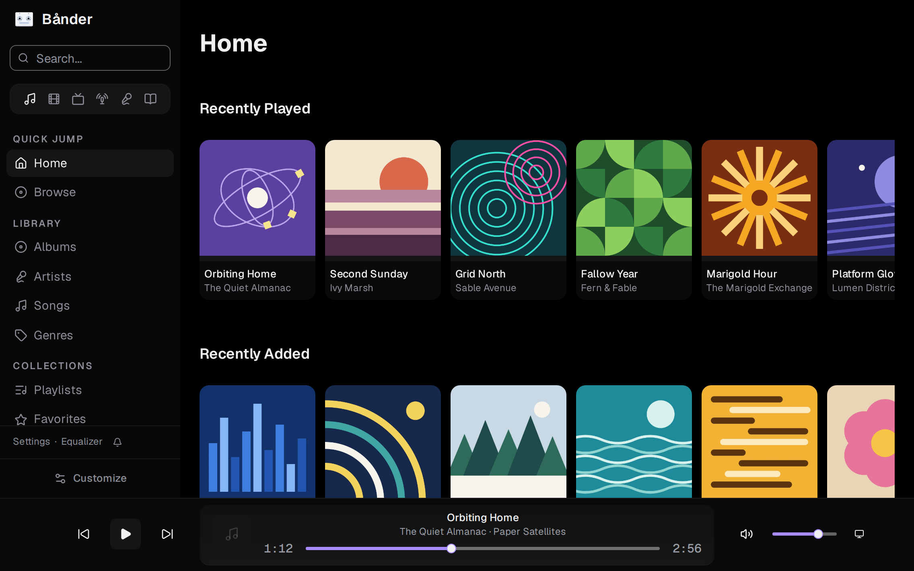

# Bånder

**A self-hosted media server for people who care how it looks, sounds, and runs.**

Somewhere in your collection is an album you haven't played in years. You spot
the cover, press play, and the opening track takes you right back.

Bånder turns your music and movie files into a personal library you can explore
and play in your web browser.

Open an artist, choose an album, and press play. The music keeps going while you
browse. Add another song to the queue, make a playlist for the evening, or settle
in with a film from your collection. Give someone their own account and share the
libraries you want them to enjoy.

You bring your own files and run Bånder on a computer you control. That's what
*self-hosted* means here: you run the software, and you decide who gets access to
your collection.

[Explore Bånder](https://baander.app/) · [Get started](#getting-started) ·
[How it works](#how-bånder-works) · [For developers](#for-developers)

*The music library in Bånder's web app.*

**Bånder is in pre-release.** Installation currently builds from source. The
[getting-started section](#getting-started) explains where to begin, and
[current status](#current-status) describes the project's verification limits.

## What you can do

### Explore and organize your collection

Browse your music by artist, album, song or genre. Open an album to see its tracks,
or return to something from your recent listening. Album covers can come from
artwork embedded in your files. Ctrl+K, or Cmd+K on a Mac, opens a search for
artists, albums and songs from any page.

Keep collections in separate libraries, each connected to a media directory.
Rescan a library when its files change. The
[library guide](docs-book/part-1-operator-guide/media/library-management.md) covers
supported formats, scanning and cover extraction.

### Listen in the web player

Keep listening while you explore the library, and return to the current track
without leaving the web app. Queue the next song, drag waiting songs into a
different order, or remove them. Shuffle and repeat let you change how the queue
plays.

Start with an equalizer preset, then shape the sound with graphic or parametric
controls. Adjust compression, stereo width or crossfeed, and save profiles for your
headphones and speakers. Capture two sets of settings as A and B to compare them.
The player also stores a crossfade preference; a web control for it is still missing.

The lyrics panel beside the queue displays lyrics fetched from LRCLIB. When they
are synced, it follows the current line and lets you jump to a line you select.
Internet radio has country browsing and starred stations.

### Build and share playlists

Choose songs for a playlist, open its page, and play it. Share it with other users
on your server and use collaborator permissions to let them contribute songs.
Playlist editing is still incomplete: the web app cannot yet remove or reorder
playlist songs, although you can do both in the playback queue.

The create form also offers smart-playlist rules. Those rules are currently stored
but not evaluated, so they do not select any music.

### Browse and play movies

Movies have their own catalog, detail pages and video player. Background workers
use FFmpeg to prepare video for streaming; the web server delivers the manifests
and media segments the player requests. Transcoding supports multiple quality tiers.
The available formats depend on the worker's encoders, the browser and the host's
resources.

For audio clients that need a different format, Bånder can transcode tracks to
Opus, AAC or MP3. Audio transcoding must be enabled explicitly. The
[transcoding guide](docs-book/part-1-operator-guide/media/transcoding.md) explains
both paths, quality settings and execution capacity.

### Move your music to another browser

Start listening in one browser, then transfer playback to another open browser
signed into the same account. The song, queue, position and playing or paused state
move with it. The [Session documentation](docs-book/part-2-developer-guide/contexts/session.md)
explains how Bånder coordinates those destinations.

Casting to AirPlay, Chromecast and DLNA receivers is planned and is not available
yet.

### Add metadata, artwork and lyrics

File tags give the library its starting point. Optional external services can add
more information: MusicBrainz matches albums, songs and artists, and a match can
add a front cover from the Cover Art Archive. Discogs supplies searches that select
it as the source; Last.fm supplies artist search and information. Neither Discogs
nor Last.fm participates in matching.

Provider configuration determines which sources are available.

Lyrics can be imported from `.lrc` files beside your tracks or fetched from
LRCLIB. The current player panel displays LRCLIB lyrics; imported local lyrics are
stored but do not yet reach that panel.

Automatic metadata synchronization and automatic lyrics fetching for newly indexed
music are both off by default. You can enable them or start jobs explicitly.
Enrichment makes requests to the configured services. See
[external APIs](docs-book/part-1-operator-guide/media/external-apis.md) for provider
setup and [new-music settings](docs-book/part-1-operator-guide/media/library-management.md#what-happens-to-new-music)
for what happens after a scan.

### Manage accounts and access

Give people separate accounts and access to selected libraries. Users have their
own settings and can manage registered devices and passkeys; operators manage
accounts and roles. Authentication supports passwords, passkeys and TOTP
two-factor authentication, although the web sign-in form currently has no passkey
control.

Notifications appear in the app, with email and administrator-managed webhooks
available when configured. Email needs mail-service settings. With VAPID keys,
the server can also send Web Push to clients that subscribe through its API; the
web app does not yet offer a way to subscribe.

The [user-management guide](docs-book/part-1-operator-guide/administration/user-management.md),
[notification guide](docs-book/part-1-operator-guide/administration/notifications.md)
and [security guide](docs-book/part-1-operator-guide/maintenance/security.md)
cover these controls and their configuration.

## How Bånder works

The journey from a folder of files to something you can press play on happens in
four stages:

1. **Connect a library.** Give a collection a name and point it at a media
   directory accessible to Bånder's web application and workers.
2. **Find the files.** A scan discovers media in that directory and queues work.
   A completed scan means discovery has finished; catalog ingestion may still be
   running.
3. **Build the catalog.** Background workers read tags and technical information
   and add the music or movies to the catalog. Configured enrichment jobs can add
   metadata, artwork and lyrics.
4. **Browse and play.** Open the library in your browser. Playback reads the
   original file or uses converted audio or video prepared by workers, according
   to the client and the deployment's capabilities.

Run another scan to pick up file changes. The `app:watch-files` command prints
filesystem events; it does not start scans or update the catalog.

### How an instance runs

The web application handles browsing and playback requests. A separate background
worker deployment handles ingestion, queued and scheduled jobs, notifications and
media encoding. PostgreSQL stores application data, while Redis supports queues
and caching. Health endpoints, job monitoring and console commands help you see
what is running and investigate failures.

Web and workers share media paths through named volumes. Source media and generated
output have different access requirements. A controller on the trusted Docker
host manages a pair of control and execution containers. Their work is bounded by
configured media slots; the containers have no CPU or memory limits. Size the host
for the whole deployment, including its workers and media jobs.

[Understanding Bånder](docs-book/part-1-operator-guide/getting-started/understanding-baander.md)
explains the components and the path from files to playback.
[Background Work](docs-book/part-1-operator-guide/workers/background-work.md)
explains the worker deployment and its lifecycle.

## Getting started

To host your own collection, begin with the
**[installation guide](docs-book/part-1-operator-guide/getting-started/installation.md)**.
It walks through building the frontend and images, preparing private configuration,
starting the deployment, creating your first administrator account and scanning
your first library.

You will need a Linux host with a rootful Docker daemon, cgroup v2, Docker Compose
and Buildx, plus Git, OpenSSL, PHP 8.5 with Swoole, and Composer for the host tooling.
Read [System Requirements](docs-book/part-1-operator-guide/getting-started/system-requirements.md)
before choosing hardware; the worker deployment and media jobs need capacity as
well as the web application.

The [deployment preset](deploy/preset/README.md) starts the gateway, web server,
PostgreSQL, connection pooler, Redis and background worker pair from one private
configuration, using the images you have built. The installation guide owns the
setup procedure and its verification checkpoints.

For configuration, monitoring, upgrades and recovery, keep the
[operator manual](docs-book/part-1-operator-guide/README.md) close by. If you want to
change the software, follow the development path below.

## For developers

This repository contains the server, web client, shared packages, deployment
tooling and documentation. The backend uses PHP, Symfony and Swoole; the web client
uses React and TypeScript. The HTTP API connects the interface to library
management, catalog queries, playback and account services.

| Start here | What you will find |
| --- | --- |
| [src/](src/) | Backend application code, organized by business capability |
| [ui/web/](ui/web/) | The React and TypeScript web client |
| [packages/](packages/) | Shared libraries, media components and tooling |
| [deploy/preset/](deploy/preset/) | The deployment preset and example configurations |
| [docs-book/](docs-book/) | Operator and developer manuals |
| [tests/](tests/) | Application and tooling tests |

Follow the [developer quick start](docs-book/part-2-developer-guide/getting-started/quick-start.md)
for host prerequisites, DNS, certificates and your first isolated worktree preview.
After that setup, `make preview-up` starts the current worktree's preview with its
own writable state, and `make preview-down` stops it.

The persistent `baander.test` development instance follows remote `master` and is
managed with `make dev-up`, `make dev-down` and `make dev-status`. The
[development environment guide](docs-book/part-2-developer-guide/getting-started/development-environment.md)
covers both workflows and their known blockers; host runtime qualification remains
pending.

Use the [developer guide](docs-book/part-2-developer-guide/README.md) for architecture
and API references, the [frontend guide](docs-book/part-2-developer-guide/development/frontend-development.md)
for web development, and the [testing guide](docs-book/part-2-developer-guide/testing/README.md)
for current runners and runtime checks. The
[CI guide](docs-book/part-2-developer-guide/contributing/continuous-integration.md)
explains how Forgejo and GitHub run the same workflows.

## Contributing

Contributions are welcome. A reproducible bug report, a clearer explanation in the
manual, or an improvement to a part of Bånder you use can be a useful place to start.

Read the [contribution instructions](docs-book/part-2-developer-guide/contributing/contributing.md)
for project conventions, checks and the contribution workflow. The developer guide
will help you find the part of the code that owns the behavior you want to change.

## Current status

Music and movies are the main browser workflows. Other media categories have
incomplete workflows and should not be assumed to have the same coverage.
[ROADMAP.md](ROADMAP.md) records remaining work and verification gaps.

The [installation guide's verification record](docs-book/part-1-operator-guide/getting-started/installation.md#verified)
describes one disposable deployment-preset installation, covering image builds,
startup, account and API sign-in setup, library ingestion and shutdown. It did not
check browser sign-in, playback, transcoding, mail, an HTTPS front proxy, an
IPv4-only edge network, a restart or an upgrade. The record identifies the tested
revision and a subsequent database-image change.

An earlier check of the development Compose stack verified frontend loading,
administrator login, worker startup and a sample music scan through ingestion and
browser catalog display. The scanned track played to completion as original FLAC
and transcoded Opus; byte-range requests also passed. The
[roadmap checkpoint](ROADMAP.md#source-installation-documentation) records that
run's environment adaptations and limits. These are separate checks of different
installation paths.

## License

Baander's first-party code is licensed under [Apache-2.0](LICENSE.md), with
[package-specific exceptions and third-party notices](THIRD_PARTY.md).
Copyright (C) 2025–2026 Martin Juul Christiansen and contributors.
