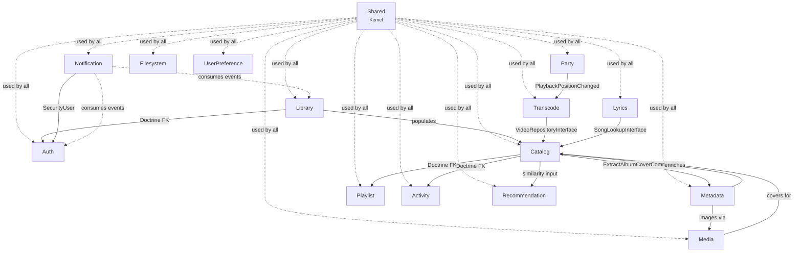
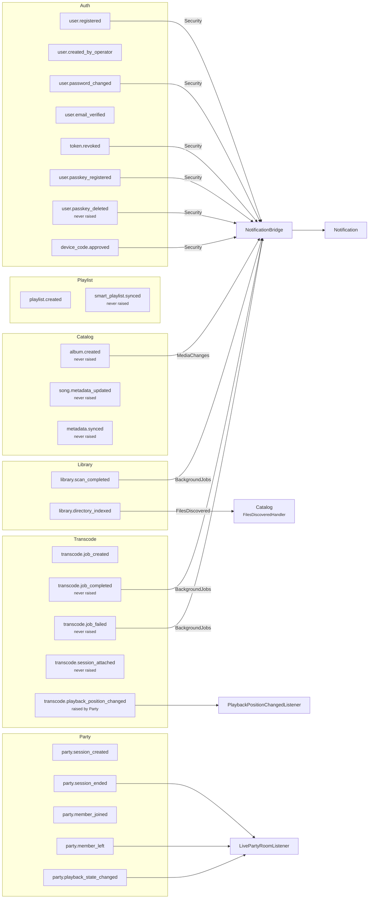
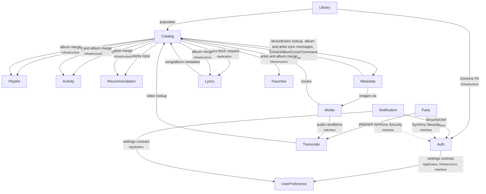
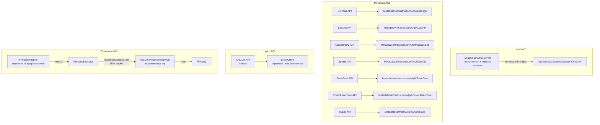

<!-- Generated by /documentation-maintainer on 2026-05-10 -->
<!-- Do not edit the generated sections above the hand-written notes line -->

# Bounded Context Map

This document describes 14 of Baander's bounded contexts, their relationships, communication patterns, and shared infrastructure.

## Context Overview

---

## Context Catalog

### Auth

| Attribute | Detail |
|-----------|--------|
| **Responsibility** | User identity, first-party login (password, passkey, TOTP), OAuth 2.0 authorization server (authorization code with PKCE, device authorization, refresh, personal access clients, administrator client registration), DPoP-bound token issuance and refresh, access token validation |
| **Namespace** | `App\Auth` |
| **Aggregates** | `User` |
| **Repositories** | `UserRepositoryInterface` |
| **Ports** | `UserPortInterface`, `AuthenticatedUserIdentityInterface`, `PasswordHasherInterface`, `JwtGeneratorInterface`, `TotpVerifierInterface`, `DpopJtiCacheInterface`, `PasskeyVerifierInterface`, `PasswordResetTokenRepositoryInterface`, `EmailVerificationTokenRepositoryInterface`, `OAuthSecretBundleInterface`, `OAuthTokenInvalidatorInterface` |
| **Events** | `UserRegistered`, `UserCreatedByOperator`, `EmailVerified`, `PasswordChanged`, `TokenRevoked`, `DeviceCodeApproved`, `PasskeyRegistered`, `PasskeyDeleted` |
| **Tech** | Own OAuth 2.0 authorization server (RFC 6749, 7636, 8628, 8414, 9207), League OAuth2 Server resource server (anti-corruption layer), WebAuthn (web-auth/webauthn-lib), OTPHP (TOTP), Redis (DPoP JTI cache and nonces, WebSocket tickets, rate limiters) |

### Catalog

| Attribute | Detail |
|-----------|--------|
| **Responsibility** | Core media catalog: artists, albums, songs, movies, videos, genres. The central read-model for the media library. |
| **Namespace** | `App\Catalog` |
| **Aggregates** | `Song`, `Album`, `Artist`, `Genre`, `Movie`, `Video` |
| **Repositories** | `SongRepositoryInterface`, `AlbumRepositoryInterface`, `ArtistRepositoryInterface`, `MovieRepositoryInterface` (all Searchable), `GenreRepositoryInterface`, `VideoRepositoryInterface` |
| **Ports** | `SongPortInterface`, `AlbumPortInterface`, `ArtistPortInterface`, `GenrePortInterface`, `MoviePortInterface` |
| **Events** | `AlbumCreated`, `SongMetadataUpdated`, `MetadataSynced` (defined; no code raises them) |
| **Tech** | PGroonga full-text search (song, album, artist and movie repositories), Doctrine ORM |

### Library

| Attribute | Detail |
|-----------|--------|
| **Responsibility** | Media library definition and file-system scanning. Owns the concept of a "library" (a watched directory on disk) and orchestrates scans that discover media files and feed them into Catalog. |
| **Namespace** | `App\Library` |
| **Aggregates** | `Library` |
| **Repositories** | `LibraryRepositoryInterface` |
| **Ports** | `LibraryPortInterface`, `DirectoryScannerPortInterface`, `LibraryMembershipQueryPort` |
| **Events** | `LibraryDirectoryIndexed`, `LibraryScanCompleted` |
| **Value Objects** | `LibraryPath`, `LibrarySlug`, `LibraryType` |
| **Tech** | File-system scanning, Redis `async` transport for queued scans, transactional outbox for discovered files |

### Media

| Attribute | Detail |
|-----------|--------|
| **Responsibility** | Media file storage, streaming, and image handling. Provides the abstraction layer for reading/writing media files and serving audio streams and images. |
| **Namespace** | `App\Media` |
| **Aggregates** | `Image` |
| **Repositories** | `ImageRepositoryInterface` |
| **Ports** | `StreamPortInterface`, `StoragePortInterface`, `ImagePortInterface` |
| **Events** | None |
| **Tech** | Flysystem for file storage, BlurHash image hashing, image conversion |

### Metadata

| Attribute | Detail |
|-----------|--------|
| **Responsibility** | External metadata enrichment. Reads embedded tags from audio files, matches them against external APIs (Discogs, Last.fm, MusicBrainz, Spotify, TasteDive), and synchronizes results back to Catalog. |
| **Namespace** | `App\Metadata` |
| **Aggregates** | None -- operates on Catalog aggregates through Catalog ports |
| **Ports** | `MetadataAdminPortInterface`, `MediaFileMetadataInterface`, `MusicBrainzLookupInterface` (published contract) |
| **Events** | None -- handles commands and messages from Catalog and its admin sync, publishes no events |
| **Value Objects** | `ExtractedMetadata`, `CoverArt`, `MatchQuality`, `MetadataMatch` |
| **Tech** | HTTP clients for Discogs, Last.fm, MusicBrainz, Spotify, TasteDive. Custom ID3/Vorbis/FLAC parsers. Matching strategies with validators. |

### Playlist

| Attribute | Detail |
|-----------|--------|
| **Responsibility** | User playlist management. Supports manual playlists (add/remove/reorder songs). A playlist created as smart stores its `smartRules`, but no code evaluates them or fills the playlist. |
| **Namespace** | `App\Playlist` |
| **Aggregates** | `Playlist` |
| **Repositories** | `PlaylistRepositoryInterface` |
| **Ports** | `PlaylistPortInterface` |
| **Events** | `PlaylistCreated`; `SmartPlaylistSynced` is defined but no code raises it |
| **Value Objects** | `PlaylistSong` |

### Recommendation

| Attribute | Detail |
|-----------|--------|
| **Responsibility** | Music recommendation engine. Computes recommendations using collaborative filtering, content similarity, genre similarity, and database relation analysis. |
| **Namespace** | `App\Recommendation` |
| **Aggregates** | `Recommendation` |
| **Repositories** | `RecommendationRepositoryInterface` |
| **Ports** | `RecommendationJobPortInterface`, `RecommendationInsightsPortInterface`, `RecommendationPublicIdentityInterface`, `ArtistRecommendationMergePortInterface` (published contract) |
| **Events** | None |
| **Domain Services** | `CollaborativeFilteringCalculator`, `ContentSimilarityCalculator`, `DatabaseRelationCalculator`, `GenreSimilarityCalculator` |
| **Value Objects** | `RecommendationType` |

### Activity

| Attribute | Detail |
|-----------|--------|
| **Responsibility** | User activity tracking. Records play events and love/favorite toggles on songs. Feeds data into Recommendation. |
| **Namespace** | `App\Activity` |
| **Aggregates** | `MediaActivity` |
| **Repositories** | `MediaActivityRepositoryInterface` |
| **Ports** | `ActivityPortInterface` |
| **Events** | None |

### Notification

| Attribute | Detail |
|-----------|--------|
| **Responsibility** | Multi-channel notification delivery. Receives the mapped domain events that the outbox replays to `NotificationBridgeSubscriber`, resolves them to notification categories, and dispatches through email, push (Web Push/VAPID), or webhooks (Slack, Discord). Manages per-user notification preferences. |
| **Namespace** | `App\Notification` |
| **Aggregates** | `Notification`, `NotificationPreference` |
| **Repositories** | `NotificationRepositoryInterface`, `NotificationPreferenceRepositoryInterface` |
| **Ports** | `WebhookRepositoryInterface`, `WebhookSecretPortInterface`, `WebhookDestinationPortInterface`, `PushSubscriptionRegistrationPortInterface`, `PushSubscriptionRemovalPortInterface` |
| **Events** | `NotificationEvent` (defined; no code raises it) |
| **Value Objects** | `NotificationCategory`, `NotificationChannel` |
| **Tech** | Web Push (VAPID), HMAC-signed webhooks, `live.changed` WebSocket hints after which the client rereads over HTTP, Discord and Slack webhook adapters |

### Transcode

| Attribute | Detail |
|-----------|--------|
| **Responsibility** | On-demand media transcoding. Manages transcode jobs and sessions, generates HLS v6 and DASH manifests, encodes segments via FFmpeg, and serves adaptive bitrate streams with quality tiers and audio profiles. |
| **Namespace** | `App\Transcode` |
| **Aggregates** | `TranscodeJob`, `TranscodeSession` |
| **Repositories** | `TranscodeJobRepositoryInterface`, `TranscodeSessionRepositoryInterface` |
| **Ports** | `TranscodeJobPortInterface`, `TranscodeSessionPortInterface`, `TranscodeStreamingPortInterface`, `SegmentCachePortInterface`, `TranscodeStoragePortInterface`, `FFmpegPortInterface` |
| **Events** | `TranscodeJobCreated`, `PlaybackPositionChanged` (raised by Party); `TranscodeJobCompleted`, `TranscodeJobFailed` and `TranscodeSessionAttached` are defined but no code raises them |
| **Value Objects** | `AudioProfile`, `LoudnessStandard`, `QualityTier`, `SessionPriority`, `SessionState`, `TranscodeStatus`, `VideoProbeResult` |
| **Domain Services** | `AudioProcessingRules`, `QualityLadder` |
| **Tech** | FFmpeg (run by the execution unit's native daemon in the worker deployment pair), HLS fMP4 segment writer, DASH manifest generator, in-memory segment cache |

### Party

| Attribute | Detail |
|-----------|--------|
| **Responsibility** | Synchronized watch-party playback. Manages party sessions with hosts and members, coordinates playback actions via WebSocket with wall-clock synchronization and jitter compensation. |
| **Namespace** | `App\Party` |
| **Aggregates** | `SyncedPartySession`, `PartyMember`, `PartyInvitation` |
| **Repositories** | `SyncedPartySessionRepositoryInterface`, `PartyMemberRepositoryInterface`, `PartyInvitationRepositoryInterface` |
| **Ports** | `PartySessionPortInterface`, `PartyMemberPortInterface`, `PartyInvitationPortInterface` |
| **Events** | `PartySessionCreated`, `PartySessionEnded`, `MemberJoined`, `MemberLeft`, `PlaybackStateChanged` |
| **Value Objects** | `MemberRole`, `PlaybackAction`, `PlaybackState` |
| **Tech** | WebSocket (Swoole), party rooms in the shared-memory tables of `WebSocketConnectionRegistry` broadcast through `WebSocketPusher`, `PlaybackSynchronizer` for wall-clock sync |

### UserPreference

| Attribute | Detail |
|-----------|--------|
| **Responsibility** | Per-user UI and playback preferences and the per-user settings store. Manages accent color, sidebar configuration, audio/layout/player preferences (versioned with history and rollback), EQ device profiles, theme mood, and user settings such as the email language. |
| **Namespace** | `App\UserPreference` |
| **Aggregates** | `SidebarConfig` |
| **Repositories** | Doctrine repository per preference entity |
| **Ports** | `AccentColorPortInterface`, `SidebarConfigPortInterface`, `AudioPreferencesPortInterface`, `LayoutPreferencesPortInterface`, `PlayerPreferencesPortInterface`, `PreferenceWriterPortInterface`, `EqDeviceProfilePortInterface`, `ThemeMoodPortInterface`, `UserSettingStoreInterface`, `UserSettingsContractInterface` (published contract) |
| **Events** | None |
| **Value Objects** | `SidebarItem`, `SidebarItemType` |

### Filesystem

| Attribute | Detail |
|-----------|--------|
| **Responsibility** | Low-level file operations: MIME type detection and inotify-based file watching. A utility context without the full four-layer structure. |
| **Namespace** | `App\Filesystem` |
| **Aggregates** | None |
| **Ports** | `MimeDetectorPortInterface` |
| **Events** | None |
| **Tech** | inotify file watcher, custom MIME detection |

### Lyrics

| Attribute | Detail |
|-----------|--------|
| **Responsibility** | Song lyrics storage and retrieval. Integrates with LRCLIB API to fetch plain and synced/timed lyrics (LRC format). The model accepts the sources embedded tags, LRCLIB, Musixmatch and Genius, but only LRCLIB fetches store lyrics. |
| **Namespace** | `App\Lyrics` |
| **Aggregates** | `Lyrics` (state object) |
| **Repositories** | `LyricsRepositoryInterface` |
| **Ports** | `LyricsPortInterface`, `LyricsAdminPortInterface`, `LrclibClientInterface`, `LyricsFetchRequestInterface` (published contract) |
| **Commands** | `FetchLyricsCommand`, `BulkFetchLyricsCommand` |
| **Events** | None |
| **Tech** | LRCLIB API (anti-corruption layer via `LrclibClient`), Symfony HttpClient |

---

## Shared Kernel (`src/Shared/`)

The Shared kernel provides cross-cutting primitives used by every context. Deptrac allows Shared imports by layer: a Domain layer may import only Shared Domain, and an Application layer only Shared Domain and Shared Application. Importing from another bounded context requires justification.

### Domain Layer

| Component | Purpose |
|-----------|---------|
| `Uuid` | UUID v7 primary keys (internal identity) |
| `PublicId` | Nanoid-based 21-char external identifiers |
| `Email` | Typed email value object |
| `Cursor`, `CursorDirection`, `CursorPage` | Cursor-based pagination types |
| `SearchOptions`, `SearchResult` | Search abstractions for PGroonga |
| `JobStatus` | Async job status enum |
| `AbstractDomainEvent` | Base class for all domain events |
| `DomainEventInterface` | Event contract (`occurredAt()`, `eventName()`) |
| `Searchable` | Interface for repositories supporting full-text search |

### Application Layer

| Component | Purpose |
|-----------|---------|
| `CancellableJobInterface` | Contract for jobs that support cancellation |
| `JobCancelledException` | Signal for cancelled jobs |
| `SettingDefinitionProviderInterface`, `SettingDefinitionRegistry` | Setting definitions contributed by each context, collected by container tag |
| `SettingValueParser` | The only path from CLI or JSON input to a typed setting value |
| `SystemSettings` / `SystemSettingsPortInterface` | Effective values of server-wide settings, read fresh through DBAL |

### Infrastructure Layer

| Component | Purpose |
|-----------|---------|
| `Doctrine/` | Custom types (`UuidType`, `PublicIdType`, `CitextType`, `JobStatusType`), `GeneratePublicIdListener`, `PgroongaSearchTrait` |
| `Messenger/` | `JobIdStamp`, `JobMonitoringMiddleware`, `JobMonitorService`, `ResultStampMiddleware` with `PartyMemberResultStamp`, `PublicIdNormalizer`, `UuidNormalizer`, `ValidatedSendersLocator`, `OrdinaryAdmissionTransport` (wraps the Redis `async` transport) |
| `Swoole/` | `Async::sleep()` (coroutine-aware), `CpuProcessPool` (excluded from the container; nothing uses it), `WebSocketConnectionRegistry`, `WebSocketPusher` |
| `Cache/` | `CacheTags` for Redis tag-aware invalidation |
| `Redis/` | `RedisClientFactory` |
| `LiveUpdates/` | `LiveUpdateRuntime`, `LiveFrameSender` for `live.*` change hints over the WebSocket |
| `Security/` | `WsTicketAuthenticator` (redeems single-use WebSocket tickets) |
| `Logging/` | `BoundedContextProcessor`, `CorrelationIdProcessor` |
| `Health/` | `HealthCheckService`, `HealthCheckResult` |
| `Event/` | `OutboxEventDispatcher` and `NotificationReplayDispatcher` (replay outbox events to the notification listeners), `NotificationDeliveryBus` (stores notification delivery intents), `RelayOutboxWorkerCommand` (`app:outbox:consume`) |
| `Pagination/` | `CursorPaginator`, `CursorCodec`, `CursorResult` |

### Interface Layer

| Component | Purpose |
|-----------|---------|
| `Controller/` | Shared controllers (SPA, health, WebSocket, job monitor, metrics, config) |
| `DTO/` | `ApiError`, `OAuthError`, `ValidationError`, `PaginatedResponse`, `CursorPaginatedResponse` |
| `Resource/` | `AbstractResource` -- base for API response transformation |
| `Console/` | `HealthCheckCommand`, `ConfigValidateCommand`, `app:settings:list`, `get`, `set` and `reset` |
| Traits | `ApiResponsesTrait`, `TranslatorTrait` |

---

## Event Flow Map

Domain events are the primary integration mechanism between contexts. In-process listeners hear an event when it is dispatched. `OutboxSubscriber` also stores each event in `domain_event_outbox`, and `app:outbox:consume` replays the stored events to `NotificationBridgeSubscriber` in Notification Infrastructure, which listens only to the mapped event classes and turns each into a `CreateNotificationCommand`.

### Events Published by Context

Unconnected events (raised, but no consumer): `user.created_by_operator`, `user.email_verified`, `party.session_created`, `party.member_joined`, `playlist.created`, `transcode.job_created`.

Defined but never raised: `user.passkey_deleted`, `album.created`, `song.metadata_updated`, `metadata.synced`, `smart_playlist.synced`, `transcode.job_completed`, `transcode.job_failed`, `transcode.session_attached`. The edges from `user.passkey_deleted`, `album.created`, `transcode.job_completed` and `transcode.job_failed` show only the resolver's mapping.

### Event Notification Categories

The `EventCategoryResolver` maps events to categories that determine how and whether users are notified:

| Category | Events |
|----------|--------|
| **Security** | `UserRegistered`, `PasswordChanged`, `PasskeyRegistered`, `PasskeyDeleted`, `TokenRevoked`, `DeviceCodeApproved` |
| **BackgroundJobs** | `LibraryScanCompleted`, `TranscodeJobCompleted`, `TranscodeJobFailed` |
| **MediaChanges** | `AlbumCreated` |

---

## Upstream / Downstream Relationships

### Library -> Auth (Infrastructure layer)

- **What:** `UserLibraryAccessEntity` keeps the user as a plain `user_id` UUID column; `LibraryForeignKeys` declares the `fk_user_library_access_user_id` foreign key from `user_library_access.user_id` to `users`
- **Why:** The `user_library_access` join table needs a foreign key to the users table. Data-level dependency only, not domain-level.

### Catalog -> Metadata: cover extraction (Application layer)

- **What:** Library imports no Metadata class. Catalog's `FilesDiscoveredHandler` dispatches `Metadata\Application\Command\ExtractAlbumCoverCommand` for each album an import touched that has no cover, and `BatchExtractCoversHandler` dispatches it for albums missing art
- **Why:** Catalog creates the albums, so it requests cover art extraction from Metadata. Coupling is through an async command DTO, keeping it loose.

### Catalog -> Library (Application layer)

- **What:** `ScanLibraryHandler` records each directory it indexes as `LibraryDirectoryIndexed` in the transactional outbox. `LibraryDirectoryOutboxEventDispatcher` relays it as Library's `FilesDiscovered` message on the `async` transport, and Catalog's `FilesDiscoveredHandler` creates the catalog entries. Library imports no Catalog class; Catalog depends on the `Library Files Discovered Contract` Deptrac layer.
- **Why:** Library scans discover media files and Catalog owns the entities. The outbox records the event in the transaction that commits the index rows.

### Lyrics -> Catalog (Application + Interface layer)

- **What:** Lyrics uses Catalog's `SongLookupInterface` contract. `FetchLyricsHandler` calls `findLyricSignature()`, which returns a `SongLyricSignature` (title, artist name, album title, duration). `BulkFetchLyricsHandler` walks song IDs with `songIdsAfter()` and reads their signatures with `findLyricSignatures()`, and `LyricsController` and `LyricsSongResolver` resolve a visible song with `findVisibleSongId()`.
- **Why:** LRCLIB requires track name, artist name, album name, and duration to find matching lyrics. Catalog resolves them from its song and album data and passes only the signature across the boundary.

### Notification -> Auth (Infrastructure layer)

- **What:** `Notification\Infrastructure\Security\NotificationVoter` uses `Auth\Infrastructure\Security\SecurityUser` for authorization decisions
- **Why:** The voter checks that the authenticated user owns a notification. No controller calls it; `NotificationController` checks ownership itself.

### Notification -> Auth (Domain layer)

- **What:** `Notification\Domain\Service\EventCategoryResolver` maps `Auth\Domain\Event\OAuth\DeviceCodeApproved` to the Security category. Deptrac allows this through the `Auth Device Approval Event Contract` layer, which contains only that event class; the other Auth events the resolver maps are entries in `deptrac.baseline.yaml`.
- **Why:** Approving a device request gives a device a token pair, so the user is notified. The narrow layer keeps the rest of Auth Domain out of Notification's reach.

### Catalog -> Metadata (Application layer)

- **What:** Catalog's MusicBrainz matching searches and looks up releases, recordings and artists, and fetches front covers, through `Metadata\Application\Port\MusicBrainzLookupInterface` and its DTOs in `Metadata\Application\DTO\MusicBrainz\`, which form the `Metadata MusicBrainz Lookup Contract` Deptrac layer. `Catalog\Application\MessageHandler\RequestAlbumMatchHandler` handles Metadata's `SyncAlbumMessage`, which the library and genre syncs dispatch for each album, by requesting the album's match in Catalog's album match queue; the queue reads `metadata.auto_sync` by the constant of `MetadataSettingDefinitions`. `Catalog\Application\MessageHandler\QueueArtistSyncsHandler` handles Metadata's `SyncArtistsMessage`, which the admin sync dispatches, by queuing a `SyncArtistMessage` for every artist with a MusicBrainz ID and missing details, and `Catalog\Application\MessageHandler\SyncArtistHandler` handles each `SyncArtistMessage` by filling the artist from MusicBrainz by that ID; an album or song match apply and an import queue the same message from Catalog. `SyncAlbumMessage`, `SyncArtistsMessage`, `SyncArtistMessage` and `MetadataSettingDefinitions` form the `Metadata Sync Contract` layer. Ingest requests automatic matches through Catalog's own `AlbumMatchRequestInterface`, without Metadata.
- **Why:** Every write a match or an artist sync makes is a Catalog write, so Catalog owns matching and the artist sync, and Metadata keeps the MusicBrainz client. The narrow layers keep the rest of Metadata out of Catalog's reach, and the admin syncs keep their messages while Catalog decides what an album or artist sync does.

### Catalog -> Favorites, Activity, Recommendation (Infrastructure layer)

- **What:** `Catalog\Infrastructure\ArtistMergeService` moves a merged artist's favorites, play history and artist recommendations to the artist it merges into, and deletes a removed artist's favorites and recommendations, through `ArtistFavoriteMergePortInterface`, `ArtistActivityMergePortInterface` and `ArtistRecommendationMergePortInterface`. The ports form the `Favorites Artist Merge Contract`, `Activity Artist Merge Contract` and `Recommendation Artist Merge Contract` Deptrac layers, and each runs as statements inside the caller's transaction.
- **Why:** A MusicBrainz match merges artists that turn out to be one performer, so that their favorites and plays follow the surviving artist. Each context writes its own tables; Catalog only orders the steps.

### Catalog -> Playlist, Lyrics, Activity, Favorites (Infrastructure layer)

- **What:** `Catalog\Infrastructure\AlbumMergeService` folds each duplicate song a merge removes into the song the target keeps of the same file, through `AlbumPlaylistMergePortInterface`, `AlbumLyricsMergePortInterface`, `AlbumActivityMergePortInterface` and `AlbumFavoriteMergePortInterface`, and moves the merged album's plays and favorites to the target through the last two. The ports form the `Playlist Album Merge Contract`, `Lyrics Album Merge Contract`, `Activity Album Merge Contract` and `Favorites Album Merge Contract` Deptrac layers, and each runs as statements inside the merge's transaction.
- **Why:** Playlist entries, lyrics, plays and favorites are what users stored on a song or album, and the merge must not lose them when it deletes a duplicate or the source album. Each context writes its own tables; Catalog only orders the steps and holds the song rows while they run.

### Catalog -> Lyrics (Application layer)

- **What:** `Catalog\Application\CommandHandler\FilesDiscoveredHandler` calls `Lyrics\Application\Port\LyricsFetchRequestInterface::requestFetch()` for the new songs without a sidecar `.lrc` file, after each flush that commits them. The Lyrics implementation queues a `FetchLyricsCommand` on the `async` transport per song while `lyrics.auto_fetch` is on. Deptrac allows this through the `Lyrics Fetch Request Contract` layer, which contains only that interface.
- **Why:** New songs get lyrics without a bulk fetch, and requesting after the commit means the fetch finds the song.

### Auth -> UserPreference (Application, Infrastructure and Interface layers)

- **What:** `RegisterUserHandler` seeds the email language from `Accept-Language`, `AfterResponseMailer` resolves it for password reset and verification emails, and `AdminUserSettings` (behind `AdminUserSettingsController` and `app:user:setting`) reads, sets and resets a user's settings. All go through `UserPreference\Application\Port\UserSettingsContractInterface` and its DTO `UserSettingView`, which form the `UserPreference Settings Contract` Deptrac layer.
- **Why:** The email language is a user setting owned by UserPreference, but Auth sends the credential emails and owns the admin user endpoints. Dispatching UserPreference commands from Auth would reach into its Application layer; the narrow contract keeps the rest of UserPreference out of reach.

### Notification -> UserPreference (Application layer)

- **What:** `SendEmailHandler` calls `UserSettingsContractInterface::resolveLanguage()` for each recipient when the worker sends a notification email.
- **Why:** The email is written in the recipient's language as it stands when it is sent, through the same `UserPreference Settings Contract` layer.

### Media -> Transcode (Interface layer)

- **What:** `Media\Interface\Controller\StreamController` transcodes a track through `Transcode\Application\Port\AudioRenditionPortInterface` and reads `transcode.enabled` and `transcode.max_bitrate` by the constants of `TranscodeSettingDefinitions`. Deptrac allows this through the `Transcode Audio Rendition Contract` layer: the port, `AudioRendition`, `AudioRenditionFormat`, `AudioRenditionFailedException`, `AudioRenditionBusyException` and the settings class.
- **Why:** Media owns the track stream and its access checks; Transcode owns FFmpeg execution and the transcode cache.

### Metadata -> Catalog, Media (Application layer)

- **What:** Metadata enrichers and sync handlers use Catalog ports to update domain models, and `ExtractAlbumCoverHandler` uses Media ports for image storage
- **Why:** After external API enrichment, results must be written back to the catalog and cover art stored.

### Party -> Transcode (Application layer)

- **What:** Party's start, pause and seek handlers raise Transcode's `PlaybackPositionChanged` domain event when the party has a transcode job; Transcode's `PlaybackPositionChangedListener` turns it into an `UpdateTranscodePositionCommand` for the job's session
- **Why:** The transcode of a party's video follows the host's playback position.

### Transcode -> Catalog (Infrastructure layer)

- **What:** `TranscodeSessionSubscriber` uses `VideoRepositoryInterface`
- **Why:** Transcode sessions need to look up video metadata from the catalog.

### All Contexts -> Shared (Shared kernel)

- **What:** `Uuid`, `PublicId`, `Email`, `AbstractDomainEvent`, `DomainEventInterface`, `Searchable`, `Cursor*`, `SearchOptions`, `SearchResult`, `JobStatus`
- **Why:** These are the agreed-upon primitives of the system. Every context uses UUID v7 for identity, PublicId for external-facing IDs, and the same pagination/search abstractions.

### Implicit: Party, Notification -> Auth (via Symfony Security)

- **What:** Controllers use Symfony's `Security` to resolve the current user, which returns `Auth\Infrastructure\Security\SecurityUser`
- **Why:** These contexts create resources owned by authenticated users. This controller dependency is in the Interface layer; Notification also depends on Auth in its Domain, Application and Infrastructure layers.

---

## Anti-Corruption Layers

### OAuth 2.0 Resource Server (Auth Context)

Auth uses the League OAuth2 Server library only for its `ResourceServer`, which validates access tokens; Auth issues tokens itself, at login and refresh and through its own authorization server endpoints under `/api/oauth/`. `config/services.yaml` aliases League's access token and refresh token repository interfaces to the adapters in `Auth\Infrastructure\Adapter\OAuth`. The adapters translate between League's data structures and Baander's domain models, preventing the external library's concepts from leaking into the domain layer.

### External API Adapters (Metadata Context)

The Metadata context wraps seven external services behind internal adapters. Each adapter translates external API responses into domain-level DTOs before they enter the matching pipeline.

| External Service | Location |
|-----------------|----------|
| Discogs | `Metadata\Infrastructure\Api\Discogs\` |
| Last.fm | `Metadata\Infrastructure\Api\LastFm\` |
| MusicBrainz | `Metadata\Infrastructure\Api\MusicBrainz\` |
| Spotify | `Metadata\Infrastructure\Api\Spotify\` |
| TasteDive | `Metadata\Infrastructure\Api\TasteDive\` |
| CoverArtArchive | `Metadata\Infrastructure\Api\CoverArtArchive\` |
| TMDB | `Metadata\Infrastructure\Api\Tmdb\` |

### LRCLIB API (Lyrics Context)

The LRCLIB lyrics database API is isolated behind `LrclibClientInterface`. The `LrclibClient` adapter uses Symfony HttpClient to communicate with LRCLIB endpoints (`/api/get`, `/api/search`, `/api/get/{id}`). A fetch sends one request, to `/api/get`. Every request first takes a turn under the `lrclib` rate limiter that all processes share, and waits out a pause LRCLIB asked for. No authentication required.

### FFmpeg (Transcode Context)

FFmpeg is isolated behind `FFmpegPortInterface`. `ProcessExecutor` sends each FFmpeg command through the native execution client, and the session encoder starts through `NativeProcessSpawner` on the same client, so inside the worker deployment pair FFmpeg runs only in the execution unit's native daemon (`bin/worker-native.php`). The web server starts no encoder. `ProcessExecutor` runs a command locally with `proc_open()` only in standalone tools.

---

## Communication Patterns

```mermaid
graph TD
    subgraph "Pattern 1: Domain Event"
        E1["Publisher Context"] -->|"EventDispatcher::dispatch()"| E2["OutboxSubscriber<br/>domain_event_outbox"]
        E2 -->|"app:outbox:consume replay"| E4["NotificationBridgeSubscriber"]
        E4 -->|"CreateNotificationCommand"| E3["Notification Context"]
    end

    subgraph "Pattern 2: Messenger Command"
        M1["Publisher Context"] -->|"MessageBus::dispatch()"| M2["Handler in another context"]
    end

    subgraph "Pattern 3: Port Interface"
        P1["Controller"] -->|"injects Port"| P2["Infrastructure Implementation"]
    end

    subgraph "Pattern 4: WebSocket"
        W1["Swoole WS Server"] -->|"WebSocketPusher<br/>LiveFrameSender"| W2["Connected Clients"]
    end
```

### Pattern 1: Domain Event (In-Process Dispatch and Outbox Replay)

- **Publisher:** Any context dispatches via `EventDispatcherInterface::dispatch()`; in-process listeners such as `LivePartyRoomListener` run at once
- **Consumer:** `OutboxSubscriber` stores the event in `domain_event_outbox`; `app:outbox:consume` replays it, and `NotificationBridgeSubscriber` creates a notification when the event has a category mapping
- **Use when:** Broadcasting that something happened in the domain

### Pattern 2: Messenger Command (Asynchronous)

- **Publisher:** Any context dispatches via `MessageBusInterface::dispatch()`
- **Consumer:** Handler in another context with `#[AsMessageHandler]`
- **Use when:** Requesting another context to perform an action (e.g., Catalog asking Metadata to extract covers)

### Pattern 3: Port Interface (Synchronous, In-Process)

- **Consumer:** Controller injects `Application/Port/<PortInterface>`
- **Provider:** Infrastructure service implements the port interface
- **Use when:** The Interface layer needs to invoke Application/Domain logic without depending on infrastructure

### Pattern 4: WebSocket (Real-Time)

- **Server:** `Swoole\WebSocket\Server` at `/api/ws`, managed by Shared infrastructure; no SSE endpoint remains
- **Push:** `WebSocketPusher` in Shared for replies and party room broadcasts; `LiveFrameSender` for `live.*` change hints
- **Consumers:** Party (real-time playback sync and member events), Session (`session.snapshot` pushes), Transcode (`transcode.position` reports from clients), and views such as notifications and admin pages, which reread over HTTP after a `live.changed` hint
- **Use when:** Pushing real-time updates to connected clients

---

## Context Maturity Notes

| Context | Layer Completeness | Aggregate Pattern | Notes |
|---------|-------------------|------------------|-------|
| Auth | Full 4-layer + features | State object | Most mature. Own OAuth authorization server; League resource-server ACL. 8 domain events. |
| Catalog | Full 4-layer | State objects | Core domain. PGroonga search on the song, album, artist and movie repositories. 6 aggregates. |
| Library | Full 4-layer | State object | Orchestrates scanning pipeline. Hands discovered files to Catalog as `FilesDiscovered` messages; imports only Auth ports from other contexts. |
| Media | Full 4-layer | State object | Storage/streaming abstraction. |
| Metadata | Full 4-layer (value objects only in Domain) | No aggregates | Operates on Catalog data. Admin port and the published MusicBrainz lookup and sync contracts. 7 external APIs. |
| Playlist | Full 4-layer | No state object | Manual playlists; smart playlists store rules that nothing evaluates. |
| Recommendation | Full 4-layer | Old positional-arg pattern | Has CQRS queries. Candidate for state-object migration. |
| Activity | Full 4-layer | No state object | Simple record/play model. |
| Notification | Full 4-layer | No state object | Event-driven consumer. Multi-channel delivery. |
| Transcode | Full 4-layer | State objects | Heaviest infrastructure. FFmpeg runs in the worker deployment pair's execution unit. |
| Party | Full 4-layer | State objects | WebSocket-driven. Real-time sync. 11 CQRS handlers. |
| UserPreference | Full 4-layer | State object | Simple CRUD context for the preference subsystems. User settings are written through two command handlers and published to Auth and Notification through a narrow contract. |
| Filesystem | Partial (no 4-layer) | None | Utility: MIME detection + file watcher. |
| Lyrics | Full 4-layer | State object | LRCLIB integration with cached-first strategy. REST API + console commands. Anti-corruption layer for LRCLIB. |

---

<!-- Everything below this line is hand-written. Edit freely. -->

## Notes
