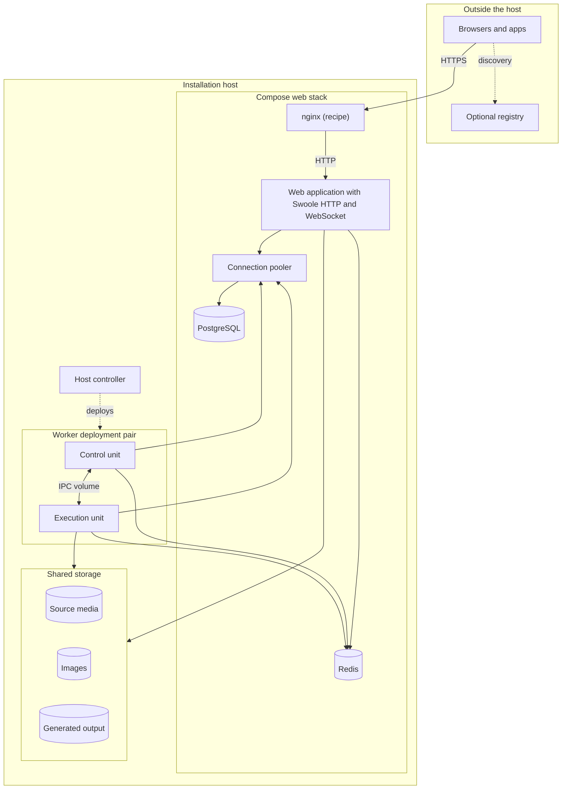

# Deployment Topology

When a scan stalls or a page stops answering, the first question is which
container to look at. A Baander installation spreads over a Compose web stack,
a worker deployment pair that Compose does not start, shared storage, and two
stores with different durability. The diagram below shows where each piece
runs, and the table after it says what each store holds.

## The browser path

A browser or app connects to nginx, which terminates HTTPS and forwards the
request over HTTP to the `app` service. That service runs the web application
on its Swoole server, which answers HTTP requests and holds the WebSocket
connections for real-time updates. The diagram labels the proxy "nginx
(recipe)" because the source-installation recipe ships an nginx service; the
proxy itself is your choice. Whatever sits in front of `app` must be the only
address the application trusts for forwarded headers, so that a client cannot
supply its own forwarded address. See the
[proxy trust setting](configuration.md#rate-limiting) in Configuration.

## PostgreSQL behind the connection pooler

Every database client, web or worker, connects to the **connection pooler**
rather than to PostgreSQL. It is PgBouncer in transaction mode: a client holds a
server connection only for the length of a transaction, so PostgreSQL's backend
count follows the pooler's server pools instead of the number of web, worker and
media clients. An application alias serves web, ordinary workers, media jobs and
migrations; a control alias with its own server pool serves worker leases, media
authority checks and the scheduler. Work that needs session state connects to
PostgreSQL directly. See
[Connection pooler](configuration.md#connection-pooler) in Configuration.

## Redis

The web application and both worker units use Redis directly. It carries the
`async` and `scheduler` message streams, the cache pools, PHP sessions,
rate-limit state and the DPoP nonces and proof identifiers used for replay
protection. The worker's consumers also write their heartbeat here, which is how the web
container's health check learns that a consumer is alive. While Redis is
unreachable, requests that need rate-limit or DPoP state answer `503` with a
retry delay instead of guessing. See [Redis](configuration.md#redis) in
Configuration.

## The worker deployment pair and the host controller

Background work runs in the **worker deployment pair**: two containers admitted
together under one deployment namespace and boot identity. The control unit
renews the deployment lease in PostgreSQL and supervises the outbox relay, the
scheduler poller, the autoscaler and the media coordinator. The execution unit
runs the ordinary `async` consumers, one separate `scheduler` consumer and the
native execution daemon that owns encoders and other native processes. A private
IPC volume joins the two; the web container has no access to that volume or to
Docker's socket.

The host controller, `bin/worker-deployment.php`, creates and starts the pair on
the trusted installation host from an admitted manifest and private credentials.
Compose knows nothing about the pair: `docker-compose.yml` declares nginx, the
web application, PostgreSQL, the pooler and Redis, and starting the web stack
starts no worker. The dotted edges in the diagram mark that difference.

Web and the pair start under the same deployment profile. The small-host
household profile, for example, fixes two shared copy slots and permits stream
copy but no re-encoding; see [Deployment profiles](configuration.md#deployment-profiles) in
Configuration. The pair's admission, lifecycle and recovery are explained in
[The worker deployment pair](background-work.md#the-worker-deployment-pair).

## Shared storage

The web application and the execution unit read and write the same files, so
their mounts must agree on absolute paths. Source media is the operator's
originals, mounted read-only for the recipe's web and worker containers.
Images are the application `storage/` directory, where uploaded or extracted
artwork and its derivatives live. Generated output is the conversion root
selected by `CONVERT_STORAGE_PATH`, where worker-owned media execution writes
video output and audio renditions that the web application then serves. A
shared transcode state path sits beside them; it carries file state, not
execution authority. See [Shared media paths](storage-and-data.md#shared-media-paths)
in Storage and Data.

## The optional registry

The registry lets a client find a registered server by its public identity. It
is a separately operated service with its own API, datastore, credentials,
health checks and backups, which is why the diagram places it outside the
installation host with an edge from the clients only. Running the web
application and the worker pair does not start it, and the application's
Discovery feature does not call it. Deploy it only when you are responsible for
the registry itself; see [Registry](registry.md).

## What PostgreSQL and Redis hold

PostgreSQL is the authoritative record; Redis holds work in flight and
short-lived state.

| Store | What it holds | What its loss means | Detail |
|---|---|---|---|
| PostgreSQL | Accounts, libraries and the catalog; the outbox and change inbox; job history and failed messages; the deployment lease and execution state. | The catalog and accounts come back only from a backup. Restored outbox and ownership rows describe old work and old owners; resolve the old deployment's state before replacement work is admitted. | [What must be preserved](storage-and-data.md#what-must-be-preserved) |
| Redis | The `async` and `scheduler` message streams, cache, PHP sessions, rate limits, DPoP nonces and the worker heartbeat. | Events the relay had not yet handed off replay from the outbox, and the scheduler can materialize pending occurrences again from PostgreSQL. Work already acknowledged into a stream is gone; inventory it and use the task's own retry. Sessions, rate limits and nonces start empty. The repository Compose file declares no persistent Redis volume. | [What must be preserved](storage-and-data.md#what-must-be-preserved) and [Partial failures](backup-and-recovery.md#partial-failures) |

The web server runs its health checks every 60 seconds and alerts
administrators once per Redis outage. The alert is a row in PostgreSQL, so a
PostgreSQL outage cannot be recorded as an alert and PostgreSQL must be watched
from outside. See [Health Checks](monitoring.md#health-checks)
in Monitoring and [Health alerts](notifications.md#health-alerts) in
Notifications.

## Development instances

The repository's own development setup looks like the diagram but is not the
documented installation. The **persistent development instance** follows remote
`master` in its own checkout at `baander.test` and keeps its libraries, accounts
and settings through ordinary updates. A **worktree preview** runs one
worktree's PHP and Vite source under a worktree-specific name below
`baander.test`, with its own PostgreSQL, Redis, keys and writable storage.
Web and Vite read the live worktree, but the preview's workers run the
**preview worker snapshot** captured by the most recent `make preview-up`, so a
worker change needs that command again before the pair runs it.

Both instances enter through the development gateway, an nginx container that
serves the `.test` names with a locally trusted certificate, rather than
through the recipe's nginx and its trusted-proxy setting. Generic Make targets
select the current worktree's preview; `INSTANCE=persistent` selects the
persistent instance; neither selects an installed operator instance. See
[Which installation a command targets](understanding-baander.md#which-installation-a-command-targets)
and the [Development Environment](../part-2-developer-guide/development-environment.md)
guide.

## See Also

- [Understanding Baander](understanding-baander.md) — the components and what each owns when work stops
- [Background Work](background-work.md) — the worker deployment pair, admission and recovery
- [Storage and Data](storage-and-data.md) — every store, its writers and its preservation meaning
- [Configuration](configuration.md) — deployment profiles, the pooler, Redis and proxy trust
- [Getting Started](getting-started.md) — the source-installation recipe step by step
- [Registry](registry.md) — the separately operated discovery service
