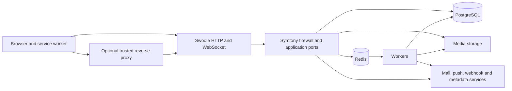

# Application threat model

An unauthenticated client can reach Baander directly or through an explicitly
trusted reverse proxy. This model follows that client's input through the PHP
application and records where the current tests establish a boundary. It also
covers a signed-in user attempting to read another user's data, a stolen token,
a malicious outbound destination, and unavailable infrastructure.

The evidence applies to the checkout and runtime recorded in
[ROADMAP.md](../../ROADMAP.md), not to an independently assessed deployment.
Registry internals, quorum downgrade, regional deployment qualification and deferred
mobile work remain outside this delivery. The combined application and registry
roadmap item remains open. A scanner canary establishes scanner operation, not
resistance to hostile requests.

## Assets and actors

| Asset | Authority and exposure |
| --- | --- |
| Passwords, TOTP secrets, passkeys, OAuth signing keys and `APP_SECRET` | The application and its operator can use these; database, filesystem and process access are privileged boundaries. Password hashes are not plaintext passwords. |
| Access tokens, refresh token chains and browser DPoP keys | The browser holds credentials; the API verifies the token and proof. A script running on the application origin can use browser credentials. Pending logout deliberately retains the ended session's key and tokens until revocation is confirmed. |
| Libraries, playlists, media, user profiles and notification subscriptions | Membership, ownership and administrator checks control access. A signed delivery URL is a bearer capability until expiry; token revocation alone does not revoke it. |
| Redis state and worker messages | Nonces, replay decisions, caches, rate counters and jobs cross the Redis boundary. Redis availability has different consequences for DPoP and rate limiting. |
| Logs, mail, webhook payloads and external-service credentials | These can disclose activity or secrets to their recipients. Log redaction is a separate control from response filtering. |

Actors include anonymous clients, members, playlist collaborators, administrators,
operators with console access, external OAuth clients, notification receivers,
external metadata providers and an attacker who controls a proxy, DNS answer or
application-origin script. Console access is full authority. A compromised host,
malicious administrator or arbitrary application-origin script is not contained by
ordinary API authorization.

## Data flows and trust boundaries



The service worker authenticates supported same-origin media requests. It must not
send tokens to a matching path on a foreign origin or follow an authenticated media
redirect. Browser-auth tests run the real worker and browser storage with a local
HTTP fixture; they do not run the production PHP issuer.

Swoole parses wire HTTP before Symfony sees a request. The Symfony firewall checks
ordinary API credentials and application ports enforce resource authority. The
WebSocket handshake uses a separate query-token authenticator; its proof-possession
limit is recorded below. Workers process jobs using application and infrastructure
services, with database and media privileges independent of the originating HTTP
connection. Tests of a controller alone cannot establish Swoole parsing or a live
WebSocket lifecycle.

PHP Discovery is local registration and pairing. `RegisterServerHandler` generates
an API key and persists a server through its application port; pairing handlers
persist and complete local sessions. These paths do not call the registry service.
A stored server URL is not evidence of an outbound request. The separate registry's
replication, quorum and routing security need their own model.

## Request identity and proxy deployment

Both HTTP layers read `TRUSTED_PROXIES`, a comma-separated list of proxy addresses
or CIDRs. The default is empty, including development. The Swoole trust-all handler
is disabled. Configure only the immediate proxies under operator control, and make
those proxies remove client-supplied forwarding values before setting their own.
A broad container-network CIDR grants every reachable member of that network proxy
authority; it is not an automatic consequence of using Docker.

For direct access, leave the list empty. For a reverse proxy, set its actual source
address or deliberately restricted CIDR and verify the external scheme, host and
client address. This affects rate-limit identities and the URL against which DPoP
proofs are checked. TLS termination, trusted-proxy topology and protection of
PostgreSQL, Redis and the loopback Swoole management API remain deployment duties.

## Threats and evidence

Test names below are repository paths relative to `tests/` unless a different root
is given. Existing tests are evidence of intended controls; the current execution
counts and failures are recorded separately in the roadmap.

| Threat and prerequisite | Impact | Implemented control and supporting evidence | Coverage limit or unresolved finding |
| --- | --- | --- | --- |
| Credential leakage through response or error handling: attacker can submit credentials or inspect their own profile response | Token or password disclosure | `Integration/OAuthFirewallAcceptanceTest.php` checks profile and replay-refusal responses and application logs; the runtime drill rejects malformed login input without reflecting a credential canary | Intentional login, refresh, personal-client, registration and webhook-secret responses return credentials. No exhaustive taint analysis of all logs or exporters was performed. |
| Query credential leakage: a WebSocket URL reaches application logging | A log reader can reuse a live query token | `Unit/Shared/Infrastructure/Logging/StreamSignatureRedactionProcessorTest.php` reproduces the prior disclosure and checks token/signature query redaction, including encoded parameter names | Reverse-proxy logs, browser history and third-party observability require separate configuration. Redaction does not remove query credentials from the protocol. |
| Foreign-origin credential forwarding or stale browser credentials after logout | External-origin disclosure or use of a superseded session | `ui/web/tests/e2e/browser-auth/worker-auth.spec.ts` covers foreign paths, blocked redirects, worker restart, account switch, cross-tab logout and pending logout | Browser fixture responses model the issuer. Application-origin script compromise remains authoritative; CSP/XSS resistance is not established by these tests. |
| Access-token or DPoP replay: attacker steals a token or proof | Impersonation | `Integration/OAuthFirewallAcceptanceTest.php` checks missing/wrong/replayed proof, method binding and revocation through the production firewall; `Integration/OAuthGrantPathAcceptanceTest.php` covers grant flows | WebSocket query tokens have the separate gap below. Logout/revoke deliberately permit skipping only replay-store availability checks during a DPoP store outage. |
| Cross-user or cross-library access: a member guesses another resource identifier or changes request method | Unauthorized read, mutation or queued work | `Integration/CatalogReadFirewallTest.php`, `CatalogMutationFirewallTest.php`, `PlaylistReadFirewallTest.php`, `PlaylistMutationFirewallTest.php`, `ArtistMutationFirewallTest.php` and the extended OAuth firewall suite exercise membership, collaborator removal, owner/admin distinctions and alternate methods | These are production-kernel requests, not network penetration tests. Pairing functional tests and anonymous/revoked route probes do not prove every authenticated pairing race. Pairing sessions have no user ownership field; knowledge of the pairing code is part of their authority. |
| Malformed JSON/types or oversized wire request: anonymous client sends hostile input | Server errors, unintended writes or loss of availability | `scripts/test-security-runtime-container.sh` runs real `app:serve`; `tests/Fixtures/security-runtime.php` checks bounded rejection, fresh-connection liveness and unchanged user/token counts. Login validation prevents decoding/type errors from escaping as 500 | The drill covers selected malformed framing and declared oversize; it does not establish resistance to slow clients, every request-smuggling ambiguity or sustained resource exhaustion. |
| Forged forwarding headers: direct client chooses apparent address, scheme or host | Rate-limit evasion and incorrect DPoP request identity | `Unit/Shared/Infrastructure/Http/ProxyTrustTest.php` exercises direct and explicit proxy trust; both configuration layers now default to no trust | Correct proxy header replacement and network isolation are deployment assumptions. The tests do not emulate every proxy vendor or multi-hop topology. |
| Rate-counter outage or concurrent updates | Brute-force limits can admit more requests than configured | Existing `Functional/Auth/AuthEndpointRateLimitTest.php` and `ApiRateLimitTest.php` exercise ordinary exhaustion; the storage findings below record the unclosed failure modes | Rate limiting is not currently a fail-closed security boundary during cache failure, and uncoordinated concurrent consumers can lose updates. |
| Outbound SSRF through webhook URL or changed DNS | Access to internal services | `WebhookDestinationPolicy` checks every DNS answer, denies forbidden ranges and restricts optional LAN allowance; delivery pins the checked address, bypasses ambient proxies and refuses redirects. `Unit/Notification/Infrastructure/Webhook/` tests cover forbidden addresses, changing DNS and dispatch options | DNS tests are controlled resolver fixtures. Local TLS tests qualify transport certificate behavior separately; they do not certify public DNS or deployment trust stores. |
| Outbound TLS failure or HTTPS downgrade | Interception or connection to an unintended endpoint | `Unit/Lyrics/Infrastructure/Api/LrclibTransportSecurityTest.php` uses a disposable CA/server to check trusted success, untrusted certificate, hostname mismatch and redirect rejection. The lyrics client disables redirects | Other outbound transports have separate limits below. Operator-configured base URLs remain trusted configuration. |

## Outbound inventory

| Path | Destination selection and boundary |
| --- | --- |
| `Notification/Infrastructure/Webhook/WebhookDeliveryService` | Administrator-configured URL; destination policy validates and pins addresses at delivery. HTTP is permitted service behavior, so webhook confidentiality requires choosing HTTPS. |
| `Lyrics/Infrastructure/Api/LrclibClient` | Operator-configured base URL, encoded search input; redirects disabled after the reproduced downgrade. No claim that arbitrary operator configuration is safe. |
| `Metadata/Infrastructure/Api/` | MusicBrainz, Cover Art Archive, Discogs, Last.fm, Spotify, TasteDive and TMDB use fixed HTTPS service URLs and PHP streams. Redirect and DNS behavior is not covered by the webhook policy. |
| `Notification/Application/Handler/SendPushHandler` | Sends persisted subscriptions through Minishlink WebPush. Subscription input restricts HTTPS hosts to configured providers; delivery has no address-pinning policy. |
| Symfony Mailer and OpenTelemetry exporters | Operator-selected transport endpoints; mail and tracing intentionally cross the application boundary. Their TLS settings and credential handling were not qualified by this drill. |
| `Radio/Infrastructure/Sync/IprdStationSyncAdapter` | Fetches fixed `iprd-org.github.io` catalog URLs with default HTTP-client redirects and DNS behavior; this is separate from client playback. |
| Radio stream and artwork URLs | The inspected paths store or return URLs to clients. They do not establish a PHP server-side fetch. Browser connections have a different trust boundary. |
| PHP Discovery registration/pairing | Local persistence and credential return, with no registry-service call in these handlers. |

## Open findings and qualification work

1. **WebSocket proof possession.** The query-token authenticator validates the OAuth
   JWT and user but does not require a DPoP proof or validate `Origin`. A party with
   a live token can authenticate the handshake without its bound key. The extended
   OAuth firewall test demonstrates acceptance before revocation and refusal after
   revocation using the real resource server. Moving browser handshakes to a
   separately scoped, short-lived credential needs a protocol/client design; query
   redaction alone does not close this finding.
2. **Rate-limit storage failure and concurrency.** Symfony cache storage treats
   failed writes as successful limiter consumption; Redis cache reads can degrade
   to misses. The installed application has no lock component, so read-modify-write
   consumption is not serialized. `Unit/Shared/Infrastructure/RateLimiter/RateLimiterFailureSemanticsTest.php`
   reproduces failed storage and a deterministic two-consumer interleaving. These
   findings must remain visible until strict storage failure semantics and shared atomicity are
   designed and verified. DPoP store outage handling is a different mechanism and
   must not be used as evidence that rate limiting fails closed.
3. **Metadata, radio-catalog and push egress.** Fixed metadata/catalog origins and approved push providers
   reduce URL choice but do not pin validated addresses or constrain every redirect.
   Provider compromise, a malicious redirect or a changed DNS answer could cross
   the intended destination boundary. `Unit/Metadata/Infrastructure/Api/MetadataStreamRedirectTest.php` reproduces
   PHP stream defaults following an HTTPS redirect to loopback HTTP. The CI
   image (PHP 8.5.2) forwards the Authorization header; host PHP 8.5.11 strips it. This is transport evidence, not a demonstrated exploit through
   an application adapter or live provider. Provider-specific policy remains
   needed, especially where Cover Art Archive relies on redirects as part of its
   service contract.
4. **Unqualified boundaries.** Sustained denial of service, complete HTTP parser
   differential testing, authenticated pairing races, live foreign-origin WebSocket
   upgrades, all external TLS transports, registry quorum downgrade and actual
   regional deployments remain unqualified. Existing scanner tests do not close
   any of these findings.

## Reproduce the checkpoint

Use the CI image and disposable runners from [Testing](testing.md). The security
runtime runner creates an internal Docker network and disposable PostgreSQL and
Redis, generates test-only OAuth keys and removes its containers on exit. It has a
240-second outer deadline and three-second socket deadlines. It does not reset the
development database. The Forgejo workflow runs it as a blocking step.

```bash
BAANDER_TEST_IMAGE=baander-ci-prewarm:local bash scripts/test-security-runtime-container.sh
BAANDER_TEST_IMAGE=baander-ci-prewarm:local bash scripts/test-unit-container.sh
BAANDER_TEST_IMAGE=baander-ci-prewarm:local BAANDER_FUNCTIONAL_TIMEOUT_ACTIVE=1 \
  bash scripts/test-functional-container.sh tests/Functional
BAANDER_TEST_IMAGE=baander-ci-prewarm:local BAANDER_FUNCTIONAL_TIMEOUT_ACTIVE=1 \
  bash scripts/test-functional-container.sh tests/Integration
```

The full checkpoint also includes PHPStan, Deptrac, container lint and OpenAPI drift.
A passing checkpoint supports the named cases and controls, not an assertion that
the application has no exploitable vulnerabilities.
