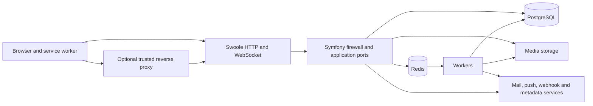

# Application threat model

An unauthenticated client can reach Baander directly or through an explicitly
trusted reverse proxy. This model follows that client's input through the PHP
application and records where the current tests establish a boundary. It also
covers a signed-in user attempting to read another user's data, a stolen token,
a malicious outbound destination, and unavailable infrastructure.

The evidence applies to the checkout and runtime recorded in
[ROADMAP.md](../../ROADMAP.md), not to an independently assessed deployment.
The separate [registry threat model](registry-threat-model.md) covers the C++
service's credential ownership, replay, parsing, TLS and quorum boundaries. The
application checkpoint below does not qualify those boundaries. Regional deployment
qualification and deferred mobile work remain separate work. The combined
model/regression checkpoint and remaining findings are recorded in the roadmap.
A scanner canary establishes scanner operation, not resistance to hostile requests.

## Assets and actors

| Asset | Authority and exposure |
| --- | --- |
| Passwords, TOTP secrets, passkeys, OAuth signing keys and `APP_SECRET` | The application and its operator can use these; database, filesystem and process access are privileged boundaries. Password hashes are not plaintext passwords. |
| Access tokens, refresh token chains and browser DPoP keys | The browser holds credentials; the API verifies the token and proof. A script running on the application origin can use browser credentials. Pending logout deliberately retains the ended session's key and tokens until revocation is confirmed. |
| Libraries, playlists, media, user profiles and notification subscriptions | Membership, ownership and administrator checks control access. A signed delivery URL is a bearer capability until expiry; token revocation alone does not revoke it. |
| Redis state and worker messages | Nonces, replay decisions, caches, rate counters and jobs cross the Redis boundary. DPoP and rate-limit stores refuse protected work when state cannot be established, with narrow availability exceptions for logout and revocation. |
| Logs, mail, webhook payloads and external-service credentials | These can disclose activity or secrets to their recipients. Log redaction is a separate control from response filtering. |

Actors include anonymous clients, members, playlist collaborators, administrators,
operators with console access, external OAuth clients, notification receivers,
external metadata providers and an attacker who controls a proxy, DNS answer or
application-origin script. Console access is full authority. A compromised host,
malicious administrator or arbitrary application-origin script is not contained by
ordinary API authorization.

## Data flows and trust boundaries



The service worker authenticates supported same-origin media requests. It must not
send tokens to a matching path on a foreign origin or follow an authenticated media
redirect. Browser-auth tests run the real worker and browser storage with a local
HTTP fixture; they do not run the production PHP issuer.

Swoole parses wire HTTP before Symfony sees a request. The Symfony firewall checks
ordinary API credentials and application ports enforce resource authority. The
WebSocket handshake accepts a single-use ticket issued by `POST /api/ws/tickets`
through the OAuth and DPoP firewall. The raw upgrade callback validates its route,
framing and exact Origin, then atomically consumes the ticket and checks fresh
user/token state. Workers process jobs using application and infrastructure
services, with database and media privileges independent of the originating HTTP
connection. Tests of a controller alone cannot establish Swoole parsing or a live
WebSocket lifecycle.

PHP Discovery is local registration and pairing. `RegisterServerHandler` generates
an API key and persists a server through its application port; pairing handlers
persist and complete local sessions. These paths do not call the registry service.
A stored server URL is not evidence of an outbound request. The separate registry's
replication, quorum and routing security need their own model.

## Request identity and proxy deployment

Both HTTP layers read `TRUSTED_PROXIES`, a comma-separated list of proxy addresses
or CIDRs. The default is empty, including development. The Swoole trust-all handler
is disabled. Configure only the immediate proxies under operator control, and make
those proxies remove client-supplied forwarding values before setting their own.
A broad container-network CIDR grants every reachable member of that network proxy
authority; it is not an automatic consequence of using Docker.

For direct access, leave the list empty. For a reverse proxy, set its actual source
address or deliberately restricted CIDR and verify the external scheme, host and
client address. This affects rate-limit identities and the URL against which DPoP
proofs are checked. TLS termination, trusted-proxy topology and protection of
PostgreSQL, Redis and the loopback Swoole management API remain deployment duties.

## Threats and evidence

Test names below are repository paths relative to `tests/` unless a different root
is given. Existing tests are evidence of intended controls; the current execution
counts and failures are recorded separately in the roadmap.

| Threat and prerequisite | Impact | Implemented control and supporting evidence | Coverage limit or unresolved finding |
| --- | --- | --- | --- |
| Credential leakage through response or error handling: attacker can submit credentials or inspect their own profile response | Token or password disclosure | `Integration/OAuthFirewallAcceptanceTest.php` checks profile and replay-refusal responses and application logs; the runtime drill rejects malformed login input without reflecting a credential canary | Intentional login, refresh, personal-client, registration and webhook-secret responses return credentials. No exhaustive taint analysis of all logs or exporters was performed. |
| Query credential leakage: a WebSocket URL reaches application logging | A log reader can race the client to redeem an unused ticket | `Unit/Shared/Infrastructure/Logging/StreamSignatureRedactionProcessorTest.php` reproduces the prior disclosure and checks ticket/token/signature query redaction, including encoded parameter names | Bundled proxy access logs for exact `/api/ws` requests omit queries and referrers. WebSocket proxy error logging is suppressed because nginx includes raw requests. Pre-location parser errors, external proxies, browser history and third-party observability remain separate limits. Tickets remain short-lived bearer capabilities. |
| Foreign-origin credential forwarding or stale browser credentials after logout | External-origin disclosure or use of a superseded session | `ui/web/tests/e2e/browser-auth/worker-auth.spec.ts` covers foreign paths, blocked redirects, worker restart, account switch, cross-tab logout and pending logout | Browser fixture responses model the issuer. Application-origin script compromise remains authoritative; CSP/XSS resistance is not established by these tests. |
| Access-token or DPoP replay: attacker steals a token or proof | Impersonation | `Integration/OAuthFirewallAcceptanceTest.php` checks missing/wrong/replayed proof, method binding and revocation through the production firewall; `Integration/OAuthGrantPathAcceptanceTest.php` covers grant flows | The WebSocket runtime drill verifies ticket issuance and redemption separately. Logout/revoke deliberately permit skipping only replay-store availability checks during a DPoP store outage. |
| Cross-user or cross-library access: a member guesses another resource identifier or changes request method | Unauthorized read, mutation or queued work | `Integration/CatalogReadFirewallTest.php`, `CatalogMutationFirewallTest.php`, `PlaylistReadFirewallTest.php`, `PlaylistMutationFirewallTest.php`, `ArtistMutationFirewallTest.php` and the extended OAuth firewall suite exercise membership, collaborator removal, owner/admin distinctions and alternate methods | These are production-kernel requests, not network penetration tests. Pairing functional tests and anonymous/revoked route probes do not prove every authenticated pairing race. Pairing sessions have no user ownership field; knowledge of the pairing code is part of their authority. |
| Malformed JSON/types or oversized wire request: anonymous client sends hostile input | Server errors, unintended writes or loss of availability | `scripts/test-security-runtime-container.sh` runs real `app:serve`; `tests/Fixtures/security-runtime.php` checks bounded rejection, fresh-connection liveness and unchanged user/token counts. Login validation prevents decoding/type errors from escaping as 500 | The drill covers selected malformed framing and declared oversize; it does not establish resistance to slow clients, every request-smuggling ambiguity or sustained resource exhaustion. |
| Forged forwarding headers: direct client chooses apparent address, scheme or host | Rate-limit evasion and incorrect DPoP request identity | `Unit/Shared/Infrastructure/Http/ProxyTrustTest.php` exercises direct and explicit proxy trust; both configuration layers now default to no trust | Correct proxy header replacement and network isolation are deployment assumptions. The tests do not emulate every proxy vendor or multi-hop topology. |
| Rate-counter outage or concurrent updates | Brute-force limits can admit more requests than configured | Configured factories execute Symfony policies on operation-local snapshots and commit through Redis compare-and-set. Store errors and exhausted conflict retries stop protected work with a generic 503. Named clears advance the same namespace generation used by consumption. `Integration/RateLimiterConcurrencyTest.php` and `RateLimiterHttpAvailabilityTest.php` target these boundaries; `Functional/Auth/AuthEndpointRateLimitTest.php` and `ApiRateLimitTest.php` retain ordinary exhaustion coverage | Local storage, HTTP and runtime checks pass; distributed load and Redis failover remain unqualified. The generic API limiter preserves the narrow logout/revoke availability exception; it still enforces confirmed exhaustion and every other authentication/proof check. |
| Outbound SSRF through webhook URL or changed DNS | Access to internal services | `WebhookDestinationPolicy` checks every DNS answer, denies forbidden ranges and restricts optional LAN allowance; delivery pins the checked address, bypasses ambient proxies and refuses redirects. `Unit/Notification/Infrastructure/Webhook/` tests cover forbidden addresses, changing DNS and dispatch options | DNS tests are controlled resolver fixtures. Local TLS tests qualify transport certificate behavior separately; they do not certify public DNS or deployment trust stores. |
| Metadata, radio-catalog or push destination changes through DNS or redirects | Internal-service access or provider credential disclosure | `PublicDestinationPolicy` requires an approved HTTPS hostname on port 443 and rejects the request if any DNS answer is not public. `PublicHttpClient` and `PushTransport` pin an approved address, verify TLS and disable proxies, automatic redirects and reused connections. `Unit/Shared/Infrastructure/Http/PublicDestinationPolicyTest.php`, `PublicHttpClientTest.php` and `Unit/Notification/Infrastructure/Push/PushTransportTest.php` cover these controls | Local adapter, destination-policy and TLS regressions pass in the CI image. Complete native DNS runs in a bounded helper within the caller deadline; helper admission, cleanup and scheduling limits are described below. Approved providers and application-origin script compromise remain separate trust boundaries. |
| Outbound TLS failure or HTTPS downgrade | Interception or connection to an unintended endpoint | `Unit/Lyrics/Infrastructure/Api/LrclibTransportSecurityTest.php` uses a disposable CA/server to check trusted success, untrusted certificate, hostname mismatch and redirect rejection. The lyrics client disables redirects | Other outbound transports have separate limits below. Operator-configured base URLs remain trusted configuration. |

## Outbound inventory

| Path | Destination selection and boundary |
| --- | --- |
| `Notification/Infrastructure/Webhook/WebhookDeliveryService` | Administrator-configured URL; destination policy validates and pins addresses at delivery. HTTP is permitted service behavior, so webhook confidentiality requires choosing HTTPS. |
| `Lyrics/Infrastructure/Api/LrclibClient` | Operator-configured base URL, encoded search input; redirects disabled after the reproduced downgrade. No claim that arbitrary operator configuration is safe. |
| `Metadata/Infrastructure/Api/` | MusicBrainz, Cover Art Archive, Discogs, Last.fm, Spotify, TasteDive and TMDB, including Spotify token acquisition, use approved hosts through `PublicHttpClient`. Each request checks every DNS answer and pins a public address with TLS verification and proxies disabled. Only Cover Art Archive may follow approved redirects, as described below. |
| `Notification/Application/Handler/SendPushHandler` | Minishlink retains encryption and VAPID signing. `PushTransport` revalidates the actual outgoing endpoint against the approved push domains, including previously persisted subscriptions, then pins a public address with TLS verification and proxies disabled. Every 3xx is a failed delivery; 404/410 retain subscription-expiry handling. |
| Symfony Mailer and OpenTelemetry exporters | Operator-selected transport endpoints; mail and tracing intentionally cross the application boundary. Their TLS settings and credential handling were not qualified by this drill. |
| `Radio/Infrastructure/Sync/IprdStationSyncAdapter` | Fetches the fixed `iprd-org.github.io` summary and catalog URLs through `PublicHttpClient`, with approved-host/public-address checks, pinning and no redirects. Client playback remains a separate boundary. |
| Radio stream and artwork URLs | The inspected paths store or return URLs to clients. They do not establish a PHP server-side fetch. Browser connections have a different trust boundary. |
| PHP Discovery registration/pairing | Local persistence and credential return, with no registry-service call in these handlers. |

### Provider transport boundaries

The provider policy accepts HTTPS on port 443 with an approved ASCII hostname,
without user information or a fragment. Exact host allowlists and explicitly
approved domain suffixes use label boundaries. Every A/AAAA answer must be public;
empty, mixed public/private, mapped-private, multicast and IPv6 translation or
transition answers are rejected. No LAN exception applies. The transport pins one
approved address while retaining the hostname for TLS peer/name verification and
uses a fresh HTTP/1.1 connection with proxies disabled. Caller options cannot
replace these controls.

Metadata and IPRD requests reject redirects by default. Cover Art Archive alone may
follow at most three manual GET redirects within `coverartarchive.org`,
`archive.org` or their label-boundary subdomains. Each hop repeats validation and
pinning and cancels the previous response. Cross-origin hops retain only `Accept`, `Accept-Language` and `User-Agent`
headers; credentials, cookies and request bodies are not forwarded. The
redirect chain shares one HTTP budget.

Public HTTP requests carry one monotonic deadline through DNS and every approved
redirect hop, capped at thirty seconds. Push transport shares a thirty-second
budget between DNS and sending; its connection timeout is the smaller of five
seconds and the remaining budget. Direct destination-policy calls without a
caller deadline use a thirty-second budget.

`NativeDnsResolver` starts a fresh PHP helper for the system resolver's complete
A/AAAA lookup. It retains native family-error semantics and rejects incomplete or
invalid output rather than accepting one successful family after the other fails.
The caller polls without blocking its coroutine worker. Admission permits at most
eight owned children per PHP process, including children still awaiting reaping;
independent resolver instances share that bound. Replies are limited to 64 KiB.
Polling sleeps for at most five milliseconds, with a one-millisecond minimum near
the deadline. Timeout and cancellation kill the direct helper; cleanup polls for
up to 250 milliseconds, and an unreaped child retains its admission slot. The
helper also arms an alarm rounded up to the remaining whole second, capped at
thirty seconds, so abrupt parent exit does not leave a normal lookup unbounded.

Process launch, cleanup and operating-system scheduling prevent a hard real-time
return guarantee. Existing provider and Messenger retries can extend the overall
operation. Transport-level replay of push requests and Spotify token POSTs stays
disabled; delivery is not exactly once. Webhook resolution retains its separate
implementation and policy.

Provider API-key queries, push endpoint credentials and transport exception chains
are excluded from delivery logs. This protects the changed paths; it is not an
exhaustive taint analysis of logging or external observability.

## Open findings and qualification work

1. **WebSocket residual limits.** Ticket issuance requires a valid DPoP proof and
   allowed Origin; a raw access token no longer authenticates an upgrade. Tickets
   expire within thirty seconds and are single use. A stolen, unused ticket can
   still race the intended client. Revocation racing connection registration keeps
   the existing reconciliation bound. Chained sessions close through the immediate
   logout path; tokens without a refresh chain rely on reconciliation. The embedded
   player's party message vocabulary remains different from the server protocol;
   migrating its authentication does not qualify party synchronization. External
   proxy logging and deferred native clients remain unqualified.
2. **Rate-limit storage and residual limits.** The configured limiters use shared atomic Redis
   storage rather than Symfony's cache storage. Each operation executes the installed
   fixed/sliding-window policy against its own snapshot and compares both the
   generation and opaque revision before writing. Redis rejects snapshots older than
   two seconds or from a future server time. Empty reads and per-subject resets leave
   ten-second revision tombstones, preventing a paused writer from confusing an
   expired state with the absence it originally read. Definite conflicts retry
   within a limit of eight total attempts and a two-second monotonic budget; an
   in-flight bounded Redis call can finish after that deadline. Transport errors,
   uncertain writes and corrupt state are not retried as fresh consumption. The 19 names, budgets, identity keys,
   media exemptions and development bypass are unchanged. The full backend suites,
   focused concurrency/outage checks and production runtime drills pass; the roadmap
   records their counts and limits. The rewritten
   `Unit/Shared/Infrastructure/RateLimiter/RateLimiterFailureSemanticsTest.php`
   targets failed storage, conflict refetch, uncertain writes and the retry deadline.
   The effective configuration contributes to the subject digest, so a configuration
   change starts a fresh budget; this isolates configurations rather than enforcing
   one shared budget across a rolling configuration change. Named clears reach all
   configurations of the limiter. Wrong-type subject keys and missing/invalid
   generation fields still fail closed after a named clear until expiry or targeted
   repair. A valid old-generation hash, including extra fields, is replaced on read.
   DPoP outage handling is a separate mechanism.
3. **Provider destination residual limits.** Metadata, radio-catalog and persisted
   push endpoints now use the public destination controls above. Their adapter,
   pinning, redirect and local TLS checks pass in the CI image; no live-provider or
   deployment trust-store assessment is claimed. The historical
   `Unit/Metadata/Infrastructure/Api/MetadataStreamRedirectTest.php` retains the raw
   PHP stream reproduction: an HTTPS request follows a redirect to loopback HTTP;
   CI PHP 8.5.2 also forwards Authorization while host PHP 8.5.11 strips it. That
   fixture records the former transport's behavior, not a bypass of the new
   adapters. Bounded helper execution removes native DNS from the coroutine
   worker and includes lookup in the caller's request budget. The dedicated
   network-isolated DNS drill and native lifecycle tests cover complete answers,
   stalled lookups, cancellation and cleanup; current results are in the roadmap.
   Per-process helper capacity, cleanup/scheduling tolerance, overall provider
   retries and approved-provider compromise remain limits. Webhooks,
   operator-configured lyrics, mail, tracing
   and browser playback retain their separate policies.
4. **Unqualified boundaries.** Sustained denial of service, complete HTTP parser
   differential testing, authenticated pairing races, live external TLS providers and
   actual regional deployments remain unqualified. The registry model records its
   separate local quorum qualification. Existing scanner tests do not close
   any of these findings.

## Reproduce the checkpoint

Use the CI image and disposable runners from [Testing](testing.md). The security
runtime runner creates an internal Docker network and disposable PostgreSQL and
Redis, generates test-only OAuth keys and removes its containers on exit. It has a
360-second outer deadline. Malformed-input sockets have three-second deadlines;
WebSocket and outage probes use bounded request budgets of up to ten seconds. It does not reset the
development database. The Forgejo workflow runs it as a blocking step.

```bash
BAANDER_TEST_IMAGE=baander-ci-prewarm:local bash scripts/test-security-runtime-container.sh
BAANDER_TEST_IMAGE=baander-ci-prewarm:local bash scripts/test-unit-container.sh
BAANDER_TEST_IMAGE=baander-ci-prewarm:local BAANDER_FUNCTIONAL_TIMEOUT_ACTIVE=1 \
  bash scripts/test-functional-container.sh tests/Functional
BAANDER_TEST_IMAGE=baander-ci-prewarm:local BAANDER_FUNCTIONAL_TIMEOUT_ACTIVE=1 \
  bash scripts/test-functional-container.sh tests/Integration
```


The same runner exercises browser-compatible ticket issuance, missing/wrong/replayed
proofs, Origin and route rejection, ambiguous query parameters, single-use and
concurrent redemption, ticket expiry, account disable, logout closure and pending
ticket revocation. It pauses and stops its disposable Redis instance to verify
bounded 503 responses, then checks fresh issuance and upgrades after recovery.
The client keeps its DPoP key in the window; the service worker gains no new signing
permissions. Every reconnect requests a fresh ticket, and cancelled issuance cannot
open a late socket.

The full checkpoint also includes PHPStan, Deptrac, container lint and OpenAPI drift.
A passing checkpoint supports the named cases and controls, not an assertion that
the application has no exploitable vulnerabilities.
