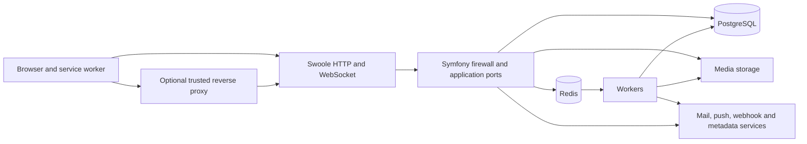

# Application threat model

An unauthenticated client can reach Baander directly or through an explicitly
trusted reverse proxy. This model follows that client's input through the PHP
application and records where the current tests establish a boundary. It also
covers a signed-in user attempting to read another user's data, a stolen token,
a malicious outbound destination, and unavailable infrastructure.

The evidence applies to the checkout and runtime recorded by each verification
run, not to an independently assessed deployment. The [testing guide](../testing/README.md)
documents the runners and their artifact locations.
The separate [registry threat model](registry-threat-model.md) covers the C++
service's credential ownership, replay, parsing, TLS and quorum boundaries. The
application checkpoint below does not qualify those boundaries. Regional deployment
qualification and deferred mobile work remain separate work. Remaining findings
and coverage limits are described below.
A scanner canary establishes scanner operation, not resistance to hostile requests.

## Assets and actors

| Asset | Authority and exposure |
| --- | --- |
| Passwords, TOTP secrets, passkeys, OAuth signing keys and `APP_SECRET` | The application and its operator can use these; database, filesystem and process access are privileged boundaries. Password hashes are not plaintext passwords. |
| Access tokens, refresh token chains and browser DPoP keys | The browser holds credentials; the API verifies the token and proof. A token acts with first-party authority only when it belongs to the first-party client and its chain began with a password or passkey sign-in; every other token is delegated and limited by its scopes. A script running on the application origin can use browser credentials. Pending logout deliberately retains the ended session's key and tokens until revocation is confirmed. |
| Libraries, playlists, media, user profiles and notification subscriptions | Membership, ownership and administrator checks control access. A signed delivery URL is a bearer capability until expiry; token revocation alone does not revoke it, but each delivery request checks that the media's owner may still play it. Only administrators read server filesystem paths. |
| Redis state and worker messages | Nonces, replay decisions, caches, rate counters and jobs cross the Redis boundary. DPoP and rate-limit stores refuse protected work when state cannot be established, with narrow availability exceptions for logout and revocation. |
| Logs, mail, webhook payloads and external-service credentials | These can disclose activity or secrets to their recipients. Log redaction is a separate control from response filtering. |

Actors include anonymous clients, members, playlist collaborators, administrators,
operators with console access, external OAuth clients, notification receivers,
external metadata providers and an attacker who controls a proxy, DNS answer or
application-origin script. Console access is full authority. A compromised host,
malicious administrator or arbitrary application-origin script is not contained by
ordinary API authorization.

## Data flows and trust boundaries



The service worker authenticates supported same-origin media requests. It must not
send tokens to a matching path on a foreign origin or follow an authenticated media
redirect. Browser-auth tests run the real worker and browser storage with a local
HTTP fixture; they do not run the production PHP issuer.

Swoole parses wire HTTP before Symfony sees a request. The Symfony firewall checks
ordinary API credentials and application ports enforce resource authority. The
WebSocket handshake accepts a single-use ticket issued by `POST /api/ws/tickets`
through the OAuth and DPoP firewall. The raw upgrade callback validates its route,
framing and exact Origin, then atomically consumes the ticket and checks fresh
user/token state. Workers process jobs using application and infrastructure
services, with database and media privileges independent of the originating HTTP
connection. Tests of a controller alone cannot establish Swoole parsing or a live
WebSocket lifecycle.

PHP Discovery is local registration and pairing. `RegisterServerHandler` generates
an API key and persists a server through its application port; pairing handlers
persist and complete local sessions. These paths do not call the registry service.
A stored server URL is not evidence of an outbound request. The separate registry's
replication, quorum and routing security need their own model.

## Request identity and proxy deployment

Both HTTP layers read `TRUSTED_PROXIES`, a comma-separated list of proxy addresses
or CIDRs. The default is empty, including development. The Swoole trust-all handler
is disabled. Configure only the immediate proxies under operator control, and make
those proxies remove client-supplied forwarding values before setting their own.
A broad container-network CIDR grants every reachable member of that network proxy
authority; it is not an automatic consequence of using Docker.

For direct access, leave the list empty. For a reverse proxy, set its actual source
address or deliberately restricted CIDR and verify the external scheme, host and
client address. This affects rate-limit identities and the URL against which DPoP
proofs are checked. TLS termination, trusted-proxy topology and protection of
PostgreSQL, Redis and the loopback Swoole management API remain deployment duties.

The [deployment preset](../../../deploy/preset/README.md#gateway-and-client-addresses)
fixes that topology itself. Its gateway and web alone share a dedicated edge network,
on which the gateway holds a pinned address in each family, outside the range Docker
assigns from; web's `TRUSTED_PROXIES` is derived to exactly those addresses, and a
configured value is refused. Workers stay on the private network, so none can reach
web as a trusted proxy. The gateway sets `X-Forwarded-For`, `X-Forwarded-Host` and
`X-Forwarded-Proto` from its own connection and drops `X-Forwarded-Port`. It takes a
client address from `X-Forwarded-For` only from the front proxies the operator
declares in `listen.frontProxies`, or from the edge bridge when it listens on
loopback. Web listening on `::` reports an IPv4 peer in its plain form, so proxy
trust and rate-limit keys see one address per peer.

Rate limits follow the route the router matched from the decoded path, and the
generic API limiters judge an API request by its decoded path, so a percent-encoded
path such as `/%61pi/auth/registe%72` is charged like the route it reaches.

## Threats and evidence

Test names below are repository paths relative to `tests/` unless a different root
is given. Existing tests are evidence of intended controls; the current execution
counts and failures belong to the corresponding run artifacts.

| Threat and prerequisite | Impact | Implemented control and supporting evidence | Coverage limit or unresolved finding |
| --- | --- | --- | --- |
| Credential leakage through response or error handling: attacker can submit credentials or inspect their own profile response | Token or password disclosure | `Integration/OAuthFirewallAcceptanceTest.php` checks profile and replay-refusal responses and application logs; the runtime drill rejects malformed login input without reflecting a credential canary. Every `/api` client error answers in the error envelope with a message for its status, never the exception's own text (`Functional/Shared/ApiClientErrorEnvelopeTest.php`), and the passkey endpoints answer fixed reason codes and log the verifier's reason (`Functional/Auth/PasskeyEndpointsTest.php`) | Intentional login, refresh, administrator OAuth client registration and secret rotation, and webhook-secret responses return credentials. No exhaustive taint analysis of all logs or exporters was performed. |
| First-party authority through the OAuth endpoints: an anonymous client pushes an authorization request naming Baander's own client and has a signed-in victim open the consent link | Full account takeover | `OAuthClientAuthenticator` refuses the first-party client wherever it is the authenticated or identified client, `AuthorizationRequestValidator::validatePush()` refuses it as well, and consent is always an explicit decision. Each access token records the grant that started its chain; only a password or passkey sign-in of the first-party client carries first-party authority. `Integration/OAuthGrantPathAcceptanceTest.php` covers the refused push and every refused token grant; `Integration/OAuthFirewallAcceptanceTest.php` checks that only a first-party sign-in carries administrator roles and that a first-party token from an authorization code keeps no scopes; `Integration/OAuthAccessTokenGrantMigrationTest.php` and `Integration/OAuthPersonalAccessClientMigrationTest.php` cover the stored grant and the personal access flag | A personal access client is public, so anyone who knows its ID can push a request as it; its owner still decides each one on the consent page, which names the client type and the loopback redirect with its port. |
| Scope bypass on a public route: a delegated token without `library` asks for original media | Media download beyond the granted scopes | The original track and video routes need the `library` scope for a presented token; a signed URL without a token still works. `Functional/Controller/StreamControllerAccessTest.php` covers the refused delegated token. `Unit/Auth/Infrastructure/Security/OAuth/PublicRouteIdentityTest.php` reflects every public API route's controller method and the same-class helpers it calls, and fails when one reads the caller's identity | The identity check is a deny-list of known identity reads; it does not follow calls into other classes. |
| Rate-limit evasion through path encoding: anonymous client percent-encodes an auth path | Unthrottled registration, reset, verification and OAuth requests | The auth, OAuth, discovery and cover-extraction limiters match the routed `_route`; the generic API limiters and JSON enforcement read the decoded path through `ApiRequestPath`. `Functional/Auth/AuthEndpointRateLimitTest.php` charges a percent-encoded registration; `Unit/Shared/Infrastructure/Security/LimitedRouteInventoryTest.php` holds every limited route to its method and path | — |
| Second-factor removal or password guessing from a stolen session; sessions that outlive a factor change | Lasting takeover of a signed-in account | Turning TOTP off, changing the password and removing a passkey need step-up under the per-account attempt limit, with one answer for every mismatch (`Functional/Auth/StepUpTest.php`). `CredentialChangeRevoker` ends every other session, paired devices and third-party apps included, when TOTP is turned on or off, a passkey is added or removed, the password changes or a new address is confirmed, and refuses a change from a session another change already ended (`Integration/PasswordChangeSessionRevocationTest.php`, `Unit/Auth/Application/Service/CredentialChangeRevokerTest.php`) | An operator's email change leaves the user's sessions alone. |
| Pre-registration of another person's address: an attacker registers it and has its owner open the verification link | The attacker keeps TOTP and passkeys past the owner's password reset | A verification link confirms an address only in a signed-in session of the account it was sent for; another account's live link answers `403` and stays usable. Self-registration stays closed until an operator opens `auth.registration_open`, and both registration outcomes answer after the same response floor. An unverified account reaches only public routes, its own profile and its verification routes. `Functional/Auth/PasswordResetClaimTest.php`, `Functional/Auth/EmailVerificationDeliveryTest.php` and `Functional/Auth/UnverifiedAccountGateTest.php` cover these | The floor hides the difference only while `auth.registration.response_floor_ms` stays above the slowest new-account path on the host; no timing assertion runs in CI. |
| Cross-user playback control: a party host names another user's transcode job | Pausing or seeking another user's encoder; listing other users' jobs | A party takes only a job its host owns and loses it when the owner leaves or is revoked; non-admin job listings show only the caller's jobs. `Functional/Controller/PartySessionCreationTest.php`, `Unit/Party/Infrastructure/PartyMediaAccessTest.php` and `Unit/Transcode/Interface/Controller/TranscodeJobAuthorizationTest.php` cover these | A new host steers the owner's encoder after a handover while the owner stays a member. |
| Signed delivery after lost access: a member keeps a signed live stream URL after their library access is removed or their account is disabled | Continued streaming for up to the URL's 24-hour lifetime | Live HLS and DASH requests check the job owner's current access after the signature, as original and artifact routes do, and answer `409`. The live routes and their firewall rows accept only public IDs, `s<index>` subtitle keys and `full.vtt`. `Integration/SignedDeliveryFirewallTest.php`, `Unit/Transcode/Infrastructure/Transcode/LiveDeliveryAccessAdapterTest.php` and `Unit/Shared/Infrastructure/Security/DeliveryRouteInventoryTest.php` cover these | A signed URL stays a bearer capability, unbound to a user or session: a URL minted by a session that has since ended keeps working until it expires while its owner keeps access. |
| Stale or excess read exposure: a member reads history from a library they lost, or server paths | Titles, covers and filesystem layout outside current access | Activity enrichment names only items inside the viewer's current library access; library and song routes leave out `path` for non-administrators. `Functional/Controller/ActivityLibraryScopeTest.php` and `Functional/Catalog/Interface/Controller/SongServerPathTest.php` cover these | — |
| Passkey ceremony from another origin, or enumeration through passkey options | Relay from a sibling host or port, or listing an account's credential IDs | Both ceremonies accept only the public origins (`APP_URL` and `AUTH_EXTRA_ORIGINS`) on the relying party, the host of `APP_URL`, or a subdomain of it. Sign-in options name no account and list no credentials, and new passkeys are discoverable. `Unit/Auth/Infrastructure/Security/Passkey/PasskeyServiceTest.php` and `Functional/Auth/PasskeyEndpointsTest.php` cover these | — |
| Locking the installation out of administration: the only super admin is deleted, disabled or demoted, or two super admins do so to each other at once | No account can change server settings or roles from the web | `SuperAdminContinuity` refuses with `409` `last_super_admin` under a transaction-scoped advisory lock, from the admin API and the console. `Integration/SuperAdminRemovalRaceTest.php` and `Unit/Auth/Application/CommandHandler/User/LastSuperAdminTest.php` cover the races and the refusals | An installation with no enabled super admin refuses nothing; console access creates one. |
| Database read of one-time codes | A database reader redeems an approved device code from any key | Authorization codes and device codes are stored as their hex SHA-256; user codes stay plain. `Integration/InitialSchemaMigrationTest.php` checks that the migration deletes stored codes | A user code carries too few bits for an unsalted hash to resist offline guessing, so it is not hashed. |
| Anonymous infrastructure detail | Worker, pool, memory and profile figures for reconnaissance | Public `/health`, `/ready` and `/live` answer each component's status only; the full report is the admin route `GET /api/debug/health`. The production nginx and the preset gateway answer `/metrics` with `404`. `Functional/Controller/HealthCheckControllerTest.php`, `Integration/Docker/NginxTemplateTest.php` and `packages/baander-deployment/tests/PresetDeploymentTest.php` cover these | `/metrics` stays unauthenticated on the web port `9501` for Prometheus on the application network. |
| Stored image that parses as SVG or HTML | Script at the application origin | Image files are served with their recorded type when it is JPEG, PNG, WebP or GIF, otherwise as an `application/octet-stream` attachment, always with `Content-Security-Policy: default-src 'none'; sandbox` (`Functional/Media/Interface/Controller/ImageFileResponseTest.php`) | — |
| Resource exhaustion through pairing and provider searches | Unbounded pairing rows or a spent provider quota | The QR pairing payload is a `POST` under the discovery limit, and creating a pairing session deletes expired ones; Discogs and Last.fm searches spend a per-user limiter and accept 1 to 100 results. `Functional/Controller/DiscoveryControllerSecurityTest.php` and `Functional/Metadata/Interface/MetadataSearchLimitTest.php` cover these | — |
| Committed credentials in production: an installation keeps a development password or key | Known Redis or database passwords, forgeable Web Push signatures, development accounts with public passwords | Production refuses to boot with an empty or committed Redis or database password, or a VAPID private key the repository committed; the development commands run only in the dev environment or with `BAANDER_DEVELOPMENT_INSTANCE=1`. `Unit/Shared/Infrastructure/Security/ProductionSecretsTest.php`, `Unit/Auth/Interface/Console/CreateUsersCommandTest.php` and `Unit/Command/Dev/SetupCommandTest.php` cover these | The guard knows only the committed values; a weak password of the operator's own is not refused. |
| Query credential leakage: a WebSocket URL reaches application logging | A log reader can race the client to redeem an unused ticket | `Unit/Shared/Infrastructure/Logging/StreamSignatureRedactionProcessorTest.php` reproduces the prior disclosure and checks ticket/token/signature query redaction, including encoded parameter names | Bundled proxy access logs for exact `/api/ws` requests omit queries and referrers. WebSocket proxy error logging is suppressed because nginx includes raw requests. Pre-location parser errors, external proxies, browser history and third-party observability remain separate limits. Tickets remain short-lived bearer capabilities. |
| Foreign-origin credential forwarding or stale browser credentials after logout | External-origin disclosure or use of a superseded session | `ui/web/tests/e2e/browser-auth/worker-auth.spec.ts` covers foreign paths, blocked redirects, worker restart, account switch, cross-tab logout and pending logout | Browser fixture responses model the issuer. Application-origin script compromise remains authoritative; CSP/XSS resistance is not established by these tests. |
| Access-token or DPoP replay: attacker steals a token or proof | Impersonation | `Integration/OAuthFirewallAcceptanceTest.php` checks missing/wrong/replayed proof, method binding and revocation through the production firewall; `Integration/OAuthGrantPathAcceptanceTest.php` covers grant flows | The WebSocket runtime drill verifies ticket issuance and redemption separately. Logout/revoke deliberately permit skipping only replay-store availability checks during a DPoP store outage. |
| Cross-user or cross-library access: a member guesses another resource identifier or changes request method | Unauthorized read, mutation or queued work | `Integration/CatalogReadFirewallTest.php`, `CatalogMutationFirewallTest.php`, `PlaylistReadFirewallTest.php`, `PlaylistMutationFirewallTest.php`, `ArtistMutationFirewallTest.php` and the extended OAuth firewall suite exercise membership, collaborator removal, owner/admin distinctions and alternate methods | These are production-kernel requests, not network penetration tests. Pairing functional tests and anonymous/revoked route probes do not prove every authenticated pairing race. Pairing sessions have no user ownership field; knowledge of the pairing code is part of their authority. |
| Malformed JSON/types or oversized wire request: anonymous client sends hostile input | Server errors, unintended writes or loss of availability | `scripts/test-security-runtime-container.sh` runs real `app:serve`; `tests/Fixtures/security-runtime.php` checks bounded rejection, fresh-connection liveness and unchanged user/token counts. Login validation prevents decoding/type errors from escaping as 500 | The drill covers selected malformed framing and declared oversize; it does not establish resistance to slow clients, every request-smuggling ambiguity or sustained resource exhaustion. |
| Forged forwarding headers: direct client chooses apparent address, scheme or host | Rate-limit evasion and incorrect DPoP request identity | `Unit/Shared/Infrastructure/Http/ProxyTrustTest.php` exercises direct and explicit proxy trust and the IPv4 form of a mapped peer; both configuration layers now default to no trust. For the preset, `packages/baander-deployment/tests/PresetDeploymentTest.php` checks that web trusts exactly the gateway's pinned edge addresses, that only the gateway and web join the edge network and that the gateway sets every forwarding header itself; the preset qualification checks at runtime that a forged `X-Forwarded-For` is logged under the sender's own edge address in each family | Outside the preset, correct proxy header replacement and network isolation are deployment assumptions. The tests do not emulate every proxy vendor or multi-hop topology. |
| Rate-counter outage or concurrent updates | Brute-force limits can admit more requests than configured | Configured factories execute Symfony's fixed- and sliding-window policies, or the project's continuous token bucket, on operation-local snapshots and commit through Redis compare-and-set. Store errors and exhausted conflict retries stop protected work with a generic 503. Named clears advance the same namespace generation used by consumption. `Integration/RateLimiterConcurrencyTest.php` and `RateLimiterHttpAvailabilityTest.php` target these boundaries; `Functional/Auth/AuthEndpointRateLimitTest.php` and `ApiRateLimitTest.php` retain ordinary exhaustion coverage | Local storage, HTTP and runtime checks pass; distributed load and Redis failover remain unqualified. The generic API limiter preserves the narrow logout/revoke availability exception; it still enforces confirmed exhaustion and every other authentication/proof check. |
| Outbound SSRF through webhook URL or changed DNS | Access to internal services | `WebhookDestinationPolicy` checks every DNS answer, denies forbidden ranges and restricts optional LAN allowance; delivery pins the checked address, bypasses ambient proxies and refuses redirects. `Unit/Notification/Infrastructure/Webhook/` tests cover forbidden addresses, changing DNS and dispatch options | DNS tests are controlled resolver fixtures. Local TLS tests qualify transport certificate behavior separately; they do not certify public DNS or deployment trust stores. |
| Metadata, radio-catalog or push destination changes through DNS or redirects | Internal-service access or provider credential disclosure | `PublicDestinationPolicy` requires an approved HTTPS hostname on port 443 and rejects the request if any DNS answer is not public. `PublicHttpClient` and `PushTransport` pin an approved address, verify TLS and disable proxies, automatic redirects and reused connections. `Unit/Shared/Infrastructure/Http/PublicDestinationPolicyTest.php`, `PublicHttpClientTest.php` and `Unit/Notification/Infrastructure/Push/PushTransportTest.php` cover these controls | Local adapter, destination-policy and TLS regressions pass in the CI image. Complete native DNS runs in a bounded helper within the caller deadline; helper admission, cleanup and scheduling limits are described below. Approved providers and application-origin script compromise remain separate trust boundaries. |
| Outbound TLS failure or HTTPS downgrade | Interception or connection to an unintended endpoint | `Unit/Lyrics/Infrastructure/Api/LrclibTransportSecurityTest.php` uses a disposable CA/server to check trusted success, untrusted certificate, hostname mismatch and redirect rejection. The lyrics client disables redirects | Other outbound transports have separate limits below. Operator-configured base URLs remain trusted configuration. |

## Outbound inventory

| Path | Destination selection and boundary |
| --- | --- |
| `Notification/Infrastructure/Webhook/WebhookDeliveryService` | Administrator-configured URL; destination policy validates and pins addresses at delivery. HTTP is permitted service behavior, so webhook confidentiality requires choosing HTTPS. |
| `Lyrics/Infrastructure/Api/LrclibClient` | Operator-configured base URL, encoded search input; redirects disabled after the reproduced downgrade. No claim that arbitrary operator configuration is safe. |
| `Metadata/Infrastructure/Api/` | MusicBrainz, Cover Art Archive, Discogs, Last.fm, Spotify, TasteDive and TMDB, including Spotify token acquisition, use approved hosts through `PublicHttpClient`. Each request checks every DNS answer and pins a public address with TLS verification and proxies disabled. Only Cover Art Archive may follow approved redirects, as described below. |
| `Notification/Application/Handler/SendPushHandler` | Minishlink retains encryption and VAPID signing. `PushTransport` revalidates the actual outgoing endpoint against the approved push domains, including previously persisted subscriptions, then pins a public address with TLS verification and proxies disabled. Every 3xx is a failed delivery; 404/410 retain subscription-expiry handling. |
| Symfony Mailer and OpenTelemetry exporters | Operator-selected transport endpoints; mail and tracing intentionally cross the application boundary. Their TLS settings and credential handling were not qualified by this drill. |
| `Radio/Infrastructure/Sync/IprdStationSyncAdapter` | Fetches the fixed `iprd-org.github.io` summary and catalog URLs through `PublicHttpClient`, with approved-host/public-address checks, pinning and no redirects. Client playback remains a separate boundary. |
| Radio stream and artwork URLs | The inspected paths store or return URLs to clients. They do not establish a PHP server-side fetch. Browser connections have a different trust boundary. |
| PHP Discovery registration/pairing | Local persistence and credential return, with no registry-service call in these handlers. |

### Provider transport boundaries

The provider policy accepts HTTPS on port 443 with an approved ASCII hostname,
without user information or a fragment. Exact host allowlists and explicitly
approved domain suffixes use label boundaries. Every A/AAAA answer must be public;
empty, mixed public/private, mapped-private, multicast and IPv6 translation or
transition answers are rejected. No LAN exception applies. The transport pins one
approved address while retaining the hostname for TLS peer/name verification and
uses a fresh HTTP/1.1 connection with proxies disabled. Caller options cannot
replace these controls.

Metadata and IPRD requests reject redirects by default. Cover Art Archive alone may
follow at most three manual GET redirects within `coverartarchive.org`,
`archive.org` or their label-boundary subdomains. Each hop repeats validation and
pinning and cancels the previous response. Cross-origin hops retain only the
`Accept`, `Accept-Language` and `User-Agent` headers; credentials, cookies and
request bodies are not forwarded. The redirect chain shares one HTTP budget.

Public HTTP requests carry one monotonic deadline through DNS and every approved
redirect hop, capped at thirty seconds. Push transport shares a thirty-second
budget between DNS and sending; its connection timeout is the smaller of five
seconds and the remaining budget. Direct destination-policy calls without a
caller deadline use a thirty-second budget.

`NativeDnsResolver` starts a fresh PHP helper for the system resolver's complete
A/AAAA lookup. It retains native family-error semantics and rejects incomplete or
invalid output rather than accepting one successful family after the other fails.
The caller polls without blocking its coroutine worker. Admission permits at most
eight owned children per PHP process, including children still awaiting reaping;
independent resolver instances share that bound. Replies are limited to 64 KiB.
Polling sleeps for at most five milliseconds, with a one-millisecond minimum near
the deadline. Timeout and cancellation kill the direct helper; cleanup polls for
up to 250 milliseconds, and an unreaped child retains its admission slot. The
helper also arms an alarm rounded up to the remaining whole second, capped at
thirty seconds, so abrupt parent exit does not leave a normal lookup unbounded.

Process launch, cleanup and operating-system scheduling prevent a hard real-time
return guarantee. Existing provider and Messenger retries can extend the overall
operation. Transport-level replay of push requests and Spotify token POSTs stays
disabled; delivery is not exactly once. Webhook resolution retains its separate
implementation and policy.

Provider API-key queries, push endpoint credentials and transport exception chains
are excluded from delivery logs. This protects the changed paths; it is not an
exhaustive taint analysis of logging or external observability.

## Open findings and qualification work

1. **WebSocket residual limits.** Ticket issuance requires a valid DPoP proof and
   allowed Origin; a raw access token no longer authenticates an upgrade. Tickets
   expire within thirty seconds and are single use. A stolen, unused ticket can
   still race the intended client. Revocation racing connection registration keeps
   the existing reconciliation bound. Chained sessions close through the immediate
   logout path; tokens without a refresh chain rely on reconciliation. The embedded
   player's party message vocabulary remains different from the server protocol;
   migrating its authentication does not qualify party synchronization. External
   proxy logging and deferred native clients remain unqualified.
2. **Rate-limit storage and residual limits.** The configured limiters use shared atomic Redis
   storage rather than Symfony's cache storage. Each operation executes the installed
   policy (Symfony's fixed or sliding window, or the project's continuous token
   bucket) against its own snapshot and compares both the generation and opaque
   revision before writing. Redis rejects snapshots older than two seconds or from a
   future server time. Empty reads and per-subject resets leave ten-second revision
   tombstones, so a paused writer does not confuse an expired state with the absence
   it originally read. Definite conflicts retry within a limit of eight total
   attempts and a two-second monotonic budget; an in-flight bounded Redis call can
   finish after that deadline. Transport errors, uncertain writes and corrupt state
   are not retried as fresh consumption. The atomic storage leaves the 22 limiter
   names, their budgets, identity keys, media exemptions and the development bypass
   as configured. The full backend suites, focused concurrency/outage checks and
   production runtime drills have recorded passing runs; those artifacts retain
   their counts and limits. The rewritten
   `Unit/Shared/Infrastructure/RateLimiter/RateLimiterFailureSemanticsTest.php`
   targets failed storage, conflict refetch, uncertain writes and the retry deadline.
   The effective configuration contributes to the subject digest, so a configuration
   change starts a fresh budget; this isolates configurations rather than enforcing
   one shared budget across a rolling configuration change. Named clears reach all
   configurations of the limiter. Wrong-type subject keys and missing/invalid
   generation fields still fail closed after a named clear until expiry or targeted
   repair. A valid old-generation hash, including extra fields, is replaced on read.
   DPoP outage handling is a separate mechanism.
3. **Provider destination residual limits.** Metadata, radio-catalog and persisted
   push endpoints now use the public destination controls above. Their adapter,
   pinning, redirect and local TLS checks pass in the CI image; no live-provider or
   deployment trust-store assessment is claimed. The historical
   `Unit/Metadata/Infrastructure/Api/MetadataStreamRedirectTest.php` retains the raw
   PHP stream reproduction: an HTTPS request follows a redirect to loopback HTTP;
   CI PHP 8.5.2 also forwards Authorization while host PHP 8.5.11 strips it. That
   fixture records the former transport's behavior, not a bypass of the new
   adapters. Bounded helper execution removes native DNS from the coroutine
   worker and includes lookup in the caller's request budget. The dedicated
   network-isolated DNS drill and native lifecycle tests cover complete answers,
   stalled lookups, cancellation and cleanup; execution results belong to the
   corresponding run artifacts. Per-process helper capacity, cleanup/scheduling
   tolerance, overall provider retries and approved-provider compromise remain
   limits. Webhooks, operator-configured lyrics, mail, tracing and browser playback
   retain their separate policies.
4. **Unqualified boundaries.** Sustained denial of service, complete HTTP parser
   differential testing, authenticated pairing races, live external TLS providers and
   actual regional deployments remain unqualified. The registry model records its
   separate local quorum qualification. Existing scanner tests do not close
   any of these findings.

## Reproduce the checkpoint

Use the CI image and disposable runners from [Testing](../testing/README.md). The security
runtime runner creates an internal Docker network and disposable PostgreSQL and
Redis, generates test-only OAuth keys and removes its containers on exit. It has a
360-second outer deadline. Malformed-input sockets have three-second deadlines;
WebSocket and outage probes use bounded request budgets of up to ten seconds. It
does not reset the development database. The
[CI workflow](../contributing/continuous-integration.md) runs it as a blocking step
on both forges.

```bash
BAANDER_TEST_IMAGE=baander-ci-prewarm:local bash scripts/test-security-runtime-container.sh
BAANDER_TEST_IMAGE=baander-ci-prewarm:local bash scripts/test-unit-container.sh
BAANDER_TEST_IMAGE=baander-ci-prewarm:local bash scripts/test-functional-container.sh tests/Functional
BAANDER_TEST_IMAGE=baander-ci-prewarm:local bash scripts/test-functional-container.sh tests/Integration
```

The same runner exercises browser-compatible ticket issuance, missing/wrong/replayed
proofs, Origin and route rejection, ambiguous query parameters, single-use and
concurrent redemption, ticket expiry, account disable, logout closure and pending
ticket revocation. It pauses and stops its disposable Redis instance to verify
bounded 503 responses, then checks fresh issuance and upgrades after recovery.
The client keeps its DPoP key in the window; the service worker gains no new signing
permissions. Every reconnect requests a fresh ticket, and cancelled issuance cannot
open a late socket.

The full checkpoint also includes PHPStan, Deptrac, container lint and OpenAPI drift.
A passing checkpoint supports the named cases and controls, not an assertion that
the application has no exploitable vulnerabilities.
