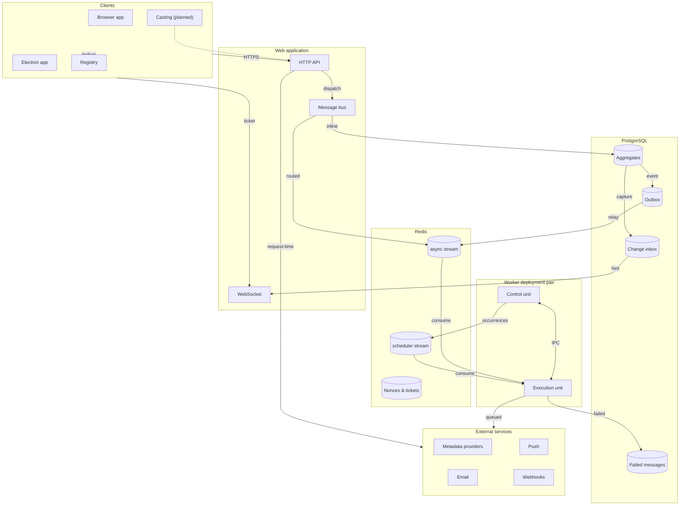

# Communication Map

Baander is one web application, two stores, a worker pair and a handful of
clients and external services, and they talk to each other over a small number
of paths: HTTPS requests with DPoP proofs, a WebSocket, a Symfony Messenger bus
with two Redis streams, a PostgreSQL outbox and change inbox, a private IPC
volume, and outbound provider calls. This page puts every path on one map,
says which page owns each path, and gives the rule for deciding whether a new
piece of work is an inline command, an outbox event, a scheduled occurrence or
a routed async message. It is a hub; the flow diagrams live on the pages it
links.

The map shows paths, not deployment. [Deployment Topology](../../part-1-operator-guide/getting-started/deployment-topology.md)
draws the same parts as containers and volumes; [Architecture Overview](overview.md)
describes the bounded contexts and layers that the web application and the
workers both load.

## Clients

Every client is an HTTP client of the API first. The browser single-page
application in `ui/web` is the reference client: it holds a DPoP key pair,
sends a proof with every request, refreshes tokens, and opens one WebSocket for
live updates. The Electron app in `ui/electron` loads that same application
against a configured server URL, so it shares the generated API client and the
DPoP package in `ui/shared/dpop`; what it adds is a native shell with its own
codec and window services. [Frontend Development](../development/frontend-development.md)
owns both. The local casting companion is a Bånder component on the receiver's
network that supplies discovery and control when the browser or remote server
cannot provide them directly, connecting the listener's home receivers to
playback controlled through Bånder; it is planned, and the map draws it with a
dotted edge for that reason.

## HTTP API and WebSocket

The HTTP API sits behind the Symfony firewall. `OAuth2Authenticator` validates
the access token and its DPoP binding on every API request; token endpoints
hand out single-use nonces that `DpopNonceManager` stores in Redis under
`dpop:nonce:` keys for `auth.dpop.nonce_ttl` seconds. The handshake and the
proof claims are specified in [DPoP Proofs](../development/api-authentication.md#dpop-proofs);
[Authentication](../development/api-authentication.md#authentication) covers the login, refresh and
OAuth grants around it.

The WebSocket is opened in two steps because a browser cannot set an
Authorization or DPoP header on an upgrade. The client first calls
`POST /api/ws/tickets` through its authenticated HTTP client, then opens
`/api/ws?ticket=<ticket>`; Swoole's upgrade handler checks the route, framing
and Origin, and `WsTicketAuthenticator` has Redis consume the ticket atomically
before a fresh database query checks the token. The socket then carries change
hints, which name what to reread and carry no resource contents, playback
session coordination messages, party sync messages and transcode position
controls.
[Real-Time Patterns](real-time-patterns.md) owns the connection registry, the
message protocol and [the ticket authentication](real-time-patterns.md#authentication);
[Live Updates](live-updates.md) owns the committed-change path that feeds it.

## Message bus and PostgreSQL

Controllers and console commands dispatch commands, queries and messages on one
Messenger bus. The bus decides between an inline handler and a Redis stream by
the workloads map in `config/packages/messenger.php`, as
[Routing](../development/cqrs-and-messaging.md#routing) describes: a message absent from the
map, or listed with its `default` flag off and dispatched without a transport
stamp, runs in the calling process against the aggregates in PostgreSQL; a
message listed with `default` on, or stamped with a transport name, is sent to
the `async` or `scheduler` stream. The `failed` transport is the PostgreSQL
table `failed_messages`, where a delivery lands after the execution unit
exhausts its retries; see
[Message contract and retries](../development/cqrs-and-messaging.md#message-contract-and-retries).

Two PostgreSQL tables turn committed writes into communication. The outbox
captures domain events in the producing transaction, so an event exists only
if its write committed; the control unit's relay reconstructs each event and
dispatches it to durable listeners, which hand further messages to `async`
(for example, a committed `LibraryDirectoryIndexed` becomes a `FilesDiscovered`
message). Party and transcode listeners stay on the live dispatcher in the
producing process. [Durable Event Replay](../development/cqrs-and-messaging.md#durable-event-replay)
owns that path. The change inbox is filled by capture triggers in the same
transaction as the business write; `DoctrineLiveChangeProjector` folds its
rows into scoped revisions, and `LiveUpdateRuntime` on the HTTP workers turns
revision changes into WebSocket hints. [Committed capture and projection](live-updates.md#committed-capture-and-projection)
owns that path.

## Redis

Redis carries the two Messenger streams, `messages` for the `async` transport
and `scheduler_occurrences` for the `scheduler` transport, both read by the
`baander` consumer group with consumer names that include the deployment and
boot identity. It also holds DPoP nonces and WebSocket tickets, both
short-lived by design, and the durable consumer's heartbeat, which
`MessengerWorkerHealth` writes without expiry so that the web container can
judge a worker by the age of its last write. Job history, outbox records and
failed messages are in PostgreSQL, not Redis. [Deployment Topology](../../part-1-operator-guide/getting-started/deployment-topology.md)
says what losing each store would mean.

## Worker deployment pair

Background work runs in two containers admitted together under one deployment
namespace and boot identity. The control unit renews the deployment lease and
supervises the outbox relay, the scheduler poller, the autoscaler and the media
coordinator; the execution unit runs the ordinary `async` consumers, one
separate `scheduler` consumer and the native execution daemon that runs probes
and encoders. A private IPC volume joins them: each unit publishes a heartbeat
there and admits work only while its peer's heartbeat is current and at the
same lease epoch. The scheduler records occurrences in PostgreSQL before it
relays them to the `scheduler` stream, so a recovery pass can publish an
occurrence that was recorded but never reached Redis. A transcode is the one
workload that bypasses the bus entirely: the web request commits an execution
request in PostgreSQL, the control unit claims it, and bounded native requests
cross the IPC socket to the execution unit.
[Background Work](../../part-1-operator-guide/workers/background-work.md) owns the pair's
duties, admission and recovery; [Scheduled work](../../part-1-operator-guide/workers/background-work.md#scheduled-work)
owns the occurrence path.

## External services

Most outbound traffic leaves from the execution unit, because the work that
needs a provider is queued: `SendEmailCommand` and `SendPushCommand` route to
`async` by default, `SendWebhookCommand` is explicit-only and is handed to
`async` by the notification relay, and the metadata sync messages call
MusicBrainz, Discogs and the other providers from their handlers.
[External APIs](../../part-1-operator-guide/media/external-apis.md) owns the provider
list and the degradation matrix; [Notifications](../../part-1-operator-guide/administration/notifications.md)
owns email, push and webhook delivery.

The web application calls out directly in three cases, which is why the map
has an edge from the HTTP API to the external services as well. Credential
emails for password reset and verification go through `AfterResponseMailer`,
which sends after the response, straight to the mailer transport, so that a
request for a real account takes as long as one for an unknown address. The
on-demand lyrics fetch and the lyrics search call LRCLIB inside the request:
`FetchLyricsCommand` has `default` off and `LyricsController` dispatches it
without a transport stamp, and `SearchLyricsHandler` calls the client from its
query handler. Metadata browsing (`MetadataBrowseController`) looks up
MusicBrainz and Last.fm inside the request. Every outbound path and its
destination policy is listed in the
[outbound inventory](application-threat-model.md#outbound-inventory).

## Discovery and the registry

LAN discovery and pairing are an ordinary part of the API. The Discovery
context registers a server, opens a pairing session with a short-lived code and
completes the pairing, storing server and pairing records in the application
database; its endpoints live under `/api/discovery/`. The registry is a
separate service, a C++ API backed by rqlite, that lets a client find a
registered server by its public identity. The application does not call it,
which is why the map has no edge from the web application to the registry:
only clients look a server up there. [Discovery](../contexts/discovery.md) owns the
context; [Registry](../../part-1-operator-guide/administration/registry.md) owns the service.

## When something is a message

A new background task is one of four kinds, and the workloads map in
`config/packages/messenger.php` is the authority on how each is routed. The
retry policy per transport is on
[CQRS and Messaging](../development/cqrs-and-messaging.md#message-contract-and-retries), not
here. The vocabulary (asynchronous workload catalog, workload resource class,
consumer identity, worker deployment pair) is defined in [CONCEPTS.md](../../../CONCEPTS.md).

| Kind | Choose it when | How it is routed | Where it runs | Where it fails to |
|------|----------------|------------------|---------------|-------------------|
| Inline command | The caller needs the result in the same request or process, and the work is short enough to hold the request. | Not in the workloads map, or in it with `default` off and dispatched without a transport stamp. | The calling process: the HTTP worker, the console command or the worker that dispatched it. | The caller; the exception reaches the request or command. |
| Domain event through the outbox | A committed write must have a side effect, possibly in another context, that survives the producing process. | Captured in the PostgreSQL outbox in the producing transaction and relayed by the control unit to durable listeners, which hand further messages to `async`; party and transcode listeners also run live in the producing process. | The control unit's relay for the listeners; the execution unit for the messages they queue. | The outbox record's dead-letter state; a queued message then follows the routed row. |
| Scheduled occurrence | Work recurs on a schedule or is triggered as a registered job. | The control unit records the occurrence in PostgreSQL and relays it to the `scheduler` stream as `ExecuteScheduledOccurrenceCommand`, which the map routes by default. | The execution unit's separate `scheduler` consumer. | `failed_messages`; the schedule also records its own last result. |
| Routed async command | Work is long, calls a provider, or must not hold the request: scans, enrichment, image derivatives, email, push. | In the workloads map with `default` on, or with `default` off and dispatched with a `TransportNamesStamp` naming `async`. | The execution unit's ordinary `async` consumers. | `failed_messages`. |

## Flows

Three flows cross most of the map, and each has its diagram on the page that
owns it:

- [Routing a dispatched message](../development/cqrs-and-messaging.md#routing): from the bus
  through the workloads map to an inline handler, a stream, a retry or
  `failed_messages`.
- [Running a transcode](../contexts/transcode.md#lifecycle): from the session
  request through PostgreSQL, the control unit, the IPC socket and shared
  storage to served segments and a change hint.
- [Completing an OAuth login with DPoP](../development/api-authentication.md#dpop-proofs): from
  the first proof without a nonce to a bound token pair and a proven API
  request.

The committed-change path, from a business write to a refreshed view, is on
[Live Updates](live-updates.md).

## See Also

- [Architecture Overview](overview.md) — bounded contexts, layers and the shared kernel
- [CQRS and Messaging](../development/cqrs-and-messaging.md) — commands, handlers, events and the transports
- [Real-Time Patterns](real-time-patterns.md) — the WebSocket registry, protocol and ticket authentication
- [Live Updates](live-updates.md) — committed change capture and delivery
- [Deployment Topology](../../part-1-operator-guide/getting-started/deployment-topology.md) — the same parts as containers, volumes and stores
- [Background Work](../../part-1-operator-guide/workers/background-work.md) — the worker deployment pair for operators
