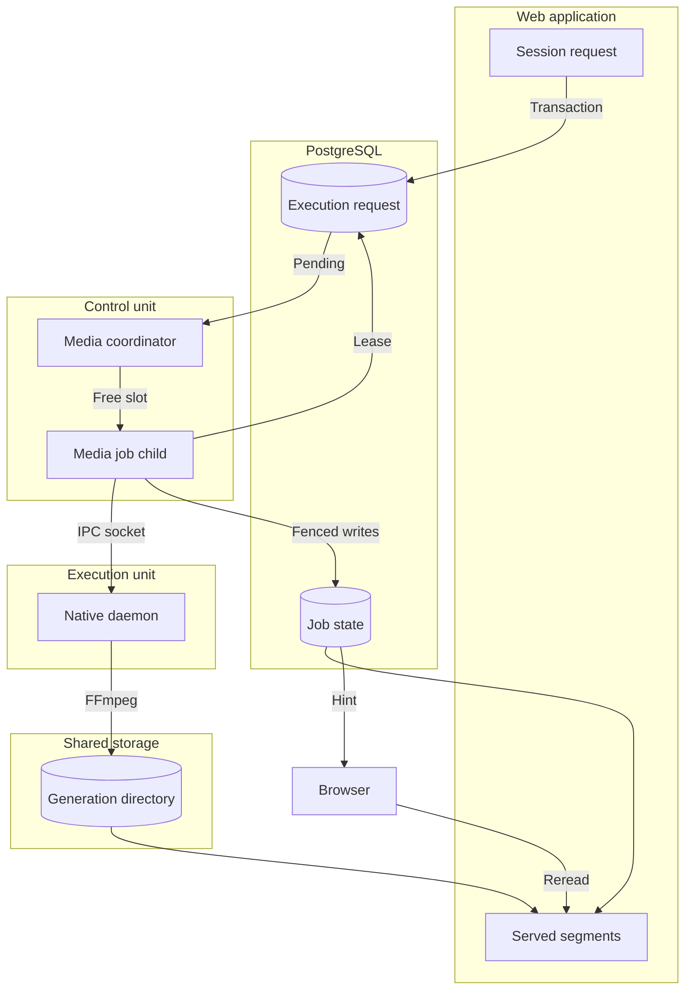

# Transcode

`src/Transcode/` transcodes video to CMAF with FFmpeg. It is the most infrastructure-heavy context in the codebase: it manages long-running encoding jobs, produces HLS v6 and DASH manifests, keeps a seek-aware segment priority queue, and hands FFmpeg commands to the worker deployment pair, where the execution unit runs the native encoder.

## Lifecycle

A transcode runs across the web application, PostgreSQL, the worker deployment pair and shared storage; no Messenger message carries it, and the web request starts no encoder.

## Domain Models

### Aggregate Roots

| Root | Description |
|------|-------------|
| `TranscodeJob` | A single encoding job with status, progress tracking, and quality tier |
| `TranscodeSession` | A live transcoding session with real-time state, priority, and lifecycle |

Each root keeps its fields in a state object, `TranscodeJobState` or `TranscodeSessionState`, which its private constructor, `create()` and `reconstitute()` share, as the project's aggregate root convention requires.

### Value Objects

| Type | Kind | Description |
|------|------|-------------|
| `SegmentMetadata` | Value object | Metadata for an encoded segment (index, duration, size, keyframe, encoding time, and completion timestamp) |
| `QualityTier` | Value object | HEVC quality definitions (resolution, bitrate, codec parameters) |
| `AudioProfile` | Value object | Audio encoding settings (codec, bitrate, channels) |
| `LoudnessStandard` | Enum | Audio normalization targets (e.g., EBU R128) |
| `SessionState` | Enum | `Pending`, `Preparing`, `Active`, `Paused`, `Completed`, `Failed`, `Cancelled` |
| `SessionPriority` | Enum | Session priority for the segment queue (`Critical`, `High`, `Normal`, `Low`, `Bulk`) |
| `TranscodeStatus` | Enum | Job status values |
| `VideoProbeResult` | Value object | Parsed output from FFprobe |
| `AudioStreamInfo`, `SubtitleTrackInfo` | Value object | One audio or subtitle stream FFprobe found, with its language, codec and default flag |
| `ColorSpace` | Value object | A source's color primaries, transfer and matrix, read from FFprobe |
| `EncoderProfile` | Value object | The hardware or software encoder configuration `HardwareCapabilitiesProber` qualified |
| `HardwareAccelerator` | Enum | `None`, `Nvenc`, `Vaapi`, `VideoToolbox`, `Qsv`, `Amf` |
| `ToneMapMethod` | Enum | HDR tone-mapping method: `Hable`, `Reinhard`, `BT2446`, `None` |
| `AacImplementation` | Enum | The `transcode.aac_implementation` setting (see [Ports](#ports)) |
| `PresentationSelection` | Value object | The presentation an encode produces: mode, source hash, selected video and audio streams, output container and encoding fingerprint |
| `StreamType` | Enum | `Video`, `Audio`, `Subtitle`, each encoded separately |

## Domain Services

| Service | Purpose |
|---------|---------|
| `QualityLadder` | Defines the available quality tiers and their encoding parameters |
| `AudioProcessingRules` | Rules for audio encoding, normalization, and loudness targeting |
| `VideoProcessingRules` | Video encoder flags, GOP sizing, RFC 6381 codec strings, and HDR tone-mapping rules |

## Commands & Handlers

| Command | Handler | Purpose |
|---------|---------|---------|
| `CreateTranscodeSessionCommand` | `CreateTranscodeSessionHandler` | Start a new transcoding session |
| `PauseTranscodeSessionCommand` | `PauseTranscodeSessionHandler` | Pause an active session |
| `ResumeTranscodeSessionCommand` | `ResumeTranscodeSessionHandler` | Resume a paused session |
| `CancelTranscodeSessionCommand` | `CancelTranscodeSessionHandler` | Cancel a session and clean up resources |
| `UpdateTranscodeSessionCommand` | `UpdateTranscodeSessionHandler` | Update session state |
| `UpdateTranscodePositionCommand` | `UpdateTranscodePositionHandler` | Update playback position (drives the segment priority queue) |
| `FailInterruptedTranscodeSessionsCommand` | `FailInterruptedTranscodeSessionsHandler` | Mark non-terminal sessions for interrupted jobs as failed |
| `CleanupOrphanedJobsCommand` | `CleanupOrphanedJobsHandler` | Remove stale or incomplete jobs |
| — (`app:transcode:cache-sweep`) | `SweepTranscodeCacheHandler` | Sweep idle video and audio rendition cache directories by TTL and LRU size budget |

## Ports

This context defines the following port interfaces, among others:

| Port | Purpose |
|------|---------|
| `FFmpegPortInterface` | FFmpeg process management (probe, encode, segment) |
| `TranscodeJobPortInterface` | Job lifecycle operations |
| `TranscodeSessionPortInterface` | Session lifecycle operations |
| `SegmentCachePortInterface` | In-memory caching of encoded segments |
| `TranscodeStoragePortInterface` | Persistent storage of segment files |
| `TranscodeStreamingPortInterface` | Streaming segment delivery to clients |
| `StreamAuthPortInterface` | Stream signing/authentication |
| `AudioRenditionPortInterface` | Cached on-the-fly audio transcoding of a track to a format and bitrate; published to Media through the `Transcode Audio Rendition Contract` Deptrac layer with `AudioRenditionFormat`, `AudioRenditionFailedException` and `TranscodeSettingDefinitions` |

The `AacImplementation` value object maps the `transcode.aac_implementation` setting to FFmpeg's codec names (`libbac`, `libfdk_aac`, `aac`). `AudioRenditionExecutor` reads the setting per rendition and probes the source codec; `CreateTranscodeSessionHandler` reads it once and stores it in the session's `DesiredTranscodeState`, from which every FFmpeg spawn of that session takes it. `SegmentEncoder::buildStreamArgs` forces the selected decoder on the mapped AAC audio stream and names the selected encoder; without an implementation it emits the built-in codec, which is what `EncodePresentationIdentity` hashes, so the identity is the same for all three. `AacImplementationProbe` lists the implementations the binary offers once per job and refuses an unavailable selection before the spawn.

## Audio Renditions

Media's `GET /api/stream/track` streams a track transcoded to Opus, AAC or MP3 when the request names a `format`. Media checks library access and reads the system settings `transcode.enabled` (off by default) and `transcode.max_bitrate` (kbps, default `320`) on every request; `TranscodeSettingDefinitions` contributes both, plus `transcode.aac_implementation` (default `bac`), which Transcode reads when it encodes AAC. With transcoding off, a request with a format is `403` and no encode starts. Otherwise Media caps the requested bitrate at the maximum, or uses the maximum when none is requested, and calls `AudioRenditionPortInterface::open()`. `AudioRenditionFormat::supportedBitrate()` then snaps the bitrate down to the highest step of `BITRATE_LADDER` that the format supports (seven steps from 64 to 320 kbps; Opus at most 256 kbps), limiting each format to at most seven bitrate choices.

`AudioRenditionCache` admits durable work through `AudioRenditionRuntimePort`.
The runtime key includes the track, format, bitrate and source signature. The
signature fingerprints the resolved source path, modification time and size, so
a repaired source rename selects a separate rendition even when the track ID and
file metadata stay unchanged. The output root is
`audio-renditions/<track>/<signature>/` under the transcode storage root. Repeated
requests for the unchanged source reuse that identity. This is a path and metadata
fingerprint; it does not detect a same-path replacement that preserves both size
and modification time.

The media worker discovers committed pending admissions and claims an execution
generation. `AudioRenditionExecutor` verifies the source signature before encoding,
holds the rendition's filesystem lock and delegates FFmpeg to native execution.
Each generation writes its own `.part` file, then renames it to the final file while
holding durable ownership. A busy filesystem lock defers the attempt. An expired
claim can be recovered in a new generation; stale workers cannot publish its
output. Encoding requires the separately deployed media worker, including for
requests made outside Swoole.

A complete rendition is served as a file with Range support. Otherwise the request
waits for its accepted generation to produce bytes and returns a progressive stream
with `Accept-Ranges: none`. The reader remains pinned to that generation and rejects
ownership loss. A failed encode or startup timeout raises
`AudioRenditionFailedException`, which Media maps to HTTP `500`.

`SweepTranscodeCacheHandler` treats `audio-renditions/<track>` as one cache unit
under the same TTL and size budget as video directories. A rename can leave the
previous completed output until that sweep removes it. If a completed file has
been evicted, the next request resets the observed completed generation and waits
for a worker to rebuild it from the same source.

## Domain Events

| Event | Trigger |
|-------|--------|
| `TranscodeJobCreated` | A new encoding job is created |
| `TranscodeJobCompleted` | An encoding job finishes successfully |
| `TranscodeJobFailed` | An encoding job fails |
| `TranscodeSessionAttached` | A client attaches to a transcoding session |
| `PlaybackPositionChanged` | Party starts, pauses or seeks playback; `PlaybackPositionChangedListener` turns it into `UpdateTranscodePositionCommand` for the job's session (drives the segment priority queue) |

`TranscodeJobService` raises `TranscodeJobCreated`. No code raises `TranscodeJobCompleted`, `TranscodeJobFailed` or `TranscodeSessionAttached`; `TranscodeJobEventSubscriber` logs the first two, and Notification maps them to its background-jobs category.

## API Endpoints

Endpoints are split between session management and streaming delivery.

### Session Management

| Method | Path | Purpose |
|--------|------|---------|
| GET | `/api/transcode/sessions` | List active transcoding sessions for the authenticated user |
| GET | `/api/transcode/sessions/list` | List all transcoding sessions for the authenticated user |
| POST | `/api/transcode/sessions` | Create a new session |
| GET | `/api/transcode/sessions/{publicId}` | Get a single session |
| PATCH | `/api/transcode/sessions/{publicId}` | Update a session |
| PATCH | `/api/transcode/sessions/{publicId}/pause` | Pause a session |
| PATCH | `/api/transcode/sessions/{publicId}/resume` | Resume a paused session |
| POST | `/api/transcode/sessions/{publicId}/position` | Update playback position |
| DELETE | `/api/transcode/sessions/{publicId}` | Cancel a session |

### Job Management

| Method | Path | Purpose |
|--------|------|---------|
| GET | `/api/transcode/jobs` | List the caller's orphaned transcoding jobs in accessible libraries; an administrator sees every user's |
| GET | `/api/transcode/jobs/list` | List transcoding jobs for the authenticated user |
| GET | `/api/transcode/jobs/{publicId}` | Get the status of one of the caller's jobs; another user's job answers `404` unless the caller is an administrator |
| GET | `/api/transcode/jobs/{publicId}/metrics` | Encoding metrics of one of the caller's jobs, with the same `404` for another user's job |
| POST | `/api/transcode/jobs/cleanup` | Trigger orphaned-job cleanup |

### Streaming

| Method | Path | Purpose |
|--------|------|---------|
| POST | `/api/stream/sign` | Sign a master manifest URL for playback (token and DPoP proof required; library membership checked) |
| GET | `/api/transcode/{videoId}/quality-ladder` | Available quality tiers (token and DPoP proof required; library membership checked) |
| GET | `/api/transcode/{videoId}/master.m3u8` | HLS master manifest (signed URL) |
| GET | `/api/transcode/{videoId}/manifest.mpd` | DASH manifest (signed URL) |
| GET | `/api/transcode/{jobPublicId}/tracks/{track}/media.m3u8` | HLS media playlist for the video or audio track (signed URL) |
| GET | `/api/transcode/{jobPublicId}/subtitles/{language}/media.m3u8` | HLS subtitle manifest (signed URL) |
| GET | `/api/transcode/{jobPublicId}/tracks/{track}/init.mp4` | Init segment for the video or audio track (signed URL) |
| GET | `/api/transcode/{jobPublicId}/tracks/{track}/segment.m4s?index={index}` | Media segment for the video or audio track (signed URL) |
| GET | `/api/transcode/{jobPublicId}/subtitles/{language}/{segment}.vtt` | Subtitle segment (signed URL) |
| GET | `/api/transcode/artifacts/{jobPublicId}/{generation}/master.m3u8` | Completed video HLS master playlist (`CompletedVideoController`, signed URL) |
| GET | `/api/transcode/artifacts/{jobPublicId}/{generation}/tracks/{track}/media.m3u8` | Completed video HLS track playlist (`CompletedVideoController`, signed URL) |
| GET | `/api/transcode/artifacts/{jobPublicId}/{generation}/tracks/{track}/init.mp4` | Completed video track initialization segment (`CompletedVideoController`, signed URL) |
| GET | `/api/transcode/artifacts/{jobPublicId}/{generation}/tracks/{track}/segment.m4s?index={index}` | Completed video track media segment (`CompletedVideoController`, signed URL) |

The live media playlist, init segment, media segment and subtitle segment routes take a required `generation` query naming the pinned transcode execution generation. The signed URLs in the master manifest carry it; a request without it answers `404`. Completed video artifact routes carry `{generation}` in the URL path.

The live routes require `{videoId}` and `{jobPublicId}` to be public IDs and `{language}` to be a source subtitle track key of the form `s<index>`, such as `s0`, and `{segment}` is always `full`. The `security.yaml` rows that admit delivery without a token match the same patterns, so any other path under `/api/transcode/`, such as `/api/transcode/jobs/master.m3u8`, needs authentication.

A signed URL is not bound to the user who presents it, but it serves only while the owner of each job it names may still play the job's video. Each live manifest, segment and subtitle request checks that once, after the signature, through `LiveDeliveryAccessPort`; the master and DASH manifests check every job of their rendition set. A lost library, a disabled owner and a missing job all answer `409` (`Playback media is unavailable.`). The wait for a segment to be published re-resolves the job every 0.25 seconds without repeating the check. Completed video artifacts check the job owner the same way in `CompletedVideoDeliveryAdapter`.

## Cross-Context Relationships

| Direction | Context | Details |
|-----------|---------|---------|
| Depends on | Shared | `Uuid`, `PublicId`, `NativeExecutionClientInterface`, `Async`, `JobMonitoringMiddleware` |
| Depended on by | Party | Raises `PlaybackPositionChanged` for synchronized playback and checks access through `PlaybackAccessInterface` (the `Transcode Playback Access Contract` Deptrac layer) |
| Depended on by | Media | The track stream transcodes audio through `AudioRenditionPortInterface` and reads `TranscodeSettingDefinitions` keys (the `Transcode Audio Rendition Contract` Deptrac layer); playback delivery uses `MediaExecutionPolicyInterface`, `CompletedVideoArtifactPort`, `CompletedVideoDeliveryPort`, `CopyPresentationPortInterface` and `StreamAuthPortInterface` (the `Transcode Delivery Contract` layer) |
| Depended on by | Catalog | Ingest probes audio and video files through `AudioProbePortInterface` and `VideoProbePortInterface` (the `Transcode Probe Contract` layer) |
| Depended on by | Notification | Maps `TranscodeJobCompleted` and `TranscodeJobFailed` to its background-jobs category |
| Depends on | Catalog | Reads videos through `VideoPortInterface`; the worker, session start and completed-artifact reuse resolve the source file with an unrestricted scope, so a file that no longer resolves inside one of the video's libraries is refused |
| Depends on | Auth | `AuthenticatedUserIdentityInterface`, `UserIdentifierResolverInterface` |
| Depends on | Media | `PlaybackMediaAccessInterface` |
| Depends on | QoL | QoL contracts only. `TranscodeSessionSubscriber` injects `StreamAdmissionPortInterface` directly to evaluate stream admission and record completion; `QualityFilteringStreamingDecorator` wraps `TranscodeStreamingService` (decoration priority `-1`) to filter manifests by the allowed-tier contract; `QualityLadderPort` and `EncoderProfileFingerprintAdapter` implement QoL contracts |

## Infrastructure

### FFmpeg

The FFmpeg classes build commands and read their results. `ProcessExecutor` sends every command through the native execution client that the media job child configures at launch, so inside the worker pair a command runs only in the execution unit. A worker that requires native execution refuses to run a command locally; the local `proc_open` path exists for standalone tools.

| Component | Purpose |
|-----------|---------|
| `SegmentEncoder` | CMAF segment encoding: the quality tier's encoder profile, video and audio filter chains, and the segment duration |
| `FFmpegArguments`, `FFprobeArguments` | Literal argument lists for encodes, subtitle extraction and probes. `FFmpegArguments::inputClause()` writes every input: a format whitelist and `-protocol_whitelist file` before `-i`, chosen by `FFmpegInputKind` |
| `FFmpegAdapter` | `FFmpegPortInterface`: init and media segment encodes, loudness analysis and subtitle extraction |
| `FFprobeAdapter` | Audio and video probing (duration, codecs, resolution) |
| `VideoFilterBuilder`, `AudioFilterBuilder` | Scaling, tone mapping, loudness normalization and downmix filters from a probe result |
| `HardwareCapabilitiesProber` | Qualifies the configured hardware encoder with a test encode at worker start; without one the software encoder is qualified |
| `ProcessExecutor` | Sends each command through the native execution client in admitted workers and runs it locally only in standalone tools |

Every FFmpeg and ffprobe input names what it is, and the kind decides which demuxers may open it. FFmpeg checks the format whitelist against the demuxer it probed and passes the list to every nested demuxer, so a DASH manifest, an HLS playlist, a concat script or an IMF playlist under a media file name is refused before it can open the file it names. A source test fails on a literal `-i` anywhere else in `src/`.

| Input kind | Used by | Format whitelist |
|------------|---------|------------------|
| Library audio | Import probe, audio rendition and its probes | the audio demuxers of `MediaContainer`: `mp3,flac,ogg,wav,aac,mov,asf,aiff` |
| Library video | Import probe, play-time probe, keyframe listing, encode, stream copy, subtitle extraction, timeline preview | the video demuxers of `MediaContainer`: `mov,matroska,avi,asf` |
| Published presentation | The probe of a worker's own `manifest.mpd` | `dash,mov` |
| Generated source | Hardware capability probes | none; the input is forced to `lavfi` |

`MediaContainer` in the Shared kernel is the one table of supported containers: the extensions the scanner discovers, the FFmpeg demuxer that must recognize the content and the media type of the original. `docker/ffmpeg/expected-capabilities.txt` lists every whitelisted demuxer, so the FFmpeg capability gate proves the build has them. The whitelist is part of the encode argument list, which `EncodePresentationIdentity` hashes, so changing it changes every encode fingerprint and completed encode artifacts are encoded again on their next play.

The probes name every entry they read: no container tag is printed, and of the stream tags only `DURATION`, `language` and `title`, which give a Matroska film's end and name its tracks. One named tag can still be large, so the output bound of native execution remains the barrier. The copy keyframe listing prints one compact `key_frame,best_effort_timestamp_time` line per keyframe, about 12 bytes, so it fits the bound up to some 87,000 keyframes; past that the copy session fails with `The source keyframe listing failed:` and the bound's reason. Subtitle extraction runs at `-loglevel error -nostats`, so FFmpeg's input dump, which prints every tag, stays out of its error output.

### Manifest Generation

| Component | Purpose |
|-----------|---------|
| `FMP4SegmentWriter` | Writes fMP4 segments to storage |
| `ManifestGenerator` | Generates HLS v6 playlists |
| `WebVttTimeline` | Clips and rebases WebVTT subtitle cues to the local timeline of a restarted video generation |
| `QualityLadderRenderer` | Renders quality tier information for clients |
| `DashManifestGenerator` | Generates DASH manifests |

### Caching and Storage

| Component | Purpose |
|-----------|---------|
| `InMemorySegmentCache` | Hot cache for recently encoded segments |
| `TranscodeFileStorage` | Persistent file storage for segments and manifests |
| `SegmentFileResolver` | Resolves segment paths between cache and storage |

### Worker pair execution

Encoding runs in the worker deployment pair, not in the web server. The control unit admits work and owns the lease; the execution unit runs the native encoder; PostgreSQL holds the job state that both the web application and the worker read. The web request for a session commits the transcode session and its execution request in one transaction and then polls the request's outcome for up to five seconds; a refused, failed or cancelled outcome, or no acceptance before the admission deadline, is a startup failure the controller reports as `503`.

`TranscodeSessionShare` bounds each user's transcode sessions, encode and copy sessions together, at the `transcode.sessions_per_user` setting. `CreateTranscodeSessionHandler` and `CopyPresentationService::start`, the copy start of delivery negotiation, take the user's advisory lock (`pg_advisory_xact_lock` on the user id, through `TranscodeSessionSharePort`) as the first statement of their transaction, before the video row, so one user's starts count their sessions in turn. Before creating a session, `makeRoom` ends the user's own sessions with the oldest sign of life (`transcode_sessions.updated_at`) that have been silent for two minutes, or throws `TranscodeSessionLimitException` (`409`, reason `transcode_session_limit`), which delivery negotiation passes on. When the running and waiting video executions already fill the slots that run them (`DeploymentProfile::mediaClientIds('video')`: the video slots, or under `remux` the shared copy slots), it also ends the slot holder of any user that has been silent for 70 minutes. Audio copies that share the copy slots under `remux` are not counted: no session holds them, so a start waits for them. For each session it ends, it locks the execution row and then the session row, never a second video row, in session id order. It cancels the execution of a running one and releases the job as stale session expiry does. A finished execution stays complete and still names the ended session, so both starts refuse to hand an ended session back to its client and create a new one. `AuthorizedPlayback::start` admits each tier in its own transaction, so it first checks under the same lock that every tier fits. If a later tier is refused, it withdraws the sessions it created.

| Component | Purpose |
|-----------|---------|
| `TranscodeRuntimeState` | The execution request in `transcode_runtime_state`: `lockAdmission` and `admit` inside the producer transaction, `control` for the desired state, position and seek, `pending`, `claim` with a short lease, `renew`, `observe` for the outcome and output directory, and `release`. Writes are fenced on the transcode execution generation and the transcode control revision |
| `MediaWorkerRunner` | The control unit's media coordinator: polls pending video and audio work only while a media job slot is free, launches one media job child per request, and gives the child its native client slot and generation |
| `bin/worker-media-job.php` | The media job child: confirms the native execution peer is ready, boots a fresh kernel, claims the request and runs the claim |
| `TranscodeSessionSubscriber` | Runs one claimed video request: renews the lease on a timer, probes the source, starts the encoder for the current generation, persists segment and manifest state through the ownership fence, and observes `ready` and `complete` |
| `TranscodeStreamManager` | One continuous FFmpeg process per job and tier, started, paused, resumed and stopped through `ProcessSpawnerInterface` |
| `NativeProcessSpawner`, `TranscodeProcessPool` | Submit the encoder, probes and subtitle helpers as native execution attempts through `NativeExecutionClientInterface` and retire them with a confirmed outcome |
| `NativeExecutionClient` (Shared) | Speaks to the native execution daemon over the Unix socket on the private IPC volume; every request carries the deployment namespace, boot, lease epoch, client slot and generation |
| Native execution daemon | `bin/worker-native.php` in the execution unit; runs FFmpeg, probes and helpers and reports each attempt's state, output and exit code. Standard output past `NativeExecutionProtocol::OUTPUT_BYTES` (1 MiB) fails that attempt: the daemon kills its process group, blanks its output and reports a non-zero exit with the reason, also when the overflow shows only in the final drain after the command exited 0. Standard error keeps its newest `ERROR_TAIL_BYTES` (64 KiB) behind a truncation marker and fails nothing. A process group not reaped within one second of its stop still poisons the daemon |
| Lease loss | A child whose lease or deployment authority lapses stops its encoder and stops persisting state; after the lease expires the next claim starts a new transcode execution generation, so output of the old generation is not delivered as current output |

### Console Commands

| Command | Purpose |
|---------|---------|
| `app:transcode:session:list` (`TranscodeSessionListCommand`) | List the active transcode sessions of every user, or of one user with `--user` (CLI counterpart of `GET /api/transcode/sessions/`) |
| `app:transcode:session:show` (`TranscodeSessionShowCommand`) | Show one transcode session by `PublicId` (CLI counterpart of `GET /api/transcode/sessions/{publicId}`) |
| `app:transcode:job:cleanup` (`TranscodeJobCleanupCommand`) | Remove transcode jobs that no session uses, with their output (CLI counterpart of `POST /api/transcode/jobs/cleanup`) |
| `app:transcode:cache-sweep` (`SweepTranscodeCacheCommand`) | Sweep old transcode segment cache directories (TTL + LRU size budget; schedulable console command) |
| `debug:hw-transcode` (`DebugHwTranscodeCommand`) | Show the last worker-published hardware encoder profile and sample FFmpeg commands |
