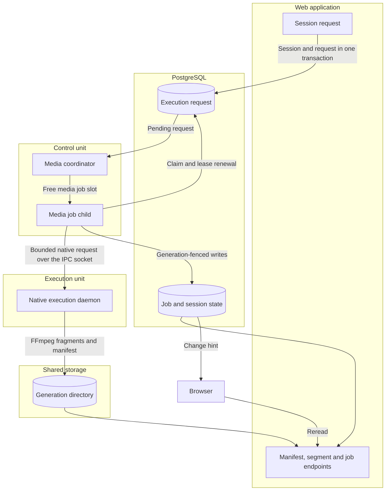

# Transcode

`src/Transcode/` handles CMAF video transcoding via FFmpeg. It is the most infrastructure-heavy context in the codebase: it manages long-running encoding jobs, produces HLS v6 and DASH manifests, implements a seek-aware segment priority queue, and hands FFmpeg commands to the worker deployment pair, where the execution unit runs the native encoder.

## Lifecycle

A transcode runs across the web application, PostgreSQL, the worker deployment pair and shared storage; no Messenger message carries it, and the web request starts no encoder.

## Domain Models

### Aggregate Roots

| Root | Description |
|------|-------------|
| `TranscodeJob` | A single encoding job with status, progress tracking, and quality tier |
| `TranscodeSession` | A live transcoding session with real-time state, priority, and lifecycle |
| `SegmentMetadata` | Metadata for an encoded segment |

### Value Objects

| Type | Kind | Description |
|------|------|-------------|
| `QualityTier` | Value object | HEVC quality definitions (resolution, bitrate, codec parameters) |
| `AudioProfile` | Value object | Audio encoding settings (codec, bitrate, channels) |
| `LoudnessStandard` | Value object | Audio normalization targets (e.g., EBU R128) |
| `SessionState` | Enum | `Pending`, `Preparing`, `Active`, `Paused`, `Completed`, `Failed`, `Cancelled` |
| `SessionPriority` | Value object | Session priority for the segment queue |
| `TranscodeStatus` | Enum | Job status values |
| `VideoProbeResult` | Value object | Parsed output from FFprobe |

## Domain Services

| Service | Purpose |
|---------|---------|
| `QualityLadder` | Defines the available quality tiers and their encoding parameters |
| `AudioProcessingRules` | Rules for audio encoding, normalization, and loudness targeting |

## Commands & Handlers

| Command | Handler | Purpose |
|---------|---------|---------|
| `CreateTranscodeSessionCommand` | `CreateTranscodeSessionHandler` | Start a new transcoding session |
| `PauseTranscodeSessionCommand` | `PauseTranscodeSessionHandler` | Pause an active session |
| `ResumeTranscodeSessionCommand` | `ResumeTranscodeSessionHandler` | Resume a paused session |
| `CancelTranscodeSessionCommand` | `CancelTranscodeSessionHandler` | Cancel a session and clean up resources |
| `UpdateTranscodeSessionCommand` | `UpdateTranscodeSessionHandler` | Update session state |
| `UpdateTranscodePositionCommand` | `UpdateTranscodePositionHandler` | Update playback position (drives the segment priority queue) |
| `CleanupOrphanedJobsCommand` | `CleanupOrphanedJobsHandler` | Remove stale or incomplete jobs |

## Ports

This context defines the following port interfaces, among others:

| Port | Purpose |
|------|---------|
| `FFmpegPortInterface` | FFmpeg process management (probe, encode, segment) |
| `TranscodeJobPortInterface` | Job lifecycle operations |
| `TranscodeSessionPortInterface` | Session lifecycle operations |
| `SegmentCachePortInterface` | In-memory caching of encoded segments |
| `TranscodeStoragePortInterface` | Persistent storage of segment files |
| `TranscodeStreamingPortInterface` | Streaming segment delivery to clients |
| `StreamAuthPortInterface` | Stream signing/authentication |
| `AudioRenditionPortInterface` | Cached on-the-fly audio transcoding of a track to a format and bitrate; published to Media through the `Transcode Audio Rendition Contract` Deptrac layer with `AudioRenditionFormat`, `AudioRenditionFailedException` and `TranscodeSettingDefinitions` |

## Audio Renditions

Media's `GET /api/stream/track` streams a track transcoded to Opus, AAC or MP3 when the request names a `format`. Media checks library access and reads the system settings `transcode.enabled` (off by default) and `transcode.max_bitrate` (kbps, default `320`) on every request; `TranscodeSettingDefinitions` contributes both. With transcoding off, a request with a format is `403` and no encode starts. Otherwise Media caps the requested bitrate at the maximum, or uses the maximum when none is requested, and calls `AudioRenditionPortInterface::open()`. `AudioRenditionFormat::supportedBitrate()` then snaps the bitrate down to the highest step of `BITRATE_LADDER` that the format supports (seven steps from 64 to 320 kbps; Opus at most 256 kbps), limiting each format to at most seven bitrate choices.

`AudioRenditionCache` admits durable work through `AudioRenditionRuntimePort`.
The runtime key includes the track, format, bitrate and source signature. The
signature fingerprints the resolved source path, modification time and size, so
a repaired source rename selects a separate rendition even when the track ID and
file metadata stay unchanged. The output root is
`audio-renditions/<track>/<signature>/` under the transcode storage root. Repeated
requests for the unchanged source reuse that identity. This is a path and metadata
fingerprint; it does not detect a same-path replacement that preserves both size
and modification time.

The media worker discovers committed pending admissions and claims an execution
generation. `AudioRenditionExecutor` verifies the source signature before encoding,
holds the rendition's filesystem lock and delegates FFmpeg to native execution.
Each generation writes its own `.part` file, then renames it to the final file while
holding durable ownership. A busy filesystem lock defers the attempt. An expired
claim can be recovered in a new generation; stale workers cannot publish its
output. Encoding requires the separately deployed media worker, including for
requests made outside Swoole.

A complete rendition is served as a file with Range support. Otherwise the request
waits for its accepted generation to produce bytes and returns a progressive stream
with `Accept-Ranges: none`. The reader remains pinned to that generation and rejects
ownership loss. A failed encode or startup timeout raises
`AudioRenditionFailedException`, which Media maps to HTTP `500`.

`SweepTranscodeCacheHandler` treats `audio-renditions/<track>` as one cache unit
under the same TTL and size budget as video directories. A rename can leave the
previous completed output until that sweep removes it. If a completed file has
been evicted, the next request resets the observed completed generation and waits
for a worker to rebuild it from the same source.

## Domain Events

| Event | Trigger |
|-------|--------|
| `TranscodeJobCreated` | A new encoding job is created |
| `TranscodeJobCompleted` | An encoding job finishes successfully |
| `TranscodeJobFailed` | An encoding job fails |
| `TranscodeSessionAttached` | A client attaches to a transcoding session |
| `PlaybackPositionChanged` | The playback position in a session changes (drives the segment priority queue) |

## API Endpoints

Endpoints are split between session management and streaming delivery.

### Session Management

| Method | Path | Purpose |
|--------|------|---------|
| GET | `/api/transcode/sessions` | List transcoding sessions |
| POST | `/api/transcode/sessions` | Create a new session |
| GET | `/api/transcode/sessions/{uuid}` | Get a single session |
| PATCH | `/api/transcode/sessions/{uuid}` | Update a session |
| PATCH | `/api/transcode/sessions/{uuid}/pause` | Pause a session |
| PATCH | `/api/transcode/sessions/{uuid}/resume` | Resume a paused session |
| POST | `/api/transcode/sessions/{uuid}/position` | Update playback position |
| DELETE | `/api/transcode/sessions/{uuid}` | Cancel a session |

### Job Management

| Method | Path | Purpose |
|--------|------|---------|
| GET | `/api/transcode/jobs` | List transcoding jobs |
| GET | `/api/transcode/jobs/{publicId}` | Get a single job status |
| GET | `/api/transcode/jobs/{publicId}/metrics` | Job encoding metrics |
| POST | `/api/transcode/jobs/cleanup` | Trigger orphaned-job cleanup |

### Streaming

| Method | Path | Purpose |
|--------|------|---------|
| POST | `/api/stream/sign` | Sign a master manifest URL for playback (token and DPoP proof required; library membership checked) |
| GET | `/api/transcode/{videoId}/quality-ladder` | Available quality tiers (token and DPoP proof required; library membership checked) |
| GET | `/api/transcode/{videoId}/master.m3u8` | HLS master manifest (signed URL) |
| GET | `/api/transcode/{videoId}/manifest.mpd` | DASH manifest (signed URL) |
| GET | `/api/transcode/{jobPublicId}/tracks/{track}/media.m3u8` | HLS media playlist for the video or audio track (signed URL) |
| GET | `/api/transcode/{jobPublicId}/subtitles/{language}/media.m3u8` | HLS subtitle manifest (signed URL) |
| GET | `/api/transcode/{jobPublicId}/tracks/{track}/init.mp4` | Init segment for the video or audio track (signed URL) |
| GET | `/api/transcode/{jobPublicId}/tracks/{track}/segment.m4s?index={index}` | Media segment for the video or audio track, with an optional `generation` query (signed URL) |
| GET | `/api/transcode/{jobPublicId}/subtitles/{language}/{segment}.vtt` | Subtitle segment (signed URL) |

## Cross-Context Relationships

| Direction | Context | Details |
|-----------|---------|---------|
| Depends on | Shared | `Uuid`, `PublicId`, `NativeExecutionClientInterface`, `Async`, `JobMonitoringMiddleware` |
| Depended on by | Party | References transcode jobs for synchronized playback |
| Depended on by | Media | The track stream transcodes audio through `AudioRenditionPortInterface` and reads `TranscodeSettingDefinitions` keys (the `Transcode Audio Rendition Contract` Deptrac layer) |
| Depended on by | Notification | Listens to transcode domain events for user notifications |
| Depends on | QoL | QoL contracts only. `StreamAdmissionListener` (on `TranscodeSessionAttached`, priority 1) and `StreamCompletionListener` (on `TranscodeJobCompleted`) call the stream-admission contract; `QualityFilteringStreamingDecorator` filters manifests by the allowed-tier contract (decoration priority -1, below the cache decorator); `QualityLadderPort` and `EncoderProfileFingerprintAdapter` implement QoL contracts |

## Infrastructure

### FFmpeg

The FFmpeg classes build commands and read their results. `ProcessExecutor` sends every command through the native execution client that the media job child configures at launch, so inside the worker pair a command runs only in the execution unit. A worker that requires native execution refuses to run a command locally; the local `proc_open` path exists for standalone tools.

| Component | Purpose |
|-----------|---------|
| `SegmentEncoder` | CMAF segment encoding: the quality tier's encoder profile, video and audio filter chains, and the segment duration |
| `FFmpegArguments`, `FFprobeArguments` | Literal argument lists for encodes, subtitle extraction and probes |
| `FFmpegAdapter` | `FFmpegPortInterface`: init and media segment encodes, loudness analysis and subtitle extraction |
| `FFprobeAdapter` | Audio and video probing (duration, codecs, resolution) |
| `VideoFilterBuilder`, `AudioFilterBuilder` | Scaling, tone mapping, loudness normalization and downmix filters from a probe result |
| `HardwareCapabilitiesProber` | Qualifies the configured hardware encoder with a test encode at worker start; without one the software encoder is qualified |
| `ProcessExecutor` | Sends each command through the native execution client in admitted workers and runs it locally only in standalone tools |

### Manifest Generation

| Component | Purpose |
|-----------|---------|
| `HlsSegmentWriter` | Writes HLS segments to storage |
| `HlsManifestGenerator` | Generates HLS v6 playlists |
| `QualityLadderRenderer` | Renders quality tier information for clients |
| `DashManifestGenerator` | Generates DASH manifests |

### Caching and Storage

| Component | Purpose |
|-----------|---------|
| `InMemorySegmentCache` | Hot cache for recently encoded segments |
| `TranscodeFileStorage` | Persistent file storage for segments and manifests |
| `SegmentFileResolver` | Resolves segment paths between cache and storage |

### Worker pair execution

Encoding runs in the worker deployment pair, not in the web server. The control unit admits work and owns the lease; the execution unit runs the native encoder; PostgreSQL holds the job state that both the web application and the worker read. The web request for a session commits the transcode session and its execution request in one transaction and then polls the request's outcome for up to five seconds; a refused, failed or cancelled outcome, or no acceptance before the admission deadline, is a startup failure the controller reports as `503`.

| Component | Purpose |
|-----------|---------|
| `TranscodeRuntimeState` | The execution request in `transcode_runtime_state`: `lockAdmission` and `admit` inside the producer transaction, `control` for the desired state, position and seek, `pending`, `claim` with a short lease, `renew`, `observe` for the outcome and output directory, and `release`. Writes are fenced on the transcode execution generation and the transcode control revision |
| `MediaWorkerRunner` | The control unit's media coordinator: polls pending video and audio work only while a media job slot is free, launches one media job child per request, and gives the child its native client slot and generation |
| `bin/worker-media-job.php` | The media job child: confirms the native execution peer is ready, boots a fresh kernel, claims the request and runs the claim |
| `TranscodeSessionSubscriber` | Runs one claimed video request: renews the lease on a timer, probes the source, starts the encoder for the current generation, persists segment and manifest state through the ownership fence, and observes `ready` and `complete` |
| `TranscodeStreamManager` | One continuous FFmpeg process per job and tier, started, paused, resumed and stopped through `ProcessSpawnerInterface` |
| `NativeProcessSpawner`, `TranscodeProcessPool` | Submit the encoder, probes and subtitle helpers as native execution attempts through `NativeExecutionClientInterface` and retire them with a confirmed outcome |
| `NativeExecutionClient` (Shared) | Speaks to the native execution daemon over the Unix socket on the private IPC volume; every request carries the deployment namespace, boot, lease epoch, client slot and generation |
| Native execution daemon | `bin/worker-native.php` in the execution unit; runs FFmpeg, probes and helpers and reports each attempt's state, output and exit code |
| Lease loss | A child whose lease or deployment authority lapses stops its encoder and stops persisting state; after the lease expires the next claim starts a new transcode execution generation, so output of the old generation is not delivered as current output |
