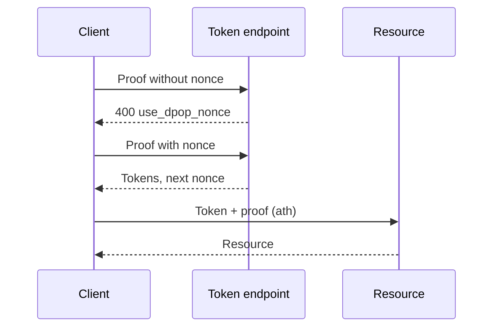

# API Authentication and OAuth 2.0

Use this page when implementing first-party sign-in or authenticated API requests. Tokens use RFC 9449 DPoP proofs. Third-party and device clients use [OAuth Client Flows](api-oauth.md), with [client authentication and administration](api-oauth-client-authentication.md).

## Authentication

Baander's own apps get tokens through password login, passkey login and refresh. Other clients redeem authorization codes, device codes and refresh tokens at `POST /api/oauth/token`, as described in [OAuth Client Flows](api-oauth.md). Every token endpoint requires a DPoP proof and returns a DPoP-bound token pair. First-party endpoints use Baander's `data` envelope; the OAuth token endpoint uses the RFC 6749 format. There is no client credentials grant.

### Token Response

A successful login or refresh request returns:

```json
{
  "data": {
    "accessToken": "eyJ...",
    "tokenType": "DPoP",
    "expiresIn": 3600,
    "refreshToken": "..."
  }
}
```

Login responses also include a `user` object inside `data`, identified by `publicId`.

Access-token JWTs use the user's public ID as `sub` and the OAuth client's public ID as `client_id`. OAuth `client_id` parameters and administration's `clientId` identify that same registered client. Each token also carries `iss`, the issuer `APP_URL`; the resource server refuses a token whose `iss` is missing or names another issuer. Its header names the type `at+jwt` and, as `kid`, the RFC 7638 thumbprint of the signing key, the same `kid` that `GET /.well-known/jwks.json` publishes for that key. Previously issued access tokens with UUID identity claims are rejected. Refresh with the existing refresh token to obtain the current claims; if refresh is refused, sign in again.

| Field | Description |
|-------|-------------|
| `accessToken` | JWT bound to the client's DPoP key |
| `tokenType` | Always `DPoP` |
| `expiresIn` | Access token lifetime in seconds (default: 3600 / 1 hour) |
| `refreshToken` | Opaque token used to obtain a new token pair without signing in again |

The OAuth token endpoint, `POST /api/oauth/token`, answers with the same tokens in the RFC 6749 format (section 5.1), without the envelope:

```json
{
  "access_token": "eyJ...",
  "token_type": "DPoP",
  "expires_in": 3600,
  "refresh_token": "...",
  "scope": "library playlist"
}
```

`scope` lists the scopes the access token carries, separated by spaces. The answer carries `Cache-Control: no-store`, `Pragma: no-cache`, and a `DPoP-Nonce` header.

Token lifetimes are configured in `config/packages/auth.yaml`:
- **Access token**: 3600 seconds (1 hour) — `auth.access_token.ttl`
- **Refresh token**: 2592000 seconds (30 days) — `auth.refresh_token.ttl`, counted again from each rotation
- **Refresh token chain**: 7776000 seconds (90 days) — `auth.refresh.max_chain_lifetime`, counted from the sign-in that started the chain; no rotation extends it
- **Authorization code**: 60 seconds — `auth.auth_code.ttl`
- **Pushed authorization request** (`request_uri`): 300 seconds (5 minutes) — `auth.par.request_uri_ttl`
- **Device code**: 900 seconds (15 minutes) — `auth.device_code.ttl`

### DPoP Proofs

Every token request carries a `DPoP` header with a proof JWT (RFC 9449) signed by the client's key. The proof must include a nonce the server issued:

1. Send the request with a proof that has no nonce. The server answers `400` with `{"error": "use_dpop_nonce", "error_description": "..."}` and a `DPoP-Nonce` header.
2. Repeat the request with a new proof whose `nonce` claim is that value.

Each nonce works once and expires after `auth.dpop.nonce_ttl` seconds (default 300). Successful token responses include a `DPoP-Nonce` header for the client's next proof; after password login and refresh the header is best-effort and is left out while the nonce store cannot save a nonce, so the client's next token request starts with a nonce challenge. At the first-party endpoints, a request without a `DPoP` header gets a `400` `ApiError`, and an invalid proof gets the `use_dpop_nonce` answer. The OAuth token endpoint answers a missing or invalid proof with `400` and `{"error": "invalid_dpop_proof", "error_description": "..."}` (RFC 9449), with a `DPoP-Nonce` header as well.

The sequence below shows the handshake against one token endpoint; `/api/auth/login`, `/api/auth/refresh`, and `/api/oauth/token` all follow it.



A proof's `htu` must name one of the deployment's public origins followed by the request path: the origin of `APP_URL`, or one of the comma-separated origins in `AUTH_DPOP_EXTRA_ORIGINS` (empty by default). The scheme and `Host` the request arrived with play no part, because behind a TLS-terminating proxy the request reaches Baander as plain HTTP and the client chooses the `Host` header. An origin in `AUTH_DPOP_EXTRA_ORIGINS` that is not an absolute `http` or `https` URL stops the application from booting.

Issued tokens are bound to the proof key: the access token carries `cnf.jkt`. API requests send `Authorization: DPoP <accessToken>` with a `DPoP` proof from the same key that includes the access token hash (`ath`). Signed stream delivery URLs do not need a proof.

### Password Login

```
POST /api/auth/login
Content-Type: application/json
DPoP: <proof>

{"email": "user@baander.app", "password": "secret", "totpCode": "123456"}
```

`totpCode` is required only when the account has TOTP enabled; without it, or with an empty string, the response is `401` with code `AUTH_TOTP_REQUIRED`. The server checks the DPoP proof before the credentials, so a nonce challenge leaves the code unspent for the retry. Each code is accepted once: a successful login spends the code's 30-second time step in the transaction that stores the tokens, and the same code is refused afterwards, also when two logins race with it. A code is accepted for the current step and `auth.totp.window` steps on either side (1 by default). When the stored TOTP secret cannot be decrypted with `AUTH_TOTP_ENCRYPTION_KEY`, the response is `401` with code `AUTH_TOTP_UNAVAILABLE`; an operator's TOTP reset lets the account sign in with its password alone.

An unknown address, a wrong password, a wrong TOTP code and a disabled account with a wrong password all get the same `401` `AUTH_INVALID_CREDENTIALS` answer after the same work, so the answer does not reveal whether an account exists. A disabled account is reported as disabled only once its password matches. Each rejected password or code counts against the address's failure limit from all client addresses together; once the limit is reached, every login for that address answers `429` with `Retry-After`, the right password included (see [Rate limiting](../../part-1-operator-guide/configuration/rate-limits.md#rate-limiting)).

### Passkey Login

Passkey login uses the browser's WebAuthn API:

1. `POST /api/auth/passkey/authenticate/options` (optionally with `userId`) returns `{"data": {"challengeKey": "...", "options": { ... }}}`.
2. The client calls `navigator.credentials.get()` with `options`.
3. The client sends the assertion with a `DPoP` header:

```
POST /api/auth/login/passkey
Content-Type: application/json
DPoP: <proof>

{"challengeKey": "...", "response": { ... }, "userId": "..."}
```

`userId` is an optional user public ID. The server checks the DPoP proof before the assertion, so a nonce challenge leaves the assertion valid for the retry. Disabled accounts cannot sign in. For an account with TOTP enabled, the assertion must carry the user-verified flag (a PIN or biometric check on the authenticator); the flag is checked only after the signature verifies. An authenticator that always reports a signature counter of 0 can sign in; the clone check compares counters only when one of them is non-zero.

Each challenge works once. Challenges live only in Redis, under a key bound to the ceremony: a registration challenge to the user who asked for it, a login challenge to its `challengeKey`. While Redis is unavailable, the options, verification and login endpoints answer `503` with `Retry-After`.

To register a passkey, an authenticated user calls `POST /api/auth/passkey/options` and passes the browser's credential to `POST /api/auth/passkey/register`. The options request needs a verified email address and [step-up](#step-up-re-authentication). Registration options encode the user's public ID as the WebAuthn user handle. Authentication and account signals use the same public identity; there is no UUID-handle fallback.

### Refresh

```
POST /api/auth/refresh
Content-Type: application/json
DPoP: <proof>

{"refreshToken": "..."}
```

This endpoint refreshes only tokens of the [first-party client](#first-party-and-delegated-tokens); a refresh token issued to any other client answers `401` here, and that client refreshes at the token endpoint with its own client authentication (see [Refresh at the token endpoint](api-oauth.md#oauth-20-authorization-server)). The proof must be signed by the key the token pair was issued to. Refresh consumes the token and returns a new pair with the same key binding. A lost response can be recovered within `auth.refresh.reuse_grace_seconds` (default and maximum 60 seconds; 0 disables recovery): a retry of the consumed token with the same proof key, while its live replacement remains unused, revokes that replacement pair and issues a fresh one. A retry outside the grace window or after a replacement was used revokes the whole rotation chain. A proof from another key is refused without revoking the chain.

Baander stores each refresh token only as its SHA-256 hash, so the database holds no usable refresh token. Every rotation chain also has an absolute lifetime, `auth.refresh.max_chain_lifetime` (90 days by default), counted from the sign-in that started it: once it has passed, the chain's refresh tokens are refused however recently they were rotated, and the user signs in again.

A refused refresh token answers `401`; sign in again. `503` with `Retry-After` means the server could not check the token, for example while its database or nonce store is unavailable; keep the token and retry after the given delay.

### Client Fingerprint Binding

Password login, passkey login, and the token endpoint accept an optional `X-Baander-Client-Fingerprint` header. If it is sent, the access token is bound to that value, and every API request with the token must send the same header or get `401` (`AUTH_INVALID_TOKEN`). Refresh, at `/api/auth/refresh` or with `grant_type=refresh_token`, keeps the binding of the token it rotates and ignores a header sent with the refresh request. Tokens issued without the header ignore it. The WebSocket upgrade authenticates with a handshake ticket issued over HTTP and does not carry the fingerprint header; see [Real-Time Patterns](../architecture/real-time-patterns.md#authentication).

### First-party and Delegated Tokens

A token is first-party when it was issued to the first-party client: the client registered with type `first_party` whose public ID is `AUTH_SPA_CLIENT_ID`. Password login, passkey login and `POST /api/auth/refresh` issue only first-party tokens, which act with the user's full authority and carry no scopes. Every other token is delegated, whichever grant issued it and whether its client is public, confidential, a device or one of the user's own personal access clients. A delegated token differs in two ways:

- Its user authenticates with `ROLE_USER` alone, so no administrator authority travels with it, even for an administrator's account.
- It reaches only public routes and the routes its scopes cover. Every other route answers `403` before the controller runs:

```
HTTP/1.1 403 Forbidden
WWW-Authenticate: DPoP error="insufficient_scope"

{"error": {"message": "The access token does not grant access to this resource.", "code": "insufficient_scope"}}
```

The scopes are `profile`, `email`, `library` and `playlist`, the list in `auth.scopes.user_grants`:

| Scope | Routes it covers |
|-------|------------------|
| `profile` | Reading the user's own profile, `GET /api/auth/me` |
| `email` | `GET /api/auth/me`, with the email address included |
| `library` | Browsing the catalog, streaming, playback and its coordination across devices, transcoding, device registration, favorites, listening history, recommendations and radio |
| `playlist` | The user's playlists: reading, creating, changing, sharing and deleting them |

Everything else is first-party only: administration and monitoring, account security (passwords, email changes, passkeys, TOTP, logout, WebSocket tickets), consent and device approval, token revocation, personal access client management, notifications and push subscriptions, listening parties, and preferences and settings. A route that requires an administrator role is first-party only whatever its area. `ScopeRouteMap` (`src/Auth/Infrastructure/Security/OAuth/`) holds the classification, and `ScopeRouteInventoryTest` fails when a route is missing from it, so a new route stays out of reach of delegated tokens until it is classified.

`GET /api/auth/me` answers a delegated token with `publicId`, `name` and `createdAt`, and adds `email` and `emailVerifiedAt` only when the token holds the `email` scope. A first-party token also gets `roles`, `totpEnabled` and `pendingEmail`.

### Step-up Re-authentication

Three self-service changes ask the signed-in user to prove they are present, with fields in the JSON body:

| Request | Needs |
|---------|-------|
| `PUT /api/auth/me/email` | `currentPassword`, plus `totpCode` when TOTP is on |
| `POST /api/auth/passkey/options` | `currentPassword`, plus `totpCode` when TOTP is on |
| `POST /api/auth/totp/setup` | `currentPassword`; the request is refused with `409` while TOTP is on |

A wrong password, and a missing or wrong code, all get the same `422` with `error.details.reason` `step_up_failed`. A code that confirms a change is spent like a login code and cannot confirm a second one. Every attempt counts against the account's step-up limit, 10 per 15 minutes by default from any address, checked before the password; over the limit the request answers `429` with `Retry-After`.

Passkey registration options and TOTP setup also need a verified email address. An unverified one answers `422` with `error.details.reason` `email_unverified`, before step-up spends an attempt.

### Changing the Email Address and Password

`PUT /api/auth/me/email` with `{"email": "new@baander.app", "currentPassword": "...", "totpCode": "123456"}` does not change the address at once. It holds the new address as the account's pending address, which a first-party `GET /api/auth/me` returns as `pendingEmail`, and emails a verification link to it. The account keeps its current address, and that address's verification, until the link is used. The request answers `202` with the same body whether or not another account uses the new address; if one does by the time the link is opened, the link fails like an invalid one and the pending change is dropped. Using the link moves the pending address into the account, verifies it, and emails the previous address that the account's address changed. Asking for the current address drops a pending change, and asking for a different one ends the earlier link.

`PUT /api/auth/me/password` changes the password. It ends every other session of the user, including one issued while the change was running, and the session that made the change stays signed in.

### Revocation

`POST /api/auth/logout` revokes the presenting token's whole rotation chain, including its refresh tokens. `POST /api/oauth/revoke` (RFC 7009) requires a first-party token and revokes the chain of an access or refresh token held by the signed-in user. A presented value that is a JWT signed with Baander's key is read as an access token and found by its `jti`; any other value is looked up as a refresh token, then as an access token ID.

A JWT signed with another key counts as unknown. An unknown token or one held by another user gets the same `200` answer. Delegated clients cannot reach this endpoint, and the server metadata does not advertise it. Both operations close the chain's WebSocket connections after revocation commits; socket reconciliation retries closure when immediate closure fails. A revocation failure answers `503` with `Retry-After`; retry the request.

Access tokens can be verified with the keys at `GET /.well-known/jwks.json`.
