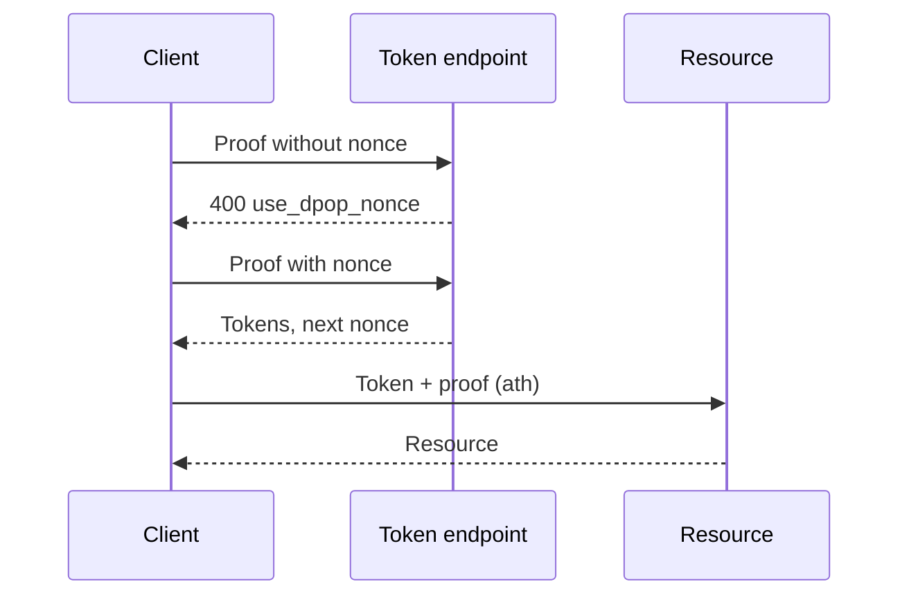

# API Authentication and OAuth 2.0

Every API token request uses RFC 9449 DPoP proof-of-possession handshakes. First-party clients sign in with passwords or WebAuthn passkeys; third-party and device clients use the OAuth 2.0 authorization server with pushed authorization requests and PKCE, or RFC 8628 device codes.

## Authentication

Baander's own apps get tokens from three endpoints: password login, passkey login, and refresh. Other clients use the OAuth 2.0 authorization server: the authorization code grant with PKCE, the device authorization grant, and the refresh token grant, all redeemed at `POST /api/oauth/token`. Every token endpoint requires a DPoP proof and returns a DPoP-bound token pair: the first-party endpoints in Baander's `data` envelope, the OAuth token endpoint in the RFC 6749 format. There is no client credentials grant.

### Token Response

A successful login or refresh request returns:

```json
{
  "data": {
    "accessToken": "eyJ...",
    "tokenType": "DPoP",
    "expiresIn": 3600,
    "refreshToken": "..."
  }
}
```

Login responses also include a `user` object inside `data`, identified by `publicId`.

Access-token JWTs use the user's public ID as `sub` and the OAuth client's public ID as `client_id`. OAuth `client_id` parameters and administration's `clientId` identify that same registered client. Previously issued access tokens with UUID identity claims are rejected. Refresh with the existing refresh token to obtain the current claims; if refresh is refused, sign in again.

| Field | Description |
|-------|-------------|
| `accessToken` | JWT bound to the client's DPoP key |
| `tokenType` | Always `DPoP` |
| `expiresIn` | Access token lifetime in seconds (default: 3600 / 1 hour) |
| `refreshToken` | Opaque token used to obtain a new token pair without signing in again |

The OAuth token endpoint, `POST /api/oauth/token`, answers with the same tokens in the RFC 6749 format (section 5.1), without the envelope:

```json
{
  "access_token": "eyJ...",
  "token_type": "DPoP",
  "expires_in": 3600,
  "refresh_token": "...",
  "scope": "library playlist"
}
```

`scope` lists the scopes the access token carries, separated by spaces. The answer carries `Cache-Control: no-store`, `Pragma: no-cache`, and a `DPoP-Nonce` header.

Token lifetimes are configured in `config/packages/auth.yaml`:
- **Access token**: 3600 seconds (1 hour) — `auth.access_token.ttl`
- **Refresh token**: 2592000 seconds (30 days) — `auth.refresh_token.ttl`
- **Authorization code**: 60 seconds — `auth.auth_code.ttl`
- **Pushed authorization request** (`request_uri`): 300 seconds (5 minutes) — `auth.par.request_uri_ttl`
- **Device code**: 900 seconds (15 minutes) — `auth.device_code.ttl`

### DPoP Proofs

Every token request carries a `DPoP` header with a proof JWT (RFC 9449) signed by the client's key. The proof must include a nonce the server issued:

1. Send the request with a proof that has no nonce. The server answers `400` with `{"error": "use_dpop_nonce", "error_description": "..."}` and a `DPoP-Nonce` header.
2. Repeat the request with a new proof whose `nonce` claim is that value.

Each nonce works once and expires after `auth.dpop.nonce_ttl` seconds (default 300). Successful token responses include a `DPoP-Nonce` header for the client's next proof; after password login and refresh the header is best-effort and is left out while the nonce store cannot save a nonce, so the client's next token request starts with a nonce challenge. At the first-party endpoints, a request without a `DPoP` header gets a `400` `ApiError`, and an invalid proof gets the `use_dpop_nonce` answer. The OAuth token endpoint answers a missing or invalid proof with `400` and `{"error": "invalid_dpop_proof", "error_description": "..."}` (RFC 9449), with a `DPoP-Nonce` header as well.

The sequence below shows the handshake against one token endpoint; `/api/auth/login`, `/api/auth/refresh`, and `/api/oauth/token` all follow it.



Issued tokens are bound to the proof key: the access token carries `cnf.jkt`. API requests send `Authorization: DPoP <accessToken>` with a `DPoP` proof from the same key that includes the access token hash (`ath`). Signed stream delivery URLs do not need a proof.

### Password Login

```
POST /api/auth/login
Content-Type: application/json
DPoP: <proof>

{"email": "user@baander.app", "password": "secret", "totpCode": "123456"}
```

`totpCode` is required only when the account has TOTP enabled; without it, the response is `401` with code `AUTH_TOTP_REQUIRED`.

### Passkey Login

Passkey login uses the browser's WebAuthn API:

1. `POST /api/auth/passkey/authenticate/options` (optionally with `userId`) returns `{"data": {"challengeKey": "...", "options": { ... }}}`.
2. The client calls `navigator.credentials.get()` with `options`.
3. The client sends the assertion with a `DPoP` header:

```
POST /api/auth/login/passkey
Content-Type: application/json
DPoP: <proof>

{"challengeKey": "...", "response": { ... }, "userId": "..."}
```

`userId` is an optional user public ID. The server checks the DPoP proof before the assertion, so a nonce challenge leaves the assertion valid for the retry. Disabled accounts cannot sign in.

To register a passkey, an authenticated user calls `POST /api/auth/passkey/options` and passes the browser's credential to `POST /api/auth/passkey/register`. Registration options encode the user's public ID as the WebAuthn user handle. Authentication and account signals use the same public identity; there is no UUID-handle fallback.

### Refresh

```
POST /api/auth/refresh
Content-Type: application/json
DPoP: <proof>

{"refreshToken": "..."}
```

The proof must be signed by the key the token pair was issued to. Refresh consumes the token and returns a new pair with the same key binding. A lost response can be recovered within `auth.refresh.reuse_grace_seconds` (default and maximum 60 seconds; 0 disables recovery): a retry of the consumed token with the same proof key, while its live replacement remains unused, revokes that replacement pair and issues a fresh one. A retry outside the grace window or after a replacement was used revokes the whole rotation chain. A proof from another key is refused without revoking the chain.

A refused refresh token answers `401`; sign in again. `503` with `Retry-After` means the server could not check the token, for example while its database or nonce store is unavailable; keep the token and retry after the given delay.

### Client Fingerprint Binding

Password login, passkey login, and the token endpoint accept an optional `X-Baander-Client-Fingerprint` header. If it is sent, the access token is bound to that value, and every API request with the token must send the same header or get `401` (`AUTH_INVALID_TOKEN`). Refresh, at `/api/auth/refresh` or with `grant_type=refresh_token`, keeps the binding of the token it rotates and ignores a header sent with the refresh request. Tokens issued without the header ignore it. The WebSocket upgrade authenticates with a handshake ticket issued over HTTP and does not carry the fingerprint header; see [Real-Time Patterns](../architecture/real-time-patterns.md#authentication).

### OAuth 2.0 Authorization Server

Clients other than Baander's own apps discover the endpoints at `GET /.well-known/oauth-authorization-server` (RFC 8414). The document roots every endpoint at the issuer (`APP_URL`, for example `https://baander.app`). It advertises `code` as the only response type, the three grant types, `S256` as the only PKCE method, the DPoP signing algorithms, and the scopes from `auth.scopes.user_grants` as `scopes_supported`. It lists `none`, `client_secret_post` and `private_key_jwt` as client authentication methods, and `token_endpoint_auth_signing_alg_values_supported` names the algorithms a client assertion may be signed with. It also names `pushed_authorization_request_endpoint` and sets `require_pushed_authorization_requests` to `true`.

**Authorization code with PKCE.** Every authorization request is pushed first (RFC 9126). The authorization endpoint accepts only the `client_id` and the `request_uri` a push returned, never the request parameters themselves. The flow has four steps:

1. The client posts the request to `POST /api/oauth/par` on the back channel, authenticated as at the token endpoint and bound to its DPoP key.
2. It sends the user's browser to the authorization endpoint with `client_id` and the returned `request_uri`.
3. The consent page looks the pushed request up and records the user's decision.
4. The client redeems the code at the token endpoint with a proof from the bound key.

**Pushing the request.** The parameters may be form-encoded (RFC 9126) or JSON. A public client sends its `client_id` alone; a confidential client adds its secret or a client assertion, by its registered method (see [Client authentication](#client-authentication)). The request must bind a DPoP key in one of two ways (RFC 9449 section 10.1):

- a `DPoP` header carrying a proof, checked exactly as at the token endpoint, including the server nonce;
- the `dpop_jkt` parameter, the base64url SHA-256 JWK thumbprint (RFC 7638) of the key, 43 characters long.

A request may carry both, and then they must name the same key. The authorization code issued for the request is bound to that key. A request with a proof:

```
POST /api/oauth/par
Content-Type: application/x-www-form-urlencoded
DPoP: <proof with nonce>

response_type=code&client_id=V1StGXR8_Z5jdHi6B-myT&redirect_uri=http://127.0.0.1:53682/callback&scope=library%20playlist&state=<state>&code_challenge=<challenge>&code_challenge_method=S256
```

A client that sends no proof names its key instead, for example `...&code_challenge_method=S256&dpop_jkt=0ZcOCORZNYy-DWpqq30jZyJGHTN0d2HglBV3uiguA4I`. Either way, a stored request is answered with `201`:

```json
{
  "request_uri": "urn:ietf:params:oauth:request_uri:6esc_11ACC5bwc014ltc14eY22c",
  "expires_in": 300
}
```

The `request_uri` stays usable for `auth.par.request_uri_ttl` seconds (300 by default) and is used up by one decision. A push runs every authorization request check that needs no user. The redirect URI must match a registered one exactly, except that a loopback URI matches on any port (RFC 8252), and it may be omitted only when the client registered exactly one. `response_type` must be `code`, and device clients are refused (`unauthorized_client`). PKCE with `S256` is required for every client; `plain` and a missing method are rejected. Requested scopes outside `auth.scopes.user_grants` are dropped.

Errors at the push answer the client directly, in the RFC 6749 shape `{"error": "...", "error_description": "..."}`: `401` for `invalid_client`, otherwise `400`. They include:

- `invalid_request` when the request has neither a proof nor `dpop_jkt`, when `dpop_jkt` is malformed, or when it carries a `request_uri` parameter;
- `invalid_dpop_proof` when the proof and `dpop_jkt` name different keys;
- `request_not_supported` for a `request` parameter, since request objects are not supported.

Every answer carries `Cache-Control: no-store`, and an answer to a request with a verified proof carries the next `DPoP-Nonce`. A rate-limited push gets `429`. A push the server cannot store gets `503` with `Retry-After` and no nonce; this covers a database restart, an unavailable rate limit or nonce store, and a `jwks_uri` key set that cannot be fetched. Push again after the delay.

**Sending the user to the consent page.** The metadata's `authorization_endpoint` is the web app's consent page, `APP_URL/oauth/authorize` (configured as `auth.oauth.authorization_page_uri`), not an API route. The client sends the browser there with only two parameters:

```
https://baander.app/oauth/authorize?client_id=V1StGXR8_Z5jdHi6B-myT&request_uri=urn%3Aietf%3Aparams%3Aoauth%3Arequest_uri%3A6esc_11ACC5bwc014ltc14eY22c
```

The page passes them on to two API endpoints, `GET` and `POST /api/oauth/authorize`, with the signed-in user's DPoP-bound access token. Third-party clients never call these endpoints themselves; like other web app calls, they accept cross-origin requests only from `APP_URL`. First, `GET /api/oauth/authorize` looks the pushed request up without using it:

```
GET /api/oauth/authorize?client_id=V1StGXR8_Z5jdHi6B-myT&request_uri=urn%3Aietf%3Aparams%3Aoauth%3Arequest_uri%3A6esc_11ACC5bwc014ltc14eY22c
Authorization: DPoP <accessToken>
DPoP: <proof>
```

```json
{
  "client_id": "V1StGXR8_Z5jdHi6B-myT",
  "client_name": "Baander Player",
  "client_type": "public",
  "scopes": ["library", "playlist"],
  "redirect_uri": "http://127.0.0.1:53682/callback",
  "consent_required": true
}
```

`scopes` are the scopes an approval grants: the pushed scopes Baander allows, or the default scopes when none are left. `client_type` is `public`, `confidential`, `first_party`, or `personal_access`. `consent_required` is false only for clients with the first-party flag: the first-party client and the user's own personal access clients. The page may approve those without asking. Another user's personal access client gets `unauthorized_client`.

Then `POST /api/oauth/authorize` records the user's decision on the same pushed request. The body may be JSON or form-encoded:

```json
{
  "decision": "approve",
  "client_id": "V1StGXR8_Z5jdHi6B-myT",
  "request_uri": "urn:ietf:params:oauth:request_uri:6esc_11ACC5bwc014ltc14eY22c"
}
```

```json
{
  "redirect_uri": "http://127.0.0.1:53682/callback?code=<code>&state=<state>&iss=https%3A%2F%2Fbaander.app"
}
```

Either decision uses the request up, so it is decided once; of two concurrent decisions, one wins and the other gets `invalid_request_uri`. On denial (`"decision": "deny"`), `redirect_uri` carries `error=access_denied`, `error_description`, the pushed `state`, and `iss` instead of `code`. `iss` (RFC 9207) lets the client detect a mix-up between authorization servers. The page navigates to `redirect_uri`; neither endpoint redirects. Their success and OAuth error answers carry `Cache-Control: no-store`; an unauthenticated request gets a `401` `ApiError` without it.

The two endpoints read only `client_id`, `request_uri` and `decision`. Errors from either endpoint are `400` with `{"error": "...", "error_description": "..."}`:

- When `client_id` or `request_uri` is missing (`invalid_request`), the client is unknown or revoked (`invalid_client`, still `400`), or the pushed request is unknown, malformed, expired, already used or pushed by another client (`invalid_request_uri`), the body has no `redirect_uri`. The same holds for an `invalid_request` from `POST /api/oauth/authorize` whose `decision` is missing or invalid, or whose body is neither JSON nor form-encoded. The page shows the error to the user and must not redirect.
- An error that depends on the user, `unauthorized_client` for another user's personal access client or `access_denied` for a disabled account, adds `redirect_uri`: the pushed redirect URI carrying `error`, `error_description`, the pushed `state`, and `iss`. The page navigates there. These errors leave the pushed request unused.

**Redeeming the code.** An authorization code lives for `auth.auth_code.ttl` seconds (60 by default), long enough for the redirect and the token request. The client redeems it with a proof signed by the key the pushed request was bound to:

```
POST /api/oauth/token
Content-Type: application/x-www-form-urlencoded
DPoP: <proof with nonce, from the bound key>

grant_type=authorization_code&client_id=V1StGXR8_Z5jdHi6B-myT&code=<code>&redirect_uri=http://127.0.0.1:53682/callback&code_verifier=<verifier>
```

A proof from any other key gets `invalid_grant`, as do a wrong `code_verifier` and a code that is expired, used, or another client's.

**Device authorization.** A device client posts its `client_id` and an optional `scope`, form-encoded or JSON, to `POST /api/oauth/device/authorize`:

```
POST /api/oauth/device/authorize
Content-Type: application/x-www-form-urlencoded

client_id=<client_id>&scope=library
```

```json
{
  "device_code": "...",
  "user_code": "BCDF-GHJK",
  "verification_uri": "https://baander.app/device",
  "verification_uri_complete": "https://baander.app/device?user_code=BCDF-GHJK",
  "expires_in": 900,
  "interval": 5
}
```

A missing `client_id` (`invalid_request`) or a client that is not a device client (`unauthorized_client`) gets `400`; an unknown or revoked client gets `401` `invalid_client`. The device shows the user code and `verification_uri`, or encodes `verification_uri_complete` in a QR code, and polls the token endpoint with `grant_type=urn:ietf:params:oauth:grant-type:device_code` and `device_code`.

`verification_uri` is the web app's device page (`auth.device.verification_uri`). For the signed-in user, the page looks the code up with `GET /api/oauth/device/verify?user_code=BCDF-GHJK`:

```json
{
  "data": {
    "userCode": "BCDF-GHJK",
    "clientId": "V1StGXR8_Z5jdHi6B-myT",
    "clientName": "Living room TV",
    "scopes": ["library"],
    "expiresAt": "2026-10-07T12:15:00+00:00"
  }
}
```

It then sends the user's decision to `POST /api/oauth/device/approve` with `{"userCode": "BCDF-GHJK", "decision": "approve"}` or `"deny"`, and gets `{"data": {"decision": "approved", "message": "..."}}`, or `"denied"`. Case, spaces, and dashes in the user code do not matter. An unusable code gets a `400` `ApiError` whose `error.details.reason` is `user_code_required` (lookup only), `invalid_user_code`, or `device_already_processed`.

Polls answer `authorization_pending` until the user decides, `slow_down` when they come sooner than the interval (which then grows by 5 seconds), `access_denied` after a denial, and `expired_token` after expiry. An approved code is redeemed once.

**Refresh at the token endpoint.** `grant_type=refresh_token` rotates a pair exactly as `POST /api/auth/refresh` does, and the refresh token must have been issued to the authenticated client.

The token endpoint accepts form-encoded or JSON parameters, and every grant authenticates the client as described in [Client Authentication](#client-authentication). Errors use the RFC 6749 shape `{"error": "...", "error_description": "..."}`: `400`, or `401` for `invalid_client`. Every token answer and OAuth error carries `Cache-Control: no-store`, `Pragma: no-cache`, and a `DPoP-Nonce` for the next proof. Two answers carry no nonce: a rate-limited request gets `429`, and a request the server cannot decide gets `503` with `Retry-After` and `Cache-Control: no-store`. That happens, for example, while its database restarts, while the nonce store or the assertion `jti` store is unavailable, or when a client's `jwks_uri` set cannot be fetched; keep the tokens and retry after the delay. A successful answer uses the RFC 6749 token response above.

**Personal access clients.** `GET` and `POST /api/oauth/clients/` list and create the current user's personal access clients, and `DELETE /api/oauth/clients/{publicId}` revokes one together with its access and refresh tokens. Only the owner can revoke a client. The list carries no client secret.

### Client Authentication

The pushed authorization request endpoint and the token endpoint authenticate the client the same way. Every request names its client in `client_id`. Each client has one authentication method, fixed at registration and listed in the admin API as `authMethod`:

| Method | Client | What the request adds |
|--------|--------|-----------------------|
| `none` | Public, device, first-party and personal access clients | Nothing; `client_id` alone |
| `client_secret_post` | Confidential client registered with a secret | `client_secret` |
| `private_key_jwt` | Confidential client registered with keys | `client_assertion` and `client_assertion_type=urn:ietf:params:oauth:client-assertion-type:jwt-bearer` |

A request that presents a method other than the registered one, or more than one, gets `401` `invalid_client` (RFC 6749 section 2.3). So does a request from an unknown, malformed or revoked client, so the answer does not reveal which it was.

**Client assertions.** A `private_key_jwt` client signs a JWT (RFC 7523 as updated by RFC 10070) with one of its registered keys:

- The `alg` header is one of `EdDSA`, `ES256`, `ES384`, `ES512`, `RS256`, `RS384` or `RS512`; `none` and HMAC algorithms are refused. The metadata lists them as `token_endpoint_auth_signing_alg_values_supported`.
- The `typ` header is absent or `client-authentication+jwt`, with or without the `application/` prefix, in any case. Any other type is refused.
- The `kid` header selects the key. Without it, every registered signing key is tried. A `jwks_uri` client needs `kid` to rotate keys, because only an unknown `kid` makes Baander fetch the set again before the cache expires.
- `iss` and `sub` are the `client_id`.
- `aud` is exactly the issuer identifier, `APP_URL`, as a string or as a one-element array. The token endpoint or pushed request endpoint URL is refused, although OpenID Connect Core suggests the token endpoint. Nothing is normalized, so a trailing slash makes the audience differ.
- `exp` is required and may lie at most `auth.client_assertion.max_lifetime` seconds (300 by default) ahead, plus the clock skew `auth.dpop.clock_skew`. When `iat` is present, it may not lie in the future beyond the skew, and `exp - iat` may not exceed the maximum lifetime either. `nbf` is honored.
- `jti` is required and accepted once per client. Sign a new assertion for every request, including the token request that follows a push.

An assertion for a client with the ID `Kp3xR8vW2mQ7nL5tY9bZc` on `https://baander.app`, before signing:

```json
{
  "alg": "ES256",
  "typ": "client-authentication+jwt",
  "kid": "player-2026-11"
}
```

```json
{
  "iss": "Kp3xR8vW2mQ7nL5tY9bZc",
  "sub": "Kp3xR8vW2mQ7nL5tY9bZc",
  "aud": "https://baander.app",
  "iat": 1795086000,
  "exp": 1795086060,
  "jti": "4f0c6a6e-3a1d-4c55-9a59-7d1b0f1c2e88"
}
```

The signed assertion goes in the request body:

```
POST /api/oauth/par
Content-Type: application/x-www-form-urlencoded
DPoP: <proof with nonce>

response_type=code&client_id=Kp3xR8vW2mQ7nL5tY9bZc&client_assertion_type=urn%3Aietf%3Aparams%3Aoauth%3Aclient-assertion-type%3Ajwt-bearer&client_assertion=<signed JWT>&redirect_uri=https://sync.baander.app/callback&scope=library&state=<state>&code_challenge=<challenge>&code_challenge_method=S256
```

An assertion that fails any check gets `401` `invalid_client`; the server logs which check failed but does not say so in the answer. While the store that records assertion `jti` values is unavailable, the endpoint answers `503` with `Retry-After`. The assertion may have been used up by then, so retry with a newly signed one. A DPoP nonce challenge (`use_dpop_nonce`) is answered before the assertion is checked, so the retry may send the same assertion.

**Client keys.** A `private_key_jwt` client registers its public keys in one of two ways:

- **Inline JWK Set.** The administrator stores the set with the client. It holds at most 10 keys and 64 KB, only public asymmetric keys (no `oct` keys and no private members), and when it holds more than one key, each has its own `kid`.
- **`jwks_uri`.** The client publishes the set at an `https` URI on port 443, without credentials. Baander fetches it from a public address on that host alone, without following redirects, within 3 seconds, and stops reading after 64 KB; the set must meet the rules of an inline one. Only keys with `use` absent or `sig` count.

A fetched set is cached for `auth.client_jwks.cache_ttl` seconds (3600 by default). An assertion whose `kid` the cached set lacks makes Baander fetch the set again, at most once per client every `auth.client_jwks.refetch_interval` seconds (60 by default), so a client can rotate its keys on its own: publish the new key, then sign with it. Replacing a client's keys through the admin API or the console makes the cached set unreachable at once. A fetch that fails, times out, answers anything but `200` or sends more than 64 KB gets `503` with `Retry-After` and caches nothing. So does a request that needs a fetch while another request is fetching the same client's uncached set, or while Redis, which holds the fetch lock, is unavailable. A set that is malformed, or that lacks the assertion's key after the refetch, gets `invalid_client`.


### OAuth Client Administration

Administrators manage device, public and confidential clients under `/api/admin/oauth/clients`. Listing requires `ROLE_ADMIN`; every change requires `ROLE_SUPER_ADMIN`. Each endpoint has an `app:oauth:client:*` console command that applies the same rules.

`GET /api/admin/oauth/clients` lists every client except personal access clients, revoked ones included:

```json
{
  "data": [
    {
      "clientId": "V1StGXR8_Z5jdHi6B-myT",
      "name": "Living room TV",
      "type": "device",
      "authMethod": "none",
      "jwksUri": null,
      "redirectUris": [],
      "revoked": false,
      "createdAt": "2026-10-07T12:00:00+00:00",
      "updatedAt": "2026-10-07T12:00:00+00:00"
    }
  ]
}
```

`type` is `device`, `public`, `confidential`, or `first_party`. `authMethod` is the client's [authentication method](#client-authentication), and `jwksUri` is the key set address of a `private_key_jwt` client that publishes its keys. The first-party login client is listed but cannot be changed through these endpoints.

`POST /api/admin/oauth/clients` registers a client:

```json
{
  "name": "Baander Player",
  "type": "confidential",
  "redirectUris": ["https://player.baander.app/callback"]
}
```

`name` is at most 100 characters. `type` is `device`, `public`, or `confidential`. `redirectUris` holds 1 to 10 URIs for public and confidential clients and must be omitted or empty for device clients. Each URI must be absolute, without a fragment or credentials, and use `https`, `http` on a loopback host, or a private-use scheme in reverse domain form.

A confidential client takes `authMethod`: `client_secret_post` (the default) or `private_key_jwt`. Device and public clients leave it out. A `private_key_jwt` client also takes exactly one key source, `jwks` with an inline JWK Set or `jwksUri` with the address of a published one; see [Client keys](#client-authentication) for the rules:

```json
{
  "name": "Baander Sync",
  "type": "confidential",
  "redirectUris": ["https://sync.baander.app/callback"],
  "authMethod": "private_key_jwt",
  "jwksUri": "https://sync.baander.app/.well-known/jwks.json"
}
```

The answer is `201` with the client and `clientSecret`. For a confidential client registered with the default method:

```json
{
  "data": {
    "clientId": "V1StGXR8_Z5jdHi6B-myT",
    "name": "Baander Player",
    "type": "confidential",
    "authMethod": "client_secret_post",
    "jwksUri": null,
    "redirectUris": ["https://player.baander.app/callback"],
    "revoked": false,
    "createdAt": "2026-10-07T12:00:00+00:00",
    "updatedAt": "2026-10-07T12:00:00+00:00",
    "clientSecret": "<43-character secret>"
  }
}
```

`clientSecret` is a `client_secret_post` client's secret, shown in this response only; Baander stores its SHA-256 digest. It is `null` for device, public and `private_key_jwt` clients. Invalid input gets `422`: a validation error for a missing or malformed field, or `error.details.reason` `invalid_registration` when the registration rules reject the client, for example its redirect URIs or its key source.

`POST /api/admin/oauth/clients/{clientId}/rotate-secret` gives a confidential client a new secret and answers `200` in the same shape, with the new `clientSecret`. The old secret stops working at once; issued tokens stay valid. `POST /api/admin/oauth/clients/{clientId}/revoke` revokes the client together with every access and refresh token issued to it and answers `200` with the client, without `clientSecret`. Revoking a revoked client succeeds again.

`POST /api/admin/oauth/clients/{clientId}/keys` replaces a `private_key_jwt` client's keys with the `jwks` or `jwksUri` in the body, and answers `200`. It may switch the client from one key source to the other; the method stays `private_key_jwt`. The new keys apply to the next assertion, and a cached copy of a published set is no longer used. Invalid keys get `422` with `error.details.reason` `invalid_keys`.

All three take the `client_id` as `{clientId}`; an unknown one gets `404`. A first-party or personal access client gets `409` with `error.details.reason` `protected_client`. Rotation also answers `409` for a client without a secret (`no_secret`), which includes every `private_key_jwt` client, and key replacement for a client without keys (`no_keys`); both answer `409` for a revoked client (`revoked`). Responses that carry a secret also carry `Cache-Control: no-store`.

### Revocation

`POST /api/auth/logout` revokes the presenting token's whole rotation chain, including its refresh tokens. `POST /api/oauth/revoke` (RFC 7009) requires authentication and revokes the chain of an access or refresh token held by the signed-in user. An unknown token or one held by another user gets the same `200` answer. Both operations close the chain's WebSocket connections after revocation commits; socket reconciliation retries closure when immediate closure fails. A revocation failure answers `503` with `Retry-After`; retry the request. Access tokens can be verified with the keys at `GET /.well-known/jwks.json`.

