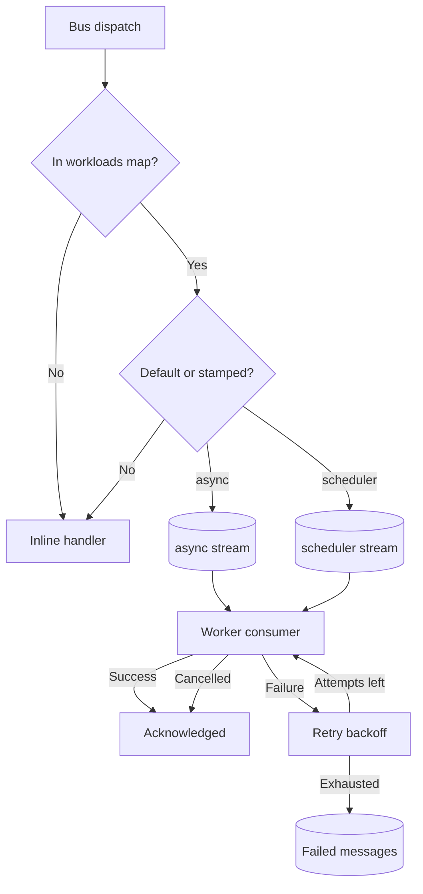

# CQRS and Messaging

Baander implements Command Query Responsibility Segregation (CQRS) with Symfony Messenger. Commands represent writes (create, update, delete), and queries represent reads. Messenger sends selected background commands to a transport; a command without a transport route runs in the calling process.

## How It Works

1. A controller creates a command DTO and dispatches it through `MessageBusInterface`
2. Messenger routes the command to the matching handler (identified by `#[AsMessageHandler]`)
3. The handler executes business logic using domain models and repositories
4. The handler returns a result or dispatches domain events

Outside tests, the routed background commands travel through Redis. Tests replace the ordinary transports with in-memory transports; an unrouted command still runs inline.

## Writing a Command

A command is a `final readonly class` that carries input data and no business logic. Its fields are either private with getters, as below, or public promoted properties; it has no setters.

```php
// src/Playlist/Application/Command/CreatePlaylistCommand.php
final readonly class CreatePlaylistCommand
{
    public function __construct(
        private string $name,
        private Uuid $userId,
        private ?string $description = null,
        private bool $isPublic = false,
    ) {
    }

    public function getName(): string { return $this->name; }
    public function getUserId(): Uuid { return $this->userId; }
    public function getDescription(): ?string { return $this->description; }
    public function isPublic(): bool { return $this->isPublic; }
}
```

## Writing a Handler

A handler is a `final class` with `#[AsMessageHandler]` on `__invoke`. It depends on repository and port interfaces, never on infrastructure implementations.

```php
// src/Playlist/Application/CommandHandler/CreatePlaylistHandler.php
final class CreatePlaylistHandler
{
    public function __construct(
        private readonly PlaylistRepositoryInterface $playlistRepository,
        private readonly EventDispatcherInterface $eventDispatcher,
    ) {
    }

    #[AsMessageHandler]
    public function __invoke(CreatePlaylistCommand $command): Playlist
    {
        $playlist = Playlist::create(
            $command->getName(),
            $command->getUserId(),
            $command->getDescription(),
            $command->isPublic(),
        );

        $this->playlistRepository->save($playlist);

        $this->eventDispatcher->dispatch(new PlaylistCreated(
            playlistId: $playlist->getId(),
            name: $playlist->getName(),
            isPublic: $command->isPublic(),
            userId: $command->getUserId(),
        ));

        return $playlist;
    }
}
```

When a handler must persist a domain write and capture an outbox event atomically, wrap the write and the event dispatch in `TransactionPortInterface` so both share one database commit boundary (see [Durable Event Replay](#durable-event-replay)). The Playlist handler above saves and dispatches without that boundary: it shows the shape of a handler, not of an atomic producer.

## Dispatching from a Controller

A controller injects `MessageBusInterface` and dispatches the command:

```php
$this->commandBus->dispatch(new CreatePlaylistCommand(
    name: $payload->name,
    userId: Uuid::fromString($user->getId()),
    description: $payload->description,
    isPublic: $payload->isPublic,
));
```

Symfony's service container autowires `MessageBusInterface` to the application's only bus, `messenger.bus.default`. No explicit configuration is needed. `dispatch()` returns the envelope rather than the handler's value; a controller that needs the result reads it from the envelope's stamps.

## Domain Events

A domain event signals a side effect to other contexts. It extends `AbstractDomainEvent` and implements `eventName()`, `toPayload()`, and `fromPayload()`:

```php
// src/Transcode/Domain/Event/TranscodeJobCompleted.php
final readonly class TranscodeJobCompleted extends AbstractDomainEvent
{
    public function __construct(
        private readonly Uuid $jobId,
        private readonly Uuid $videoId,
        private readonly string $qualityTier,
        private readonly int $totalSegments,
        ?DateTimeImmutable $occurredAt = null,
    ) {
        parent::__construct($occurredAt);
    }

    public function eventName(): string
    {
        return 'transcode.job_completed';
    }

    public function toPayload(): array { /* ... */ }
    public static function fromPayload(array $payload): static { /* ... */ }
}
```

Handlers dispatch events through Symfony's `EventDispatcherInterface`, and listeners in other contexts react to them; a `TranscodeJobCompleted` listener, for example, could notify users that their video is ready.

## Job Monitoring

`JobMonitoringMiddleware` gives every dispatched message a `JobIdStamp` before a transport stores it. The job ID travels with the message, so each delivery of it (a Messenger retry, a retry from the failure transport, or a redelivery after a worker died) is an attempt of the same job. `WorkerJobMonitorSubscriber` records received delivery attempts. `JobMonitorAdministration::runInline()` records monitored work executed in the calling process. Both use `JobMonitorService::startAttempt()`, which upserts the job's single `job_monitors` row, and complete only the attempt they started. See [Monitoring](../../part-1-operator-guide/operations/README.md) for details.

An operator can cancel the job of a long-running handler. The handler calls `JobCancellationCheckpointInterface::check()` (a Shared Application port) between items of its work, outside any `catch` that would swallow the exception. `check()` throws `JobCancelledException` when the job monitor's Cancel action, or `app:monitor:job:cancel`, has set the job's cancellation flag; outside a job run it does nothing. Each check costs a Redis `EXISTS`, so place checkpoints per item of real work (an album, a directory, a page), not inside a tight loop.

`JobCancellationMiddleware` runs each received job as the current job of its coroutine, so the checkpoint finds the job ID without the handler passing it, on Messenger workers and inline runs alike. When the handler stops at a checkpoint, the middleware marks the row `cancelled` and returns the envelope with a `JobCancelledStamp`, so the transport acknowledges the delivery: it is not retried and does not reach the failure transport. An inline run (`JobMonitorAdministrationInterface::runInline()`) rethrows `JobCancelledException` to its console command.

## Async Processing

### Routing

The workloads map in `config/packages/messenger.php` decides where a dispatched message goes. A message that the map lists with its `default` flag on, or whose dispatcher names a transport in a `TransportNamesStamp`, goes to that transport's Redis stream. Every other message runs inline in the calling process.



The consumers of these streams run in the admitted worker deployment, which owns
the Redis `async` (`MESSENGER_TRANSPORT_DSN`) and `scheduler` consumers, the outbox
relay, the scheduler and media execution. The web container runs `app:serve`
without task workers or a CPU pool. Consumer names include the deployment and boot
identity. [Background Work](../../part-1-operator-guide/workers/background-work.md)
explains admission, observation, lifecycle and uncertain outcomes for operators;
[Worker deployment](../../part-1-operator-guide/workers/worker-deployment.md)
is the manifest and host-command reference.

### Message contract and retries

Queued commands and stored job retry data use the `baander.message` JSON format,
version 1. The codec registers supported message types and fields explicitly;
Redis payloads do not depend on Symfony object serialization. Retry metadata keeps
completed handler names, so a retry skips handlers that already succeeded.
Consumers still need idempotency for external effects.

A message that exhausts its retries goes to the `failed` transport. That transport is a PostgreSQL table, `failed_messages`, created by a migration rather than by Messenger (`auto_setup: false`) and excluded from Doctrine schema comparison. Its receiver is listable, so `messenger:failed:show`, `messenger:failed:retry` and `messenger:failed:remove` work by message ID, and the admin endpoints in [Monitoring](../../part-1-operator-guide/operations/job-monitoring.md#failed-messages) use the same receiver.

Tests use this table too, while the ordinary transports are in-memory. See [Testing](../testing/workers-and-messaging.md) for the disposable-service delivery, retry and runtime drills.

## Durable Event Replay

Live domain events enter the outbox. For `LibraryDirectoryIndexed`, a Library
dispatcher converts the committed event into a `FilesDiscovered` message and
sends it to `async`. Other events continue through the private
notification dispatcher, where notification and admin-alert listeners run. Party
and transcode listeners stay on the live dispatcher. A notification event's receipt,
notification records and channel delivery intents commit in one transaction;
replaying the same outbox ID skips an already committed receipt.

Committed email, push and webhook intents use the versioned JSON codec and are
handed to Redis `async`. A lost acknowledgement can repeat that handoff, so the
receipt does not guarantee exactly-once external delivery. Both event replay and
intent handoff use leased claims, retry backoff and dead-letter state after five
failed attempts. See [app:outbox:consume](../../part-1-operator-guide/commands/app-outbox-consume.md)
for relay operation and its monitoring limit.

Operator user creation, user registration and email verification commit their
domain writes and event capture in one transaction. The producer runtime drill
verifies those three auth producers; other event producers still need their
transaction boundaries reviewed. See [Testing](../testing/runtime-drills.md) for the outbox and
producer drills and the limits of their coverage.

Library scans commit each directory's file-index updates and
`LibraryDirectoryIndexed` capture in one transaction. Traversal and hashing stay
outside it. The relay cannot read the intent until the index is committed, so an
import's missing-file observation cannot be overwritten by the scanner's later
index write. A capture failure rolls back that directory; earlier committed
directories survive a later failure or cancellation.

Directory relay uses the same leased retries and five-attempt dead-letter
policy. It does not use the notification receipt: Redis may accept a message even
when the relay loses its acknowledgement, so duplicate imports remain possible.
The scan's `directoriesQueued` count reports durable acceptance, not completed
transport delivery or catalog ingestion. After a dead-lettered handoff, repair the
cause and use the [rescan option](../../part-1-operator-guide/commands/app-library-scan.md#queued-directories-and-delivery-failures)
to queue unchanged indexed files again. This boundary covers the library scan
only; it does not show that every event producer has one.

## See Also

- [Coding Conventions](coding-conventions.md) — CQRS rules and common mistakes
- [Real-Time Patterns](../architecture/real-time-patterns.md) — how events feed into WebSocket pushes
- [Testing](../testing/conventions.md) — how to test handlers
- [Background Work](../../part-1-operator-guide/workers/background-work.md) — operate consumers, scheduling, outbox relay and native execution
