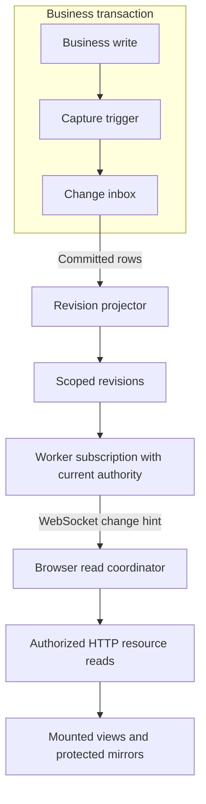

# Live updates

A mounted view needs to learn when its server data changes. A query's stale time
does not schedule that work: it only determines whether the cached result is fresh
when another operation checks it. Baander's live-update contracts connect each
reader to the changes that require another authorized read.

The backend captures committed changes, projects revisions, and delivers authorized
hints over the existing WebSocket connection. The authenticated application enables
the shared coordinator for catalog, personal, preference, and administrative
readers. Change hints schedule authorized HTTP reads; they do not carry resource
contents or replay user actions.



## Registering a reader

Each feature owns its query descriptors. A descriptor records its family, query
key variants, source tables or external source, authorization audience, refresh
policy, and verification. Include list, detail, filtered, and paginated keys.
Readers that keep server results outside React Query also need a descriptor;
Recents, Timeline, sidebar configuration, and EQ profiles are examples.

Classify the source before choosing a refresh policy:

- Stored state changes when a database transaction commits.
- Sampled state, such as worker occupancy, needs a bounded cadence while visible.
- Demand-driven state, such as an external lyrics search, follows explicit input.
- Deployment-fixed definitions need a new read when the server incarnation changes.

The coverage test inspects actual consuming calls. Unused generated endpoint
exports do not require descriptors. A new consuming call must be classified even
when an adjacent call already uses the same family. Classification establishes
coverage; a behavior test must still prove that the right change refreshes it.

## Coordinating browser reads

`OwnedQueryClient` connects consuming queries to `LiveQueryCoordinator`. Feature
modules export `LiveQueryDescriptor` entries with a family and a `matches` function;
`shared/live/descriptors.ts` assembles them and expands dependent families. Match
key segments with `keyStartsWith` or `firstKeyMatches`, including generated URL
keys and infinite-query variants. Keep the source and verification inventory in
`shared/live/coverage.ts` alongside the runtime descriptors.

A change marks matching cached queries stale. Active readers refresh; inactive
variants retain that dirtiness until observed. Each read acknowledges the dirty
generation it started with, so a change received during a read still requires a
later read. Infinite queries keep their loaded pages and refresh them through
bounded page requests. Do not clear loaded content merely to indicate updating.

An authoritative resource response of 403 or 404 completes the attempted
generation as unavailable. The coordinator clears retained resource data and
preserves the error for the view, rather than retrying that generation forever.
A later hint can restore the resource. Transient failures retain dirty work and
retry; an obsolete response cannot acknowledge a newer authorization or change.
The image reader treats an absent cover as successful empty content.

Readers outside React Query register a `LiveReadAdapter` through
`useLiveCoordinator()`. Supply a stable `id`, `family`, `isActive`, an abortable
`read(signal)`, and a `purge` callback for protected mirrors. Unregister on cleanup
and call `notifyAdapterActivityChanged()` when visibility changes without a query
observer change. Thread the supplied `AbortSignal` into every HTTP read, including
all pages. Generated query hooks inherit their owning query's signal; request
options must not replace it. A late completion must also pass its ownership check
before writing a store.

Use the endpoint's registered URL, including its trailing slash. DPoP binds a
proof to the request URL; a collection redirect can therefore turn a valid
signed read into a denial. Generated clients already use the registered route.
Handwritten readers and playback actions need the same path, with behavior tests
that check the actual request.

Use `sampleIntervalMs` for sampled state: runtime counters and job status commonly
use 5,000ms, spans use 10,000ms, and analytics use 30,000ms. Sampling runs while the
reader is active, visible, online, and authorized. Classify explicit searches as
`refreshPolicy: 'demand'` and deployment definitions as `deploymentFixed: true` or
`refreshPolicy: 'deployment'`. Provider credentials read from the server environment
belong to deployment definitions, rather than stored credential changes. Do not
add a feature socket, polling timer, or independent recovery loop.

The coordinator coalesces work for 100ms and spaces starts for each family by at
least 500ms. It retains at most 256 pending read identities and keeps excess work
as family dirtiness. HTTP admission covers actual attempts, retries, and infinite
pages: at most four background requests run concurrently and at most 20 attempts
start per second. Foreground reads have priority. Hidden or offline clients defer
background work. Admitted resource requests have a 30-second timeout, preserving
any shorter explicit timeout. A stalled response releases its admission slot on
timeout so queued readers and retries can proceed. These are configured budgets,
not measured throughput or latency.

## Local mutations, drafts, and preferences

Acquire a family hold before an optimistic mutation. Release it after confirmation
or rollback, including failure paths:

```ts
const stamp = captureOwnership()
const release = coordinator.beginMutation(['playlists'])
try {
  await savePlaylist()
  assertCurrentOwnership(stamp)
  // Apply the confirmed response to this owner's state.
} finally {
  release()
}
```

`beginMutation` cancels affected reads and holds background refreshes. Its release
is idempotent and hints the affected families, so local feedback need not wait for
the client's own socket message. Keep rollback under the same ownership checks.
Use `guardMutationCallbacks` for per-call callbacks and check again after every
`await` inside them. A callback guard checks entry; it cannot guard a continuation
that has already suspended.

Hold only the affected families. A global pause while any mutation is pending
would stop unrelated notifications and other readers during a slow save. Session
creation and device claims also need their own hold, with the confirmed cache
write inside the ownership check and before releasing it. Do not use the total
mutation count as a substitute for these scopes.

An initial query deferred by admission or a family hold is still pending, even
when it is not currently fetching. Automatic readers use `isPending` to distinguish
that state from a completed empty or missing-resource response. For demand readers,
pair pending state with the activation condition: a disabled query is pending too.
A placeholder is not evidence that the source has completed its first read.
Background refresh keeps existing content visible.

Editors use `useDraft` in `shared/drafts/use-draft.ts` to separate server snapshots
from local fields. Feed refreshed snapshots to `receive`; clean drafts adopt them,
while dirty drafts retain input and expose a conflict when the baseline changes.
Deletion uses the unavailable state. Access revocation uses `revokeAccess`, which
removes server-owned values while retaining locally edited fields. A save captures
its submitted field revisions with `beginSave`; `completeSave` acknowledges those
revisions without clearing edits made while the save was pending. Pair failures
with `failSave` and offer the server or local conflict choice explicitly.

Preference mirrors use `usePreferenceSync` in
`features/settings/hooks/use-preference-sync.ts`. It coordinates version reads,
debounced writes, retries, conflicts, and ownership with the same refresh path.
Receiving a remote value must not enqueue it as a new local save. Keep pending
local edits until acknowledged, and do not apply an EQ profile merely because its
list refreshed. Selection, scroll, queue, playback position, and browser-local
navigation remain owned by their existing feature state.

Audio, layout and player preference endpoints return 404 until the account has
saved a value. The preference reader treats that initial absence as a completed
read while its known server version is zero. It does not invent a payload or clear
pending edits, writes or conflicts. The first save uses version zero. A late 404
cannot reset an already known version; authorization and transient failures retain
their existing failure handling.

## Mapping a stored change

The source catalog lives in `tests/Fixtures/LiveUpdates/capture-sources.json`.
Record the queried tables and relationships, relevant columns, old and new
audiences, delete dependencies, and any response cache between storage and the
reader. Do not include secret values or row snapshots in change notifications.
Lease heartbeats that do not alter visible state need no refresh.

An audience describes who may learn that data changed. User-private data uses its
owner; library and playlist data follows current access; administrative data
requires the current role. Shared authenticated data must be explicitly classified.
Neither a family name nor a notification grants access to a resource.

## Committed capture and projection

The capture migration installs triggers on the catalog's declared tables. A
business write appends family and audience identifiers to `query_change_inbox`
in the same transaction. A rollback therefore removes the hint as well as the
write. Triggers compare the relevant fields, retain old and new audiences, and
resolve deletion dependencies before their parent rows disappear. Bulk personal
updates use statement transition tables to record each affected recipient once.
The inbox stores identifiers rather than source rows or secrets. TOTP capture
compares only whether the secret is absent, because that changes visible security
status.

Resolve typed references inside their source route before querying dependent
owners. For example, `token_id` holds an opaque string on OAuth token rows but a
UUID reference on token metadata. A SQL `WHERE` condition does not establish the
evaluation order needed to protect that conversion. The capture function resolves
the UUID only inside the applicable procedural route check, then uses the typed
value for its indexed lookup.

`DoctrineLiveChangeProjector` takes an advisory lock and folds at most 1,000
committed inbox rows into `query_scope_revision`. Updating the revisions and
deleting those selected inbox rows happen in one transaction. An inbox ID is an
address, not a commit-order cursor: an earlier ID can commit after a later one,
and the next batch still processes it. Revision rows remain after deletion of
their source resources so a surviving counter cannot restart at an older value.

The projector owns its transaction. Its 225ms statement deadline leaves time for
rollback before PostgreSQL's 250ms transaction deadline; a failed projection
discards the connection. The revision reader accepts an idle connection or a
read-only transaction and queries at most 500 scopes per batch. An authorization
snapshot can therefore read membership and revisions in one consistent
transaction. Both tables are migration-managed and excluded from Doctrine's
entity schema comparison.

## Message contract

PHP and TypeScript validate the same examples in
`tests/Fixtures/LiveUpdates/protocol.json`. The finite family vocabulary appears
in `LiveFamily` and `LIVE_FAMILIES`; the fixture tests detect disagreement.

A subscription contains only `type: live.subscribe` and `version: 1`.
Clients cannot select users, rooms, families, or raw query keys. Server messages
use `live.ready`, `live.changed`, `live.reset`, or `live.health` and carry a
subscription identity, authorization generation, opaque authorization fingerprint,
family names, and pipeline health. Generations are positive decimal strings,
bounded by PostgreSQL bigint, so JavaScript does not round them.

Resource contents remain behind their normal authorized HTTP endpoints. The
fingerprint identifies a change in authorization; it is not an access credential.
A healthy connection alone does not prove that publication or subsequent reads
succeeded.

`live.ready` establishes the subscription's permitted families. `live.changed`
names affected families. An authorization change sends `live.reset` with the union
of the old and new families, including families whose access was removed. That
union tells the browser what to purge; it is not the new permission set. The client
must fence pending work and obtain the current recovery snapshot before scheduling
resource reads.

## Authorization and recovery

`GET /api/live/recovery` uses the normal DPoP authentication path and returns a
private, non-cacheable snapshot of permitted families, the authorization fingerprint,
and pipeline health. Disabled or deleted accounts are denied. Database failures
cannot produce a successful baseline.

The snapshot reads the current account, library access, playlist access, revisions,
and backlog in one read-only repeatable-read transaction. Context-owned ports
resolve access with scalar database reads, so retained entities and token roles
cannot preserve revoked permissions. A 500ms statement deadline and a one-second
transaction deadline bound each snapshot. A failed rollback closes the connection.

## Worker delivery

HTTP worker zero checks for committed changes every 250ms, including when no
browser is connected. Each HTTP worker reconciles its own subscriptions every
second, rotating fairly through at most 32 principals per pass. Overlap guards
prevent concurrent passes. Worker shutdown clears timers and pending frames;
draining workers stop starting projection and reconciliation work.

Database services are released at the read or projection boundary, before socket
delivery. Coroutine cleanup provides a second release path. Send and watchdog
callbacks also register cleanup: logging can acquire pooled services too. Each
connection has at most one pending frame, with family changes coalesced without losing reset
information. Delivery limits the socket queue plus the outgoing frame to 64KiB;
a 100ms watchdog closes a peer whose native send remains blocked.

Health messages are due every five seconds. Read or projection failure reports
degraded health while retaining the last baseline. Recovery to current health is
reported even when the revision vector did not change. A backlog older than five
seconds is also degraded. Clients still need their own expiry and HTTP recovery
policy when no message arrives.

## Browser ownership

The authenticated application owns one shared transport. Listening-session sync
receives that transport and subscribes only when a session exists. Establishing a
connection for freshness does not join a listening session or claim a device.

Swoole's configured 300-second idle check uses
[the server's last receive time](https://github.com/swoole/swoole-src/blob/v6.2.0/src/server/master.cc#L1693),
so outgoing server health messages do not refresh it. The shared transport sends
the existing authenticated `ping` every 30 seconds while its owned socket is open
and retained. Error, close, reconnect and last release clear the timer;
generation and socket checks reject obsolete callbacks. The `pong` reply is a
transport acknowledgement; authority and publication health retain separate checks.

Freshness messages retain their 64 KiB limit. The shared socket also carries full
listening-session queues, which use a separate 16 MiB envelope ceiling matching
the native configuration. Both limits count UTF-8 bytes; a large valid session
snapshot must not be discarded under the smaller freshness limit.

Each principal session owns its QueryClient and mounted observers. Token rotation
keeps that identity. Switching accounts replaces it; a same-account access change
fences pending work and clears protected query results and store mirrors without
remounting the player. Removing a query from the cache alone is insufficient:
mounted observers must also stop rendering its old result.

Construct the client, recovery controller and coordinator together. React
StrictMode may repeat a state initializer; mutating an object retained by another
initializer can attach the client to a discarded coordinator. Provider tests must
mount a real query and prove both its initial read and its response to a change
hint, as well as checking connection cleanup.

Query functions, mutation callbacks, Axios responses, and session restoration
carry ownership stamps. Feature code that continues after an `await` must recheck
its captured stamp before changing a store or dispatching playback work. Use
`guardMutationCallbacks` for per-call mutation callbacks; an asynchronous callback
still needs a check after each awaited operation. Clearing a mutation cache does
not cancel callbacks already running.

A temporary delivery failure retains the last authorized readable data, including
loaded pages and mirrors, while new protected reads wait for permission recovery.
An explicit reset, changed authorization fingerprint, or recovery denial purges
protected state and rejects late work from the prior generation. Recovery with
the same fingerprint retains the loaded data. Successful permission recovery is
separate from completing the resource reads needed to establish freshness.

The coverage inventory classifies the recovery endpoint as a protocol control.
It is excluded from resource-family refresh scheduling to avoid a recovery loop.

Images follow the same ownership rules. Mounted image readers share authenticated
Blob bytes through a catalog query, including album-cover routes whose URL stays
the same when the cover changes. Each renderer owns its object URL and revokes it
on replacement or unmount. Authorization resets remove the old bytes from the
view; confirmed denial also hides a retained image during the retry delay.
Palettes derive from those bytes, reject obsolete extraction results, and clear
with the other account-derived mirrors. Refreshing artwork does not replace the
playback queue.

The status indicator shows **Connecting…** while establishing delivery,
**Updating…** while recovery or required resource reads remain, and **Updates
unavailable** when freshness is degraded. It disappears when current. A ready
socket or successful recovery snapshot alone does not mean those reads finished.
The ready deadline is 10 seconds; health expires after 15 seconds without a valid
message. While visible and degraded, the client attempts HTTP recovery every
30 seconds and retries failed recovery with jittered backoff from 1 to 30 seconds.
These deadlines detect loss of freshness; they are not delivery guarantees.

A missing ready message or expired health deadline replaces the shared socket.
Swoole can retain a connection across worker reloads while losing the worker's
authentication and subscription maps. Sending another subscription on that
connection cannot restore its authentication. A new connection obtains a fresh
ticket and subscription identity. Explicit degraded-health messages keep the
existing connection alive while publication recovers.

## Inspecting the runtime

The existing server statistics HTTP endpoint and `app:server:stats` command expose
`live_updates` for each worker. The per-worker operation reads in-memory diagnostics
without acquiring database services or disclosing subscription identities. The full
statistics request also observes Redis and can borrow pooled services; compare
warmed baselines through the same observer path.

| Field | Meaning |
| --- | --- |
| `projector_enabled` | This worker started the projection timer. |
| `last_successful_projection_check_age_ms` | Age of the last successful check, including empty or busy returns; it does not prove revisions advanced. |
| `last_successful_reconciliation_age_ms` | Age of the last successful authorization and revision read. |
| `max_subscription_read_age_ms` | Oldest successful read among this worker's current subscriptions. |
| `backlog_observed` | Whether a successful snapshot has observed the inbox. |
| `last_observed_oldest_pending_age_ms` | Backlog age at that observation; null means empty only when `backlog_observed` is true. |
| `projection_error_count`, `read_error_count` | Failures since this worker started. |
| `active_subscriptions` | Current subscriptions on this worker. |
| `pending_send_count` | Pending coalesced frames, excluding a send already in progress. |
| `slow_peer_close_count` | Connections closed for delivery overload. |

Null check or read ages mean no successful operation has been recorded. The
backlog observation is historical and does not advance with the clock. Use these
fields together: a recent empty-or-busy projection check cannot establish that
pending changes have been published.

## Verification

Run the frontend coverage and protocol suites with
`yarn --cwd ui/web test tests/live-updates`. Run the backend contract suites through
the [disposable test runner](testing.md) with
`bash scripts/test-backend-container.sh tests/Unit/Shared/LiveUpdates`.
The shared fixtures must pass on both sides before a protocol change is integrated.

The AST census in `coverage.test.ts` checks actual query and direct-reader calls,
including import aliases, constant keys, generated overrides, and infinite variants.
It rejects both unclassified consumers and stale inventory entries. Each inventory
row records sources, audiences, mirrors, response-cache policy, key variants,
dependencies, and a nonempty `unitProofs` list. The test rejects empty
proof lists and verifies that the referenced proofs exist; it does not establish
end-to-end behavior by itself. Browser and capacity
qualification remain separate checkpoints in the [testing guide](testing.md#live-update-qualification).

The browser scenarios cover cross-client permissions and notifications, interrupted
delivery and wake, managed reload/restart, a real scan and worker ingestion, retained
song pages and the complete Timeline walk. Preview evidence and production-mode
capacity are distinct: the CI-image runner serves the built frontend with the real
login limiter and requires its own passing receipts. Follow the testing guide's
commands and evidence boundaries before claiming qualification.

The browser draft/audio scenario keeps newer local text while the user's own PATCH
is pending and an unrelated notification refreshes, then reconnects delivery. Remote
metadata conflict/deletion and preference conflict use component/coordinator and
hook proofs. Do not describe those as browser conflict scenarios or infer complete
coverage from an inventory row.

For a new stored source, also verify rollback, deletion, ownership changes, and
bulk writes against disposable PostgreSQL. For a new
reader, verify local mutation feedback, remote changes, inactive variants,
recovery, and access removal. Editors must retain drafts; refreshing a profile
list must not apply a profile or restart playback.
