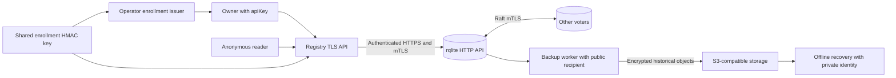

# Registry threat model

The registry publishes server metadata and accepts updates from the credential
that owns each public identity. It is the standalone C++ service in `relay/`,
backed by rqlite. PHP Discovery registration and pairing use local application
persistence and do not call this service; their boundaries belong to the
[application threat model](application-threat-model.md).

This model describes source controls and the cases exercised by the local native
contracts. Execution results and toolchain limitations belong to
[ROADMAP.md](../../ROADMAP.md). Test descriptions below do not claim a current
passing run. Container startup qualification is prior evidence unless that
container gate is explicitly rerun; local native tests do not renew it or qualify
a regional deployment.

## Assets and actors

| Asset | Authority and exposure |
| --- | --- |
| Registration `apiKey` | A client-generated secret encoding 32 random bytes as 64 lowercase hex characters. Possession authorizes updates to every identity owned by its SHA-256 digest. |
| Enrollment capability and HMAC key | A capability binds one identity, credential digest and expiry. The shared key lets an operator or API process mint capabilities; it is not a public verification key. |
| Stored ownership, metadata and revision | rqlite stores the credential digest and the public URL, name, version and heartbeat timestamps. Public lookup intentionally discloses current metadata, revision and heartbeat/update timestamps. |
| Database and TLS credentials | Basic authentication credentials, client keys and trusted CAs grant database or peer access. The API certificate authenticates the public listener. |
| Voter state and backups | Persisted membership, schema checksum, SQLite data and backup files carry ownership and metadata across restarts and recovery. A backup contains credential digests. |
| Availability and logs | API sessions, database slots and quorum are bounded resources. Logs must not become a second credential store. |

Actors include anonymous lookup clients, enrolled owners, a different owner
attempting takeover, holders of leaked credentials or enrollment capabilities,
network attackers, and operators controlling configuration, keys or voter storage.
There is no application tenant model here. A credential can own several public
identities, and lookup is public. Cross-identity checks enforce credential
ownership, not user, organization or library authorization.

Operators with database access and API processes holding query/execute credentials
can alter registry state outside the registration ownership checks. Compromise of
those actors or trusted voters crosses the database trust boundary; this protocol
provides no per-owner database isolation.

## Data flows and trust boundaries

The public API exposes registration, lookup, `/health` and `/ready`. It does not
proxy rqlite query, execute, load, backup or join routes. The API's outbound
database connections use operator-configured endpoints. Voter HTTP and Raft
listeners need private network access rules even though their transports also
require certificates and authentication.

The source boundaries are [registration and SQL](../../relay/cpp/core.cpp),
[TLS HTTP handling](../../relay/cpp/server.cpp),
[database transport and JSON parsing](../../relay/cpp/transport.cpp), and
[voter startup](../../relay/docker/rqlite-entrypoint.sh). The
[registry README](../../relay/README.md) documents configuration and reproduction
commands.

## Threats and evidence

### Credential disclosure

Registration hashes the submitted credential with SHA-256; SQL persists the digest,
not the raw credential. Response builders select public fields explicitly.
Database errors become fixed public failures rather than upstream response bodies.
Transport exceptions do not log request bodies, credentials or authentication
headers. Responses carry `Cache-Control: no-store`.

`relay/tests/security_test.cpp` checks response field selection and malformed
database results containing secret markers. `relay/tests/run_http_contract.py`
checks response bodies, headers and captured API/rqlite logs for the actual raw
credential, its digest, enrollment capability, enrollment key and database password
markers. Those checks cover their fixture values and paths; they are not exhaustive
analysis of process memory, crash dumps, proxy logs or external observability.
Private key, password, enrollment-key and backup access remains an operator duty.

### Cross-identity mutation and enrollment abuse

The registration transaction updates a row only when both `public_id` and
`credential_digest` match. First insertion requires valid enrollment and cannot
replace an existing row. The transaction selects the resulting revision for the
same owner before success is reported. Going offline does not free an identity.

Enrollment uses HMAC-SHA-256 over a versioned message containing the public
identity, credential digest and expiry. The verifier requires an expiry within
five minutes and compares the MAC with `CRYPTO_memcmp`. A capability cannot be
moved to another identity or credential. It is not consumed on use; an owner
already needs no enrollment for a heartbeat.

`relay/tests/run_cluster_contract.py` exercises distinct owners through different
API instances: a claimant with valid enrollment for a different credential still
gets `403`, stored ownership and metadata/revision remain unchanged, a capability
cannot claim a different identity, and the owner can retry through the other API.
`relay/tests/security_test.cpp` checks identity, digest, key and expiry binding.
These controls cannot establish that a client generated its credential randomly
or that an enrolled owner controls the domain named by its URL.

### Replay and stale metadata

The owner credential is reusable and the protocol has no signed client sequence,
nonce or metadata version precondition. An old authorized registration can be
submitted again: it restores its old URL, name and version while advancing the
server revision and heartbeat. Monotonic timestamps and revisions record accepted
writes; they do not order client intent or prevent replay.

`relay/tests/run_http_contract.py` updates owner metadata, then replays the exact
earlier body with the original enrollment capability and checks that the old
metadata returns with a new revision. A separate heartbeat checks that the owner
can register without enrollment. This is an accepted limitation of the current protocol. Someone who
steals the raw owner credential can keep identities online or change their public
metadata. There is no credential rotation, revocation, ownership transfer or
lost-credential recovery endpoint. Enrollment expiry does not revoke an existing
owner credential. A future freshness or recovery protocol needs its own design.

### Malformed HTTP, JSON and field types

Boost.Beast bounds request headers and bodies to 8 KiB. Each TLS connection serves
one request and closes, and its deadline covers handshake, reads, database work
and response writes. JSON parsing bounds nesting to eight levels; field validation
checks object/string types, lengths, control characters, public identity syntax,
credential syntax and the HTTPS URL shape. SQL binds registration values as
parameters.

The HTTP contract exercises conflicting framing, oversized fixed/chunked bodies,
pipelined requests, malformed JSON bytes and wrong field types. Its rejection
checks compare the public metadata/revision snapshot and require a fresh health
request to succeed; they do not inspect the private owner row for every case.
Native security tests exercise malformed database envelopes, row types and values.
The fuzz target in `relay/tests/parser_fuzz.cpp` covers bounded JSON parsing,
registration validation and enrollment parsing; its corpus includes duplicate
keys. It does not fuzz the live HTTP parser.

A focused reproduction found that pinned nlohmann/json 3.12.0 accepts a valid
object followed by a raw NUL, even when another JSON value follows that byte: its
lexer treats NUL as end-of-input. The shared bounded parser rejects raw NUL bytes
before DOM parsing, after the size check, while preserving valid escaped Unicode
such as `\u0000`. Native regressions in `relay/tests/transport_test.cpp` cover
trailing and interior NULs, hidden suffix bytes, an escaped-NUL positive control
and size-limit precedence. The malformed-owner HTTP case checks wire rejection;
execution status for these regressions belongs to the roadmap. The same
parser reads database responses, so malformed upstream bytes must fail closed
rather than becoming a successful authoritative result.

JSON object duplicate keys are not rejected explicitly. The current nlohmann
parser retains the last occurrence, and validation operates on that resulting
object. A duplicate-key corpus seed does not establish a rejection policy or
equivalence with a proxy using a different parser. Duplicate enrollment HTTP
headers are a separate case: a first claim requires exactly one such header.

### Rate abuse and resource exhaustion

The API uses one token bucket per instance, fixed session capacity and deadlines.
The database pool has fixed slots and no waiting queue; saturation fails with
`503`. Rate exhaustion answers `429`; both statuses include `Retry-After: 1`.
`/health` bypasses the request token bucket but still needs a session and TLS work.
The HTTP and transport contracts exercise rate exhaustion, pool saturation,
deadlines, slow requests and shutdown behavior.

The bucket is global to an API instance, not per owner or source address and not
coordinated across instances. One client can consume another client's allowance;
adding instances changes the aggregate allowance. Session admission saturation,
sustained hostile load, whole-host CPU/RSS and the constrained 24-hour soak remain
separate qualification work. Bounded state alone does not establish fair access
or denial-of-service resistance.

### Stored URLs and actual outbound connections

A registration URL must be absolute HTTPS with a hostname, without user information
or a fragment. The registry stores and returns it; this path does not resolve the
hostname or fetch the resource. An attacker-supplied registration URL is therefore
not, by itself, a demonstrated registry SSRF path. HTTPS syntax also does not prove
that the destination is public or safe for a consumer to fetch. Consumers need
their own destination and rendering policy.

The API's database egress goes to configured rqlite origins. The transport requires
HTTPS, explicit CA trust, hostname verification, SNI, a client certificate/key and
Basic authentication. Optional `connectAddress` changes the connected IP while
retaining the configured TLS identity. Redirects are rejected, not followed.
Configuration and its DNS remain privileged inputs; this is not a public-address
allowlist. `relay/tests/run_transport_contract.py` checks certificates, hostname
binding, redirects, deadlines and reconnection with disposable TLS peers.

### TLS or quorum downgrade

Both API and database TLS contexts disable SSLv2/3 and TLS 1.0/1.1. The transport
contract probes upstream legacy TLS rejection, untrusted/expired certificates and
hostname mismatch. It does not qualify inbound legacy TLS negotiation; that
listener setting has source evidence until a dedicated probe is run.

Lookup and readiness request `level=linearizable`. Registration uses a transaction
on the unified endpoint with the same consistency level; it does not queue writes
or fall back to stale reads. Invalid results, lost quorum and uncertain upstream
outcomes produce `503`; the transport evicts the connection and does not replay
the uncertain write. A confirmed absent or offline identity gets `404`, which is
distinct from inability to obtain an authoritative answer.

`relay/tests/run_cluster_contract.py` checks partitions, minority refusal, majority
progress, loss of a quorum and recovery with persisted identities/revisions.
Local TLS forwarders emulate partitions; they do not establish regional network
or physical-failure behavior. The startup wrapper requires explicit new-node modes,
preserves persisted membership on restart and refuses manual peer recovery files.
Its container contracts are separate prior evidence unless rerun in the current
checkpoint. Quorum loss does not authorize reducing the configured voter set.

### Backup disclosure and recovery

The opt-in [backup worker](../../relay/backup/registry_backup.py) streams snapshots
into age and spools only ciphertext. It holds a public recipient, database backup
credentials and S3 upload credentials. The private recovery identity stays outside
the worker. Snapshot transport verifies TLS and rejects nonbinary responses,
incomplete transfers and rqlite stream-error trailers before upload.

Every completed capture uses a distinct historical object key. The worker does not
delete objects or enable bucket-native versioning. A failed attempt preserves the
last successful capture time; a separate health invocation detects failed or stale
backups. Operators must also monitor a stopped or missing worker.

The disposable backup contract uses real age and rclone against authenticated TLS
object storage, then decrypts separately and reuses the existing fresh-cluster
restore assertions. Wrong identities and altered ciphertext must fail before load.
Encryption protects confidentiality and ciphertext integrity, but anyone holding
the public recipient can create ciphertext; it does not authenticate the uploader.
Destination write permissions, trusted object selection and independently retained
recovery material remain operator responsibilities. The
[backup runbook](../../relay/backup/README.md) documents these boundaries.

## Remaining qualification and operational work

The shared enrollment key gives every verifier minting authority. A compromised
verifier can issue capabilities for unclaimed identities; existing ownership still
requires its credential unless database authority is also compromised. The current
configuration loads one key at startup and has no key identifier, overlapping-key
window or live rotation mechanism. Operators need a separately designed rotation
procedure; no such procedure is qualified here.

Live HTTP fuzzing, parser differentials, session admission saturation and inbound
legacy TLS probes remain open. Regional deployment, physical failure, constrained
resource soak, actual S3 destination qualification and measured recovery objectives
also remain open. Local binary and encrypted-object restore contracts do not
establish those operational guarantees. Consult the roadmap for the actual
release, sanitizer, static and container checkpoints and their limitations.
