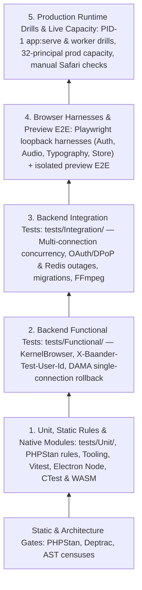

# Testing Pyramid and E2E Layers

How Bånder structures its testing pyramid, separates unit, functional, and integration suites, and layers end-to-end browser verification.

## Testing Pyramid

When you change a domain rule, an HTTP controller, a database query, or a browser audio node, you do not need to boot the full application stack to find out whether it works. Bånder pushes each check down to the smallest runner that actually exercises the mechanism under test:

Static gates (`make ci`, PHPStan, Deptrac, and frontend AST censuses for typography and live-update consumers) run alongside the pyramid to reject layer violations and malformed request payloads before runtime suites start.

## Unit, Functional, and Integration Boundaries

The three backend application suites (`Unit`, `Functional`, and `Integration`) differ by whether the Symfony kernel boots, how authentication and database transactions work, and whether the test crosses process or connection boundaries:

| Boundary | Unit (`tests/Unit/`, Vitest) | Functional (`tests/Functional/`) | Integration (`tests/Integration/`) |
|----------|------------------------------|----------------------------------|------------------------------------|
| **Symfony kernel & DI** | No kernel or container boot | Boots the kernel (`KernelBrowser` via `App\Tests\Functional\TestCase`) | Boots the kernel or connects directly to disposable services |
| **Database & Redis** | None | Real PostgreSQL and Redis inside a single DAMA transaction that rolls back on teardown | Real PostgreSQL and Redis with committed writes, multiple sessions, or fault injection |
| **Authentication** | Constructed principals and value objects | `TestAuthenticator` reads `X-Baander-Test-User-Id` without JWT or DPoP cryptography | Real OAuth 2.0 and DPoP proofs, token rotation, nonces, and firewall matrices |
| **Test doubles** | Never mock domain models; stub or mock port interfaces (`*PortInterface`, repositories) in handler tests | Real repositories and handlers; external HTTP and DNS stay mocked or routed to local fakes | Real infrastructure adapters (PostgreSQL locks, Redis Lua scripts, FFmpeg, outbound socket bounds) |

### Unit Tests

Unit tests instantiate domain objects directly (`Album::create(...)`) with no container, database, or mocks. Application command and query handler tests pass real domain models into the handler while stubbing (`createStub()`) or mocking (`createMock()`) port interfaces (`RepositoryInterface`, `EventDispatcherInterface`). See [Unit and Functional Conventions](conventions.md) for object construction and test-double rules.

Ordinary unit and PHPStan rule tests run in ParaTest workers that recycle every 25 files. Tests that fork processes, send signals, or open Swoole coroutines are listed in `scripts/backend-native-tests.json`; the runner executes each of those files in a fresh PHP process inside a single-worker privileged container with networking disabled. See [Backend Runners and Coverage](backend-runners.md) for lane scheduling.

### Functional Tests

Functional tests extend `App\Tests\Functional\TestCase` and send requests through Symfony's `KernelBrowser` (`authenticatedRequest()`, `anonymousRequest()`) or execute console commands. One test exercises the full vertical slice inside a single PHP process: routing, `#[MapRequestPayload]` validation, `#[IsGranted]` voters, controller serialization (`successResponse()` vs. flat 201 `created()`), and Doctrine mappings.

To keep functional suites fast and self-cleaning, DAMA DoctrineTestBundle wraps each test in a database transaction and rolls it back on teardown (`$client->disableReboot()` keeps that connection open across requests). Because every query in the test shares one uncommitted transaction and authenticates via `X-Baander-Test-User-Id`, a functional test cannot show what a second database connection sees after a commit or rollback, nor does it exercise production bearer tokens or DPoP proofs.

### Integration Tests

When a test must prove behavior across independent connections, real commits, cryptographic handshakes, or external binaries, it belongs in `tests/Integration/`:

- **Concurrent database sessions:** `PlaylistConcurrencyTest` and `RefreshTokenConcurrencyTest` open separate PostgreSQL connections to verify that competing writes, playlist reorders, and token rotations serialize or roll back without lost updates.
- **Committed state and Swoole pool recovery:** `CoverExtractionPersistenceTest` disables DAMA rollback, injects a real ORM flush failure, checks committed rows from a second connection, and verifies that Swoole pool release and Symfony reset let the handler retry cleanly.
- **OAuth/DPoP cryptography and store outages:** `RefreshTokenGraceTest`, `DpopStoreOutageTest`, and the signed-delivery and mutation firewall matrices test real token rotation, replay grace windows, and bounded `503` responses when Redis is paused or stopped. See [Security, Firewall, and Network Suites](security-and-firewall.md).
- **Schema and migrations:** `InitialSchemaMigrationTest` and PGroonga search suites verify fresh initialization, upgrades on populated schemas, idempotent second runs, and scored full-text queries against the extension-capable database image.
- **Native media encoding:** `SegmentEncoder*MediaTest` runs FFmpeg against disposable storage to verify segment output and stream selection. See [Media and Playback Qualification](media-and-playback.md).

## End-to-End and Browser Verification Layers

Running every browser assertion against a full backend stack would make frontend checks slow and brittle. Bånder splits browser and end-to-end verification into four layers so each Playwright suite runs only the services its contract requires:

### 1. Specialized Loopback Browser Harnesses

Four Playwright suites run real browser engines against small loopback HTTPS servers with temporary certificates and no PHP backend. All four run as blocking CI gates (see [Frontend, Browser, and Audio Testing](frontend-and-browser.md)):

- **Browser authentication transport (`yarn --cwd ui/web test:browser-auth`):** Runs Chromium and WebKit against a scripted loopback server (`refresh-state.ts`) whose token rotation state machine is pinned to `tests/Integration/RefreshTokenGraceTest.php`. It verifies that the service worker signs native `` and `<audio>` requests with DPoP credentials, isolates foreign origins (`web.baander.app`, `api.baander.app`, `foreign.baander.app`), retries once on a DPoP nonce challenge, honors `503` with `Retry-After` during an outage, shares rotated credentials across tabs, recovers when CDP stops the service worker, and delivers pending logouts after offline or outage recovery.
- **Web audio graph and stream recovery (`yarn --cwd ui/web test:audio-graph`):** Runs Chromium, Firefox, and WebKit against `audio.baander.app` on loopback. It tests the real `AudioProcessor` node graph in `OfflineAudioContext`, shipped WASM loudness/FFT/metering worklets, crossfades, and preloaded handoffs. `media-interruption.spec.ts` and `stream-recovery.spec.ts` cut a live audio stream mid-body (simulating a web server drain) and verify that the player enters its reconnecting state, holds its clock at the saved position, and resumes the same track once `/live` answers again.
- **Web typography (`yarn --cwd ui/web test:typography`):** Runs Chromium, Firefox, and WebKit against `https://typography.baander.app:5188` to verify bundled Geist and Noto faces, script-specific line heights, zero letter-spacing for Thai, Burmese, Hangul, and CJK text, fixed-row glyph bounds, and that Latin-only pages request no non-Latin font files.
- **Web store isolation and debugging (`yarn --cwd ui/web test:store-debug`):** Runs Chromium against `https://debug.baander.app:5187` to verify Zustand store render isolation, no-op updates, opt-in timeline recording, historical state reconstruction without side effects, and pure transition verification.

### 2. Application Preview E2E (`ui/web/tests/e2e/`)

General browser E2E suites run against the worktree's isolated preview stack (`make preview-up` with `E2E_BASE_URL="$(make preview-url)"`), traversing the nginx TLS ingress, Swoole web server, PostgreSQL, Redis, background Messenger workers, React SPA, and service worker:

- **Styling, preferences, and calibration specs (`tests/e2e/styling/`, `tests/e2e/settings/`, `tests/e2e/layout/`):** Sign in through the real HTTP login flow and persist real user preferences, without injecting fake auth-store state. To check all 32 mood × accent combinations, recessed-footer gradient contrast (`footer-material.spec.ts`), and visualizer modes (`visualizer-calibration.spec.ts`) without scanning media libraries, these specs intercept catalog GET routes with deterministic fixtures and play a local silent WAV.
- **Live-update and scanner specs (`tests/e2e/live-updates/`):** Exercise the complete asynchronous loop from a real `app:library:scan` run or an independent committed database writer through PostgreSQL change capture, worker projection, WebSocket `live.changed` hints, and bounded browser HTTP re-reads, checking that active audio playback, scroll position, and unsaved form drafts survive updates and server restarts.

### 3. Production-Mode Capacity Qualification

Because a development preview carries Vite and debug overhead, live-update latency and concurrency acceptance runs against an immutable production CI image (`php scripts/test-live-capacity-container.php` with `APP_ENV=prod` and `APP_DEBUG=0`). An owned HTTPS ingress container bridges the host loopback browser to an internal network running the production Swoole server, workers, PostgreSQL, and Redis. The suite drives 32 concurrent signed-in principals plus an administrator diagnostics client through ordinary updates, a 10,000-row capture burst over 10 seconds, a 10-page retained song-list refresh, and a 100-page (10,000-album) serial Timeline walk measured with raw CDP network timestamps. See [Live-Update Qualification](live-updates.md).

### 4. Production Runtime Drills and Manual Hardware Checks

At the top of the pyramid, container runtime drills (`scripts/test-*-runtime-container.sh`, `scripts/test-web-shutdown-container.sh`, `scripts/test-security-runtime-container.sh`) boot `app:serve` and the worker supervisors as PID 1 against disposable PostgreSQL, Redis, and Mailpit instances. They stop PostgreSQL and Redis mid-session, reload workers, send `SIGTERM`/`docker stop`, verify WebSocket `1012` close frames and `/ready` `503` drain responses, and check single-use WebSocket ticket redemption and nginx proxy log redaction.

Because Playwright's Linux WebKit decodes media through GStreamer rather than Apple's media stack, Safari playback of an encoding rendition (`Accept-Ranges: none` byte-range probes) and Safari stream resume after a web container restart are verified manually on macOS and iOS. See [Production Runtime Drills](runtime-drills.md).
