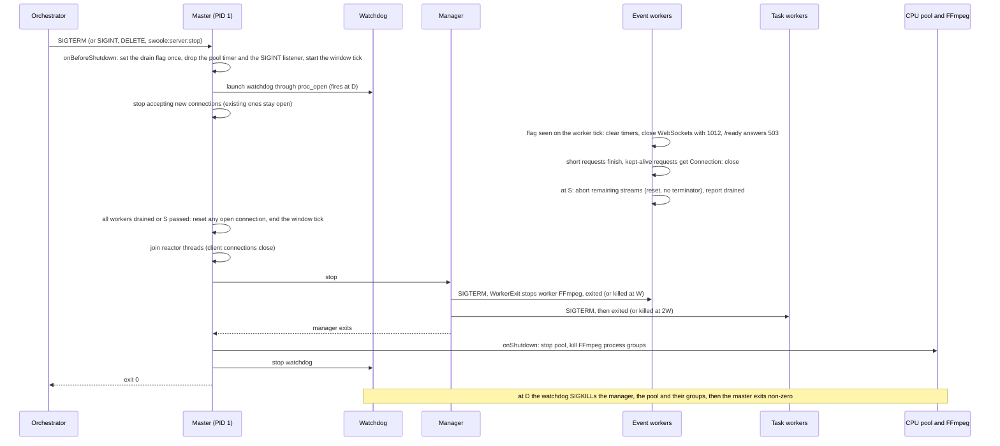
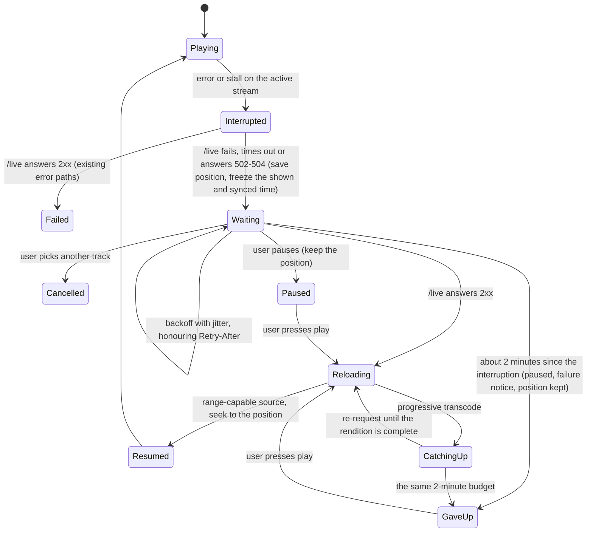

# Web Server Drain on Container Stop - Plan

## Goal Capsule

- **Objective:** stopping or restarting the web container no longer interrupts listeners: a song that is playing resumes where it was once the server is back, WebSocket clients rejoin, no encoder process outlives the server, and the container exits on its own within the stop timeout the operator configured.
- **Means:** one drain path entered from Swoole's `onBeforeShutdown` (KTD1), a single drain deadline (KTD2), streams cut as errors (KTD4), and a web player that resumes after an outage (KTD6).
- **Authority:** this plan's Product Contract, then AGENTS.md and `.agents/rules/` (architecture, admin and console, frontend rules and `ui/DESIGN.md`), then the Key Technical Decisions. The pre-release policy applies: no compatibility layers.
- **Stop conditions:**
  - Stop and ask if U1 cannot find why `app:serve` ignores SIGTERM.
  - Stop and ask if the fix requires replacing Swoole's process mode or the forked bundle's server lifecycle.
  - Stop and ask if no browser can resume a transcoded track at a position without a server-side start offset (KTD6).
- **Execution profile:** backend (Symfony 8.0, PHP 8.5 ZTS, Swoole 6.2.0, forked `packages/swoole-bundle`) and web (`ui/web`, React, Vitest). Runtime proof comes from Docker drills, not unit tests alone. No schema change.
- **Ships:** local commits on `plan/item4-web-shutdown`; push only when the user asks.

---

## Product Contract

### Summary

The web server gets one drain path for every way it is stopped: SIGTERM, SIGINT, the bundle API's `DELETE /api/server` and `swoole:server:stop`. The drain lets short requests finish. At a deadline it cuts long streams as errors, closes WebSockets with a reconnect code, stops every FFmpeg process, and exits before the container's stop timeout. The web player then resumes the interrupted track at its position, and the client defects that a restart exposes are fixed. Production gets a deliberate `memory_limit`. A drill that runs the real server as PID 1 guards all of it.

### Problem Frame

A planned stop of the web container does not end cleanly today. With `app:serve` as PID 1, SIGTERM does nothing: `docker stop -t 40` waits the full 40 seconds and then sends SIGKILL (measured in the CI image). Swoole refuses a userland SIGTERM handler, so the SIGINT handler in `SwooleWorkerEventSubscriber` is the only shutdown code the app owns. That handler stops the CPU process pool first, which ends a playing transcoded stream with a clean end, and the player skips to the next track. Its fallback, a self-SIGKILL after 5 seconds, has no effect when the process is PID 1, so even SIGINT never finishes.

The surrounding paths have gaps of their own:

- FFmpeg processes started by pool workers and by HTTP workers are never stopped.
- Several Swoole timers are never cleared.
- A database query in the master at startup leaves the server half-started when PostgreSQL is down.
- The operator docs say a graceful-restart handler runs on shutdown, but nothing calls it.

On the client, every session-sync tab older than an hour reconnects with an expired token after a restart. A token refresh that fails because the server is restarting logs the user out. A 502 during the outage reads as an unsupported format.

Production also runs each web worker under PHP's default `memory_limit` of 128M from `php.ini-production`. The memory health check judges every worker against that number.

### Requirements

**Server drain**

- R1. SIGTERM, SIGINT, `DELETE /api/server`, `swoole:server:stop` and `$server->shutdown()` all start the same drain, which runs once however many of them arrive.
- R2. Once the drain starts, the server serves no new connections, `/ready` answers 503 to any request that still reaches it, and requests already being handled finish with complete responses within the drain budget.
- R3. When the stream deadline arrives, every response still streaming is cut so the client sees a transfer error, never a clean end of body.
- R4. WebSocket connections receive a close frame with a reconnect code before their TCP connection closes.
- R5. No FFmpeg process or CPU pool worker survives the server, whether or not the server runs as PID 1.
- R6. The server exits within one configured drain deadline, including when it runs as PID 1. A process that has not stopped by then is killed, and the server exits non-zero.
- R7. A worker reload (`PATCH /api/server`, SIGUSR1, the error-rate reloader) never starts the drain. A reload requested during a drain is ignored.
- R8. A planned stop sends no health alert, and new `swoole_task` work dispatched during the drain goes to the Redis `async` transport instead of the in-memory task queue.
- R9. A stop signal that arrives while the master's start-up listeners run still drains. Those listeners survive an unreachable PostgreSQL.

**Clients**

- R10. When the active track's stream fails because the server is unreachable, the web player retries and resumes the same track at the position it had reached, without a failure notice, a skip, a second play record, or a sync of position 0.
- R11. A transcoded track resumes at its position only once the restarted encode can serve that position; until then the player shows that it is reconnecting.
- R12. The player gives up after about two minutes, then pauses with the existing failure notice and keeps the position, so pressing play tries again.
- R13. Session-sync WebSockets reconnect with a current access token, and a session rejoin does not seek the device that is playing.
- R14. A token refresh that fails with a network error or a 5xx keeps the user signed in and retries. Only a 400 or 401 from the refresh ends the session.

**Configuration, proof and records**

- R15. The production image sets `memory_limit` to 512M in an ini file that the server and the `app:health:check` HEALTHCHECK both read.
- R16. The dev compose stop grace and the operator docs state the drain deadline and the stop timeout it needs.
- R17. A drill runs the server as PID 1 and fails when any of R1 to R9 or R15 regresses; CI runs it.
- R18. The operator transcoding docs match what shutdown does, and ROADMAP item 4 is closed.

### Key Decisions

- **The player resumes at the position rather than pausing with an error.** The user chose it over pausing and leaving resume to a follow-up. Governs R10, R11, R12. (session-settled: user-directed — chosen over pausing with the existing error: a restart should not cost the listener their place.)
- **Production `memory_limit` is set for the whole image.** The alternative was a web-only override. The worker supervisor already passes explicit limits to its children, and the HEALTHCHECK must read the same value as the server. Governs R15. (session-settled: user-approved — chosen over a web-only `-d` in `start-web.sh`: one setting that every process in the image reads.)

### Success Criteria

- `docker stop` on a busy web container exits with code 0 before its stop timeout, and a listener in the web player hears the same song continue from where it was.

### Scope Boundaries

- The worker container (`app:worker`) and its shutdown are out of scope. Its drills stay as they are.
- React Native and the `ui/rn` clients are out of scope (deferred indefinitely).
- Video party sockets (`PartySyncBus`) reconnect already and keep membership in the database; nothing changes there.
- Considered and not built:
  - **A pre-drain window before the listener closes.** Swoole stops accepting new connections as soon as the drain starts, so a load balancer only sees the 503 from `/ready` on connections it already holds. Nothing in the stack probes `/ready` today. A window opened by `STOPSIGNAL SIGINT` with an app-owned grace would revisit this if a load balancer ever needs it.
  - **Honouring a signal that arrives before Swoole starts.** Start-up is short, and the orchestrator's SIGKILL covers it.
  - **Resuming HLS transcode sessions after a restart.** `GracefulRestartHandler` stays as groundwork for the movie feature. The drain stops its loops and FFmpeg and releases their locks, and the docs say so.
  - **Keeping queued `swoole_task` jobs.** They are lost on a stop, as documented in `docs/solutions/architecture-patterns/state-set-when-work-is-queued-on-swoole-task-must-expire.md`. Their claims expire.

#### Deferred to Follow-Up Work

- The drill runs the CI image. Running the production image end to end needs its own environment and fixtures and stays a release-qualification task.

---

## Planning Contract

### Key Technical Decisions

- KTD1. **The drain starts in `onBeforeShutdown`, through a new bundle configurator.** Swoole 6.2 runs SIGTERM, `Server::shutdown()` (which sends SIGTERM to the master over a pipe), the API server's `DELETE` and the pid-file route through one master handler. That handler calls `onBeforeShutdown` before the master stops accepting connections, and the master's loop keeps running until nothing holds it. Swoole refuses a userland SIGTERM handler, so this hook is the only shared entry point. SIGINT gets a one-line handler that calls `$server->shutdown()`. The pool shutdown in the SIGINT handler and its self-SIGKILL timer are removed, along with their misleading comment.
- KTD2. **One knob, `WEB_DRAIN_SECONDS`, default 30, sets the whole drain budget D.** Everything else is derived from it:
  - The drain window S, during which workers drain with their connections still open (KTD3), is `floor((D - 4) / 2)`: 13 s at the default.
  - Swoole's `max_wait_time` W is `floor((D - 4 - S) / 2)`: 6 s at the default. After the window, Swoole stops event workers and task workers in series, each for up to W, and the manager force-kills at 2W.
  - The pool keeps its 3-second stop after the workers have gone, and 1 second is margin, so S + 2W + 4 never exceeds D.
  - The backstop fires at D. The smallest accepted D is 8 (S = 2, W = 1); a smaller value is rejected at boot.

  Orchestrators must allow D + 5 seconds; the dev compose sets that (35 s), and the docs state the rule for `docker run --stop-timeout` and other orchestrators. A stop timeout below that still ends with streams cut as errors, which the player recovers from. D is the whole budget, so the compose grace is D + 5 rather than the 2D + 15 first proposed. (session-settled: user-approved — a 30-second default chosen over a budget that fits Docker's 10-second default: short requests and the tails of songs get time to finish.)
- KTD3. **Workers drain inside a window the master holds open.** In Swoole 6.2 process mode the master joins its reactor threads, which closes every client connection, before the manager sends SIGTERM to any worker. A drain run from `WorkerExit` would therefore write to connections that are already gone. Instead:
  - `onBeforeShutdown` records the drain start in a one-row table created before the fork (conflict proportion 1.0, checked `set()`, per `docs/solutions/runtime-errors/swoole-table-default-conflict-proportion-drops-keys.md`). It then starts a master `Timer::tick`, which keeps the master's loop, and with it the reactor threads and every client connection, alive.
  - Each event worker polls the flag on a short tick of its own and runs its drain steps once, while its connections still work. It answers requests that still arrive on kept-alive connections (`/ready` with 503, others with `Connection: close`), closes its WebSockets, waits for short requests, cuts its streams at S, then reports itself drained in the table.
  - The master tick ends when every event worker has reported or S has passed. Before it ends, it closes with a reset every client connection that is still open, so no reactor thread waits on output a stalled client will never read. Swoole then joins the reactor threads and stops the manager.
  - `WorkerExit` keeps only what must run as the worker stops: clearing its own timers and stopping its own FFmpeg. Reloads never set the flag, so they run none of the drain steps (R7).
- KTD4. **A stream is cut by closing its connection without `end()`.** `StreamedResponseProcessor`'s `finally` always ends the response, which writes a clean chunked terminator, and the player then treats a cut as the end of the track. The processor gains an abort path, which the stream deadline and a failed generator (an encode that stopped) both take, and which closes the connection with a reset and no terminator. The CPU pool stops only in `onShutdown`, after the workers have gone, so encoders outlive the streams they feed.
- KTD5. **The backstop is a separate watchdog process, not a master timer.** A PID 1 cannot SIGKILL itself, and once the window closes the master blocks in `waitpid` on the manager, where no master timer can fire. KTD3 bounds the window and the reactor-thread join, and Swoole's 2W alarm bounds the manager, so the watchdog covers only a manager or pool that does not stop. At drain start the master launches it through `proc_open` as a fresh process (a small console command given D and the PIDs and process groups to kill). It is not a plain `fork`, which would hold every client socket open and copy the master's Swoole runtime. At D it SIGKILLs the manager, the pool and their process groups, which unblocks the master. The master then exits non-zero through `pcntl_exec`, following `WorkerSupervisorRunner`. A clean drain ends the watchdog before D.
- KTD6. **A transcoded track resumes once its rendition is complete.** Progressive renditions are sent with `Accept-Ranges: none`, and a restart begins the encode again from zero. The player does not rely on a browser seeking inside a non-range stream. It re-requests the track, stays paused while the response is still progressive, and seeks once the server answers with the complete rendition, which supports byte ranges. Original files and complete renditions resume with an ordinary range request. U7 checks this in Chromium, Firefox and WebKit before committing to it.
- KTD7. **The player tells an outage from a broken track by probing `/live`.** The media element hides the HTTP status, and Chrome reports an nginx 502 as `MEDIA_ERR_SRC_NOT_SUPPORTED`. When the active stream fails or stalls, the player probes `/live`. A network error, a timeout or a 502, 503 or 504 answer means the server is unreachable and starts the retry; nginx answers 502 while the web container restarts. Only a 2xx answer counts as healthy, and it sends the error down the existing paths, including the switch to a transcoded stream.
- KTD8. **FFmpeg runs in its own process group.** The pool workers and `TranscodeStreamManager` start FFmpeg through `proc_open`, and nothing stops it when its parent is killed. Starting it in a new session and stopping it with a group signal, TERM first and then KILL, covers a run where the server is not PID 1. When the server is PID 1, the PID namespace teardown is the last resort.

### High-Level Technical Design

The drain across processes, from the stop signal to exit:

The player after an interrupted stream:

### Assumptions

- The root cause of the ignored SIGTERM is in app code that runs in the master: the CPU pool's health `Timer::tick`, the `Process::signal(SIGINT)` listener, or a master-side listener. A minimal Swoole server in the same image stops on SIGTERM in 5.2 seconds. U1 confirms the cause before U2 builds on it.
- 512M per web worker leaves room: the web drill already runs every streaming and Safari scenario under the CI image's 512M. U5 records measured peaks, and a peak above 60 percent of the limit reopens the number.

### System-Wide Impact and Risks

- **Auth.** U6 changes when the web client signs a user out. Only a 400 or 401 from `/api/auth/refresh` still ends the session; the server's token rules are unchanged.
- **Messaging.** During a drain, task work moves to the Redis `async` transport. The handlers already accept both transports.
- **Health.** A planned stop is silent. A crash or an outage outside a drain still alerts.
- **Forked bundle.** The bundle gains a configurator and the processor's abort path. Both are local to `packages/swoole-bundle`, so no upstream release is involved.
- **Risk: a Swoole upgrade changes the shutdown internals.** The plan relies on four behaviours of Swoole 6.2: the shared SIGTERM path, a master loop held open by a master timer, client connections closing only when the reactor threads join, and the 2W alarm. U1 and the drill assert each one, so an upgrade that changes them fails CI.
- **Risk: a browser reports a cut stream as a normal end.** U7's browser check runs before the player work and stops the unit if any engine does.
- **Risk: a TLS terminator in front of nginx ends a cut stream cleanly.** Over HTTP/2 a proxy can turn an upstream reset into a normal end, and the player would then skip the track. The upgrading guide names the risk, and the drill covers the path through nginx only.
- **Risk: an operator keeps Docker's 10-second stop default.** Streams are then cut early by SIGKILL. The player still resumes, and the upgrading guide states the stop timeout.

### Sequencing

U1 comes first, because every later server unit depends on its root cause. U2, U3 and U4 then build the drain in order: master, workers, streams and processes. U5 is configuration and docs and can land any time after U2 fixes the knob. U6 is a web unit with no server dependency. U7 depends on R3 holding (U4) and lands after U6, whose position handling it touches. U8 completes the drill, wires CI and closes the roadmap.

---

## Implementation Units

### U1. Find why SIGTERM is ignored and add the PID 1 shutdown drill

- **Goal:** know why `app:serve` ignores SIGTERM, fix that cause alone, and have a drill that starts the server as PID 1 through `start-web.sh` and asserts that `docker stop` exits it.
- **Requirements:** R1, R17.
- **Dependencies:** none.
- **Files:**
  - Create `scripts/test-web-shutdown-container.sh`.
  - Modify `src/Shared/Infrastructure/Swoole/SwooleWorkerEventSubscriber.php` and `src/Shared/Infrastructure/Swoole/ProcessPool/CpuProcessPool.php` as the root cause requires.
  - Tests: `tests/Unit/Shared/Infrastructure/Swoole/SwooleWorkerEventSubscriberTest.php`.
- **Approach:**
  1. Reproduce in the CI image with PostgreSQL and Redis, server as PID 1. Remove the master's registrations one at a time: the pool health timer, the SIGINT listener, the `ServerStartedEvent` listeners. Check the master's signalfd mask in `/proc/1/fdinfo`.
  2. Record the cause and the evidence in the drill's header comment and in the commit message.
  3. Fix the cause so a plain SIGTERM reaches Swoole's own shutdown. The full drain arrives in U2.
  4. Confirm, with timestamps, the behaviours U2 to U4 rely on (KTD3):
     - Client connections close when the reactor threads join, before any worker receives SIGTERM.
     - A master `Timer::tick` holds the master's loop, the reactor threads and the client connections open, and a response or WebSocket close frame a worker writes during that time reaches the client.
     - Requests on connections kept alive from before the stop still reach a worker while the master's loop runs.
     - The master blocks in `waitpid` on the manager after the join.
     - Whether `onBeforeShutdown` runs more than once for repeated signals.
- **Execution note:** Diagnose first. The drill's idle SIGTERM case must fail before the fix and pass after it.
- **Patterns to follow:** `scripts/test-worker-containment-container.sh` (TERM scenario, exit code and `OOMKilled` checks); `scripts/test-web-runtime-container.sh` (network, fixtures, cleanup trap, `HEALTH_MONITOR_INTERVAL_SECONDS` env pattern).
- **Test scenarios:**
  - Idle server, `docker stop -t 20`: the container exits 0 within the drain budget, and its log shows Swoole's shutdown.
  - Idle server, `docker kill --signal INT`: same result.
  - The behaviours from step 4 are asserted or recorded, so a later Swoole upgrade that changes them fails the drill.
- **Verification:** the drill passes in the CI image, and the cause is written down.

### U2. One drain path in the master, with the deadline and the watchdog

- **Goal:** every stop route enters one idempotent drain that sets the drain flag, holds the master's loop open for the drain window, arms the backstop and exits within D (KTD1, KTD2, KTD3, KTD5).
- **Requirements:** R1, R6, R7, R9.
- **Dependencies:** U1.
- **Files:**
  - Create `packages/swoole-bundle/src/Server/Configurator/WithServerBeforeShutdownHandler.php`, a before-shutdown handler interface beside the existing shutdown handlers, and its wiring in `packages/swoole-bundle/src/Bridge/Symfony/Bundle/Resources/config/services.php`.
  - Create, in `src/Shared/Infrastructure/Swoole/Drain/`, the drain coordinator, the drain-state table (a bootable created before the fork) and the watchdog.
  - Modify `src/Shared/Infrastructure/Swoole/SwooleWorkerEventSubscriber.php` (SIGINT calls `shutdown()` only), `config/packages/swoole.yaml` and `config/services.yaml` (`WEB_DRAIN_SECONDS`, derived `max_wait_time`, a `pid_file` beside the control socket), `packages/swoole-bundle/src/Bridge/Symfony/Bundle/Command/ServerStopCommand.php` (stop through `ApiServerClient`, waiting D plus a margin), and `src/Recommendation/Infrastructure/Swoole/RecommendationJobCleanupService.php` (bounded, catches and logs).
  - Fix the startup table's undefined `$settings` in `packages/swoole-bundle/src/Bridge/Symfony/Bundle/Command/ServerExecutionCommand.php`, so it prints the real `max_wait_time`.
  - Tests: `tests/Unit/Shared/Infrastructure/Swoole/Drain/` (coordinator, table, watchdog, deadline derivation), `packages/swoole-bundle/tests/` for the configurator, `tests/Unit/Recommendation/Infrastructure/Swoole/RecommendationJobCleanupServiceTest.php`.
- **Approach:**
  1. The configurator registers `onBeforeShutdown` following `WithServerShutdownHandler`.
  2. The coordinator runs once:
     - It records the drain start in the table and drops the pool's master timer and the SIGINT listener.
     - It launches the watchdog through `proc_open` and logs one drain-start line with D, S and W.
     - It starts the window tick, which ends when every event worker has reported drained or S has passed. Before ending, it resets every client connection still open.
     - A second call logs that a drain is already running and changes nothing.
  3. Every callback that touches a pooled service calls `CoWrapper::defer()` first, per `docs/solutions/runtime-errors/swoole-callbacks-outside-the-bundle-leak-pooled-services.md`. The master steps touch no pooled service.
  4. Where the bundle's settings cannot take an env value, the configurator sets `max_wait_time` on the server before start. The executor chooses the mechanism.
- **Patterns to follow:** `WorkerSupervisorRunner` (PID 1 exit through `pcntl_exec`, a fixed deadline); `HealthAlertTable` and `WorkerMemoryTable` (pre-fork tables); `HealthMonitorTimerProbeTest` (pool-leak probe).
- **Test scenarios:**
  - Two drain calls in one master: one drain-start log, one watchdog and one window tick, with no deadline extension.
  - The window tick ends as soon as every event worker reports drained, and otherwise at S, after resetting the connections still open.
  - The deadline derivation: D = 30 gives S = 13 and W = 6; D = 8 gives S = 2 and W = 1; D = 7 is rejected at boot with a clear message.
  - The drain-state table sets and reads its single row, and a failed `set()` throws.
  - The watchdog, started as a separate process with child PIDs, SIGKILLs them and their groups at D; ended early, it kills nothing; it holds none of the master's sockets.
  - `RecommendationJobCleanupService` with the database throwing logs once and returns, and `onStart` completes.
  - The configurator registers the callback only when a handler is configured.
  - Drill: SIGINT, `DELETE /api/server` from inside the container, and `swoole:server:stop` each produce one drain-start line and exit 0.
  - Drill: SIGTERM then SIGINT gives one drain with the original deadline.
  - Drill: SIGTERM with PostgreSQL stopped first still exits 0.
  - Drill: the manager stopped with SIGSTOP through `docker exec` makes the server exit non-zero at D, before the stop timeout. No HTTP route is added for this.
  - Drill: an event worker stopped with SIGSTOP through `docker exec` is killed by Swoole's 2W alarm, and the server exits 0 before D.
  - Drill: a client that stops reading a held progressive stream before the stop does not keep the server from exiting within D.
  - Drill: `PATCH /api/server` reload keeps the server PID, the pool PIDs and open WebSockets, and logs no drain.
- **Verification:** the drain scenarios pass in the drill, and no unit or functional test regresses.

### U3. Per-worker drain steps

- **Goal:** each event worker, once it sees the drain flag, runs its drain steps while its connections still work, and every worker stops its own timers and FFmpeg as it exits (KTD3).
- **Requirements:** R2, R4, R5, R7, R8.
- **Dependencies:** U2.
- **Files:**
  - Create, in `src/Shared/Infrastructure/Swoole/Drain/`, the worker drain tick (started on worker start, polling the drain table) and a `WorkerExitedEvent` subscriber.
  - Modify:
    - `src/Shared/Interface/Controller/HealthCheckController.php`: `/ready` answers 503 while draining.
    - `src/QoL/Infrastructure/Swoole/CpuGpuSampler.php` and `src/QoL/Infrastructure/Swoole/MidStreamMonitor.php`: keep their timer ids and clear them.
    - `packages/swoole-bundle/src/Server/WorkerHandler/CoroutineWatchdogWorkerStartHandler.php`: clear its timer.
    - `src/Shared/Infrastructure/Health/HealthMonitorSubscriber.php`: no alert once draining.
    - `src/Shared/Infrastructure/Swoole/ErrorRateWorkerReloader.php`: no reload once draining.
    - `src/Shared/Infrastructure/Messenger/SwooleTaskWithRedisFallbackSender.php`: Redis once draining.
    - `src/Shared/Infrastructure/Swoole/WebSocketPusher.php`: close all of this worker's fds.
    - `src/Transcode/Infrastructure/Swoole/TranscodeStreamManager.php`: `stopAll()` called and loop locks released.
    - `src/QoL/Infrastructure/Swoole/LearningDataPersister.php`: called from worker 0.
  - Tests in `tests/Unit/Shared/Infrastructure/Swoole/Drain/`, beside each touched class's existing tests, and `tests/Unit/Shared/Infrastructure/Messenger/SwooleTaskWithRedisFallbackSenderTest.php`.
- **Approach:**
  1. The worker tick runs the drain steps once when it first sees the flag:
     - Close this worker's WebSockets with 1012 ("service restart").
     - Answer requests on kept-alive connections with `Connection: close`.
     - Save QoL state from worker 0, logging any failure.
     - Let short requests finish, abort the remaining streams at S (U4), report drained, and clear its own tick.
  2. The `WorkerExitedEvent` subscriber runs once per worker as the worker stops, and only when the flag is set: it clears the remaining timers and stops worker-owned FFmpeg. Reloads never set the flag, so they run none of this.
  3. Nothing waits on task results or pipe messages, which Swoole stops delivering once the workers are signalled (swoole-src#6139).
  4. Re-routed task messages keep their `fromTransport` names, per `docs/solutions/runtime-errors/inline-messenger-run-must-name-the-routed-transport.md`.
  5. Every tick callback that touches a pooled service calls `CoWrapper::defer()` first.
- **Patterns to follow:** `HealthMonitorSubscriber` (keep the timer id, treat `< 1` as failure, clear on stop); `WebSocketPusher::close()`; `SwooleFallbackHandlerRegistrationTest`.
- **Test scenarios:**
  - The worker tick without the flag: nothing happens.
  - A reload's `WorkerExit` (flag unset): no WebSocket closed, no timer cleared, no FFmpeg stopped.
  - The worker tick sees the flag on three consecutive ticks: each drain step runs once, and the worker reports drained once.
  - A worker before `onWorkerStarted` set the server on `WebSocketPusher`: the step skips the WebSockets without an error.
  - `/ready` while draining answers 503; otherwise its existing checks apply.
  - Each formerly uncleared timer is cleared, and a `Timer::tick` probe shows no PHP timer left in the worker.
  - The task sender sends to `async` while draining and to `swoole_task` otherwise, and the envelope's transport name matches the handler's `fromTransport`.
  - `ErrorRateWorkerReloader` after five 5xx responses while draining: no reload.
  - The health monitor while draining sends no dependency alert.
  - `TranscodeStreamManager::stopAll()` stops every tracked process and releases each loop lock.
  - `LearningDataPersister` failing logs and lets the drain continue.
  - Drill: a WebSocket client receives a close frame with code 1012 before EOF.
  - Drill: a request for `/ready` on a connection kept alive from before the stop gets 503 with `Connection: close`.
- **Verification:** the drill shows every worker reporting drained before S when nothing is streaming, and the unit tests pass.

### U4. Cut streams as errors and stop every encoder

- **Goal:** long streams end as transfer errors at the stream deadline, and no FFmpeg or pool worker outlives the server (KTD4, KTD8).
- **Requirements:** R3, R5.
- **Dependencies:** U2, U3.
- **Files:**
  - Modify:
    - `packages/swoole-bundle/src/Bridge/Symfony/HttpFoundation/StreamedResponseProcessor.php`: an abort path for both the generator stream and the ranged-file loop.
    - The stream deadline hook in the worker drain subscriber.
    - `src/Transcode/Infrastructure/Transcode/AudioRenditionCache.php`: a stopped encode raises, so the stream is aborted.
    - `src/Shared/Infrastructure/Swoole/ProcessPool/CpuProcessPool.php`, `src/Transcode/Infrastructure/Swoole/TranscodePoolWorker.php`, `src/Transcode/Infrastructure/Swoole/AudioRenditionPoolWorker.php`, `src/Transcode/Infrastructure/Swoole/ProcOpenSpawner.php`: process groups and group stop.
  - Tests: `packages/swoole-bundle/tests/` for the processor, `tests/Unit/Shared/Infrastructure/Swoole/CpuProcessPoolShutdownTest.php`, `tests/Unit/Transcode/Infrastructure/Transcode/AudioRenditionCacheTest.php`.
- **Approach:**
  1. The processor tracks its in-flight streamed responses per worker, so the drain can abort them at S.
  2. An abort closes the connection with a reset and without the chunked terminator. A generator that throws takes the same path.
  3. The pool's existing stop in `onShutdown` (`CpuProcessPoolShutdownHandler`) stays as the only pool stop. It signals each FFmpeg group before it escalates to SIGKILL.
- **Execution note:** Start with the drill case that asserts curl exit 18 on a held progressive stream; it fails today.
- **Patterns to follow:** `tests/Fixtures/WebRuntime/HeldRendition.php` and `StreamClient.php`; `CpuProcessPool::killAllWorkers()`.
- **Test scenarios:**
  - A generator that throws mid-stream: the connection is closed and `end()` is never called.
  - A drain abort at S on a streamed response: the same.
  - A ranged file response aborted mid-loop: the body is shorter than its Content-Length.
  - `AudioRenditionCache::follow()` when the encoder lock is released before completion: it throws, it does not return.
  - The pool shutdown with a worker that ignores the shutdown message and has a child process: the worker and the child are both gone afterwards.
  - Drill: a held progressive stream at stop is cut with curl exit 18 (transfer closed with outstanding data).
  - Drill: a short request in flight at stop completes with its full body.
  - Drill, server not PID 1 (`docker exec` start): after the stop, no FFmpeg or `cpu-pool-worker` process remains in the container.
- **Verification:** the stream and process drill cases pass; the existing web drill's stream and Safari steps still pass.

### U5. Production memory limit, stop grace and operator docs

- **Goal:** production runs at a deliberate 512M, and operators know the drain deadline and the stop timeout it needs.
- **Requirements:** R15, R16, R18.
- **Dependencies:** U2.
- **Files:**
  - Modify `Dockerfile` (a conf.d ini in the `production` stage), `docker-compose.yml` (`stop_grace_period` from 3605 s to 35 s, with a comment deriving it from `WEB_DRAIN_SECONDS`).
  - Docs: `docs-book/part-1-operator-guide/configuration.md` (`WEB_DRAIN_SECONDS`, the memory limit), `docs-book/part-1-operator-guide/monitoring.md` (memory check against 512M, planned stops send no alert), `docs-book/part-1-operator-guide/upgrading.md` (stop timeout rule, player resume, nginx re-resolution of a replaced container, and that a TLS terminator in front of nginx must pass an upstream reset through rather than end the stream cleanly), `docs-book/part-1-operator-guide/transcoding.md` (replace the claim that the graceful-restart handler runs on shutdown with what the drain does), `docs-book/part-2-developer-guide/testing.md` (the new drill).
- **Approach:** the ini lives in conf.d so the server, the HEALTHCHECK CLI and console commands read one value; the worker supervisor's explicit `-d` limits keep applying to its children. Run docs through `prose-fix`.
- **Execution note:** Mostly configuration; prove it with the drill and an image check, not unit tests.
- **Test scenarios:**
  - Drill or image check: the production image reports `memory_limit` 512M for `php -r` and for `app:health:check`, and the server's startup table shows 512 MiB.
  - The drill records the largest worker memory from `WorkerMemoryTable` during the stream scenarios; above 60 percent of 512M fails the step (Assumptions).
- **Verification:** the image check passes; the docs build and read cleanly.

### U6. Web: reconnect with a current token, keep the session through a restart

- **Goal:** a restart no longer logs users out, strands old session tabs, or jumps the playing device back (R13, R14).
- **Requirements:** R13, R14.
- **Dependencies:** none (independent of the server units).
- **Files:**
  - Modify `ui/web/src/features/session/hooks/use-session.ts` (token read on each connect; `session.joined` seeks only a device that is not active), `ui/web/src/features/session/services/SessionSyncBus.ts` (token provider instead of a captured token; jittered backoff), `ui/web/src/shared/api-client/axios-instance.ts` (transient refresh failures keep auth).
  - Tests: the matching `__tests__` files beside each module.
- **Approach:** the bus asks for the current token when it builds each connection URL. A refresh that fails with a network error or 5xx leaves auth in place and lets the request fail, so the caller retries; a 400 or 401 keeps today's sign-out. Follow `.agents/rules/frontend.md`.
- **Test scenarios:**
  - A bus reconnecting after the token was refreshed uses the new token in its URL.
  - Reconnect backoff stays within 1 to 30 seconds and varies between attempts.
  - A refresh failing with a network error: auth is not cleared, and no redirect to `/login` happens.
  - A refresh failing with 502: same.
  - A refresh failing with 401: auth is cleared and the user is sent to `/login`, as today.
  - `session.joined` on the active device with a server position 30 seconds behind: no seek.
  - `session.joined` on a device that is not active: it seeks to the server position, as today.
- **Verification:** the web test suite, typecheck and lint pass.

### U7. Web: resume the interrupted track at its position

- **Goal:** the player rides out a server restart and resumes the same track where it was (KTD6, KTD7).
- **Requirements:** R10, R11, R12.
- **Dependencies:** U4 (cuts arrive as errors), U6.
- **Files:**
  - Modify `ui/web/src/features/player/hooks/use-audio-playback.ts` (error and stall handling enter the retry), `ui/web/src/features/player/stores/player-playback-runtime.ts` (outage probe, retry with backoff, catch-up for progressive renditions, resume without a play record), `ui/web/src/features/player/stores/player-playback-slice.ts` (user actions during a retry), and the player's reconnecting state in the UI following `ui/DESIGN.md`.
  - Create a resume helper beside `player-playback-runtime.ts` if the runtime grows too large.
  - Tests: `ui/web/src/features/player/hooks/__tests__/` and the stores' `__tests__`; a Playwright check in the audio-graph harness (`yarn --cwd ui/web test:audio-graph`) for Chromium, Firefox and WebKit.
- **Approach:**
  1. On an error or a stall of the active element, save the position and freeze the shown and synced time, then probe `/live` (KTD7).
  2. While the probe fails, back off from 1 second, doubling to 15 seconds, with jitter, and honour `Retry-After` on a 503 `transcode_busy`.
  3. When the server answers, reload the same source. Seek directly when the source supports ranges; otherwise stay paused and re-request until the rendition is complete (KTD6).
  4. Bypass `recordPlay` and the loudness reset for a same-track resume.
  5. When `play()` is rejected for lack of a gesture, show "Tap to resume" instead of failing silently.
  6. One budget of about two minutes runs from the interruption and covers both waiting for the server and catching up on a transcode (R12).
  7. The player's states during a retry follow `ui/DESIGN.md`:
     - While waiting or catching up, the full player and the mini-player show "Reconnecting…" in place of the time, keep the frozen position, and show the play control as playing; pressing it pauses.
     - The seek bar stays usable, and a seek moves the saved position.
     - After the budget, the existing failure notice shows and the play control returns to paused.
     - "Reconnecting…" and "Tap to resume" are announced through a polite live region, and "Tap to resume" is a focusable button.
- **Execution note:** Run the browser check first: how a cut chunked response and a cut Content-Length response surface in each engine (error code, `ended`, or a stall). If an engine reports a cut as `ended`, stop and ask (Goal Capsule).
- **Patterns to follow:** `requestSelectedTrackPlayback` and its generation token; `switchToTranscodedStream`; `notifyPlaybackFailure`.
- **Test scenarios:**
  - The probe answers 502 (nginx while the container restarts): the player enters the retry, with no failure notice and no switch to a transcoded stream.
  - An original stream fails with a network error, the probe fails twice, then succeeds: the player resumes the same track at the saved position, with no failure toast and no second `recordPlay`.
  - A progressive transcode fails during an outage: after the server returns, the player stays paused while responses are progressive and seeks once the complete rendition arrives.
  - `MEDIA_ERR_SRC_NOT_SUPPORTED` while the probe fails: no switch to a transcoded stream.
  - `MEDIA_ERR_SRC_NOT_SUPPORTED` while the probe succeeds: the switch to a transcoded stream happens, as today.
  - A stall with no error event for longer than the stall timeout enters the retry.
  - A 503 with `Retry-After: 5` delays the next attempt by at least 5 seconds.
  - The user seeks during the retry: the target follows the seek.
  - The user picks the next track during the retry: the retry is cancelled.
  - The user pauses during the retry: no automatic resume, and play resumes at the saved position.
  - The user presses play during the backoff: an immediate attempt.
  - The server never returns: after about two minutes the player is paused, the failure notice shows, and the position is kept.
  - The server returns but the transcode is still not complete two minutes after the interruption: the player gives up the same way.
  - While reconnecting, a screen reader hears "Reconnecting…" once, and "Tap to resume" can be reached and pressed with the keyboard.
  - During the retry the shown time and the synced position never drop to 0.
  - Repeat-one with a cut stream resumes the same track at the position, not from 0.
  - The next-track preload failing during the outage does not change the active track.
  - Browser check: Chromium, Firefox and WebKit surface a cut chunked audio response and a cut Content-Length response as an error or a stall, never as `ended`.
- **Verification:** web tests, typecheck and lint pass; the browser check passes in all three engines; a manual run against the dev stack with `docker compose restart app` resumes a playing song at its position.

### U8. Complete the drill, wire CI, close the roadmap

- **Goal:** the drill covers every server scenario, runs in CI, and the roadmap records item 4 as closed.
- **Requirements:** R17, R18.
- **Dependencies:** U1 to U5 (U6 and U7 for the roadmap entry).
- **Files:** `scripts/test-web-shutdown-container.sh`, `.forgejo/workflows/ci.yaml` (a step beside the web runtime drill), `ROADMAP.md` (item 4 in "Resume here", the "Not yet fixed" paragraph removed, the quality-gate checkpoint updated), `docs-book/part-2-developer-guide/testing.md`.
- **Approach:** the drill uses a low `WEB_DRAIN_SECONDS` to stay inside CI's time budget, and asserts exit codes, elapsed time against D and the stop timeout, log lines, and the absence of leftover processes. Record the quality-gate run in the roadmap the way the item 3 checkpoint does.
- **Test expectation:** the drill itself is the test; its scenarios are listed under U1 to U5.
- **Verification:** CI runs the drill and it passes; `ROADMAP.md` names item 4 as delivered, with anything left open stated.

---

## Verification Contract

| Gate | Command or check |
|---|---|
| Unit | `scripts/test-unit-container.sh`; focused host runs for touched classes |
| Functional and integration | `BAANDER_TEST_IMAGE=baander-ci-prewarm:local bash scripts/test-functional-container.sh tests/Functional` and `tests/Integration` |
| Bundle | the forked bundle's own PHPUnit suite under `packages/swoole-bundle/tests` |
| Static | PHPStan full scan, Deptrac 0, `lint:container`, OpenAPI check |
| Runtime | `scripts/test-web-shutdown-container.sh` (new), `scripts/test-web-runtime-container.sh`, the worker drills, `scripts/test-container-startup.sh` |
| Web | `yarn --cwd ui/web test`, typecheck, lint, `yarn --cwd ui/web test:audio-graph` for the browser check |

## Definition of Done

- R1 to R18 are met, with the drill and test evidence above.
- U1's root cause is recorded in the drill and the commit, and the misleading `max_wait_time` comment is gone.
- No Swoole timer, signal listener or FFmpeg process is left behind by a drain in the drill.
- Code from abandoned approaches, including the diagnostic edits from U1, is removed.
- The roadmap and operator docs describe the shipped behaviour.
- Changes are committed on `plan/item4-web-shutdown`; nothing is pushed until the user asks.

---

## Sources

- Swoole 6.2.0 source: `src/server/master.cc` (shutdown handler, `onBeforeShutdown`, `stop_master_thread`), `src/server/manager.cc` (2W alarm), `src/server/worker.cc` (`WorkerExit` repeats, pipe read removed), `ext-src/swoole_process.cc` (a userland handler for a system signal is refused); swoole-src#6139.
- `docs/solutions/runtime-errors/swoole-callbacks-outside-the-bundle-leak-pooled-services.md`, `docs/solutions/runtime-errors/swoole-table-default-conflict-proportion-drops-keys.md`, `docs/solutions/architecture-patterns/health-checks-run-in-a-messenger-consumer-cannot-see-outages-that-stop-it.md`, `docs/solutions/architecture-patterns/state-set-when-work-is-queued-on-swoole-task-must-expire.md`, `docs/solutions/runtime-errors/inline-messenger-run-must-name-the-routed-transport.md`.
- Measured on 2026-10-11 in the CI image: SIGTERM to `app:serve` as PID 1 leaves every process running until Docker's SIGKILL; SIGINT runs the handler but the container is still up 20 seconds later; a minimal Swoole server in the same image stops on SIGTERM in 5.2 seconds.
