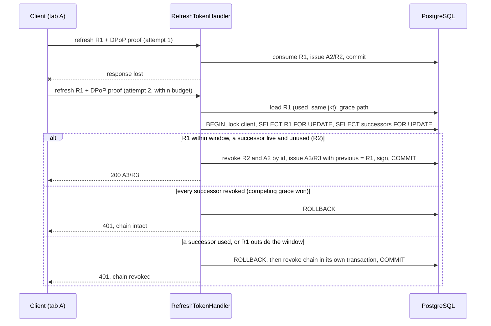
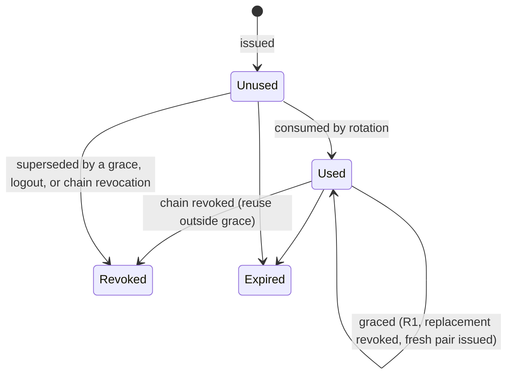
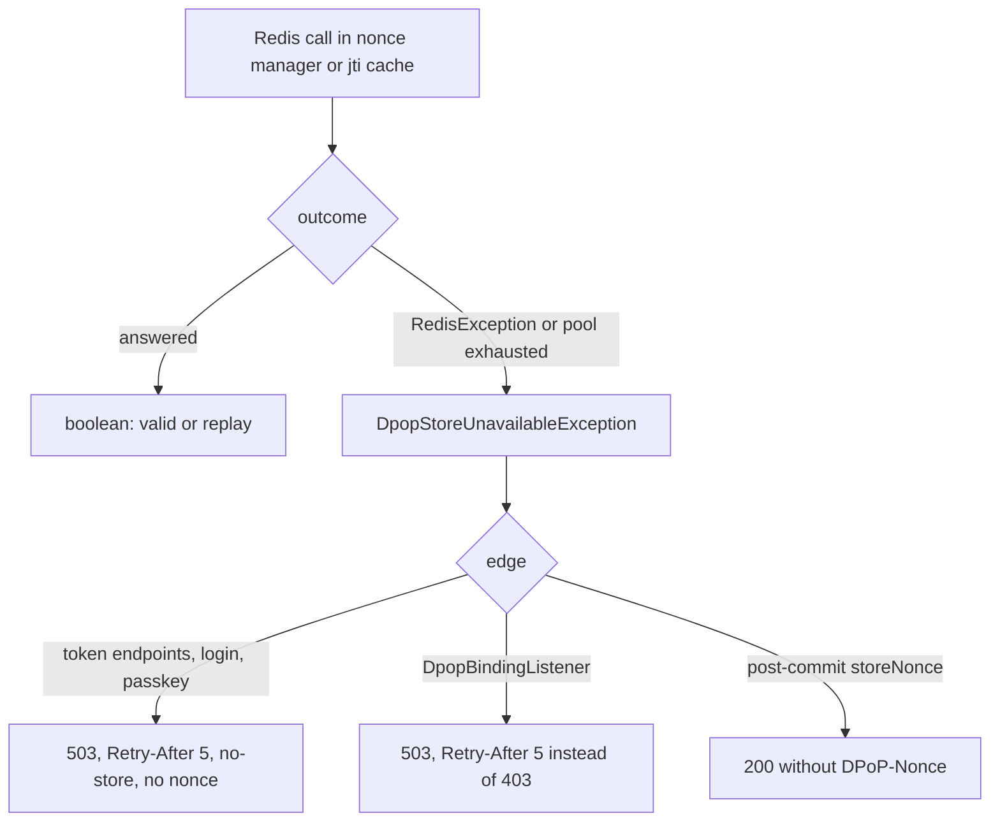
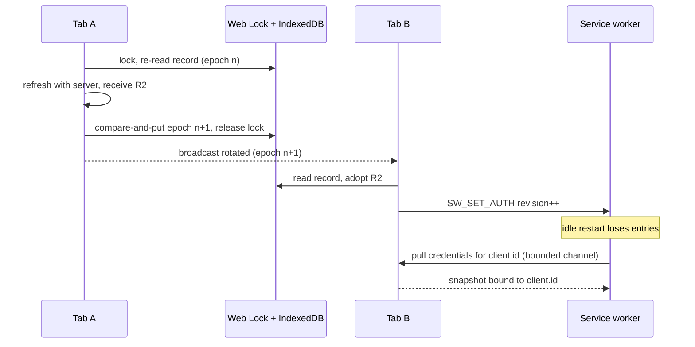

# Browser Credential and Session Qualification - Plan

## Goal Capsule

- **Objective:** a signed-in listener stays signed in through everything that is not their own logout: a refresh whose answer never arrived, a second tab of the same account, a Redis outage, a service worker the browser restarted, or a server restart. Logout ends the session in every tab and socket that used it. The evidence is recorded against real PostgreSQL, real Redis and a real browser, and the roadmap's open bullet closes.
- **Means:** a narrow lost-response grace on the server (KTD1), one store-unavailable signal answered with 503 and `Retry-After` (KTD2), a client refresh budget derived from one constant (KTD4), cross-tab coordination (KTD5), a logout that revokes what the request authenticated with (KTD6), and a worker that pulls its credentials back after a restart (KTD7).
- **Authority:** this plan's Product Contract, then AGENTS.md and `.agents/rules/` (architecture, admin and console, frontend rules and `ui/DESIGN.md`), then the Key Technical Decisions. The pre-release policy applies: no compatibility layers.
- **Stop conditions:**
  - Stop and ask if the grace in U3 cannot be made one atomic decision inside the refresh transaction.
  - Stop and ask if the Electron shell cannot use the Web Locks API (U7).
  - Stop and ask if Playwright's Chromium cannot stop a service worker through CDP (U9); the restart scenario then needs another route.
- **Execution profile:** backend (Symfony 8.0, PHP 8.5 ZTS, Swoole 6.2.0, League OAuth2 Server 9.4, PostgreSQL, Redis) and web (`ui/web`, React, Zustand, Axios, Vitest, Playwright). Runtime proof comes from PHPUnit integration tests on disposable PostgreSQL and Redis, the browser-auth Playwright suite and the web runtime drill. No PostgreSQL migration; one new column on the pre-fork Swoole table that registers WebSocket connections.
- **Ships:** local commits on `plan/item5-browser-session`; push only when the user asks.

---

## Product Contract

### Summary

The refresh endpoint gains a lost-response grace, a Redis outage becomes a "come back later" answer instead of a nonce loop or a 403, logout revokes the session's chain and closes its sockets, and the web client learns to wait on 503, to share one refresh across tabs, and to re-arm its service worker after a restart. Every behaviour is proven by an integration suite on real PostgreSQL and Redis, an extended browser suite, and the runtime drill.

### Problem Frame

The roadmap's open bullet (`ROADMAP.md`, "Verify concurrent refresh against PostgreSQL ...") asks for a combined qualification of the browser credential lifecycle. Research against the current source found that the lifecycle does not yet hold together.

A refresh whose response is lost after the server rotated the token leaves the client with a consumed token. Its next refresh is treated as reuse, the chain is revoked, and the user is signed out. The web client does not retry a refresh on a transport failure, so the retry only happens at the next 401, possibly minutes later.

During a Redis outage the DPoP nonce and jti checks fail closed in the only way they can today: both classes turn a Redis exception into the same boolean as a real miss (`src/Auth/Infrastructure/Security/OAuth/DpopNonceManager.php`, `src/Auth/Infrastructure/Cache/RedisDpopJtiCache.php`). Token endpoints then answer 400 `use_dpop_nonce` with a nonce that was never stored, and every DPoP-bound API request answers 403 through `DpopBindingListener`. The client keeps its session but nothing works until Redis returns, and it never honours the 503 with `Retry-After` the refresh endpoint already sends for database faults.

Logout revokes nothing on the server. `AuthController::logout` passes the raw JWT where `RevokeTokenCommand` expects a token id, no row matches, and the handler returns without error. The refresh token stays redeemable for 30 days and the session WebSocket stays open.

Two tabs of one account hydrate the same IndexedDB record and never coordinate afterwards. The second tab presents a refresh token the first tab already rotated, which the server treats as reuse. An idle service worker that the browser kills and respawns forgets every credential and then forwards native media requests without `Authorization`; nothing asks the page to republish. The browser-auth suite covers neither case: its eleven tests use two accounts for the two-page case and never restart the worker, challenge a nonce or answer 503.

Smaller defects sit in the same code: `TokenPairIssuer` signs and writes token metadata after its commit; the jti cache's TTL configuration is unreachable through its port and its comment says "fail open" for fail-closed code; a listener puts a random unstored `DPoP-Nonce` on every API response, which overwrites the stored nonce the token endpoint gave the client, so even a refresh inside the nonce lifetime is challenged; `/api/oauth/token` answers a bare 500 on server faults. The roadmap's "seven tests and 107 assertions" suite no longer exists under that description; the real PostgreSQL coverage is `tests/Integration/OAuthGrantPathAcceptanceTest.php`, sequential and in one process, with no concurrent refresh and no rollback on a signing failure.

### Requirements

**Refresh rotation and reuse (server)**

- R1. A used refresh token presented again with a proof from the same DPoP key, within the grace window, while every live replacement of it (a successor row that is not revoked) is unused, gets a fresh token pair; the live replacements and their access tokens are revoked in the same transaction. The presented token stays used and its `used_at` is unchanged, so repeated graces share the one window measured from the first consumption. A duplicate presentation that starts after a grace committed supersedes the pair the client just adopted; the client's single flight and budget (R15, R18) are what keep that from happening to an honest client.
- R2. Any other presentation of a used refresh token revokes its chain, in a transaction that commits before the 401 is answered. A same-key presentation of a refresh token that a grace superseded (revoked, never used, in a chain that still holds a live refresh token) also revokes the chain. A presentation whose DPoP key differs from the token's answers 401 without revoking anything.
- R3. Two simultaneous presentations of one refresh token yield exactly one usable pair. The one that loses the row lock re-reads the presented token and its replacements under that lock and gets one of three answers: a replacement already used revokes the chain (R2); every replacement already revoked by a competing grace answers 401 with the chain intact; a live unused replacement is superseded and a fresh pair is issued (R1).
- R4. A refresh whose persistence or signing fails leaves the presented token unconsumed and answers 503 with `Retry-After`; the next presentation succeeds.
- R5. The grace window is `auth.refresh.reuse_grace_seconds`, default 60, maximum 60, where 0 disables R1; it is measured on the database clock.
- R6. Every grace and every reuse rejection is logged with the chain id and the reason (grace, outside window, replacement used, superseded token presented, different key, concurrent loser), never with a token string.

**DPoP store outage (server)**

- R7. When the nonce or jti store is unavailable, `/api/auth/refresh`, the login and passkey endpoints, `/api/oauth/token` and every DPoP-bound API request answer 503 with `Retry-After` and `Cache-Control: no-store`, and carry no `DPoP-Nonce` or `WWW-Authenticate` header. A genuine nonce miss keeps its 400 `use_dpop_nonce` answer and a genuine replay keeps its 400 or 403.
- R8. A nonce is issued only after it was stored. A successful refresh whose post-commit nonce store fails still answers 200, without a `DPoP-Nonce` header.
- R9. A Redis that accepts connections but does not answer yields the 503 within a bounded time.
- R10. `/api/oauth/token` answers server faults with 503 and `Retry-After`, as `/api/auth/refresh` does.
- R11. Only token endpoints issue DPoP nonces. The random unstored nonce on every `/api/` response is removed.
- R12. The jti replay cache keeps entries for the proof acceptance window, configured through its port; the dead store method goes.

**Login and logout (server)**

- R13. Logout revokes the chain of the access token that authenticated the request and closes every WebSocket connection authenticated with any access token of that chain. A refresh with any token of that chain afterwards answers 401. Rotation and a grace never close a socket. `/api/oauth/revoke` revokes only a token whose user is the authenticated user, closes sockets the same way, and answers a foreign or unknown token exactly alike (200, nothing revoked), so it is not a liveness oracle.
- R14. Login, passkey, authorization-code and device-code issuance write token metadata and sign the JWT inside the issuing transaction.

**Web client**

- R15. One refresh has one wall-clock budget of 30 s: a per-attempt timeout of 10 s, at most one transport retry, one nonce retry and one 503 wait, a fresh proof per attempt, and a remaining-budget check before each attempt. The 503 wait is `Retry-After` plus a uniform jitter of up to the same value, capped at 10 s in total. The budget stays below the server grace window; the invariant is stated once, next to the constants.
- R16. The initiating request and every queued request get one outcome from a refresh: one replay with the fresh token, or one failure. A queued request never starts its own refresh.
- R17. A refresh answered 503 keeps the session. A 401, or a 400 `invalid_grant`, ends it. Every other failure keeps the session and fails the request.
- R18. Tabs of one origin run one refresh at a time under a Web Lock whose wait is bounded by the budget. Under the lock a tab re-reads the stored record and adopts tokens another tab rotated instead of calling the server; the lock is held until the record's write has completed. Every credential write (refresh, login, account switch) is a compare-and-put against the record's epoch; the epoch only grows, a cleared record keeps it as a tombstone, and a tab adopts the stored record whenever its own epoch differs. Rotation and clearing are broadcast as events that carry the epoch and never a token.
- R19. Logout in one tab clears every tab of the origin and closes their session sockets; a sibling tab that receives `cleared` re-reads the record and clears only when it is gone or tombstoned at that epoch or later, then lands on the login page without calling the server. The tombstone write does not wait for the lock.
- R20. The session-sync socket closes when its tab clears its credentials. A reconnect uses the token current at that moment.
- R21. After the browser restarts an idle service worker, a credentialed path requested by a known same-origin client (a fetch with a non-empty client id that is not a navigation) makes the worker pull credentials from that client over one bounded channel per client, accept only a reply bound to that client id and origin, compare the request origin with the snapshot's API origin, and then sign the request; a foreign origin is forwarded unchanged with no credentials. Until the pull answers it never forwards a request to the API origin without credentials. A proof or refresh capacity overflow answers a synthetic 503 with `Retry-After: 1`. Every channel and timer is closed on success, timeout, cancellation, logout, account switch and restart.
- R22. The worker's deadlines are pinned to the Axios budget by a test, so neither changes alone.
- R23. Without the Web Locks API the refresh fails as a transient failure; unit tests run with fakes.

**Qualification evidence**

- R24. Integration tests on real PostgreSQL and Redis prove R1 to R4, R7 to R10, R13 and R14, including two database sessions refreshing one token, a logout concurrent with a refresh of the same chain, a signing failure that rolls back, a Redis that refuses connections, a Redis that hangs, and no pool growth after repeated refreshes.
- R25. The browser-auth suite exercises in one browser session: a nonce challenge, a lost response and its recovery, a 503 wait and retry, two tabs of one account rotating, logout across tabs, a worker restart during playback, foreign-origin exclusion and the retry bounds.
- R26. The web runtime drill covers a Redis outage on the real server: 503 with `Retry-After` on a refresh and on an API call, one health alert, and a successful refresh after Redis returns.
- R27. The operator guide, the testing guide, `ROADMAP.md` and `CONCEPTS.md` describe the new behaviour; the roadmap replaces the stale "seven tests and 107 assertions" line with the real suites.

### Key Decisions

- **This qualification is roadmap item 5.** (session-settled: user-approved — chosen over the registry gates and the other item 4 leftovers: the roadmap names it first and it sits in the application-release horizon.) Governs all.
- **Lost-response grace, narrow.** (session-settled: user-approved — chosen over no grace, and over returning the cached replacement: the same DPoP key must sign, the window is short, and the unused replacement is revoked so one chain never holds two live refresh tokens.) Governs R1, R2, R5.
- **A Redis outage answers 503 and the checks stay fail-closed.** (session-settled: user-approved — chosen over failing open and over a PostgreSQL fallback store: no proof is accepted without the replay check, and 503 is the only standard "wait" answer at a token endpoint.) Governs R7, R8, R9.
- **Defects found in the audited code are fixed here.** (session-settled: user-approved — chosen over deferral.) Governs R10 to R14, R20, R21.
- **Logout revokes the chain.** A logout ends the session the request authenticated with, which the cross-tab broadcast also ends on the client, so the server revokes the whole chain rather than the one access token. Governs R13, R19.
- **A different DPoP key never revokes.** Revoking on a key mismatch would let anyone holding a token string sign the user out; today's answer is kept. Governs R2.
- **The outage wait is delivered for refresh and native media only.** Ordinary API calls surface the 503 to their caller as today; the UI shows errors while the session is kept. Governs R7, R17.

### Success Criteria

- The unit, functional and integration suites, PHPStan, Deptrac at zero, container lint, the OpenAPI check, the web test, typecheck and lint gates, the browser-auth suite and the web runtime drill pass in the CI image, and the quality-gate checkpoint in `ROADMAP.md` records the counts.
- A reader of the operator guide can say what a user experiences during a Redis outage, what logout revokes, and what the grace window setting does.

### Scope Boundaries

- Out, considered and not built: a Playwright runner against the real PHP server. The browser suite keeps its scripted server, whose refresh state machine is pinned to the integration matrix (KTD9). Evidence that the scripted server drifts from the real one would change the call.
- Out, considered and not built: closing a session socket when its access token expires. The socket's lifetime is bounded by revocation (R13) and the refresh-token lifetime; a disabled account is already disconnected. A requirement to end pushes at access-token expiry would change the call.
- Out, considered and not built: Prometheus counters per refresh outcome. The logs (R6) and the existing health alert carry the operator signal; drills assert through HTTP answers.
- Out, considered and not built: revocation by a confidential OAuth client (RFC 7009 client authentication at `/api/oauth/revoke`). The route sits behind the user firewall with no client authentication; a client-credential flow for revocation would change the call.
- Out: the remaining item 4 leftovers (HLS drain drill, `play()` retry bound, heartbeat-scan cost), the Safari manual checks, the dev-database reconcile, the real-firewall authorization matrix, the threat model, React Native.

#### Deferred to Follow-Up Work

- The main e2e suite (`ui/web/tests/e2e/fixtures.ts`, `auth/login.spec.ts`) uses `baander.test` credentials against AGENTS.md and is not run in CI; its stale reload comment goes with it.
- Logout during a Redis outage ends the session locally only, because the logout request itself fails the DPoP check with 503; the chain stays until it expires. Documented in the operator guide (U10); a queued server-side logout is follow-up work.

### Acceptance Examples

- AE1. **Lost response.** Covers R1, R15. Given tab A refreshes with R1 and the server rotates to R2 but the response is lost, when tab A retries within the budget with R1 and the same key, then it receives R3, R2 is revoked, and the next API call succeeds.
- AE2. **Replacement already used.** Covers R2. Given R1 was rotated to R2 and R2 has been used, when R1 is presented again with the same key inside the window, then the chain is revoked and the answer is 401.
- AE3. **Concurrent loser.** Covers R3. Given two requests present R1 at once from the same key, when the second waits on the row lock and then finds R1 used and R2 unused, then it gets R3 and R2 is revoked; the first request's late response is discarded by the client.
- AE4. **Redis outage.** Covers R7, R17, R26. Given Redis is stopped, when the client refreshes, then it receives 503 with `Retry-After: 5` and no nonce header, waits, retries once, keeps its session on a second 503, and refreshes successfully after Redis returns.
- AE5. **Two tabs, one account.** Covers R18. Given tabs A and B hold R1 and A rotates to R2, when B's access token is rejected, then B takes the lock, reads R2 from storage, adopts it, and never calls the refresh endpoint.
- AE6. **Logout across tabs.** Covers R13, R19. Given tabs A and B share a session, when A logs out, then the chain is revoked, A's and B's sockets close, B lands on the login page, and a refresh with R2 answers 401.
- AE7. **Worker restart.** Covers R21. Given the browser stopped the idle service worker during playback, when the next segment request arrives, then the worker pulls credentials from the requesting tab, signs the request, and the player continues.

---

## Planning Contract

### Key Technical Decisions

- KTD1. **Grace is decided in `RefreshTokenHandler` after the DPoP binding check and before chain validation, from rows read under the row lock inside the refresh transaction.** (session-settled: user-approved — chosen over a validator that revokes on any used token: that rule runs outside the transaction and revokes before the grace can be judged.) The pre-transaction read of the presented token only routes: an unused, unrevoked token takes today's path; a used token, or a revoked unused token, presented with the token's own jkt enters the locked evaluation. Inside the transaction, after the client lock, the handler re-reads the presented token `FOR UPDATE`, then its successors `FOR UPDATE`, and classifies with one predicate shared with the pre-check, on `NOW()` with `>=`: a revoked unused token whose chain still holds a live refresh token is a superseded token presented (reuse, R2); otherwise the token must be used, not revoked and consumed within the window; a successor with `used_at` set means reuse; successors all revoked means a competing grace won; at least one live unused successor means grace. The grace revokes those successors and their access tokens by id, with the affected count asserted, and issues the fresh pair with the presented token as predecessor, so the validator's "predecessor used, not revoked" rules hold for the next rotation. The repository methods used inside the transaction never clear the EntityManager, and the handler calls them before any `persist`. The consume-race loser (`consumeByTokenId` returning null) runs the same locked evaluation (R3). A reuse verdict revokes the chain in a transaction of its own that commits before the 401 is raised, never inside the issuing closure that the exception rolls back. A grace repeats within the window; the window and the rate limiter bound it. Governs R1, R2, R3, R5, R6.
- KTD2. **One Application exception, `DpopStoreUnavailableException`, is the outage signal.** (session-settled: user-approved — chosen over a tri-state result: the four edges already catch exceptions, and a tri-state would spread the outage through every caller of `DpopValidationResult`.) `DpopNonceManager` and `RedisDpopJtiCache` translate `\RedisException` and `RedisPoolExhaustedException` into it; `RedisClientFactory` (Shared Infrastructure) keeps throwing its own exceptions and never learns the Auth one. A real miss or replay keeps its boolean. `createChallengeResponse` lets the store failure propagate, so no unstored nonce is issued (R8). The exception is answered at five edges: `AuthController::refresh`, `LoginController`, `PasskeyAuthenticator`, `TokenEndpointDpopListener` and `DpopBindingListener`, each with 503, `Retry-After: 5`, `Cache-Control: no-store`, no nonce header. `ExceptionSubscriber` forwards the headers of a 503 `HttpExceptionInterface`, so `OAuthController::token` answers server faults by throwing Symfony's service-unavailable exception with a retry delay (R10) and no Auth import enters Shared. The post-commit `storeNonce` in a successful refresh catches the exception and omits the header. Only the two Redis classes log the failure; the edges add nothing, since the health monitor already alerts once per outage. Governs R7, R8, R10.
- KTD3. **Every Redis connection on the request path gets a read timeout: `RedisClientFactory` and the Symfony cache pools.** A hung Redis otherwise blocks the coroutine until TCP gives up, which defeats a prompt 503 (R9). The refresh request reaches Redis through the cache-backed rate limiters and Doctrine's caches before any DPoP code runs, and those pools are built from bare DSNs in `config/packages/cache.yaml` with Symfony's default of no read timeout, so the factory's timeout alone does not bound the request. The DSNs gain `timeout` and `read_timeout` options at the same value as the factory, chosen so the rate limiter, API limiter, Doctrine cache and DPoP reads together stay inside the client's 10 s attempt timeout (R15). The implementer confirms no borrowed connection runs a blocking command longer than the timeout; Messenger's transport has its own connection.
- KTD4. **The client refresh budget lives in one module; the worker keeps its own constants, pinned by a test.** `ui/web/src/shared/auth/refresh-budget.ts` holds the budget, per-attempt timeout, `Retry-After` cap and the derived worker deadline, with the invariant against the server window in a comment. The service worker stays a single-file build with no imports (its build, typecheck config, unit-test loader and the browser-auth harness are untouched); it declares its deadlines as named constants, and the invariant test asserts they equal the values the budget module derives, the same technique that pins the budget to the server default. Bundling the worker for one constant was considered and not built: it would change the build, the tsconfig, two test loaders and the committed worker output. Governs R15, R22.
- KTD5. **Cross-tab coordination uses Web Locks, BroadcastChannel and an epoch in the IndexedDB record.** Every refresh runs inside `navigator.locks.request` with an `AbortSignal` timed at the budget. The stored record carries an `epoch` that only grows: a credential write is get, compare, put inside one IndexedDB readwrite transaction with nothing awaited in between, it resolves with the new epoch or the current record on a mismatch (the transaction aborts, never retries), and the lock is released on the transaction's completion. Login and account switch write through the same path under the lock and broadcast `rotated`. `clearAuth` writes a tombstone (id, epoch plus one, cleared, no keys or tokens) without taking the lock; a holder whose later compare-and-put fails adopts the tombstone and clears; only a login writes over a tombstone, at its epoch plus one. A tab adopts the stored record whenever its epoch differs in either direction, and a missing record counts as newer than any held epoch; a record without an epoch is wiped (pre-release policy). The channel carries `rotated` and `cleared` events with the epoch and never a token, which keeps credentials inside the IndexedDB and DPoP lifecycle (`.agents/rules/frontend.md`); the lock and the re-read are the correctness mechanism and the events only prompt a re-read. A waiter whose lock request aborts re-reads once, adopts or fails transient, and never calls the server. Governs R18, R19, R23.
- KTD6. **Logout revokes by the authenticated token's id and closes sockets by access token id.** `AuthController::logout` reads `oauth_access_token_id` from the request attributes (the authenticator already sets it) and dispatches `RevokeTokenCommand` with `revokeChain: true`; a chainless access token falls back to single-token revocation. `WsQueryTokenAuthenticator` returns the user id and the access token id as plain strings (no Auth Domain type enters Shared Infrastructure, so the Deptrac baseline does not grow), and the forked bundle's handshake configurator `packages/swoole-bundle/src/Server/Configurator/WithWebSocketHandler.php` passes both to `WebSocketController::onOpen`. `WebSocketConnectionRegistry` gains an `access_token_id` column sized by its own constant (80 bytes, with a guard against longer ids); a unit test on the Auth side asserts a freshly generated token id has that length, since the Auth constant is private and Shared Infrastructure must not import it. `LiveConnectionsPortInterface` gains a close-by-access-token method, implemented through a new server control operation beside the user-disconnect one; `RevokeTokenHandler` lists the chain's access token ids before the revoking UPDATE (refresh rows first, KTD11) and calls it after the commit, logging outside the web server as `DisableUserHandler` does. `OAuthController::revoke` goes through the same command after checking that the token's user is the authenticated user; the route sits behind the user firewall and has no client authentication, so there is no client owner to check, and an ownership failure is answered exactly like an unknown token. `PasswordChanger` and `ClientRevoker` keep revoking without closing sockets (recorded under System-Wide Impact). Governs R13.
- KTD7. **The worker pulls credentials from an unknown same-origin client.** On a credentialed path from a client without an entry, and only for a fetch with a non-empty client id that is not a navigation, the worker opens one bounded `MessageChannel` to that client (coalesced per client id), the bridge answers with the current snapshot at the revision of its last published state (never a new revision, so an in-flight newer `SW_SET_AUTH` still wins), and the reply is accepted only when `client.id` and the origin match. The request origin is compared with the snapshot's API origin after the reply and before signing. Capacity overflow is a deadline outcome answered with a synthetic 503 and `Retry-After: 1`, which the existing relay turns into a player wait. Governs R21.
- KTD8. **`DpopNonceResponseListener` is removed and the jti TTL is the proof acceptance window.** The listener's unstored nonce overwrote, in the client, the stored nonce the token endpoint had issued, so even a refresh inside the nonce lifetime was challenged. Removing it saves the round trip only for refreshes within `auth.dpop.nonce_ttl` (300 s); the web client refreshes on a 401 after the access token's 3600 s, so an ordinary refresh still receives one challenge, which R15's nonce retry covers. The jti TTL equals the larger of `auth.dpop.nonce_ttl` and twice `auth.dpop.clock_skew`, passed through `DpopJtiCacheInterface`. Governs R11, R12.
- KTD9. **Evidence is layered: PHPUnit integration owns the PostgreSQL and Redis truths, the browser suite owns the client against a scripted server, the runtime drill owns the real server.** The scripted server gains a minimal refresh state machine (consumed, replacement, window, grace) whose answers mirror the integration matrix, so the browser test proves recovery, not only a retry. A bake-off was not run: the alternative, a Playwright runner against the PHP server, is concrete enough to judge, and its cost (a new Docker runner plus a web build in CI) outweighs the drift risk a pinned contract leaves.
- KTD10. **`TokenPairIssuer` writes metadata and signs inside its transaction**, in the order flush, metadata, sign, commit, as the refresh handler already does, so a signing failure at login leaves no committed pair without its binding. The issuer gets the same failure cleanup as the handler. Governs R14.
- KTD11. **One lock order for chain rows: client `FOR SHARE`, then the presented refresh row, then its successors, then access rows.** The refresh transaction locks the refresh row at consume and the old access row at flush; today's chain revocation locks access rows first, which a logout (U5) running against a refresh of the same chain would turn into a deadlock. Every chain revocation (`TokenChainValidator::revokeChain`, `RevokeTokenHandler`, the handler's reuse verdict) locks the chain's refresh rows before its access rows, ordered by id (UUID v7, issuance order). Both issuing transactions set a local `lock_timeout` of a few seconds so a stuck lock becomes a 503 inside the client's attempt timeout. Governs R3, R4, R13.

### High-Level Technical Design

Lost-response grace, from the client's second attempt to the fresh pair:

A refresh token row over its life:

What a DPoP check answers when its store fails:

Credentials across tabs and the worker:

### Assumptions

- The Electron shell runs Chromium, so Web Locks and BroadcastChannel are available there as in the browsers the project supports.
- Playwright's Chromium exposes `ServiceWorker.stopAllWorkers` through a CDP session, which is how U9 produces an idle restart.
- Adding a column to the WebSocket registry's `Swoole\Table` is safe because the table is created before the fork.
- Symfony's cache-backed rate limiter fails open during a Redis outage (logs and treats failures as misses) once its connection times out; U2's outage test confirms it for both the refused and the hung case rather than assuming it.

### System-Wide Impact and Risks

- **Auth boundary.** The grace relaxes rotation only for a proof from the same DPoP key. The key is a non-extractable `CryptoKey`; an attacker who can present it already runs code in the client, where sender-constraining is already undermined (RFC 9700 4.10.1). The window and the rate limiter bound the exposure; `reuse_grace_seconds: 0` turns it off.
- **Every DPoP-bound API request** changes its outage answer from 403 to 503. Clients that treated the 403 as authorization loss will now wait instead; `tests/Integration/OAuthFirewallAcceptanceTest.php` keeps pinning the real-replay 403.
- **Logout now revokes a chain.** Third-party OAuth clients that called logout and then refreshed will be refused; before this plan their logout revoked nothing. `/api/oauth/revoke` today lets any signed-in user revoke any token whose string they know; U5 adds the ownership check. Password change and client revocation keep revoking without closing sockets: those sockets end at reconnect, and closing them is recorded as considered and not built because a disabled account already disconnects and the other two paths are the user's own actions.
- **The refresh rate limiter** is keyed by the refresh-token string before any proof check, so a string holder can spend a victim's bucket, and it is skipped in `dev`. Pre-existing, kept; the grace is bounded by the window alone where the limiter does not run.
- **Risk: the browser-auth suite is Chromium-only** and relies on CDP for the restart scenario; Firefox and WebKit stay covered only by the existing audio-graph suites.
- **Risk: the client budget and the server window** can drift apart if either constant changes alone; the invariant is written next to both constants and asserted by a unit test that reads the server default from `config/packages/auth.yaml`.
- **Risk: background-tab throttling** can delay an honest retry past the window; the 60 s default and the documented behaviour (sign-in again) accept this.

### Sequencing

U1 and U2 (outage signal), U3 (grace) and U5 (logout) are independent of each other; U4 (concurrency and rollback proof) builds on U3 and U5, because its deadlock scenario needs a logout that revokes. U5 owns the lock-order change in `RevokeTokenHandler`; U4 owns it in the refresh handler and the validator. U6 (budget) precedes U7 (cross-tab) and U8 (worker), which precede U9 (browser suite). U10 closes with the drill, the docs and the roadmap.

---

## Implementation Units

| U-ID | Title | Key files | Depends on |
|---|---|---|---|
| U1 | Store-unavailable signal, jti TTL, Redis read timeout, nonce listener removal | `src/Auth/Infrastructure/Security/OAuth/DpopNonceManager.php`, `src/Auth/Infrastructure/Cache/RedisDpopJtiCache.php`, `src/Shared/Infrastructure/Redis/RedisClientFactory.php` | — |
| U2 | 503 answers at the five edges and on the token endpoint | `src/Auth/Interface/Controller/User/AuthController.php`, `src/Auth/Infrastructure/Security/OAuth/DpopBindingListener.php`, `src/Auth/Interface/Controller/OAuth/OAuthController.php`, `openapi.json` | U1 |
| U3 | Lost-response grace in the refresh handler | `src/Auth/Application/CommandHandler/OAuth/RefreshTokenHandler.php`, `src/Auth/Infrastructure/Repository/OAuth/RefreshTokenRepository.php` | — |
| U4 | Concurrency, rollback and pool proofs on PostgreSQL; issuer alignment | `tests/Integration/`, `src/Auth/Application/Service/TokenPairIssuer.php` | U3, U5 |
| U5 | Logout revokes the chain and closes its sockets | `src/Auth/Interface/Controller/User/AuthController.php`, `src/Shared/Infrastructure/Swoole/WebSocketConnectionRegistry.php` | — |
| U6 | Client refresh budget, transport retry and 503 wait | `ui/web/src/shared/api-client/axios-instance.ts`, `ui/web/src/shared/auth/refresh-budget.ts` | — |
| U7 | Cross-tab coordination, epoch, logout fan-out, socket close | `ui/web/src/features/auth/stores/auth-store.ts`, `ui/shared/crypto/auth-db.ts` | U5, U6 |
| U8 | Service worker restart pull, overflow 503, lifecycle | `ui/web/src/features/player/services/auth-stream-worker.ts`, `service-worker-bridge.ts` | U6 |
| U9 | Browser-auth suite: modes, real store, worker stop | `ui/web/tests/e2e/browser-auth/` | U7, U8 |
| U10 | Runtime drill, docs, roadmap, checkpoint | `scripts/test-web-runtime-container.sh`, `docs-book/`, `ROADMAP.md`, `CONCEPTS.md` | U2, U4, U9 |

### Phase A: server

### U1. Store-unavailable signal, jti TTL, Redis read timeout, nonce listener removal

- **Goal:** a Redis failure is distinguishable from a miss or a replay, a hung Redis fails within a bound, the jti TTL is the configured window, and no unstored nonce is ever issued.
- **Requirements:** R8, R9, R11, R12; KTD2, KTD3, KTD8.
- **Dependencies:** none.
- **Files:** `src/Auth/Application/Exception/DpopStoreUnavailableException.php` (new), `src/Auth/Infrastructure/Security/OAuth/DpopNonceManager.php`, `src/Auth/Infrastructure/Cache/RedisDpopJtiCache.php`, `src/Auth/Application/Port/DpopJtiCacheInterface.php`, `src/Auth/Infrastructure/Security/OAuth/DpopProofValidator.php`, `src/Shared/Infrastructure/Redis/RedisClientFactory.php`, `config/packages/cache.yaml`, `src/Shared/Infrastructure/EventListener/DpopNonceResponseListener.php` (removed), `config/services.yaml`, `config/packages/auth.yaml`, `tests/Unit/Auth/Infrastructure/Security/OAuth/DpopNonceManagerTest.php` (new), `tests/Unit/Auth/Infrastructure/Cache/RedisDpopJtiCacheTest.php` (new), `tests/Unit/Auth/Infrastructure/Security/OAuth/DpopProofValidatorTest.php`.
- **Approach:**
  1. Both Redis classes catch `\RedisException` and `RedisPoolExhaustedException` only, log once at warning, and throw the new exception; other throwables propagate as bugs.
  2. `createChallengeResponse` stores first and lets the exception propagate.
  3. The port takes the TTL; the jti is recorded with one atomic set-if-absent-with-expiry command so no key outlives its TTL; `store()` and the wrong comment go; the validator passes the configured window (KTD8).
  4. The factory sets a read timeout on every new connection, and every Redis DSN in `config/packages/cache.yaml` gets the same `timeout` and `read_timeout` options (KTD3).
  5. The nonce response listener and its service wiring are removed.
- **Patterns to follow:** `RedisClientFactory::borrow` for pooled access; the existing stubs of the nonce manager in `tests/Unit/Auth/Interface/Controller/User/*` show how controllers are tested with it.
- **Test scenarios:**
  - `isValid` with a stored nonce returns true once and false the second time (GETDEL) against a fake Redis.
  - `isValid` when the borrow throws `RedisException` throws `DpopStoreUnavailableException`.
  - `createChallengeResponse` when the store fails throws and sets no header.
  - `isReplay` first use false, second use true, with the configured TTL applied to the key.
  - `isReplay` when the pool is exhausted throws the exception.
  - The validator lets the exception pass through `validate` unchanged.
  - A proof whose `jwk` carries private members is rejected.
  - A connection created by the factory carries the read timeout.
  - No response from a non-token `/api/` route carries `DPoP-Nonce` (functional test on an existing route).
- **Verification:** the unit suite and the functional suite pass; PHPStan and Deptrac stay clean.

### U2. 503 answers at the five edges and on the token endpoint

- **Goal:** during a Redis outage every token endpoint and every DPoP-bound API request answers 503 with `Retry-After`, and nothing signs the user out.
- **Requirements:** R7, R8, R10; KTD2.
- **Dependencies:** U1.
- **Files:** `src/Auth/Interface/Controller/User/AuthController.php`, `src/Auth/Interface/Controller/User/LoginController.php`, `src/Auth/Infrastructure/Security/Passkey/PasskeyAuthenticator.php`, `src/Auth/Infrastructure/Security/OAuth/TokenEndpointDpopListener.php`, `src/Auth/Infrastructure/Security/OAuth/DpopBindingListener.php`, `src/Auth/Interface/Controller/OAuth/OAuthController.php`, `src/Shared/Infrastructure/EventListener/ExceptionSubscriber.php`, `openapi.json` and the regenerated client under `ui/web/src/shared/api-client/gen/` (through `yarn generate`, never by hand), `tests/Integration/OAuthGrantPathAcceptanceTest.php`, `tests/Integration/DpopStoreOutageTest.php` (new), `tests/Fixtures/Auth/ProductionOAuthKernel.php`, `tests/Unit/Auth/Infrastructure/Security/OAuth/DpopBindingListenerTest.php`.
- **Approach:**
  1. Each of the five edges catches the exception and answers 503 with `Retry-After: 5`, `Cache-Control: no-store`, the generic API error body, and no nonce or `WWW-Authenticate` header; `AuthController::refresh` distinguishes a real proof failure (keeps `use_dpop_nonce`) from the outage; `PasskeyAuthenticator` answers through a response exception, since the store exception is not an authentication failure.
  2. The post-commit `storeNonce` in `refresh` and `LoginController` becomes best-effort: 200 without the header.
  3. `OAuthController::token` answers 503 with `Retry-After` for non-OAuth throwables (R10) by throwing Symfony's service-unavailable exception.
  4. `ExceptionSubscriber` forwards the headers of a 503 `HttpExceptionInterface` (today only 401 and 403 keep theirs).
  5. The outage test builds the production kernel with `RedisClientFactory` and the cache pool providers on an unreachable DSN for the refused case and issues `CLIENT PAUSE` on the disposable Redis for the hung case.
- **Patterns to follow:** `AuthController::refreshFailure` and `TranscodeStartupUnavailableListener` for 503 answers; `OAuthGrantPathAcceptanceTest::testRefreshAnswers503WhileTheDatabaseIsRestarting` for the outage test shape; `ProductionOAuthKernel` for definition overrides.
- **Test scenarios:**
  - Covers AE4. Refresh with Redis refusing connections answers 503, `Retry-After: 5`, `Cache-Control: no-store`, no `DPoP-Nonce`; the same token refreshes successfully once Redis answers, with no sign-out in between.
  - Login and passkey endpoints during the outage answer 503 without a nonce header.
  - `/api/oauth/token` with `grant_type=refresh_token` during the outage answers 503 with `Retry-After`; a database fault there answers 503 too.
  - A DPoP-bound GET during the outage answers 503, not 403; a real replay still answers 403.
  - A hung Redis (`CLIENT PAUSE` longer than the read timeout) answers 503 within the client's attempt timeout; the measured bound covers the rate limiter and Doctrine cache reads that precede the DPoP check, not only the factory call.
  - A refresh whose post-commit nonce store fails answers 200 without `DPoP-Nonce`; the next refresh gets one challenge and then succeeds.
  - A second refresh on the same kernel after the outage works (the EntityManager is usable again).
  - The rate limiter neither throws nor blocks during the outage.
- **Verification:** the new integration test and the acceptance test pass on disposable PostgreSQL and Redis; the OpenAPI responses for the token endpoints list 503, `app:export-openapi-spec --check` and `yarn generate:check` pass.

### U3. Lost-response grace in the refresh handler

- **Goal:** a client that lost a refresh response recovers on its retry, and every other reuse still ends the chain.
- **Requirements:** R1, R2, R3, R5, R6; KTD1.
- **Dependencies:** none.
- **Files:** `src/Auth/Application/CommandHandler/OAuth/RefreshTokenHandler.php`, `src/Auth/Domain/Repository/OAuth/RefreshTokenRepositoryInterface.php`, `src/Auth/Infrastructure/Repository/OAuth/RefreshTokenRepository.php`, `src/Auth/Domain/Repository/OAuth/AccessTokenRepositoryInterface.php`, `src/Auth/Infrastructure/Repository/OAuth/AccessTokenRepository.php`, `src/Auth/Domain/Service/TokenChainValidator.php`, `src/Auth/Domain/Model/OAuth/RefreshToken.php`, `config/packages/auth.yaml`, `tests/Unit/Auth/Application/CommandHandler/OAuth/RefreshTokenHandlerTest.php`, `tests/Unit/Auth/Application/CommandHandler/OAuth/RefreshTokenHandlerConcurrencyTest.php`, `tests/Unit/Auth/Domain/Service/TokenChainValidatorTest.php`, `tests/Unit/Auth/Infrastructure/Repository/OAuth/RefreshTokenRepositoryTest.php`, `tests/Integration/OAuthGrantPathAcceptanceTest.php`, `tests/Integration/RefreshTokenGraceTest.php` (new).
- **Approach:**
  1. The repository contract gains a locked read of a token and of its successors (`FOR UPDATE`, successors ordered by id) and a revoke-by-ids step for refresh tokens; the access token repository (and its cache decorator, with the same tag invalidation) gains revoke-by-ids. Neither method clears the EntityManager, and the handler calls them before any `persist`.
  2. The handler routes per KTD1 before chain validation, classifies under the lock with one predicate on `NOW()`, logs per R6, and takes the grace inside the existing transaction; the consume-race loser runs the same locked evaluation (R3).
  3. A reuse verdict (a used successor, outside the window, a superseded token presented with the same key) revokes the chain in its own transaction, refresh rows before access rows (KTD11), which commits before the 401; the validator keeps its rules and stops being the place that revokes.
  4. The window parameter is read from `auth.refresh.reuse_grace_seconds` in the `parameters` block of `config/packages/auth.yaml`, validated to 0 to 60.
  5. The handler adopts the closed-manager cleanup that `DoctrineTransaction` performs, so a flush failure does not poison the coroutine's manager.
  6. `OAuthGrantPathAcceptanceTest`'s replay test is rewritten into the matrix below.
- **Execution note:** write the integration matrix first against disposable PostgreSQL; the unit tests pin the handler's decision order.
- **Patterns to follow:** `RefreshTokenRepository::consumeByTokenId` for the conditional UPDATE; `tests/Integration/LibraryScanClaimTest.php` for a claim taken by one UPDATE under concurrency; `DoctrineTransaction` for Swoole-aware cleanup.
- **Test scenarios:**
  - Covers AE1. Lost response: R1 rotated to R2, R1 presented again with the same key inside the window, replacement unused: 200 with R3; the rows show R3 and A3 present with R3's predecessor R1, R2 and A2 revoked, R1 still used with its `used_at` unchanged; the grace is logged with the chain id and no token string.
  - Covers AE2. Replacement used: R2 has been rotated to R3; R1 presented again: 401, and every refresh and access row of the chain reads revoked after the response, reason logged.
  - R2 consumed between the pre-transaction read and the lock: 401, chain revoked.
  - Outside the window (`used_at` older than the window): 401, chain revoked.
  - Different key on R1: 401, nothing revoked.
  - R2 presented after the grace superseded it, with the same key: 401, chain revoked (superseded token presented); with a different key: 401, nothing revoked.
  - `reuse_grace_seconds: 0`: the lost-response case answers 401 and revokes.
  - Grace twice within the window: both succeed; the first replacement and the second are revoked in turn.
  - Covers AE3. Two concurrent presentations with two database sessions: exactly one usable pair remains after the race; the loser gets 200 through the locked grace when a live unused successor exists (the first pair is then revoked), 401 with the chain intact when every successor is revoked, and 401 with the chain revoked when a successor was used.
  - After a grace, the next ordinary rotation of R3 succeeds (validator rules hold).
  - After logout (U5) a presentation of R1 answers 401.
- **Verification:** unit, functional and integration suites pass.

### U4. Concurrency, rollback and pool proofs on PostgreSQL; issuer alignment

- **Goal:** the roadmap's PostgreSQL claims are backed by tests that run two sessions, fail signing, and watch the pools, and issuance no longer commits before it signs.
- **Requirements:** R3, R4, R14, R24; KTD10, KTD11.
- **Dependencies:** U3, U5.
- **Files:** `tests/Integration/RefreshTokenConcurrencyTest.php` (new), `tests/Fixtures/Auth/refresh-race.php` (new child process), `tests/Fixtures/Auth/ProductionOAuthKernel.php`, `src/Auth/Application/CommandHandler/OAuth/RefreshTokenHandler.php` (lock order and `lock_timeout`, KTD11), `src/Auth/Domain/Service/TokenChainValidator.php`, `src/Auth/Application/Service/TokenPairIssuer.php`, `tests/Unit/Auth/Application/Service/TokenPairIssuerTest.php` (new), `tests/Unit/Auth/Application/CommandHandler/OAuth/RefreshTokenTransactionTest.php`.
- **Approach:**
  1. No production seam: a `JwtGeneratorInterface` decorator registered by the test kernel blocks on a file flag inside the transaction (after consume, before commit) while a child process presents the same token on its own connection (the `OAuthClientRevocationRaceTest` pattern); a wrapper connection as in `OAuthTokenInvalidationTest` is the alternative for the commit-then-throw case.
  2. The same decorator fails signing once; the test asserts the token stays unconsumed and the next refresh succeeds (R4).
  3. Pool stats from `SwoolePoolStatsProvider` are compared before and after a loop of refreshes.
  4. `TokenPairIssuer` moves metadata and signing inside its transaction in the order flush, metadata, sign, commit, with the handler's failure cleanup (KTD10).
  5. The refresh handler's reuse revocation and the validator's chain revocation take refresh rows before access rows, ordered by id, and both issuing transactions set a local `lock_timeout` (KTD11); `RevokeTokenHandler`'s order is U5's.
- **Patterns to follow:** `tests/Integration/OAuthClientRevocationRaceTest.php` and `tests/Fixtures/Auth/OAuthRevocationRace.php`; `tests/Integration/OAuthTokenInvalidationTest.php` for a connection that commits then throws.
- **Test scenarios:**
  - Two sessions present R1: one 200, one 401 or graced 200 per R3, never two usable pairs, never a revoked chain.
  - A logout of the chain concurrent with a refresh of R2 in another session: no deadlock error; the chain ends revoked; the refresh answers 401 or 503, never 200.
  - Signing fails after consume: rollback, `used_at` null, no new rows, 503 with `Retry-After`; the retry succeeds.
  - A flush failure after consume (the kind that closes the manager): same outcome, and a second refresh on the same kernel and coroutine succeeds.
  - Login with a signing failure commits no token pair and no metadata.
  - Fifty refreshes in one kernel leave the EntityManager and Redis pools at their starting sizes.
  - A connection that acknowledges the commit then throws leaves a usable pair for the client's retry (the lost-response case at the database level).
  - A lock held past `lock_timeout` answers 503 within the client's attempt timeout.
- **Verification:** integration suite passes in the CI image; `RefreshTokenTransactionTest` builds the handler through named arguments so new dependencies do not break it.

### U5. Logout revokes the chain and closes its sockets

- **Goal:** logout ends the session on the server: the chain is revoked and the WebSocket connections that authenticated with that access token are closed.
- **Requirements:** R13; KTD6.
- **Dependencies:** none.
- **Files:** `src/Auth/Interface/Controller/User/AuthController.php`, `src/Auth/Interface/Controller/OAuth/OAuthController.php` (revoke endpoint), `src/Auth/Application/CommandHandler/OAuth/RevokeTokenHandler.php`, `src/Auth/Application/Command/OAuth/RevokeTokenCommand.php`, `src/Shared/Application/Port/LiveConnectionsPortInterface.php`, `src/Shared/Infrastructure/Swoole/SwooleLiveConnections.php`, a new operation under `src/Shared/Infrastructure/Swoole/Control/Operation/` beside the user-disconnect one, `src/Shared/Infrastructure/Security/WsQueryTokenAuthenticator.php`, `packages/swoole-bundle/src/Server/Configurator/WithWebSocketHandler.php` (the path-repository fork), `src/Shared/Infrastructure/Swoole/WebSocketConnectionRegistry.php`, `src/Shared/Interface/Controller/WebSocketController.php`, `tests/Functional/Auth/LogoutTest.php` (new), `tests/Unit/Shared/Infrastructure/Swoole/WebSocketConnectionRegistryTest.php`, `tests/Unit/Auth/Application/CommandHandler/OAuth/RevokeTokenHandlerTest.php`, the operation's unit test.
- **Approach:**
  1. Logout reads `oauth_access_token_id` from the request attributes and dispatches `RevokeTokenCommand` with `revokeChain: true`; an unauthenticated request keeps answering 401; a chainless token falls back to single-token revocation.
  2. The authenticator returns the user id and the access token id as plain strings; the fork's handshake configurator passes both to `onOpen`; the registry stores the token id (80 bytes, its own constant, guarded) per connection and lists fds by token id; a unit test under `tests/Unit/Shared/Infrastructure/Swoole/` drives the handshake and asserts both ids reach `onOpen`.
  3. The port gains close-by-access-token, served by the new control operation; the revoke handler lists the chain's access token ids before the revoking UPDATE (refresh rows first, KTD11) and calls the port after the commit, logging outside the web server as `DisableUserHandler` does.
  4. `OAuthController::revoke` dispatches the same command after checking that the token's user is the authenticated user; a foreign token gets the unknown-token answer.
  5. Rotation and the grace do not call the port.
- **Patterns to follow:** `DisableUserHandler` for the port use and the no-web-server log; `WebSocketUserDisconnectOperation` for the control operation; `AuthController` line 654 for reading the attribute.
- **Test scenarios:**
  - Covers AE6. Logout with a valid DPoP session: every access and refresh token of the chain is revoked; a refresh with that refresh token answers 401; a second logout with the revoked token answers 401 from the authenticator and revokes nothing further.
  - Logout without a token answers 401.
  - The registry round-trips an 80-character token id, refuses a longer one, and returns the fds registered with a token id and none for another; a freshly generated token id has exactly the registry's length.
  - The handshake passes the user id and the access token id to the controller, which registers both.
  - The revoke handler asks the port to close every access token of the chain on chain revocation and not on single-token revocation of a refresh token; with the port throwing the no-web-server exception it logs and completes.
  - `/api/oauth/revoke` with another user's token string, issued to the same SPA client, answers 200 exactly as an unknown token does (RFC 7009 section 2.2), revokes nothing and closes no socket; with the caller's own token it revokes and closes sockets.
  - A refresh rotation and a grace close no connection.
- **Verification:** functional and unit suites pass, including the handshake test; no admin route or command dispatches `RevokeTokenCommand`, so `AdminCliParityTest` and `CommandDocsCoverageTest` stay green.

### Phase B: web client

### U6. Client refresh budget, transport retry and 503 wait

- **Goal:** one refresh has one budget; a lost response is retried at once; a 503 is waited out once; every request gets one outcome.
- **Requirements:** R15, R16, R17, R22; KTD4.
- **Dependencies:** none.
- **Files:** `ui/web/src/shared/auth/refresh-budget.ts` (new), `ui/web/src/shared/api-client/axios-instance.ts`, `ui/web/src/features/auth/lib/retry-after.ts`, `ui/web/src/features/player/services/auth-stream-worker.ts` (deadline constants only), `ui/web/tests/shared/api-client/auth-retry.test.ts`, `ui/web/tests/shared/auth/refresh-budget.test.ts` (new).
- **Approach:**
  1. The budget module exports the constants and the derived worker deadline, with the invariant comment (R15).
  2. `refreshSession` loops over attempts: transport failure, nonce challenge and 503 each allow one more attempt, the budget is checked before each, and a 503 wait honours the capped `Retry-After` with jitter (generalised `retry-after.ts`).
  3. `ensureFreshAccessToken` keeps the single flight; queued requests observe the one promise (R16).
  4. The worker keeps its own named deadline constants; the invariant test pins them to the values the budget module derives (KTD4).
  5. The invariant test reads the server default from `config/packages/auth.yaml` with a declared YAML reader or a regex, under the node environment.
- **Patterns to follow:** the existing `MAX_DPOP_NONCE_RETRIES` loop; `auth-retry.test.ts` mock adapters and held replies.
- **Test scenarios:**
  - A refresh that times out once and succeeds on the retry replays the initiator and every queued request once.
  - 503 with `Retry-After: 5`: the client waits between 5 s and 10 s (fake timers, seeded jitter), retries, succeeds; the session is kept throughout.
  - 503 twice: the session is kept, the initiator and the queued requests fail once.
  - `Retry-After: 120` is capped at 10 s in total.
  - A nonce challenge after a 503 wait counts within the budget; an attempt that would exceed the budget is not started.
  - 401 and `invalid_grant` still end the session; a network error keeps it.
  - Every attempt carries a fresh proof (distinct jti) and the same key.
  - The invariant test fails when the budget plus cap reaches the server default read from `config/packages/auth.yaml`, and when the worker's deadline constants differ from the values the budget module derives.
- **Verification:** `yarn test`, `yarn typecheck` (worker config included), `yarn lint`, `yarn build` pass.

### U7. Cross-tab coordination, epoch, logout fan-out, socket close

- **Goal:** tabs of one origin share one refresh and one logout, and never overwrite each other's credentials.
- **Requirements:** R18, R19, R20, R23; KTD5.
- **Dependencies:** U5 (logout semantics), U6.
- **Files:** `ui/web/src/features/auth/services/auth-coordination.ts` (new), `ui/web/src/features/auth/stores/auth-store.ts`, `ui/shared/crypto/auth-db.ts`, `ui/web/src/shared/crypto/auth-db.ts`, `ui/web/src/shared/api-client/axios-instance.ts`, `ui/web/src/features/session/hooks/use-session.ts`, `ui/web/src/features/session/services/SessionSyncBus.ts`, `ui/web/src/features/auth/stores/__tests__/auth-store.test.ts`, `ui/web/src/features/auth/services/__tests__/auth-coordination.test.ts` (new), `ui/web/src/features/session/__tests__/session-rejoin.test.tsx`.
- **Approach:**
  1. Both record shapes (`ui/shared/crypto/auth-storage.ts` and the legacy adapter) gain an `epoch`; a save takes the expected epoch, runs get, compare, put in one readwrite transaction, and resolves with the new epoch or the current record on a mismatch; `clear` writes the tombstone; a record without an epoch is wiped.
  2. The coordination module wraps a refresh in the Web Lock with an abort signal at the budget, re-reads under the lock, adopts or refreshes, writes, releases on the transaction's completion, broadcasts `rotated`; login and account switch use the same path; `clearAuth` writes the tombstone without the lock and broadcasts `cleared`.
  3. The store adopts on `rotated` (and on any epoch difference it reads), re-reads on `cleared` and clears only against a tombstone or missing record, then navigates to the login page; `setTokens` persists only under the lock and returns the write promise.
  4. `clearAuth` disconnects the session bus in its tab; a reconnect reads the current token.
- **Patterns to follow:** the generation counter in `auth-store.ts` for ownership; `FakeWebSocket` in `session-sync-bus.test.ts`; the frontend rule that credentials stay in the IndexedDB and DPoP lifecycle.
- **Test scenarios:**
  - Covers AE5. Tab B enters the lock after tab A rotated: B adopts the stored tokens and nonce and makes no network call.
  - Tab B's lock wait aborts at the budget: B re-reads once, adopts if rotated, otherwise fails transient without calling the server.
  - A tab with an older epoch cannot overwrite a newer record; its save returns the current record and it adopts.
  - Covers AE6. `cleared` from tab A: tab B re-reads, finds the tombstone, clears without calling logout, closes its socket, and lands on the login page.
  - A `cleared` event whose epoch is older than the stored record does not clear the tab.
  - A pending `setTokens` in tab B after tab A cleared does not resurrect the record: the save fails against the tombstone and B clears.
  - Logout then login in tab A; tab B that missed `cleared` takes the lock on its next 401, adopts the new record, and calls neither refresh nor logout.
  - A fresh login after logout writes over the tombstone at its epoch plus one.
  - `clearAuth` in a tab closes a CONNECTING and an OPEN socket.
  - With a fake lock that never grants, the refresh fails transient at the budget.
  - Without `navigator.locks` (jsdom) the refresh fails as transient and the session is kept.
- **Verification:** web tests, typecheck and lint pass; the store-debug browser flow still runs.

### U8. Service worker restart pull, overflow 503, lifecycle

- **Goal:** a restarted worker re-arms itself from the requesting tab and never serves a credentialed route unauthenticated; overflow makes the player wait.
- **Requirements:** R21, R22; KTD7.
- **Dependencies:** U6.
- **Files:** `ui/web/src/features/player/services/auth-stream-worker.ts`, `ui/web/src/features/player/services/service-worker-bridge.ts`, `ui/web/tests/features/player/auth-stream-worker.test.ts`, `ui/web/tests/features/player/service-worker-bridge.test.ts`.
- **Approach:**
  1. A `requestAuth(clientId)` helper mirrors `requestDpopProof`: one pending pull per client, bounded by the worker's proof deadline constant, accepted only when `client.id`, origin and a token are present.
  2. The fetch handler on an unknown client takes the pull only for a credentialed path with a non-empty client id that is not a navigation, awaits it, compares the request origin with the snapshot's API origin, and forwards a foreign origin unchanged; a failed pull for the API origin answers the synthetic 503.
  3. Capacity overflow for proofs and refreshes answers the synthetic 503 with `Retry-After: 1` instead of forwarding unauthenticated.
  4. The bridge answers the pull with the existing snapshot on the reply port at the revision of its last published state, as the refresh reply does today.
- **Patterns to follow:** `requestDpopProof` and `finish` in the worker; port-closure and timer-count assertions in the worker tests.
- **Test scenarios:**
  - Covers AE7. Fetch from a known client with no entry: one pull, the reply arms the entry, the request is signed; ports closed, no timers left.
  - Two fetches from the same unknown client share one pull.
  - A pull reply from a different client id or origin is refused and the request answers 503.
  - A pull that times out answers 503 with `Retry-After: 1` and closes its channel.
  - A fetch with an empty client id, or a navigation, takes no pull and is forwarded unchanged.
  - After the pull, a request to a foreign origin is forwarded without credentials.
  - A pull reply at an older revision than a `SW_SET_AUTH` that arrived meanwhile does not replace the newer entry.
  - Proof capacity overflow answers 503, not an unauthenticated passthrough; the relay posts the retry-after for a track stream.
  - Logout during a pending proof: the reply is refused and the channel closed by the deadline.
  - The worker's deadline constants equal the values the budget module derives (U6's invariant test covers the worker file).
- **Verification:** worker and bridge tests pass; `yarn typecheck` covers the worker config.

### U9. Browser-auth suite: modes, real store, worker stop

- **Goal:** the combined browser qualification runs in one Chromium session against a scripted server that models the refresh contract.
- **Requirements:** R25; KTD9.
- **Dependencies:** U7, U8.
- **Files:** `ui/web/tests/e2e/browser-auth/worker-auth-harness.ts`, `ui/web/tests/e2e/browser-auth/worker-auth.spec.ts`, `ui/web/tests/e2e/browser-auth/refresh-state.ts` (new scripted server state), `ui/web/tests/e2e/browser-auth/playwright.config.ts`.
- **Approach:**
  1. The scripted server gains the refresh state machine (consumed, replacement, window, grace, replacement-used) with answers pinned to U3's matrix, a nonce-challenge mode, a 503 mode with `Retry-After`, and a lost-response mode that rotates then drops the connection.
  2. A real-store mode bundles the real auth store, IndexedDB and coordination module with the fake crypto, for same-account two-page scenarios.
  3. A CDP session stops the worker for the restart scenario.
  4. The harness is rewritten to the frontend style rules (no `void`, readable setup).
- **Patterns to follow:** `harness.gate()` for held responses; `audio-graph/playback-harness.ts` for scripted outages.
- **Test scenarios:**
  - Nonce challenge: a refresh gets one challenge and succeeds on the retry with the new nonce.
  - Covers AE1. Lost response: the first refresh's connection drops after rotation; the client retries, receives the graced pair, and the next image loads.
  - Covers AE4. 503 mode: the client waits `Retry-After`, retries once, keeps its session when the second answer is 503, and succeeds once the mode ends.
  - Covers AE5. Two pages, one account: the second page adopts the first page's rotation and never calls the refresh endpoint.
  - Covers AE6. Logout in page A: page B lands on the login page and makes no server call; both workers drop their credentials.
  - Covers AE7. Worker stopped through CDP during an image sequence: the next image is served signed after one pull.
  - Foreign-origin exclusion holds after a worker stop: a foreign image from a known page gets no credentials and no pull is taken for it.
  - The existing eleven scenarios still pass, including foreign-origin exclusion and bounded retries.
- **Verification:** `yarn test:browser-auth` passes locally and in both workflows that run it.

### Phase C: evidence and documentation

### U10. Runtime drill, docs, roadmap, checkpoint

- **Goal:** the real server proves the outage behaviour, the operator and testing guides describe the new behaviour, and the roadmap closes the bullet with a recorded checkpoint.
- **Requirements:** R26, R27.
- **Dependencies:** U2, U4, U9.
- **Files:** `scripts/test-web-runtime-container.sh`, `scripts/web-runtime/` helper for signing DPoP proofs in PHP (new, if no fixture fits), `docs-book/part-1-operator-guide/security.md`, `docs-book/part-1-operator-guide/configuration.md`, `docs-book/part-1-operator-guide/monitoring.md`, `docs-book/part-2-developer-guide/testing.md`, `ROADMAP.md`, `CONCEPTS.md`.
- **Approach:**
  1. The drill stops Redis, refreshes (503, `Retry-After`, no nonce header), calls a DPoP-bound route (503, not 403), asserts one alert, restarts Redis and refreshes successfully.
  2. The operator guide gains the grace window setting, the outage behaviour, the logout semantics and the Redis-outage logout limit; the testing guide lists the new suites and modes.
  3. `ROADMAP.md` marks the bullet done, names the real suites, records the item 5 open items and the checkpoint; `CONCEPTS.md` gains the refresh chain, consumed token, lost-response grace and DPoP store outage entries.
- **Patterns to follow:** the PostgreSQL outage block already in the drill; the item 4 roadmap entry for the closing format.
- **Test scenarios:**
  - The drill fails when the refresh during the outage answers anything but 503 with `Retry-After`, when the API call answers 403, when more than one alert is delivered, or when the refresh after recovery fails.
- **Verification:** the drill passes locally and in CI; `/prose-fix` has been run on the docs; the checkpoint lists the suite counts.

---

## Verification Contract

| Gate | Command or check |
|---|---|
| Unit | `scripts/test-unit-container.sh`; focused host runs for touched classes |
| Functional and integration | `BAANDER_TEST_IMAGE=baander-ci-prewarm:local bash scripts/test-functional-container.sh tests/Functional` and `tests/Integration`, including the new grace, concurrency and outage tests |
| Static | PHPStan full scan, Deptrac 0 with an unchanged baseline, `lint:container`, `app:export-openapi-spec --check` (503 on the token endpoints) |
| Runtime | `scripts/test-web-runtime-container.sh` (Redis outage block), `scripts/test-web-shutdown-container.sh`, `scripts/test-container-startup.sh` |
| Web | `yarn --cwd ui/web test`, `yarn --cwd ui/web typecheck`, `yarn --cwd ui/web lint`, `yarn --cwd ui/web build`, `yarn --cwd ui/web generate:check`, `yarn --cwd ui/web test:browser-auth` |
| Parity | `AdminCliParityTest` and `CommandDocsCoverageTest` stay green; no admin route or command dispatches `RevokeTokenCommand` |

## Definition of Done

- Every requirement R1 to R27 is covered by a passing test, a passing drill, or a documented page named in its unit.
- The five edges answer 503 during a Redis outage and the client keeps its session across the outage in the browser suite and the drill.
- A lost refresh response recovers in the integration matrix and in the browser suite; every other reuse revokes the chain.
- Logout revokes the chain and closes the sockets; the functional logout test exists.
- The client budget invariant test and the server default agree.
- The roadmap bullet is closed with the checkpoint recorded; the stale suite line is gone.
- No abandoned experiment code remains in the diff; Deptrac's baseline did not grow.

## Sources

- `ROADMAP.md` lines 1036 to 1042 (the bullet) and the item 4 open items.
- `src/Auth/Application/CommandHandler/OAuth/RefreshTokenHandler.php` 63 to 199; `src/Auth/Infrastructure/Repository/OAuth/RefreshTokenRepository.php` 58 to 88; `src/Auth/Domain/Service/TokenChainValidator.php` 51 to 91.
- `src/Auth/Infrastructure/Security/OAuth/DpopNonceManager.php`, `src/Auth/Infrastructure/Cache/RedisDpopJtiCache.php`, `src/Auth/Infrastructure/Security/OAuth/DpopBindingListener.php` 90 to 104, `src/Shared/Infrastructure/Redis/RedisClientFactory.php` 261 to 271.
- `src/Auth/Interface/Controller/User/AuthController.php` 155 to 185 (logout) and 693 to 712 (refresh failure); `src/Auth/Application/CommandHandler/OAuth/RevokeTokenHandler.php`.
- `ui/web/src/shared/api-client/axios-instance.ts` 120 to 245; `ui/web/src/features/auth/stores/auth-store.ts`; `ui/web/src/features/player/services/auth-stream-worker.ts`; `ui/web/tests/e2e/browser-auth/`.
- `docs/solutions/architecture-patterns/state-set-when-work-is-queued-on-swoole-task-must-expire.md` (one conditional UPDATE on the database clock), `docs/solutions/runtime-errors/swoole-callbacks-outside-the-bundle-leak-pooled-services.md` (pool release), `docs/solutions/architecture-patterns/health-checks-run-in-a-messenger-consumer-cannot-see-outages-that-stop-it.md` (Redis alerting).
- RFC 9449 sections 5, 8, 8.2, 11.1 (nonce and jti rules); RFC 9700 4.14 (reuse detection); the OAuth browser-based apps BCP (draft-ietf-oauth-browser-based-apps-27, published as RFC 10017) sections 6.3.2.3, 7.4, 8.2; Okta's refresh-token grace period documentation (30 s default, 60 s maximum) for the window bound.
