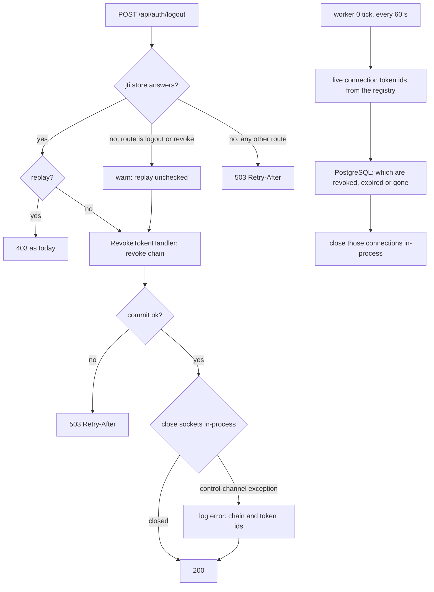
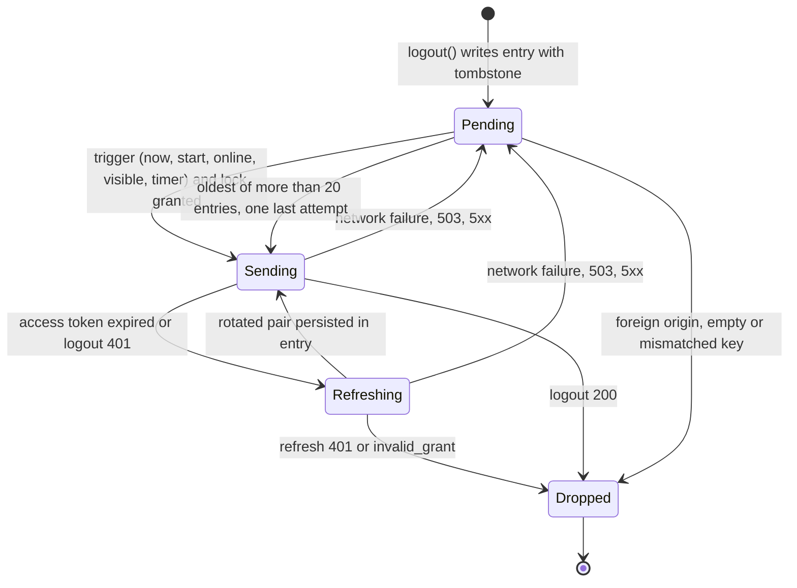

# Queued Server-Side Logout - Plan

## Goal Capsule

- **Objective:** A logout ends the session on the server even when the listener logs out during a Redis outage, while the browser is offline, or while the web server cannot close the session's WebSocket connections. A refresh-token chain never stays usable only because its logout was lost.
- **Means:** The logout and revoke routes accept a DPoP proof without the replay check while the replay store is down (KTD1); a periodic reconciliation inside the web server closes every socket whose access token is revoked or expired, so a close the hot path could not finish is bounded by one tick (KTD2); the web app keeps a pending logout and resends it until the server confirms (KTD5, KTD6).
- **Authority:** the Requirements below, then the Key Technical Decisions, then `AGENTS.md` and the rule files it names. The pre-release policy applies: no compatibility layers.
- **Stop conditions:** stop and report when a settled decision proves infeasible, when any change would accept a proof whose signature, `htm`, `htu`, `iat`, `ath` or key binding failed, or when the reconciliation cannot run inside HTTP worker 0 under the item 4 drain rules.
- **Execution profile:** `ce-work` on branch `plan/item6-queued-logout`, created from the unmerged `plan/item5-browser-session`. Local commits only; push on request. PostgreSQL work goes to the postgres specialist.
- **Who finishes:** the implementer runs every gate in the Verification Contract; the lead integrates, updates the roadmap and ships.

---

## Product Contract

### Summary

Item 5 made logout revoke the whole chain and close its sockets, and made a failed revocation answer 503. Two gaps remain: during a Redis outage the logout never reaches the controller, and a logout the browser could not deliver is never sent again. This plan closes both. On the server, the two revocation routes verify the DPoP proof without the Redis replay check while that store is down, revoke the chain in PostgreSQL and answer 200; a timer inside the web server reconciles live sockets against PostgreSQL once a minute and closes every one whose access token is revoked or expired, so a close the hot path could not finish, a console revocation, a password change or a client revocation ends its sockets within that minute. In the browser, logout first records the intent in IndexedDB with the key that signs it, clears the tab at once, and sends the logout as the first attempt of a drain that runs again on start, on `online`, on visibility and on a backoff timer until the server confirms, refuses the entry's refresh token, or says the chain is gone.

### Problem Frame

Every API request carries a DPoP proof whose `jti` is checked for replay in Redis, and item 5 made that check fail closed with a 503. The logout route inherits that answer, so a listener who logs out during a Redis outage is signed out in the browser only; the chain stays alive on the server for up to 30 days. After today's local clear nobody can redeem it from that browser, since the private key is wiped with the store and the refresh token is bound to it; what remains is a script or extension that already holds the key handle in a live page, a non-web client with its own key store, and a server-side session that outlives what the user believes ended. The same holds when the browser is offline, when the database fault answers 503, and after a 503 the web app never retries, because it clears its credentials and forgets the request. When the chain is revoked but the web server could not close the sockets, the 503 is also wrong by RFC 7009: the token no longer exists, so the client cannot retry it. Nothing else ever closes a socket after its handshake: a chain revoked from a console process, a password change, a client revocation, or an access token that simply expired keeps its socket until the client hangs up or the server restarts.

### Requirements

**Outage-tolerant revocation (server)**

- R1. `POST /api/auth/logout` and `POST /api/oauth/revoke` accept a DPoP proof whose replay check could not run because the jti store raised the store-unavailable signal (a refused or hung Redis, or an exhausted pool), after verifying the proof's signature, `typ`, `alg`, public-only `jwk`, `iat` window, `htm`, `htu`, `ath` and the `cnf.jkt` binding of the access token. One warning per such request names the route, the key thumbprint and the user id, never a token or the proof.
- R2. Every other route keeps the fail-closed 503 during a store outage, and the two routes keep every other verdict: a replay detected by a working store, a wrong key, a wrong method or URL, or a mismatched `ath` is refused as today.
- R3. The two routes never touch the nonce store. A `jti` first seen during the outage is not recorded, so the same proof is accepted again after the store recovers while its `iat` window lasts; a replayed logout can only re-end the session its access token belongs to, and once that logout succeeded the authenticator refuses the revoked access token before any proof is read; a replayed revoke can also end another chain of the same user whose token id the replayer supplies in the body, since the proof does not cover the body, bounded by the proof's acceptance window.
- R4. During a Redis outage the logout revokes the chain in PostgreSQL, closes its sockets in-process and answers 200; the health monitor still raises exactly one Redis alert for the outage.

**Socket reconciliation (server)**

- R5. A revocation that committed answers 200 even when the in-process socket close raised the control-channel exception; the handler logs an error with the chain id and the number of connections, never a token string, and 503 is answered only when the revocation did not commit. The reuse-verdict revocation in `RefreshTokenHandler` does the same and answers its 401 regardless.
- R6. HTTP worker 0 runs a reconciliation tick that lists the access token ids of every live WebSocket connection from the connection registry, asks PostgreSQL which of them belong to a chain that still has a live (stored, unrevoked, unexpired) access token, and closes the other connections in-process; a connection whose chain died is closed within one tick interval (60 s) whatever ended it, including a console process in another container, a password change, a client revocation or an expiry nobody refreshed. The chain is the unit, not the handshake token: a rotation revokes the token a socket was opened with while the session goes on, and rotation alone never closes a socket (amended during code review, which found the per-token query closing every live session's socket within a tick of its rotation).
- R7. The tick releases its pooled services every run, skips while the server drains, never overlaps itself, stops on worker exit, is recreated on worker start, and logs a close that did not complete so the next tick retries it. During a reload the old and the new worker 0 may both tick; closing a socket that is already gone counts as done.
- R8. The hot-path close on logout, revoke and reuse verdicts stays as item 5 built it; the tick is the backstop, not the primary path.

**Pending logout (web)**

- R9. A logout the user started writes a pending-logout entry to IndexedDB in the same transaction as the credential tombstone, holding the DPoP key pair, the access and refresh tokens, the access token's expiry, the API origin and the creation time; the tab clears its credentials and broadcasts `cleared` at once, where the store today clears only after the server answers, and the server logout is sent afterwards as the first drain attempt. A forced clear after a refresh refused the session writes no entry, since the chain is already gone. When IndexedDB is unavailable the logout proceeds as today without an entry.
- R10. A drain runs after `initAuth` on start, on the `online` event, on `visibilitychange` to visible and on an in-page backoff timer; it takes the shared auth lock per entry with a short bounded wait, re-reads the entry under the lock, signs a fresh proof from the entry's key pair with bare Axios calls, and never uses the store's current session.
- R11. A drain attempt first refreshes with the entry's refresh token when the stored access token has expired or when the logout answered 401, persists the rotated pair in the entry before the logout is sent, and then logs out. The entry is dropped on a logout 200, on a refresh 401 or `invalid_grant`, on an origin that is not the app's API origin, on a key that reads back empty or cannot sign or whose thumbprint differs from the access token's `cnf.jkt`, or when it is the oldest of more than 20 entries after one last attempt. It is kept on a network failure, a 503 (honouring `Retry-After`), any other 5xx, any other logout answer, and a logout 401 that persists after a successful refresh; the refresh token's own lifetime ends the entry through the refresh refusal.
- R12. Entries are a list with per-entry ids, every append, update and delete is one IndexedDB readwrite transaction that re-reads the list, at most 20 entries are kept (the oldest is sent once and then dropped with a warning), a later login in the same browser does not remove pending entries, and an entry is never adopted as the tab's session.
- R13. The service worker learns nothing about pending logouts; the tab's existing null-token push on clear is all it needs.

**Evidence and documentation**

- R14. Integration tests on real PostgreSQL and Redis prove R1 to R6, including a logout and a revoke during a refused Redis, every retained refusal of R2, a close failure answered 200 with the error logged, and a reconciliation pass that closes the recorded connections of a revoked chain and of an expired token while leaving a live one open.
- R15. A probe test proves the reconciliation tick releases its pooled services per run, and a unit suite proves its lifecycle and its dead-token query in chunks.
- R16. The browser-auth suite proves a logout while offline is sent once when the browser comes back online, two pages drain one entry once, an expired access token is refreshed before the logout, a chain already gone drops the entry, and the stored P-256 key reads back on WebKit.
- R17. The web runtime drill's Redis-outage block proves, with a second signed-in pair, that a logout during the outage answers 200 and revokes its chain, that this pair's refresh answers 401 after Redis returns, and that the first pair's refresh still rotates as item 5 proved.
- R18. The operator guide, the Auth context guide, the testing guide, `CONCEPTS.md` and the roadmap describe the new behaviour, including what a logged-out browser still holds until the drain succeeds.

### Key Decisions

- **All three parts ship in one plan.** (session-settled: user-directed — chosen over a server-only and a client-only variant: each alone leaves one of the lost-logout cases open.) Governs R1 to R13.
- **The replay check is the only check the two routes may skip, and only on a store failure.** A replayed logout can only re-end a session its key holder already ended, and a replayed revoke reaches at most another chain of the same user whose token id the replayer already knows, while every other check still binds the proof to that key and token (RFC 9449 section 11.1 makes jti tracking a hardening, not a MUST). Governs R1, R2, R3.
- **A failed socket close after a committed revocation answers 200.** RFC 7009 reserves 503 for a token that still exists; the token is gone and the reconciliation closes the socket. Governs R5.
- **Sockets are reconciled, not queued.** (session-settled: user-directed — chosen over a PostgreSQL-queued close job and over building both: the in-process close cannot fail the way a queue would retry, while a periodic reconciliation bounds every open-socket case with one timer.) Governs R6, R7, R8.
- **Logout is queue-then-send.** The tab ends its session locally before the server answers; delivery is the drain's job. Governs R9, R10.
- **A logout 401 means "refresh and try again", never "chain gone".** The authenticator answers the same 401 for an expired, a revoked and a malformed access token, so only the refresh's answer can tell the chain is gone. Governs R11.
- **A pending entry lives until the server refuses it.** (session-settled: user-directed — chosen over a 7-day cap with a last attempt and over narrowing the Objective: the drain only runs when the app is open, so a day-10 request lands as readily as a day-1 one, and the refresh token's own lifetime already ends an entry.) Governs R11, R12.

### Scope Boundaries

- `app:user:disable` keeps its console close; the reconciliation now also ends its sockets within a minute when it runs where no server is reachable.
- Not built, considered: a PostgreSQL-queued close job with an in-server Messenger consumer (user decision). Inside an HTTP worker the close operation does not fan out, a socket already gone returns false rather than throwing, and the pusher's only throw needs a detached server, so the queue had no producer on the running server; the reconciliation covers the cases that are real.
- Not built, considered: accepting an expired access token at the logout route. The League validator cannot tell expiry from a bad signature, and the refresh-first drain covers the case with the existing endpoints; a signature-only verifier would be a second token path to secure. Evidence that would change this: a drain that cannot refresh because of a rotation race in practice.
- Not built, considered: the Background Sync API. Chromium-only; the start, `online`, visibility and timer triggers must exist anyway.
- Not built, considered: a per-process in-memory jti set during the outage. The replay is harmless by construction (R3); add it only if it stays trivial once U1 is written.
- Not built, considered: a notice on the login page that a logout is still pending. Log only; a product decision for later.
- Not built, considered: a 7-day age cap on pending entries (user decision). It would drop logouts the server could still take; the refresh refusal is the natural end.

#### Deferred to Follow-Up Work

- An absolute chain lifetime on the server, so a script on the origin cannot keep a chain alive by rotating it; rotation resets the refresh token's lifetime today.

### Acceptance Examples

- AE1. **Logout during a Redis outage.** Covers R1, R4. Given Redis refuses connections and the listener holds a bound pair, when they log out, then the logout answers 200, the chain is revoked, the sockets opened with it are closed, the warning names the route and the thumbprint, and a refresh with the pair answers 401 once Redis is back.
- AE2. **Another route during the outage.** Covers R2. Given the same outage, when the listener calls `/api/auth/me`, then it answers 503 with `Retry-After: 5`, as in item 5.
- AE3. **Replay during the outage.** Covers R3. Given a captured logout proof whose original logout succeeded, when it is sent again within the `iat` window, then the authenticator answers 401 for the revoked access token and nothing changes; given the original was lost, the late copy answers 200 and revokes the chain; with another `ath` or another key it is refused.
- AE4. **Close failed, reconciled.** Covers R5, R6, R7. Given the web server refuses to close the sockets on the hot path, when the listener logs out, then the logout answers 200 with the error logged, and the next reconciliation tick closes the chain's connections.
- AE5. **Revoked elsewhere.** Covers R6. Given a user is disabled from a console process in the worker container, or an access token simply expired while its socket stayed open, when the next tick runs, then those connections are closed and a live connection of another user stays open.
- AE6. **Logout while offline.** Covers R9, R10, R11. Given the browser is offline, when the listener logs out, then the tab lands on the login page at once, the entry is stored, and when the browser comes back online the logout is sent exactly once and the entry is removed.
- AE7. **Reopened after the access token expired.** Covers R11. Given a pending entry whose access token expired, when the app starts, then the drain refreshes with the entry's refresh token, updates the entry, logs out with the new access token and removes the entry.
- AE8. **Chain gone meanwhile.** Covers R11. Given a pending entry whose chain another device revoked, when the drain runs, then the logout answers 401, the refresh answers 401, and the entry is dropped without a warning about reuse.
- AE9. **Two pages drain.** Covers R10, R12. Given two pages of one origin with one pending entry, when both come online, then one request reaches the server and the other page finds the entry gone.

---

## Planning Contract

### Key Technical Decisions

- KTD1. **`DpopProofValidator::validate()` gains a replay policy, and `DpopBindingListener` applies it to the two routes.** The validator takes a named flag that, for the jti step only, turns the store-unavailable signal into a result flag `replayUnchecked` instead of an exception, and still runs the `ath` and `jkt` steps that follow it. The listener passes the flag for the route names `auth_logout` and `oauth_revoke`, logs the warning when the flag comes back set, and keeps answering 503 for every other route. The replay verdict of a working store is untouched. Chosen over catching the exception in the listener and validating a second time: the jti step sits before the `ath` and binding steps, so a caller-side catch would skip them. Governs R1, R2, R3.
- KTD2. **A worker-0 reconciliation tick closes dead sockets.** `src/Auth/Infrastructure/Swoole/RevokedSocketReconciler.php` copies the lifecycle of `HealthMonitorSubscriber` (worker 0 only, timer on `WorkerStartedEvent`, `CoWrapper::defer()` first, drain check, no overlap, timer cleared on worker stop) with a 60 s tick. Each run reads the distinct access token ids of every live connection through a new registry scan. It asks `AccessTokenRepositoryInterface::findTokenIdsOfLiveChains(list)`, in chunks of 500, which of them belong to a chain with a stored, unrevoked and unexpired access token on the database clock (per-chain liveness, amended during code review; see R6); ids that are not stored at all count as dead. It hands the dead ids to `LiveConnectionsPortInterface::closeForAccessTokens()`, which runs in-process through the coordinator inside an HTTP worker. A close that reports fewer connections than listed, or raises the control-channel exception, is logged at error level and the next tick retries; the run itself never throws past the tick. The stop hook is a new auto-tagged Shared Application port, `WorkerTimerInterface` with one `stop()` method, that `DrainWorkerExitSubscriber` iterates beside the timers it already holds, so Shared never depends on Auth. Chosen over a PostgreSQL-queued close job (see Scope Boundaries) and over closing connections by age: the query names the real condition, and expiry is one of its cases. Governs R6, R7, R8.
- KTD4. **The handlers log a failed close and never answer 503 for it.** `RevokeTokenHandler::revokeChain()` and `RefreshTokenHandler::closeLiveConnections()` catch `ServerControlException` after the commit, log an error naming the chain id and the number of connections, and return (or raise the rejection, for the refresh); `ServerNotRunningException` keeps its warning. The controllers' 503 covers only a revocation that did not commit. Governs R5.
- KTD5. **The pending logout lives in the existing IndexedDB store as a second record, written with the tombstone.** `AuthStorageBackend` gains `beginLogout(entry)` that puts the entry into a `pending-logouts` list record and writes the tombstone in one readwrite transaction, plus `listPendingLogouts()`, `updatePendingLogout(id, patch)` and `removePendingLogout(id)`, each one transaction that re-reads the list. The web adapter in `ui/web/src/shared/crypto/auth-db.ts` surfaces them. No database version bump is needed for a second record id. Chosen over a separate database: the key pair and the tokens already live there, and one origin store is wiped together by Safari's storage cap, which keeps the residual honest (see Risks). Governs R9, R12.
- KTD6. **One drain module owns delivery; `logout()` only records and triggers it.** `ui/web/src/features/auth/services/pending-logout.ts` exports the entry type, `recordLogout()` (the atomic write), `drainPendingLogouts()` and `installPendingLogoutTriggers()`. The drain signs proofs with `createDpopProof` from the entry's pair, sends bare `Axios` requests with an explicit `Authorization: DPoP` header, refreshes through a standalone `refreshWithPair()` that reuses the nonce-challenge retry and the 503 wait of `refresh-budget.ts` without touching the store, and decides per R11. The store's `logout()` becomes: record the entry with the tombstone, clear locally and broadcast, then start a drain. The item 5 `logoutsInFlight` guard goes, since no logout waits for the server any more. Governs R9, R10, R11.
- KTD7. **Drain scheduling: per-entry lock, bounded wait, backoff timer.** The drain requests the auth lock with a 2 s wait per entry (the budget parameter of `withAuthLock`), skips the entry on a lock timeout, and never holds the lock across entries; a backoff timer (2 s, factor 2, cap 5 min, jitter, at most 8 timer-driven attempts per page session) reschedules while entries remain, and each trigger event resets it. Every drain request carries the 10 s attempt timeout of `refresh-budget.ts`, so a hung request cannot hold the lock past it. `navigator.onLine` is never a gate. Governs R10.
- KTD8. **Access token expiry comes from the JWT.** The entry stores the `exp` claim decoded from the access token at logout; no new response field. Governs R11.
- KTD9. **Tests and fixtures.** `RecordingLiveConnections` gains a fault switch (a flag file, as `IssuanceFaults`) that makes `closeForAccessTokens()` throw `ServerControlException`; `RedisOutageOAuthKernel` already provides the refused Redis; the browser-auth scripted server gains an outage mode for logout, a revoked-chain verdict for logout and refresh, and the specs use Playwright's `context.setOffline()`. Governs R14 to R17.

### High-Level Technical Design

Request paths for a logout, by failure:

Pending-logout entry lifecycle in the browser:

### Assumptions

- The dev and CI images already run the health monitor timer in worker 0, so the same lifecycle hooks exist for the consumer.
- The browser-auth suite's WebKit project is available for the key read-back scenario; if it is not, the scenario runs on Chromium and the WebKit gap is recorded in the testing guide.

### System-Wide Impact

- **Auth boundary.** Two routes gain a degraded acceptance path. The operator guide's security section explains it, with the replay residual of R3 and the fact that a revoke request body is not covered by the proof.
- **Logged-out browser.** Until the drain succeeds, a logged-out browser still holds a refresh token and a signing key for the ended session, until the logout lands or the refresh token is refused, at most its 30-day lifetime. The security section states it; the entry is dropped as soon as the server confirms.
- **Web server lifecycle.** One more worker-0 timer under the item 4 drain rules, stopped through the new timer port by `DrainWorkerExitSubscriber`.
- **Sockets everywhere.** Every path that revokes or expires an access token now ends its sockets within a minute: logout, revoke, reuse verdicts, `app:user:disable` from any container, password change, client revocation and plain expiry. The operator guide's statements that some of these keep sockets open are retired.
- **Database load.** One query per tick listing the live connections' token ids in chunks; a server with a thousand sockets sends two `IN` lists a minute.
- **Cross-tab behaviour.** Logout no longer waits for the server, so the item 5 interplay between an in-flight logout and sibling rotations disappears; the related store tests change with it.

### Risks

- **A drain that rotates and then fails to persist the new pair** leaves the entry with a consumed refresh token; the next attempt is graced within 60 s or revokes the chain as reuse later, which still ends the session but logs a reuse warning. Mitigation: persist before the logout request (R11) and test the order.
- **A logged-out browser holds a usable session until delivery.** Anyone who can run script on the origin, at the keyboard of a shared machine or through a stored script, can sign with the entry's key and refresh its chain; the server's reuse detection catches only a careless abuser, and rotation resets the refresh lifetime, so only the origin's integrity bounds it. Accepted with the rule that the entry is never adopted and the 20-entry cap; an absolute chain lifetime is recorded as follow-up. Safari's storage cap wipes the entry, the key and the tokens together after 7 days of non-use, leaving a chain nobody can use.
- **A socket of a revoked chain stays open for up to one tick** when the hot-path close failed; the holder keeps the party, listening-session and playback control the handshake authorised for that minute. Accepted; the tick interval is the bound.
- **A debug-mode warning inside the close operation** can surface as the control-channel exception, so dev runs may log the R5 error for a cause production never produces; the reconciliation closes the socket either way.
- **Clock skew** between browser and server makes the stored expiry wrong; the logout-401-then-refresh rule covers it.

### Sequencing

U1 (validator and listener), U8 (reconciliation tick) and U4 (handlers' failure contract) are independent; the drill's idle-SIGTERM and reload cases run right after U8, since it is the unit that can break the shutdown rules. U5 (storage and drain) and U6 (store rewiring, triggers, suites) are the web side; U6 needs U5. U7 (drill, docs, roadmap) needs U1, U4, U8 and U6.

---

## Implementation Units

### U1. Replay policy on the validator and the two revocation routes

**Goal:** the two revocation routes accept a proof during a store outage under R1 to R3.

**Requirements:** R1, R2, R3, R4. Implements KTD1.

**Dependencies:** none.

**Files:** `src/Auth/Infrastructure/Security/OAuth/DpopProofValidator.php`, `src/Auth/Domain/Model/OAuth/ValueObject/DpopValidationResult.php`, `src/Auth/Infrastructure/Security/OAuth/DpopBindingListener.php`, `tests/Unit/Auth/Infrastructure/Security/OAuth/DpopProofValidatorTest.php`, `tests/Unit/Auth/Infrastructure/Security/OAuth/DpopBindingListenerTest.php`, `tests/Integration/DpopStoreOutageTest.php`.

**Approach:**
1. Add the replay policy flag to `validate()` and the `replayUnchecked` flag to the result value object; the jti step catches the store-unavailable exception only when the flag allows it and continues to the `ath` and `jkt` steps.
2. In the listener, derive the flag from the route name set and log the warning with route and thumbprint when the result carries the flag; leave the 503 catch for every other route.
3. Extend the outage integration test with a logout and a revoke during the refused Redis, and with the retained refusals.

**Patterns to follow:** the route exemption list at the top of `DpopBindingListener`; `DpopStoreOutageTest` for the refused kernel and the bound requests; the warning-without-token rule of `RefreshTokenHandler`.

**Test scenarios:**
- A proof for `auth_logout` while the jti cache throws: the result is valid with `replayUnchecked` set and the `ath` and `jkt` checks still ran.
- The same proof with a mismatched `ath`, a wrong key, a wrong `htm` or `htu`, or an `iat` outside the window while the cache throws: invalid.
- A proof for `auth_logout` while the cache answers "replay": invalid, no flag; a working cache answering "not seen" sets no flag either.
- A proof without `ath` while an access token is presented, on the degraded path: invalid.
- A proof for any other route while the cache throws: the exception propagates and the listener answers 503.
- Listener: a logout during the outage reaches the controller and one warning is logged whose context carries the route, the thumbprint and the user id and no key that holds a token or the proof; the same warning appears when the pool is exhausted.
- Integration, Covers AE1: logout during the refused Redis answers 200, the chain is revoked, the recorded close carries the chain's access token ids, the nonce store is never called, and a refresh with the pair answers 401 after Redis returns.
- Integration, Covers AE2: `/api/auth/me` answers 503 during the outage.
- Integration, Covers AE3: a logout proof replayed after its logout succeeded answers 401; the late copy of a lost logout answers 200 and revokes.
- Integration: the same proof sent again after Redis returned, inside its window, is answered the same, since its `jti` was never recorded.
- Integration: a revoke during the outage with the caller's own refresh token answers 200 and revokes; with a foreign token answers 200 and revokes nothing; a captured revoke replayed with the same user's other chain id revokes that chain, which documents the body residual.

**Verification:** the unit and integration suites above pass in the CI image.

### U4. Handlers log a failed close and answer 200

**Goal:** a revocation whose close failed is answered per R5, and the reconciliation is proven against the recorded connections.

**Requirements:** R5, R14. Implements KTD4.

**Dependencies:** U8 for the integration case that closes the recorded connections.

**Files:** `src/Auth/Application/CommandHandler/OAuth/RevokeTokenHandler.php`, `src/Auth/Application/CommandHandler/OAuth/RefreshTokenHandler.php`, `src/Auth/Interface/Controller/User/AuthController.php`, `src/Auth/Interface/Controller/OAuth/OAuthController.php`, `tests/Unit/Auth/Application/CommandHandler/OAuth/RevokeTokenHandlerTest.php`, `tests/Unit/Auth/Application/CommandHandler/OAuth/RefreshTokenHandlerTest.php`, `tests/Unit/Auth/Interface/Controller/AuthControllerLogoutFaultTest.php`, `tests/Unit/Auth/Interface/Controller/OAuth/OAuthControllerTokenFaultTest.php`, `tests/Fixtures/Auth/RecordingLiveConnections.php`, `tests/Integration/RefreshTokenConcurrencyTest.php`, `openapi.json`, `ui/web/src/shared/api-client/gen/endpoints/index.ts`.

**Approach:**
1. In both handlers, catch `ServerControlException` after the commit, log the error with the chain id and the connection count (never a token string, per item 5), and return; keep the `ServerNotRunningException` warning.
2. Narrow the controllers' 503 to the revocation itself: the OpenAPI 503 descriptions say the chain was not revoked; regenerate the spec and the client.
3. Give `RecordingLiveConnections` the fault switch and add the integration case for a close that fails and is answered 200, followed by a reconciliation pass that closes the recorded ids.

**Patterns to follow:** the item 5 `closeLiveConnections()` helpers; `IssuanceFaults` for the flag directory.

**Test scenarios:**
- Revoke handler: close throws `ServerControlException`; an error naming the chain id and the connection count is logged, with no token string; the handler returns.
- Revoke handler: close throws `ServerNotRunningException`; a warning is logged.
- Refresh handler: a reuse verdict whose close fails logs the error and still raises the rejection.
- Controllers: a handler that completed answers 200; a handler fault before the commit answers 503 with `Retry-After`; a committed revocation never answers 503.
- Integration, Covers AE4: logout with the fault switch on answers 200, the chain is revoked, the error is logged, and a reconciliation pass closes the recorded ids.

**Verification:** unit, functional auth and integration suites pass; the OpenAPI check passes.

### U8. The reconciliation tick in HTTP worker 0

**Goal:** every socket whose token chain died is closed within one tick, whatever ended it; a rotation alone closes nothing.

**Requirements:** R6, R7, R8, R14, R15. Implements KTD2.

**Dependencies:** none.

**Files:** `src/Auth/Infrastructure/Swoole/RevokedSocketReconciler.php`, `src/Shared/Application/Port/WorkerTimerInterface.php`, `src/Shared/Infrastructure/Swoole/Drain/DrainWorkerExitSubscriber.php`, `src/Shared/Infrastructure/Swoole/WebSocketConnectionRegistry.php`, `src/Auth/Domain/Repository/OAuth/AccessTokenRepositoryInterface.php`, `src/Auth/Infrastructure/Repository/OAuth/AccessTokenRepository.php`, `src/Auth/Infrastructure/Cache/CachedAccessTokenRepository.php`, `config/services.yaml`, `tests/Unit/Auth/Infrastructure/Swoole/RevokedSocketReconcilerTest.php`, `tests/Unit/Auth/Infrastructure/Swoole/RevokedSocketReconcilerProbeTest.php`, `tests/Unit/Shared/Infrastructure/Swoole/Drain/DrainWorkerExitSubscriberTest.php`, `tests/Unit/Shared/Infrastructure/Swoole/WebSocketConnectionRegistryTest.php`, `tests/Unit/Auth/Infrastructure/Repository/OAuth/AccessTokenRepositoryTest.php`, `tests/Integration/RefreshTokenConcurrencyTest.php`.

**Approach:**
1. Add the registry scan for distinct live access token ids and the repository query for the stored, unrevoked, unexpired subset on the database clock, chunked.
2. Write the reconciler per KTD2 with the health monitor's lifecycle, the timer port, and the error log for an incomplete close.
3. Have the drain subscriber stop every tagged timer owner; register the reconciler for worker 0.

**Patterns to follow:** `HealthMonitorSubscriber`, `HealthMonitorTimerProbeTest`, `DrainWorkerExitSubscriber`, the id-ordered chunked queries of `RefreshTokenRepository`.

**Test scenarios:**
- The timer starts in HTTP worker 0 only, not in task workers or other workers, and is recreated on a second worker start.
- A tick while draining does nothing; a tick that finds the previous tick running skips and warns.
- Registry: the scan returns each live token id once across workers and ignores removed connections.
- Repository: of five ids, one revoked, one expired, one unknown and two live, the query returns the two live ids; a list of 1,200 ids is sent in three chunks.
- Reconciler: the dead ids are handed to the close port once; a close that reports fewer than expected logs an error; a control-channel exception logs an error and the tick ends normally.
- Probe: each tick releases the pooled services its coroutine took.
- The drain subscriber stops the reconciler with the health monitor through the timer port.
- Integration, Covers AE5: with recorded connections for a revoked chain, an expired token and a live token, one pass closes the first two and leaves the third.

**Verification:** unit suite green in the CI image; the web runtime drill's idle-SIGTERM and reload cases pass right after this unit (no timer outlives the drain).

### U5. Pending-logout storage and the drain

**Goal:** the browser can record a logout and deliver it later, per R9 to R13.

**Requirements:** R9, R10, R11, R12, R13. Implements KTD5, KTD6, KTD7, KTD8.

**Dependencies:** none.

**Files:** `ui/shared/crypto/auth-storage.ts`, `ui/shared/crypto/auth-db.ts`, `ui/web/src/shared/crypto/auth-db.ts`, `ui/web/src/features/auth/services/pending-logout.ts`, `ui/web/src/shared/api-client/axios-instance.ts` (export the nonce-challenge and outage helpers the standalone refresh reuses), `ui/web/src/shared/auth/refresh-budget.ts`, `ui/web/tests/shared/auth/auth-fakes.ts`, `ui/web/src/shared/crypto/__tests__/auth-db.test.ts`, `ui/web/src/features/auth/services/__tests__/pending-logout.test.ts`.

**Approach:**
1. Add the list record and the four backend operations, each one transaction that re-reads the list; cap at 20 entries.
2. Write the drain module: per-entry lock with a 2 s wait, origin check, empty-key check, age check, expiry check from the stored `exp`, refresh with the entry's pair, persist, logout, decide per R11, backoff timer and trigger installation.
3. Extend the IndexedDB fake so a second record and structured-cloned keys behave as in browsers.

**Patterns to follow:** `refreshWithServer()` for the bare request with a proof and the nonce retry; `withAuthLock`; `auth-store.test.ts` fakes and storage seeding.

**Test scenarios:**
- Record: `recordLogout()` writes the entry and the tombstone in one transaction; a failing write still resolves so the logout proceeds (R9). The web client sends no `X-Baander-Client-Fingerprint`, so the entry carries none; a client that did would have to store and resend it.
- List mutations: two appends from two tabs keep both entries; a delete during an append loses nothing; the 21st entry drops the oldest with a warning.
- Drain, Covers AE6: an entry whose logout answers 200 is removed and one request was sent.
- Drain, Covers AE7: an entry whose access token expired refreshes first, persists the rotated pair before the logout, and removes the entry.
- Drain: a logout 401 triggers a refresh; a refresh 200 then logout 200 removes the entry.
- Drain, Covers AE8: a refresh 401 or `invalid_grant` drops the entry.
- Drain: a network failure or a 503 keeps the entry and schedules the backoff; `Retry-After` is honoured.
- Drain: a foreign origin, an empty or unusable key, or a key whose thumbprint differs from the token's `cnf.jkt` is dropped; the 21st entry sends the oldest once and then drops it.
- Drain: a logout 400 or 403, or a 401 that persists after a successful refresh, keeps the entry.
- The drain never writes the credential record and never adopts an entry as the session; a forced clear after a refresh 401 writes no entry.
- Drain, Covers AE9: the lock is held by another tab; the entry is skipped this round, not sent twice.
- Triggers: `online`, visibility and start each run a drain once; the timer stops when the list is empty; at most 8 timer attempts per page session.

**Verification:** Vitest suites pass; typecheck and lint clean.

### U6. Store rewiring and the browser-auth scenarios

**Goal:** logout is queue-then-send in the app, and the browser suite proves the lifecycle.

**Requirements:** R9, R10, R16. Implements KTD6, KTD9.

**Dependencies:** U5.

**Files:** `ui/web/src/features/auth/stores/auth-store.ts`, `ui/web/src/main.tsx`, `ui/web/src/features/auth/stores/__tests__/auth-store.test.ts`, `ui/web/tests/features/auth/auth-store.test.ts`, `ui/web/tests/e2e/browser-auth/scripted-server.ts`, `ui/web/tests/e2e/browser-auth/refresh-state.ts`, `ui/web/tests/e2e/browser-auth/fixture-bundles.ts`, `ui/web/tests/e2e/browser-auth/worker-auth-harness.ts`, `ui/web/tests/e2e/browser-auth/worker-auth.spec.ts`, `ui/web/tests/e2e/browser-auth/playwright.config.ts`.

**Approach:**
1. `logout()` records, clears, broadcasts and starts a drain; drop the `logoutsInFlight` guard and rewrite the store tests that modelled an in-flight logout.
2. Install the triggers after `initAuth()` in `main.tsx`.
3. Scripted server: logout answers 503 in outage mode, a revoked chain answers 401 to logout and `invalid_grant` to refresh; specs for AE6 to AE9 with `context.setOffline()`, and the WebKit key read-back.

**Patterns to follow:** the AE6 scenario of item 5 in `worker-auth.spec.ts`; `refresh-state.ts` verdicts.

**Test scenarios:**
- Store: `logout()` resolves after the local clear even when the network is down; the tab is cleared, `cleared` is broadcast, the entry exists.
- Store: a login after a pending logout starts a new session and leaves the entry in place.
- Browser, Covers AE6: offline logout lands on the login page; online sends exactly one logout; the entry is gone.
- Browser, Covers AE7 and AE8 through the scripted verdicts.
- Browser, Covers AE9: two pages, one request.
- Browser (WebKit): the stored P-256 private key signs a proof after reload.

**Verification:** `yarn test:browser-auth` passes with the new scenarios; Vitest, typecheck and lint clean.

### U7. Drill, documentation and roadmap

**Goal:** the real server proves the outage logout, and the guides and roadmap describe the behaviour.

**Requirements:** R17, R18.

**Dependencies:** U1, U4, U8, U6.

**Files:** `scripts/test-web-runtime-container.sh`, `scripts/web-runtime/redis-outage.php`, `docs-book/part-1-operator-guide/security.md`, `docs-book/part-1-operator-guide/commands/app-user-disable.md`, `docs-book/part-2-developer-guide/contexts/auth.md`, `docs-book/part-2-developer-guide/testing.md`, `CONCEPTS.md`, `ROADMAP.md`.

**Approach:**
1. The drill's login mode signs in twice and keeps two pairs; the outage mode logs out with the second pair and asserts 200 and the revoked chain; the recovered mode keeps the first pair's refresh-and-rotate proof and adds a refresh with the second pair that must answer 401.
2. Security section: the degraded acceptance and its residual, including that pool pressure triggers it and that a revoke body is not covered by the proof; the reconciliation that ends every dead socket within a minute, which retires the lines saying that password change, client revocation and a console `app:user:disable` leave sockets open; and what a logged-out browser still holds until the logout lands or its refresh token is refused. Auth context: the reconciler, the timer port and the registry scan. Testing guide: the new suites. Roadmap: close the item 5 open bullet, retire its 'password change and client revocation' bullet, and add the checkpoint. Run the prose check on the new prose. Auth context: the new message, transport and consumer. Testing guide: the new suites. Roadmap: close the item 5 open bullet and add the checkpoint. Run the prose check on the new prose.

**Test scenarios:** `Test expectation: none -- drill assertions and prose; the drill's new lines are the proof.`

**Verification:** the drill passes end to end; `CommandDocsCoverageTest` unaffected; the roadmap counts match the final gate run.

---

## Verification Contract

| Gate | Command | Proves |
| --- | --- | --- |
| PHP unit | `BAANDER_TEST_IMAGE=baander-ci-prewarm:local bash scripts/test-unit-container.sh` | U1, U4 and U8 unit scenarios, the reconciler probe |
| Functional and integration | `BAANDER_TEST_IMAGE=baander-ci-prewarm:local BAANDER_FUNCTIONAL_TIMEOUT_ACTIVE=1 bash scripts/test-functional-container.sh tests/Functional tests/Integration` | R14, R15 |
| Static | PHPStan, Deptrac and `lint:container` in the CI image with the tree replaced, as item 5 ran them; `app:export-openapi-spec --check` | zero Deptrac violations, spec in sync |
| Web | `yarn vitest run`, `yarn typecheck`, `yarn lint` in `ui/web` | U5, U6 unit scenarios |
| Browser | `yarn test:browser-auth` in `ui/web` | R16 |
| Drill | `BAANDER_TEST_IMAGE=baander-ci-prewarm:local bash scripts/test-web-runtime-container.sh` | R17 and the shutdown rules |

## Definition of Done

- Every R has a passing test or drill line named in its unit; AE1 to AE9 are covered.
- All gates above are green in the CI image; Deptrac stays at zero with the baseline unchanged.
- The reconciliation query follows the PostgreSQL rules and was reviewed by the postgres specialist.
- No `logoutsInFlight` guard, no log-only close catch in the refresh handler, no leftover 503 wording for a revoked chain, no abandoned experiment code remains in the diff.
- Docs and roadmap updated per U7; `CONCEPTS.md` defines the pending logout and the socket reconciliation.

---

## Sources

- Item 5 plan: `docs/plans/2026-10-12-1748-fix-browser-credential-session-qualification-plan.md` (Deferred to Follow-Up Work names this work).
- Code: `src/Auth/Infrastructure/Security/OAuth/DpopProofValidator.php` (jti step before `ath` and `jkt`), `DpopBindingListener.php` (route exemptions, outage catch), `src/Auth/Application/CommandHandler/OAuth/RevokeTokenHandler.php`, `src/Shared/Infrastructure/Health/HealthMonitorSubscriber.php`, `src/Shared/Infrastructure/Swoole/Drain/DrainWorkerExitSubscriber.php`, `src/Shared/Infrastructure/Swoole/WebSocketConnectionRegistry.php`, `src/Shared/Infrastructure/Swoole/Control/Operation/WebSocketAccessTokenDisconnectOperation.php`, `ui/web/src/shared/api-client/axios-instance.ts`, `ui/web/src/features/auth/services/auth-coordination.ts`, `ui/shared/crypto/auth-db.ts`.
- Learnings: `docs/solutions/architecture-patterns/health-checks-run-in-a-messenger-consumer-cannot-see-outages-that-stop-it.md`, `docs/solutions/architecture-patterns/state-set-when-work-is-queued-on-swoole-task-must-expire.md`, `docs/solutions/runtime-errors/inline-messenger-run-must-name-the-routed-transport.md`, `docs/solutions/runtime-errors/swoole-callbacks-outside-the-bundle-leak-pooled-services.md`, `docs/solutions/runtime-errors/swoole-sigterm-waits-for-master-timers-and-closes-connections-before-workers-stop.md`.
- Standards: RFC 9449 sections 4.3 and 11.1 (jti tracking is a hardening; the acceptance window is the MUST), RFC 7009 section 2.2.1 (503 means the token still exists), RFC 9700 section 4.14.2 (idle expiry as the backstop).
- Vendor: `vendor/league/oauth2-server/src/AuthorizationValidators/BearerTokenValidator.php` (expired and forged tokens share one hint). The Messenger doctrine-transport findings that shaped the rejected queue are in the review record, not in this plan.
- Browser compatibility: Background Sync is Chromium-only; Web Locks and `keepalive` are universal; WebKit bug 312279 and the seven-day storage cap.
