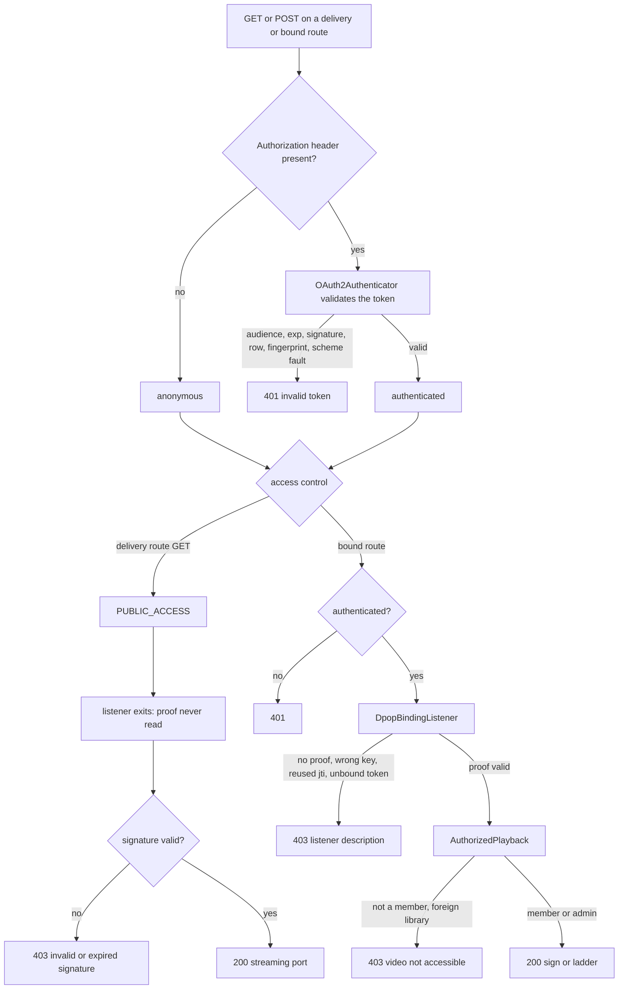

# Video Delivery Authorization Matrix - Plan

## Goal Capsule

- **Objective:** A regression in any authenticator, listener, signature check or library check on the video delivery surface fails a test before it ships. The release gate holds written evidence of what every actor gets from every delivery endpoint under every credential condition, through the production firewall.
- **Means:** The existing real-firewall delivery suite grows into a status-and-discriminator matrix over the seven signature-only delivery endpoints and the two DPoP-bound endpoints (KTD1, KTD2), with the one deviation the trace found, the Bearer scheme on a DPoP-bound token, closed in the same change (KTD4).
- **Authority:** the Requirements below, then the Key Technical Decisions, then `AGENTS.md` and the rule files it names. The pre-release policy applies: no compatibility layers.
- **Stop conditions:** stop and report when a matrix cell answers differently from its contract and the fix would widen what any actor can reach, when a cell cannot be exercised through the real firewall without mocking a security component, or when the Bearer-scheme refusal breaks a client in the repository other than the three functional tests named in U4.
- **Execution profile:** `ce-work` on branch `plan/item7-authorization-matrix`, created from `master` at c605f9a8. Local commits only; push on request. The suites run in the CI image, since the integration suite needs PostgreSQL and Redis.
- **Who finishes:** the implementer runs every gate in the Verification Contract; the lead integrates, updates the roadmap and ships.

---

## Product Contract

### Summary

The video delivery endpoints are proven today for signed URLs and library membership, but not for a credential that is wrong: a missing or foreign-key DPoP proof, a replayed proof, a token for another audience, an expired or revoked token, a broken token, a fingerprint-bound token, or the Bearer scheme. This plan turns the existing real-firewall suite into a matrix that crosses the five actors with every credential condition on all nine endpoints, records the expected status and the deciding component for each cell, adds the one state guard the surface lacks (a route-inventory test), and closes the one deviation the trace found by refusing a DPoP-bound token presented with the Bearer scheme.

### Problem Frame

The roadmap's release gate asks for anonymous, owner, unrelated-user, library-member, administrator and revoked-token cases through the real firewall, with missing, wrong-key and replayed proofs, audience variations, expired signatures and cross-library requests, across the master, rendition, DASH and subtitle manifests and the segments. `tests/Integration/SignedDeliveryFirewallTest.php` already proves part of that: a signed URL serves every actor without a proof, five signature faults answer 403 on all seven delivery paths, library membership gates signing and the quality ladder, a member of another library is refused, a revoked token is refused even with a valid signature, and the delivery exemption does not extend to signing.

What nobody has written down is the rest of the contract. A delivery route needs no credential, yet a presented token is validated in full before access control runs, so an expired, revoked, foreign-audience or malformed token answers 401 even with a valid signature. The DPoP proof is never read on those routes, so proof faults cannot change the answer and no replay key is written. On the two DPoP-bound endpoints the listener, the authenticator and the library check each answer with their own status. Across the surface three components answer 403 (the binding listener, the library check and the signature check) while the authenticator answers 401, and every 403 reaches the client as the same generic body, so neither the status nor the body can tell them apart. The code trace found one deviation from the standard: a DPoP-bound token presented with the Bearer scheme is accepted when a proof accompanies it. The test fixtures cannot yet mint a malformed audience or a chosen expiry, and the delivery route set is copied in three places with nothing holding them together.

### Requirements

**The contract the matrix records**

- R1. A valid signed URL serves the media to any request that carries no credential, whichever actor made it, on each of the seven delivery endpoints; the URL is a bearer capability, so an unrelated user and a member of another library get the media too.
- R2. A credential presented on a delivery endpoint must be valid even though none is needed: an expired, revoked, foreign-audience, missing-audience, malformed-audience, syntactically broken or fingerprint-mismatched token answers 401 with the authenticator's invalid-token code before the signature or the streaming port is reached.
- R3. On a delivery endpoint the DPoP proof is never read: a valid token with no proof, with a proof from another key, or with a reused proof answers 200, and no replay key is recorded, so the same proof is still accepted afterwards on the signing endpoint.
- R4. A signature fault answers 403 before the streaming port is called: a missing, expired or foreign-secret signature, a tampered path and an added query parameter on each of the seven delivery endpoints, and on the segment endpoint an index substituted under a signature made for another index.
- R5. On the signing endpoint and the quality ladder, an anonymous request answers 401; a valid token and proof answer 200 for the owner, a member and an administrator and 403 for an unrelated user or for a video of another library; a missing proof, a proof from another key, a reused proof and a token without a key binding answer 403 with the listener's description; an expired, revoked, foreign-audience or broken token answers 401; a fingerprint-bound token answers 401 without its header and 200 with it.
- R6. A DPoP-bound access token presented with the Bearer scheme in the Authorization header answers 401 with the invalid-token code on every route the `api` firewall authenticates, with or without a proof; the WebSocket handshake, which takes the token from a query parameter, is unchanged.
- R7. Each refusal row asserts the deciding component as well as the status: for a 401 the authenticator's invalid-token code in the body, for a 403 the message of the exception that refused (recorded by the suite before the API's generic forbidden envelope replaces it, KTD1), and that the streaming port and the Messenger bus were not called; each success row asserts the port call the endpoint makes.

**Evidence and guards**

- R8. The matrix runs through the production firewall against disposable PostgreSQL and Redis in the CI image, with real RS256 access tokens, real ES256 proofs and the real Redis replay store; no security component is mocked.
- R9. A route-inventory test proves the delivery route set from the two public-access rows of the security configuration equals the binding listener's exemption list and is contained in the rate limiter's exemption list (which also exempts the audio stream and image routes), and the integration suite derives its unsigned-request loop from that inventory so every listed route answers 403 unsigned; a path variant that the public-access pattern over-matches still answers 403.
- R10. Two state transitions are proven: a membership revoked after signing leaves the signed URL serving and refuses a new signature and the ladder; a token revoked after signing leaves the signed URL serving without the token and refusing it with the token.
- R11. No response body and no server log line of the suite contains an access token or a proof.

**Fixtures and documentation**

- R12. The shared token fixture mints a token with chosen claim overrides, so a test can produce a missing, object, foreign or non-string-element audience, an audience list that contains the server, and an expiry that agrees with the row; the delivery suite and the other firewall suites keep their current calls working.
- R13. The testing guide lists the delivery matrix and the sibling firewall suites and what each proves; the operator guide and the Auth context guide state the delivery contract of R1 to R3 and R6; the glossary defines the signed delivery URL; the roadmap records item 7, its checkpoint counts and the ticked backlog line.

### Key Decisions

- **A signed URL is a bearer capability.** (session-settled: user-directed — chosen over tightening delivery to the signing user: the URL carries no user or key, the browser fetches delivery URLs without a token, and the operator guide already states that signed URLs outlive a disable.) Governs R1, R10.
- **A presented credential must be valid even where none is needed.** The authenticator examines any Authorization header before access control, the browser never attaches one to delivery URLs, and refusing a bad token is the safer reading. Governs R2.
- **A DPoP-bound token is refused under the Bearer scheme.** (session-settled: user-directed — chosen over recording the current acceptance and deferring: every issued token is DPoP-bound, the web client always sends the DPoP scheme, and RFC 9449 section 7.1 expects the DPoP scheme for a bound token.) Governs R6.
- **The deciding component is part of the contract.** Three components answer 403 with one generic body; a matrix that records the status or the body alone would pass when the wrong component refused. Governs R7.
- **Owner is a membership alias.** Libraries have no owner concept; the owner row stays as documentation that ownership confers nothing beyond membership. Governs R5.
- **A cell that answers against the contract is fixed here.** (session-settled: user-directed — chosen over deferring found defects: the matrix is the release gate's evidence, and evidence of a known gap is not acceptance.) Governs R2 to R6.

### Scope Boundaries

- In scope: the seven delivery endpoints under `/api/transcode/`, `POST /api/stream/sign` and `GET /api/transcode/{videoId}/quality-ladder`, the fixtures they need, the Bearer-scheme refusal, the route-inventory guard and the documentation of the contract.
- Audio track streams, catalog reads, image reads, playlist reads and artist mutations keep their own real-firewall suites and are not touched.
- A Redis or PostgreSQL outage during delivery or signing is item 6's contract and is not repeated.
- Not built, considered: asserting Redis state for the no-replay-key claim. The claim is observable through the firewall by reusing the proof on the signing endpoint (R3); reading Redis would test the store, not the contract.
- Not built, considered: running every token condition on all seven delivery paths. The authenticator short-circuits before the route is known, so one manifest and one segment representative carry the same evidence; the per-route checks (signature, exemption list, anonymous success) keep the seven-path loops.
- The WebSocket handshake's query-token authentication presents the bound token without a scheme or proof and stays as it is; R6 covers the Authorization header on the `api` firewall only.
- Not built, considered: HEAD requests on delivery URLs. The access-control rows match GET only, so an anonymous HEAD answers 401 and a HEAD with a token needs a proof; recorded here as known behaviour, since the player sends GET.
- Not built, considered: a test that a deleted token row or a job the streaming port no longer knows is refused. The first is the same branch as revoked; the second is decided by the port after the signature and is already proven to come after it.

#### Deferred to Follow-Up Work

- The HEAD behaviour above, should the player ever probe ranges with HEAD.

### Acceptance Examples

- AE1. **Unrelated user with a signed URL.** Covers R1. Given a signed URL for a video of library A, when a signed-in member of library B fetches it with no Authorization header, then the segment is served and the streaming port was called once.
- AE2. **Expired token on a signed URL.** Covers R2. Given a valid signed URL and an access token whose row and JWT expired a minute ago, when the request carries that token, then the answer is 401 with the invalid-token code and the streaming port was never called.
- AE3. **Proof ignored on delivery.** Covers R3. Given a proof built for the signing endpoint, when it is first sent with a valid token on a delivery URL and then on the signing endpoint, then the delivery answers 200 and the signing answers 200 with three session dispatches, since no replay key was recorded.
- AE4. **Segment index substituted.** Covers R4. Given a URL signed for `index=0`, when `index=1` is requested with the same signature, then the answer is 403 and the port was never called.
- AE5. **Replay on the signing endpoint.** Covers R5. Given a member's accepted signing request, when the same proof is sent again, then the second answer is 403 with the reused-jti description and no session is dispatched.
- AE6. **Bearer scheme.** Covers R6. Given a member's DPoP-bound token and a valid proof, when the signing request carries `Authorization: Bearer <token>`, then the answer is 401 with the invalid-token code.
- AE7. **Membership revoked after signing.** Covers R10. Given a member signed a master manifest URL and their library access was then removed, when they fetch the signed URL without a token and then ask for the ladder and for a new signature with token and proof, then the manifest is served and both requests answer 403.
- AE8. **Route inventory.** Covers R9. Given the compiled router, when the test collects every route whose path matches a public-access delivery pattern, then that set equals the listener's exemption list, is contained in the rate limiter's, and every route in it answers 403 unsigned; `GET /api/transcode/sessions/init` without a signature answers 403.

---

## Planning Contract

### Key Technical Decisions

- KTD1. **One suite, two matrices, provider rows that carry status and discriminator.** `tests/Integration/SignedDeliveryFirewallTest.php` keeps its kernel and helpers and gains two data providers: a delivery provider over the credential conditions of R2 and R3 with the expected status, discriminator and port-call count, run against one manifest and one segment representative, and a bound-endpoint provider over the conditions of R5 and R6 run against both bound endpoints. The existing seven-path loops stay for the signature kinds, the anonymous success and the revoked case. The 403 discriminator is the refusing exception, not the body: the API's exception subscriber answers every 401 and 403 with a generic translated envelope, so `SignedDeliveryKernel` makes the event dispatcher public and the suite registers a kernel-exception probe at a priority above the firewall's exception listener that records the throwable's class and message (`DPoP proof header is required.`, the reused-jti and thumbprint messages, `Access token is not DPoP-bound.`, `Video is not accessible.`, `Invalid or expired signature.`); 401 rows keep the body's invalid-token code, and the segment routes' own signature body may serve as well. Chosen over a new test class: the kernel, the port mocks and the library helpers are the expensive part and already exist; chosen over reading the kernel's log for the message: the missing-proof refusal and the library check log nothing, so a probe is the only source that observes every component.
- KTD2. **Replay cells reuse an accepted proof on the same route.** The validator records the `jti` before the `ath` and key-binding checks and compares `htu` before that, so a proof refused for another reason still consumes its `jti` and a proof reused on another route fails on `htu`. A replay cell therefore sends a proof that was accepted once on the same endpoint and asserts the second answer. Governs the R5 replay row.
- KTD3. **Claim overrides on the shared token fixture.** `tests/Fixtures/Auth/OAuthAccessTokenJwt::sign()` gains an optional array of claim overrides merged over the claims it derives from the row, with a null override removing a claim; `SignedDeliveryFirewallTest::actorToken()` moves onto it. An expired token is a row whose expiry is in the past, so the JWT and the row agree. Chosen over a second signing helper: both firewall suites then mint tokens one way.
- KTD4. **The Bearer-scheme refusal lives in the authenticator, and the key binding comes from the validator.** `src/Auth/Infrastructure/Security/OAuth/OAuth2Authenticator.php` already rewrites the DPoP scheme to Bearer for the League validator but never sees the claims; `DpopAwareBearerTokenValidator`, which parses them, sets a request attribute carrying `cnf.jkt`, and the authenticator remembers the presented scheme before the rewrite and refuses when that attribute is present and the scheme was Bearer, with the same invalid-token failure the other token faults raise. Bound therefore means the same claim the binding listener reads, not the row's stored thumbprint. (session-settled: user-directed — chosen over recording the current acceptance: see the Key Decision that governs R6.) Chosen over refusing in the binding listener: the listener does not run on delivery routes, and R6 covers every API route.
- KTD5. **The route inventory is a unit test over the compiled container, and the integration loop runs from it.** A test under `tests/Unit/Shared/Infrastructure/Security/` boots the kernel's router with a scratch cache directory and no database, reads the two public-access patterns from the security configuration, the listener's exemption list (promoted from an inline array to a public constant so the test can read it) and the rate limiter's exemption constant, and asserts equality with the listener's list and containment in the rate limiter's; the integration suite builds its delivery paths from the same inventory, so a new delivery route is requested unsigned and must answer 403, and the path-variant cell runs there too. The unit test proves the lists agree; the integration loop proves every listed route validates the signature. Chosen over a single source of truth refactor: three lists in three layers would need a Shared constant that Deptrac allows everywhere, which is a larger change than the guard and not asked for.
- KTD6. **Fingerprint binding is one credential row per family.** A token with a stored client fingerprint, persisted through the existing metadata entity, is exercised with no header, a wrong header and the matching header on a delivery representative and on the signing endpoint. The header name comes from the shared header enum.
- KTD7. **Logs and bodies are checked once for credentials.** One assertion scans every response body of the matrix and every log file under the kernel's log directory (the production kernel writes `prod.log` at debug level beside `error.log`, and debug is where the authenticator and the proof validator log their failures) for the token and proof strings, so the logging rule from item 5 is part of the evidence rather than a comment. Governs R11.

### High-Level Technical Design

The matrix rows are the edges of this graph: every refusal row names the node that answered, every success row names the port call at the leaf.

### Assumptions

- Of the three functional tests that send the Bearer scheme, `tests/Functional/Auth/LogoutTest.php` and `DisabledUserAccessTest.php` drive the authenticator with bound tokens and move to the DPoP scheme; `PersonalAccessClientTest.php` presents the token to the League resource server below the authenticator, where the scheme rewrite does not run, and keeps Bearer.
- The WebSocket handshake authenticates a bound token from its query parameter through its own authenticator, with no scheme and no proof, and is outside R6.

### System-Wide Impact

- R6 changes runtime behaviour on every route the `api` firewall authenticates from the Authorization header: a Bearer presentation of a DPoP-bound token stops working. No client in the repository sends it; the web client sends the DPoP scheme on every request, and the WebSocket handshake authenticates its query token through its own authenticator.
- The fixture change in KTD3 touches every suite that calls the shared token signer; its default behaviour is unchanged.
- The route-inventory guard makes a new delivery route fail a unit test until it is added to the exemption lists and validates the signature, which is the intended friction.

### Sequencing

U1 (fixtures) first, then U2 and U3 in parallel (they share the suite file, so the lead merges the provider sections), then U4 (the refusal and its row, which U3's provider cites), then U5 (guard and transitions), then U6 (docs and roadmap, after the counts are known).

---

## Implementation Units

### U1. Token fixture with claim overrides and fingerprint metadata

**Goal:** Tests can mint any token shape the matrix needs through one helper, and a fingerprint-bound token through the existing metadata entity.

**Requirements:** R12, KTD3, KTD6.

**Dependencies:** none.

**Files:** `tests/Fixtures/Auth/OAuthAccessTokenJwt.php`, `tests/Integration/SignedDeliveryFirewallTest.php` (the `actorToken` helper), `tests/Unit/Auth/Fixtures/OAuthAccessTokenJwtTest.php` (new).

**Approach:**
1. Add an optional claim-override array to the signer: entries merge over the derived claims, a null value removes the claim; `exp` keeps the row's expiry unless overridden.
2. Move `actorToken()` onto the shared signer and let it take the same overrides plus a row expiry, so an expired token is a row expired in the past.
3. Add a helper that persists a metadata row with a client fingerprint for a token.

**Patterns to follow:** `tests/Fixtures/Auth/SignedDpopProof.php` (optional `issuedAt`), the `persist()` and `entities` bookkeeping in the suite.

**Test scenarios:**
- Signing with no overrides produces the same claims as before: `aud` string, `jti` equal to the row's token id, `cnf.jkt` from the row.
- An override of `aud` to a list, to an object, to a missing claim (null) and to a list with an integer element lands verbatim in the payload.
- A row with an expiry in the past yields a JWT whose `exp` is in the past.

**Verification:** the unit test passes; every existing suite that calls the signer passes unchanged.

### U2. The delivery matrix

**Goal:** The seven signature-only endpoints have a recorded contract for every credential condition, with the deciding component asserted.

**Requirements:** R1, R2, R3, R4, R7, R8, R11; AE1 to AE4.

**Dependencies:** U1.

**Files:** `tests/Integration/SignedDeliveryFirewallTest.php`.

**Approach:**
1. Add a delivery provider keyed by case name with the condition, the expected status, the body discriminator and the port call count, run against `master.m3u8` and `segment?index=0` (KTD1).
2. Keep the seven-path loops for the signature kinds and extend the kinds with the segment index substitution (R4); the manifest paths keep the added-parameter form.
3. Add the cross-route proof test of AE3 and the library-B member case of AE1.
4. Add the exception probe of KTD1 to the kernel and the suite, and the credential scan of KTD7 as a shared assertion the rows call.

**Patterns to follow:** `OAuthFirewallAcceptanceTest::invalidPresentations()` (named rows carrying the status), the `never()`/`once()` port expectations already in the suite.

**Test scenarios:**
- Covers AE1. A member of library B fetches library A's signed segment with no header: 200, port called once.
- A valid token with no proof, with a proof from a fresh key, and with the same proof twice: 200 each time on both representatives.
- Covers AE3. A proof for the signing URL sent first on a delivery route then on the signing endpoint: 200 and 200 with three dispatches.
- Covers AE2. Expired token (row and JWT): 401, invalid-token code, port never called.
- Revoked token: 401 (the existing seven-path case stays).
- Token with a foreign audience string, a foreign audience list, a missing audience, an object audience, a list with a non-string element: 401 each; a list that contains the server: 200.
- Syntactically broken token (two parts, non-JSON payload, empty token after the scheme): 401.
- Token without a key binding on a delivery route: 200 (the listener exits first).
- Fingerprint-bound token: 401 without the header, 401 with a wrong value, 200 with the matching value.
- Covers AE4. Index substituted under a signature for another index: 403, port never called; the five existing signature kinds keep answering 403 on all seven paths.
- Covers R11. No response body and no line of any log file under the kernel's log directory contains any token or proof used by the matrix.

**Verification:** the integration suite passes in the CI image; every row's discriminator matches the component the High-Level Technical Design names.

### U3. The bound-endpoint matrix

**Goal:** The signing endpoint and the quality ladder have a recorded contract for every actor and credential condition, with the deciding component asserted.

**Requirements:** R5, R7, R8, R11; AE5.

**Dependencies:** U1.

**Files:** `tests/Integration/SignedDeliveryFirewallTest.php`.

**Approach:**
1. Add a bound-endpoint provider keyed by case name with the actor, the condition, the expected status, the discriminator, the port expectation and the bus expectation, run against both endpoints (KTD1).
2. Replay rows reuse the accepted proof per KTD2.
3. The fingerprint rows persist metadata per KTD6.

**Patterns to follow:** `testLibraryAuthorizationControlsQualityLadderAndSigning` (actor loop with the three-dispatch expectation), `OAuthFirewallAcceptanceTest::testProofReplayIsRejectedThroughProductionRedisCache`.

**Test scenarios:**
- Anonymous: 401 on both endpoints.
- Owner, member, admin with valid token and proof: 200; sign dispatches three sessions, the ladder calls the port once.
- Unrelated user, and a member asking for another library's video: 403 with the video-not-accessible description, no dispatch.
- Missing proof, proof from another key, token without a key binding: 403 with the listener's description for each.
- Covers AE5. The same accepted proof sent twice: second answer 403 with the reused-jti description.
- Expired, revoked, foreign-audience, broken token: 401 with the invalid-token code, no dispatch.
- Fingerprint-bound token: 401 without the header, 200 with it.
- Covers R11. The credential scan of U2 covers these rows too.

**Verification:** the integration suite passes in the CI image; each 403 row names a different component from its neighbours.

### U4. Refuse the Bearer scheme for a DPoP-bound token

**Goal:** A DPoP-bound token presented with the Bearer scheme answers 401 on every API route.

**Requirements:** R6, KTD4; AE6.

**Dependencies:** U3 (its provider carries the row).

**Files:** `src/Auth/Infrastructure/Security/OAuth/OAuth2Authenticator.php`, `src/Auth/Infrastructure/Security/OAuth/DpopAwareBearerTokenValidator.php`, `tests/Unit/Auth/Infrastructure/Security/OAuth/OAuth2AuthenticatorTest.php` (extend or create), `tests/Unit/Auth/Infrastructure/Security/OAuth/DpopAwareBearerTokenValidatorTest.php` (extend), `tests/Integration/SignedDeliveryFirewallTest.php`, `tests/Functional/Auth/LogoutTest.php`, `tests/Functional/Auth/DisabledUserAccessTest.php`.

**Approach:**
1. In the validator, set a request attribute from the `cnf.jkt` claim; in the authenticator, remember the presented scheme before the rewrite and, after the validator returns, refuse when the attribute is present and the scheme was Bearer, with the invalid-token failure (KTD4).
2. Move the logout and disabled-user functional tests to the DPoP scheme; the personal-access-client test keeps Bearer because it calls the resource server directly (Assumptions).
3. Add the row to the bound-endpoint provider and one delivery row.

**Patterns to follow:** the existing invalid-token failure path in the authenticator; `tests/Unit/Auth/Infrastructure/Security/OAuth/DpopBindingListenerTest.php` for the test style.

**Test scenarios:**
- Covers AE6. Bound token, valid proof, Bearer scheme on the signing endpoint: 401 with the invalid-token code.
- Bound token, Bearer scheme, no proof: 401 (the authenticator refuses before the listener).
- Bound token, Bearer scheme, valid signed delivery URL: 401.
- Bound token with the DPoP scheme: unchanged answers.
- Unit: the validator exposes the binding attribute for a bound token and none for an unbound one; the authenticator refuses a bound token under Bearer and accepts it under DPoP, with the same user loaded.

**Verification:** the unit and integration cases pass; the two moved functional tests pass with the DPoP scheme and the personal-access-client test passes unchanged.

### U5. Route-inventory guard and state transitions

**Goal:** The delivery route set cannot drift apart across its three copies, and the two state transitions the operator guide promises are proven.

**Requirements:** R9, R10, KTD5; AE7, AE8.

**Dependencies:** U2.

**Files:** `tests/Unit/Shared/Infrastructure/Security/DeliveryRouteInventoryTest.php` (new), `src/Auth/Infrastructure/Security/OAuth/DpopBindingListener.php` (the exemption array becomes a public constant), `tests/Integration/SignedDeliveryFirewallTest.php`.

**Approach:**
1. Promote the listener's inline delivery-route array to a public constant that the listener and the test both read.
2. The unit test boots the kernel with a scratch cache directory, collects every route whose path matches either public-access delivery pattern from `config/packages/security.yaml`, and asserts the set equals the listener's constant and is contained in the rate limiter's constant, by route name.
3. The integration suite builds its delivery paths from the same inventory (route name to a sample path with placeholder ids) and requests each unsigned, expecting 403 and no port call; it also gets the path-variant cell and the two transition tests.

**Patterns to follow:** the scratch-cache kernel with a public router alias in `tests/Integration/CorsConfigurationTest.php`; the access-control reader in `tests/Support/AdminCliParity/AdminRouteClassifier.php`; `createVideoLibrary()` and the entity bookkeeping for the membership removal.

**Test scenarios:**
- Covers AE8. The inventory equals the listener's constant and is contained in the rate limiter's; the implementer confirms once, by removing a name from one list and restoring it, that the test fails.
- Covers AE8. Every route in the inventory, requested unsigned: 403, port never called.
- Covers AE8. `GET /api/transcode/sessions/init` anonymous and unsigned: 403, port never called.
- Covers AE7. Membership removed after signing: the signed manifest serves without a token; the ladder and a new signature answer 403.
- Token revoked after signing: the signed segment serves without the token and answers 401 with it.

**Verification:** both tests pass; the one-time removal check showed the unit test failing on a dropped name.

### U6. Documentation and roadmap

**Goal:** The contract and the evidence are written where operators and developers look.

**Requirements:** R13.

**Dependencies:** U2, U3, U4, U5.

**Files:** `docs-book/part-2-developer-guide/testing.md`, `docs-book/part-1-operator-guide/security.md`, `docs-book/part-1-operator-guide/monitoring.md`, `docs-book/part-2-developer-guide/contexts/auth.md`, `docs-book/part-2-developer-guide/contexts/transcode.md`, `CONCEPTS.md`, `ROADMAP.md`.

**Approach:**
1. The testing guide gains a block beside the item 5 suites naming the delivery matrix, the route-inventory guard and the sibling firewall suites, with what each proves.
2. The operator guide's signed-URL passage states that a valid signed URL serves any holder without a credential, that a presented token must be valid, that the proof is not read on delivery routes, and that the Bearer scheme is refused for bound tokens on the Authorization header while the WebSocket handshake's query token is unchanged; the Auth context guide gains the no-replay-key sentence and the same scheme rule; the monitoring guide's request examples move from the Bearer scheme to the DPoP scheme.
3. The glossary defines the signed delivery URL as a bearer capability, and the transcode context guide's Streaming endpoint table is corrected to the real delivery, signing and ladder paths.
4. The roadmap gains the item 7 entry under the delivered plans, its checkpoint counts, and the ticked backlog line with the suite's case count.

**Test expectation: none -- documentation and record only.**

**Verification:** the prose passes the prose audit; the roadmap checkpoint carries the counts from the final gate run.

---

## Verification Contract

| Gate | Command | Proves |
| --- | --- | --- |
| PHP unit | `BAANDER_TEST_IMAGE=baander-ci-prewarm:local bash scripts/test-unit-container.sh` | U1, U4 and U5 unit scenarios |
| Integration | `BAANDER_TEST_IMAGE=baander-ci-prewarm:local BAANDER_FUNCTIONAL_TIMEOUT_ACTIVE=1 bash scripts/test-functional-container.sh tests/Integration` | R1 to R11, the whole matrix |
| Functional | the same runner with `tests/Functional` | the three Bearer-scheme tests after U4, and no regression elsewhere |
| Static | PHPStan, Deptrac, `lint:container` and `app:export-openapi-spec --check` in the CI image with `src tests config vendor packages` mounted | zero Deptrac violations, spec unchanged |

The web gates are not affected: no file under `ui/` changes.

## Definition of Done

- Every R except R13 (documentation) has a passing test named in its unit; AE1 to AE8 are covered; R13 is closed by the U6 changes.
- Every refusal row in the suite carries a discriminator and a port or bus expectation.
- The gates above are green in the CI image; Deptrac stays at zero with the baseline unchanged.
- No test presents a bound token with the Bearer scheme to the authenticator or through the firewall except the rows that expect 401.
- No abandoned experiment code remains in the diff; the suite's helpers that U1 replaced are gone.
- Docs, glossary and roadmap updated per U6.

---

## Sources

- Roadmap: `ROADMAP.md`, the "Application security and reliability" backlog's first line and the "Production authentication and contract drift gates" section (the 25-case delivery matrix record).
- Code trace: `config/packages/security.yaml` (public-access rows, `api` firewall), `src/Auth/Infrastructure/Security/OAuth/OAuth2Authenticator.php` (`supports`, scheme rewrite, invalid-token failure, fingerprint binding), `DpopAwareBearerTokenValidator.php` (audience branch), `DpopBindingListener.php` (route exemption, listener refusals), `DpopProofValidator.php` (step order: `htu`, replay, `ath`, key binding), `src/Auth/Infrastructure/Adapter/OAuth/AccessTokenRepository.php` (revoked, expired, missing row), `src/Auth/Infrastructure/Security/ApiRateLimitListener.php` (exemption copy), `src/Transcode/Interface/Controller/StreamManifestController.php`, `StreamSegmentController.php`, `StreamSigningController.php`, `src/Transcode/Interface/Security/SignedStreamRequest.php`, `src/Transcode/Infrastructure/Auth/HmacStreamAuthAdapter.php`, `src/Transcode/Infrastructure/Auth/AuthorizedPlayback.php`, `src/Auth/Infrastructure/Doctrine/Entity/OAuth/TokenMetadataEntity.php`, `src/Shared/Application/Http/BaanderHeader.php`, `src/Shared/Infrastructure/EventListener/ExceptionSubscriber.php` (every 401 and 403 answers the generic envelope; the exception's own message is not shown), `src/Shared/Infrastructure/Security/WsQueryTokenAuthenticator.php` (the handshake presents the query token as Bearer to the resource server).
- Existing suites: `tests/Integration/SignedDeliveryFirewallTest.php` (kernel, helpers, current cases), `OAuthFirewallAcceptanceTest.php` (named status rows, replay through Redis), `TrackStreamFirewallTest.php` (replay with port resolution count), `tests/Fixtures/Auth/ProductionOAuthKernel.php`, `SignedDpopProof.php`, `OAuthAccessTokenJwt.php`.
- Web client: `ui/web/src/features/player/services/auth-stream-worker.ts` credentials only `/api/stream/` and `/api/images/`, so delivery URLs are fetched with the signature alone.
- Standards: RFC 9449 section 7.1 (a DPoP-bound token is presented with the DPoP scheme), section 4.3 (proof checks), section 11.1 (jti tracking).
- Docs to extend: `docs-book/part-2-developer-guide/testing.md` (item 5 block as the pattern), `docs-book/part-1-operator-guide/security.md` (signed URLs outlive a disable), `docs-book/part-2-developer-guide/contexts/auth.md` (listener exemption sentence).
