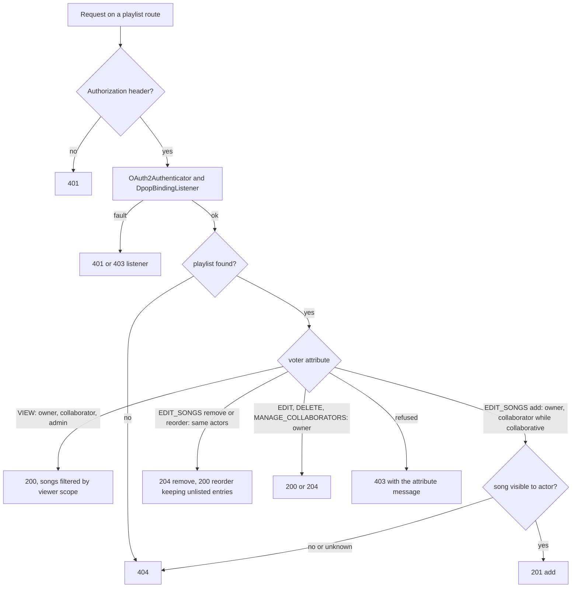
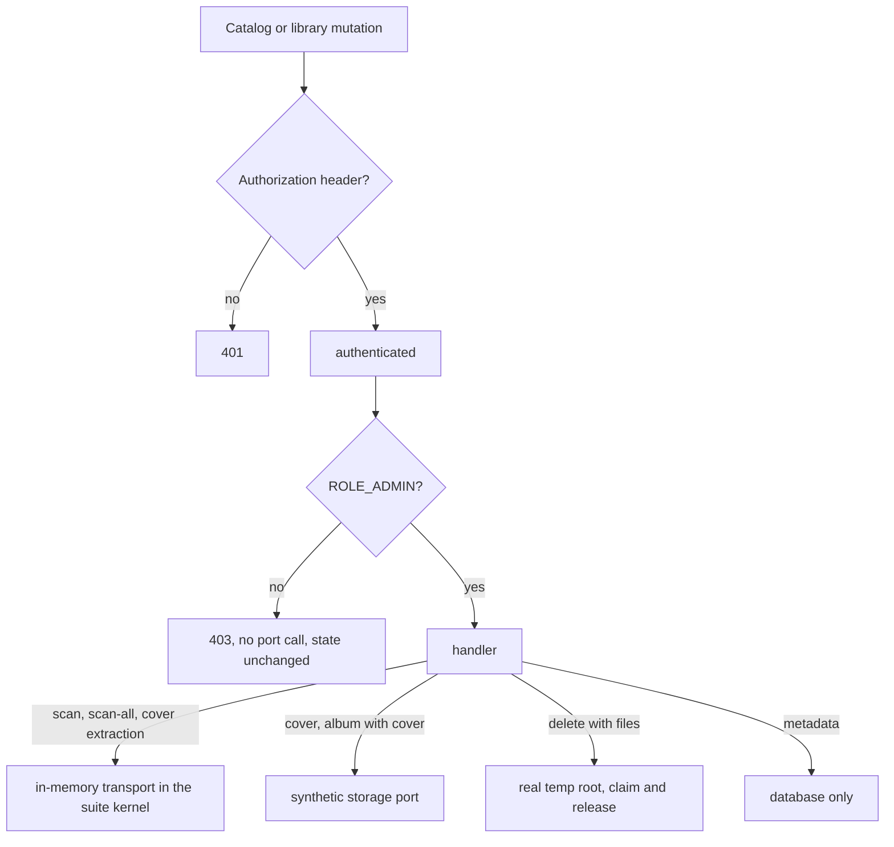

# Catalog Authorization Matrix and Playlist Collaborators - Plan

## Goal Capsule

- **Objective:** A regression in any role check, ownership check, library scope or signing bound on the catalog, library and playlist surface fails a test before it ships. The release gate holds written evidence of what every actor can change and read through the production firewall, and a playlist owner can share editing with named collaborators from the web client, while a collaborator can leave.
- **Means:** A new real-firewall suite over the catalog and library mutations held to the router by an inventory guard (KTD1, KTD10), a playlist mutation suite under the owner-and-collaborator contract (KTD4), rows added to the existing read and delivery suites (KTD8), and the collaborator feature wired through the voter and two routes (KTD4, KTD5) with the owner's sharing controls on the playlist page (KTD11).
- **Authority:** the Requirements below, then the Key Technical Decisions, then `AGENTS.md` and the rule files it names. The pre-release policy applies: no compatibility layers.
- **Stop conditions:** stop and report when a matrix cell answers against its contract and the fix would widen what any actor can reach, when a cell cannot be exercised through the real firewall without replacing a security component, or when a transport replacement in the suite kernel still lets a message reach Redis after one bounded attempt.
- **Execution profile:** `ce-work` on branch `plan/item8-catalog-authorization`, created from `master` at 71df8f57. Local commits only; push on request. The functional and integration suites run in the CI image; the web typecheck, lint and unit tests run because the generated client and the playlist page change.
- **Who finishes:** the implementer runs every gate in the Verification Contract; the lead integrates, updates the roadmap and ships.

---

## Product Contract

### Summary

The catalog read suite proves who can see what, but nobody has proved who can change the catalog, and the roadmap still carries two unverified claims: that no code path acts as an administrator when it has no actor, and that signing only ever signs what the caller may play. This plan adds a real-firewall matrix over every catalog, library and playlist mutation and the library-scoped reads the read suite skips, turns the playlist's unused collaborator table into a working feature with its own rows and the owner's sharing controls on the playlist page, pushes the signing validation rows through the real kernel, and records the fallback-identity audit as evidence with one tightening.

### Problem Frame

`tests/Integration/CatalogReadFirewallTest.php`, `PlaylistReadFirewallTest.php`, `ArtistMutationFirewallTest.php`, `LyricsFirewallTest.php` and `SignedDeliveryFirewallTest.php` cover reads, artist mutations, lyrics and video delivery. Twenty-four catalog mutations (albums, songs, movies, genres, covers, cover extraction, admin deletes and previews), six library mutations (store, update, delete, scan, scan-all, validate-path) and six playlist mutations have no firewall row at all; their guards are a mix of class-level and method-level role attributes and one hand-written ownership check, and nothing proves that a refused request leaves no side effect behind.

The playlist surface is inconsistent with its own model. The voter grants administrators every attribute but the controller only consults it for viewing; every mutation goes through an ownership check that refuses administrators and writes its own 403 body. `playlist_collaborators` exists with a role column, `PlaylistCollaboratorEntity` is mapped, the resource exposes an `isCollaborative` flag, and no code reads any of it. Adding a song never checks that the actor can see the song, and an unknown id reaches a foreign key and answers 500. Reordering replaces the whole list with the ids sent, so a client that sees only part of the playlist deletes the rest.

The roadmap line also asks to eliminate fallback administrator identities. The code trace found none on a user-facing path: a missing actor narrows to no scope, voters refuse a missing user, and the only unscoped default, `LibraryLookup::byIdentifier`, is reached from administrator-gated handlers and console commands. The signing endpoint's path and lifetime bounds have a unit matrix but no row through the kernel.

### Requirements

**Catalog and library mutations**

- R1. Every catalog mutation answers 401 for an anonymous request and 403 for a member and for an unrelated user, with no handler side effect (no bus message, no storage call, no media-file call, unchanged catalog state), and the administrator's request runs to its documented success status. The routes: album update, merge and destroy; song update and destroy; movie update and destroy; genre store, update, destroy, add and remove song, add and remove album; album and artist cover upload and removal; cover extraction; admin album and song delete and delete preview; the admin album duplicates listing.
- R2. Every library mutation (store, update, delete, scan, scan-all, validate-path) answers the same way. A successful scan claims only the library it names and dispatches one scan message; scan-all claims every unclaimed library and skips the claimed ones, and the matrix asserts that on the suite's own libraries and releases the claims the row took; a second scan of a claimed library answers 409.
- R3. Administrator deletion with file removal proves the claim, the transaction, the unlink and the release on a real library root holding the seeded files; a delete preview with file inspection on a missing root answers 200 with deletion not allowed, the library not busy and no file verdicts, and claims nothing.
- R4. Cover upload stores one image through the storage port and creates one image row for the administrator; cover removal and album deletion with a cover discard the image through the storage port after commit; a member's request calls neither.

**Library-scoped reads**

- R5. A denied artist, album, genre or public-id filter on the song, album and artist lists returns an empty page with total 0 for a member; album duplicates and cover answer 404 for an unrelated user and succeed for an administrator; the admin duplicates listing answers 403 for a member and 200 for an administrator; an anonymous request answers 401 on details, duplicates, cover, genre show and library stats.

**Playlist collaborators**

- R6. A playlist owner adds and removes collaborators by the user's public id; a value that is not a public id answers 404 from the router before any lookup. Adding is idempotent, removing a non-collaborator is idempotent, an unknown user answers 404, the owner adding themself answers 422, a collaborator may remove their own row (idempotent, 204), and any other non-owner removal or addition (administrator included) is refused.
- R7. While a playlist is collaborative, a collaborator may view it and add, remove and reorder its songs; when the owner turns collaboration off, collaborators keep viewing and lose editing. The owner alone updates metadata, deletes the playlist and manages collaborators. A non-owner administrator keeps viewing and is refused every mutation; an unrelated member is refused everything; an anonymous request answers 401.
- R8. A song is added only when the acting user can see it through their own library membership; an unknown or invisible song answers 404 and nothing is written. A duplicate add stays idempotent; removing any id stays idempotent.
- R9. Reordering places the listed songs in the given order and keeps the unlisted entries after them in their stored order; a reorder never removes an entry.
- R10. The playlist list includes the playlists the actor collaborates on, each with the owner's public id and the actor's visible song count; viewing filters songs by the viewer's own scope, and every song count a playlist response carries is the viewer's visible count.
- R11. Every playlist refusal is a voter refusal carrying an attribute-specific message, so a matrix row names the deciding rule; the controller writes no 403 body of its own.

**Signing and scope defaults**

- R12. The signing endpoint answers 400 through the real kernel, for an authenticated member with a valid proof, on a non-manifest path, a path with a query or trailing newline, and a lifetime outside 1 to 86400 seconds or of the wrong type, with no playback start, no dispatch and no ladder read.
- R13. No code path answers a missing actor or scope with administrator-wide access. The evidence table is recorded in this plan's Appendix, and `LibraryLookup::byIdentifier` takes a required scope so an unrestricted lookup is an explicit choice at each call site.

**Evidence and documentation**

- R14. Every matrix row runs through the production firewall against disposable PostgreSQL and Redis with real RS256 tokens and ES256 proofs. Only ports with external side effects are replaced, and the Messenger transports that would otherwise reach Redis are in-memory in the suite's kernel.
- R15. The testing guide lists the new suites; the playlist context page, the Playlist README and the glossary define collaborators; the operator security guide states that catalog and library changes are administrator-only and how playlist sharing works, and the web client's playlist page explains how an owner shares and how a collaborator leaves; the OpenAPI specification and the generated web client carry the collaborator routes; the roadmap records item 8, its checkpoint counts and the ticked backlog line.

### Key Decisions

- **A matrix cell that answers against the contract is fixed in this work.** (session-settled: user-directed — chosen over deferring found defects to open items: the matrix is release evidence, and evidence of a known gap is not acceptance.) Governs R1 to R12.
- **Playlists are shared with named collaborators.** (session-settled: user-directed — chosen over keeping mutations owner-only and over letting administrators mutate any playlist: the collaborator table and flag already exist, and the roadmap line is the moment to give them one contract.) Governs R6 to R11.
- **Users are named by public id in routes and resources; a UUID never leaves the API.** (session-settled: user-directed — chosen over UUID path values and resource fields: the project identifies users publicly by their public id, and the collaborator routes and the playlist resource follow it.) Governs R6, R10.
- **The collaborative flag is the owner's switch for collaborator editing.** The stored flag otherwise grants nothing, and the pre-release policy prefers a meaning to a dead column; the owner toggles it through the metadata update. Governs R7.
- **The fallback-identity audit is recorded, not acted on.** (session-settled: user-approved — the scoping synthesis proposed recording evidence when no identity remains, and the user confirmed it.) The one unscoped default becomes explicit. Governs R13.
- **Administrators do not mutate playlists.** A playlist is personal data; the owner-and-collaborator decision above refused the administrator alternative. Governs R7.
- **Artist mutations and lyrics stay in their own suites.** They are already proven through the firewall. Scope boundary, not a requirement.

### Scope Boundaries

- Out of scope: audio track delivery (`TrackStreamFirewallTest`), image reads (`ImageReadFirewallTest`), user and library-access administration (`AdminUserLibraryAccessController`), radio, discovery and pairing, the WebSocket handshake, `HEAD` requests.
- Considered and not built: a visibility check on song removal (the id must already be known and removal is idempotent); a `viewer` collaborator role (the role column keeps its `editor` default and the resource does not expose it); a meaning for `isPublic` (the read suite records that it grants nothing, and no requester asked for public playlists); scoping of `GET /api/lyrics/search` (it calls the remote lyrics provider for any authenticated user with no library scope; a follow-up, see below); bounding a collaborator's add by the owner's scope (adds are bounded by the actor's own scope; the owner's view filters what they cannot see, and the hidden entries survive reorder per R9; a user report of a phantom count is the evidence that would reopen it).

#### Deferred to Follow-Up Work

- Library scoping for the lyrics search route.
- A `viewer` collaborator role.
- The activity, transcode-session and party-member resources still expose the owner's UUID as `userId`; they move to public ids in their own change.

### Acceptance Examples

- AE1. **Covers R1.** Given a member with a valid token and proof, when they `PATCH /api/albums/{id}` with a new title, then the answer is 403, the album title is unchanged and no bus message exists.
- AE2. **Covers R2.** Given an administrator and an unclaimed library, when they `POST /api/libraries/{id}/scan`, then the answer is 202, the library row carries a scan claim, one scan message sits on the in-memory transport, and a second scan within the claim answers 409.
- AE3. **Covers R3.** Given an administrator and a library whose root is a temporary directory holding the seeded song file, when they delete the song with file removal, then the file is gone, the row is gone and the claim is released.
- AE4. **Covers R4.** Given a member, when they upload a cover image, then the answer is 403 and the storage port was never called.
- AE5. **Covers R5.** Given a member and an artist of a library they cannot read, when they list songs filtered by that artist, then the page is empty with total 0.
- AE6. **Covers R7, R8.** Given a collaborative playlist and a collaborator who can see song S but the owner cannot, when the collaborator adds S, then the answer is 201; when the owner views the playlist, S is hidden and the count excludes it.
- AE7. **Covers R7.** Given the owner turned collaboration off, when a collaborator adds a song, then the answer is 403 with the song-editing message, and viewing still answers 200.
- AE8. **Covers R9.** Given a playlist of five songs of which a collaborator sees three, when the collaborator reorders those three, then the playlist still holds five songs, the three in the new order first and the two hidden ones after them.
- AE9. **Covers R6.** Given an owner, when they add an unknown user id as collaborator, then the answer is 404 and no row exists; when they add the same collaborator twice, the second answer is 204 and one row exists; when the collaborator removes their own row, the answer is 204 and the row is gone, and a second removal is 204 again.
- AE10. **Covers R7, R11.** Given an administrator who does not own the playlist, when they update its name, then the answer is 403 and the kernel-exception probe recorded the owner-only message.
- AE12. **Covers R15.** Given the owner opens their playlist in the web client, when they turn collaboration on and add a collaborator by public id, then the page shows the collaborator and the switch on; given a collaborator opens it, then they see a leave action and no owner controls.
- AE11. **Covers R12.** Given a member with a valid token and proof, when they sign `/api/transcode/{id}/media.m3u8` or sign a master manifest with a lifetime of 86401, then the answer is 400 with the controller's message, no playback session was started and nothing was dispatched.

---

## Planning Contract

### Key Technical Decisions

- KTD1. **One catalog-and-library mutation suite with a provider keyed by route and actor.** `tests/Integration/CatalogMutationFirewallTest.php` boots `tests/Fixtures/Auth/CatalogMutationOAuthKernel.php`, a `ProductionOAuthKernel` subclass whose compiler pass replaces the `messenger.transport.async` and `messenger.transport.swoole_task` definitions with in-memory transports, replaces `StoragePortInterface` with a synthetic mock, and aliases the dispatcher, the transports and the library repository public. A `mutation()` map gives each route its method, path, payload and expected administrator status; denied rows assert the status, a catalog state snapshot taken after clearing the entity manager, zero messages on both transports and zero storage calls; administrator rows assert the change, the response shape and the expected port calls. Chosen over one suite per entity: the kernel boot is the cost and the compiled container is shared only within a class. Chosen over mocking the bus: the scan and delete handlers' claims are the behaviour under test. The Swoole task sender falls back to the Redis transport when no server runs, so the transport replacement is what keeps scan messages out of the disposable Redis.
- KTD2. **Discriminators per status.** A 401 reads the authenticator's code from the body. A role refusal throws Symfony's default `AccessDeniedException` with its default message, so a catalog or library 403 row asserts the probe's class and that message, zero port calls and an unchanged snapshot; a proof or binding refusal carries the listener's own message and would fail the row. Each actor identity also has a positive-control read row in the suite, so a mis-minted credential cannot pass as a role refusal. A playlist 403 is told apart by the probe's attribute message (R11). A 404, 409 and 422 are told apart by status and the response body. The kernel-exception probe and the credential scan are the ones `SignedDeliveryFirewallTest` registers.
- KTD3. **Per-row libraries for anything that claims or deletes.** Scan, scan-all and the two file-deletion rows each seed their own library inside the row, after any earlier claim row has released its claims; scan-all assertions cover only the suite's libraries, since the handler walks every library in the shared database, and the row releases every claim its response reports before it ends; the two file-deletion rows use a temporary directory as the library root holding real files, and validate-path uses a created temporary directory. The claim learning in `docs/solutions/architecture-patterns/state-set-when-work-is-queued-on-swoole-task-must-expire.md` is the reason: a successful scan leaves a fifteen-minute claim.
- KTD4. **Collaborators live on the aggregate and the voter decides every playlist mutation.** `Playlist` carries the collaborator user ids, loaded and saved by `PlaylistRepository` from `playlist_collaborators`. `PlaylistVoter` answers `VIEW` for the owner, a collaborator and an administrator; `EDIT_SONGS` for the owner and, while the playlist is collaborative, a collaborator; `EDIT`, `DELETE` and `MANAGE_COLLABORATORS` for the owner only; `LEAVE` for a collaborator removing their own row; its administrator grant narrows to `VIEW`. The controller asks the voter on every route and throws `AccessDeniedException` with one message per attribute; the ownership helper and its 403 body go. (session-settled: user-directed — chosen over owner-only mutations and over an administrator grant on mutations: see the Key Decision that governs R6 to R11.) Chosen over reading collaborator rows in the voter directly: the aggregate is what the repository already hydrates, and the voter stays dependency-free.
- KTD5. **Collaborator management is two routes, one aggregate writer and a public-id resolver.** `PUT /api/playlists/{publicId}/collaborators/{userPublicId}` and `DELETE` on the same path, idempotent, answering 204, with a route requirement that admits only a public id; the owner holds both, and the delete route also admits a collaborator naming their own public id through the voter's `LEAVE` attribute. The add and remove handlers load the aggregate, call its add-collaborator and remove-collaborator methods and save through the repository, so the repository sync from KTD4 is the only writer of the collaborator table. A `PlaylistCollaboratorResolverInterface` port in Playlist Application answers the user's UUID for a public id or throws the shared not-found exception; its Infrastructure adapter calls a new public-id method on `UserIdentifierResolverInterface`, and `deptrac.yaml` grants `'Auth User Identifier Contract'` to `Playlist Infrastructure`. The adapter never calls the email-or-UUID method, so a member route cannot probe accounts by address. The playlist resource exposes `ownerPublicId` and `collaboratorPublicIds` to every viewer the voter admits and drops the owner UUID; the repository loads both public ids with the aggregate. The update request gains `isCollaborative`, and the list query unions the playlists the actor collaborates on. Chosen over an adapter that writes rows directly: two writers of one table would let a later aggregate save drop a row, and the entity's user reference would add a Deptrac violation. Chosen over a collaborator role parameter: one capability set is the contract.
- KTD6. **Song visibility on add is a Playlist Application port under the actor's scope.** `AddSongCommand` carries the actor's `LibraryReadScope` (a Shared Domain value); the handler asks a `PlaylistSongVisibilityInterface` whose Infrastructure adapter uses the Catalog song-lookup contract Playlist Infrastructure already depends on, and throws the shared not-found exception when the song is not visible. Chosen over calling the Catalog song port in the controller: that dependency is a baselined violation and the baseline authorizes no new use.
- KTD7. **Reorder keeps what it was not told about.** `Playlist::reorderSongs` places the listed ids first in the given order and appends the unlisted entries in their stored order, renumbering positions; ids not in the playlist are ignored. Governs R9.
- KTD8. **Read gaps and signing rows extend the suites that own them.** `CatalogReadFirewallTest` gains the denied-filter rows, the unrelated and administrator duplicates and cover rows, the admin duplicates listing and the anonymous detail paths; `PlaylistReadFirewallTest` gains the collaborator list and show rows; `SignedDeliveryFirewallTest` gains a provider of 400 rows on the signing endpoint whose discriminator is the controller's body message, a null probe, zero dispatches and zero ladder reads. The existing unit matrix in `tests/Unit/Transcode/Interface/Controller/StreamSigningSecurityTest.php` stays the owner of the branch coverage.
- KTD9. **The one unscoped default becomes explicit.** `LibraryLookup::byIdentifier` requires its scope; the six callers that relied on the default pass the unrestricted scope with a one-line reason each (administrator-gated handler or scan claim service). The audit table in the Appendix is the evidence for R13; nothing else changes.
- KTD10. **The mutation map is held to the router.** A unit test beside the inventory guard from item 7 loads the routing configuration, collects every route under `/api/` that accepts a method other than GET, subtracts the routes other suites own (artist mutations, lyrics, user and library-access administration, authentication, sessions, radio, discovery, party, favorites, activity, notifications, recommendations, QoL, media and metadata administration, the signing endpoint) by an explicit exclusion list, and asserts the remainder equals the union of the catalog suite's mutation map keys and the playlist suite's route keys, both exposed as public constants. A new mutation route then fails a unit test until it has rows. Chosen over trusting the hand-written map: the objective is evidence that stays complete after the next route lands.
- KTD11. **Sharing controls live in one dialog on the playlist page.** The playlist detail page compares the resource's `ownerPublicId` with the signed-in user's public id from the auth store: the owner gets a sharing dialog built from the shared dialog, switch, input and button primitives that toggles the collaborative flag through the playlist update, lists collaborators by public id with a remove action, adds one by pasted public id, and shows the owner's own public id with a copy action so the two users can exchange ids; a collaborator gets a leave action; everyone else sees no control. Mutations go through the generated client hooks and invalidate the playlist show and index queries. The playlists page marks playlists shared with the viewer. Chosen over a user search: no member-facing user listing exists, and public ids are the identifiers users share.

### High-Level Technical Design

The matrix rows are the edges of these graphs: every refusal row names the node that answered and the ports that were never reached; every success row names the port call or state change at the leaf.

### Assumptions

- The MIME detector and `getimagesize` accept a one-pixel PNG written to a temporary file, so cover upload rows need no replacement of the detector.
- The in-memory transport definitions can replace the two transport services in the production kernel's compiler pass; the first scan row proves it, and the stop condition covers the case where a message still reaches Redis.
- The generated web client can be regenerated with the repository's generator without hand edits; no page changes.

### System-Wide Impact

- R7 and R11 change runtime behaviour on every playlist mutation: administrators lose the voter grant they never used, the 403 body becomes the generic envelope, and the collaborative flag starts gating. The web client only creates playlists and adds songs as the owner; nothing in `ui/web/src` reads the old body.
- R9 changes reorder semantics for every client: a partial list no longer deletes entries.
- KTD5 adds a Deptrac ruleset entry and two routes to the OpenAPI specification; `OpenApiSpecTest` and the specification check require the blocks and the regenerated spec.
- KTD9 touches six call sites in Library Application; behaviour is unchanged.
- The two new suites raise the integration run time by roughly the artist and delivery suites combined.
- The playlist page and a new dialog change under `ui/web/src/features/playlist`, so the web typecheck, lint and unit tests gate the change; the browser authentication suites are untouched.

### Sequencing

U1 then U2 (the playlist feature, U2 needs the aggregate from U1), U3 after U2 (its rows assert the feature). U4 (the catalog kernel fixture) is independent of U1 to U3; U5 needs U4. U6 and U7 are independent of everything else. U9 (the web controls) needs U2's regenerated client. U8 last, after the counts are known. The lead merges U3, U5 and U6 serially since U6 edits the delivery suite only and the others each own one file.

---

## Implementation Units

### U1. Playlist collaborator model, voter and controller

**Goal:** The playlist aggregate knows its collaborators, every playlist refusal comes from the voter with a named rule, adding a song checks visibility, and reordering keeps unlisted entries.

**Requirements:** R7, R8, R9, R11, KTD4, KTD6, KTD7.

**Dependencies:** none.

**Files:** `src/Playlist/Domain/Model/Playlist.php`, `src/Playlist/Infrastructure/Doctrine/Repository/PlaylistRepository.php`, `src/Playlist/Infrastructure/Security/PlaylistVoter.php`, `src/Playlist/Interface/Controller/PlaylistController.php`, `src/Playlist/Application/Command/AddSongCommand.php`, `src/Playlist/Application/CommandHandler/AddSongHandler.php`, `src/Playlist/Application/Port/PlaylistSongVisibilityInterface.php` (new), `src/Playlist/Infrastructure/PlaylistSongVisibility.php` (new), `config/services.yaml` (port binding), `tests/Unit/Playlist/Domain/Model/PlaylistTest.php`, `tests/Unit/Playlist/Infrastructure/Security/PlaylistVoterTest.php`, `tests/Unit/Auth/Infrastructure/Security/Voter/VoterIsolationTest.php`, `tests/Unit/Playlist/Application/CommandHandler/AddSongHandlerTest.php` (new or extended).

**Approach:**
1. Give `Playlist` a collaborator id list with `isCollaborator()`, loaded on reconstitute and synced on save by the repository from `playlist_collaborators`.
2. Rewrite the voter per KTD4: five attributes, administrator grant on `VIEW` only, the `PlaylistEntity` subject branch removed (no caller passes an entity).
3. Replace every ownership check in the controller with a voter check that throws `AccessDeniedException` carrying the attribute's message; remove the helper and its body.
4. Carry the actor's read scope in `AddSongCommand`; the handler asks the new visibility port and throws not-found for an unknown or invisible song; the controller maps the shared not-found exception to 404 as the catalog controllers do.
5. Change `reorderSongs` per KTD7.

**Patterns to follow:** `src/Transcode/Infrastructure/Auth/AuthorizedPlayback.php` (an access refusal with a message), `src/Catalog/Infrastructure/Security/AlbumVoter.php` (voter shape), the repository's existing `toDomain` and `syncSongsToEntity` pair.

**Test scenarios:**
- A playlist reconstituted with two collaborator ids answers true for each and false for a stranger; saving a playlist whose collaborators changed adds and removes exactly the differing rows.
- The voter grants `VIEW` to the owner, a collaborator and an administrator, and refuses an unrelated member and a missing user.
- The voter grants `EDIT_SONGS` to a collaborator while the playlist is collaborative and refuses the same collaborator once the flag is off; the owner is granted either way; the administrator is refused.
- The voter refuses `EDIT`, `DELETE` and `MANAGE_COLLABORATORS` to a collaborator and to an administrator and grants them to the owner.
- The voter grants `LEAVE` to a collaborator for their own row and refuses it to the owner, to an administrator and to an unrelated member.
- `VoterIsolationTest` no longer expects an administrator grant on every playlist attribute.
- Adding a visible song appends it; adding an invisible song throws not-found and leaves the playlist unchanged; adding a song already present returns the playlist unchanged.
- Reordering with a subset places the subset first in the given order and the rest after in stored order with contiguous positions; an id not in the playlist is ignored; reordering with the full list behaves as before.
- Every song count the playlist resource emits comes from the viewer's visible subset, never from the stored entry count.

**Verification:** the unit suites named above pass; PHPStan and Deptrac are clean; `PlaylistReadFirewallTest` still passes (the unrelated-user 403 row and the owner rows are unchanged).

### U2. Collaborator management routes, list and resource

**Goal:** An owner can add and remove collaborators over the API, collaborators can find shared playlists in their list, and the specification and generated client carry the routes.

**Requirements:** R6, R10, R15 (specification and client), KTD5.

**Dependencies:** U1.

**Files:** `src/Playlist/Domain/Model/Playlist.php` (add and remove collaborator, `isCollaborative` on the metadata update), `src/Playlist/Application/Port/PlaylistCollaboratorResolverInterface.php` (new), `src/Playlist/Application/Command/AddCollaboratorCommand.php`, `RemoveCollaboratorCommand.php` and their handlers (new), `src/Playlist/Application/Command/UpdatePlaylistCommand.php` and `src/Playlist/Application/CommandHandler/UpdatePlaylistHandler.php` (`isCollaborative`), `src/Playlist/Infrastructure/PlaylistCollaboratorResolver.php` (new adapter), `src/Playlist/Infrastructure/Doctrine/Repository/PlaylistRepository.php` (list union, public ids), `src/Playlist/Domain/Repository/PlaylistRepositoryInterface.php`, `src/Playlist/Application/Port/PlaylistPortInterface.php`, `src/Playlist/Interface/Controller/PlaylistController.php` (two routes), `src/Playlist/Interface/Request/UpdatePlaylistRequest.php` (`isCollaborative`), `src/Playlist/Interface/Resource/PlaylistResource.php` (`ownerPublicId`, `collaboratorPublicIds`), `src/Auth/Application/Port/UserIdentifierResolverInterface.php` and `src/Auth/Application/Service/UserLookup.php` (public-id method), `deptrac.yaml`, `openapi.json`, `ui/web/src/shared/api-client/gen/` (regenerated), `src/Playlist/README.md`, `tests/Unit/Playlist/Application/CommandHandler/*CollaboratorHandlerTest.php` (new), `tests/Unit/Auth/Application/Service/UserLookupTest.php` (public-id case).

**Approach:**
1. Add the public-id method to the user-identifier contract and its service, the resolver port and adapter, and the two commands and handlers; a handler resolves the public id, loads the aggregate, adds or removes the collaborator on it and saves, so the repository sync is the only writer.
2. Add the two routes guarded by `MANAGE_COLLABORATORS`, the delete route also admitting `LEAVE` for the actor's own id, with a public-id route requirement, answering 204, 404 for a value that is not a public id or an unknown user, 422 when the owner names themself; full OpenAPI blocks including 403 and 404.
3. Extend the list query so the actor's collaborated playlists appear with the owner's user id and the actor's visible count.
4. Add `isCollaborative` to the update request, command, handler and the aggregate's metadata update; replace the resource's owner UUID with `ownerPublicId` and add `collaboratorPublicIds`.
5. Export the specification and regenerate the web client; no page changes.

**Patterns to follow:** `src/Library/Application/CommandHandler/GrantLibraryAccessHandler.php` (user resolution through the contract), the existing playlist command and handler pairs, the update request's nullable fields.

**Test scenarios:**
- The add handler resolves a known public id, adds the collaborator to the aggregate and saves it, so the repository sync writes exactly one row; a second call changes nothing; an unknown public id throws not-found before the aggregate is touched; the owner's own id is refused.
- The remove handler removes the collaborator from the aggregate and saves; a user who was not a collaborator leaves the aggregate unchanged.
- The user lookup's public-id method answers the UUID for a known public id and throws not-found otherwise; the email-or-UUID method is unchanged.
- The playlist resource carries the owner's public id and the collaborators' public ids and no UUID.
- The list for a collaborator contains the shared playlist with the owner's id and the collaborator's visible count, and does not contain playlists of the same owner the actor does not collaborate on.
- The specification test finds both routes documented with 204, 403, 404 and 422; the specification check reports no drift after export.

**Verification:** the unit tests pass; `OpenApiSpecTest` passes; the specification check and the web typecheck pass with the regenerated client.

### U3. Playlist mutation matrix

**Goal:** Every playlist mutation and the collaborator routes have a row per actor with the deciding rule named, and the read suite proves the collaborator view.

**Requirements:** R6 to R11, AE6 to AE10, KTD2, KTD4.

**Dependencies:** U2.

**Files:** `tests/Integration/PlaylistMutationFirewallTest.php` (new), `tests/Fixtures/Auth/PlaylistOAuthKernel.php` (dispatcher alias if missing), `tests/Integration/PlaylistReadFirewallTest.php` (collaborator list and show rows).

**Approach:**
1. Reuse the playlist kernel, the identity and token minting, the request helper and the kernel-exception probe from the delivery suite.
2. Seed an owner, a collaborator, an unrelated member and an administrator across two libraries, so a song visible to the collaborator but not to the owner exists.
3. One provider over store, update, destroy, add song, remove song, reorder, add collaborator and remove collaborator crossed with owner, collaborator, collaborator with the flag off, unrelated member, administrator and anonymous; each row names the status, the probe message for a 403, and the state after.
4. Separate tests for the visibility cells, the reorder cell, collaborator removal between two requests, and owner deletion seen by a collaborator.

**Patterns to follow:** `tests/Integration/SignedDeliveryFirewallTest.php` (provider shape, probe, `assertDecidedBy`), `tests/Integration/PlaylistReadFirewallTest.php` (seeding and cleanup).

**Test scenarios:**
- Covers AE6: the collaborator adds a song the owner cannot see; the owner's view hides it and the count excludes it; the collaborator's view shows it.
- Covers AE7: with the flag off, the collaborator's add answers 403 with the song-editing message and their view answers 200.
- Covers AE8: the subset reorder keeps the hidden entries after the listed ones.
- Covers AE9: unknown collaborator 404 with no row; repeated add 204 with one row; removal of a non-collaborator 204.
- An owner naming a collaborator by email address, by UUID or by a malformed value answers 404 from the router with no resolver call and no row.
- A collaborator deleting their own public id answers 204 and the row is gone; deleting another collaborator's id answers 403 with the owner-only message; an administrator deleting a collaborator answers 403.
- Covers AE10: a non-owner administrator's update, delete, add, remove, reorder and collaborator management answer 403 with the owner-only or song-editing message; their view answers 200.
- An unrelated member answers 403 on view and on every mutation; anonymous answers 401 everywhere.
- A collaborator removed between two requests answers 403 on the next; a playlist deleted by its owner answers 404 to the collaborator.
- Adding an unknown song id answers 404 and writes nothing; adding a malformed id answers 400 before any lookup.
- The read suite's list row for a collaborator shows the shared playlist with the owner's id and the collaborator's visible count.
- The credential scan finds no token or proof in any body or log file.

**Verification:** the suite passes in the CI image; the read suite passes with its new rows.

### U4. Catalog mutation kernel fixture

**Goal:** A production kernel subclass whose transports are in-memory, whose storage port is synthetic and whose libraries can own a real root, proved by the administrator scan row.

**Requirements:** R14, KTD1, KTD3.

**Dependencies:** none.

**Files:** `tests/Fixtures/Auth/CatalogMutationOAuthKernel.php` (new), `tests/Integration/CatalogMutationFirewallTest.php` (skeleton with the scan row).

**Approach:**
1. In the compiler pass, registered before optimization so it runs ahead of the framework's Messenger pass that collects senders and receivers, replace the `async` and `swoole_task` transport definitions with in-memory transports and alias them public; replace `StoragePortInterface` with a synthetic definition; alias the dispatcher and the library repository public.
2. Add helpers to seed a library with a temporary root and real files, and a cleanup that removes the root.
3. Write the administrator scan row first and prove the message landed on the in-memory transport and nothing on Redis.

**Execution note:** start with the scan row failing against the real transport, then make the replacement land it in memory; the stop condition applies if a message still reaches Redis after one bounded attempt.

**Patterns to follow:** `tests/Fixtures/Auth/MediaOAuthKernel.php` (synthetic port definitions), `tests/Fixtures/Auth/ProductionOAuthKernel.php` (aliases and parameters), `tests/Functional/CoverBatchRoutingTest.php` (in-memory transport assertions).

**Test scenarios:**
- Covers AE2: the administrator scan answers 202, the library row carries a claim, one scan message sits on the in-memory task transport, the Redis stream is empty, and a second scan answers 409.
- A member scan answers 403 with no claim and no message.

**Verification:** the two rows pass in the CI image; the disposable Redis holds no scan message after the run.

### U5. Catalog and library mutation rows

**Goal:** Every catalog and library mutation has its rows, denied rows prove no side effect, and the file-deletion rows run on a real root.

**Requirements:** R1 to R4, AE1, AE3, AE4, KTD1 to KTD3.

**Dependencies:** U4.

**Files:** `tests/Integration/CatalogMutationFirewallTest.php`, `tests/Unit/Shared/Infrastructure/Security/MutationRouteInventoryTest.php` (new, KTD10), `tests/Integration/PlaylistMutationFirewallTest.php` (route-key constant).

**Approach:**
1. Build the `mutation()` map for the thirty routes with payloads that succeed for an administrator against the seeded catalog, and a provider crossing them with anonymous, member, unrelated member and administrator.
2. Take the catalog state snapshot after clearing the entity manager; assert it unchanged on every denied row together with zero transport messages and zero storage calls.
3. Seed per-row libraries for scan, scan-all and the two file-deletion rows; a temporary directory for validate-path; a one-pixel PNG for the cover uploads through a multipart request.
4. Record every id a successful row creates (library, access row, genre, image, scan claim) for cleanup, and release every claim a scan or scan-all row took before the row ends.
5. Expose the map's route keys as a public constant and write the inventory guard (KTD10) over it and the playlist suite's keys.

**Patterns to follow:** `tests/Integration/ArtistMutationFirewallTest.php` (mutation map, state snapshot), `tests/Integration/SignedDeliveryFirewallTest.php` (provider rows with port counts).

**Test scenarios:**
- Covers AE1: the member's album update answers 403 with the title unchanged and no message.
- Every route in R1 answers 401 anonymous, 403 member and unrelated member with the snapshot unchanged, and its documented status for the administrator with the expected change.
- Covers AE3: the administrator's song deletion with file removal on the real root removes the file and the row and releases the claim; album deletion with file removal does the same for the album's files.
- Delete preview with file inspection on a missing root answers 200 with deletion not allowed, the library not busy and no file verdicts, and claims nothing.
- Positive control: the member and the unrelated user each succeed on a catalog read with the same credential the denied rows use, so a credential fault cannot pass as a refusal; every catalog and library 403 row asserts the probe's class and Symfony's default message.
- Covers AE4: a member's cover upload never calls the storage port; the administrator's upload stores once, creates one image row and discards nothing; cover removal discards once; album deletion with a cover discards after commit.
- Cover extraction answers 202 for the administrator with one batch message on the in-memory transport and 403 for a member with none.
- Library store creates the library and grants the administrator membership; update and delete work on the suite's library; validate-path answers 422 blank, valid false for a missing path and valid true for the created directory.
- Scan-all claims the suite's unclaimed libraries and skips the claimed one; the transport holds a message for each of the suite's unclaimed libraries and none for the claimed one; the row releases every claim its response reports.
- The inventory guard fails when a non-GET route under the API prefix is neither excluded nor present in the catalog or playlist route keys, and passes on the current router.
- Album merge refuses a cross-library merge with 400 and succeeds within one library.
- The credential scan finds no token or proof in any body or log file.

**Verification:** the suite passes in the CI image within the shard memory limit; the artist suite still passes.

### U6. Read gaps and signing rows

**Goal:** The read suite covers the denied filters and the remaining actors on related resources, and the signing validation answers through the real kernel.

**Requirements:** R5, R12, AE5, AE11, KTD8.

**Dependencies:** none.

**Files:** `tests/Integration/CatalogReadFirewallTest.php`, `tests/Integration/SignedDeliveryFirewallTest.php`.

**Approach:**
1. Add the six denied-filter rows, the unrelated and administrator duplicates and cover rows, the admin duplicates listing rows and the anonymous detail paths to the read suite.
2. Add a provider of 400 rows on the signing endpoint to the delivery suite: media manifest path, segment path, path with a query, path with a trailing newline, lifetimes 0, -1, 86401, a string, a float, null and an array, and a malformed JSON body.

**Patterns to follow:** the read suite's existing denied-search test; the delivery suite's bound-endpoint provider.

**Test scenarios:**
- Covers AE5: each denied filter returns an empty page with total 0 for the member and the matching rows for the administrator.
- Album duplicates and cover answer 404 for the unrelated user and succeed for the administrator; the admin duplicates listing answers 403 member, 200 administrator, 400 for a malformed library id.
- Anonymous answers 401 on an artist detail, album duplicates, album cover, genre show and library stats.
- Covers AE11: each 400 row answers the controller's message, the probe recorded nothing, the bus mock dispatched nothing and the ladder port was never read.

**Verification:** both suites pass in the CI image.

### U7. Required scope on the library lookup

**Goal:** No library lookup runs unrestricted by default.

**Requirements:** R13, KTD9.

**Dependencies:** none.

**Files:** `src/Library/Application/Service/LibraryLookup.php`, `src/Library/Application/CommandHandler/UpdateLibraryHandler.php`, `DeleteLibraryHandler.php`, `GrantLibraryAccessHandler.php`, `RevokeLibraryAccessHandler.php`, `src/Library/Application/Service/LibraryScanClaims.php`, their unit tests.

**Approach:**
1. Make the scope parameter required.
2. Pass the unrestricted scope at the six call sites with a one-line reason naming the administrator gate or the claim service.

**Patterns to follow:** `src/Library/Application/QueryHandler/GetLibraryHandler.php` (scope passed through).

**Test scenarios:**
- A lookup with the unrestricted scope finds any library; a lookup with a member scope finds only that member's libraries; the handlers' existing tests pass with the explicit scope.

**Verification:** PHPStan finds no caller without a scope; the Library unit and functional suites pass.

### U9. Sharing controls on the playlist page

**Goal:** An owner shares a playlist and manages collaborators from the web client, and a collaborator can leave.

**Requirements:** R15 (web client), AE12, KTD11.

**Dependencies:** U2.

**Files:** `ui/web/src/features/playlist/components/SharePlaylistDialog.tsx` (new), `ui/web/src/features/playlist/pages/PlaylistDetailPage.tsx`, `ui/web/src/features/playlist/pages/PlaylistsPage.tsx` (shared badge), `ui/web/src/features/playlist/components/__tests__/SharePlaylistDialog.test.tsx` (new), `ui/web/src/features/playlist/pages/__tests__/PlaylistDetailPage.test.tsx` (new).

**Approach:**
1. Read the viewer's public id from the auth store and the owner's from the playlist resource; render the sharing dialog trigger for the owner and a leave action for a collaborator.
2. Build the dialog from the shared primitives: a switch bound to the collaborative flag through the playlist update mutation, the collaborator list with remove actions, an input and button to add a public id, and the owner's own public id with a copy action.
3. Use the generated hooks for the collaborator routes and the update; invalidate the playlist show and index queries after each mutation; show the server's error message on 404 and 422.
4. Mark playlists on the list page whose owner is not the viewer.

**Patterns to follow:** `ui/web/src/features/admin/components/users/LibraryAccessDialog.tsx` and its test (dialog shape, query invalidation, mocked client), `.agents/rules/frontend.md` (generated hooks, styled primitives, effect hygiene), `ui/DESIGN.md` (dialog and primary-action rules).

**Test scenarios:**
- Covers AE12: as the owner, the dialog shows the switch off and no collaborators; turning the switch on sends the update with the flag and the list refetches; adding a public id sends the put and the collaborator appears; removing sends the delete and the collaborator disappears.
- As a collaborator, the page shows a leave action and no sharing dialog; leaving sends the delete for the viewer's own public id and navigates back to the list.
- As an unrelated viewer the page renders neither control.
- A 404 on add shows the server's message and leaves the list unchanged; a 422 for the owner's own id shows the message.
- The list page marks a playlist whose owner is not the viewer and leaves the viewer's own playlists unmarked.

**Verification:** the web unit tests pass; the typecheck and lint pass; no browser suite changes.

### U8. Documentation, glossary and roadmap

**Goal:** The guides, glossary, specification and roadmap state the delivered contract.

**Requirements:** R15.

**Dependencies:** U1 to U7, U9.

**Files:** `docs-book/part-2-developer-guide/testing.md`, `docs-book/part-2-developer-guide/contexts/playlist.md`, `docs-book/part-1-operator-guide/security.md`, `src/Playlist/README.md`, `CONCEPTS.md`, `ROADMAP.md`.

**Approach:**
1. Add the two suites and the extended rows to the testing guide's real-firewall list.
2. State the collaborator contract (R6 to R11) in the playlist context page and README and the glossary entry.
3. Add to the operator security guide that catalog and library changes are administrator-only, that playlists are shared by named collaborators under the owner's switch, and that no actor-less path has administrator scope.
4. Record item 8 in the roadmap with the checkpoint counts and tick the backlog line.

**Test expectation:** none — documentation; `prose-fix` runs on every changed docs-book page.

**Verification:** the pages read correctly; the roadmap entry names the suites and counts.

---

## Verification Contract

| Gate | Command | Proves |
| --- | --- | --- |
| PHP unit | `BAANDER_TEST_IMAGE=baander-ci-prewarm:local bash scripts/test-unit-container.sh` | U1, U2, U7 unit scenarios and the mutation route inventory guard |
| Integration | `BAANDER_TEST_IMAGE=baander-ci-prewarm:local BAANDER_FUNCTIONAL_TIMEOUT_ACTIVE=1 bash scripts/test-functional-container.sh tests/Integration` | R1 to R14, the three matrices, the read and delivery rows, admin/CLI parity unchanged |
| Functional | the same runner with `tests/Functional` | no regression in the Library and Playlist functional suites |
| Static | PHPStan, Deptrac, `lint:container` and `app:export-openapi-spec --check` in the CI image with `src tests config vendor packages` mounted | zero Deptrac violations with the baseline unchanged, specification exported |
| Web | `yarn typecheck`, `yarn lint` and `yarn test` in `ui/web` | the regenerated client compiles and the sharing controls' tests pass |

The browser authentication suites are not affected: the sign-in flow does not change.

## Definition of Done

- Every R has a passing test named in its unit; AE1 to AE11 are covered; R15 is closed by U8.
- Every denied row in the two mutation suites asserts an unchanged snapshot and zero port or transport calls; every playlist 403 row asserts the voter message.
- The gates above are green in the CI image; Deptrac stays at zero with the baseline unchanged; the only ruleset change is the grant in KTD5.
- No playlist route writes a 403 body of its own; the ownership helper is gone.
- No abandoned experiment code remains in the diff.
- Docs, glossary, specification, generated client and roadmap updated per U2 and U8; the sharing controls land with their tests per U9.

---

## Appendix

### Fallback administrator identity audit

| Candidate | Evidence | Fallback identity |
| --- | --- | --- |
| `LibraryReadScopeProvider::current()` | no identity or a malformed id narrows to no scope; `ROLE_ADMIN` widens; otherwise membership ids | no |
| `LibraryReadScope::none()` in queries | `CatalogReadScopeQuery` emits a false predicate | no |
| `LibraryLookup::byIdentifier(..., ?scope = null)` | defaults to unrestricted; callers that omit it: `UpdateLibraryHandler`, `DeleteLibraryHandler`, `GrantLibraryAccessHandler`, `RevokeLibraryAccessHandler`, `LibraryScanClaims` (twice), all administrator-gated or the claim service | no on a user-facing read; tightened by KTD9 |
| Repository `search()` delegating to `searchVisible(unrestricted)` | callers: `SyncGenresHandler` (Messenger) and the `*Service::search` wrappers used by console commands only | no |
| Console commands using the unrestricted scope | genre list, library list, show, stats, scan, lyrics apply and fetch | no: the CLI is full authority by rule |
| `ListLibraryAccessHandler` unrestricted `findVisible` | reached only from the user-management list route | no |
| Voters with a missing user or subject | playlist, song, album and library voters refuse a non-identity user; the admin voter reads roles only | no |
| `AuthorizedPlayback` | throws on a null user; an administrator skips the membership join | no |
| `CreateUsersCommand` | development seeding of an administrator account, not a runtime fallback | no |
| Messenger handlers constructing an administrator principal | none; `Actor::CLI` and `Actor::SYSTEM` are audit strings | no |

### Sources

- Roadmap: `ROADMAP.md`, the "Application security and reliability" backlog's first open line, and the item 7 entry as the record format.
- Code trace: `config/packages/security.yaml` (the `^/api/admin` role row and the authenticated `^/api/` row), the controllers under `src/Catalog/Interface/Controller/`, `src/Library/Interface/Controller/LibraryController.php`, `src/Playlist/Interface/Controller/PlaylistController.php` (the ownership helper, the voter call on show, the add-song path), `src/Playlist/Infrastructure/Security/PlaylistVoter.php`, `src/Playlist/Infrastructure/Doctrine/Entity/PlaylistCollaboratorEntity.php`, `src/Playlist/Domain/Model/Playlist.php` (reorder), `src/Playlist/Infrastructure/Doctrine/Repository/PlaylistRepository.php` (owner-only list), `src/Library/Application/Service/LibraryLookup.php`, `src/Library/Infrastructure/LibraryReadScopeProvider.php`, `src/Catalog/Infrastructure/Doctrine/Query/CatalogReadScopeQuery.php` (filter predicates), `src/Shared/Infrastructure/Messenger/SwooleTaskWithRedisFallbackSender.php` (the Redis fallback), `config/packages/messenger.yaml` (transport routing), `src/Library/Application/Service/LibraryScanClaims.php` and `src/Library/Infrastructure/Filesystem/LibraryMediaFiles.php` (claims), `src/Catalog/Application/CommandHandler/Cover/SetCoverHandler.php` and `src/Catalog/Application/Service/CoverImageDiscarder.php` (storage port use), `src/Library/Application/PathValidator.php`, `src/Transcode/Interface/Controller/StreamSigningController.php` (path and lifetime bounds), `src/Auth/Application/Port/UserIdentifierResolverInterface.php`, `deptrac.yaml` (Playlist rulesets, the Auth user-identifier contract grants) and `deptrac.baseline.yaml` (the Playlist entries).
- Existing suites: `tests/Integration/ArtistMutationFirewallTest.php`, `CatalogReadFirewallTest.php`, `PlaylistReadFirewallTest.php`, `LyricsFirewallTest.php`, `SignedDeliveryFirewallTest.php`, `tests/Fixtures/Auth/ProductionOAuthKernel.php`, `MediaOAuthKernel.php`, `PlaylistOAuthKernel.php`, `tests/Unit/Transcode/Interface/Controller/StreamSigningSecurityTest.php`, `tests/Unit/Playlist/Infrastructure/Security/PlaylistVoterTest.php`, `tests/Unit/Auth/Infrastructure/Security/Voter/VoterIsolationTest.php`, `tests/Unit/Playlist/Domain/Model/PlaylistTest.php`, `tests/Functional/CoverBatchRoutingTest.php`, `tests/Integration/AdminCliParityTest.php`.
- Learnings: `docs/solutions/architecture-patterns/state-set-when-work-is-queued-on-swoole-task-must-expire.md` (scan claims last fifteen minutes), `docs/solutions/runtime-errors/inline-messenger-run-must-name-the-routed-transport.md` (why the suite asserts dispatch rather than running handlers inline).
- Runner: `scripts/test-functional-container.sh` (environment the image provides, fail on skipped), `scripts/run-phpunit-shards.php` (one process per kernel-using file, 512 MiB).
- Rules: `.agents/rules/admin-cli-parity.md` (playlist routes are neither administrator-guarded nor admin pages, so the collaborator routes need no command), `.agents/rules/architecture-rules.md`.
- Docs to extend: `docs-book/part-2-developer-guide/testing.md` (the item 7 block as the pattern), `docs-book/part-2-developer-guide/contexts/playlist.md`, `docs-book/part-1-operator-guide/security.md`, `src/Playlist/README.md`, `CONCEPTS.md`.
