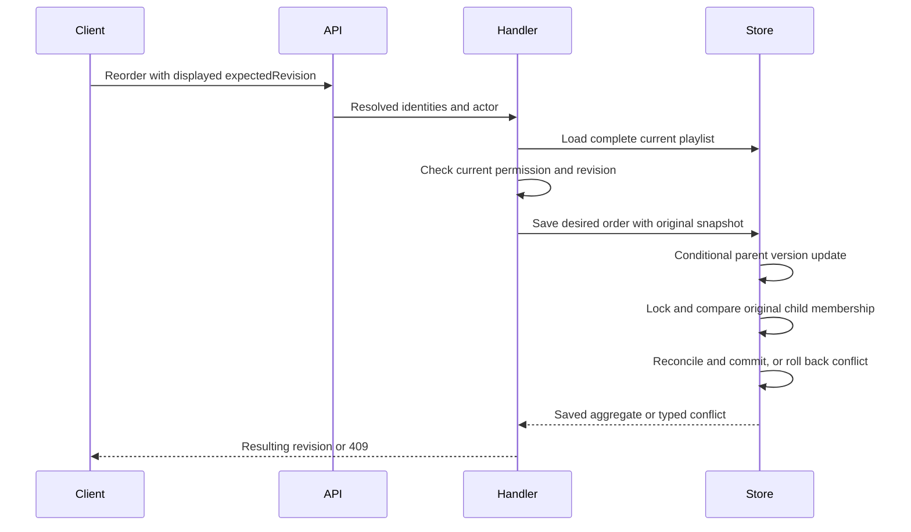

# Prevent playlist concurrent writes from losing changes

## Goal Capsule

**Objective:** Playlist users can repeat collaborator additions safely and receive a conflict when a reorder would overwrite changes they have not seen.

**Means:** Guard aggregate persistence before reconciling children, and require the displayed playlist revision for reorder (KTD1–KTD3).

**Authority:** The next-work entry in `ROADMAP.md`, the collaborator definition in `CONCEPTS.md`, and `AGENTS.md` govern scope.
The lead implements, verifies, reviews and commits on `plan/playlist-concurrent-writes`.
A later merge or push needs a separate request.
No local database reset is authorized by this work.
Stop for a product decision only if evidence makes these contracts infeasible; resolve implementation details from source and tests.

## Product Contract

### Problem Frame

Two requests can load the same playlist and each save its entire song and collaborator snapshot.
The second save can fail on a duplicate collaborator constraint or silently discard the first request's changes.
Reorder currently accepts an order without any client precondition, so even a request submitted after another edit can overwrite that edit.

### Requirements

- R1. Concurrent identical collaborator additions retain the existing idempotent PUT contract: successful requests return 204 and leave one membership.
A bounded conflict retry may return 409 if contention exhausts its budget.
- R2. Every existing-playlist save must reject a stale aggregate before writing parent metadata or child changes that could overwrite newer state.
A missing persisted playlist must not be recreated by a stale save.
- R3. Reorder requires the revision obtained with the displayed song order and returns 409 without mutation when it is stale.
A successful reorder returns the resulting revision; clients must refresh after a conflict instead of silently replaying their old order.
- R4. Preserve existing owner, collaborator and administrator permissions, song visibility, subset reorder behavior, and idempotent collaborator removal behavior.
Recheck authorization on a fresh aggregate used after a reload or retry.
- R5. Revisions cover the complete stored membership, including hidden songs, without exposing their identifiers.
They change after aggregate writes and committed song or collaborator membership cascades.
- R6. Preserve existing data through a forward migration and verify fresh initialization and incremental upgrade.
Do not reset user databases or rewrite the consolidated initial migration.

### Scope Boundaries

This work includes persistence, affected application/API contracts, generated web contracts, regression tests and documentation.
The web app has no reorder interaction; this task does not add one.
Invitation flows, removal visibility policy, visible-song count optimization, broader playlist aggregate redesign, provider qualification and mobile work remain deferred.
The concurrency contract covers application writers and the identified foreign-key cascades.
Other direct SQL writers are outside its scope.

### Acceptance Examples

- AE1. Two sessions add the same absent collaborator: one membership remains, both complete successfully under the bounded retry, and no unique-constraint error escapes.
Distinct concurrent additions retain both memberships when the retry succeeds.
- AE2. Two reorder requests use the same displayed revision: one commits; the other returns 409 and cannot alter the winner's order.
The same refusal occurs when the stale request starts after the first has already committed.
- AE3. A collaborator reorders visible songs while hidden songs exist: omitted songs remain in their previous relative order.
A competing add, remove, metadata edit or collaboration change prevents a stale snapshot from overwriting it.
- AE4. A catalog or user deletion cascades membership removal: a previously issued revision becomes stale, and an overlapping save either precedes the cascade or refuses without restoring deleted membership.
- AE5. A failed save leaves rows and revision unchanged and permits a fresh request to use a clean persistence context.

## Planning Contract

### Key Technical Decisions

- KTD1. **Explicit aggregate compare-and-swap before reconciliation.** Add a non-negative integer persistence version to playlists and carry its loaded value with the domain aggregate.
Inside the existing transaction/manager-cleanup conventions, conditionally increment the parent version before scheduling or flushing any child changes.
Zero affected rows is a typed playlist conflict.
Keep creation distinct from reconstitution so a deleted existing aggregate cannot enter the creation path.
Doctrine's automatic optimistic version alone is insufficient: its UnitOfWork inserts new child entities before updating the versioned parent.
This guards all existing save callers without a new locked-read API at every entrypoint.
- KTD2. **Original membership and cascade protection.** Capture an immutable original persistence snapshot when fully hydrating an aggregate.
After winning the parent compare-and-swap, read and lock current song IDs/positions and collaborator IDs with scalar DBAL queries in deterministic order, then compare them with that original snapshot.
Compare original state, not the desired mutated state.
A preceding cascade causes conflict; a following cascade waits for the save and applies afterwards.
Explicit playlist deletion must acquire the parent lock before scheduling child deletion, using the same transaction and cleanup boundary as save.
Keep parent-before-child ordering for these two operations.
Refresh managed entities before reconciliation where needed; an ORM identity-map object is not evidence of current database state.
Metadata-only list projections must not be treated as complete writable snapshots.
- KTD3. **Opaque client revision from the same snapshot.** Expose `revision` on playlist detail and successful reorder responses, and require `expectedRevision` on the reorder request.
Use a deterministic opaque digest of the persistence version and canonical complete song/collaborator membership.
Include version to invalidate ordinary writes even if an order changes away and back; include membership to detect external cascades.
Metadata and collaborator edits intentionally invalidate reorder revisions too.
Derive detail revision from the aggregate used to assemble its songs, not the later independent read-view query.
Do not expose a misleading token on metadata-only list resources.
- KTD4. **Bounded retry only for collaborator addition.** Retry the typed persistence conflict at most three attempts, reloading a fresh aggregate and rechecking the owner on each attempt.
An already-present collaborator returns without a write.
After exhaustion return the standard 409 envelope; do not catch arbitrary database failures or replay stale reorder intent.
Move reorder orchestration into an application command/handler; retain HTTP validation and current library visibility resolution.
The handler rechecks current edit permission before applying the revision precondition.
- KTD5. **Incremental schema and fixture integration.** Add a normal timestamp migration after `Version20261017000000`, retaining existing playlist identities and rows.
Extend `tests/Support/FinalSchemaBootstrap.php` to apply the current migrations in timestamp order in its empty isolated schema, still reusing provisioned extensions.
Keep initial-refusal, no-op, future-migration and irreversible-initial tests meaningful as the migration count increases.

The compare-and-swap approach is preferred over locking and reloading before every mutation because the latter changes every writer entrypoint.
An insert-only upsert cannot protect unrelated memberships during full-snapshot reconciliation.
A second persisted order-version column and cross-context cascade triggers are unnecessary; the snapshot digest and child locks cover the required cases.
These alternatives are resolved from existing source behavior; no prototype or comparative implementation is needed.

### High-Level Technical Design

### Evidence and Risks

`PlaylistRepository::save()` reconciles both collections on every save; `findEntityOrCreate()` currently permits stale recreation.
`PlaylistController::show()` combines an aggregate song snapshot with a later read view, so revision placement matters.
`AddCollaboratorHandler` already defines sequential duplicate addition as a no-op.
`ConflictException` and `ExceptionSubscriber` provide the existing safe 409 response contract.
`DoctrineTransaction` supplies manager cleanup after failure.
`LibraryScanClaimTest` demonstrates real-session races with observed lock waits instead of timing guesses.

Parent/child lock ordering and ORM state after rollback need execution-time verification.
An enclosing transaction must not leave a failed aggregate advertised as successfully persisted; tests must cover rollback and subsequent reload.
Tests should force the relevant interleavings rather than rely on repeated racing requests.

Primary references: [PostgreSQL explicit locking](https://www.postgresql.org/docs/18/explicit-locking.html), [Doctrine transactions and concurrency](https://www.doctrine-project.org/projects/doctrine-orm/en/3.6/reference/transactions-and-concurrency.html), and installed Doctrine UnitOfWork flush ordering.
The adjacent scan-claim lesson in `docs/solutions/architecture-patterns/state-set-when-work-is-queued-on-swoole-task-must-expire.md` supports atomic stale-writer checks; it does not call for playlist leases.

## Implementation Units

### U1. Guard complete playlist persistence

**Goal:** Enforce R2, R5 and R6 at the repository boundary.
**Dependencies:** None.
**Files:** `src/Playlist/Domain/Model/Playlist.php`; a focused persistence snapshot value type if needed; `src/Playlist/Infrastructure/Doctrine/Entity/PlaylistEntity.php`; `src/Playlist/Infrastructure/Doctrine/Repository/PlaylistRepository.php`; a typed conflict under `src/Playlist/Application/Exception/`; a forward file under `migrations/`; `tests/Support/FinalSchemaBootstrap.php`; `tests/Integration/InitialSchemaMigrationTest.php`; `tests/Integration/PlaylistConcurrencyTest.php`; relevant domain unit tests.
**Approach:** Implement KTD1, KTD2 and KTD5; expose the aggregate revision getter required by KTD3.
Keep unrelated aggregate construction and persistence conventions intact.
**Test scenarios:** Two detached versions, stale metadata/song/collaborator writes, missing parent, complete versus metadata-only projections, cascade before/overlapping save, explicit playlist delete versus save without reversed lock order, rollback with reusable manager, and populated-schema upgrade preserving rows.
**Verification:** Focused domain and PostgreSQL integration tests, followed by PHPStan and container wiring checks.
**Execution note:** Establish failing stale-snapshot and duplicate-insert evidence before fixing persistence.

### U2. Enforce API preconditions and idempotent additions

**Goal:** Deliver R1, R3 and R4 using U1's persistence contract.
**Dependencies:** U1 interfaces agreed before parallel edits; integrated execution depends on U1.
**Files:** `src/Playlist/Application/Command/AddCollaboratorCommand.php`; `src/Playlist/Application/CommandHandler/AddCollaboratorHandler.php`; new reorder command/handler; `src/Playlist/Interface/Controller/PlaylistController.php`; `src/Playlist/Interface/Request/ReorderSongsRequest.php`; `tests/Unit/Playlist/Application/CommandHandler/`; `tests/Unit/Playlist/Interface/Controller/PlaylistCollaboratorRoutesTest.php`; `tests/Unit/Playlist/Interface/Controller/PlaylistSongIdentityTest.php`; `tests/Integration/PlaylistMutationFirewallTest.php`.
**Approach:** Implement KTD3 and KTD4, preserving existing response messages and visibility checks.
Use the shared application forbidden/conflict outcomes rather than persistence exceptions in controllers.
**Test scenarios:** AE1–AE3; missing/malformed expected revision; stale request after completed write; current permission lost before handling or retry; detail token bound to its displayed order; retry exhaustion; unknown playlist/user; owner self-add; existing duplicate no-op.
**Verification:** Focused handlers, controller contracts and real HTTP firewall tests; keep the existing permission matrix intact.

### U3. Qualify and document the complete behavior

**Goal:** Verify AE1–AE5 and publish the current contract within the repository.
**Dependencies:** U1 and U2.
**Files:** `tests/Integration/PlaylistConcurrencyTest.php`; `openapi.json`; generated playlist client/model files in `ui/web/src/`; `docs-book/part-2-developer-guide/contexts/playlist.md`; affected installation/migration guidance; `CONCEPTS.md`; `ROADMAP.md`.
**Approach:** Complete deterministic two-session concurrency coverage, regenerate API/client contracts, describe revision refresh and bounded conflict outcomes, and record current migration behavior and verification counts.
Do not add a web reorder control or change unrelated follow-up items.
**Test scenarios:** Real duplicate/distinct collaborator requests; two competing reorders; reorder versus membership changes and cascades; loser rollback and winner preservation; fresh and upgraded schema; no-op migration rerun.
**Verification:** The authoritative backend suite and static gates, web typecheck/lint/tests, generated-contract drift, independent code review and prose checks.

## Verification Contract

Use disposable infrastructure with `BAANDER_TEST_IMAGE=baander-ci-prewarm:local` and the project's PostgreSQL image.
Run focused tests through `scripts/test-unit-container.sh` and `scripts/test-functional-container.sh`; run `scripts/test-backend-container.sh` for final backend qualification.
Run PHPStan, Deptrac, container lint, Composer platform checks and OpenAPI drift in the CI image as documented in the testing guide.
Regenerate OpenAPI and the Orval client, then run `yarn typecheck`, `yarn lint` and `yarn test --run` in `ui/web`.
Rerun runtime drills only if changes reach their production behavior or fixture bootstrap; serialize shared-state tests.
No test connects to production; use `baander.app` fixture domains and preserve local user data.

## Definition of Done

All requirements and acceptance examples have passing evidence, fresh installation and populated upgrade preserve their guarantees, and no stale writer can silently replace the winning playlist state in the covered paths.
The API and generated client agree on required revision input and conflict output.
Independent plan review precedes implementation; simplification, independent code review and prose checks complete before local commits finish.
Record actual suite counts, timings and any limits in `ROADMAP.md`, close its two selected findings, and retain unrelated open work.
Remove abandoned implementation attempts and disposable resources.
Leave the branch committed locally; do not merge, push or reset local databases without a new request.
