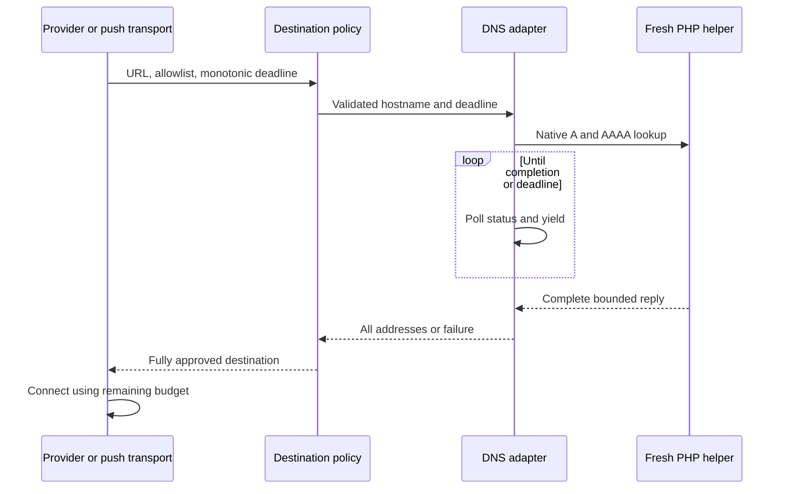
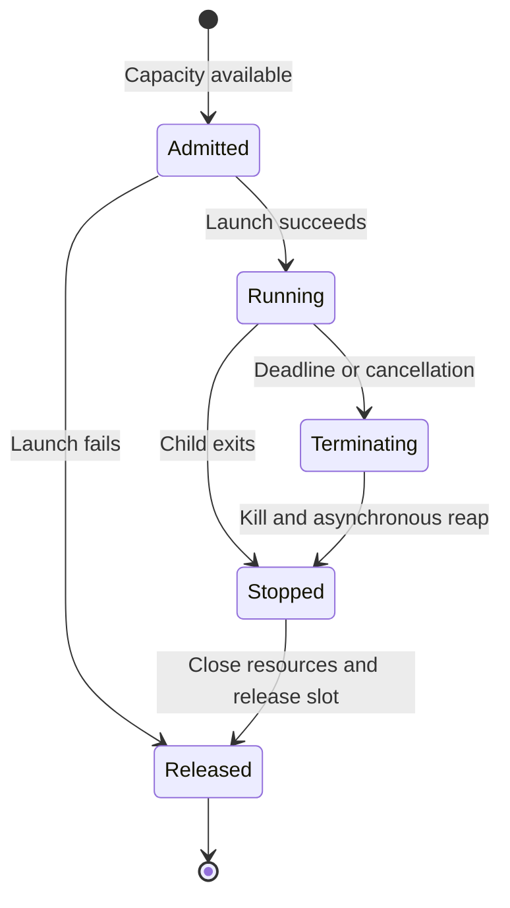

# Bounded coroutine DNS resolution - Plan

## Goal Capsule

- **Objective:** Provider requests and web-push deliveries fail promptly when DNS stalls, while other requests continue and destination restrictions remain effective.
- **Means:** Isolate the existing complete native DNS lookup in a bounded fresh PHP child, carrying the caller's monotonic deadline through resolution and transport (KTD1–KTD4).
- **Authority:** The user's request to continue `ROADMAP.md` selects its bounded coroutine DNS item; the Product Contract owns behavior and the Planning Contract owns implementation choices.
- **Execution:** Implement and qualify on `plan/bounded-coroutine-dns`; the lead records evidence in `ROADMAP.md` and commits locally.
- **Stop conditions:** Stop for an unavoidable weakening of address validation, a required public API/schema change, or a prerequisite requiring live-provider access or local data mutation.
- **Delivery boundary:** Merge and push require a separate request.

---

## Product Contract

### Summary

Give provider and web-push destination resolution a deadline that includes DNS work.
Preserve complete A/AAAA validation and connection pinning while keeping the coroutine worker available during a slow lookup.

### Problem Frame

`PublicDestinationPolicy` runs `dns_get_record` in the calling worker.
`PublicHttpClient` checks its deadline only after that blocking call, and `PushTransport` starts its transport timeout afterwards.
A slow resolver can therefore exceed the intended request budget and delay unrelated coroutines.
The roadmap already records why Swoole's capped address resolver cannot safely replace the complete answer set.

### Requirements

**Deadlines and isolation**

- R1. DNS lookup must yield the coroutine worker while a slow resolver runs, with equivalent bounded behavior outside a coroutine.
- R2. One monotonic request deadline must cover helper startup, DNS, connection and every permitted redirect; no transport starts with an exhausted budget.
- R3. Timeout, cancellation, lookup failure or capacity exhaustion must fail closed without retaining an unbounded population of children, output buffers or waiting requests.

**Destination security and existing behavior**

- R4. Validate every returned A and AAAA address before selecting a connection address, preserving current native family-error semantics and rejecting oversized results rather than accepting a truncated subset.
- R5. Preserve existing URL/host restrictions, private/reserved/transition-address rejection, TLS verification, address pinning, proxy/reuse restrictions, redirect policy and credential-safe failures.
- R6. Preserve provider payloads and existing retry behavior, plus push 404/410 expiry handling; this work introduces no additional retry.

### Acceptance Examples

- AE1. A DNS fixture withholds replies beyond the request budget: the call fails within bounded scheduling tolerance, no HTTP connection starts, and a concurrent heartbeat coroutine continues (R1–R3).
- AE2. A fixture returns many public A records followed by a private address, or public A with private AAAA: destination validation refuses the whole answer (R4–R5).
- AE3. A returns public addresses and AAAA returns a temporary server error: lookup fails; a successful family with definitive no-data in the other retains native behavior (R4).
- AE4. A redirect consumes part of the budget: the next lookup and connection receive only the remainder, including same-origin revalidation (R2, R5).
- AE5. Repeated timeout and cancellation calls leave no live owned children, unreaped results or open output descriptors after cleanup completes; admitted work can resume (R3).

### Scope Boundaries

This change covers the shared public destination policy, its provider HTTP wrapper and web-push transport.
Webhook, operator-configured lyrics, mail, tracing and browser playback retain their separate policies.
No application API, database schema, frontend behavior or production dependency changes are intended.

A new DNS packet parser, third-party event-loop bridge, DNS cache, general process supervisor and deployment containment redesign are considered unnecessary: native lookup already owns answer semantics and existing deployment supervision owns process death.
Revisit these choices only if runtime qualification invalidates the bounded helper approach.

#### Deferred to Follow-Up Work

Live-provider and regional qualification remain separate roadmap work.
The mobile decision remains deferred.

---

## Planning Contract

### Key Technical Decisions

- KTD1. **Keep native answer semantics in a fresh-exec PHP helper** (R1, R4). Run the existing combined A/AAAA lookup through the installed PHP executable and system resolver, without booting Symfony or loading application credentials. PHP 8.5.2 queries each requested family and destroys accumulated answers on temporary/server failure; definitive no-data continues. Swoole 6.2 rejects AF_UNSPEC and caps results, while Amp DNS is development-only and tolerates one-family failures. A helper preserves the established behavior without a new resolver stack.
- KTD2. **Own the direct child in a small DNS-specific adapter** (R1, R3). Follow `WorkerChildProcess` and `LeaseAgentProcess` lifecycle patterns without broadening those primitives. Launch argv directly, with no host interpolation into shell text; temporarily suspend the process hook around a non-yielding launch as `DrainWatchdog` does. Poll status with `Async::sleep`, close/reap only after stopped status, and restore hook flags immediately. Capture a bounded structured reply and reject malformed, nonzero-exit or oversized output. The helper must not spawn descendants.
- KTD3. **Bound admission and cleanup explicitly** (R3). Admit at most eight DNS children per operating-system process, including children awaiting reap, with no waiting queue; share this bound across policy instances and reset inherited accounting by PID. Timeout and cancellation signal the owned child and retain its slot until it is reaped. Cleanup must remain coroutine-aware even after the requesting coroutine is canceled, without blocking `proc_close` on a running child. Use the smallest DNS-specific ownership handoff needed and verify it in the installed runtime. Existing container/supervisor containment owns abrupt parent death; the helper's own finite lifetime limits orphan persistence. This is not a hard real-time guarantee against a stalled kernel or scheduler.
- KTD4. **Pass an absolute monotonic deadline into destination resolution** (R2). `PublicHttpClient` retains its capped request budget across redirects. Push establishes its thirty-second send budget before lookup and gives cURL only the remainder, retaining the existing connection cap. A direct policy call gets a finite default budget; test resolvers remain injectable without becoming a production fallback.
- KTD5. **Keep security classification in the parent policy** (R4–R6). The helper returns only the complete address list or failure. Existing validation remains the single owner of destination classification; no private-address escape hatch or partially validated result is introduced.

### High-Level Technical Design

### Assumptions

The existing Linux PHP/Swoole deployment and executable are the supported runtime for the helper.
Process creation has nonzero overhead; this tradeoff is accepted to retain the complete native answer semantics.
No cross-worker/global admission service is required: the local bound scales with configured worker count and the helper lifetime remains finite.

### Implementation Notes and Risks

Runtime qualification must establish process-hook behavior, cancellation cleanup and native resolver error semantics before the new adapter is accepted.
A fake lookup alone cannot prove coroutine isolation or complete answers.
The exact output limit, polling interval, helper lifetime and cleanup tolerance are implementation details to select explicitly and record with their test evidence.
The output limit must accommodate ordinary complete DNS replies, and overflow must never be converted into success.
No launch-blocking product question remains.

### Sources and Existing Patterns

- `ROADMAP.md`, provider destination policy checkpoint: existing protections and resolver limitations.
- `src/Shared/Infrastructure/Http/PublicDestinationPolicy.php` and `src/Shared/Infrastructure/Http/PublicHttpClient.php`: complete validation, shared redirect deadline and safe errors.
- `src/Notification/Infrastructure/Push/PushTransport.php`: encrypted endpoint pinning, protected cURL options and expiry semantics.
- `src/Shared/Infrastructure/Worker/WorkerChildProcess.php`, `src/Shared/Infrastructure/Worker/LeaseAgentProcess.php`, and `src/Shared/Infrastructure/Swoole/Drain/DrainWatchdog.php`: fresh-exec ownership, bounded reply and process-hook launch patterns.
- [PHP 8.5.2 native DNS implementation](https://github.com/php/php-src/blob/php-8.5.2/ext/standard/dns.c#L824-L936): family iteration and error handling shape KTD1.
- [PHP proc_open](https://www.php.net/manual/en/function.proc-open.php) and [proc_close](https://www.php.net/manual/en/function.proc-close.php): argv bypasses shell parsing and closing a live process waits, shaping KTD2.
- [Swoole 6.2 family validation](https://github.com/swoole/swoole-src/blob/v6.2.0/ext-src/swoole_coroutine_system.cc#L154-L190) and [address limit](https://github.com/swoole/swoole-src/blob/v6.2.0/src/network/dns.cc#L778-L817): capped lookup cannot establish R4.

---

## Implementation Units

### U1. Add bounded native DNS execution

**Goal:** Deliver the DNS-specific adapter and helper under R1, R3–R4 and KTD1–KTD3.

**Dependencies:** None.

**Files:** New `src/Shared/Infrastructure/Http/NativeDnsResolver.php`, `bin/dns-lookup.php`, `tests/Unit/Shared/Infrastructure/Http/NativeDnsResolverTest.php`, and fixtures under `tests/Fixtures/Http/`; root-owned `scripts/backend-native-tests.json`; reuse existing async and hook helpers.

**Approach:** Establish the child protocol, admission ownership and failure cleanup together; keep helper execution independent of application bootstrap.

**Test scenarios:** Complete mixed-family reply and duplicates; nonzero exit, malformed and oversized replies; exhausted capacity and slot recovery; expired deadline before launch; child timeout and caller cancellation; independent resolver instances sharing admission; inherited process accounting reset.

**Execution note:** Start with failing lifecycle and native-runtime coverage; do not infer safety from mocked child results.

**Verification:** Run deterministic tests in the ordinary lane. Register every file that executes actual process or signal lifecycle in the native manifest when introducing it, and run it in the fresh native lane. U3 adds complete native DNS qualification.

### U2. Carry budgets through public destination resolution

**Goal:** Integrate the adapter while preserving R2 and R4–R6 under KTD4–KTD5.

**Dependencies:** U1.

**Files:** `src/Shared/Infrastructure/Http/PublicDestinationPolicy.php`, `src/Shared/Infrastructure/Http/PublicHttpClient.php`, `src/Notification/Infrastructure/Push/PushTransport.php`; `tests/Unit/Shared/Infrastructure/Http/PublicDestinationPolicyTest.php`, `tests/Unit/Shared/Infrastructure/Http/PublicHttpClientTest.php`, `tests/Unit/Shared/Infrastructure/Http/PublicHttpTransportTest.php`, `tests/Unit/Notification/Infrastructure/Push/PushTransportTest.php`, `tests/Unit/Notification/Infrastructure/Push/PushTransportTlsTest.php`, and `tests/Integration/MessengerJsonDeliveryTest.php`; affected manual policy construction in provider tests; DI configuration only if required by existing service discovery.

**Approach:** Replace the synchronous default lookup, pass remaining caller budgets, and adapt injected test resolvers without weakening the destination checks.

**Test scenarios:** AE2–AE4; exhausted DNS budget prevents transport; push timeout shrinks after DNS; direct policy calls remain bounded; existing host, mapped-address, transition-address, TLS, redirect, credentials and expiry cases remain passing.

**Verification:** Focused shared HTTP, provider adapter, push and Messenger delivery tests; container wiring and static analysis.

### U3. Qualify runtime behavior and record delivery

**Goal:** Prove AE1–AE5 in the authoritative image and document the resulting guarantees and limits.

**Dependencies:** U1–U2.

**Files:** New `tests/Unit/Shared/Infrastructure/Http/NativeDnsResolverRuntimeTest.php`; disposable DNS/helper fixtures under `tests/Fixtures/Http/`; root-owned `scripts/backend-native-tests.json` and new `scripts/test-dns-runtime-container.sh`; `docs-book/part-2-developer-guide/testing.md`, `docs-book/part-1-operator-guide/security.md`, `docs-book/part-2-developer-guide/application-threat-model.md`, affected Shared/Metadata/Notification context documentation, and `ROADMAP.md`.

**Approach:** Run actual child lifecycle fixtures in the fresh native lane. Qualify native DNS through a dedicated disposable container drill: root configures only that container's `/etc/resolv.conf` and starts a loopback DNS fixture on port 53; application and helper probes run as `www-data`. The container has networking disabled, so all DNS traffic stays on loopback. This setup exercises the production system resolver without a production test-endpoint option or host resolver changes. The drill owns a bounded run and removes its container and fixtures on every exit. Record final counts, timings, limits and remaining roadmap work; update only the affected DNS claims in the security documents.

**Test scenarios:** Heartbeat proceeds during stalled DNS with process hooks on/off; both-family success, no-data and temporary/server failure; a private answer beyond Swoole's limit is refused; timeout/cancellation stress returns capacity and leaves no owned child or descriptors; helper finite lifetime covers abrupt parent exit in a disposable process; reduced redirect/send budget is observed by the terminal transport.

**Verification:** Native manifest and runner/isolation checks, authoritative backend suites and static gates, affected runtime drills, independent code review, simplification and prose audit.

---

## Verification Contract

Follow `docs-book/part-2-developer-guide/testing.md`; authoritative results come from `baander-ci-prewarm:local` through the repository's container runners.
Run the focused ordinary/native selections first, then all backend lanes through `scripts/test-backend-container.sh` after the implementation stabilizes.
Complete Composer platform checks, PHPStan, Deptrac, container lint and OpenAPI drift in the CI image.
Run native manifest/runner/isolation regression checks when adding process or signal tests in U1 and the fresh-runtime test in U3.
Run the dedicated DNS container drill in the same authoritative image; the native lane runs as `www-data` and cannot configure its own system resolver.
Run the affected production security and web-runtime drills with disposable infrastructure; add worker drills only if implementation reaches their lifecycle code.
No web behavior or generated API contract is intended, so web-suite repetition requires a resulting frontend or API change.

Assertions must inspect actual transport calls, remaining budgets, child ownership and coroutine progress, rather than elapsed time alone.
Use `baander.app` hosts and loopback-only peers; no live provider, production DNS or development database mutation is authorized by this plan.
Record real timings, counts, initial failures and justified omitted gates in `ROADMAP.md`.

---

## Definition of Done

- R1–R6 and AE1–AE5 have direct coverage, including actual runtime proof for the helper lifecycle.
- U1–U3 leave one complete validated address set, one caller deadline and bounded owned resources on success and failure.
- All applicable authoritative checks pass; independent review findings are resolved and the final diff is scoped to this item.
- Documentation and roadmap state the implemented behavior, resource/deadline limits, qualification evidence and remaining work.
- Disposable test resources are removed and the finished work is committed locally on the named branch.
