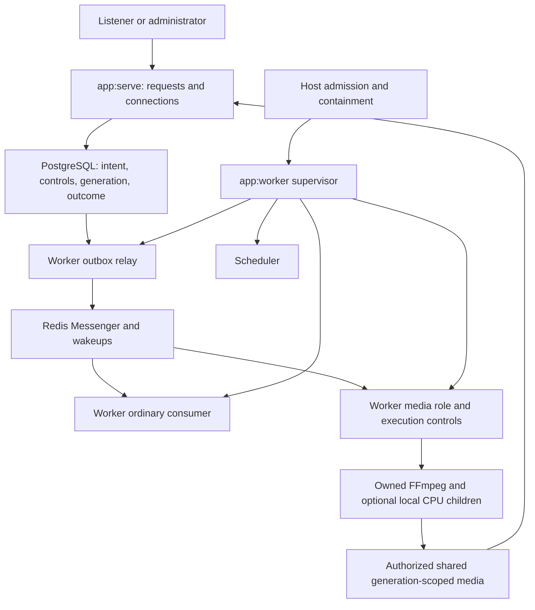
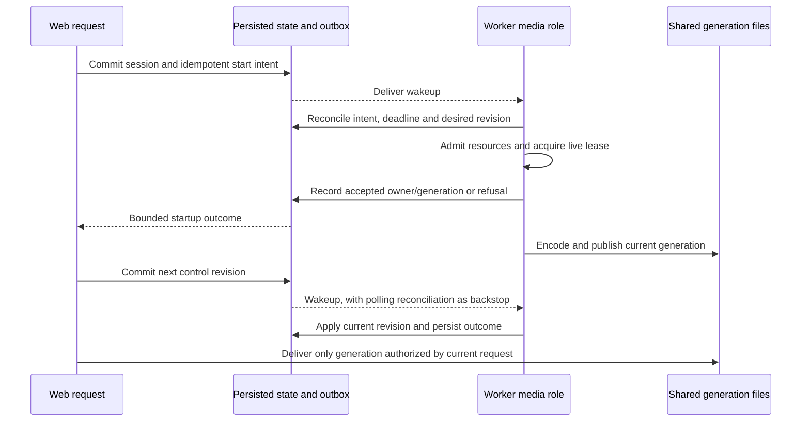
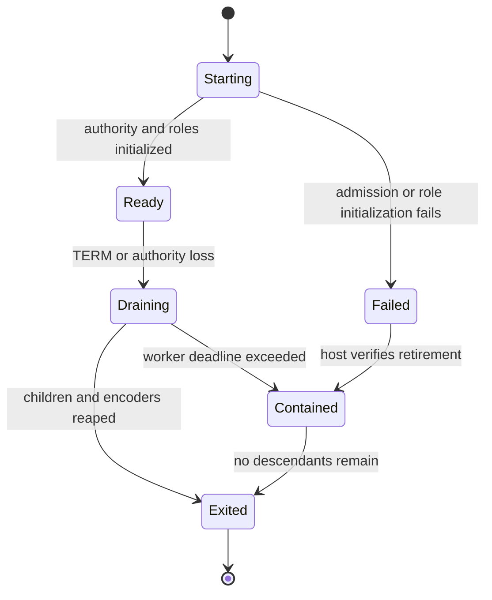
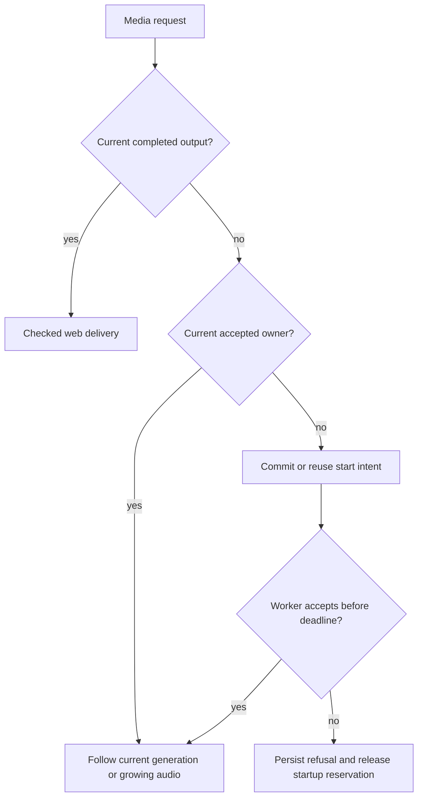

# Two-command deployment - Plan

## Goal Capsule

- **Objective:** Operators can run and replace Baander's web service independently of background processing while listeners continue to receive correctly published media.
- **Means:** Complete the existing web/worker ownership split through domain-specific durable handoffs (KTD1–KTD5, KTD8).
- **Authority:** The current request and `ROADMAP.md` govern scope; its first unchecked worker architecture item is the delivery target. The media boundary in `docs/plans/2026-07-17-001-feat-messenger-enterprise-hardening-plan.md` supplies the existing correctness contract. Current containment and health-monitor decisions remain binding.
- **Execution profile:** Local implementation and commits on `plan/two-command-deployment`; use disposable services and fixtures for checks. The lead integrates, runs authoritative gates and records evidence in `ROADMAP.md`.
- **Stop conditions:** Preserve local media, databases, services and volumes. No live provider/region operations, merge or push are authorized. Report an unmet acceptance condition rather than checking off partial ownership.

---

## Product Contract

### Summary

Make `app:serve` own HTTP, WebSocket/SSE connections and media delivery, and make `app:worker` own queued execution, scheduling, relay, media execution and its control services.
Prove the split using independent production processes, real FFmpeg output and host-controlled worker retirement.

### Problem Frame

The production entrypoints already use two commands, but their names overstate the separation.
The worker starts a consumer, outbox relay and scheduler; web still starts task workers, six CPU children, video FFmpeg loops, audio encoding and some detached background work.
An operator therefore cannot reason about background execution or replace web independently from the processes producing media.
The current strict worker recipe also forbids mounts, so it cannot yet access authorized source files or publish files that web can deliver.

### Requirements

**Ownership and lifecycle**

- R1. Web owns connection handling, authorization, synchronous request work and delivery; worker owns consumers, scheduler, outbox relay, background media work and execution control.
- R2. Production web starts no task-worker pool, CPU pool, FFmpeg encoder, hardware-probing subprocess or detached background conversion, and has no local execution fallback when worker ownership is unavailable.
- R3. Worker owns and accounts for every execution descendant, closes admission before draining, and reaps or externally contains all descendants before replacement.
- R4. Keep the existing host-authorized immutable-container admission, private PID namespace, manual recovery and 35-second worker drain boundary; workers receive no Docker authority or automatic container restart.

**Media correctness**

- R5. Persist a transcode session and its start intent in the same commit, and report accepted startup only after a worker owns its execution; absence/refusal follows the existing bounded startup-unavailable response.
- R6. Persist authoritative media state with ordered controls and a session generation, so seek, pause, resume, cancellation and reattachment reach the current leased worker owner across web processes.
- R7. Publish and deliver media within its current generation, so a stale encoder or old request cannot expose segments from before a seek or restart.
- R8. Preserve cached audio delivery, growing-rendition streaming, duplicate convergence, completed-file publication and explicit encoding failure across the process boundary.
- R9. The first supported deployment shares explicitly authorized source and derived-file storage on one host, with identical container paths and least required access for each role.

**Existing interfaces and proof**

- R10. Preserve typed recommendation admission results, requeue behavior and CLI success semantics while moving computation to worker ownership; move existing asynchronous handler routes together with their registrations.
- R11. Keep connection control, drain behavior and the accepted web health monitor in web, and report each role's actual execution state without fictitious web pools.
- R12. Prove ownership, live delivery, cross-process controls, restart and descendant cleanup with disposable runtime drills before closing the roadmap item.

### Scope Boundaries

This plan delivers the first unchecked worker architecture item, including the correctness needed to make ownership real.
It changes media persistence and delivery identity only where R5–R8 require them.
Explicit foreground maintenance commands retain their shared application execution paths and monitored completion semantics; they are not web background fallbacks.
It does not introduce a generic remote process-pool API: the repository has three concrete CPU caller families, each with a domain-specific execution path.
It does not relocate the web health monitor or request-scoped bounded DNS helpers; their lifecycle remains part of serving and observing web.

#### Deferred to Follow-Up Work

- The remaining roadmap items for complete route/resource classification, workload matrices and global autoscaling policy.
- Hardware-device, multi-host, live-region, codec/load and saturation qualification beyond the CPU-only ownership acceptance topology.
- Broader resource tuning and new operator automation; this work adds only reservations and descendant bounds required to admit the moved roles.

### Acceptance Examples

- AE1. **Covers R1–R4, R11–R12:** Start web without worker, request uncached media and inspect all web descendants; startup fails within its documented bound and no background executor appears, while direct delivery and web health remain available.
- AE2. **Covers R5–R9, R12:** Start admitted worker and web with disposable shared volumes; simultaneous requests through separate web workers converge to one encoder, and web delivers decodable worker-produced video and growing audio.
- AE3. **Covers R6–R7, R12:** Seek, pause/resume, cancel and reattach through a different web worker; ordered persisted state controls the leased encoder and old-generation media cannot be delivered as current.
- AE4. **Covers R3–R4, R8, R12:** Stop/restart web during media production, then retire worker during encoding; web replacement leaves worker execution intact and retirement leaves no encoder or CPU descendant alive.
- AE5. **Covers R10–R11:** Queue a recommendation and an image conversion; callers receive their documented typed response while worker processes execute the work and web diagnostics describe only web processes.

---

## Planning Contract

### Verified Baseline

`WorkerSupervisorRunner` currently declares only consumer, relay and scheduler roles, and `WorkerCommand` explicitly excludes media.
`config/packages/messenger.yaml` still routes background work through `swoole_task`, with transport-specific handler attributes.
`config/services.yaml` boots `CpuProcessPool` and `HardwareCapabilitiesProber` inside web.
`ImageController` additionally uses detached conversion coroutines outside the pool.

`CreateTranscodeSessionHandler` currently acquires a live Redis lease before invoking a local `TranscodeSessionSubscriber` coroutine.
That lease deliberately forbids serialization, and `SeekSignalBroker` uses process-local channels.
The loop loads job/session objects once, so persisting cancellation alone does not stop it.
`SegmentAvailabilityTable` and CPU tables/pipes are inherited Swoole state; neither crosses independent containers.
CPU result files default to private `/tmp`, while HTTP segment delivery already has a checked filesystem fallback.

### Key Technical Decisions

- KTD1. **Use domain messages, not remote pool RPC.** Govern R1–R2 and R10 through existing Redis Messenger/JSON codec patterns. Ordinary background work, recommendations and image derivatives use worker consumers; video orchestration and audio execution use a dedicated coroutine-capable media role under `WorkerSupervisorRunner`. Keep a CPU pool only inside that media role if its existing video helpers still require concurrency.
- KTD2. **Persist video intent and controls before notification.** Govern R5–R6 through the existing `TransactionPortInterface` and one Transcode-owned per-job runtime row. Store session identity, the full desired-state snapshot, desired/observed revisions, execution generation, validated worker launch identity, claim token, database-clock lease expiry and acceptance/outcome there. Keep this runtime adapter separate from generic ORM aggregate saves. Synchronous request admission assigns revisions before returning; Redis/outbox notifications only wake a bounded database reconciler. Request identifiers make replay converge; a handoff deadline and terminal refusal prevent a timed-out request from becoming an unobserved late start.
- KTD3. **Fence publication by generation.** Govern R6–R7 by including the persisted generation in output directories, readiness state and media URLs/validation. The current worker owner checks its lease and revision before state/publication effects. An old FFmpeg may write only its old directory; it cannot advance the current generation. Persist the worker's resolved encoder/capability snapshot with acceptance, and build manifests from that snapshot rather than web environment defaults or lazy probing. Manifest, init and segment requests must agree on generation. Notify connected clients of committed generation changes through existing shared realtime delivery; an attached player reacquires the signed current manifest and restores authoritative position/paused state while ignoring superseded reloads. Existing canonical path, regular-file and file-stability checks remain required.
- KTD4. **Admit explicit shared storage.** Govern R4 and R9 by extending the host operator manifest, immutable recipe fingerprint and containment inspection together. The initial supported profile uses explicitly named local Docker volumes: worker source access is read-only, while derived-file/state/media-storage access is writable where execution requires it. Preserve existing authorized web/CLI source deletion. Restrict fixed targets outside executable code, configuration, secrets, control sockets and Docker paths. Reject unlisted volumes, driver options, bind mounts and devices. Inspect the concrete volume identity and access mode before admission or recovery; a changed recipe requires a new admitted deployment.
- KTD5. **Keep admission and cleanup inside worker authority.** Govern R3–R5 and R8 by reserving media-role memory and descendant capacity before launch. Media readiness means the role has obtained authority, initialized its transport/control state and can admit work, not merely that its PID exists. Close media admission on lease loss or drain, stop/reap owned FFmpeg and pool children, then let existing host containment enforce the final deadline. Keep control reconciliation runnable while encoders consume their admitted capacity.
- KTD6. **Separate recommendation admission from execution.** Govern R10 by retaining synchronous lightweight web creation of `RecommendationGenerationResult`, then queueing an identifier-only execution message and running the existing computation in a worker. Preserve requeue's handled-result contract. The default maintenance CLI continues monitored foreground execution through the shared application use case, preserving completed counts and completion-based exit status. Resolve database credentials in the executing process rather than serializing the current pool payload's connection URL; add no new queue-mode flag for this task.
- KTD7. **Retire misleading web diagnostics.** Govern R11 by removing the retired `task_workers` and `transcode_pool` sections from web control results, CLI rendering and web UI types/components. Keep web connection/debug commands on their existing UNIX socket. Expose worker readiness through existing worker/deployment authority surfaces rather than sending worker commands to the web socket.
- KTD8. **Give audio its own durable rendition authority.** Govern R8 through a separate Transcode-owned `audio_rendition_runtime` table keyed by the existing full canonical rendition identity: track key plus source-signature filename, format and bitrate. Keep its validated immutable input snapshot, pending/running/complete/failed state, execution generation, worker claim/lease, accepted partial/final paths and terminal error in that row. Concurrent admission inserts once; a bounded database reconciler recovers pending/expired work independently of Redis. A worker claims under the row lock, then acquires the existing canonical filesystem lock nonblocking before publishing its running path or encoding. A busy lock returns the claim to pending for bounded retry. Each attempt writes only its generation directory; terminal publication uses owner/generation/live-lease fencing. Web follows the accepted row's paths and pins the generation at first byte, failing on ownership/generation loss rather than concatenating a successor's bytes. Completed-file range delivery remains available.

Any retained media CPU pool boots before opening database or Redis connections; its children must not inherit live Doctrine or Redis clients from a booted application runtime.
Use fresh executable children if that invariant cannot be established with the current bootstrap.

The alternatives do not require a prototype bake-off: inherited pool pipes/tables rule out cross-container reuse, while explicit existing handlers and Redis transport support the selected domain handoffs.
Moving only service tags or publishing queue messages without durable acceptance cannot satisfy R5–R8.

### High-Level Technical Design

### Assumptions

- The ownership acceptance topology uses CPU encoding and explicitly named local Docker volumes. This is an implementation default for qualification, not a claim that device or host-bind support has been qualified.
- Existing public startup-unavailable and audio busy/error mappings remain the default; exact timeout values are read from their current sources before implementation and named in the new acceptance tests.
- No new global capacity policy is needed to move the fixed roles. Existing authority/reservation mechanisms are extended only for their real resource and descendant cost.

### Risks and Execution Decisions

Media persistence changes require the PostgreSQL specialist, the PostgreSQL remediation skill and fresh-install verification.
Preserve the delivered `migrations/Version20261017000000.php` and add a forward migration for the runtime tables; verify both fresh bootstrap and upgrade from the delivered schema in disposable databases.
Preserve local data and never reset the development database.
The transaction must not remain open while waiting for worker startup.
On refusal or deadline expiry, reconcile any startup-only budget allocation and accepted owner before returning the existing failure response.

The runtime row is the media authority; a PostgreSQL-backed lease adapter replaces Redis authority for moved loops rather than introducing two authoritative lease clocks.
Expose the complete job/session, claim, execution generation and desired revision through a new Transcode execution-ownership port and immutable claim value; a worker-local handle performs renewal/release.
Retire the old Redis execution-lease aliases after their callers move.
Acquire its row lock before reading `clock_timestamp()` and judging expiry.
Guard progress, failure, release and publication by job/session, claim token, execution generation, live lease and the applicable desired revision.
Keep FFmpeg and filesystem work outside the transaction; immutable generation directories prevent a stale writer from overwriting a successor after a database check completes.
For first admission, retain the unique video/tier constraint and retry the whole short transaction after a conflicting insert, clearing the unit of work rather than issuing SQL inside an aborted transaction.

The most serious execution risk is a false successful handoff: queue acceptance, an expired lock or a file's existence does not prove an owned encoder.
Tests must inspect committed acceptance, full process ancestry and generation-consistent publication.
Keep host retirement as the old-boot containment boundary and retain generation fencing for local lease turnover.

### Sources and Research

- `ROADMAP.md`, “Worker architecture and resource control”: narrow delivery target and later open items.
- `docs/plans/2026-07-17-001-feat-messenger-enterprise-hardening-plan.md`, “Runtime ownership” and “Media boundary”: existing cross-process and media correctness contract.
- `dev-docs/worker-runtime-inventory.md`: current ownership and explicitly unsupported media mounts.
- `docs-book/part-1-operator-guide/commands/README.md` and `docs-book/part-1-operator-guide/commands/app-worker.md`: immutable host admission, PID 1, worker drain and manual recovery.
- `docs/solutions/runtime-errors/inline-messenger-run-must-name-the-routed-transport.md`: preserve handler selection when routes change.
- `docs/solutions/architecture-patterns/health-checks-run-in-a-messenger-consumer-cannot-see-outages-that-stop-it.md`: preserve the accepted web health monitor.
- `docs/solutions/runtime-errors/swoole-sigterm-waits-for-master-timers-and-closes-connections-before-workers-stop.md`: preserve web drain and connection semantics while removing pool cleanup.

---

## Implementation Units

### U1. Admit the shared media topology

**Goal:** The host admits exactly the storage and resource layout the worker needs.
**Requirements:** R3–R4, R9; KTD4–KTD5.
**Dependencies:** None.
**Files:** `src/Shared/Infrastructure/Worker/DeploymentOperatorManifest.php`, `src/Shared/Infrastructure/Worker/DeploymentContainerRecipe.php`, `src/Shared/Infrastructure/Worker/DockerWorkerContainment.php`; `src/Shared/Application/DTO/WorkerRuntimeConfiguration.php`; `tests/Unit/Shared/Infrastructure/Worker/DeploymentContainerRecipeTest.php`; add `tests/Unit/Shared/Infrastructure/Worker/DeploymentMediaMountsTest.php`; affected operator/containment fixtures.
**Approach:** Extend the versioned manifest, recipe identity, inspect matching and role reservations as one contract. Resolve configured library roots, `CONVERT_STORAGE_PATH`, `var/transcode_state`, `storage` and `storage/media` into explicit shared mounts. Separate read-only worker source access from writable derived storage and preserve existing authorized web/CLI library deletion. Keep private worker scratch/results private when web does not consume them.
**Test scenarios:** Admit the declared local volumes and modes; reject target overlap, writable source, unlisted volume, driver options, bind/socket/code mount and devices. Changing a source identity or mode invalidates the recipe. Insufficient role/descendant reservations reject before launch; recovery rejects a mismatched existing container.
**Verification:** Focused manifest/recipe/containment tests and disposable operator drill after U7 integration.

### U2. Move ordinary background execution and preserve admission results

**Goal:** Background messages, recommendation computation and image derivatives execute under worker ownership.
**Requirements:** R1–R2, R10; KTD1, KTD6.
**Dependencies:** U1 for final runtime integration; message design can proceed independently.
**Files:** `config/packages/messenger.yaml`; affected transport-specific handler attributes; `src/Recommendation/Application/CommandHandler/GenerateRecommendationsHandler.php`, `src/Recommendation/Application/CommandHandler/RequeueRecommendationJobHandler.php`; Recommendation execution message/handler/codec to add; Recommendation admin controller and generate command; `src/Media/Interface/Controller/ImageController.php`; Media image-derivative message/handler/codec; `src/Shared/Infrastructure/Messenger/SwooleTaskWithRedisFallbackSender.php`; `tests/Functional/Recommendation/RecommendationPoolWorkerTest.php`; `tests/Unit/Shared/Infrastructure/Messenger/SwooleFallbackHandlerRegistrationTest.php`; add `tests/Functional/Recommendation/RecommendationWorkerAdmissionTest.php`, `tests/Functional/Media/ImageDerivativeWorkerTest.php`.
**Approach:** Move production `swoole_task` routes and restricted handler registrations together. Split recommendation web admission from shared computation under KTD6, retaining the default CLI's inline job-monitor entrypoint and retiring obsolete pool code once callers move. Replace detached image conversion with a domain job and retain original-image response while conversion is pending. Audit any other detached producer found in this bounded ownership inventory.
**Test scenarios:** Every moved family resolves a handler on its actual worker transport; representative messages execute once with existing retry semantics. Recommendation HTTP creation and requeue return typed results; default CLI execution reports completed counts and keeps completion/failure/cancellation exit semantics. Image requests return the original before publication and converge on one correctly published derivative. Failed enqueue reports failure and never runs computation in web.
**Verification:** Focused handler registration, recommendation, media and JSON-codec suites.

### U3. Persist media admission, revisions and publication generation

**Goal:** Media state and durable execution intent survive independent processes and retries.
**Requirements:** R5–R8; KTD2–KTD3, KTD8.
**Dependencies:** U1 defines topology; independent of U2.
**Files:** `src/Transcode/Domain/Model/TranscodeJob.php`, `src/Transcode/Domain/Model/TranscodeJobState.php`, `src/Transcode/Domain/Model/TranscodeSession.php`, `src/Transcode/Domain/Model/TranscodeSessionState.php`; Transcode Doctrine repositories; new `src/Transcode/Infrastructure/Doctrine/TranscodeRuntimeState.php`, `src/Transcode/Infrastructure/Doctrine/AudioRenditionRuntime.php` and one forward migration for both tables; `src/Transcode/Application/CommandHandler/CreateTranscodeSessionHandler.php`, update/pause/resume/cancel handlers; `src/Transcode/Infrastructure/Messaging/TranscodeMessagePayloadCodec.php`; new `src/Transcode/Application/Port/TranscodeExecutionOwnershipPort.php`, audio runtime port and claim DTO/worker-local lease handles; `tests/Integration/TranscodeSessionOwnershipPersistenceTest.php`; add `tests/Integration/TranscodeExecutionIntentTest.php`, `tests/Integration/TranscodeControlRevisionTest.php`, `tests/Integration/TranscodeRuntimeLeaseTest.php`, `tests/Integration/AudioRenditionRuntimeLeaseTest.php`; fresh-bootstrap/history guard tests.
**Approach:** The PostgreSQL specialist owns both runtime tables, their adapters/ports and migration in this persistence unit; agree the consumed interfaces with U4/U5 before edits. Add a job-keyed video runtime table with session FK, bounded desired state/profile/position, desired/observed revisions, execution generation, existing validated launch-identity fields, per-claim token, lease expiry and update time under KTD2, plus the distinct audio table under KTD8. Use existing transaction/outbox patterns on the same connection for aggregate flushes and runtime mutation. Preserve public transport identities; acquire the live runtime lease only inside the worker. Cancellation stays terminal and a seek while paused keeps the paused desired state.
**Execution note:** Establish transaction, duplicate and race regression coverage before changing the current handoff.
**Test scenarios:** A second connection sees neither session nor intent before commit and both afterward; forced session/intent/outbox failure rolls everything back and clears the unit of work. A crash after commit before Redis notification is recovered by database polling. Concurrent first starts and repeated attachment converge to one generation. Reversed wakeups retain the latest committed control, seek while paused stays paused, and cancel before start prevents encoding. Expiry is denied after waiting for a row lock. Stale owners cannot write progress/failure/readiness or release a successor. Request expiry racing acceptance leaves no startup allocation leak. Fresh migrations and migration-history guards preserve existing constraints.
**Verification:** Disposable PostgreSQL integration tests, migration/fresh-install gate and affected aggregate tests; no development DB mutation.

### U4. Run video execution and controls in the worker media role

**Goal:** A supervised worker role owns video probing, loops, controls, local CPU helpers and encoder cleanup.
**Requirements:** R1–R7, R12; KTD1–KTD3, KTD5.
**Dependencies:** U1, U3.
**Files:** `src/Shared/Infrastructure/Worker/WorkerSupervisorRunner.php`; `src/Shared/Interface/Console/WorkerCommand.php`; new worker media command/runtime; `src/Transcode/Application/Port/TranscodeLoopStarterInterface.php`; `src/Transcode/Infrastructure/Swoole/TranscodeSessionSubscriber.php`, `src/Transcode/Infrastructure/Swoole/SeekSignalBroker.php`, `src/Transcode/Infrastructure/Swoole/TranscodeStreamManager.php`, `src/Transcode/Infrastructure/Swoole/TranscodeProcessPool.php`, `src/Transcode/Infrastructure/Swoole/JobStatePersister.php`; Transcode storage/streaming adapters and manifest/segment controllers; `src/Transcode/Infrastructure/QoL/StreamCompletionListener.php` and execution-control startup wiring; `ui/web/src/features/catalog/hooks/useBaanderPlayer.ts`; `ui/web/src/features/catalog/components/MoviePlayerOverlay.tsx`; `tests/Unit/Transcode/Infrastructure/Swoole/TranscodeLoopOwnershipTest.php`, `tests/Unit/Transcode/Infrastructure/Swoole/TranscodeStreamManagerOwnershipTest.php`; add `tests/Integration/TranscodeWorkerControlTest.php`, `tests/Integration/TranscodeGenerationDeliveryTest.php`, `ui/web/src/features/catalog/hooks/__tests__/useBaanderPlayer.test.ts`.
**Approach:** Initialize a coroutine-capable media role under the existing supervisor authority protocol. Replace local Redis-lease transfer/channel ownership with worker-local handles to KTD2's PostgreSQL authority; receive wakeups and reconcile current state without requiring an encoder slot for controls. Apply KTD3 through resolver, manifest/init/segment, audio and subtitle identity and publication checks. Move only execution QoL services; keep web health, connection and drain controls under R11. Keep media execution generations distinct from deployment/worker launch generations.
**Test scenarios:** Worker readiness waits for authority and initialized admission. Any retained forked pool starts before live database/Redis clients exist, and each executing process opens its own connections. Duplicate starts acquire one owner; stale/deadline-expired intents cannot launch. Controls from another process apply in order, including pause/resume, seek, final-session end and cancel. Old callbacks cannot stop replacement encoders; old generations cannot satisfy current manifest/init/segment requests. An attached client resumes the current signed generation after seek/recovery, preserving paused state and position even when reloads complete out of order. Manifest codec metadata matches the worker-resolved encoder and web performs no lazy capability probe. Lease loss and TERM stop/reap real descendants, including pool helpers and stubborn FFmpeg. Reattachment/recovery uses persisted state and cannot duplicate the active encoder.
**Verification:** Focused loop/control/publication suites plus real U7 live/restart/retirement acceptance.

### U5. Execute audio renditions in the worker

**Goal:** Web follows worker-produced audio without owning the encode or relying on private pool results.
**Requirements:** R2–R5, R8–R9; KTD1, KTD5, KTD8.
**Dependencies:** U1, U3, U4.
**Files:** `src/Transcode/Infrastructure/Transcode/AudioRenditionCache.php`; `src/Transcode/Infrastructure/Swoole/AudioRenditionPoolWorker.php`; new audio admission/execution/result application adapters consuming U3's audio runtime port; Transcode codec and media-role routing; `tests/Unit/Media/AudioRenditionCacheTest.php`; `tests/Functional/Media/AudioTranscodeStreamTest.php`, `tests/Functional/Media/AudioTranscodeToggleTest.php`; add `tests/Integration/AudioRenditionWorkerHandoffTest.php`.
**Approach:** Consume U3's specialist-owned rendition claim adapter and agreed interfaces. Refactor the existing encoder around KTD8 and make web admission/following use its current accepted row. Eliminate web CPU dispatch and non-coroutine inline fallback. Keep an audio encode's lifecycle tied to its admitted shared cache work rather than adding new client-disconnect cancellation behavior.
**Test scenarios:** Completed cache delivery requires no execution. Concurrent misses insert one pending row and converge across web workers. Source fingerprint changes select a distinct key and the worker validates its input snapshot before encoding. Commit-before-wakeup failure recovers through polling; an occupied flock never becomes fake completion or duplicate encoding. A crash after rename but before completion update reconciles idempotently. Partial/final rename races retain byte correctness. Stale owners cannot publish outcome/paths or delete successor files, and a reader pinned to a failed/replaced generation errors without mixing bytes. Startup refusal, worker death, FFmpeg failure and missing completion produce bounded existing errors; complete range requests retain behavior. Worker drain closes admission and leaves no audio encoder alive after retirement.
**Verification:** Focused audio suites and real growing-audio acceptance in U7.

### U6. Remove web executors and update truthful diagnostics

**Goal:** Production web wiring and its public diagnostics match its delivery role.
**Requirements:** R1–R2, R11; KTD1, KTD7.
**Dependencies:** U2–U5.
**Files:** `config/services.yaml`, `config/packages/swoole.yaml`; web execution/bootstrap and pool drain/shutdown adapters; `src/Shared/Infrastructure/Swoole/Control/Operation/DebugWorkersOperation.php`; `src/Shared/Interface/Console/ServerWorkersCommand.php`; `ui/web/src/features/admin/api/debug-api.ts`; `ui/web/src/features/admin/components/diagnostics/WorkerPoolsSection.tsx`; `ui/web/src/features/admin/pages/__tests__/ServerDiagnosticsPage.test.tsx`; affected worker/pool/QoL wiring tests; add `tests/Functional/WebExecutionOwnershipTest.php`.
**Approach:** Remove web task-worker, CPU-pool and hardware-prober boot hooks after all callers move. Retire obsolete fallback senders/handlers and web pool shutdown responsibilities. Apply KTD7 across actual CLI/API/UI consumers and regenerate exported schemas/clients if their contract changes. Keep the existing health monitor, web service-memory reporting and connection/drain lifecycle intact.
**Test scenarios:** Web kernel and production entrypoint start no background pool/prober/task executor. Web-only uncached requests fail without execution; cached/direct delivery works. Diagnostics omit retired sections consistently in CLI and UI. Existing health outage/alert behavior, connection controls, reload and drain still pass with no worker dependency.
**Verification:** Wiring/diagnostic tests, affected frontend tests/type/lint, generated-contract checks and updated web runtime/shutdown drills.

### U7. Prove independent production ownership end to end

**Goal:** A disposable production drill establishes the actual two-command contract.
**Requirements:** R1–R12; AE1–AE5.
**Dependencies:** U1–U6.
**Files:** Add `scripts/test-two-command-deployment-container.sh` and `tests/Fixtures/Worker/two-command-deployment.php`; `scripts/test-worker-command-container.sh`, `scripts/test-worker-production-container.sh`, `test-worker-operator-container.sh`; `scripts/test-web-runtime-container.sh`, `test-web-shutdown-container.sh`; `.forgejo/workflows/ci.yaml`; `scripts/backend-native-tests.json` for any new native tests.
**Approach:** Use disposable PostgreSQL/Redis, authorized scratch volumes and locally generated FFmpeg fixtures. Start actual immutable production worker and web entrypoints separately; use bounded HTTP clients, database assertions and container/PID ancestry evidence. Update fixed role counts and readiness assertions in existing worker drills. Replace web-shutdown assertions about a nonempty web CPU pool with worker independence and preserved web drain assertions.
**Execution note:** Prefer production runtime smoke evidence for this packaging and ownership unit; class mocks cannot establish ancestry or cleanup.
**Test scenarios:** Exercise AE1–AE5, real representative background execution, live init/segment decoding, ordered controls, duplicate attachment, generation rejection, worker absence and dependency failure. Keep a real attached playback client across seek and worker recovery, proving it resumes the current generation with its prior paused/position state rather than merely decoding a fresh manifest in isolation. Restart web while encoding, then explicitly recover worker only after old-container containment. TERM during video/audio work and force a stubborn descendant through the existing deadline; verify no survivors. Reject a drifted shared-volume recipe and prove worker has no Docker authority. Every failure path must still clean only its disposable project and volumes.
**Verification:** New combined drill plus affected worker command/production/operator/containment/recovery/retirement and web runtime/shutdown drills, serialized when they share resources. Preserve legacy redelivery coverage for its own contract.

### U8. Publish accurate local acceptance records

**Goal:** Operators and maintainers can follow the implemented topology and identify remaining work.
**Requirements:** R4, R9, R11–R12.
**Dependencies:** U7 and authoritative gates.
**Files:** `README.md`; `docs-book/part-1-operator-guide/getting-started.md`, `docs-book/part-1-operator-guide/upgrading.md`, `docs-book/part-1-operator-guide/transcoding.md`; `docs-book/part-1-operator-guide/commands/README.md`, `docs-book/part-1-operator-guide/commands/app-worker.md`; `dev-docs/worker-runtime-inventory.md`; `docs-book/part-2-developer-guide/testing.md`; `CONCEPTS.md` if generation/worker lifecycle terms require definitions; `ROADMAP.md`.
**Approach:** Document actual role startup, immutable storage admission, bounded failures, media ownership and explicit retirement/recovery. Remove stale application-Supervisor and web-encoding claims. Preserve the glossary meaning of web “Drain” and “Worker reload.” Record each delivered unit and its exact verification checkpoint; check off only the first worker item when R12 passes.
**Test expectation:** No new tests for prose. Validate generated command documentation against current CLI sources and use prose-fix preservation audit plus repository documentation checks.
**Verification:** Documentation/source reconciliation, link/path checks, `git diff --check`, and the final evidence ledger.

---

## Verification Contract

The authoritative runtime is the current CI image with locked Composer dependencies, as documented in `docs-book/part-2-developer-guide/testing.md`.
Use `scripts/test-backend-container.sh` for focused files during units and all four backend suites at the final checkpoint.
Add native process tests to `scripts/backend-native-tests.json`; use the disposable integration lanes for PostgreSQL/Redis assertions.

| Gate | Applies to | Required evidence |
|---|---|---|
| Focused backend container suites | U1–U6 | Passing relevant unit, integration and functional assertions; record counts |
| Fresh-install/schema checks | U3 | Constraints, mappings and session/intent transaction verified in disposable PostgreSQL |
| Combined deployment drill | U7 | Actual commands, immutable image, shared media, decoded output, PID ancestry, controls and zero surviving descendants |
| Existing affected runtime drills | U7 | Worker authority/lease/retirement and web outage/reload/drain behavior preserved |
| Full backend coordinator | Final | All discovered files covered exactly once; suite counts and no hidden failures |
| PHPStan and Deptrac in CI runtime | Final | Both pass without baseline expansion |
| Composer platform, container lint and OpenAPI drift | Final | Locked platform requirements, service wiring and exported API generation agree with the changed source |
| Affected frontend and exported contract checks | U6/final | Type/lint/tests pass; generated artifacts match source if changed |
| Documentation and diff checks | U8 | Prose preservation, truthful commands, no whitespace errors |

Read `.forgejo/workflows/ci.yaml` and current Make/runner targets for exact authoritative gate invocations before running them.
Keep full logs outside the checkout and record concise counts/statuses in `ROADMAP.md`.
No publication or live infrastructure validation is part of these gates.

---

## Definition of Done

- Every U1–U8 outcome has its required evidence, with R1–R12 established by the relevant tests and production drill.
- Every moved executor and inline fallback is removed from production web; obsolete services, messages, pool workers and experimental approaches are removed when unused.
- Persisted admission, controls and generations pass duplicate, timeout, cancellation and stale-writer cases without leaking allocations or encoders.
- The actual worker roles report authoritative readiness and fit their admitted memory/PID envelope; existing host containment remains effective.
- Web health, connection control, delivery, reload and drain retain their accepted behavior.
- Documentation describes only verified behavior, and `ROADMAP.md` records delivered units, counts, static gates and residual qualification limits.
- The first worker architecture checkbox is complete only after its end-to-end proof passes; later worker architecture checkboxes remain open.
- Changes and commits stay local until a separate request authorizes merge or push.
