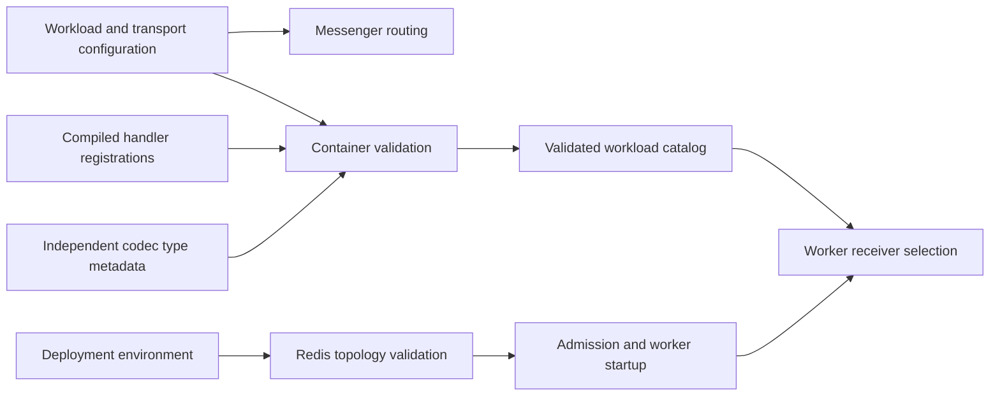

# Validated asynchronous routes - Plan

## Goal Capsule

**Objective:** Operators can start a worker knowing that every configured queued message can be decoded and handled on its intended queue, under a distinct consumer identity.

**Means:** One workload catalog, compiled-container validation and deployment transport validation (KTD1–KTD4).

**Authority:** The next unchecked worker architecture item in `ROADMAP.md` defines scope. Project instructions and current source govern implementation; the older Messenger redesign supplies context where it still applies.

**Execution:** Complete the units on `plan/validated-async-routes`, verify in the CI image, apply independent review findings and commit locally. Merge and push require a separate request.

**Stop conditions:** Preserve local application databases and running services. A change requiring a new queue topology or a new capacity policy belongs to the later roadmap items.

---

## Product Contract

### Summary

Validate asynchronous message routes, resource classes, registered handlers, independent JSON codecs and retry policies together. Prevent transport configuration from overriding admitted consumer identity.

### Problem Frame

The two-command deployment already moves background work to the worker. Its fifteen default production routes live separately from codec registrations and handler restrictions. Lyrics fetching also selects the asynchronous transport explicitly while retaining synchronous callers. Missing or inconsistent registrations can therefore survive configuration review and fail only when work arrives. Redis DSN path and query values can also override the consumer identity supplied by the launcher.

### Requirements

#### Message configuration

- R1. Every production asynchronous message has one permitted asynchronous transport, a default or explicit-only dispatch mode, one supported resource class, one wire-codec mapping and at least one handler eligible for its bus and transport.
- R2. Container compilation rejects uncataloged routes, ambiguous routes, missing or mismatched handlers, duplicate codec registrations and missing codec coverage before queued work is accepted.
- R11. Explicit transport selection must match the workload's permitted queue before sending; lyrics fetching remains synchronous unless its caller explicitly selects asynchronous execution.
- R3. Each consumable transport has an explicit retry strategy with bounded configured values and uses the independent JSON transport serializer. Preserve Symfony's recoverable-exception semantics; configured retry limits do not impose an unconditional maximum execution count.
- R4. Dispatch and worker receiver selection use the same validated catalog, preserving the current `async`, then `scheduler` polling order.

#### Execution and identity

- R5. Every admitted consumer launch retains its deployment, boot, role and generation identity on both configured Redis transports.
- R6. Admission and direct `app:worker` startup reject DSNs that override the intended stream, group or generated consumer identity, before creating a container or acquiring runtime authority.
- R7. Configuration failures identify the offending setting and rule without including credentials or the DSN value.

#### Preserved behavior

- R8. Preserve synchronous dispatch, inline monitored jobs, cancellation, scheduler authority, ordinary retries and manual failed-message retries.
- R9. Test-only asynchronous fixtures require explicit catalog entries and remain absent from production.
- R10. Record verified scope and actual check counts in the roadmap; resource classes alone make no claim of reserved capacity or measured concurrency.

### Acceptance Examples

- AE1. Covers R1–R3: removing a routed message's codec or eligible handler fails compilation with the message named; unrelated synchronous handlers and codec-only messages remain valid.
- AE2. Covers R4, R8–R9, R11: production builds contain sixteen workloads with fifteen default routes and one explicit-only lyrics workload. Test builds add only the explicit failure probe, and worker selection still consumes `async` before `scheduler` without consuming `failed`.
- AE3. Covers R5–R7: a DSN that supplies a fixed consumer through its path or query is refused without creating a deployment or starting a child; errors do not reveal its password.
- AE4. Covers R5, R8: separate admitted launch identities appear as distinct real Redis consumers, and handler failure still follows the original receiver's retry policy.
- AE5. Covers R8, R11: a direct lyrics fetch still returns its synchronous result, while a background fetch reaches `async`; an unsupported or wrong-queue override fails before storing a message.

### Scope Boundaries

This item covers Messenger's durable route inventory and the configuration needed to make its existing worker launch contract true. Synchronous domain-event subscribers and codec-only controls do not become asynchronous merely because they have handlers or codec entries. The retired generic scheduled-job wrapper remains retired.

#### Deferred to Follow-Up Work

Physical queue families, reserved control capacity, per-class admission limits, autoscaling and saturation qualification remain the later worker roadmap items. The existing scheduler's nested Messenger and reserved console execution keep their current authority and resource checks.

No new operator command, UI, schema, message wire version or compatibility consumer is needed. A new diagnostics surface would duplicate the compile/start failures and existing tooling without improving this item's acceptance.

---

## Planning Contract

### Verified Baseline

- `config/packages/messenger.yaml` routes fourteen classes to `async` and one scheduled occurrence class to `scheduler`. Both declare three retries; `failed` declares zero automatic retries.
- `LyricsFetchRequester` and `BulkFetchLyricsHandler` explicitly send `FetchLyricsCommand` to `async`; its synchronous callers still consume `LyricsFetchResult`.
- `MessagePayloadCodecInterface::types()` and the eleven feature-owned codecs already enumerate wire types independently of Symfony. `JsonMessageCodec` rejects duplicate types when constructed.
- Symfony's compiled sender and handler locators expose the actual route and transport restriction decisions. Its installed Redis transport gives DSN path/query options precedence over supplied options.
- `WorkerSupervisorRunner` generates a launch identity and starts one fresh consumer process for `async scheduler`. It drains on child exit; a new deployment requires explicit containment/recovery.
- `JobMonitorAdministration::runInline()` supplies the routed `ReceivedStamp` to select transport-bound handlers without queueing.
- `FailureTransportProbe` is an explicit test-only route with a test-only handler and codec.

### Key Technical Decisions

- KTD1. Define workload rows and transport policy once in PHP configuration, deriving default Messenger routing and the injected catalog from those rows. Governs R1, R3–R4, R9, R11. The lyrics row permits explicit asynchronous selection without generating a default route. Replacing the YAML configuration avoids keeping two independently edited route lists.
- KTD2. Validate the effective container wiring after Messenger has registered handlers. Governs R2–R3. Inspect service definitions and side-effect-free codec type metadata; do not instantiate runtime services or scan source text in production. Codec coverage is directional from durable routes, not equality with all supported message types.
- KTD3. Classify existing work with a finite set of resource classes and preserve current physical transports and reservations. Governs R1, R4, R8, R10. The scheduler resource class describes orchestration, not the cost of its nested target. The catalog supplies the ordered receiver list to the worker.
- KTD4. Share a narrow Redis topology validator between host deployment environment admission and the resolved worker startup environment. Governs R5–R7. Accept the current canonical pathless Redis base and async `messages` path, with an optional matching `baander` group; reject explicit consumer components and conflicting or malformed topology options. The scheduler base must support the existing fixed scheduler path without path/query ambiguity. Reject rather than rewrite credentials or transport topology.
- KTD5. Retain the existing wire format, retry values and framework-independent codec implementation. Governs R1, R3, R8. Pure codec type metadata may become static so compilation and runtime use the same declarations without constructing services.
- KTD6. Validate effective producer sender selection against the catalog, including transport override stamps. Governs R11. Received envelopes and inline execution retain their existing handler path; internal failure-transport relisting remains separate from producer routing.

### Assumptions

Resource classes are descriptive policy metadata in this item. Actual independent reservations are governed by the next roadmap item. Consumer uniqueness here is the admitted `app:worker` contract; standalone maintenance commands retain their explicit configuration and are not an alternative deployment supervisor.

### High-Level Technical Design

Compilation failure prevents the executable container from being produced. Environment validation happens again at worker startup because direct invocation does not pass through host manifest creation.

### Risks and Evidence

Compiler validation depends on installed Symfony definitions; exercise the actual compiled container as well as isolated malformed definitions. In-memory test substitutions must preserve policy checks without pretending to be Redis production transports. See `docs/solutions/runtime-errors/inline-messenger-run-must-name-the-routed-transport.md` for the inline handler-selection constraint.

---

## Implementation Units

### U1. Compile one validated asynchronous workload catalog

**Goal:** Establish R1–R4, R9 and R11 before any producer or worker uses inconsistent configuration.

**Dependencies:** None.

**Files:** `config/packages/messenger.yaml` and its PHP replacement; `config/services.yaml`; `src/Kernel.php`; new catalog and compiler pass under `src/Shared/Infrastructure/Messaging/`; sender validation under `src/Shared/Infrastructure/Messenger/`; `src/Shared/Application/Messaging/MessagePayloadCodecInterface.php`; feature-owned `*MessagePayloadCodec.php`; tests under `tests/Unit/Shared/Infrastructure/Messaging/` and `tests/Integration/`; existing lyrics fetch tests.

**Approach:** Apply KTD1–KTD3, KTD5 and KTD6. Preserve transport options, bus middleware ordering and test overrides while consolidating route definitions. Validate effective route, handler, retry and serializer metadata. Register the failure probe only in the test catalog.

**Execution note:** Start with malformed configuration cases and a compiled-container coverage test.

**Test scenarios:** Missing/extra/multiple routes; invalid resource class; absent or wrong-transport/bus handler; missing or duplicate codec type/class; wrong serializer; missing or invalid retry metadata; test fixture isolation; synchronous and codec-only registrations remain valid. Explicit lyrics queueing succeeds without changing synchronous results; uncataloged or wrong-queue overrides fail before send. Representative JSON round trips preserve the existing wire data.

**Verification:** Focused unit and compiled-container integration suites in the CI image, including existing serializer, inline-job, failure-retry and cancellation coverage.

### U2. Bind admitted worker transport selection and identity

**Goal:** Establish R4–R8 at worker creation and startup.

**Dependencies:** U1's catalog interface.

**Files:** `src/Shared/Infrastructure/Worker/WorkerSupervisorRunner.php`; `DeploymentRuntimeEnvironment.php`; a shared transport validator; worker configuration/launcher tests; deployment credential tests; affected worker runtime fixtures and scripts.

**Approach:** Consume the validated catalog's ordered receivers. Apply KTD4 before external side effects, preserving launch environment isolation and current identity construction. Validate both Messenger's DSN and the scheduler Redis base.

**Test scenarios:** Canonical URLs accepted; path/query consumer overrides and changed stream/group refused; malformed/nested identity options refused; errors redact credentials; invalid direct startup makes no lease request or child launch; separate boots/namespaces/generations retain distinct identities; actual Redis consumer registration matches the generated names. Preserve current receiver order, failure transport exclusion and scheduler authority.

**Verification:** Focused launcher/admission tests and the real worker-command drill, with disposable Redis and PostgreSQL only.

### U3. Qualify and document the route contract

**Goal:** Establish R8–R10 and close only the validated-route roadmap checkbox.

**Dependencies:** U1, U2.

**Files:** `ROADMAP.md`; `CONCEPTS.md`; `dev-docs/worker-runtime-inventory.md`; relevant operator worker/configuration pages and `docs-book/part-2-developer-guide/testing.md`; affected CI or runner fixtures only where required by new tests.

**Approach:** Document every workload's resource class, route and inherited transport policy. Explain valid DSN forms and compile/start failures without credentials. Record measured checks and keep capacity/autoscaling items open.

**Test expectation:** No new tests for prose; reconcile configuration examples with production source and apply prose-fix preservation checks.

**Verification:** Full backend coordinator, relevant runtime drills, static gates, runner/isolation regressions, independent code review and documentation checks.

---

## Verification Contract

Use the CI image and current commands in `docs-book/part-2-developer-guide/testing.md`. Focused backend selections run through `scripts/test-backend-container.sh`; the final coordinator covers all four suites. Run PHPStan and Deptrac without baseline expansion, Composer platform checks, container lint and OpenAPI drift checks. The worker-command drill verifies the actual transport/identity path; preserve existing failure/retry, scheduler, outbox and launcher regressions. Run runner/isolation regressions if their fixtures or classification change. No frontend implementation changes are expected, so repeat frontend gates only if that scope changes.

Keep logs outside the tracked tree and record actual counts, durations and cleanup outcomes in `ROADMAP.md`. Disposable runtime verification must leave the local application databases, baseline containers and stored media untouched.

---

## Definition of Done

- Every production routed message appears in the validated catalog with its eligible handler, codec, resource class and retry policy.
- Invalid catalog or transport configuration fails before accepting or starting affected work.
- Real worker delivery uses the intended streams and generated consumer identities; existing inline, retry and scheduler behavior passes.
- Required checks pass, independent review findings are resolved, and abandoned experimental code is removed.
- The roadmap records the delivered item and verification evidence while later capacity and autoscaling work stays open.
- Changes are committed locally on the plan branch.
