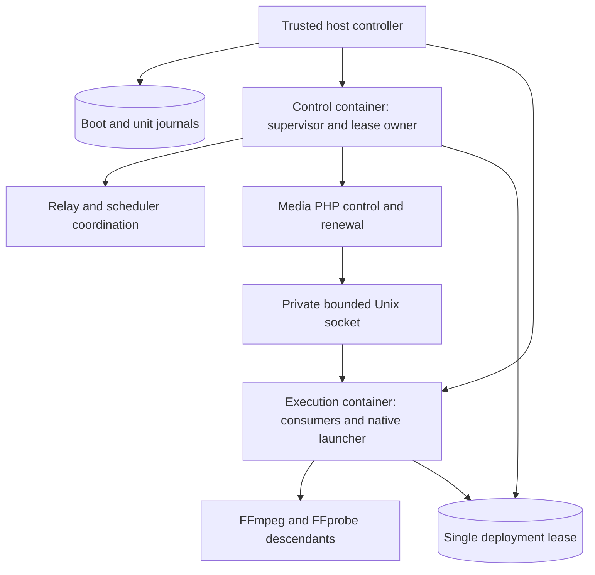
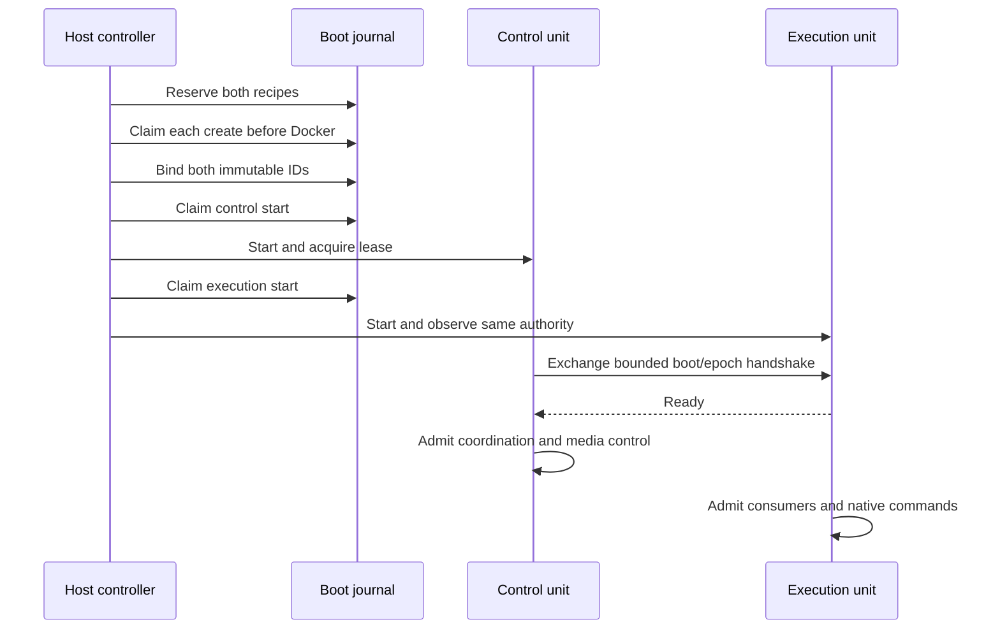
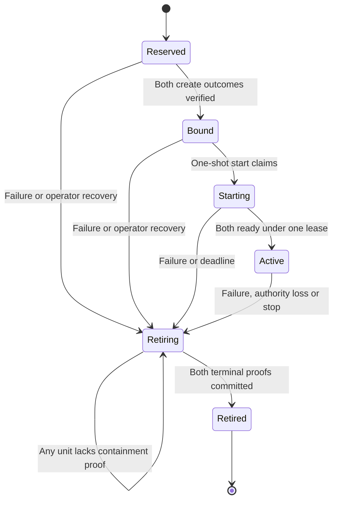

# Reserved Worker Control Capacity - Plan

## Goal Capsule

Playback control, lease renewal and worker coordination must remain runnable when catalog, metadata and media execution exhaust their admitted resources.
Implement one logical worker deployment containing separate control and execution containers, with enforced resource ceilings and joint retirement.
The next unchecked worker item in `ROADMAP.md` supplies the scope; its later autoscaling and broader saturation items remain separate.
The user selected this topology over host-provisioned nested cgroups.

Deliver the complete change on `plan/reserved-worker-control`, verify in disposable infrastructure, record evidence in the roadmap and commit locally.
Do not reset local databases, change baseline services or publish this branch.
If a runtime result contradicts the isolation or containment guarantees, correct the design and repeat the affected proof before declaring completion.

---

## Product Contract

### Summary

Give worker control processes their own CPU, memory and PID budgets.
Run ordinary and scheduled message bodies, FFmpeg and FFprobe in a separately constrained execution container.
Keep the two containers under one deployment identity and release ownership only after both have been contained.

### Problem Frame

`WorkerRuntimeConfiguration` accounts for reservations, but all four current roles share one Docker resource domain.
An encoder or PHP payload can consume resources needed by deployment supervision, media control and renewal.
Video control currently shares a process tree with its FFmpeg children, and the consumer checks `async` before `scheduler`, allowing sustained ordinary traffic to starve scheduled execution.

### Requirements

**Capacity and responsiveness**

- R1. Ordinary catalog and metadata handlers and all native media commands run outside the control container's CPU, memory and PID budgets.
- R2. Deployment renewal, scheduler coordination, outbox relay, media admission and playback control retain independently provisioned capacity under admitted execution pressure.
- R3. Every execution descendant remains within a finite CPU, memory and PID ceiling, including threads, grandchildren and reparented processes.
- R4. Scheduled occurrences have an execution slot independent of the ordinary receiver backlog.
- R5. Preserve three video slots and one audio slot; device admission remains zero because the supported recipes expose no accelerator devices.

**Ownership and failure**

- R6. One logical deployment has exactly two immutable container bindings and one namespace lease; partial creation or startup cannot authorize untracked work or another attempt after uncertainty.
- R7. Native submission, polling and signalling use bounded operations and attempt identities; a lost reply cannot create a duplicate encoder or let a stale request signal its replacement.
- R8. Child failure, authority loss or uncertain native cleanup stops admission and drains the whole deployment; no role or container restarts automatically.
- R9. Replacement remains barred until both containers have verified containment, even when control exits or is removed first.
- R10. Shutdown completes within the existing 35-second deployment deadline; failure to prove individual command cleanup escalates to container containment without returning its slot to admission.

**Delivery and data**

- R11. Preserve durable control revisions, execution generations, leases, scheduler receipts and outbox semantics across the split.
- R12. Upgrade deployment journals without deleting application data or fabricating containment; refuse an unresolved old singleton deployment before schema mutation.
- R13. Verify resource isolation and control responsiveness with real containers under CPU, memory and PID pressure, and record actual profile, counts and timings.

### Acceptance Examples

- AE1. With continuous `async` backlog and a due scheduler occurrence, the scheduled receiver executes without waiting for the ordinary queue to empty. Covers R4.
- AE2. With all media slots occupied and execution CPU saturated, control renewals and desired-state observation continue within the qualified deadlines. Covers R1–R5, R13.
- AE3. A native launch succeeds but its response is lost. Retrying that attempt observes its existing identity; it never launches another process. Covers R7, R11.
- AE4. Control is removed while an execution grandchild ignores signals. The namespace stays reserved until execution removal is verified. Covers R3, R8–R10.
- AE5. Execution creation was never claimed when retirement begins. Its reservation can be cancelled; a claimed but unbound execution attempt remains unresolved instead. Covers R6, R9.
- AE6. An upgrade finds an active singleton lease or uncertain create. The migration refuses and leaves its journal and application rows intact. Covers R12.

### Scope Boundaries

This work covers the admitted worker deployment and its native media operations.
Request-side image conversion, web diagnostics and the web server's own resource allocation remain outside this worker item.
The execution unit also hosts heavy PHP handlers, so moving only external commands does not satisfy R1.

Do not add accelerator support, automatic restarts, per-job Docker containers, a general command-execution service, or worker access to Docker or host cgroups.
Individual jobs share the execution ceiling; failure isolation between jobs is not promised.
Do not claim a hard real-time guarantee or protection from unrelated host workloads, host OOM, failed storage or unavailable PostgreSQL/Redis.
Dependency failure must still close admission and preserve ownership rather than be described as successful control.

### Deferred to Follow-Up Work

Measured autoscaling, production default tuning, the full transport-outage matrix and broad seek/pause/resume/reconnect saturation qualification remain the subsequent roadmap items.
The targeted pressure tests required by R13 are part of this delivery.

---

## Planning Contract

### Key Technical Decisions

- KTD1. **Two containers, one deployment.** (session-settled: user-directed — chosen over host-provisioned cgroup delegation: use the existing trusted Docker controller without adding worker host authority.) Preserve the two-command product contract: `app:worker` is the worker entrypoint, with an explicit fixed unit selected by the host manifest. Implements R1–R3, R6, R9.
- KTD2. **Enforced budgets per unit.** Require explicit control and execution memory, CPU and PID limits in the operator manifest, disable swap and automatic Docker restart, and verify the actual recipe before start and retirement. Require disjoint operator-selected logical CPU sets for the two units and validate them against the daemon's available CPUs. CPU affinity separates Baander work; it does not make those host CPUs exclusive to Baander. Preserve dropped capabilities, private PID/cgroup namespaces and no Docker mounts. Implements R2–R3, R5.
- KTD3. **Control owns authority; execution observes it.** Control PID 1 owns the single namespace lease and supervises relay, scheduler coordination and media PHP control. Execution PID 1 supervises dedicated ordinary and scheduled consumers plus the native launcher; its bounded authority observer never acquires or releases the namespace. Both units use the same boot and committed lease epoch. Consumers have distinct launch-derived identities and exactly one receiver each. Implements R2, R4, R6, R8, R11.
- KTD4. **Fixed boot and unit journals.** Add a boot record and `control`/`execution` unit keys to creation, binding and retirement journals. Reserve both recipes atomically before Docker; each unit has one create claim and one start claim. A boot retirement tombstone serializes with every admission mutation under the existing namespace advisory lock. Only completion of the whole boot may release the lease. Implements R6, R9, R12.
- KTD5. **Native commands use private bounded IPC.** Put a Unix socket in a dedicated named volume shared only by the two units, with a private boot directory and owner-only permissions. Use an argv-only FFmpeg/FFprobe allowlist, strict bounded JSON frames, boot/epoch/client-generation/attempt identities, finite connect/read/write deadlines and coroutine-compatible waiting. No arbitrary shell, environment, executable or raw PID is accepted from requests. Implements R1, R7.
- KTD6. **Execution owns native lifetime.** The launcher drains output independently of callers, retains bounded stdout and stderr, reports explicit running/exited/rejected/unknown outcomes and reaps children. Bound active commands and retained results; overflow is a failure, never silent truncation of probe JSON. A bounded monotonic attempt ledger prevents replay after result release. Signal requests identify attempts; successful signalling alone does not prove containment. Unknown launch or stop outcomes poison admission and drain the boot. Implements R3, R5, R7–R10.
- KTD7. **All worker media seams move together.** Replace local pipe/PID contracts in video streaming with process handles carrying remote status/output operations. Keep video desired-state and renewal loops in control. Replace its local CPU helper bootstrap with remote probe/subtitle operations; route audio encoding and startup capability probing through the same native boundary. Ordinary PHP/native-library payloads stay in the execution consumers. Convert active shell-string FFmpeg calls to argv and leave no control-side native fallback. Implements R1, R7, R11.
- KTD8. **Bound the peer lifecycle.** Register both units before starting control, then execution. Control may renew while awaiting execution readiness, but neither unit admits business work before a matching peer handshake. A 30-second startup deadline fails closed. Peer death, malformed identity, lease discontinuity or native-cleanup uncertainty drains both units; execution has an independent bounded authority/peer watchdog. Preserve the 35-second drain deadline and external exact-ID removal proof. Implements R6, R8–R10.
- KTD9. **Retain unresolved evidence.** A never-claimed unit may be cancelled under the boot retirement barrier. A claimed but unbound create cannot be cleared by a missing name or timeout, because a delayed Docker create may still complete. Reconcile it to a verified binding before removal. Persist each unit's proof separately so controller interruption cannot lose successful containment. Implements R6, R9.
- KTD10. **Forward schema transition.** Add an incremental migration after the consolidated initial migration. Reject unresolved singleton journals and active leases. Preserve completed history as terminal imported boots, with the old binding assigned to control and execution recorded as never created and cancelled; this enables no singleton runtime path. Keep application tables and migration history intact, and make downgrade explicitly irreversible. Implements R12.

### High-Level Technical Design

The native protocol has a bounded request envelope containing identity, operation and operation-specific data.
Operations are submit, inspect, signal and release; signals are pause, resume and stop for an already admitted attempt.
Submission acceptance is distinct from command completion.
Terminal results remain observable until release; an older or unknown attempt can never be reinterpreted as a fresh launch.

### Resource and Verification Profile

Use a disposable Linux Docker/cgroup-v2 host profile with at least four available logical CPUs and 8 GiB RAM.
Assign one logical CPU to control and a disjoint set to execution; both receive explicit CPU ceilings.
Start qualification at 2304 MiB/128 PIDs for control and 4096 MiB/256 PIDs for execution, including all PHP processes and native threads.
These are test inputs and admission limits, not measured universal defaults.
Verify available host memory and leave at least 1 GiB outside the two ceilings for the disposable dependency stack; record the actual host and dependency limits.

Implementation evidence revises this initial profile. The production cold-boot
attempt failed at the 128 MiB PHP heap ceiling; the 2304/4096 MiB pair above is
retained as the attempted starting profile, not a qualified deployment default.
Kernel processes now receive a 256 MiB PHP heap ceiling. The revised control
reservation is 2624 MiB/128 PIDs; execution requires 4160 MiB plus at least 320 MiB
when scheduled console execution is enabled, yielding 4480 MiB/256 PIDs in the
qualification fixture. Control management reserves 384 MiB and five media PHP
processes reserve 1600 MiB. Execution management/native capacity reserves 3520 MiB,
including 3136 MiB for native work.

The revised pair totals 7104 MiB. With 768 MiB for disposable PostgreSQL/Redis and
1024 MiB headroom, standalone admission totals 8896 MiB and requires at least
9 GiB host RAM. Combined web/media and pressure runs add a 2048 MiB web ceiling,
for 10944 MiB total and an 11 GiB host minimum. Four available logical CPUs remain
required; the actual qualification host exposes sixteen CPUs and 64 GiB RAM.
These revised values remain explicit test inputs and admission limits; passing
pressure receipts must establish any responsiveness claim.

A second production attempt reached `worker_media_ready`, then Docker recorded an
OOM kill of the disposable PostgreSQL container at event timestamp 1792323993
(artifacts `var/test-runs/baander-worker-operator-1792323879-1858109`). Its 512 MiB
fixture ceiling was insufficient. PostgreSQL now receives 2048 MiB and Redis
retains 256 MiB, for 2304 MiB of dependency ceilings. The worker pair is unchanged.
With 1024 MiB headroom, standalone admission now totals 10432 MiB and requires
11 GiB host RAM; adding the 2048 MiB web ceiling totals 12480 MiB and requires
13 GiB. The preceding 9/11 GiB thresholds record the earlier attempted profile.
This correction changes disposable fixture limits only; it introduces no database
tuning, application configuration or schema change. Runtime qualification was
still pending at that point; the final monitored results are recorded below.

The first CPU-pressure attempt also OOM-killed the 2048 MiB PostgreSQL fixture
before a qualified window. Its revised 4096 MiB ceiling was observed over 104
samples spanning 64.37 seconds: peak sampled memory was 2656.74 MiB, with 35 client
backends and 44 total processes at peak. Client counts stayed at 34–35 during
seconds 5–60, then fell to 26 after eight web connections closed; OOM counters
remained zero. Evidence: `var/test-runs/control-capacity-1792325154-1940806/cpu`.
These observations establish this disposable fixture's demand, not its cause or
universal PostgreSQL sizing.

PostgreSQL/Redis ceilings now total 4352 MiB (4096/256). With the unchanged
7104 MiB worker pair and 1024 MiB headroom, standalone admission totals 12480 MiB
and requires 13 GiB host RAM; the additional 2048 MiB web ceiling brings combined
runs to 14528 MiB and a 15 GiB minimum. Earlier thresholds above remain attempted
profiles. The revised CPU attempt then hit the fixture's sixty-second HTTP timeout
while deliberately holding an encoder for sixty seconds plus setup. Increasing
that fixture request timeout to 120 seconds permits the intended measurement;
application responsiveness thresholds are unchanged. Final qualification follows.

The final monitored CPU phase passed on the revised profile: desired-state
observation p99/max were 0.233721/0.258274 seconds and heartbeat p99/max were
0.010040/0.029077 seconds. Its 1135 occupied-slot samples preserve three video
and one audio execution slots; ordinary backlog remained at least 1984 while
1920 deliveries were acknowledged and five due scheduled occurrences returned.
Drain took one second. The final memory phase advanced execution's `oom_kill`
counter from zero to one against the identified native daemon and automatically
drained in five seconds. Control suffered no OOM in either phase; exact-ID bounded
Docker event capture remained live through drain. Receipts are under
`var/test-runs/control-capacity-qualified/{cpu,memory}/qualification.json`.
The final PID phase passed in 60.740 seconds including setup and cleanup:
execution's kernel PID-max counter advanced from zero to nineteen and native
launch failed on attempt three, triggering a one-second automatic joint drain.
Control peaked at 11 of 128 PID slots with no PID-max event or OOM, and its maximum
heartbeat age was 0.009744 seconds. The final fixture waits for valid baseline
samples and records the same-cgroup kernel counter at fork refusal: earlier
attempts left reusable slots or missed the rapid drain in periodic sampling and
correctly failed qualification. No application threshold changed. Receipt:
`var/test-runs/control-capacity-pid-verified/qualification.json`.
These three live phases qualify the stated profile; autoscaling, universal
defaults and broader saturation behavior remain outside it.

During 60 seconds of execution CPU pressure with ordinary backlog and occupied native slots, require control heartbeat and desired-state observation p99 at most one second and maximum at most two seconds, with uninterrupted lease continuity.
Normal native control RPCs have a one-second maximum client deadline; timeout is an explicit uncertain/failure result, not a successful action.
Memory/PID exhaustion must remain in the execution unit and cause bounded failure/drain rather than control OOM or loss of its management processes.
Verify both containers exit within the drain deadline and trusted recovery releases ownership only after both exact-ID proofs.
Full UI/media saturation behavior is outside this profile.

### System-Wide Impact and Risks

The deployment manifest, journal schema, runtime entrypoint, native process interfaces and drills change together.
Operators must retire existing singleton workers with the old controller before applying the migration; a blocked preflight is not permission to reset their data.
Shared source and derived volumes must use identical paths in both containers, while the IPC volume is inaccessible to web.
Control must retain the existing separate database connection for media renewal and must not inherit live Doctrine connections across forks.
Database or storage stalls remain dependency failures; separate cgroups cannot fix them.

The principal risks are partial Docker outcomes, stale native handles, blocked IPC and inaccurate resource accounting.
KTD4–KTD9 and the real-container acceptance tests address those risks.
Exact method names and final per-process memory allocations are implementation details; changing the topology, containment rule or responsiveness threshold requires revisiting this contract.

---

## Implementation Units

### U1. Persist and retire the complete deployment

**Goal:** Make the two-container lifecycle durable before changing runtime ownership.
**Requirements:** R6, R9, R12; KTD1, KTD4, KTD9, KTD10.
**Dependencies:** None.
**Files:** `migrations/`, `src/Shared/Infrastructure/Worker/DoctrineDeploymentInventory.php`, `DoctrineDeploymentLease.php`, `DoctrineDeploymentRetirement.php`, deployment binding/retirement value objects, `DeploymentContainmentController.php`, `config/packages/doctrine.yaml`, and deployment integration tests.
**Approach:** Add the root barrier and fixed unit records, preserve statement/lock timeouts and dedicated connections, and remove single-container lease-release bypasses.
**Test Scenarios:** Partial creates; unclaimed cancellation versus claimed uncertainty; concurrent admission/retirement; wrong daemon or binding; interrupted unit removal; atomic final lease release; older-boot completion; fresh schema and preserved terminal singleton history; rejected unresolved upgrade.
**Verification:** Disposable PostgreSQL integration tests and affected migration/schema checks, including observations from independent connections.

### U2. Admit and operate the two resource domains

**Goal:** Have the host controller create, start, inspect and recover exactly the declared pair.
**Requirements:** R1–R3, R5–R6, R9; KTD1–KTD4, KTD8–KTD9.
**Dependencies:** U1.
**Files:** `DeploymentOperatorManifest.php`, `DeploymentContainerRecipe.php`, `DockerDeploymentCreate.php`, `DockerWorkerContainment.php`, `RegisteredDeploymentStart.php`, `RegisteredDeploymentRecovery.php`, `bin/worker-deployment.php`, recipe/operator unit tests and fixtures.
**Approach:** Version the manifest, include both budgets, disjoint CPU sets and the private IPC volume in immutable fingerprints, validate actual Docker state, and make status/recovery report each unit plus overall completion.
**Test Scenarios:** Overlapping/unavailable CPU sets; invalid per-unit budget; extra mount/device; recipe mismatch; one create/start success followed by uncertainty; no retry after claim; only one containment proof; both removal orders.
**Verification:** Unit/integration tests plus disposable operator, retirement and recovery drills.

### U3. Implement bounded native execution

**Goal:** Own native commands in execution without blocking PHP control.
**Requirements:** R3, R5, R7–R10; KTD5–KTD6.
**Dependencies:** U2's identity and mount contract.
**Files:** New native execution protocol/client/launcher classes under `src/Shared/Infrastructure/Worker/`, native entrypoint under `bin/`, and focused unit/native test fixtures.
**Approach:** Implement strict framing, asynchronous submission, bounded output drainage, attempt fencing, finite RPC deadlines, bounded admission/result retention and explicit uncertain outcomes.
**Test Scenarios:** Fragmented frames and partial writes; overlong/malformed requests; foreign boot/epoch; forbidden command; lost launch reply; replay after release; stale stop; full slots; stdout/stderr flood; EOF; command timeout; stubborn descendant; client death; daemon death.
**Verification:** Real-process tests in the native lane and a two-container IPC smoke drill. Test-only launchers may use fixture commands; the production allowlist remains fixed.

### U4. Move media native work behind the boundary

**Goal:** Keep media orchestration and renewal in control while native work consumes execution resources.
**Requirements:** R1–R3, R5, R7, R10–R11; KTD1, KTD5–KTD7.
**Dependencies:** U3.
**Files:** `src/Transcode/Infrastructure/Swoole/ProcessSpawnerInterface.php`, `ProcOpenSpawner.php`, `TranscodeStreamManager.php`, `TranscodeProcessPool.php`, `src/Transcode/Infrastructure/Transcode/AudioRenditionExecutor.php`, FFmpeg adapters/prober/process executor, `bin/worker-media.php`, `bin/worker-media-job.php`, service wiring and affected transcode tests.
**Approach:** Replace local resource/PID leakage with attempt handles, remote probe/subtitle operations and native audio execution. Preserve generation-specific files and publication after ownership checks. Remove the production local-helper fork and cleanup assumptions.
**Test Scenarios:** Video probe and streaming; pause/resume/stop; seek retires the captured attempt; audio partial-to-final publication; subtitle output; startup qualification in execution; failed/uncertain command; lease loss during RPC; native output caps.
**Verification:** Existing media persistence/control tests, remote-adapter tests and actual software FFmpeg video/audio drills.

### U5. Supervise both units and separate consumers

**Goal:** Run each role in its intended budget and preserve bounded joint failure behavior.
**Requirements:** R2, R4, R6, R8–R11; KTD1, KTD3, KTD8.
**Dependencies:** U1–U4.
**Files:** `src/Shared/Application/DTO/WorkerRuntimeConfiguration.php`, `src/Shared/Interface/Console/WorkerCommand.php`, `src/Shared/Infrastructure/Worker/WorkerSupervisorRunner.php`, lease-agent/runtime components, `bin/worker-lease-agent.php`, runtime entrypoints and supervisor/command tests.
**Approach:** Add fixed unit selection, one control lease owner, execution observation and peer readiness. Separate ordinary and scheduled consumer definitions with role-specific identities. Account for every management process, media PHP child, consumer, launcher and native task before admission.
**Test Scenarios:** Delayed/missing peer; authority mismatch; one unit exits; lease continuity loss; stop during startup; scheduler delivery under ordinary backlog; child exhaustion; no restart; both units respect the drain deadline.
**Verification:** Focused native supervisor tests, messaging tests and revised worker-command drill.

### U6. Qualify isolation and lifecycle under pressure

**Goal:** Prove the resource boundary and its failure behavior on real containers.
**Requirements:** R1–R13.
**Dependencies:** U1–U5.
**Files:** Worker runtime drill scripts/fixtures, a dedicated control-capacity drill, `scripts/backend-native-tests.json`, and affected runner regressions.
**Approach:** Extend the production two-command and operator drills to the pair, then run the stated pressure profile serially on disposable infrastructure. Capture cgroup membership/counters, control timing, lease epochs, immutable container IDs and cleanup results.
**Test Scenarios:** CPU saturation, memory exhaustion, PID/thread exhaustion, signal-ignoring/reparented descendants, lost IPC responses, controller interruption between removals, old-boot fencing and scheduled receiver progress.
**Verification:** Complete authoritative backend suites, static gates, no-Swoole messaging selection, affected lifecycle/media drills and runner/isolation regressions where their fixtures changed.

### U7. Document and record the supported deployment

**Goal:** Make installation, operation and evidence agree with the shipped boundary.
**Requirements:** R5, R8–R13.
**Dependencies:** U6.
**Files:** `CONCEPTS.md`, `ROADMAP.md`, `dev-docs/worker-runtime-inventory.md`, operator installation/upgrade and worker command guidance, developer testing guide, manifest examples and relevant PostgreSQL references if verified discoveries require updates.
**Approach:** Define worker unit/native attempt terms, document the paired manifest and retirement prerequisite, distinguish limits from host guarantees and measured defaults, and record actual results without inheriting earlier test counts.
**Test Scenarios:** Documentation/manifest examples match parser and fixed unit behavior; old single-container instructions are removed from current guidance.
**Verification:** `prose-fix`, links, command-doc coverage and diff checks; independent code review with justified findings resolved.

---

## Verification Contract

Use the current CI image through the disposable runners documented in `docs-book/part-2-developer-guide/testing.md`; host PHP is not authoritative.
Run `scripts/test-backend-container.sh` for affected selections during implementation and the complete backend suites after integration.
Run the no-Swoole messaging selection with `BAANDER_TEST_DISABLE_SWOOLE=1` and verify all discovered cases execute.
Run Composer platform checks, PHPStan, Deptrac, container lint and OpenAPI drift checks without baseline expansion.
Register new fork/signal/socket tests in the native manifest; run `python3 -m unittest discover -s scripts/tests` and the disposable backend isolation probe when changing runner classifications or fixtures.

Run the operator, retirement, recovery, worker-command, production-media and two-command deployment drills against the paired topology, then the dedicated pressure drill.
Keep large logs in temporary artifacts and record exact counts, timings, failures, corrections and any remaining limits in `ROADMAP.md`.
Do not start a second expensive or shared-state verification run concurrently.
Local application databases, existing PostgreSQL/Redis volumes and media files remain untouched.

---

## Definition of Done

All requirements and acceptance examples are covered by implementation and observed verification.
The old single-container runtime and control-side native fallbacks no longer remain as supported paths.
No unit completion or direct callback can release a lease before whole-deployment containment.
Resource and latency claims match the measured profile, including explicit dependency and host limits.
The migration preserves data and refuses unresolved history; no local reset was performed.
Documentation, concepts and roadmap agree with the code; abandoned experiments are removed.
Independent review and required gates pass, and the work is committed locally on the plan branch.

---

## Appendix

### Sources

Current source anchors include `WorkerSupervisorRunner.php`, `WorkerRuntimeConfiguration.php`, the deployment journal adapters, `TranscodeSessionSubscriber.php`, `TranscodeStreamManager.php`, `AudioRenditionExecutor.php` and `bin/worker-media-job.php`.
The existing Unix control protocol and `LeaseAgentProcess` supply bounded-I/O patterns, but neither already implements remote native lifetime.
The scheduler starvation follows the installed Symfony Messenger worker's ordered receiver loop in `vendor/symfony/messenger/Worker.php`.

Relevant institutional guidance is in `docs/solutions/architecture-patterns/health-checks-run-in-a-messenger-consumer-cannot-see-outages-that-stop-it.md`, `state-set-when-work-is-queued-on-swoole-task-must-expire.md` in the same directory, and the Swoole shutdown and pooled-callback solutions under `docs/solutions/runtime-errors/`.
Carry their isolation, fencing and measured-shutdown lessons forward; their historical web CPU-pool topology is obsolete.

[Docker resource constraints](https://docs.docker.com/engine/containers/resource_constraints/) and [Linux cgroup v2](https://www.kernel.org/doc/html/latest/admin-guide/cgroup-v2.html) distinguish hard ceilings, weights and protections.
[systemd delegation](https://systemd.io/CGROUP_DELEGATION/) describes the host ownership contract avoided by KTD1.
[Unix domain sockets](https://man7.org/linux/man-pages/man7/unix.7.html) supplies the local transport semantics for KTD5.
