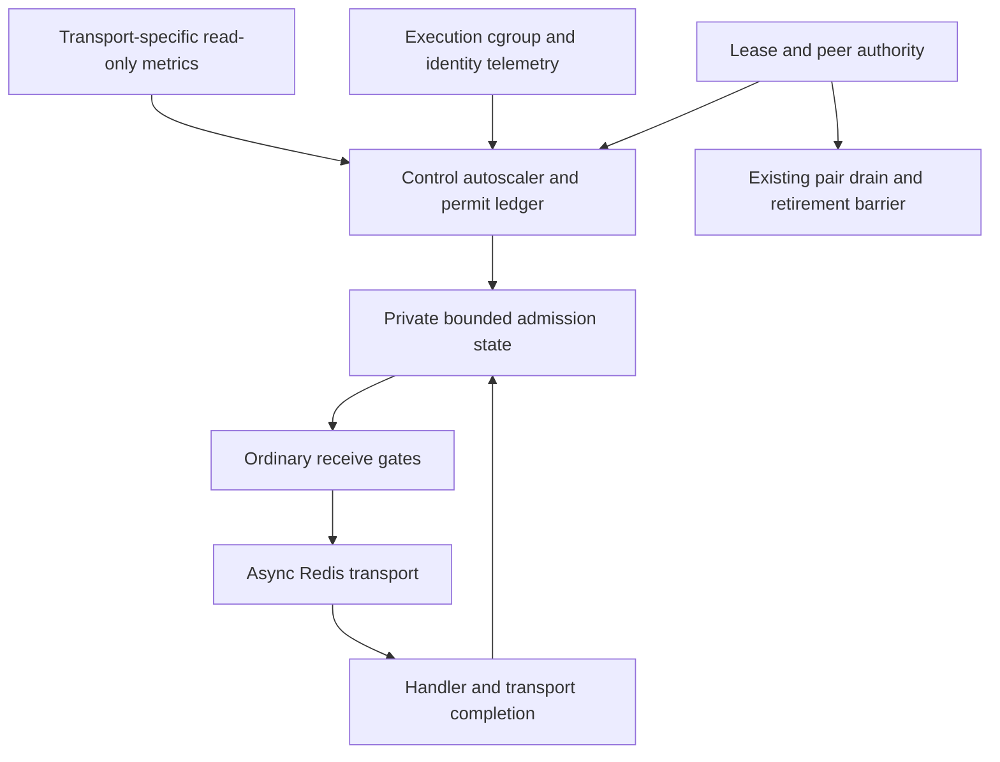
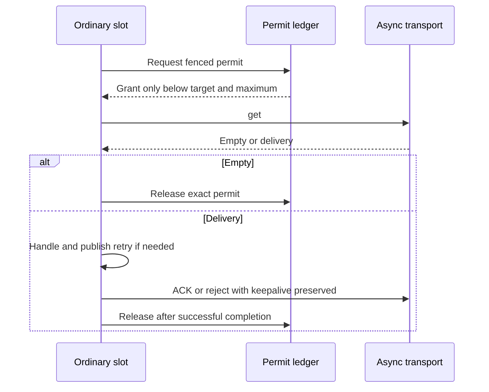
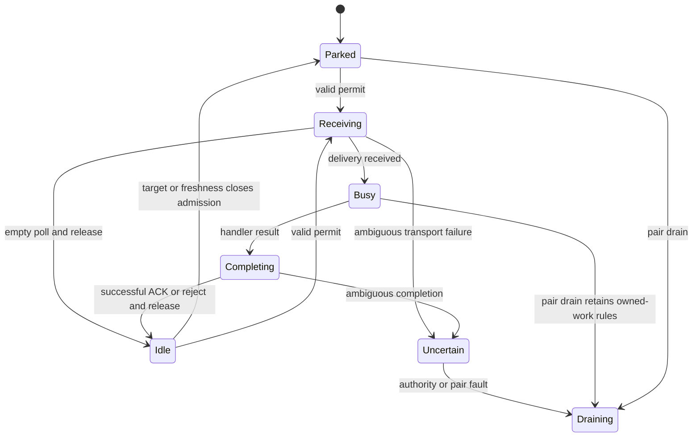
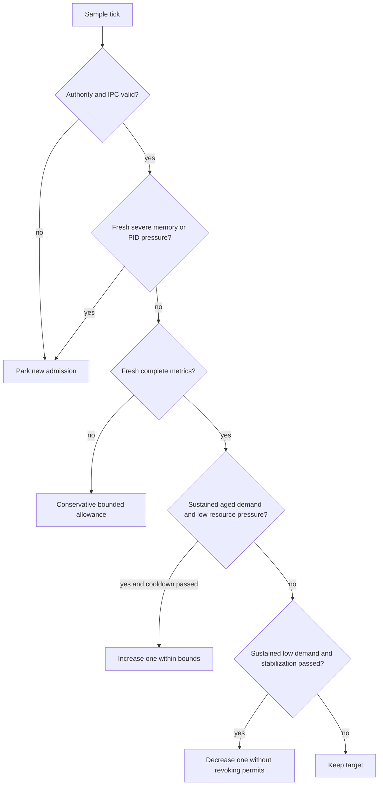

# Measured Worker Autoscaling - Plan

## Goal Capsule

- **Objective:** Background work absorbs bursts and settles after demand falls while playback and worker control remain responsive on admitted hardware.
- **Means:** Adaptive receive admission within a fixed resident ordinary-consumer pool (KTD2).
- **Authority:** The requested unchecked autoscaling item in `ROADMAP.md`, current source and `CONCEPTS.md` govern scope; `.agents/rules/` govern implementation. Historical strategy counts do not override current topology.
- **Execution profile:** Complete the implementation and disposable qualification; the lead integrates, runs authoritative checks and records delivered scope in `ROADMAP.md`.
- **Stop conditions:** Reconsider the approach if resident pools cannot fit the admitted envelope, lease deadlines cannot accommodate startup, or the receive protocol cannot preserve owned deliveries. Preserve existing reservations and local data while resolving such evidence.

---

## Product Contract

### Summary

Use measured backlog age, job duration, utilization and admission budgets to adjust ordinary asynchronous concurrency, with stable scale-up/down behavior and measured default profiles.

### Problem Frame

The deployment pair currently reserves fixed ordinary and scheduled consumers alongside independent coordination and native capacity. Fixed ordinary concurrency cannot respond to changing background demand, while adding consumers without complete memory, PID and connection accounting can impair playback or control. Existing admission envelopes are declared limits; their arithmetic does not establish a universal capacity recommendation.

### Requirements

**Adaptive behavior**

- R1. Autoscaling uses measured backlog age, job duration, utilization and admitted budgets to choose ordinary asynchronous concurrency.
- R2. Scale-up and scale-down remain stable under bursts, sustained work and idle periods, with observable reasons for each decision.
- R3. Lowering concurrency lets every owned delivery complete its handler, retry publication, acknowledgement and keepalive responsibilities.
- R4. Occupancy never exceeds the admitted maximum; after a target reduction, new receives wait until existing occupancy permits them.

**Authority and availability**

- R5. Preserve the worker deployment pair, lease authority, identity fencing and joint retirement barrier.
- R6. Preserve reserved control, scheduler, three-video/one-audio media capacity and bounded native execution, including operation without hardware acceleration.
- R7. Missing, stale, disconnected and invalid measurements remain distinguishable from idle and cause bounded conservative admission.
- R8. Control and observation remain responsive when ordinary work or native/media work saturates execution.

**Evidence and operation**

- R9. Select default profiles from measured disposable qualification, recording hardware, workloads, limits, startup costs and remaining coverage limits.
- R10. Operators can inspect desired concurrency, actual occupancy, measurement freshness, pressure and decision reasons through an existing worker/host status surface.
- R11. Preserve current transport wire format, retry retention and at-least-once delivery behavior when multiple consumers poll concurrently.

### Scope Boundaries

This work completes the measured autoscaling item in `ROADMAP.md`. Broader regional acceptance, every provider workload and universally optimal profiles remain separate roadmap work. Resource-class metadata remains descriptive; the shared FIFO gains no resource queues or fairness guarantee. PostgreSQL schema redesign, an admin UI and automatic restart of individual worker children are outside this change.

### Acceptance Examples

- AE1. **Covers R1, R2, R9:** An ordinary I/O burst ages beyond the configured delay objective; qualified low-pressure evidence increases concurrency, then sustained low demand returns it to minimum after stabilization.
- AE2. **Covers R3, R4, R11:** Four deliveries hold permits when the target becomes one; all finish normally, and no fifth receive starts until occupancy falls below one.
- AE3. **Covers R5, R7:** A stale or foreign-epoch controller snapshot cannot enable a parked slot; losing lease authority still drains the pair and retains its retirement reservation.
- AE4. **Covers R6, R8, R9:** Concurrent media/native pressure constrains ordinary admission while control renewal, playback probes and exact retirement checks remain within the qualification thresholds.
- AE5. **Covers R7, R11:** Unknown Redis group lag, future retries, due retries and a disconnected transport produce distinct status; a due retry activates useful work without treating future retries as current backlog.

---

## Planning Contract

### Assumptions

The scope choice is an unvalidated agent assumption: adjust concurrency within an admitted control/execution pair rather than create or remove whole pairs. The proposed qualification compares ordinary resident maxima 1, 2 and 4; it does not establish which one should become the default. Numeric policy tuning and playback/control responsiveness thresholds are implementation-time measurements, fixed in the qualification fixture before comparative runs and recorded with results.

### Key Technical Decisions

- KTD1. **Keep separate control and execution containers.** Extend their existing admitted recipes and private IPC rather than introduce nested cgroups (session-settled: user-directed — chosen over nested cgroups: preserve independently enforced control and execution capacity). Governs R5, R6 and R8.
- KTD2. **Prelaunch a finite ordinary-consumer pool and gate receives.** Every resident slot retains its process, launch identity and full memory/PID reservation while parked. `WorkerSupervisorRunner` treats unexpected direct-child exit as pair failure, so admission changes avoid inventing planned child retirement or a descendant-containment receipt. This is concurrency elasticity, with no resident-memory reclamation claim (R3–R6).
- KTD3. **Use one bounded permit ledger independent of handler work.** The control-unit autoscaler publishes the desired target to private shared admission state; every slot updates one globally serialized occupancy ledger. Use bounded local file locking on the existing private IPC volume when it satisfies the protocol; a socket/proxy is an implementation choice requiring evidence, not an additional required daemon. A permit covers both an in-progress `get()` and any returned delivery until successful delegated ACK/reject completion. Empty polls release once; exceptions or ambiguous outcomes retain occupancy and surface a fault until exact evidence resolves them. Target changes atomically share this ledger, preventing low-index slots from replacing busy newly parked slots during shrink. Namespace, boot, lease epoch, role, slot generation, request identity and revision fence every operation. Duplicate release and stale grant are rejected. Crash/IPC uncertainty denies new grants; it does not recycle possibly held work (R3–R5, R7).
- KTD4. **Decorate the ordinary async transport at `get()`.** Parked receives return promptly. Preserve transport alias, envelope stamps, sender routing and `KeepaliveReceiverInterface`, setup, close and count capabilities. Send/ACK/reject/keepalive bypass receive admission; the scheduler receiver stays unchanged. Acquire permission before delegating and never veto an envelope after Redis has delivered it. Today's single-message non-batch contract is qualified explicitly; reject unsupported batching rather than claim one permit can cover arbitrary buffered batches (R3, R4, R11).
- KTD5. **Observe outside the scaled path.** A dedicated kernel-booted controller process in control performs bounded collection and decisions; network I/O never enters PID 1's renewal loop. Reserve 320 MiB for this process initially, comprising the existing 256 MiB kernel limit plus 64 MiB headroom, and qualify it before calling it measured. Its exit retains the existing pair-failure behavior. Execution publishes local cgroup samples and slot events without requiring a handler to run. New callbacks follow `CoWrapper::defer()`/`go()` service-release boundaries (R7, R8).
- KTD6. **Read transport-specific bounded metrics.** Normalize effective async and scheduler DSNs through existing Symfony semantics, honoring endpoint, TLS/auth and database index with redacted diagnostics. Sample unread group lag, first unread stream ID age, PEL and due/future delayed counts independently. Redis `XINFO GROUPS` can report null lag, so retain an honest unknown count and bounded oldest-unread evidence; do not substitute `XLEN - PEL` or Symfony's unbounded count scan. Missing groups are uninitialized, not empty. Bound commands, response bytes, Redis client timeouts and per-tick work; document the stream-ID age approximation and keep scheduler demand outside ordinary scaling (R1, R7).
- KTD7. **Measure occupied work and actual execution pressure.** Slot telemetry is scoped to the full current launch identity, sequenced and freshness bounded; duration uses monotonic time. Separate handler duration from receive-through-ACK occupancy, and busy, enabled-idle, parked, disconnected and missing states. Busy observations continue independently of handler completion where the runtime permits; a blocked native C call never becomes idle by timeout. Read execution cgroup CPU usage/quota, throttling, memory/current/max and PID/current/max including native descendants. CPU utilization uses admitted quota, not host CPU count. Existing singleton heartbeats cannot supply this identity ledger (R1, R7, R8).
- KTD8. **Use a deterministic pressure-first policy.** Valid immutable profile bounds constrain every target. Fresh severe memory/PID pressure denies new grants; existing deliveries continue. Missing authority/IPC parks admission. Missing queue or telemetry evidence blocks scale-up and downscale and clamps admission to a documented conservative allowance no greater than one, without releasing held permits; fresh recovery samples precede growth. With valid data, estimate backlog service demand from occupied-duration history and oldest waiting age; startup with no duration samples begins at minimum and permits only rate-limited one-slot exploration when demand is observed and pressure is low. Sustained evidence, separate up/down thresholds, bounded one-slot changes, cooldown and a longer downscale stabilization window prevent flapping. Idle/future retries alone cannot trigger growth. Resource-class labels do not exempt any ordinary slot from conservative all-workload reservations (R1, R2, R4, R7).
- KTD9. **Make delayed promotion atomic before concurrent polling.** Extend the existing installed Redis Messenger patch. PHP discovers a candidate and prepares the original encoded stream payload; bounded Lua checks that the member still exists and is due, then performs XADD before ZREM. This avoids the current read/add/delete race without cjson round-tripping empty arrays/objects or changing serializer behavior. Preserve the maximum of 100 promotion attempts per `get()`, counting contention no-ops toward that bound. Redis script errors do not roll back earlier writes: retain at-least-once semantics and qualify later-command failure rather than claim exactly-once promotion (R11).
- KTD10. **Fingerprint the complete resident envelope.** Manifest, recipes, runtime arguments and validation share ordinary maximum, timing policy and reservations. Execution admission begins from `4160 + 320 * (ordinaryMax - 1) + scheduledConsoleMiB`; control adds KTD5 to its current 2624 MiB envelope. Derive PID and connection costs from all prelaunched slots and controller and any evidenced IPC helper, retaining native and lease-helper reserves. Qualification may increase envelopes with evidence; it cannot silently lower reservations to make a profile fit (R5, R6, R9).

### High-Level Technical Design

### System-Wide Impact

Every resident consumer adds kernel boot, Redis/database connections and service state before it receives work. Startup readiness must cover the full resident pool within lease/peer deadlines and distinguish parked liveness from transport reachability. Memory-limit recycling still retires the pair. Media managers, native identity ledgers, scheduled-console authorization and the joint retirement barrier retain their current contracts. Status reports aggregate bounded identity evidence without exposing credentials or creating an unrelated administration feature.

### Alternatives Considered

Dynamic OS-child creation/removal would require supervisor mutation, planned-exit classification and a new descendant-containment proof. Whole-pair replacement uses the existing barrier but creates deployment churn for every demand change. A resident pool uses current process containment at the cost of permanently reserving its admitted maximum. Reopen this choice only at the Goal Capsule stop conditions.

### Deferred Implementation Questions

Final class/helper names, qualified profile maxima, sample windows and pressure thresholds depend on implementation and measured qualification. These are deliverables of U6, not grounds to omit adaptive behavior or report unmeasured defaults as accepted. No launch-blocking product question remains within the recorded assumption.

---

## Implementation Units

### U1. Admit and fingerprint bounded resident profiles

- **Goal:** Carry a single validated profile from operator manifest through both runtime recipes.
- **Requirements:** R4–R6, R9; KTD1, KTD2, KTD5, KTD10.
- **Dependencies:** None.
- **Files:** `src/Shared/Application/DTO/WorkerRuntimeConfiguration.php`, `src/Shared/Infrastructure/Worker/DeploymentOperatorManifest.php`, deployment recipe/fingerprint classes in `src/Shared/Infrastructure/Worker/`, `WorkerSupervisorRunner.php`, matching unit tests.
- **Approach:** Define resident-pool arithmetic and immutable CPU/profile inputs while preserving the currently executable single-consumer runner. Reserve controller capacity now; add its actual child definition only with the implemented U3 entrypoint. U4 owns multi-slot launch integration after U2 and the receive gate exist. Update fixture manifests and boot fingerprints together.
- **Test scenarios:** Pure profile/definition fixtures for maxima 1/2/4 calculate unique slot identities and correct resident memory/PID costs; insufficient budgets fail before launch; changed profiles alter fingerprints; scheduled-console and disjoint CPU-set validation still hold.
- **Verification:** Profile/manifest/runtime unit coverage and compiled container smoke.

### U2. Preserve delayed retries under competing pollers

- **Goal:** Remove duplicate successful promotion caused by concurrent ordinary reads.
- **Requirements:** R11; KTD9.
- **Dependencies:** None; integrate before U4 concurrent polling.
- **Files:** Existing Redis Messenger Composer patch, `composer.json` patch declarations if needed, transport retry tests and disposable Redis messaging fixtures.
- **Approach:** Characterize existing body/header and serializer behavior before replacing the promotion boundary; qualify EVAL/ACL prerequisites.
- **Test scenarios:** Concurrent pollers insert one stream entry per successfully promoted member; future members remain delayed; malformed/wrong-type/XADD failures retain accepted work; injected failure after XADD preserves documented duplicate-safe retention; contention terminates within the fixed promotion bound.
- **Verification:** Installed patch matches locked Redis Messenger 8.0.8 behavior and messaging retry tests pass under PHP 8.5 / Messenger 8.0.12.

### U3. Collect bounded queue, slot and resource observations

- **Goal:** Supply current evidence without depending on ordinary handler scheduling.
- **Requirements:** R1, R7, R8; KTD5–KTD7.
- **Dependencies:** U1 interface.
- **Files:** New autoscaling observation types/adapters in `src/Shared/Infrastructure/Worker/`, `src/Shared/Infrastructure/Messenger/WorkerHeartbeatSubscriber.php`, identity telemetry subscriber, relevant service wiring, unit and messaging/native tests.
- **Approach:** Add independent collector entrypoint and reserve it in the runner; implement identity telemetry outside resettable service state, endpoint-aware queue metrics, and execution-side cgroup publication.
- **Test scenarios:** Null lag, uninitialized group, unread/PEL/due/future distinction, alternate endpoint/dbindex, bounded timeout, identity rollover, out-of-order samples, monotonic duration, parked transport outage, native saturation and full bounded telemetry key set retain correct freshness/state.
- **Verification:** Deterministic adapter/subscriber tests, real Redis/cgroup fixtures, repeated callback cleanup with no service-pool growth.

### U4. Gate ordinary receives with strict global occupancy

- **Goal:** Enforce target changes across all resident slots without disturbing owned deliveries.
- **Requirements:** R3–R5, R7, R11; KTD2–KTD4.
- **Dependencies:** U1, U2 and U3 telemetry contract.
- **Files:** New private admission protocol/ledger in `src/Shared/Infrastructure/Worker/`, ordinary transport decorator in `src/Shared/Infrastructure/Messenger/`, service wiring and worker bootstrap, corresponding unit/integration/native tests.
- **Approach:** Keep the generic fixed supervisor lifecycle; integrate bounded shared admission state and full identity fencing. Wire resident slot expansion into the production runner only after U2 and this gate are executable together. Confirm compiled async sender and receiver resolution and preserve every transport capability.
- **Test scenarios:** Downscale 4→1 with four held permits forbids replacement receives; simultaneous empty polls release once; duplicate release, stale generation, lost grant/reply, IPC failure and target reversal cannot overadmit; parked stop remains prompt; retry publication and long-delivery keepalive continue; any resident child exit still drains the pair.
- **Verification:** Ledger adversarial interleavings, real Messenger receive/ACK/retry integration and actual PID 1 parked/busy command coverage.

### U5. Apply stable decisions and expose their evidence

- **Goal:** Turn qualified observations into bounded explainable targets.
- **Requirements:** R1, R2, R7, R8, R10; KTD5, KTD8.
- **Dependencies:** U3, U4.
- **Files:** Pure policy/profile DTOs and controller runner in `src/Shared/Infrastructure/Worker/`, existing host/worker status query and CLI resource mapping, service configuration, policy and status tests.
- **Approach:** Separate pure policy from I/O and lease renewal; publish bounded decision records including sample ages, confidence, desired/held/busy/parked counts, pressure, cooldown and last change reason. Extend existing status behavior and its CLI parity contract.
- **Test scenarios:** Deterministic time-series fixtures cover startup/no-duration history, aged I/O demand, CPU throttling, severe memory/PID pressure, idle stabilization, threshold oscillation, stale/missing recovery and finite bounds. Status retains unknown values and rejects foreign-boot observations.
- **Verification:** Policy table tests, compiled wiring, status/CLI contract and callback failure cleanup tests.

### U6. Qualify profiles and record delivered acceptance

- **Goal:** Select measured defaults and prove behavior on disposable deployment pairs.
- **Requirements:** R1–R11; KTD1, KTD10.
- **Dependencies:** U1–U5.
- **Files:** `scripts/test-worker-operator-container.sh` autoscaling checkpoint/profile inputs and separate bounded autoscaling fixtures/verifier under existing `scripts/` and `tests/` conventions, `docs-book/part-2-developer-guide/testing.md`, affected operator worker/profile/status docs, `CONCEPTS.md`, `ROADMAP.md`.
- **Approach:** Reuse the operator runner’s disposable dependencies, pair lifecycle and exact cleanup ownership; add an explicit bounded total qualification deadline. Compare resident maxima 1/2/4 with fixed baseline workloads and predeclared thresholds; include host/dependency startup, full-pool readiness, idle resident RSS/PIDs/connections, I/O bursts, CPU work, delayed retries, stale metrics and media/native pressure. Select bounded profiles from the evidence and record environment limits. Keep the planning glossary additions aligned with the implemented ordinary admission target and occupied permit. Preserve local services/data through dedicated Compose projects and volume-scoped cleanup.
- **Test scenarios:** Actual target growth and shrink obey cooldown/stabilization; shrink drains in-flight deliveries; repeat bursts recover; pressure limits work before overshoot; controller/lease/playback probes meet recorded thresholds with three video plus one audio software workloads; failures preserve joint retirement and exact cleanup ownership.
- **Verification:** Full authoritative regression/static/native/no-Swoole/real-command/media gates in the Verification Contract; record counts, timings, failures and qualified hardware with the delivered roadmap entry.

---

## Verification Contract

The lead serializes expensive/shared-state checks using the CI image and current runners documented in `docs-book/part-2-developer-guide/testing.md`. This plan specifies required evidence; existing runner entrypoints remain authoritative.

| Scope | Required evidence | Units |
|---|---|---|
| Focused behavior | Profile arithmetic/fingerprint, retry promotion races, identity/freshness, permit interleavings, pure policy and status contracts | U1–U5 |
| Messaging and no-Swoole | Compiled aliases/capabilities, real Redis retries/keepalive, effective endpoint/dbindex, synchronous fallback | U2–U5 |
| Backend and static | Full backend coordinator suite with exact discovered-file coverage, PHPStan, Deptrac and applicable formatting/container checks | U1–U6 |
| Runner infrastructure | Backend runner regressions and cleanup ownership, native worker containment/retirement/recovery and actual worker-command PID 1 behavior | U1, U4, U6 |
| Native and media | Native execution protocol/client bounds, actual software audio/video decoding, three-video/one-audio pressure, control responsiveness and exact joint retirement | U3–U6 |
| Measured qualification | Baseline versus maxima 1/2/4; timestamped target/occupancy/age/duration/cgroup traces, full startup and dependency costs, bounded burst recovery and stable shrink | U6 |
| Documentation | Prose-fix audit, links/command coverage where applicable, vocabulary consistency and `ROADMAP.md` checkpoint with actual suite counts/timings | U6 |

Qualification artifacts retain image/dependency versions, hardware/CPU sets, manifest fingerprints, initial/final state, exact fixture workloads and pass/fail thresholds. A skipped scenario remains an explicit acceptance gap; it cannot be counted as a pass. Fix a failing behavior and rerun its affected checks before accepting a profile.

---

## Definition of Done

All requirements have implementation and verification evidence; ordinary concurrency demonstrably rises and falls without overadmission or interrupted delivery completion. Selected profiles state their measured hardware/workload envelope and retain full resident reservations. Existing lease, pair failure, media/native and retirement behavior pass authoritative checks. Operator status explains current decisions and unknown evidence. `ROADMAP.md` records delivered scope, exact checkpoint counts/timings and remaining limits; no item is marked complete based only on a plan or declared budget.

---

## Appendix

### Source Anchors

- `ROADMAP.md`: reserved control/execution capacity checkpoint and next measured autoscaling item.
- `CONCEPTS.md`: asynchronous workload catalog, resource class, consumer identity, worker deployment pair, joint retirement barrier and native execution attempt.
- `src/Shared/Infrastructure/Worker/WorkerSupervisorRunner.php`, `WorkerSupervisor.php`, `LeasedWorkerRuntime.php`: fixed definitions, lease gating, failure and containment semantics.
- `vendor/symfony/messenger/Worker.php`, `vendor/symfony/redis-messenger/Transport/Connection.php`, `RedisReceiver.php`, `RedisTransport.php`: receive ordering, keepalive capabilities and installed promotion behavior.
- `docs/solutions/architecture-patterns/health-checks-run-in-a-messenger-consumer-cannot-see-outages-that-stop-it.md`: independent observation.
- `docs/solutions/runtime-errors/swoole-callbacks-outside-the-bundle-leak-pooled-services.md`: callback cleanup.
- `docs/solutions/runtime-errors/swoole-table-default-conflict-proportion-drops-keys.md`: bounded shared telemetry storage and write-failure visibility.
- [Redis XINFO GROUPS](https://redis.io/docs/latest/commands/xinfo-groups/): nullable lag and group progress semantics.
- [Redis scripting](https://redis.io/docs/latest/develop/programmability/eval-intro/): atomic script execution and bounded server blocking.
- [Kubernetes autoscaling principles](https://kubernetes.io/docs/concepts/workloads/autoscaling/horizontal-pod-autoscale/): conservative missing-metric handling and stabilization as design references; no Kubernetes adoption.
