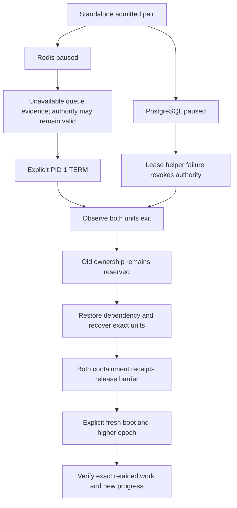
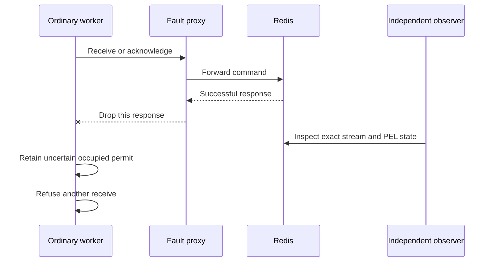

# Worker Lifecycle and Outage Qualification - Plan

## Goal Capsule

- **Objective:** Background work survives dependency outages and deployment replacement without overlapping owners, lost retained work or surviving owned processes.
- **Means:** Qualify the existing deployment pair with deterministic transport faults, independent process/session observations and explicit controller recovery.
- **Authority:** The next unchecked worker architecture item in `ROADMAP.md`; `CONCEPTS.md` defines ownership and retirement terms.
- **Execution profile:** Implement bounded acceptance fixtures, correct demonstrated contract violations, run authoritative checks and record the checkpoint in `ROADMAP.md`.
- **Stop conditions:** Reconsider a fixture that cannot distinguish accepted work from attempted work or cleanup from containment evidence. Preserve ownership and local data while resolving it.

---

## Product Contract

### Summary

Close the remaining worker lifecycle evidence gaps for leases, scheduler occurrences, process retirement, orphan cleanup, deployment recovery and transport outages.
Retain the fixed control/execution pair and explicit recovery model.

### Problem Frame

Existing component tests and deployment drills cover lease fencing, scheduler replay and journal retirement, but do not connect a live dependency outage to retained work and successful successor processing in a standalone deployment.
Uncertain Redis receives and acknowledgments also need accepted-command evidence beyond transport doubles.
Operators need to know which failures drain automatically, which require an explicit stop, and when replacement is safe.

### Requirements

**Work and authority**

- R1. Uncertain ordinary receives and completions retain their occupied permit and prevent another receive under that local ownership.
- R2. Qualify retained outbox and scheduled-occurrence work across dependency restoration and explicit successor admission, using exact work identities and effect counts.
- R3. PostgreSQL authority loss must drain the pair without depending on HTTP or successful transport work.
- R4. A Redis blackhole must leave control observable and support bounded explicit shutdown, without claiming automatic drain from unavailable observations alone.

**Containment and isolation**

- R5. Lease expiry, child exit and stopped containers must not release the joint retirement barrier; replacement requires both immutable units' containment proofs.
- R6. Recovery must be repeatable, advance successor authority and fence delayed predecessor operations without automatic pair or child restart.
- R7. Native daemon shutdown with active FFmpeg work must leave no live owned process group; deployment containment remains an external controller responsibility.
- R8. Fresh worker helpers must use independent Doctrine/PostgreSQL sessions while a parent session and transaction remain usable.

**Verification**

- R9. Run the deployed outage scenarios without an HTTP server and preserve the current paired topology and resource reservations.
- R10. Fault injection, observation and cleanup must be bounded and limited to disposable run-owned infrastructure, with evidence retained on failure.
- R11. Preserve existing lease, scheduler, retirement, orphan-containment and recovery tests, and report actual authoritative results and coverage limits.

### Scope Boundaries

This item concerns process orphans and worker ownership; the following roadmap item owns the broader shared media-control qualification.
No deployment topology, automatic reconnect/restart policy, transport timeout default, schema migration or business deduplication policy is introduced.
A Redis restart that loses data is not a preserved-stream outage test.
Regional qualification, provider workloads and long-duration soak work retain their existing roadmap scope.

### Acceptance Examples

- AE1. **Covers R1:** Redis accepts a read and records its PEL owner, but the response is lost; no handler runs and the same local permit remains uncertain.
- AE2. **Covers R1:** A handler completes once and Redis accepts XACK, but its response is lost; the PEL entry is absent while the local permit remains uncertain.
- AE3. **Covers R2, R4–R6, R9:** With Redis paused and HTTP absent, exact durable work remains outstanding. Explicit shutdown ends both units, ownership remains reserved, trusted recovery retires both IDs, and an explicitly created successor completes the work.
- AE4. **Covers R3, R5, R6:** PostgreSQL stops replying to a live pair. Independent observation establishes automatic drain; after database restoration the old reservation still blocks replacement until trusted retirement completes.
- AE5. **Covers R7, R8:** An active native process group disappears after daemon TERM, while a separate fresh-helper test proves the parent's PostgreSQL transaction remains isolated and usable.

---

## Planning Contract

### Assumptions

The next roadmap checkbox is the intended scope; existing completed autoscaling and control-capacity qualifications remain valid for unchanged behavior.
Process orphan cleanup is the relevant meaning here; deletion of cached media artifacts remains with the media plans.
The new deployment drill uses the explicit maximum-two ordinary profile selected in the autoscaling checkpoint, retaining its full resident reservations.
These are scope interpretations derived from the roadmap, not new user-selected product policies.

### Key Technical Decisions

- KTD1. **Extend the current operator fixture.** A dedicated lifecycle mode reuses production admission, immutable recipes and retirement, with no HTTP container. Existing readiness helpers retain their single-scenario assertions; a separate identity-aware fixture observes new work and expected epochs (R2, R5, R6, R9).
- KTD2. **Separate fault triggers.** Pause disposable Redis to preserve data and observe unavailable queue evidence before explicitly signaling PID 1. Pause disposable PostgreSQL to exercise independent lease-helper failure and automatic drain. Restore PostgreSQL before controller recovery; no total outage-to-recovery SLA is claimed while its journal is unavailable (R3, R4).
- KTD3. **Use command-aware reply loss.** A bounded disposable TCP proxy forwards the targeted Redis command, consumes its complete successful response, records the accepted command, and drops that response. Direct Redis inspection distinguishes pending receive from accepted acknowledgment. Use fresh-exec proxy processes and no inherited DBAL handles (R1, R8).
- KTD4. **Prove distinct boundaries independently.** Capture exact boot, epoch, unit IDs and work identities before faults. Observe shutdown before recovery, retained ownership before removal, both removal receipts before successor admission, and positive effects afterward. Cleanup cannot supply acceptance evidence (R2, R5, R6, R10).
- KTD5. **Use existing process mechanisms.** Add isolated session evidence through the real lease helper and active FFmpeg TERM evidence through the real native daemon. Observe actual backend/process identity rather than only launch arguments; make no production diagnostic protocol solely for tests (R7, R8).
- KTD6. **Correct only demonstrated violations.** Characterize transport and supervisor outcomes before changes. Existing unlimited transport I/O and consumed-but-unreturned occurrences are explicit limitations, not permission to invent completion or restart semantics (R1–R11).

### High-Level Technical Design

### Existing Evidence and Limits

`WorkerDeploymentLeaseTest`, `WorkerDeploymentRetirementTest`, `RegisteredDeploymentRecoveryTest` and scheduler occurrence tests already cover transactional fencing and replay boundaries.
`test-worker-command-container.sh` covers real outbox crash boundaries, scheduler commit-before-ACK, TERM and lease expiry.
`test-worker-containment-container.sh` covers TERM-ignoring descendants; the two-command fixture covers captured production encoder identities through web replacement and worker removal.
Reuse these checks rather than duplicating their matrices.

`WorkerSupervisorRunner` uses fresh bounded lease helpers, 30-second direct-child grace and a 35-second PID-1 fallback after drain begins.
These settings inform fixture deadlines; they do not establish unconditional kernel or controller I/O bounds.
Redis observation failures reduce ordinary admission conservatively, while a thrown uncertain receive/completion faults ownership.
Scheduler execution claims suppress repeated effects even when return persistence fails; tests must preserve that uncertainty rather than promise exactly-once delivery or guaranteed completion.

### Risks and Alternatives

A generic socket disconnect can falsely claim accepted-command loss; KTD3 requires the successful server response before dropping it.
A fast native command can exit before TERM; establish active identity and output/progress first.
Global scheduler/outbox totals and epoch-one helpers cannot distinguish new work during successor testing; use scoped identities.
Changing production timeout policy would add behavior beyond this evidence gap and is not required to qualify explicit shutdown.
A new deployment harness would duplicate admission and containment rules; extending the established operator harness keeps those rules shared.

---

## Implementation Units

### U1. Prove process and connection isolation

- **Goal:** Establish active native shutdown and independent real lease-helper sessions.
- **Requirements:** R7, R8, R10; KTD5.
- **Dependencies:** None.
- **Files:** `tests/Integration/WorkerLeaseAgentTest.php`, `tests/Integration/NativeExecutionDaemonTest.php`, narrowly required fixtures under `tests/Fixtures/Worker/`.
- **Approach:** Keep the parent's session and uncommitted transaction open while the real fresh-exec helper completes an unrelated operation; independently attribute its backend. Exercise daemon TERM with an active real FFmpeg process group.
- **Test scenarios:** Distinct helper backend and unchanged parent PID/transaction; independent observer cannot see parent writes; parent rollback remains effective. Active FFmpeg before TERM, bounded daemon exit, no live owned group afterward and socket removal.
- **Verification:** Focused CI-image integration/native lanes; no production protocol additions for observability.

### U2. Qualify real Redis response uncertainty

- **Goal:** Demonstrate receive and acknowledgment uncertainty through the installed Messenger transport.
- **Requirements:** R1, R10; KTD3.
- **Dependencies:** None.
- **Files:** `tests/Integration/MessengerAdmissionLifecycleTest.php`, bounded proxy support under `tests/Fixtures/Messaging/`.
- **Approach:** Reuse the current ledger/Worker fixtures and add command-specific response loss with independent Redis evidence.
- **Test scenarios:** Accepted receive leaves exact PEL ownership and no handler effect; accepted ACK follows one effect and removes PEL; both retain the same uncertain request and deny another receive. Proxy timeout/failure cannot count as successful fault injection. Preserve retry-publication coverage.
- **Verification:** Real Redis integration tests with and without Swoole; bounded proxy cleanup.

### U3. Exercise standalone dependency outage and successor recovery

- **Goal:** Connect live faults, preserved ownership, exact retirement and positive successor work.
- **Requirements:** R2–R6, R9, R10; KTD1, KTD2, KTD4, KTD6.
- **Dependencies:** U1 and U2 evidence informs the final assertions; harness implementation can proceed independently.
- **Files:** `scripts/test-worker-operator-container.sh`, new `scripts/test-worker-lifecycle-container.sh`, new `tests/Fixtures/Worker/lifecycle-check.php`, relevant `scripts/tests/` regressions and `.forgejo/workflows/ci.yaml`.
- **Approach:** Run Redis and PostgreSQL phases in separate disposable operator projects with the maximum-two profile. Seed and capture exact durable pending work while Redis is unavailable. The PostgreSQL phase proves authority-loss drain and positive work after restoration, without assuming pre-fault work was unconsumed. Keep externally visible faults separate from cleanup and reuse the trusted controller for retirement/successor admission.
- **Test scenarios:** No HTTP exists; Redis state survives pause; unavailable observations are distinguishable from idle; explicit TERM ends blocked workers within the fixture bound. PostgreSQL pause causes automatic drain. Both phases retain predecessor ownership, reject premature replacement, retire both immutable IDs idempotently, advance successor epoch and reject stale predecessor operations. Verify exact outbox/occurrence effects, absence of unintended duplicate effects and successful subsequent work. Always restore faults and verify removal of run-owned resources.
- **Verification:** Serialized real container drill, harness cleanup/isolation regressions and affected existing worker-command/recovery/containment checks. CI runs the same container-controller path with checkout-in-image support.

### U4. Record acceptance and operating limits

- **Goal:** Make the delivered behavior and verification reproducible.
- **Requirements:** R11; all units.
- **Dependencies:** U1–U3.
- **Files:** `ROADMAP.md`, `docs-book/part-2-developer-guide/testing.md`, relevant worker command/upgrade documentation only where the new evidence changes guidance.
- **Approach:** Document Redis explicit-stop versus PostgreSQL authority-loss behavior, exact recovery barriers, runner commands and retained uncertainty. Advance the roadmap only after final gates and independent review.
- **Verification:** Prose audit, links, whitespace and requirement-to-evidence reconciliation.

---

## Verification Contract

Use the authoritative CI image and disposable backend coordinator from the testing guide.
Run focused changed tests first, then the full backend suite and required platform, PHPStan, Deptrac, container and OpenAPI checks.
Run no-Swoole transport/session coverage, runner regressions, operator cleanup and backend stack isolation.
Run the new lifecycle drill and affected worker-command, recovery, containment and production-operator checks serially; reuse unchanged autoscaling measurements without claiming new performance qualification.
Record exact counts, elapsed times, fault triggers, immutable identities, journal/PEL outcomes and cleanup receipts.
A local blocking-CI configuration change is not evidence of a completed remote CI run.
All checks use disposable PostgreSQL/Redis and volumes; preserve existing development databases, registry storage and media.

## Definition of Done

All R1–R11 requirements have concrete evidence, U1–U4 land as local commits, and justified review findings are resolved.
The roadmap records delivered scope and limits, including consumed-but-unreturned occurrence uncertainty and the distinction between Redis observation loss and authority loss.
No merge or push is part of this implementation request.
