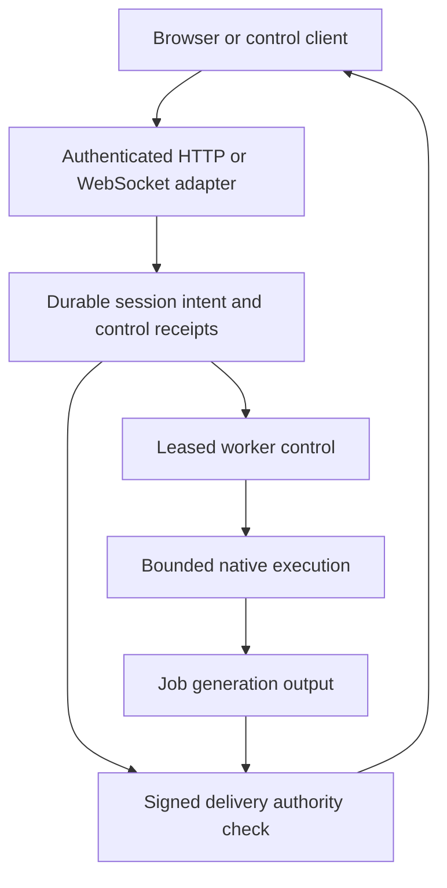
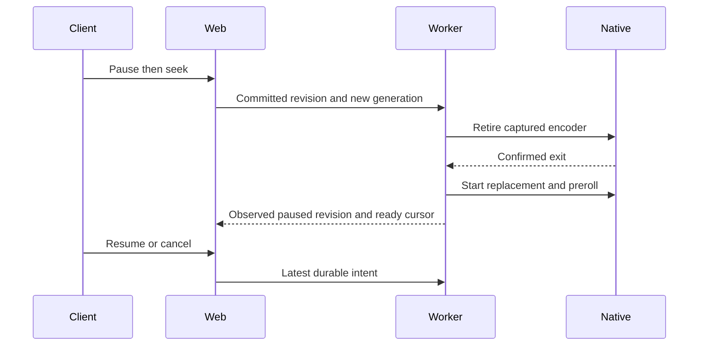
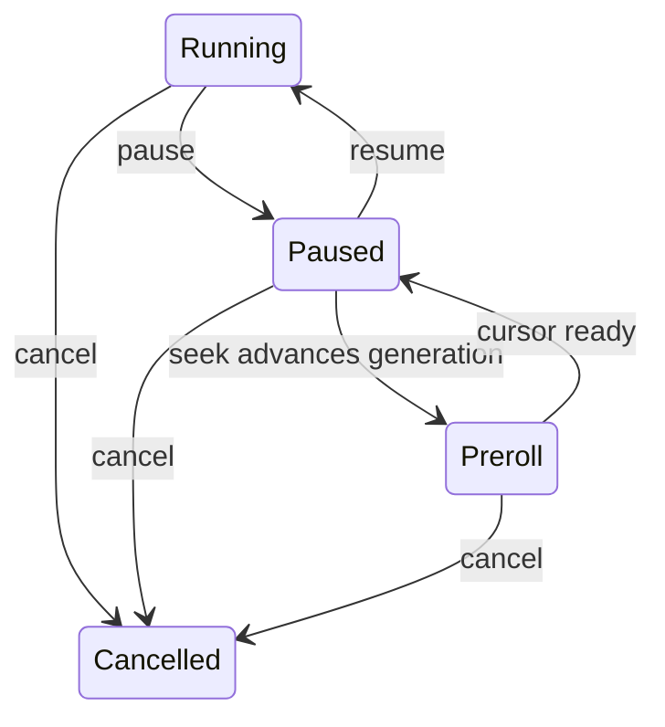

# Shared media control qualification - Plan

## Goal Capsule

- **Objective:** Listeners can seek, pause, resume and reconnect while workers are busy without reviving cancelled playback, receiving retired output or starting duplicate encoders.
- **Means:** Qualify the existing paired deployment and repair the exposed control adapter gap (KTD1, KTD2).
- **Authority:** The user request, `AGENTS.md`, the remaining shared-control acceptance in `ROADMAP.md`, then this plan.
- **Execution:** Complete the units, independent review, authoritative checks and local commits on `plan/shared-media-control-qualification`; merging and pushing require a separate request.
- **Stop conditions:** Preserve local databases, media and running services; runtime checks own disposable infrastructure only.

---

## Product Contract

### Summary

Complete shared web/worker media-control qualification using the current production deployment fixture and real browser playback.
Repair the WebSocket adapter that discards playback fences, and record actual execution and delivery evidence under saturation.

### Problem Frame

Persistence tests cover leases, revisions and receipts, while existing production drills cover initial concurrent attachment, paused seek and web replacement.
They do not yet combine seek and cancellation with full native capacity or prove repeated browser reattachment.
The WebSocket position adapter drops generation and revision fields that its application command already supports.

### Requirements

**Controls and ownership**

- R1. Native seeks retain their supplied execution generation and progress retains both generation and revision across HTTP and WebSocket adapters; explicit seeks without a generation remain intentional current playback commands.
- R2. A caller may reuse a position-control request identity across transport retries without reapplying an old command after newer controls; acknowledgements must not imply worker observation or successful mutation when a fence rejected it.
- R3. Concurrent and repeated attachment to an active owned job reuse its session and native encoder without increasing references; different owners remain independent.
- R4. Pause, seek and resume converge in committed revision order, preserving pause across seek and retiring the old native attempt before its replacement.
- R5. Cancellation remains terminal for the cancelled session, including late controls and receipt replay; deliberate new admission may create a new session under existing semantics.

**Delivery and qualification**

- R6. Requests resolved after generation retirement cannot read old init, media or subtitle output even when files remain; readiness waits must revalidate authority before opening output.
- R7. Lease expiry fences stale owners and successor publication advances execution generation, with native retirement and delivery evidence distinguished from database claim release.
- R8. At full three-video/one-audio native occupancy with execution CPU and ordinary backlog pressure, control acknowledgement meets the existing p99 <=1 second and maximum <=2 seconds budgets; seek readiness and exact cancellation retirement each have a 30-second correctness watchdog, with their measured durations reported separately.
- R9. Real browser playback advances within the existing 45-second playback watchdog after user pause/resume/seek and reconnect or remount, using current signed output and the same active owned job.
- R10. Evidence records resource occupancy, revisions, generations, process identities, timings, test counts and verified cleanup without credentials or signed URLs.

### Acceptance Examples

- AE1. Covers R1, R2: after generation changes, an old native seek is ignored through either transport; replaying a previously handled pause identity after resume cannot pause again.
- AE2. Covers R3, R4, R9: reload while paused retains the canonical session and encoder; a paused seek advances generation, keeps playback paused at its target, then resumes and advances.
- AE3. Covers R5, R8: cancel one active encoder while all slots are occupied, prove that exact process tree disappears, then reject late resume against the old session while another legitimate admission can use released capacity.
- AE4. Covers R6, R7: retain old signed resource URLs across seek and worker takeover, verify old files remain, and show that fresh requests cannot deliver their bytes.

### Scope Boundaries

This work keeps fixed control/execution deployment pairs and within-pair ordinary concurrency scaling.
It does not add pair autoscaling, new persistence mechanisms, client retry loops, byte-by-byte revocation of already-open responses or a general execution-history service.
A response already opened before retirement may finish; new requests and readiness waits must satisfy R6.
Use existing focused tests for sibling transaction rollback, owner isolation and stale lease writes, adding runtime evidence where their boundary changes.

### Deferred to Follow-Up Work

Cache sweeping, FLAC DSP performance, hardware acceleration qualification, new client ABR features, provider live qualification and regional acceptance retain separate roadmap acceptance.
The July segmenter plan's web-owned process and Swoole table topology is superseded by the current paired deployment; its playback and resource invariants remain relevant here.

---

## Planning Contract

### Key Technical Decisions

- KTD1. **Extend the production harness.** Add a dedicated media-control checkpoint to `scripts/test-worker-operator-container.sh`, reusing disposable services, budgets, exact identity capture and cleanup rather than combining incompatible existing callback switches (R3-R10).
- KTD2. **Preserve command semantics at both adapters.** Validate and forward optional UUID request identity and existing generation/revision fields for position controls; use the existing application command and durable receipts (R1, R2). Keep acknowledgements explicitly about handling the command, with authoritative current state read separately. A new application result model is unnecessary for this acknowledgement contract.
- KTD3. **Observe native ownership independently.** Capture launch/attempt evidence from the existing execution boundary and process identities during the bounded fixture; process snapshots and runtime row counts alone cannot rule out a short duplicate launch (R3, R7). Use test-only observation and existing daemon state, not a new production journal.
- KTD4. **Use phase-specific saturation assertions.** Establish full occupancy before controls, retain pressure on unaffected work, and account for deliberate slot release during cancellation (R8). Do not reuse a verifier that requires the cancelled slot to remain occupied.
- KTD5. **Separate authority from delivery timing.** Assert no old bytes for requests begun after retirement and for a request held in readiness waiting; retain the existing stream-open boundary for responses already in flight (R6).
- KTD6. **Reuse existing frontend behavior.** Extend native-HLS browser checkpoints and existing hook regressions; modify player code only for a reproduced failure of R9.

### High-Level Technical Design

### Risks and Dependencies

Production checks need the existing Linux Docker daemon, at least four allocatable CPUs, extension-capable PostgreSQL and a built worker image.
A stalled encoder held after initial output proves occupied capacity, not uninterrupted audio throughput.
Native uncertainty retains admission independently of a released database claim; qualification must not substitute one for the other.
If runtime evidence exposes a defect in those contracts, add a focused regression and repair the smallest owning mechanism before acceptance.

---

## Implementation Units

### U1. Preserve playback command fences and retry identity

**Goal:** Deliver R1 and R2 through both exposed position adapters.
**Dependencies:** None.
**Files:** `src/Shared/Interface/Controller/WebSocketController.php`, `src/Transcode/Interface/Controller/TranscodeSessionController.php`, their focused tests, protocol documentation and generated API artifacts if affected.
**Approach:** Apply KTD2 using current validation and application boundaries; preserve owned-session authorization and existing terminal behavior.
**Test scenarios:** Stale native seek, valid and stale progress, explicit seek without a fence, malformed fields, a stable request ID forwarded across retry, unauthorized session, dispatch failure, and acknowledgement that does not claim observed execution.
**Verification:** Focused controller and persistence tests in the CI image, static gates and API drift check.
**Execution note:** Add regressions for the dropped socket fields before changing the adapter.

### U2. Qualify controls at native capacity

**Goal:** Deliver R3-R8 and R10 at the real web/worker/native boundary.
**Dependencies:** U1.
**Files:** `scripts/test-worker-operator-container.sh`, a dedicated media-control runner/checkpoint, `tests/Fixtures/TwoCommand/deployment.php`, bounded companion fixtures under `tests/Fixtures/Worker/`.
**Approach:** Apply KTD1, KTD3-KTD5, reuse production authentication and pressure setup, and preserve existing runner modes.
**Test scenarios:** Repeated running/paused attachment, replay after intervening controls, paused seek under pressure, current output decode, retired init/media rejection plus subtitle authority coverage, cancellation of active and pending work, exact native retirement and subsequent legitimate admission. Retain existing takeover coverage and add stale-resource checks at its boundary. Subtitle and readiness-wait races may use deterministic tests when the production fixture lacks those resources. Include ticketed socket reconnect/replay separately from browser REST recovery. Compare accepted attempt identities across reattachment, not only final process counts.
**Verification:** Dedicated production runtime drill, affected two-command/control-capacity checks and runner/cleanup regressions; collect timing and cleanup receipts.
**Execution note:** Keep fault injection and observations within run-owned containers and volumes.

### U3. Qualify browser controls and reattachment

**Goal:** Deliver R9 with R3, R4 and R6 observable in the actual player.
**Dependencies:** U2 harness interface; implementation may proceed alongside U2 once checkpoint names are agreed.
**Files:** `ui/web/tests/e2e/two-command/browser.mjs`, `scripts/test-two-command-browser-checkpoint.sh`, relevant player hook tests and source only if a regression requires it.
**Approach:** Apply KTD6 with user actions and reload/network interruption, preserving the existing browser evidence limits and authentication fixture.
**Test scenarios:** Cold startup, user pause/seek/resume, paused remount, transport interruption followed by recovery, unchanged active session/attempt on reattachment, and playback advancing from current generation output.
**Verification:** Native-HLS browser checkpoint on the production image; focused Vitest and frontend type/lint/build checks for changed frontend code.

### U4. Record acceptance and historical scope

**Goal:** Deliver R10 and close only verified roadmap scope.
**Dependencies:** U1-U3.
**Files:** `ROADMAP.md`, `docs-book/part-2-developer-guide/testing.md`, affected protocol guidance and the three historical media plans only where reconciliation needs a notice.
**Approach:** Record actual counts, timings, thresholds, limitations and historical plan reconciliation; apply prose-fix and independent review.
**Verification:** Full authoritative backend suite, applicable static gates, affected runtime checks and browser evidence; review the final diff and remove abandoned experiments.

---

## Verification Contract

Use the CI-image `scripts/test-backend-container.sh` runner for targeted and full backend suites.
Retain real PostgreSQL lease/revision/sibling rollback tests and worker execution/stream-manager/generation-delivery coverage.
Run platform requirements, PHPStan, Deptrac, container lint and OpenAPI drift gates in that image.
Use production-image operator and native-HLS browser runners for R3-R9; record p99, maximum and convergence separately.
Run runner, cleanup and stack-isolation regressions for shared harness changes.
Frontend changes require focused player Vitest, typecheck, lint and production build, using `ui/web/package.json` scripts.
No pass is inferred from historical evidence; unchanged historical suites may be cited only with an explicit scope limit.

---

## Definition of Done

Every requirement has current passing evidence or remains visibly open in the roadmap with the precise blocker.
The WebSocket fence regression is fixed, saturated controls and browser reattachment are proven, and all run-owned infrastructure is removed.
Independent document and code reviews are complete, justified findings are resolved, documentation passes prose review, and implementation units are committed locally.
No abandoned experimental code remains and no merge or push is performed without a new request.
