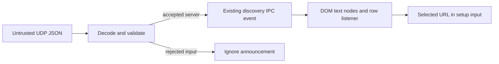

# Desktop discovery response rendering - Plan

## Goal Capsule

**Objective:** People configuring Baander Desktop can inspect and select discovered servers without a discovery announcement executing code in the setup window.

**Means:** Validate announcements at receipt and construct server rows through DOM APIs (KTD1, KTD2).

**Authority:** The Product Contract owns behavior; the Planning Contract owns implementation choices within it. Repository instructions govern implementation and verification.

**Execution:** Continue through `ce-work` on `plan/desktop-discovery-rendering`. The lead integrates changes, runs authoritative checks, records results in `ROADMAP.md`, and makes local commits. Push only when requested. Stop for a demonstrated conflict with the Product Contract or a verification blocker that cannot be resolved within scope.

## Product Contract

### Summary

Treat discovery announcements as untrusted network input. Display accepted server metadata as literal text, preserve selection behavior, and reject malformed announcements before they enter the discovered-server collection.

### Problem Frame

`DiscoveryService.handleResponse` parses UDP JSON and copies its fields without checking their types. The configuration renderer interpolates the advertised URL into an HTML attribute and the version into HTML content. An attacker able to answer discovery broadcasts can therefore supply markup to a setup window that exposes configuration actions through its preload bridge.

### Requirements

- R1. Discovered server names, URLs, and versions render as literal text; advertised values cannot create elements, attributes, or executable handlers.
- R2. Only non-null JSON objects with string `name`, `url`, `version`, `api_version`, and `timestamp` fields become discovered servers; arrays and malformed JSON are rejected.
- R3. An accepted URL is an absolute HTTP or HTTPS URL with a hostname; local HTTP servers, IP literals, explicit ports, and URL paths remain supported.
- R4. Rejecting an announcement leaves the collection unchanged and does not interrupt later valid discovery responses or crash the process through an unhandled error event.
- R5. Clicking a discovered row fills the existing server URL field with that row's accepted URL; saving still requires the existing user action.
- R6. Scanning, empty results, repeat announcements, and row replacement retain their existing behavior for valid responses.

### Scope Boundaries

This work covers announcement decoding, discovered-server row construction, and regression coverage at those boundaries. It does not redesign socket startup, timers, broadcast targets, deduplication, authentication of announcements, or configuration persistence.

Considered and not built: sender-IP matching, private-address restrictions, arbitrary metadata length caps, and a new sanitization dependency. None closes the demonstrated HTML parsing defect more directly than KTD1 and KTD2; revisit them only with a separate demonstrated requirement. A local-network response remains an unauthenticated advertisement, not proof of server identity.

### Acceptance Examples

- **AE1 (covers R1, R5).** An accepted server whose name or version contains an image tag and event-handler text displays those characters, creates no image or handler, and remains selectable.
- **AE2 (covers R1, R3).** A parseable HTTP URL containing quotes or encoded markup cannot break out of the displayed row or change its click target.
- **AE3 (covers R2–R4).** Null, arrays, missing fields, wrong field types, malformed JSON, relative URLs, and non-HTTP schemes produce no server entry; a subsequent valid announcement still appears.
- **AE4 (covers R3, R5, R6).** A valid local HTTP server with a port and path appears normally and fills the URL input when selected; a repeat announcement updates the service collection while the renderer retains its existing deduplication behavior.

## Planning Contract

### Key Technical Decisions

- **KTD1. Construct rows with DOM APIs.** Replace dynamic `innerHTML` row templates with element creation, `textContent`, and listeners that capture the accepted URL. Preserve existing class names and visible version prefix. Remove the escaping helper if it becomes unused. This implements R1 and R5 without maintaining separate HTML escaping rules for text and attributes.
- **KTD2. Validate at the UDP boundary.** Parse into an unknown value, check R2 and R3 before constructing the typed server, and retain the accepted URL string as the key and selection value. Do not canonicalize URLs or add semantic-version or timestamp-format checks. This keeps validation limited to the fields actually assumed by the current model and URL use.
- **KTD3. Ignore invalid announcements.** Treat malformed discovery traffic as rejected input rather than emitting the EventEmitter `error` channel. Retain existing socket-error behavior outside this path. This implements R4 without requiring a new reporting mechanism.
- **KTD4. Exercise the real renderer in the existing native smoke.** Extend the first-run setup checks in `ui/electron/tests/runtime-smoke.mjs` with crafted `discovery:server-found` events delivered from the Electron main process. Test UDP validation separately with a fake socket in the existing Node test runner. This proves both boundaries without adding a DOM library or using live broadcasts.

### High-Level Technical Design

### Assumptions

The current `DiscoveredServer` fields define the required response shape; version and timestamp strings are display metadata. Local HTTP support is intentional. No new domain vocabulary is introduced, so `CONCEPTS.md` needs no entry.

### Sources and Research

- `ui/electron/src/main/services/discovery.service.ts`: unchecked JSON fields, URL-keyed collection, and EventEmitter failure path.
- `ui/electron/src/renderer/config/index.html`: dynamic row template and row-click selection.
- `ui/electron/src/main/windows/config-window.ts`: isolated sandboxed setup window with a preload bridge.
- `ui/electron/tests/ipc-security.test.ts` and `ui/electron/tests/runtime-smoke.mjs`: existing mock and native verification patterns.
- `.agents/rules/frontend.md`, `ui/DESIGN.md`, and `docs-book/part-2-developer-guide/testing.md`: project rules and verification guidance.

Existing solution titles under `docs/solutions/` do not match this area. Existing DOM, URL, and Node test facilities cover the fix. No dependency choice requires external research.

## Implementation Units

### U1. Reject malformed discovery announcements

**Goal:** Enforce the accepted response contract before collection mutation.

**Requirements:** R2–R4, R6; KTD2, KTD3.

**Dependencies:** None.

**Files:** `ui/electron/src/main/services/discovery.service.ts`; new `ui/electron/tests/discovery-service.test.ts`.

**Approach:** Add focused boundary validation in the response path. Drive the service through fake socket message events and control scan cleanup without sending real broadcasts.

**Test scenarios:** Accept a complete local HTTP response and an HTTPS response; reject every AE3 shape; preserve the accepted URL including its port and path; confirm rejected input emits no server entry or fatal error; accept a valid response after rejection; preserve repeat-URL updates.

**Verification:** Focused service regressions, then the desktop Node suite and TypeScript gate.

**Execution note:** Establish failing boundary regressions before changing the response handler.

### U2. Render discovery metadata as text

**Goal:** Close the HTML injection path while preserving row selection.

**Requirements:** R1, R5, R6; KTD1, KTD4; AE1, AE2, AE4.

**Dependencies:** None; U1 and U2 can run in parallel with separate file ownership.

**Files:** `ui/electron/src/renderer/config/index.html`; `ui/electron/tests/runtime-smoke.mjs`.

**Approach:** Build and replace rows through DOM nodes. Extend the smoke's first-run setup phase before it saves the disposable server configuration; inject crafted events through the existing preload event path in both built and development modes.

**Test scenarios:** Assert literal name, URL, and version text; absence of injected elements and executable handlers; expected input value after row click; rerendering after a second unique server and empty-state behavior; unchanged setup handoff in both smoke modes.

**Verification:** Desktop build and native runtime smoke after the Node suite. Use disposable local services and block outbound network access as the smoke already does.

**Execution note:** Add the malicious metadata assertions before replacing the dynamic row template.

## Verification Contract

Use the desktop workspace scripts from `ui/electron/package.json`: `test` for the Node regressions, `tsc` for the main, preload, and renderer projects, `build` for the renderer artifact, and `test:smoke` for native Electron behavior. Run authoritative gates in the CI image as documented in `docs-book/part-2-developer-guide/testing.md`; serialize native/shared-state checks.

The Node suite must cover the accepted and rejected announcement classes in U1. The native smoke must demonstrate AE1, AE2, and AE4 through the actual setup preload and DOM in both modes. Record suite counts, static-gate results, build status, and native smoke status in `ROADMAP.md`. Run `ce-simplify-code` at the implementation phase boundary and apply justified `ce-code-review` findings before delivery. `release:validate` is outside this bounded desktop change unless the implementation changes release packaging.

## Definition of Done

U1 and U2 satisfy their requirements and verification checkpoints. All relevant desktop gates pass, review findings are resolved, and `ROADMAP.md` records the delivered behavior with evidence. Keep the final diff limited to the fix, its regressions, this plan, and the required roadmap record; remove abandoned experiments and leave local user data intact.
