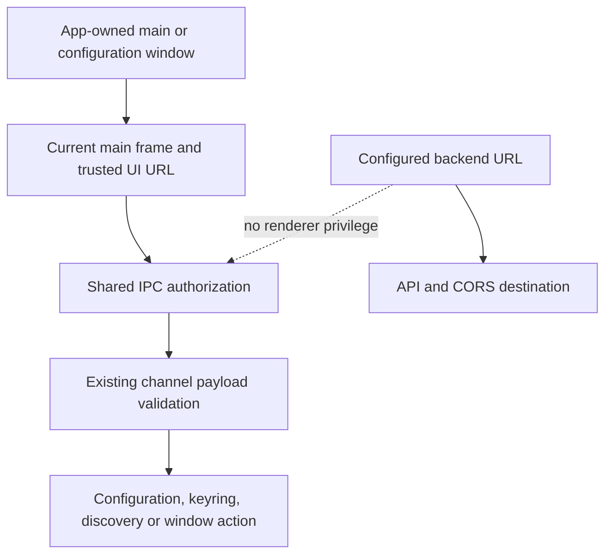
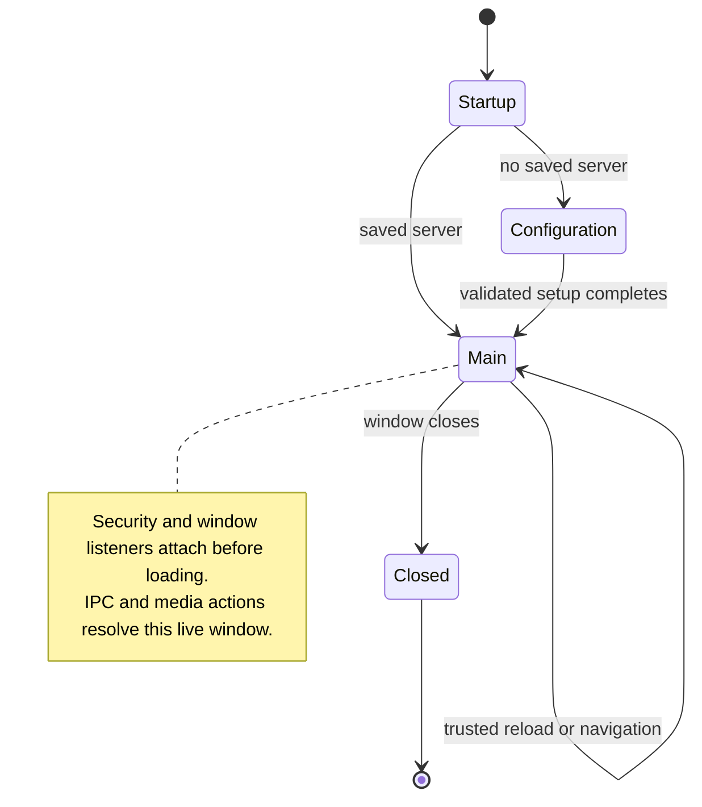
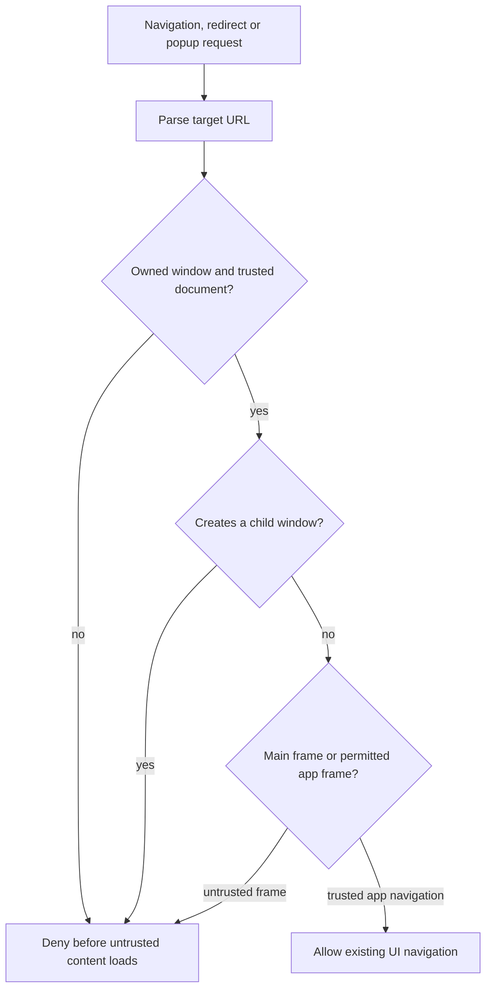

## Goal Capsule

- **Objective:** People can configure and use Baander Desktop without unrelated pages or embedded frames reading their saved credentials or controlling the app.
- **Means:** Enforce a shared renderer trust policy at navigation and IPC boundaries, with registration tied to each live app window (KTD1–KTD3).
- **Authority:** The task scope and repository instructions govern this plan; current desktop callers define supported inputs.
- **Execution profile:** Deliver bounded security fixes with focused regression tests and desktop verification. The lead integrates, records evidence in `ROADMAP.md`, and creates local commits; push only when requested.
- **Stop conditions:** Escalate a product choice that would restrict supported server destinations or external links. Report failing required gates without expanding into unrelated application or compiler cleanup.

---

## Product Contract

### Summary

Activate desktop navigation hardening and require trusted, top-level app windows for privileged IPC.
Keep server setup, configured-server use, and window controls working through the configuration-to-main-window handoff.

### Problem Frame

The desktop startup does not call the existing security helper.
That helper would also trust broad URL prefixes and permit arbitrary HTTP(S) child windows if enabled unchanged.
Configuration, keyring, discovery, deep-link, and window IPC handlers accept requests without checking the sending window or frame.
TypeScript annotations do not validate values arriving from a renderer.
A malformed server URL is persisted before the CORS shim parses it, so the handler can fail after changing stored configuration.

First-run setup creates the main window through a different path from configured startup.
Window IPC is registered only during configured startup, and media shortcuts capture the initial configuration window.
A security policy must cover both creation paths and direct later actions to the live main window.

### Requirements

**Renderer trust**

- R1. Only live app-owned windows displaying the trusted local UI may invoke main-process IPC, and only their main frame may do so.
- R2. Untrusted document navigation, frame navigation, redirects, and child-window creation must not introduce privileged renderer content.
- R3. The configured backend remains an API destination, separate from the set of privileged renderer documents.

**Supported behavior**

- R4. Preserve the existing Vite development UI, built-file UI, HTTP(S) self-hosted backend configuration, and legitimate UI routing and reloads.
- R5. Validate existing IPC payloads before persistence, CORS changes, keyring operations, theme changes, or native window actions; invalid or unauthorized requests have no privileged side effects.
- R6. First-run setup must hand off to a secured main window with working titlebar controls and media shortcuts; configured startup must use the same registration rules.

### Scope Boundaries

Work is limited to Electron renderer trust, existing IPC contracts, and the lifecycle wiring required to enforce them.
React Native, Android, backend authentication, broad web refactoring, and general compiler cleanup are outside scope.

A CSP redesign and main-window sandbox migration are considered but not built here: the current inline configuration script, reused web application, and WASM support require their own compatibility analysis.
Revisit them when that integration is explicitly scoped.
No arbitrary credential-size limit, password-strength rule, HTTPS-only server policy, or new external-link product feature is introduced.

#### Deferred to Follow-Up Work

Electron version maintenance is separate from this change; confirm support status before a release.
Discovery-result HTML interpolation in the configuration page needs a separate source-to-DOM review rather than being silently included in a navigation/IPC patch.

---

## Planning Contract

### Key Technical Decisions

- KTD1. **Use the actual UI entrypoints as trust evidence.** Derive trusted renderer locations from the same loading configuration as `ui/electron/src/main/windows/main-window.ts` and `ui/electron/src/main/windows/config-window.ts`. Development uses the exact parsed origin of `VITE_DEV_SERVER_URL`, including its port; do not hardcode localhost or accept hostname prefixes. Built mode permits the resolved main and configuration HTML files, including normal query/fragment state, rather than every `file:` URL. Packaged assets are flattened by `ui/electron/electron-builder.yml`; unpackaged built files live under `dist/renderer`. Existing `ui/web/src/App.tsx` uses browser routing, so development navigation within the trusted origin must continue to work. A backend URL never extends this policy. This is a narrow policy repair, not a new renderer protocol or origin registry framework.
- KTD2. **Install guards before windows load.** Replace the defective logic in `ui/electron/src/main/security/harden.ts` and activate it from startup before any BrowserWindow creation. Cover main-frame navigation, subframe navigation, redirects, and window-open requests with parsed URL comparisons. Deny new Electron windows from renderer requests. Existing menu/help external links use their existing main-process path; do not redirect arbitrary renderer URLs to the operating system. Do not retain the helper's site-isolation-disabling switch. Deny renderer permission requests and permission checks consistently where this helper owns that policy. Follow Electron's documented sender and navigation guidance in Sources.
- KTD3. **Check the sender independently of navigation.** A shared main-process guard checks app-window ownership, destruction state, main-frame identity, and the frame's current trusted URL on every actual IPC handler. Reject missing, detached, destroyed, foreign, and subframe senders before reading secrets or running actions. Window controls target their own authorized main window. Register handlers once, resolve live windows when invoked, and attach window-specific listeners when each main window is created; a closed configuration window must not remain the media-key target. Apply the same gate to discovery and pending deep-link handlers because they expose or mutate main-process state.
- KTD4. **Validate the contracts callers already use.** Parse server URL input and permit HTTP(S) URLs before writing configuration or updating the CORS shim. Preserve existing empty-string clearing semantics. Username values must be strings accepted by the keyring account contract; password values must be strings without adding password policy. Theme mood follows the existing dark/warm/cool/balanced values. Background color follows the formats actually used by native window callers, with no unchecked native input. Align the exposed credential-deletion bridge with the username required by its existing main-process operation. Preserve existing successful return behavior; authorization and malformed-input failures must be explicit and consistently handled by affected callers. Do not log credential values.
- KTD5. **Add focused desktop checks.** There is no existing Electron test suite, and `ui/electron/package.json` currently invokes a references-only TypeScript project with `-p`, which does not check its referenced projects. Add the smallest repeatable runner using the existing `tsx`/Node tooling, testing the new trust policy and affected handler/lifecycle behavior with disposable Electron doubles. Keep a real Electron smoke check for integration behavior that doubles cannot establish. Make desktop project checks real rather than treating an empty-project success as verification. Narrow desktop compilation corrections are permitted to make the actual gate usable; existing unrelated diagnostics are blockers to report, not authorization for broad shared-code edits. The lead's baseline individual checks all stop at a stray token after the JSON import in `ui/electron/src/shared/wasm-modules.ts`; correct that desktop source defect before assessing later diagnostics.

### High-Level Technical Design

The diagrams show responsibility and lifecycle boundaries; they do not prescribe helper signatures or a class hierarchy.

### Assumptions

The minimal regression suite will use the existing TypeScript execution tooling rather than adding a second frontend test framework.
Local Node 24, Electron 42 and Xvfb are available for the real Electron smoke run. The current CI image lacks GUI libraries, so CI owns tests and static checks; do not redesign that image merely to move this smoke into CI.

### Sequencing and Open Questions

U1 establishes the shared trust policy; U2 applies it to IPC and window lifecycle; U4 wires repeatable checks and records the acceptance checkpoint.
There is no launch-blocking product question.
Exact helper boundaries, test doubles, and the smallest headless Electron launch fixture remain implementation details.
If runtime evidence exposes unrelated startup or renderer-build failures, report their source and separate them from this security patch.

### Sources and Research

Repository evidence: `ui/electron/src/main/index.ts`, `ui/electron/src/main/security/harden.ts`, `ui/electron/src/main/security/cors-shim.ts`, both window factories, `ui/electron/src/ipc/index.ts`, the IPC modules, `ui/electron/src/preload/index.ts`, `ui/electron/config/vite.config.mts`, `ui/electron/electron-builder.yml`, and `ui/web/src/App.tsx`.
`STRATEGY.md` identifies desktop shell hardening as an active capability.
No directly matching desktop security solution was found under `docs/solutions/`.

Electron's [security checklist](https://www.electronjs.org/docs/latest/tutorial/security) supports independent IPC sender validation, navigation restrictions, and child-window restrictions.
The [WebContents API](https://www.electronjs.org/docs/latest/api/web-contents) distinguishes main-frame navigation, frame navigation, and redirects; use APIs supported by the installed Electron 42 dependency.

---

## Implementation Units

### U1. Establish trusted renderer locations and install navigation guards

- **Requirements:** R1–R4; KTD1–KTD2.
- **Files:** `ui/electron/src/main/security/harden.ts`, new `ui/electron/src/main/security/renderer-trust.ts`, both window factories, `ui/electron/src/main/index.ts`, new `ui/electron/tests/renderer-trust.test.ts`.
- **Approach:** Keep trust derivation shared with the window load targets. Attach protection before initial loads and remove permissive URL prefixes and the site-isolation switch. Preserve existing main-process external-link behavior.
- **Patterns:** Existing factory loadURL/loadFile branches and Electron 42 navigation events.
- **Test scenarios:**
  - The exact Vite origin accepts main/configuration pages and legitimate SPA paths; a different port, hostname suffix, protocol, or backend origin is rejected.
  - Built main and configuration entrypoints accept normal query/fragment state; another local HTML file, encoded path escape, or remote document is rejected.
  - A frame navigation or redirect to an untrusted document is prevented, and renderer-created HTTP(S) popups are denied.
  - Guards are attached before the first load in configured and unconfigured startup.
- **Verification:** Focused trust-policy tests pass and the Electron smoke shows blocked untrusted navigation without breaking ordinary UI loading.

### U2. Authorize IPC and preserve the live-window lifecycle

- **Requirements:** R1, R3–R6; KTD3–KTD4.
- **Files:** `ui/electron/src/ipc/index.ts`, new `ui/electron/src/ipc/guard.ts`, config/window/discovery/deep-link IPC modules, `ui/electron/src/preload/index.ts`, affected bridge declarations if required, `ui/electron/src/renderer/config/index.html`, new `ui/electron/tests/ipc-security.test.ts`, `ui/electron/src/main/index.ts`, both window factories, new `ui/electron/tests/window-lifecycle.test.ts`.
- **Approach:** Gate every existing registered renderer-to-main handler, then validate the payload before any side effect. Keep the playback placeholder unchanged unless it gains a real handler. Align credential deletion's bridge argument with its main-process contract. Catch save failures in the existing configuration page, show the existing error feedback pattern, and do not finish setup after a failed save.
- **Patterns:** Existing channel names and preload return shapes; existing configuration and keyring services.
- **Test scenarios:**
  - An owned trusted main frame can use an existing configuration getter; an otherwise identical subframe, foreign WebContents, missing sender frame, destroyed owner, or untrusted current frame URL cannot read a credential or run a privileged action.
  - A trusted caller can save an HTTP(S) self-hosted server and clear it with the existing empty value; malformed URLs, non-string values, and non-HTTP(S) schemes leave storage and CORS handlers unchanged.
  - Configuration save rejection or a false result shows a useful error and keeps configuration open without calling setup completion.
  - Valid keyring arguments reach the existing service; wrong runtime types and a missing deletion account cause no keyring call.
  - Existing theme values and supported background colors succeed; malformed native-action values are rejected before invoking Electron.
  - Discovery and pending deep-link mutations reject foreign/subframe callers through the same authorization boundary.
- **Lifecycle integration:** Consolidate main-window security/listener attachment across startup and setup completion without duplicate global handlers. Resolve media shortcut targets from the live main window and keep setup closure after main load.
  - Fresh setup saves a valid server, creates a guarded main window, and closes configuration only after the main document loads; minimize/maximize/close requests then target that main window.
  - Configured startup produces the same authorized controls and registers each handler once.
  - Repeated setup completion does not duplicate handlers or listeners; shortcut callbacks after configuration closes reach the live main window and safely handle its later destruction.
  - A request from an old configuration window cannot operate a new main window's titlebar controls.
- **Verification:** Focused tests prove authorization precedes service access, invalid payloads leave side-effect spies untouched, and both startup paths expose working controls. A disposable real Electron launch verifies the first-run handoff.

### U4. Make desktop verification repeatable and record delivery

- **Requirements:** R1–R6; KTD5.
- **Files:** `ui/electron/package.json`, minimal new `ui/electron/tests/` support where needed, `.forgejo/workflows/frontend.yaml`, `ROADMAP.md`; Electron TypeScript configuration and `ui/electron/src/shared/wasm-modules.ts` only for narrow desktop compilation corrections needed by the owned checks.
- **Approach:** Expose the focused runner, make main/preload/renderer TypeScript checks actually check their files, and add desktop checks to the existing frontend CI image workflow. Keep shared configuration edits with the lead. Record test totals, static/build outcomes, smoke evidence, and any unresolved blockers in the roadmap.
- **Test expectation:** No new product behavior; run the focused scenarios from U1–U2 and verify that the CI job invokes the same checks.
- **Verification:** Desktop gates run in the authoritative image, the relevant shared-web gate remains green where touched, and the roadmap describes the delivered scope and actual checkpoint.

---

## Verification Contract

- Run the new focused desktop security/IPC/lifecycle suite through the package's test script, using `tsx` and Node's test runner unless implementation evidence requires a smaller existing alternative.
- Run actual checks for `tsconfig.main.json`, `tsconfig.preload.json`, and `tsconfig.renderer.json`; a pass of the current references-only `tsconfig.all.json` invocation is insufficient.
- Run the existing Electron build through its package script after correcting the checking path; diagnose and report baseline failures separately.
- In the repository CI image, run the new desktop test and static gates and the relevant shared web checks if shared declarations or imports changed.
- Use local Xvfb, isolated user data and disposable local endpoints for real Electron smoke runs; CI-image GUI runtime is not a gate. Cover Vite and built-file trust locations, first-run handoff, configured startup, ordinary server requests, blocked navigation/popups, and live window controls. Do not contact production or the user's keyring.
- Run documentation preservation audit and `git diff --check`; apply simplification and code-review findings justified by the agreed scope before the delivery checkpoint.

---

## Definition of Done

All six requirements are implemented and verified by the focused regressions and applicable runtime checks.
Every privileged IPC handler uses the shared authorization rule, and invalid inputs cannot mutate configuration or reach native/keyring operations.
Both startup paths create protected app windows with working main-window controls.
`ROADMAP.md` records the actual suite counts and static/runtime gates, including any material limitations.
Changes are locally committed after the required review workflow; nothing is pushed without a request.
