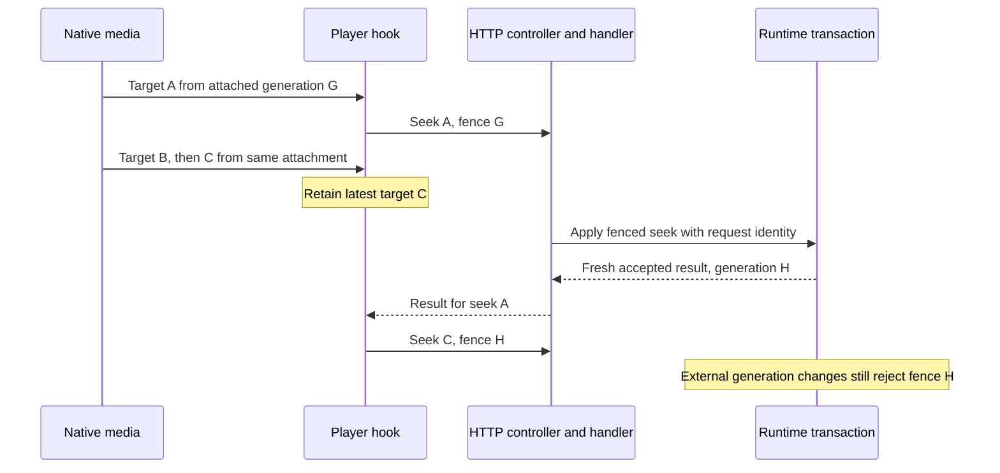

# Rapid native scrubbing - Plan

## Goal Capsule

- **Objective:** Rapid native scrubbing settles playback at the user's latest target.
- **Means:** Carry pending native seek intent through the generation acknowledged by its own accepted command (KTD1–KTD2).
- **Authority:** The user's request for the next production change and `ROADMAP.md` define scope; `CONCEPTS.md` and the project rules define existing contracts.
- **Execution:** Implement the bounded fix and extend existing regressions, then simplify and review it. The lead owns integration, verification, local commits and the roadmap checkpoint. Push only when asked.
- **Stop conditions:** Stop for a product decision if preserving existing generation fences proves incompatible with latest-target behavior; do not weaken the fences.

---

## Product Contract

### Summary

Make consecutive native seek gestures retain the latest target while the first seek replaces the attached execution generation.

### Problem Frame

The player captures the attached generation with each native seek event and serializes control requests.
The first accepted seek advances the server generation, so a later target captured from that same attachment reaches the server with a retired generation and is ignored.
The native control can therefore settle at an earlier target even though the user scrubbed farther.
`ROADMAP.md` records this as the next open production item after single-intention playback verification.

### Requirements

- R1. Consecutive valid native seek targets from the same attached execution settle at the latest target, including targets captured before the first seek response arrives.
- R2. Preserve session ownership, generation and revision fences, sibling control transactions, worker retirement and stale-source suppression.
- R3. Preserve the latest pause/resume intent and invalidate pending seek intent when the session, track, attachment lifetime or component lifetime changes.
- R4. Verify the change through existing focused backend and hook regressions and the existing real-HLS browser control drill.

### Scope Boundaries

The work covers the production seek response and pending native intent in the existing player.
It adds no new playback feature, browser harness, retry framework, schema or durable receipt format.
Reconstructing command acceptance after an ambiguous or lost response is outside this fix: a later state read cannot establish which controller changed the generation.
The existing WebSocket command-handled acknowledgement can continue to ignore the application return value.
Broader codec, browser and release qualification remains outside this item.

---

## Planning Contract

### Key Technical Decisions

- KTD1. **Return proof from the existing transaction.** A fresh, accepted seek returns its authoritative resulting generation through the application result, Messenger `HandledStamp` and HTTP response. A stale, terminal, replayed or otherwise unproven operation supplies no continuation authority. Determine freshness where the existing receipt is inserted; a reread, requested position or arithmetic on the previous generation cannot prove acceptance. Preserve request identity and receipt behavior without changing their stored shape. A fresh same-position seek may acknowledge the unchanged generation.
- KTD2. **Retain one latest pending native target.** While a native seek is in flight, replace its pending target with the newest valid event from the same attachment and session. On a matching KTD1 result, dispatch that pending target with the returned generation before the refresh replaces its attachment; do not wait for replacement media to decode. Repeat only for the same active intent lineage. Capture absolute position before any refresh resets the media cursor. Preserve the captured-generation behavior for unrelated controls and stale sources; refreshes never independently authorize rebasing. If another controller or takeover advances the generation before dispatch, the server still rejects the acknowledged generation.
- KTD3. **Extend existing proof.** (session-settled: user-directed — chosen over redundant test expansion: the requested next item is a production fix.) Add only regressions needed for R1–R3 and extend the current native control browser sequence. Reuse existing coverage of fences, pause intent and track replacement rather than constructing a qualification matrix.

### High-Level Technical Design

### Assumptions and Research

The latest pending target may replace intermediate targets; the user outcome is the final target, rather than restarting an encoder for every pointer movement.
Exact result type and private helper names remain implementation choices.
The existing synchronous command path and controller `HandledStamp` pattern provide the return route.
A single-pass source trace covered native event capture, serialized dispatch, refresh/attachment replacement, transactional receipt insertion and worker fences; no tests or runtime probes were executed during planning.
The code and existing tests establish the local mechanism, so external research adds no decision input.
No new project vocabulary is introduced.

---

## Implementation Units

### U1. Return authoritative seek continuation from the transaction

**Goal:** Provide the minimum acceptance information needed by KTD1.
**Requirements:** R2, R3; KTD1.
**Dependencies:** None.
**Files:** `src/Transcode/Application/Service/TranscodePlaybackControl.php`, `src/Transcode/Application/CommandHandler/UpdateTranscodePositionHandler.php`, `src/Transcode/Application/Port/TranscodeExecutionOwnershipPort.php`, `src/Transcode/Infrastructure/Doctrine/TranscodeRuntimeState.php`, the necessary application DTO under `src/Transcode/Application/DTO/`, `src/Transcode/Interface/Controller/TranscodeSessionController.php`; relevant existing tests in `tests/Unit/Transcode/Application/CommandHandler/SiblingPlaybackControlTest.php`, `tests/Unit/Transcode/Interface/Controller/TranscodeSessionIdentityTest.php`, `tests/Integration/TranscodeControlRevisionTest.php` and `tests/Integration/TranscodeSiblingControlRollbackTest.php`.
**Approach:** Expose the fresh accepted generation from the existing transaction and carry it through the synchronous handler result. Keep non-seek consumers and WebSocket acknowledgement behavior intact. Update OpenAPI response attributes, `openapi.json` and generated files under `ui/web/src/shared/api-client/gen/` through the established export/Orval workflow where the changed response requires it. If the persistence port return changes, adapt its implementations and test doubles within this unit.
**Test scenarios:** A fresh fenced seek returns its committed generation, including an unchanged target; a stale generation and a replay after an intervening command provide no continuation authority; a rolled-back sibling transaction produces no successful response. Extend the existing tests at their appropriate layer rather than adding duplicate cases to every layer.
**Verification:** Focused application/controller tests and the affected existing PostgreSQL integration tests in the CI image; affected static gates and generated-client consistency.

### U2. Carry the latest native target through its accepted predecessor

**Goal:** Deliver R1 using KTD2 without weakening R2–R3.
**Requirements:** R1–R3; KTD1–KTD3.
**Dependencies:** U1.
**Files:** `ui/web/src/features/catalog/hooks/useBaanderPlayer.ts`, `ui/web/tests/features/catalog/hooks/useBaanderPlayer.test.ts`.
**Approach:** Extend the hook's existing serialized control path with one pending native target and scoped continuation authority. While that native chain is active, defer same-session/job refresh snapshot and source replacement, including refresh responses already in flight, so polling cannot discard the pending target before its own seek acknowledgement arrives. Dispatch the pending target from that acknowledgement while keeping refresh application deferred; reconcile with a fresh read when the chain ends or fails, using the existing request timeout. A changed session/job, track replacement or cleanup invalidates the chain immediately. Deferred refresh data never authorizes continuation; an external generation advance still rejects the acknowledged generation. Keep pause/resume ordering and attachment restoration suppression. Dispose pending work with the existing lifetime cleanup and replacement paths.
**Execution note:** Extend the existing regression to demonstrate the retired-generation failure before changing the hook.
**Test scenarios:** Hold seek A's response, capture B then C from the same attachment, deliver a polling refresh for A's committed generation before releasing its response, then accept A with generation H and observe C sent with H and no later B. Include a refresh started before A whose response arrives during the chain; it cannot replace the source or erase C. Preserve the existing captured-generation regression for unrelated events. A stale/replayed/ambiguous response cannot rebase pending work; a track/session replacement or unmount prevents continuation. Existing pause/restoration cases remain green.
**Verification:** Focused hook tests, frontend typecheck and lint.

### U3. Verify the native interaction and record delivery

**Goal:** Verify the actual native media interaction and record the accepted scope.
**Requirements:** R1–R4; KTD3.
**Dependencies:** U1, U2.
**Files:** `ui/web/tests/e2e/two-command/browser.mjs`, `ROADMAP.md`.
**Approach:** Extend the existing `client-controls` sequence to produce consecutive native targets while the previous seek is pending, then observe the last target at the same canonical session/job. Use `scripts/test-worker-operator-container.sh` and its existing `scripts/test-two-command-browser-checkpoint.sh` checkpoint; preserve disposable fixtures and evidence capture. Record delivered behavior and actual verification counts in the roadmap.
**Test scenarios:** Consecutive native targets settle at the last target with real HLS playback; the existing paused/native control sequence retains pause intent and canonical session/job identity.
**Verification:** Existing native browser control drill plus its cleanup evidence. No new runner or broad qualification pass.

---

## Verification Contract

Run `yarn --cwd ui/web test tests/features/catalog/hooks/useBaanderPlayer.test.ts`, `yarn --cwd ui/web typecheck` and the affected frontend lint gate.
Run the named backend files through the disposable coordinator documented in `docs-book/part-2-developer-guide/testing.md`, using the tracked PHPUnit configuration and CI image.
Run PHPStan and Deptrac using existing CI-image gates for changed backend contracts, plus the established OpenAPI/Orval consistency check where generated output changes.
Run the existing operator-container native browser drill with the extended `client-controls` checkpoint, using a disposable `baander.app` target and retained evidence.
Serialize shared-state checks; report actual results, counts and cleanup, and leave any failure explicit.

---

## Definition of Done

The latest-target production fix meets R1–R3 and the focused regressions and existing browser drill pass.
Simplification and code review are complete, justified findings are resolved, and `ROADMAP.md` records delivered scope and verification checkpoints.
No schema, retry framework, new harness or unrelated qualification work enters the change.
