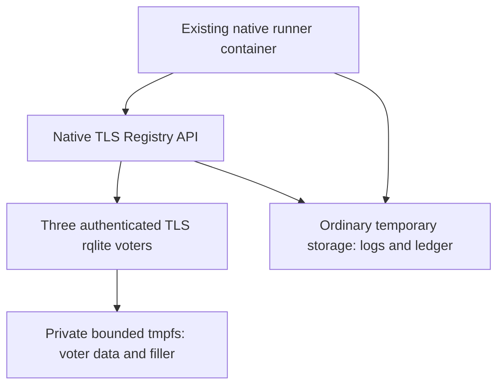
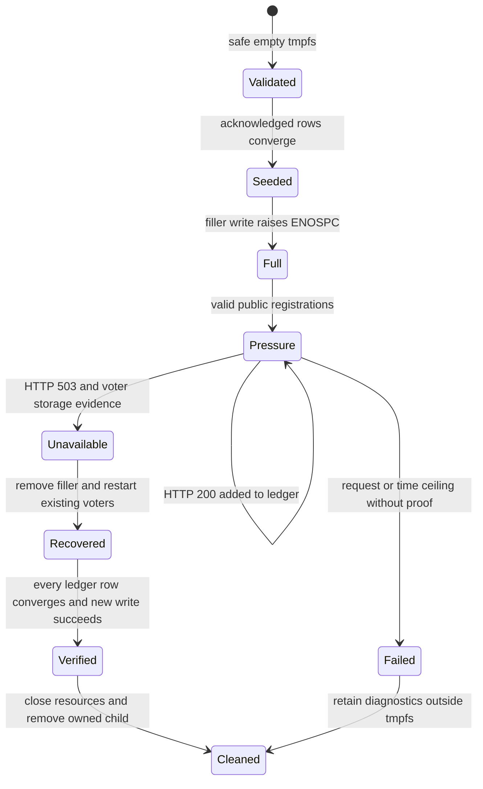

# Registry disk exhaustion qualification - Plan

## Goal Capsule

- **Objective:** Registry operators can recover from a full data filesystem without losing registrations the API acknowledged.
- **Means:** A disposable three-voter qualification exercises real storage exhaustion through the public API and checks recovery against an acknowledgement ledger (KTD1–KTD4).
- **Authority:** The user’s request to continue `ROADMAP.md`, its Registry release and growth acceptance, and the Product Contract below govern scope.
- **Execution:** Implement locally on `plan/registry-disk-exhaustion`; the lead integrates changes, runs the authoritative checks, records evidence and makes local commits. Push only when asked.
- **Stop conditions:** Stop qualification on an unsafe storage root, an unobserved storage fault, lost acknowledged data, or failed recovery. Do not weaken the oracle to obtain a pass.

---

## Product Contract

### Summary

Qualify the remaining local full-disk failure case in `ROADMAP.md` with real SQLite/rqlite voters and the native Registry API.
The result must demonstrate acknowledged-data preservation, truthful public write responses and recovery after space is reclaimed.

### Problem frame

The existing native contracts cover partitions, quorum loss, stale replicas, uncertain commits and fresh binary restoration.
They do not prove behavior when the voter data filesystem actually runs out of space.
A permissions failure, database size setting or mock error cannot establish this acceptance.

### Requirements

**Failure and durability**

- R1. Exercise actual filesystem exhaustion affecting all three disposable voter data directories, and retain evidence tying a failed voter storage operation to that exhaustion.
- R2. Every HTTP 200 registration acknowledged before or during pressure must remain exactly recoverable after restart, including metadata, credential ownership, revision and saved timestamps.
- R3. An unavailable public registration returns HTTP 503 with `Retry-After: 1`, without credentials or an invented success acknowledgement.
- R4. After reclaiming test space and restarting the existing voter processes, the cluster regains authority within 30 seconds and serves preserved registrations plus a new successful registration.

**Containment and qualification**

- R5. Exhaustion operates only inside a dedicated disposable bounded filesystem; existing Registry data, host filesystems and persistent volumes are never filled or reset.
- R6. The required release and sanitizer recipes fail when their full-disk contract cannot run or its storage, response, recovery or cleanup assertions fail.
- R7. Record the exercised failure layer and verification evidence in `ROADMAP.md`, leaving unrelated Registry acceptance open.

### Acceptance examples

- AE1. Covers R1–R3. Given acknowledged seed registrations, when real storage pressure prevents a registration, the API returns the unavailable response and every earlier acknowledged registration remains part of the recovery ledger.
- AE2. Covers R2, R4. Given the preserved voter directories and an unavailable registration attempt, when filler space is removed and the same voters restart, all ledger rows converge exactly on every voter and the same credential can retry the uncertain identity.
- AE3. Covers R5–R6. Given a missing mount, an ordinary directory or a symlinked storage root, when qualification starts, it fails before allocating filler data and leaves unrelated files untouched.

### Scope boundaries

The Registry remains SQLite/rqlite-backed.
This work adds test infrastructure and required gate integration; production fixes are limited to defects reproduced by this contract.
It does not qualify every possible storage failure layer from one observed error.
Certificate injection, snapshots and compaction under resource limits, five-host capacity, regional networks, S3 destination recovery and soak remain separate roadmap work.
No new domain vocabulary is introduced.

---

## Planning Contract

### Existing evidence and patterns

`relay/tests/cluster_support.py` owns real authenticated TLS voter processes, fault links and local requests.
`relay/tests/run_cluster_contract.py` supplies the native API fixture, enrollment-aware registration and local-row/convergence checks.
Its cleanup aggregation and `relay/tests/test_cluster_cleanup.py` are the resource-ownership patterns to extend.
`scripts/test-registry.sh` downloads checksum-verified rqlite 10.5.1 and OpenSSL 3.5.3, builds the native targets and runs the existing contracts before deleting its temporary build.
`.forgejo/workflows/ci.yaml` already requires both `registry-quality` matrix variants before publication.
The latest recorded baseline has 32 CTests and three cleanup tests; implementation must record actual final counts rather than infer them from this baseline.
No relevant stored Registry solution was found in `docs/solutions/`.

### Key technical decisions

- KTD1. **Use the existing native job’s private tmpfs.** Add a Docker `--tmpfs` mount at `/run/baander-registry-full-disk`, initially capped at 128 MiB, to the existing release/sanitize runner container and pass it explicitly as `REGISTRY_FULL_DISK_ROOT` (R5–R6). Docker supplies the mount without privileged host changes; Forgejo supports `--tmpfs` in [`container.options`](https://forgejo.org/docs/v15.0/user/actions/reference/#jobsjob-idcontaineroptions). Keep binaries, certificates, configuration and logs outside it. Restart voter children while the enclosing container stays alive because [Docker tmpfs data disappears when its container stops](https://docs.docker.com/engine/storage/tmpfs/). A bounded real filesystem is preferred to `max_page_count`, chmod or fake error injection because R1 concerns actual capacity exhaustion.
- KTD2. **Validate ownership before filling.** The new storage fixture resolves and rejects symlinks, verifies the configured root is the dedicated tmpfs mount with a device distinct from its parent, enforces the capacity ceiling and an empty initial root, then creates one private run directory (R5). All three voter data directories and one filler file live inside that run directory. Only that fixture-owned child may be removed. Missing or unsuitable storage is an error, never a fallback to ordinary temporary storage or a skipped contract.
- KTD3. **Drive the failure with valid public registrations.** After seed rows converge, allocate filler through real writes until an operation raises `ENOSPC`, flush and close it, and record capacity observations (R1). Submit unique identities with varied near-limit valid metadata through one native API connected to the voters. Stop at the first qualifying 503, with a pressure ceiling of 2,048 requests or 120 seconds, whichever comes first. The run also requires a voter storage diagnostic identifying `ENOSPC` or SQLite’s full-database error during that phase. A timeout, dead child or public 503 alone is insufficient. Spare capacity inside preallocated Raft/WAL files explains why a full mount may still admit initial successful registrations. Record whichever layer actually fails; do not claim both Raft log exhaustion and SQLite `SQLITE_FULL` unless both were observed. Strong-query pressure is unnecessary unless execution demonstrates the public request budget cannot reach the failure; such a change requires revisiting this decision rather than silently substituting a weaker oracle.
- KTD4. **Use a ledger and preserve uncertain outcomes.** Capture each HTTP 200’s submitted metadata and returned revision/timestamps, together with the expected credential digest, before sending the next pressure request (R2–R4). Derive each fresh identity’s full expected row directly from the submission and acknowledgement: revision is one and `created_ms`, `updated_ms` and `last_seen_ms` share the returned creation timestamp, following `relay/cpp/core.cpp`. Do not depend on a subsequent database read to record an acknowledgement because storage or leadership may fail immediately afterwards. Seed identities stay unchanged during pressure. Reclaim only the filler, stop remaining voter children, and restart those children on their existing directories without manual data merging. Compare every acknowledged row against local diagnostic reads on all voters, then verify public lookup responses. A 503 identity may have committed or may replay during recovery, so do not require its absence. Retry it with the same credential after recovery and verify ownership and a valid revision advance from its recovered state.
- KTD5. **Preserve health and readiness meanings.** Keep the native API running through pressure and require its liveness endpoint to answer HTTP 200 (R3). Readiness continues to describe authoritative read availability: storage exhaustion need not force it to fail while linearizable reads still work. Probe readiness after the failed pressure request so it cannot affect admission of the pressure writes. Verify restored readiness after recovery; do not introduce a production disk-space health policy solely for this test.

### High-level technical design

### Assumptions and execution-time details

The 128 MiB cap is a containment budget, not evidence of the optimized whole-host resource requirement.
Measure startup allocation and pressure duration during implementation; they must fit this cap and KTD3’s limits.
If they do not, report the evidence and revise the design before raising either limit.
Exact matching of pinned rqlite storage diagnostics and fixture helper names are implementation details.
All logs and the acknowledgement ledger must remain available outside the exhausted filesystem when an assertion fails.
The native API and voter binaries may need rebuilding because no retained verified build is available.

---

## Implementation Units

### U1. Prove full-disk response and recovery in owned storage

- **Goal:** Provide safe bounded storage, exercise real exhaustion and verify every acknowledged registration survives recovery with reliable teardown.
- **Requirements:** R1–R6; AE1–AE3; KTD1–KTD5.
- **Dependencies:** None.
- **Files:** Modify `relay/tests/cluster_support.py`; create `relay/tests/run_storage_contract.py` and `relay/tests/test_storage_cleanup.py`; retain `relay/tests/test_cluster_cleanup.py` as regression coverage. Reuse helpers from `relay/tests/run_cluster_contract.py` and `relay/tests/enrollment_support.py`.
- **Approach:** Add a narrow optional voter-data root to `Cluster`, preserving its default path for existing contracts. Put mount validation, filler ownership and disposal in the new contract. Reuse existing resource cleanup aggregation so one teardown failure cannot prevent attempts to close remaining APIs, voters, logs and fault links. Implement the lifecycle above with near-limit metadata using `baander.app` hostnames. Keep raw credentials out of diagnostics and record only their expected digests. Retain mount identity, byte usage, filler errno, pressure counts, public response evidence, relevant voter errors and recovery timing. Begin with the live contract before considering any production correction.
- **Test scenarios:**
  - Covers AE3. Missing root, ordinary filesystem, oversized mount, symlink root or nonempty initial root fails before filler allocation.
  - An owned child can be removed after a partial setup failure while an unrelated sibling sentinel remains unchanged.
  - A failure during filling closes its descriptor and still reaps fixture children and releases listeners.
  - A cleanup error is retained alongside the original assertion failure while remaining resources are closed.
  - Existing cluster contracts still select their original data directories when no override is supplied.
  - Covers AE1. Seed rows converge, actual filler writes reach `ENOSPC`, valid pressure reaches a storage-caused public 503 within KTD3’s bounds, and intermediate successful registrations enter the ledger.
  - A run that receives only successful writes, misses voter storage evidence or reaches the pressure deadline fails qualification.
  - Covers AE2. Reclaiming filler and restarting preserved voter directories restores authority within R4’s bound and reproduces every acknowledged row on every voter.
  - The unavailable identity is handled correctly whether absent or committed after restart; its original credential can retry without transferring ownership.
  - A fresh post-recovery identity registers successfully and converges, while the running API remains live during the failure.
  - An injected ledger mismatch fails the comparison rather than passing on row count or eventual readiness alone.
- **Verification:** Focused storage ownership tests and existing cleanup tests pass without touching real user data. The real contract proves the recorded filesystem fault, public response and exact recovery oracle against the pinned binaries. Focused helper tests prove missing evidence, pressure ceilings and ledger mismatches fail.

### U2. Require the contract and record acceptance

- **Goal:** Make full-disk qualification a mandatory native release gate with reproducible local instructions.
- **Requirements:** R6–R7; KTD1.
- **Dependencies:** U1.
- **Files:** Modify `scripts/test-registry.sh`, `.forgejo/workflows/ci.yaml`, `tests/Unit/Shared/Infrastructure/Ci/PublicationWorkflowTest.php`, `relay/README.md` and `ROADMAP.md`.
- **Approach:** Run the new ownership tests and full-disk contract in both release and sanitize recipes before their downloaded binaries/build are removed. Require the mount variable in these modes, fail early on missing prerequisites, and keep thread/fuzz routing explicit. Update the local release/sanitize instructions to include the dedicated Docker tmpfs and environment variable. Preserve the existing publication dependency on both native variants. Record only the completed full-disk acceptance and actual checkpoint evidence in the roadmap.
- **Test scenarios:**
  - Workflow regressions require the dedicated bounded mount, required environment and both matrix modes.
  - The full-disk runner’s failure propagates through the native recipe and blocks publication.
  - Missing storage configuration fails the required modes instead of skipping the contract.
  - Existing registry container, thread, fuzz and static gate routes retain their publication dependencies.
- **Verification:** Workflow tests pass in the CI image, both complete native recipes pass in their mounted containers, and the README instructions describe the exercised setup.

---

## Verification Contract

| Gate | Scope | Passing evidence |
|---|---|---|
| `bash -n scripts/test-registry.sh` and `git diff --check` | U2 and all edits | No syntax or whitespace errors |
| `PYTHONDONTWRITEBYTECODE=1 python3 relay/tests/test_storage_cleanup.py` | U1 | Ownership, missing evidence, bounds and ledger failure controls pass |
| `PYTHONDONTWRITEBYTECODE=1 python3 relay/tests/test_cluster_cleanup.py` | U1 | Existing process/listener cleanup tests pass |
| `bash scripts/test-backend-container.sh --testsuite Unit --filter PublicationWorkflowTest` | U2 | Actual selected workflow test/assertion counts and zero failures in the CI image |
| `REGISTRY_FULL_DISK_ROOT=/run/baander-registry-full-disk bash scripts/test-registry.sh release` | U1–U2 | Full optimized native recipe passes inside the validated mounted runner |
| `REGISTRY_FULL_DISK_ROOT=/run/baander-registry-full-disk bash scripts/test-registry.sh sanitize` | U1–U2 | Full ASan/LSan/UBSan native recipe passes inside the validated mounted runner |
| Prose preservation audit and independent final review | Documentation and final diff | Intentional prose changes accounted for; justified findings applied |

The last two recipes require KTD1’s Docker mount and the repository’s pinned native toolchain prerequisites.
Their full logs stay in temporary artifacts; the checkpoint records suite counts, compiler/runtime versions, actual failure layer, elapsed pressure/recovery times and final status.
Run the live storage qualification serially per mount, and do not treat passing mocks or preflight rejection as the positive full-disk result.
Separate static, thread, fuzz and production-container reruns apply only if their affected code or integration changes require them.
No PostgreSQL or UI acceptance is changed by the planned files.

---

## Definition of Done

- R1–R7 and AE1–AE3 are supported by the named checks, including a real capacity error affecting voter storage.
- Every acknowledged row survives restart and converges exactly, with preserved credential ownership and a successful new registration after recovery.
- Release and sanitize gates require the new contract and fail when it cannot establish its evidence.
- Owned resources are removed after success and failure; diagnostics survive outside tmpfs and no existing data is reset.
- `ROADMAP.md` records delivered scope, actual suite counts, static checks, timings and remaining Registry acceptance without marking the entire failure package complete.
- Documentation prose has passed preservation review, justified independent review findings are applied, and abandoned experimental code is removed.
