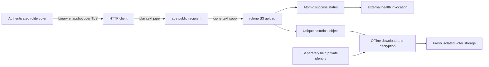
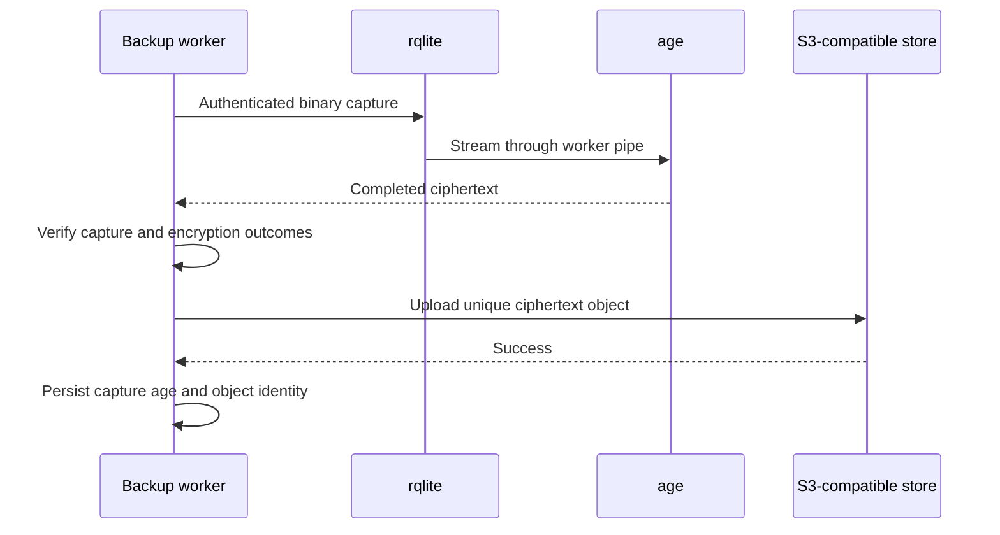
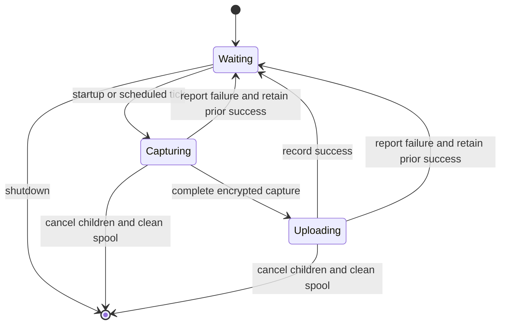

# Registry encrypted backups

## Goal Capsule

**Objective:** Operators can recover Registry registrations from a recent, independently stored backup after losing the voter storage.

**Means:** An opt-in backup container captures authenticated rqlite snapshots, encrypts them before upload and preserves separate historical objects in S3-compatible storage (KTD1–KTD3).

**Authority:** The user's choice to encrypt before upload governs encryption and recovery-key custody; `ROADMAP.md` governs the release milestone and deferred qualification; this plan governs implementation choices.

**Execution profile:** Implement the automation and prove the new behavior against disposable local services. The lead integrates, records verification in `ROADMAP.md`, completes repository review and local commits, and pushes only when asked.

**Stop conditions:** Do not access real destinations, mount an offline recovery identity into the recurring uploader, reset existing voter data or claim the deferred destination/RPO/RTO rehearsal.

---

## Product Contract

### Summary

Add encrypted, versioned five-minute S3-compatible backup automation for the Registry. Deliver the scheduler, container configuration, local end-to-end proof and recovery instructions as one bounded release implementation.

### Problem Frame

The Registry already proves authenticated binary backup and restoration into fresh voter storage in `relay/tests/run_restore_contract.py`. Operators still have no recurring process that stores encrypted recovery copies outside the voter storage. A local restore contract alone cannot protect registrations after losing that storage.

### Requirements

- R1. Capture a consistent binary snapshot through the authenticated rqlite backup API immediately on startup and every 300 seconds while the backup worker runs. Run one capture/upload attempt at a time, bound its duration below the interval, and report missed or failed attempts.
- R2. Encrypt the snapshot before any bytes are sent to object storage. The uploader needs only a public age recipient; operators keep the matching private recovery identity separately, outside the uploader and bucket credentials.
- R3. Upload each completed ciphertext under a unique UTC timestamp and random suffix, preserving historical versions without overwriting or deleting older objects. Support operator-configured S3 endpoint, region, bucket and prefix. Require authenticated TLS to rqlite and object storage.
- R4. Publish success only after snapshot retrieval, encryption and upload all succeed. Preserve the last success when an attempt fails; expose attempt failure and backup age through a separate status/health command suitable for an external monitor. Measure age from snapshot capture start, not upload completion.
- R5. Prove locally that an uploaded object can be downloaded, decrypted with the separately held identity and restored into fresh isolated voter storage with the existing registration ownership, revision, migration checksum and post-snapshot-sentinel assertions.
- R6. Package and document the opt-in worker, secret mounts, five-minute schedule, status semantics and offline recovery procedure. Record the implementation and actual verification in `ROADMAP.md`, retaining actual-destination qualification and the five-minute RPO/30-minute RTO rehearsal as open work.

### Scope Boundaries

In scope: a small standalone backup coordinator, standard encryption and S3 tools, an opt-in container, targeted disposable-service verification and operator instructions.

Considered and not built:

- Automatic retention or object deletion: the request is for recoverable historical copies; deletion introduces an avoidable data-loss policy. Operators own storage lifecycle decisions.
- A new public backup API, application scheduler or PHP dependency: the existing authenticated rqlite administration API and standalone deployment are sufficient.
- Multi-worker election, broad retries or provider failover: operators deploy one worker; a bounded failed attempt is observable and the next scheduled attempt retries.
- Mandatory bucket versioning or Object Lock: distinct immutable backup keys provide historical versions across S3-compatible providers. Operators can add provider retention controls separately.
- A broad new registry test project: reuse the existing restore contract and add coverage only for new backup behavior.

### Deferred to Follow-Up Work

Real destination credentials and qualification, actual five-minute RPO and 30-minute RTO rehearsal, whole-host backup capacity measurements, retention policy and nightly orchestration remain separate roadmap work. Local disposable-service results cannot complete those items.

---

## Planning Contract

### Context and Research

`relay/docker/voter.compose.yml` and `relay/docker/rqlite.Dockerfile` establish authenticated TLS, immutable base images, amd64 packaging and non-root containers. The pinned rqlite version is 10.5.1. Its native automatic uploader lacks client-side encryption, so it cannot implement R2 alone.

`relay/tests/run_restore_contract.py` supplies binary capture, SQLite integrity, credential-digest, revision and fresh-cluster restore assertions. Preserve those assertions rather than duplicating a second storage contract. `scripts/test-registry-static.sh` checks exact dependency notices and pins; new bundled tools must extend that scoped inventory.

The solution `docs/solutions/architecture-patterns/health-checks-run-in-a-messenger-consumer-cannot-see-outages-that-stop-it.md` shows why a worker cannot reliably report its own disappearance. The backup health command therefore reads persisted success age in a separate invocation; an external monitor must invoke it.

### Key Technical Decisions

- KTD1. Encrypt before upload, using public-recipient age encryption and separately stored private recovery identity (session-settled: user-directed — chosen over upload without client-side encryption: recovery material must remain separately controlled). Governs R2. Use standard age rather than designing a cryptographic format; no decrypt identity is needed by recurring capture.
- KTD2. Use a small Python standard-library coordinator with standard command-line tools for encryption and S3 transfer. Use curl for authenticated snapshot transport, age for R2 and rclone for authenticated S3-compatible transfer; pin and verify their releases in the image. This keeps cryptography and request signing in maintained tools rather than custom implementations or the PHP application.
- KTD3. Name each ciphertext object with capture UTC time plus a collision-resistant random suffix and a `.sqlite.age` extension. Use immutable upload semantics, retaining all completed versions. Bucket-native versioning is optional; do not claim it was enabled or qualified.
- KTD4. Fail closed on an incomplete snapshot. Check HTTP status, authenticated hostname-verified TLS, complete transfer, any rqlite stream-error trailer and successful age completion before starting upload. Use curl without redirect following and omit the rqlite redirect option; pinned rqlite proxies a follower backup request to its leader internally. Accept only an exact HTTP 200 with binary content type, a SQLite prefix and a complete transfer. Inspect the actual nonempty `X-STREAM-ERROR` field in captured headers/trailers; its declaration in `Trailer` alone is normal.
- KTD5. Stream plaintext through process pipes into age; spool only completed ciphertext in private bounded temporary storage. Keep headers and secrets out of logs, clean failed artifacts and terminate child processes on timeout or shutdown. Keep the implementation small; use curl HTTP/1.1 with bounded header capture, which retains trailers; Python `http.client` discards them. Keep fixed response/header and ciphertext limits explicit and configurable where needed for actual snapshot size.
- KTD6. A single worker uses monotonic 300-second scheduling with an overall attempt deadline shorter than one interval. It never overlaps attempts or queues missed ticks. The status file is atomically replaced and records capture start, upload completion, object key and ciphertext hash for the last success, plus the latest attempt outcome. Health fails with no success or when capture age exceeds the documented interval-plus-attempt grace. A failed attempt never refreshes success age.
- KTD7. The backup service is opt-in and separate from voter startup. Mount rqlite client TLS/auth, public recipient and private S3 configuration read-only; keep the recovery identity offline. Do not place credentials in process arguments, Compose values, committed examples or status. Use read-only root filesystem, non-root user and bounded temporary storage. Do not claim existing voter resource allocations leave room for the new service; whole-host qualification remains deferred.

### High-Level Technical Design

### Assumptions

Operators designate one worker and supply an existing reachable S3-compatible bucket, upload-scoped credentials and valid TLS material when enabling the service. The private recovery identity and independent destination access are operational prerequisites for recovery, documented and exercised with disposable material locally. No production destination is available in this implementation checkpoint.

### Open Questions

No product question blocks implementation. Exact tool versions and archive checksums must be verified against official releases during packaging. Final function names, local fixture layout and timeout configuration syntax are implementation details. Destination access, live capacity and recovery timing are deferred qualifications.

---

## Implementation Units

### U1. Capture and upload encrypted historical backups

**Goal:** Implement the complete bounded one-shot backup operation and its status record.

**Requirements:** R1–R4; KTD1–KTD6.

**Dependencies:** None.

**Files:** Create `relay/backup/registry_backup.py`; add focused new-behavior coverage in `relay/tests/run_backup_contract.py`.

**Approach:** Provide one-shot, recurring and health entry points around one operation. Read mounted configuration, verify endpoints, stream capture into age, reject incomplete capture, upload completed ciphertext with rclone and atomically publish success. Keep process supervision, temporary-file cleanup and error reporting explicit. Reuse existing authentication/TLS conventions from the relay contracts without importing test fixtures into runtime code.

**Execution note:** Start with focused proof that failed capture or encryption cannot reach upload; use real age/rclone for the end-to-end path.

**Test scenarios:**

1. A valid authenticated snapshot produces a ciphertext object under a unique key; a second successful run preserves both objects.
2. Rejected TLS/authentication, incomplete transfer, stream-error trailer or encryption failure prevents upload and leaves the previous success unchanged.
3. Upload refusal or deadline expiry reports failure, cleans temporary artifacts and keeps the old capture age.
4. Health fails with no success or stale capture; a slow upload cannot make an old capture appear newer.
5. A short injected scheduling clock/deadline proves no overlapping attempts, startup capture and subsequent scheduled retry without waiting five minutes in tests.

### U2. Package the opt-in worker and dependency notices

**Goal:** Make the new operation deployable with isolated secrets and bounded resources.

**Requirements:** R1–R4, R6; KTD1, KTD2, KTD7.

**Dependencies:** U1 interface and configuration contract.

**Files:** Create `relay/docker/backup.Dockerfile`, `relay/docker/backup.compose.yml` and `relay/backup/backup.example.json`, `relay/backup/rclone.example.conf` and `relay/backup/recipients.example.txt`; modify `relay/README.md`, `relay/third_party/` and the scoped pin/notice checks in `scripts/test-registry-static.sh`.

**Approach:** Follow existing Debian digest, amd64, non-root and read-only filesystem patterns. Verify selected age/rclone artifacts by checksum, retain their license notices and list versions. Provide public-recipient and secret-file mounts, private writable status and bounded ciphertext storage. Do not attach the worker implicitly to every voter.

**Test scenarios:**

1. Build and run the image as its declared non-root user with read-only root and disposable mounts; missing required configuration fails visibly without upload.
2. The Compose definition resolves with disposable values and leaves backup activation explicit.
3. Dependency pins, downloaded notice contents and the targeted inventory checks agree; no unqualified transitive license claim is added.

### U3. Prove offline recovery and document operation

**Goal:** Exercise the new encrypted object path through the existing fresh-cluster restore contract and publish accurate operator instructions.

**Requirements:** R5–R6; KTD1–KTD7.

**Dependencies:** U1 and U2.

**Files:** Extend `relay/tests/run_backup_contract.py`; minimally extract or parameterize reusable restore assertions in `relay/tests/run_restore_contract.py` if needed; add `scripts/test-registry-backup.sh`; update `relay/README.md`, `relay/docker/inventory.example.env`, `docs-book/part-2-developer-guide/registry-threat-model.md`, `.forgejo/workflows/ci.yaml` and `ROADMAP.md`. Add a `CONCEPTS.md` entry only if a project-specific term is introduced.

**Approach:** Use a disposable TLS S3-compatible service, rclone's supported S3 test server, with disposable SigV4 credentials and TLS. Keep fixtures small and disable multipart only for that fixture server's documented limitation; real destination compatibility remains deferred. Keep the private age identity solely in the test's recovery step. Download the real uploaded ciphertext, authenticate decryption before loading, and run the established ownership/revision/schema/sentinel restore assertions in fresh voter storage. Add the bounded new-feature gate to the relevant CI job, without rerunning unrelated registry suites solely for this feature.

**Test scenarios:**

1. Source registrations and an updated revision survive capture, upload, download, separate-identity decryption and fresh-cluster restore; the post-capture sentinel is absent and wrong ownership remains rejected.
2. The stored object has an age envelope and does not expose a SQLite header; a wrong identity and modified ciphertext both fail before restore.
3. The container path works against disposable authenticated TLS object storage and never contacts configured deployment hosts.

**Documentation verification:** Review the recipient/identity separation, first activation, status/health threshold, object selection, ciphertext verification, offline decryption and fresh-storage restore instructions against the implementation. Provide an explicit download/decrypt-to-new-file recovery entry point or documented standard-tool procedure; never automate loading into a live cluster. Run `prose-fix` over changed prose. Record actual local suite counts and static/container gates; keep deferred destination and recovery-time acceptance unchecked.

---

## Verification Contract

Run no tests during planning. During implementation use the repository CI image and existing relay contract conventions. Run Python syntax/static checks for changed scripts, the bounded backup contract with real age/rclone and disposable TLS services, the packaged-worker smoke and Compose validation, the affected direct dependency pin/notice checks and `git diff --check`. If shared restore helpers change, run the existing local restore contract once as a regression check. Keep expensive shared-state runs serialized.

The local end-to-end result proves the shipped encryption/upload/recovery path under disposable conditions. It establishes neither real destination compatibility nor a five-minute RPO, 30-minute RTO, whole-host resource budget or live disaster-recovery rehearsal.

---

## Definition of Done

- U1–U3 satisfy their requirements and meaningful new-behavior scenarios.
- The packaged recurring worker encrypts before upload and cannot access the separately stored private identity.
- Distinct ciphertext objects survive multiple captures and restore correctly through the established contract.
- Status truthfully separates capture age, upload completion and latest failure.
- Operator documentation matches the actual mounted files, commands and failure semantics.
- Dependency notices and affected static checks pass; `ROADMAP.md` records delivered scope and actual verification while preserving deferred qualification.
- Required simplification and code review finish, justified findings are applied and local commits are created by the lead. No push occurs without request.

---

## Sources and References

- `ROADMAP.md`, remaining Registry release implementation and deferred recovery qualification.
- `relay/docker/voter.compose.yml`, `relay/docker/rqlite.Dockerfile` and `relay/README.md`, deployment and dependency conventions.
- `relay/tests/run_restore_contract.py`, local binary backup and isolated restore proof.
- `scripts/test-registry-static.sh`, direct dependency pin and notice inventory.
- [rqlite backup guide](https://rqlite.io/docs/guides/backup/), native snapshot and upload capabilities.
- [age](https://github.com/FiloSottile/age), public-recipient encryption and offline identity decryption.
- [rclone S3 backend](https://rclone.org/s3/), S3-compatible endpoint and credential configuration.
- [rclone copyto](https://rclone.org/commands/rclone_copyto/), single-object transfer.
