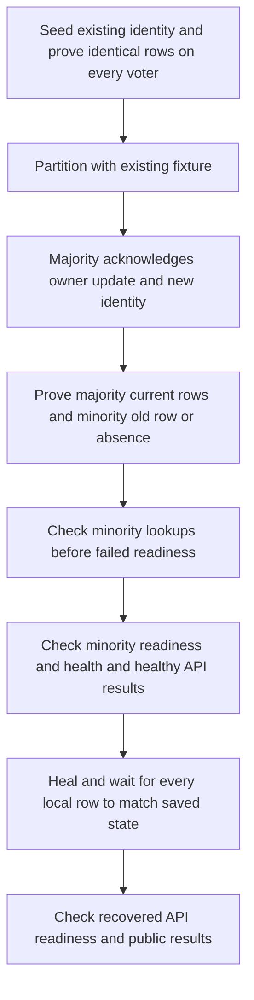

# Registry stale follower verification - Plan

## Goal Capsule

- **Objective:** Operators have repeatable evidence that registry discovery refuses obsolete metadata and false absence during a partition, then recovers the acknowledged state after rejoin.
- **Means:** Extend the existing native three- and five-voter partition contract with explicit divergent row observations (KTD1–KTD3).
- **Authority:** The Product Contract owns behavior; the Planning Contract owns the verification mechanism within those requirements; implementation units override neither.
- **Execution profile:** Bounded test and documentation work on `plan/registry-stale-follower-verification`; retain the SQLite/rqlite architecture.
- **Stop conditions:** Stop if the contract exposes a production consistency defect requiring a behavior change; report the evidence and proposed correction before expanding this test-only scope.
- **Completion owner:** The lead integrates the work, runs authoritative checks, records evidence, and makes local commits; push only when requested.

---

## Product Contract

### Summary

Qualify the registry's existing authoritative discovery behavior against replicas whose rows are demonstrably stale.
The contract will distinguish an obsolete registration from a registration missing only on the isolated voters, then verify content convergence after healing.

### Problem Frame

The current cluster contract rejects minority lookups before it creates majority-only records.
Its rejoin check waits for applied indices and reads through an API pool, which can select a healthy voter.
Those checks do not directly establish that every voter's stored content diverged during the partition and converged afterwards.
This leaves a gap in the Registry release and growth failure qualification recorded in `ROADMAP.md`.

### Requirements

**Partitioned discovery**

- R1. Demonstrate obsolete metadata for one existing public ID and false local absence for one new public ID on every isolated minority voter after the majority acknowledges both changes.
- R2. Minority API lookups for both public IDs return HTTP 503 with `Retry-After: 1` and a fixed public error envelope, without metadata or credentials.
- R3. Minority readiness returns HTTP 503 while liveness remains HTTP 200 with its existing public envelope.
- R4. The majority API and the existing API pool with healthy configured endpoints return the latest acknowledged public metadata and revision for both public IDs during the partition.

**Recovery and evidence boundaries**

- R5. After healing, every voter's local rows match the acknowledged metadata, revisions, timestamps, and credential digests, and the formerly isolated API becomes ready and returns the current public results.
- R6. Production reads remain explicitly linearizable, writes remain committed transactions, and public registration, enrollment, ownership, and response contracts remain unchanged.
- R7. Record actual verification results without treating this local contract as full-disk, regional-network, constrained-capacity, backup, or soak qualification.

### Acceptance Examples

- AE1. **Covers R1, R2, R4.** Given a public ID visible on all voters, the majority updates its URL, name, and version with the same credential after partition; minority local rows retain the original revision, minority public lookup returns 503, and majority-capable APIs return the new revision and metadata.
- AE2. **Covers R1, R2, R4.** Given an unused public ID, the majority creates it after partition; minority local queries show no row, minority public lookup returns 503 rather than 404, and majority-capable APIs return its acknowledged revision.
- AE3. **Covers R3, R5.** Given the divergent rows from AE1 and AE2, failed readiness leaves liveness healthy; after healing, all local rows match the saved acknowledged rows and the formerly isolated API returns both current records.

### Scope Boundaries

The implementation changes `relay/tests/run_cluster_contract.py` and updates `relay/README.md` and `ROADMAP.md` with verified evidence.
Existing authenticated TLS fixtures and temporary voter storage remain the execution environment.
No schema, deployment, volume-reset, automatic quorum-reduction, or production transport change is planned.
No new project-specific domain term is introduced, so `CONCEPTS.md` needs no entry.

### Deferred to Follow-Up Work

Actual full-disk injection, further certificate-lifecycle cases, simultaneous claims through separate API processes, constrained hosts, regional links, operational S3 restoration, and the 24-hour soak remain separate qualification work.
A new fault-proxy abstraction is not built: the existing partition fixture already produces the required divergence; reconsider only if a demonstrated fixture limitation prevents R1.

---

## Planning Contract

### Key Technical Decisions

- KTD1. **Reuse the existing partition phase.** Add the two identities to the current three-/five-voter scenarios in `relay/tests/run_cluster_contract.py`, preserving the existing observer's single uncertain-write assertion and failure cleanup.
- KTD2. **Observe local state independently of the API.** Use `Cluster.request` with authenticated `/db/query?level=none&associative` diagnostic queries against every voter, selecting the complete registration row; these reads prove R1 and R5 and are confined to the test harness. The [rqlite consistency contract](https://rqlite.io/docs/api/read-consistency/) makes `none` suitable for observing isolated local state without forwarding or quorum contact.
- KTD3. **Check content, not indices alone.** Capture the initial row and acknowledged majority rows as comparison snapshots, validate their digests against the submitted credentials, and compare exact selected row contents across voters within the existing 30-second convergence budget.
- KTD4. **Probe lookup before failed readiness.** Exercise both minority lookups while its API is still initialized, then probe readiness and health; `Server::route` clears `initialized` after failed readiness, so the reverse order could satisfy R2 through the schema guard without testing authoritative lookup.
- KTD5. **Keep the API result checks precise.** Reuse the existing fixed unavailability-error vocabulary for R2, require exactly an `error` envelope on failure, and compare each successful `data` envelope with its saved public snapshot while excluding credential fields.

### High-Level Technical Design

The sequence below separates the diagnostic evidence from the public contract.
Local diagnostic reads never select the endpoint used by the production API.

### Assumptions and Risks

- The existing peer-link partition prevents authoritative minority reads, as its current linearizable rejection assertions establish.
- Establish the baseline on every voter before partition, then bound all convergence polling; a slow application must fail with the voter and observed state rather than silently skipping evidence.
- Update the seed with the original credential and no enrollment capability, assert revision advances by one, and retain the new public snapshot in the existing acknowledged-record collection.
- Compare `created_ms`, `updated_ms`, and `last_seen_ms` from saved committed rows rather than assuming the clock advances between operations; the owner update must preserve creation time and never decrease update or heartbeat time.
- A diagnostic query failure is a test failure, not evidence of stale data; validate HTTP status, statement errors, and row cardinality before comparing contents.

### Open Questions

No launch-blocking question remains.
Helper names and the smallest factoring of repeated row/error assertions are implementation details.
The negative control described below is conditional on a cheap isolated build; its omission must be reported rather than represented as passing evidence.

---

## Implementation Units

### U1. Prove stale discovery rejection and content convergence

- **Goal:** Close R1–R6 in both supported voter counts.
- **Requirements:** R1–R6; AE1–AE3.
- **Dependencies:** None.
- **Files:** `relay/tests/run_cluster_contract.py`.
- **Approach:** Apply KTD1–KTD5 with small local helpers; keep diagnostic reads separate from API calls and preserve the original failure, restart, and observer assertions.
- **Execution note:** Start by adding the explicit stale-row and missing-row observations before strengthening the corresponding public assertions.
- **Patterns to follow:** `verify`, `wait_converged`, `verify_cross_api_ownership`, the no-quorum fixed-error assertions, and `Cluster.request` in `relay/tests/cluster_support.py`.
- **Test scenarios:**
  - Covers AE1. Both partitions retain the seed's old row on every minority voter while majority-capable APIs expose the owner update.
  - Covers AE2. Every minority voter lacks the new row while public lookup rejects false absence.
  - Covers AE3. Each recovered voter matches both saved rows and the formerly isolated API returns current public snapshots.
- **Verification:** The authoritative release suite and explicit five-voter contract pass without weakening existing contracts; all relevant cleanup regressions pass.

### U2. Record the delivered qualification and its limits

- **Goal:** Make R7 reviewable from the registry documentation and roadmap.
- **Requirements:** R7.
- **Dependencies:** U1 and its verification evidence.
- **Files:** `relay/README.md`, `ROADMAP.md`.
- **Approach:** Describe the new diagnostic proof and exact delivered checkpoint, including suite counts, voter counts, and static gates; retain outstanding release gates and avoid checking off a broader mixed-scope item.
- **Test expectation:** None -- documentation records U1's executed evidence and does not introduce runtime behavior.
- **Verification:** Apply `prose-fix`, inspect evidence claims against logs, and pass whitespace checks.

---

## Verification Contract

- Run `scripts/test-registry.sh` in release mode in the native qualification environment: a disposable Debian trixie container with Clang 19; preserve its CTest, cleanup, SQL, TLS transport, HTTP, three-voter, restore, and load-smoke evidence. The current inventory is 32 CTests and three cleanup regressions; record executed counts if that inventory changes.
- Run `relay/tests/run_cluster_contract.py` separately with five voters using verified pinned rqlite and the freshly built registry executable.
- Run `relay/tests/test_cluster_cleanup.py` and any existing harness regressions affected by the new helpers; do not duplicate full suites without a change or unresolved failure.
- Run Python syntax validation for the touched harness and whitespace checks for the final diff; record the executed checks in `ROADMAP.md`.
- Run the three-voter contract with an existing verified sanitizer build if available; a new sanitizer build is not required solely for Python assertions and prose, because no C++ behavior changes. If implementation expands into C++, the normal release, ASan/LSan/UBSan, static, and TSan requirements apply.
- Where a cheap isolated rebuild is available, temporarily change only lookup consistency to `none` in a disposable source/build copy and require the new assertions to fail on stale metadata or false absence before readiness is probed. Arrange the disposable harness to reach those assertions rather than stopping at an older minority rejection assertion. Keep the real branch untouched; report the failure point and discard the disposable copy. This diagnostic control does not qualify a weakened binary.
- Review the final diff for credentials in diagnostics, production consistency changes, planning IDs in source/tests, and unbounded waits; retain detailed logs outside the repository and pass `git diff --check`.

---

## Definition of Done

- U1 passes AE1–AE3 with three and five voters, including exact local row proof on every voter before partition, during divergence, and after healing.
- Existing uncertain-write, leader recovery, crash/restart, total-quorum-loss, ownership, and cleanup contracts retain their checks.
- U2 records only executed evidence, and the remaining gates in R7 remain open.
- The plan passes independent `ce-doc-review` before implementation; phase-boundary `ce-simplify-code` and pre-shipping `ce-code-review` are complete with justified findings applied.
- The lead records all delivered items and verification checkpoints in `ROADMAP.md`, commits locally on the plan branch, and leaves existing user data intact.

---

## Appendix

- `ROADMAP.md`, C++ registry and Registry release and growth: scope and remaining release qualification.
- `relay/README.md`, Contract and Local checks: authoritative read/write semantics and the boundary between local and deployment evidence.
- `relay/tests/run_cluster_contract.py`: existing partition, failover, index convergence, ownership, and total-quorum-loss assertions.
- `relay/tests/cluster_support.py`, `Cluster.request`: authenticated direct voter diagnostics using disposable TLS credentials.
- `relay/cpp/server.cpp`, `Server::route`: readiness changes initialization state after failure.
- [rqlite read consistency](https://rqlite.io/docs/api/read-consistency/): `none` reads local SQLite without leadership/contact checks; linearizable reads require quorum contact. This distinction is diagnostic evidence for KTD2, not permission to weaken R6.
