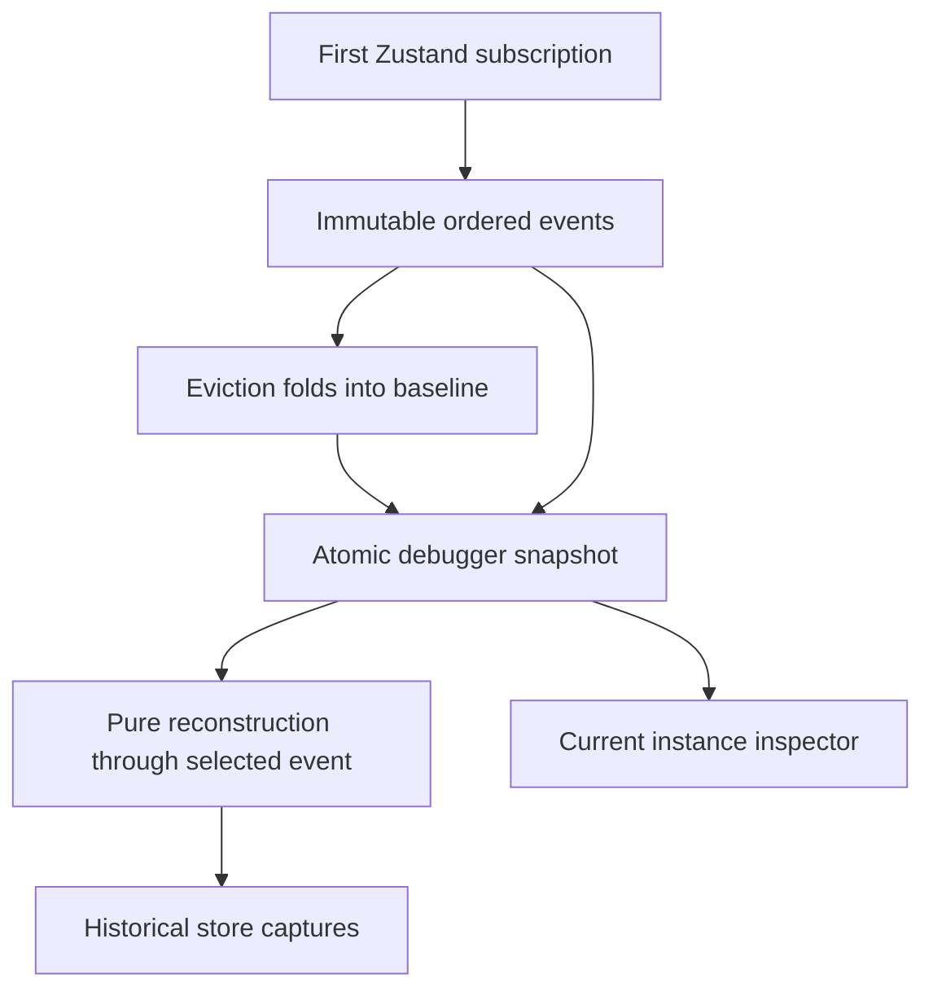
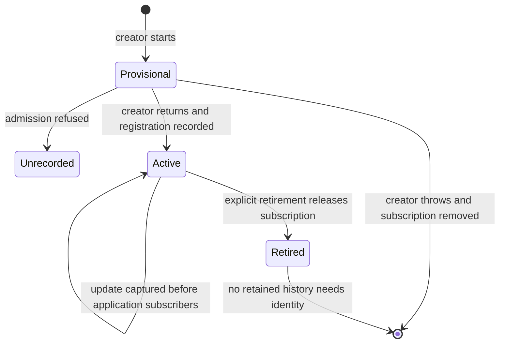
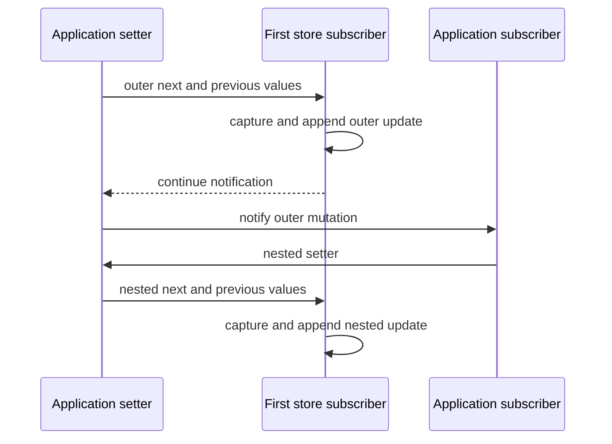

# Store Capture Reconstruction - Plan

## Goal Capsule

- **Objective:** Developers can inspect the captured state of every recorded store at a selected point in the timeline.
- **Means:** Reconstruct detached diagnostic captures from a bounded baseline and ordered recorder events (KTD1–KTD4).
- **Authority:** Repository instructions govern implementation; Product Contract owns behavior, Planning Contract owns mechanisms, and units own delivery boundaries.
- **Execution:** Deliver three dependent local commits on `plan/store-capture-reconstruction`; the lead integrates, verifies and records results in `ROADMAP.md`. Push only when requested.
- **Stop conditions:** Stop if reconstruction requires executing application actions, reading newer live values, or weakening redaction; resolve that conflict before implementation proceeds.

---

## Product Contract

### Summary

Add a read-only view of all recorded store captures at the selected timeline event, including stores that did not change in that event.
The view distinguishes missing history from incomplete captured values and keeps the existing selected update's before/after inspection.

### Problem Frame

The debugger currently exports schema-version-1 events and a name-keyed map of latest captures.
Selecting an update exposes its own before/after captures, but the record cannot establish which other store instances existed or what they held then.
The roadmap requires historical reconstruction to be defined before live replay.

### Requirements

**Historical inspection**

- R1. Reconstruct the recorded store instances and their latest captured values through the selected retained event, inclusive.
- R2. Distinguish instances with identical display names and reflect registration and retirement at their actual positions in history.
- R3. Preserve each capture's completeness and redaction/truncation markers without claiming that a complete diagnostic capture can recreate executable application state.
- R4. Report unavailable reconstruction when the selected event is absent or its capture format lacks the required history.

**Recorder integrity**

- R5. Keep sufficient bounded baseline data to reconstruct retained events after event eviction and after clearing the timeline.
- R6. Record synchronous nested mutations in their actual mutation order, including updates originating from ordinary store subscribers.
- R7. Keep diagnostic data detached from application references, keep recording failures from changing application behavior, and preserve the original creator identity when instrumentation is disabled.
- R8. Keep retained instances and labels bounded, expose omitted registrations, and provide explicit recorder retirement that releases an instance's subscription.

**Developer interface**

- R9. Add the historical multi-store view beside the selected event's existing capture inspection, preserving filtering, cursor navigation and selection removal on clear or eviction.
- R10. Export a self-contained versioned diagnostic trace containing the baseline and lifecycle provenance needed for the supported reconstruction.

### Scope Boundaries

This delivery reconstructs the recorder's sanitized captures, rather than application state with executable functions, identity-bearing objects or external resources.
It does not execute actions, asynchronous completions, network requests, native media operations or stored functions.
There is no trace import, schema-version-1 reconstruction adapter, live-state restoration, playback control or external replay engine.

Automatic garbage-collection detection is considered and not built: explicit retirement defines ownership without relying on nondeterministic collection.
A configurable admission policy is considered and not built: a fixed development-only bound closes the existing memory-retention gap without adding settings.
Migrating module-singleton application stores to retirement calls is not required; callers creating temporary stores can use the recorder lifecycle API.

#### Deferred to Follow-Up Work

Actual replay, asynchronous/external-input provenance, reference replay tests and a replay-specific version-upgrade policy remain open in `ROADMAP.md`.

### Acceptance Examples

- AE1. **Covers R1, R2:** Two instances named `selection` register around a player update; selecting the earlier event shows only the instances then registered, with different identities and no later values.
- AE2. **Covers R5:** With capacity two, evict an instance's registration and earlier update; reconstruction of the first retained event still uses the correct earlier baseline.
- AE3. **Covers R3, R6:** An outer update triggers a subscriber's nested update; the two selected points show the successive captures, preserving incomplete markers.
- AE4. **Covers R7, R9:** Navigating historical captures leaves live state and action/effect counters unchanged.

### Sources

- `ROADMAP.md`, sections Store timeline navigation and Developer tooling after the first debugger.
- `ui/web/src/shared/stores/debug.ts` and its adjacent tests.
- `ui/web/src/shared/components/mediator-dev-panel/StoreTimeline.tsx` and `StoreInspector.tsx`.
- `.agents/rules/frontend.md`, `ui/DESIGN.md` and `docs-book/part-2-developer-guide/testing.md`.

---

## Planning Contract

### Key Technical Decisions

- KTD1. **Schema version 2 owns reconstruction provenance.** Put `schemaVersion: 2` on the snapshot and exported envelope. Replace the current format with instance-keyed current captures, a baseline, and ordered registration/update/retirement events alongside existing action/completion records (R1, R2, R10). Instance entries contain the bounded name, capture and capture source event ID; each event contains its instance ID. Current stores and baseline share that instance-keyed entry shape. The baseline carries epoch and boundary event ID. IDs are recorder-local and monotonic; names are display labels bounded to 512 characters. Existing schema-version-1 exports remain ordinary diagnostic files outside this reader's supported input.
- KTD2. **Observe mutations before application subscriptions.** Install the recorder's Zustand subscription before invoking the creator, then reserve an admission slot before creation and register the wrapped creator result only after successful creation (R6, R7). Ignore construction-time notifications before registration because the creator's returned result becomes the initial live state. Capture notification arguments immediately, before later application subscribers can trigger nested writes; replace post-set aggregate capture while preserving action wrappers, parent-call links and persisted initial-state behavior. A creator failure removes the provisional subscription and releases its reserved slot. Sensitive-name checks use the raw name before display truncation. Recorder notification failures remain isolated from actions and store listeners.
- KTD3. **The baseline precedes the retained window.** Maintain the instance set and captures immediately before the first retained event; fold every evicted lifecycle/update event into it in event order (R5). Non-mutating events leave it unchanged. Clear begins a new history epoch with the current admitted instances as baseline, resets the discarded-event count, and retains monotonic event and instance IDs. Baseline and events are published atomically as one immutable snapshot.
- KTD4. **Reconstruction is a pure fold.** Read only the supplied snapshot's baseline and retained events through the selected ID, applying lifecycle changes and replacing a store capture on updates (R1, R3, R4). Return detached immutable instance entries with source event IDs and per-capture completeness. A missing cursor is unavailable; a valid cursor with incomplete captures or omitted registrations has partial coverage. Action and completion events do not change historical stores. The current-capture registry is not a fallback, and filtering never changes the fold's input history.
- KTD5. **Bound live ownership and retained history.** Admit at most 100 active recorded instances, retain the existing event capacity of 1–1000, and count refused registrations visibly (R8). Refused stores use the original creator without wrappers or subscription; another registration may succeed after an admitted instance retires. Expose explicit `unregisterStore(id)` recorder retirement. Retirement is idempotent, unsubscribes, removes the current instance, and appends one retirement event. History can retain retired identities only while required by the baseline or retained events; no unbounded all-time identity registry is kept. Historical instance metadata is therefore bounded by active admissions plus the retained lifecycle window.
- KTD6. **Use truthful instance entries throughout the panel.** Migrate `StoreInspector`'s recorder path from the lossy name map to instance entries and disambiguate duplicate labels (R2, R9). Keep any explicit external test/source registry separate from recorder identity. The timeline shows a clearly labeled historical section with the selected event ID, recorded instances and individual completeness; it also shows admission omissions. Registration and retirement have explicit event labels, while existing update before/after presentation remains owned by the selected event.

### High-Level Technical Design

### Assumptions

The chosen roadmap increment is developer inspection of sanitized recorded state from successfully registered stores, with live replay deferred. Construction-time intermediate states are outside this boundary.
The fixed admission bound in KTD5 is sufficient for the application's current module-singleton stores.
No existing exported trace needs automatic migration under the temporary pre-release policy.
These are agent-selected scope assumptions, not user-confirmed product decisions.

### Risks and Deferred Details

Persist middleware can change initialization behavior; U1 characterizes the existing `getInitialState` contract before changing observation.
Exact helper names and component extraction remain implementation details.
No PostgreSQL, API or generated-client changes are involved.
The new history fields increase enabled-tracing work within the existing bounded recorder; disabled instrumentation retains its current performance contract.

---

## Implementation Units

### U1. Record bounded instance history and baseline

**Goal:** Make each retained point reconstructable from an immutable schema-version-2 snapshot.

**Requirements:** R1–R8, R10. **Dependencies:** None.

**Files:** `ui/web/src/shared/stores/debug.ts`; `ui/web/src/shared/stores/__tests__/debug.test.ts`; optional focused adjacent `reconstruct-captures.ts`; `ui/web/src/shared/stores/__tests__/reconstruct-captures.test.ts`; minimal mechanical adaptation of `StoreInspector.tsx` and any typed snapshot fixtures affected by the new instance shape.

**Approach:** Implement KTD1–KTD5 within the existing recorder. Keep instance lifecycle ownership local; preserve stable action wrappers and the disabled creator fast path. Update export assertions for the new format. Include the independently callable pure fold in this unit. Adapt direct typed consumers mechanically so the unit can typecheck before the historical interface lands.

**Test scenarios:**

1. Register duplicate names and verify unique identities, registration order and independent captures.
2. Trigger an application subscriber's same-store and cross-store nested mutations; verify immediate before/after captures and actual event order rather than an aggregate outer result.
3. Create a persisted store and verify creator return, initial defaults, action identity and later hydration/update recording; a creator that throws leaves no admitted instance or subscription.
4. Evict registration/update/retirement records at a small capacity and verify the baseline advances correctly; clearing establishes current admitted captures before subsequent events.
5. Admit 100 active instances, refuse the next without wrapping it, retire one idempotently, admit a later instance, and verify released stores no longer record updates or action completions.
6. Verify recorder subscribers throwing do not affect application mutations, and preserve existing disabled-path/no-op/immutability/redaction tests.

**Execution note:** Start with failing regression coverage for nested subscriber ordering and baseline eviction; reuse existing tests for unchanged sanitization behavior.

**Reconstruction test scenarios:**

1. Reconstruct an interleaved two-store trace at registration, update, action, completion and retirement points; compare each result with independently written expected captures.
2. Reconstruct the oldest retained event after eviction and the first event after clear from their baselines.
3. Verify duplicate-name identities, incomplete/redacted captures and unaffected stores' older values survive the fold without borrowing newer registry values.
4. Reject absent/evicted IDs and unsupported versions; verify input snapshots and returned captures cannot mutate one another.
5. Use action/effect spies to prove reconstruction invokes no actions, setters, subscriptions, clocks, network or media operations.

### U2. Expose historical instances

**Goal:** Let developers inspect the reconstructed point and understand its limits.

**Requirements:** R3, R4, R8–R10. **Dependencies:** U1.

**Files:** `ui/web/src/shared/components/mediator-dev-panel/StoreTimeline.tsx`; `StoreInspector.tsx` in the same directory; `__tests__/StoreTimeline.test.tsx` and `__tests__/MediatorDevPanel.test.tsx` there.

**Approach:** Implement KTD6 using existing styled components, controls and cursor state.

**Test scenarios:**

1. Select an earlier update and show every instance then present; subsequent live mutations do not replace historical values.
2. Filter out intervening events while keeping the selected event visible and verify reconstruction still uses the full ordered history.
3. Clear or evict the selected event and remove its historical view; show explicit unavailable and incomplete messages where applicable.
4. Show duplicate labels as distinct Inspector entries and expose omitted registrations; retirement removes only the retired current instance.
5. Verify historical inspection never invokes live setters or actions.

### U3. Verify the browser workflow and document the boundary

**Goal:** Prove the integrated interaction and record its supported scope.

**Requirements:** R3, R7–R10. **Dependencies:** U1, U2.

**Files:** `ui/web/tests/e2e/store-debug/fixture.tsx`; `ui/web/tests/e2e/store-debug/debug.spec.ts`; `docs-book/part-2-developer-guide/testing.md`; `CONCEPTS.md`; `ROADMAP.md`.

**Approach:** Reuse the existing disposable fixture’s selection and view-mode stores; document schema2, successful-registration boundaries and captured-state reconstruction. Define recorder instance and history baseline in `CONCEPTS.md`. Record delivered scope, remaining replay work and actual check counts in `ROADMAP.md`; apply `prose-fix` to documentation.

**Test scenarios:** Inspect two historical stores, export schema2 baseline/identities, and verify unchanged live values/effect counters while navigating. Check keyboard interaction and content overflow at desktop and 390×844 narrow viewport sizes. Reuse existing disabled-path/render-isolation browser checks.

---

## Verification Contract

Use the existing authoritative CI image and frontend gates documented in `docs-book/part-2-developer-guide/testing.md` and `.forgejo/workflows/frontend.yaml`.
Run focused recorder, reconstruction and developer-panel Vitest files while implementing, then the complete web suite once the units are integrated.
The final static gates are `yarn --cwd ui/web typecheck`, `yarn --cwd ui/web lint`, and `yarn --cwd ui/web build`.
Run `yarn --cwd ui/web test:store-debug` against its existing disposable `debug.baander.app` fixture and reuse its disabled-instrumentation/render-isolation assertions.
Do not rerun unrelated backend suites for this frontend-only increment.
Keep large logs and browser receipts under a task-specific `var/test-runs/` directory; record test counts, image identity, gate results and any unresolved limitation in `ROADMAP.md`.
Use mocked/disposable services and `baander.app` test domains under repository instructions.

---

## Definition of Done

- U1–U3 satisfy their enumerated scenarios with no launch-blocking findings.
- Historical results contain only provenance supported by the selected event's baseline/window, and preserve incomplete diagnostic captures.
- The complete web suite and static gates pass in the CI image; the existing Chromium store-debug workflow passes against its disposable fixture. Host Chromium is allowed for that established workflow.
- The interface follows `ui/DESIGN.md`; documentation and roadmap distinguish delivered reconstruction from deferred live replay.
- Phase-boundary simplification and final code review are complete, justified findings are applied, and units are committed locally without pushing.
