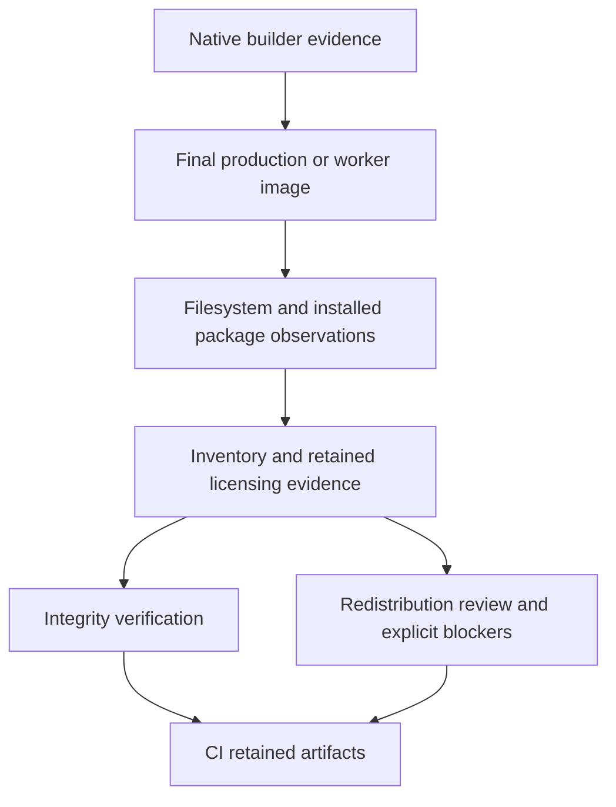

# Application packaged dependency inventory - Plan

## Goal Capsule

- **Objective:** A release maintainer can identify the third-party material shipped in an application image, inspect the retained licensing evidence, and see what still prevents redistribution qualification.
- **Means:** Collect evidence from the final application image and the builds that produced its native artifacts (KTD1–KTD4).
- **Authority:** `ROADMAP.md` and `THIRD_PARTY.md` define the delivery; this plan defines its implementation. Preserve the project's pre-release policy and existing licensing boundaries.
- **Execution:** Implement the units on a branch named after this plan. The lead owns integration, local commits, review, and verification. Push only when asked.
- **Stop conditions:** Do not declare redistribution cleared when evidence is missing or a licensing question remains. Report the exact component, evidence gap, and required follow-up under R5.

---

## Product Contract

### Summary

Produce a repeatable inventory and licensing-evidence bundle for the root Dockerfile's `production` and `worker` images. Integrate collection with the existing image build and record an evidence-based review of the current packaged application.

### Problem Frame

`THIRD_PARTY.md` records licensing boundaries but explicitly leaves the application's packaged transitive dependencies unreviewed. The production image combines installed Composer dependencies, Debian packages, compiled PHP extensions and libraries, copied tools, and repository source/public assets. A lockfile or a list of loaded extensions cannot establish which third-party material the image distributes.

### Requirements

**Packaged contents**

- R1. Bind each inventory to the observed image identity, target, platform, and source revision, and retain hashes for the evidence and observed artifacts it describes.
- R2. Inventory installed Composer packages and Debian packages from the final image, including package versions, dependency identity where available, declared licensing metadata, and retained license/copyright files.
- R3. Inventory non-dpkg native artifacts and tools actually present, retaining available build provenance and licensing evidence and exposing unresolved ownership or embedded-dependency coverage.
- R4. Account for copied repository material separately from installed dependencies, including local packages, public WebAssembly/vendor assets, native/vendor sources, JavaScript manifests, and any actual generated distributions found in the image.

**Review and use**

- R5. Distinguish observed membership, available licensing evidence, and redistribution review outcome; unknown metadata, missing notices, embedded-code gaps, and unresolved obligations remain explicit release blockers rather than becoming an invented license or clearance.
- R6. Provide one documented collection and verification path usable locally and in CI, with downloadable evidence bound to the same application images that CI builds or publishes.
- R7. Update `THIRD_PARTY.md` and `ROADMAP.md` with the delivered coverage, verification checkpoint, and any remaining redistribution work supported by the actual generated evidence.

### Scope Boundaries

The application images are the deliverable. The Registry inventory remains independent. Separate desktop/mobile releases, PostgreSQL/nginx/runner images, and the optional custom static FFmpeg build are outside this image's review unless their files actually occur in the observed image. Debian's installed FFmpeg belongs to R2.

Considered and not built: trimming the image's copied source tree, replacing build tools, introducing an SBOM service, and pinning the entire toolchain. These changes are unnecessary to report the current artifacts; revisit a specific change only if obtaining reliable evidence requires it. No license allowlist or blanket legal-compliance verdict is introduced.

### Acceptance Examples

- AE1. **Covers R2, R4:** Given a lockfile containing development packages and JavaScript dependencies, collecting a production image reports the installed Composer set and the copied JavaScript manifests in different groups. It does not assert that every lockfile dependency is installed.
- AE2. **Covers R3, R5:** Given an unowned shared object or copied WebAssembly binary without adequate embedded-dependency provenance, collection succeeds with its identity and hash and identifies the coverage gap. Verification does not label the artifact cleared.
- AE3. **Covers R1, R6:** Given a retained bundle whose license evidence or observed artifact changes, verification fails with the affected path. An unresolved review item alone does not prevent generating a useful report.

---

## Planning Contract

### Key Technical Decisions

- KTD1. **Observe the final filesystem.** A host-side Python collector uses a disposable container/export of the supplied image without starting the application or mounting the checkout over it. Read installed Composer metadata and dpkg state from that filesystem. Add an OCI source-revision label through an explicit production build argument, passed by CI and the documented local build command. Collect its observed value and reject a mismatch with the requested revision; do not treat a caller-supplied value as an observed source revision. Follow image symlinks within the exported root, including Debian copyright aliases, without escaping to host files. Pattern references: `relay/tools/packaged_inventory.py` and `scripts/tests/`.
- KTD2. **Retain native build evidence before cleanup.** Extend the existing Docker build stages to preserve resolved source/package identities, available configuration/build metadata, relevant upstream notices, and output hashes for liburing, PHP/its bundled extensions, PECL extensions, Swoole, and TSDuck. Inventory copied Composer/PIE tools and other non-dpkg artifacts inherited from the base image. Inspect the final artifact set rather than assuming this list is exhaustive. Evidence for downloaded tools must identify the bytes actually copied; collect missing upstream evidence from the matching artifact/source rather than assigning the repository's license.
- KTD3. **Use a filesystem census to expose coverage.** Partition observed files into dpkg-owned material, installed Composer packages, copied application/repository material, retained inventory evidence, and unresolved files. Identify native binaries/libraries, archives, WebAssembly, package manifests, and license/notice candidates within those groups. Report unowned compiled artifacts and known embedded-code limits explicitly. Deduplicate by content hash while preserving paths and owner relationships. Do not describe a census as proof of every embedded dependency's license.
- KTD4. **Keep a standalone application bundle.** Use `scripts/packaged_inventory.py`, `scripts/collect-packaged-inventory.sh`, and `third_party/inventory/` for the application contract. Keep retained build evidence in a dedicated image directory. Reuse the Registry's evidence/hashing and root-safe lookup approach, without modifying its Go/native review model or extracting a generic inventory framework. Output contains machine-readable observations, retained evidence, checksums, and a readable review summary.
- KTD5. **Separate integrity failures from review gaps.** Collection fails on unusable image/package input or incomplete execution; verification fails on mismatched identity, hashes, missing referenced evidence, or malformed output. Missing upstream notices or unresolved licensing information produce visible review gaps under R5. CI retains the report even when verification fails; release qualification stays open until its concrete blockers are resolved.
- KTD6. **Reuse existing image builds.** Add collection after the existing `worker` build in the quality gate. Change the production publishing job to load the built image locally, collect and verify it, then push those same tags only after integrity verification passes. Record the local image identity and the published digest when available. Use existing Forgejo artifact/package retention; introduce no external service. Establish production-to-worker component equivalence from the actual inventories; worker process configuration is the expected difference, not permission to assume equivalence.

### High-Level Technical Design

### Assumptions and Risks

The root Dockerfile is the application's current packaging contract. `COPY .` retains repository sources and public assets while `.dockerignore` excludes installed host dependencies. The image does not currently build a web distribution. Confirm these facts from the observed image; report additional files rather than silently omitting them.

Unpinned PECL downloads and floating copied tool images require build-time resolved provenance. The implementation may discover that a native artifact's embedded libraries or exact source cannot be established from current retained data. Such a finding is implementation evidence for R5, not a reason to call all native dependencies inventoried or to begin an unrelated packaging redesign.

### Sources

- `Dockerfile`: native builder stages, inherited base tools, production Composer installation, and worker inheritance.
- `.dockerignore`: actual source/public material retained by the production context.
- `.forgejo/workflows/ci.yaml`: quality-gate worker build and production publishing job.
- `relay/tools/packaged_inventory.py`, `relay/tests/test_packaged_inventory.py`, `relay/third_party/inventory/`: existing observation, retained evidence, integrity checks, and root-safe paths.
- `scripts/test-docker-context.sh`, `scripts/test-worker-production-container.sh`: affected packaging checks.
- `THIRD_PARTY.md`, `ROADMAP.md`, `STRATEGY.md`: release boundary and product scope. No matching packaging-inventory solution exists under `docs/solutions/`.

---

## Implementation Units

### U1. Collect application image observations and evidence

- **Goal:** Generate the useful final-image inventory under R1–R5.
- **Dependencies:** None.
- **Files:** Create `scripts/packaged_inventory.py`, `scripts/collect-packaged-inventory.sh`, and focused tests under `scripts/tests/`; create application evidence inputs under `third_party/inventory/` only where collection needs retained source evidence.
- **Approach:** Implement KTD1, KTD3–KTD5. Define the bundle schema and expose generation plus verification. Include a filesystem coverage summary and component-to-file/evidence relationships. Record package identity from installed metadata, with lockfiles as provenance only. Keep source manifests, vendored material, and actual compiled distributions distinguishable.
- **Test scenarios:** A minimal exported-root fixture contains an installed Composer package, an absent development package declared in its lockfile, a Debian copyright symlink, a copied source manifest, and a WebAssembly/native artifact with missing evidence. Assert correct membership and explicit gaps. Check that absolute image symlinks resolve inside the image root; path escape or symlink loops fail. Tamper with one observed artifact and one retained notice and require actionable integrity failures. A requested revision that differs from the image label fails identity verification.
- **Verification:** Run the focused Python tests, shell syntax checks, and collector help/argument checks. Do not add a broad backend test suite for this tooling.

### U2. Retain native build and tool provenance in the image

- **Goal:** Supply the evidence R3 needs before builders discard source trees.
- **Dependencies:** U1's bundle/evidence contract.
- **Files:** `Dockerfile`; build-evidence helper files under `scripts/` as needed; `third_party/inventory/` for reviewed source notices that cannot be recovered in the final image; affected focused tests under `scripts/tests/`.
- **Approach:** Implement KTD2 and connect its retained evidence to U1; add the observed revision label from KTD1 to the production target so the worker inherits it. Preserve notices with their originating component and resolved source identity, including embedded/vendor notices where available. Keep hashes tied to final compiled outputs. Enumerate remaining non-dpkg artifacts from the census, including inherited tools, and resolve their ownership or record a specific gap. Do not replace live package resolution with guessed versions from Dockerfile arguments.
- **Test scenarios:** A retained native component links to its final artifact hash and upstream notices; an absent notice produces a review gap; a mismatched artifact hash fails verification. A source's top-level license does not erase separately retained embedded/vendor notices.
- **Verification:** Build the real production and worker targets once with existing cache support, collect both images, inspect their native/component coverage and retained evidence, and compare package membership. Run `scripts/test-docker-context.sh` and the existing production worker smoke against the affected image where dependencies are available. Capture unavailable prerequisites explicitly.

### U3. Retain CI evidence and review the packaged application

- **Goal:** Make the bundle usable for the actual CI artifacts and record the completed redistribution review work under R5–R7.
- **Dependencies:** U1, U2.
- **Files:** `.forgejo/workflows/ci.yaml`, `THIRD_PARTY.md`, `ROADMAP.md`, a concise operator/developer usage document under `dev-docs/`, and a versioned application review record under `third_party/inventory/`.
- **Approach:** Implement KTD6 and document the collector's exact local invocation. Retain inventory/evidence with CI's existing artifact/package storage conventions, bound to commit and image identity. Review the generated bundle for the real production/worker images, remedy recoverable missing notices, and record concrete remaining obligations or evidence gaps. Commit compact review inputs/results and retain bulky generated image evidence as build artifacts. Keep the roadmap's application redistribution gate open for any unresolved release blockers.
- **Test scenarios:** CI uses the built image rather than the dev/CI image or checkout overlay; a failed verification still leaves diagnostic evidence; the recorded review matches the generated component coverage and unresolved counts.
- **Verification:** Validate workflow syntax and command wiring, run the documented collector/verification command against the built image, apply `prose-fix` to changed documentation, and record real suite counts, image identities, coverage totals, and gaps in the usage/review record. Keep `ROADMAP.md` to a concise delivery checkpoint, remaining gate, and links; preserve its pruning of completed history.

---

## Verification Contract

Run the focused tooling tests with `python3 -m unittest discover -s scripts/tests`, selecting the new inventory module during iteration. Run `bash -n scripts/collect-packaged-inventory.sh` and `bash scripts/test-docker-context.sh`. Generated evidence verification and real final-image observations are the acceptance checks for this delivery.

Use CI's existing `docker buildx build --target production --load` and `--target worker --load` paths with available cache. The implementation documents the final collector and verifier arguments in the usage guide; execute those exact commands against both targets and retain their output identities. Avoid duplicate expensive builds or tests once their result is established. Run the existing production worker container smoke after Dockerfile changes when its PostgreSQL prerequisite is available. Do not reset local user data.

Run the workflow's supported YAML/static validation, `git diff --check`, and prose preservation audits. Run `ce-simplify-code` at unit boundaries and `ce-code-review` before the final local commits. Full PHPUnit, frontend, PostgreSQL, and Registry suites are outside the affected behavior unless implementation introduces a concrete dependency on them. `release:validate` is not an established command for this repository and is not an acceptance gate here.

---

## Definition of Done

U1 is complete when collection and verification distinguish actual membership, retained evidence, and review gaps with the focused correctness checks passing. U2 is complete when real image observations show preserved native provenance and identify any limits in embedded-code coverage. U3 is complete when CI retains image-bound evidence, the packaged-application review is recorded, and the documentation and roadmap accurately state the delivered scope and remaining release blockers.

The final change contains no abandoned collector experiments or packaging changes outside this contract. Apply justified review findings, record the authoritative verification checkpoint, and leave local commits ready for review. Completion of the inventory delivery does not close the application's redistribution gate unless the generated evidence and review support that conclusion.
