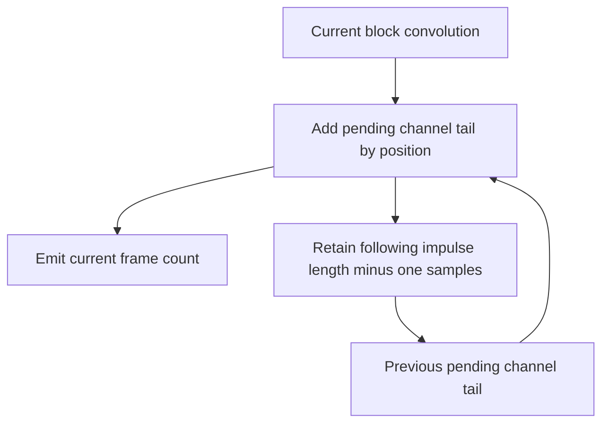

# Convolver Block Continuity - Plan

## Goal Capsule

- **Objective:** Callers of the shipped convolver receive the same convolution samples regardless of how they divide an audio stream into processing calls.
- **Means:** Repair the existing direct convolution overlap state and verify the compiled module against independent reference vectors (KTD1–KTD3).
- **Authority:** The Product Contract governs behavior; technical decisions govern its implementation. Repository instructions and `ROADMAP.md` govern delivery records.
- **Execution profile:** Establish failing regression evidence before repairing the implementation; reuse existing DSP qualification and artifact publication.
- **Stop conditions:** Stop for a demonstrated ABI incompatibility, a need to change another DSP algorithm, or inability to regenerate and verify the shipped artifacts with the pinned compiler.
- **Delivery:** The lead integrates, reviews, verifies, and commits locally. Push only when requested.

---

## Product Contract

### Summary

Repair block continuity in the shipped `partitioned_convolver` module and include that module in the existing reproducible DSP build contract.

### Problem Frame

`packages/dsp/partitioned_convolver/partitioned_convolver.cpp` adds the first overlap sample to every output sample and replaces the entire pending tail after each internal block.
A block shorter than the impulse-response tail loses contributions still due from earlier input.
A one-tap impulse response leaves an empty overlap buffer that processing dereferences.
For impulse response `[1,2,3]`, input `[1,2,3,4]`, and block size 2, source inspection yields `[1,4,10,17]`; causal convolution requires `[1,4,10,16]`.
This is source-derived evidence, to be demonstrated against the actual module during implementation.

The module is shipped and required by the Electron asset manifest.
No active player caller was found, so the work establishes module correctness without claiming a current audible player defect or player integration.

### Requirements

**Streaming behavior**

- R1. For valid interleaved finite input, each output frame equals causal convolution with the configured impulse response independently for each channel, within a declared float tolerance.
- R2. Pending contributions survive internal block boundaries and successive processing calls, including calls shorter than the impulse-response tail.
- R3. A one-tap impulse response applies its scalar gain without accessing overlap storage.

**Module delivery**

- R4. Preserve the existing create/process/destroy interface, interleaving, constructor validation, and loader contract; allocation exports may be added for safe buffer ownership.
- R5. Regenerate all three tracked convolver binaries with Emscripten 6.0.3 and include them in the existing two-build reproducibility and reference-vector gate.
- R6. Record delivered scope and measured verification checkpoints in `ROADMAP.md`, keeping broader DSP and codec qualification open.

### Acceptance Examples

- AE1. Covers R1–R2: the Problem Frame vector emits `[1,4,10,16]`; subsequent zero input drains the remaining `[17,12]` tail.
- AE2. Covers R2: an impulse response longer than the configured block produces the same complete result across single-frame, uneven, and whole-stream calls.
- AE3. Covers R1–R3: a one-tap response scales mono and interleaved stereo input, with no channel leakage or exception.

### Scope Boundaries

Direct time-domain convolution, focused actual-WASM regressions, the existing build/gate module lists, artifact synchronization, and qualification documentation are in scope.

Considered and not built: a new allocator abstraction or demo scratch-memory reuse is unnecessary because existing WASM allocation exports provide owned test buffers.
Additional API validation, reset/flush APIs, in-place processing guarantees, FFT partitioning, and real-time allocation or performance redesign are outside this correction; evidence that an existing supported caller requires one would warrant separate scope review.
Resampler qualification, codec compliance, full native audio certification, and player wiring remain separate work.

---

## Planning Contract

### Key Technical Decisions

- KTD1. **Combine pending overlap before emitting the block.** Add each available old overlap sample to the corresponding temporary convolution sample, then emit the first block-length samples and retain the complete remaining tail. This preserves contributions beyond a short block and naturally avoids reading empty overlap for R3. Governs R1–R3.
- KTD2. **Keep direct convolution and existing ownership.** Retain the per-instance, per-channel state and the current loader interface. The defect requires no new algorithm or public processing mode; the mechanism is already determined by the existing causal convolution contract. Governs R1–R4.
- KTD3. **Exercise the actual compiled module through the shared fixture.** Add `malloc` and `free` exports to the convolver Makefile alongside the existing exports. Tests use `packages/dsp/tests/wasm-fixture.mjs` and `DSP_WASM_DIR`, allocate impulse/input/output storage through those exports, destroy contexts, and free allocations. The demo's hard-coded scratch address is unsuitable because it does not establish allocation ownership. Governs R1–R4.
- KTD4. **Extend the current artifact pipeline.** Add only `partitioned_convolver` to the module arrays in `scripts/build-wasm.ts` and `scripts/test-dsp-analysis.sh`; reuse their compiler check, temporary builds, publication, and byte comparisons. Preserve the Makefile's existing `EMCC` and `WASM` overrides. Governs R5.

### Overlap State

The temporary block holds current-input convolution plus all pending contributions from previous input.
Emitted frames leave the state; the following impulse-length-minus-one frames become the next pending tail.
Each channel performs this transition independently.
A one-tap response has no pending tail.

### Assumptions and Risks

The supported processing contract uses valid separately allocated input/output buffers; this fix adds no in-place aliasing guarantee.
Callers drain a tail by passing zero input through the existing process interface.
Float comparison uses a justified absolute/relative tolerance for optimized WASM rather than bytewise numeric equality.
The generated binary may change because allocation exports become reachable; behavior and export checks must run on regenerated artifacts.
No project-specific glossary term is introduced: impulse response and overlap-add are ordinary DSP terms.

---

## Implementation Units

### U1. Repair streaming convolution with actual-WASM regression proof

**Goal:** Deliver R1–R4 using KTD1–KTD3.

**Dependencies:** None.

**Files:** `packages/dsp/partitioned_convolver/partitioned_convolver.cpp`, `packages/dsp/partitioned_convolver/Makefile`, new `packages/dsp/tests/partitioned_convolver.test.mjs`; reuse `packages/dsp/tests/wasm-fixture.mjs` unchanged unless a concrete fixture deficiency is demonstrated.

**Approach:** Add the focused tests and allocation exports, capture a failure against the current implementation, then repair the pending-tail transition. Preserve constructor validation and no-op processing guards. No loader edit is expected.

**Execution note:** Begin with the source-derived failing continuity vector against compiled WASM, not a JavaScript copy of the implementation.

**Test scenarios:**

1. AE1, including the zero-input tail and a declared tolerance against independent direct convolution.
2. An impulse longer than the block with block sizes 1, 2, and greater than the impulse length; compare whole-stream, single-frame, and uneven call partitions including a short final block.
3. One-tap unity and non-unity responses in mono and stereo.
4. Asymmetric stereo and a silent channel, proving independent channel history across calls and tail draining.

**Verification:** Focused Node test file against a temporary convolver build selected through `DSP_WASM_DIR`; verify create/process/destroy and malloc/free exports are usable. Preserve the red evidence before the passing result.

### U2. Publish and qualify the corrected convolver artifacts

**Goal:** Deliver R5 through KTD4.

**Dependencies:** U1.

**Files:** `scripts/build-wasm.ts`, `scripts/test-dsp-analysis.sh`, `ui/electron/tests/dsp-regeneration.test.ts`, `.forgejo/workflows/dsp-analysis.yaml`, `packages/dsp/partitioned_convolver/partitioned_convolver.wasm`, `public/dsp/partitioned_convolver.wasm`, `ui/electron/public/dsp/partitioned_convolver.wasm`.

**Approach:** Extend existing module lists and include the convolver source directory plus both public convolver artifact paths in push and pull-request path filters. Update the existing regeneration fixture to list five qualified modules, remove the convolver from the dormant fixture list, and change the four-build expectation to five. Regenerate through the existing command and retain the existing compiler pin.

**Test scenarios:** The existing DSP gate compiles the convolver twice and runs U1's vectors against both builds; both builds and all three tracked copies match. Existing analysis tests continue passing. The existing regeneration test verifies all five module builds and published copies; existing Electron artifact lifecycle checks still require and accept the convolver module.

**Verification:** The authoritative existing DSP qualification command and the targeted artifact lifecycle suite pass. Check the regeneration diff for unrelated binary changes; investigate any difference rather than accepting incidental regeneration churn.

### U3. Record the qualified boundary and delivery evidence

**Goal:** Deliver R6 and document R5's expanded regeneration coverage.

**Dependencies:** U2.

**Files:** `packages/dsp/README.md`, `ROADMAP.md`.

**Approach:** Update the current four-module coverage to five where applicable, remove instructions to restore the convolver instead of regenerating it, and describe the bounded convolution vectors. Preserve the resampler, codec, real-time performance, and audible playback limitations. Apply the repository's documentation prose guidance.

**Test expectation:** None; this unit changes delivery documentation only.

**Verification:** Documentation matches actual module arrays and final observed gate counts; the broader unfinished roadmap item remains open.

---

## Verification Contract

Start with focused compiled-module proof, then perform the existing integrated gate once the sources and artifacts are final.
No backend, unrelated web, resampler, or codec suite is needed for this boundary.

| Check | Scope | Required evidence |
|---|---|---|
| Focused `partitioned_convolver.test.mjs` via Node with `DSP_WASM_DIR` | U1 | Current-source failure followed by corrected vectors, complete tails, channel isolation, and one-tap safety |
| `yarn --cwd ui/electron build:wasm` | U2 | Pinned compiler; successful publication; only intended artifact differences |
| `bash scripts/test-dsp-analysis.sh` | U1–U2 | Final suite count per independent build, reproducible convolver binaries, and all shipped copies current |
| Existing Electron artifact lifecycle tests in `ui/electron` | U2 | Existing asset manifest/loader/build contract remains valid |
| Diff and documentation review | U1–U3 | No algorithm expansion, unsupported playback claim, or contradictory regeneration instructions |

Use existing repository test runners and the pinned CI image for authoritative gates.
Exact focused artifact lifecycle runner selection is implementation-time discovery from the current Electron package scripts, not permission to add another test framework.

---

## Definition of Done

All requirements have implemented evidence or documentation, and AE1–AE3 pass against the actual generated module.
The corrected convolver has passed the existing two-build DSP gate and all three tracked binaries match its result.
The existing three-method loader contract remains usable with additive allocation exports.
`ROADMAP.md` records the concrete fix, final suite counts, static gates actually run, and remaining qualification boundary.
The implementation passes phase-boundary simplification and final code review, with justified findings resolved, and is committed locally without a push.

---

## Sources and Research

- `ROADMAP.md`, broader codec/DSP qualification and DSP artifact build contract.
- `docs/plans/2026-10-20-dsp-artifact-build-contract-plan.md`, existing regeneration and packaging boundary.
- `packages/dsp/partitioned_convolver/partitioned_convolver.cpp` and `Makefile`, current state transition, validation, and exports.
- `packages/dsp/tests/wasm-fixture.mjs`, actual-module initialization and alternate artifact directory.
- `scripts/build-wasm.ts`, `scripts/test-dsp-analysis.sh`, and `.forgejo/workflows/dsp-analysis.yaml`, existing compiler, publication, qualification, and trigger contracts.
- `packages/dsp/README.md` and `ui/electron/src/shared/wasm-modules.json`, documented scope and shipped module requirement.
- `CONCEPTS.md` and `STRATEGY.md`, shared vocabulary and playback reliability context.

No matching DSP/convolver solution entry was found under `docs/solutions/`.
The implementation follows local module and qualification patterns; no external dependency or algorithm research is required for the positional overlap correction.
