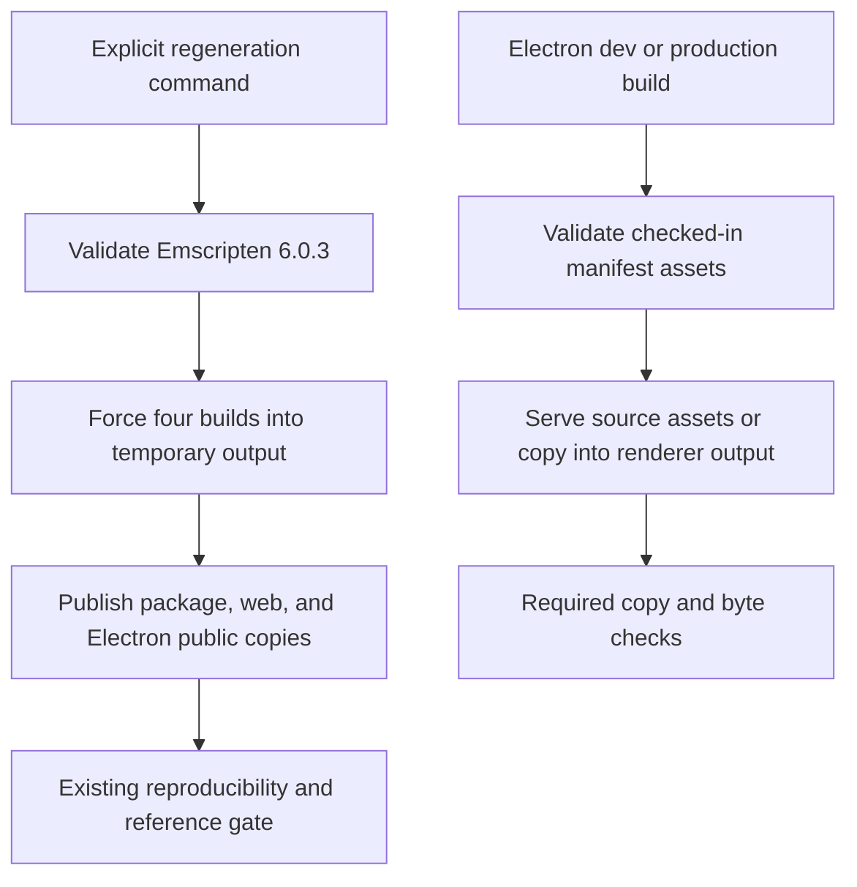

## Goal Capsule

- **Objective:** Developers can regenerate the active audio analysis binaries reproducibly and package Electron with the intended DSP files or a clear failure.
- **Means:** Separate explicit regeneration from compiler-free asset consumption (KTD1–KTD3).
- **Authority:** The requested DSP shipping work and this Product Contract bound implementation; repository rules govern delivery.
- **Execution profile:** Implement the build and packaging behavior, reuse the existing numerical qualification, and add only focused checks for the changed tooling.
- **Stop conditions:** Stop if the active analysis ABI or algorithm must change, or regeneration would require qualifying additional modules.
- **Completion owner:** The lead integrates, verifies, records the checkpoint in `ROADMAP.md`, and makes local commits. Push requires a request.

---

## Product Contract

### Summary

Provide one explicit, pinned regeneration path for the four qualified analysis modules and make Electron consume checked-in DSP assets reliably.

### Problem Frame

The existing analysis qualification checks Emscripten 6.0.3 builds and all three tracked WASM copies, but artifact production does not implement that contract. `scripts/build-wasm.ts` accepts any available compiler, uses ordinary `make`, and copies only into the web directory. Electron's asset plugin compiles missing binaries implicitly and treats required copy failures as warnings. Its `build:wasm` package command also points to a script path absent from the Electron package. Developers can therefore receive stale outputs or an apparently successful package with missing assets.

### Requirements

**Explicit regeneration**

- R1. The documented regeneration command builds `fft2048`, `spectral_features`, `dynamics_meter`, and `loudness_r128` with Emscripten 6.0.3, rejecting missing or different compilers before changing tracked artifacts.
- R2. Regeneration forces fresh builds and publishes identical WASM bytes to each source package, `public/dsp/`, and `ui/electron/public/dsp/`; it also synchronizes the dynamics loader and FFT worklet copies checked by the existing qualification gate.
- R3. The Electron `build:wasm` command resolves the actual repository regeneration entry point and reports build or required-copy failures with a nonzero result.

**Asset consumption**

- R4. Ordinary Electron development and packaging use the checked-in assets without invoking a compiler. Missing required DSP assets fail with a diagnostic directing developers to explicit regeneration or restoration.
- R5. Electron packaging requires the WASM for every module in `ui/electron/src/shared/wasm-modules.json` and the loaders actually supplied for those modules. Required copy errors and byte mismatches fail the build; optional standalone-WASM loaders remain optional only where the current module has no loader.
- R6. Preserve existing DSP ABIs, algorithms, module availability, and numerical qualification scope. Reuse the existing analytical vectors and reproducibility gate.

### Scope Boundaries

This work changes regeneration and Electron asset handling. It does not qualify the convolver or resampler, change DSP algorithms, add codec compliance, or introduce an Emscripten dependency into normal Electron builds. Existing unrelated worklet and Ziggy behavior remains outside the change unless directly needed for DSP correctness.

---

## Planning Contract

### Key Technical Decisions

- KTD1. **Keep regeneration explicit and pinned.** Make `scripts/build-wasm.ts` the active-analysis regeneration entry point, with the same compiler identity and forced-build semantics as `scripts/test-dsp-analysis.sh`. Respect `EMCC` consistently. Reject an invalid compiler before publication. The existing qualification already establishes the intended toolchain, so choosing a new compiler is unnecessary. Governs R1–R3.
- KTD2. **Build before publication.** Compile the four binaries into temporary output paths using the existing Makefile output override; after all builds succeed, publish the declared binaries, loader, and worklet to their checked-in destinations and verify copied bytes. This avoids publishing results from a partial compilation. A multi-file atomic transaction is unnecessary; an I/O failure must be explicit and recoverable by rerunning regeneration. Governs R2–R3.
- KTD3. **Consume artifacts without compiling them.** Replace Electron's implicit missing-module compilation with required-file validation and strict copying. Preserve all six manifest modules, including the two outside analysis qualification. Declare required loaders explicitly for `spectral_features`, `dynamics_meter`, `loudness_r128`, `partitioned_convolver`, and `resampler_hq`; `fft2048` has no module loader. A deleted required loader must fail validation rather than becoming optional. Compare destination bytes after copying to detect incomplete or altered copies. Governs R4–R6.
- KTD4. **Verify changed tooling only.** Add focused build-tool and plugin checks in the existing Electron Node test runner, using disposable local directories and mocked child processes/filesystem seams where needed. Numerical behavior remains covered by `scripts/test-dsp-analysis.sh`. Governs R6.

### High-Level Technical Design

This diagram describes ownership and data flow; implementation may share small helpers where that removes duplicated artifact declarations.

### Assumptions and Risks

The four-module qualification scope is authoritative for regeneration. The Electron manifest remains authoritative for packaging all six shipped modules. The explicit loader inventory in KTD3 establishes required JavaScript files; `fft2048` remains standalone WASM. Partial publication caused by filesystem failure is reported as failure and repaired by rerunning the explicit command.

### Evidence and Sequencing

`scripts/test-dsp-analysis.sh` establishes the pinned compiler, temporary output overrides, double builds, reference vectors, and tracked-copy comparisons. `packages/dsp/README.md` currently gives a manual regeneration recipe. `scripts/build-wasm.ts`, `ui/electron/package.json`, and `ui/electron/config/vite-plugin-copy-assets.ts` contain the gaps described above. Implement U1 before U2; complete U3 after both. No new domain term is introduced.

---

## Implementation Units

### U1. Regenerate the qualified analysis artifacts explicitly

- **Requirements:** R1–R3, R6; KTD1–KTD2, KTD4.
- **Files:** `scripts/build-wasm.ts`; `ui/electron/package.json`; new `ui/electron/tests/dsp-artifact-build.test.ts` for the regeneration entry point and artifact publication. A small shared helper may live alongside the script if needed for testability.
- **Approach:** Replace the all-module loose build with the qualified four-module operation, check the pinned compiler before mutation, force temporary builds, synchronize every declared destination and wrapper/worklet, and fix the Electron command path.
- **Test scenarios:** Missing compiler and a non-6.0.3 version fail before copies; a newer existing tracked binary cannot suppress compilation; a failed module build prevents publication; successful generation copies identical bytes to all declared destinations; missing required output or a copy failure returns failure; the package command resolves the repository script from Electron's working directory.
- **Verification:** Run focused tooling tests and the existing pinned qualification after intentional regeneration. Preserve source files and production ABIs.

### U2. Make Electron DSP asset consumption fail closed

- **Requirements:** R4–R6; KTD3–KTD4.
- **Files:** `ui/electron/config/vite-plugin-copy-assets.ts`; new `ui/electron/tests/dsp-asset-copy.test.ts` for DSP validation, serving, and packaging.
- **Approach:** Remove implicit compilation, validate required manifest WASM and source loaders, and propagate required DSP copy failures. Verify copied bytes. Keep dev serving compatible with checked-in files and keep the manifest's complete module set.
- **Test scenarios:** Complete checked-in assets allow dev and packaging without spawning a compiler; any required manifest WASM or required loader missing fails clearly; a standalone module with no loader succeeds; copy rejection or destination mismatch fails packaging; successful copied DSP files equal their source bytes.
- **Verification:** Use the Electron Node test runner with disposable fixtures; exercise the plugin production hook and dev initialization. Avoid a broad browser or numerical test expansion.

### U3. Connect existing CI gates and document the command

- **Requirements:** R1–R6.
- **Files:** `.forgejo/workflows/frontend.yaml`; `.forgejo/workflows/dsp-analysis.yaml`; `packages/dsp/README.md`; `ROADMAP.md`; any existing Electron build documentation whose current DSP instructions conflict with the new command.
- **Approach:** Add the root regeneration script and any new helper paths to the existing frontend and DSP workflow push and pull-request filters so tooling changes run the relevant existing gates. Replace the manual regeneration recipe with the actual package command, explain its compiler prerequisite and four-module scope, and explain compiler-free consumption and required-file failures. Record delivered behavior and actual verification counts and gates in the roadmap.
- **Test expectation:** No additional tests; this unit records the checks from U1–U2.
- **Verification:** Inspect both workflow event filters for every changed root tooling path. Check documented command paths against package metadata, apply the project prose register, and run the whitespace gate.

---

## Verification Contract

Use `yarn --cwd ui/electron test` for the focused changed-tooling checks and the existing desktop tests. Run `yarn --cwd ui/electron tsc` for the affected TypeScript surface. Run `bash scripts/test-dsp-analysis.sh` with Emscripten 6.0.3 after regeneration; it must retain its double-build comparisons, existing vectors, and tracked artifact checks. Use `git diff --check` for edited files. Run an Electron production asset-copy smoke check through the plugin hook without Emscripten on PATH; a full application build is useful only if the existing environment supports it and the plugin integration needs further evidence. Record actual counts and any baseline/environment limitation in `ROADMAP.md`.

---

## Definition of Done

The explicit command regenerates only the qualified analysis artifacts with the pinned compiler and synchronizes the copies checked by the existing gate. Normal Electron development and packaging consume checked-in files, preserve all manifest modules, and fail on missing required DSP assets or failed copies. Focused tooling checks, affected TypeScript checks, and the existing DSP qualification pass, or an evidenced external blocker is reported without claiming acceptance. The documentation and roadmap state the delivered behavior and actual verification checkpoint.
