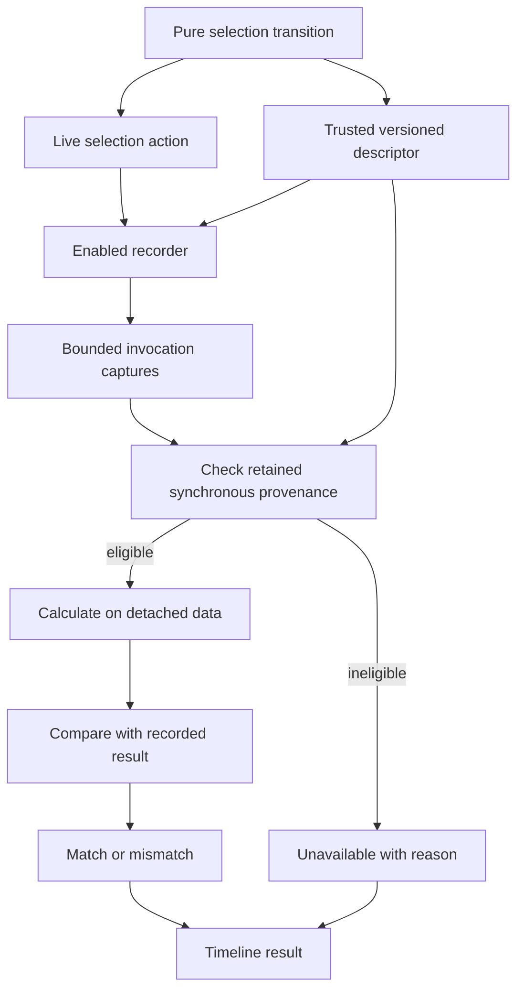

# Isolated Store Verification - Plan

## Goal Capsule

**Objective:** Developers can check whether a recorded catalog selection action still produces its recorded result under the current application logic.

**Means:** Replay one supported synchronous action against detached captures using the same pure transition used by the live store (KTD1–KTD4).

**Authority:** The Product Contract governs behavior; the Planning Contract governs implementation within it. Existing debugger capture limits and frontend rules remain binding.

**Execution profile:** Three bounded units, followed by integration and browser qualification. The lead owns shared debugger contracts, integration, authoritative checks, local commits, and the delivery entry in `ROADMAP.md`. Workers own explicitly assigned files and never stage or commit. Push only when requested.

**Stop conditions:** Stop if implementation requires invoking live store actions, weakening capture completeness, or executing a transition selected by untrusted trace content. No launch-blocking prerequisite is currently unresolved.

## Product Contract

### Summary

Add an isolated verification control to the existing developer timeline. Its first supported actions are `catalog.selection.select` and `catalog.selection.clear`. The result states whether the current pure transition matches the complete recorded result, or explains why verification is unavailable.

### Problem Frame

Historical capture reconstruction shows what the recorder observed. It cannot establish whether today's transition logic produces that observation. Developers need a bounded check that can expose a transition discrepancy without changing the running application.

### Requirements

#### Verification

- R1. Verify one selected retained `catalog.selection` `select` or `clear` action against the current shared pure transition and compare its resulting data with the recorded result.
- R2. Execute only a compiled, explicitly registered transition with matching identity, version, action binding, and synchronous provenance.
- R3. Report `match`, `mismatch`, or `unavailable`; unavailable includes a concrete reason rather than a successful or failed comparison.
- R4. Refuse incomplete, redacted, truncated, malformed, unsupported, rejected, still-running, evicted, or ambiguously attributed action histories.
- R5. Verify a successful no-op action even when its recorded invocation produced no update event.

#### Isolation and presentation

- R6. Verification must leave live store state, subscriptions, persistence, requests, native objects, debugger history, and debugger selection unchanged.
- R7. Show verification only within the existing store timeline, with an explicit control and a result tied to the selected action; remove stale results when the selection or history epoch changes or the action is evicted.
- R8. Preserve disabled instrumentation's original-creator identity and absence of runtime wrappers, subscriptions, clocks, and captures, together with existing bounded retention and redaction.

### Key Decision

**Isolated verification** (session-settled: user-directed — chosen over live restoration: check recorded transitions while leaving the running application untouched). Governs R1 and R6.

### Acceptance Examples

- AE1. A complete recorded `select` changes a detached empty selection to the captured album selection; verification reports `match`. Covers R1–R3 and R6.
- AE2. A supported transition computes different selection data from a complete recorded result; verification reports `mismatch` and shows the detached expected and recorded values. Covers R1 and R3.
- AE3. Repeating `select` with the current selection emits no update; a complete successful invocation still reports `match`. Covers R5.
- AE4. An unsupported action, incompatible transition version, incomplete capture, missing invocation boundary, asynchronous completion, nested action, or uncertain update attribution reports `unavailable` with the corresponding reason. Covers R2–R4.
- AE5. Verifying an older selection leaves the currently selected album and event count unchanged; changing selection or clearing history removes the previous result. Covers R6–R7.

### Scope Boundaries

This milestone covers R1–R8 only. Async actions, effects, network or media replay, native objects, trace import, arbitrary functions, multi-action workflows, live restoration, and additional store transitions are deferred. Reuse the existing `test:store-debug` fixture and focused suites; do not expand into authentication, backend, or audio qualification.

## Planning Contract

### Key Technical Decisions

- KTD1. **Share the selection transition.** Extract selection data and the deterministic `select`/`clear` calculation into `ui/web/src/features/catalog/stores/selection-transition.ts`. Live actions and verification use that calculation; the transition module imports no live store, browser, network, persistence, or native APIs. Governs R1 and R6.
- KTD2. **Opt in at instrumentation admission.** Extend the recorder's existing instrumentation entrypoint with an optional trusted descriptor. It declares a stable transition ID, implementation version, supported action names, data and argument validation, and pure calculation. Bind eligibility to the creator's admitted original action function references, rather than matching store/action labels alone. Replacements do not inherit trust. Keep executable descriptors in bounded recorder-owned memory, outside serialized snapshots; explicit retirement releases them. Governs R2 and R8.
- KTD3. **Capture invocation boundaries directly.** Eligible action events receive their bounded `before` capture and transition identity/version; their successful synchronous terminal events receive a bounded `after` capture and an explicit synchronous completion marker. Existing parent IDs and instance IDs identify the invocation. Add optional fields to schema version 2: existing fields retain their meaning, and missing new provenance makes older records unavailable for verification. Promise results and thrown actions never become eligible successes. Governs R2–R5 and R8.
- KTD4. **Verify through recorder-owned descriptors.** A pure helper in `ui/web/src/shared/stores/verify-transition.ts` receives the immutable snapshot, selected action ID, and trusted descriptor lookup supplied by the recorder. It validates eligibility, detaches values, runs the registered calculation, and compares data structurally. The timeline calls a recorder verification method and never imports feature store implementation. Returned values and result metadata are detached, bounded, and immutable. Governs R1–R4 and R6.
- KTD5. **Require an unambiguous retained invocation.** The selected event must be a supported action with complete validated arguments and before data, matching descriptor/version, and one retained synchronous resolved terminal with complete validated after data. Reject missing or contradictory boundaries, nested actions, foreign or unattributed updates inside the invocation, rejection, and incomplete provenance. When updates exist, require same-instance direct parentage and a consistent before/after chain from the invocation start to its terminal result. A no-update invocation is valid only when the terminal result equals its starting data. Unrelated activity outside those boundaries does not invalidate an otherwise complete invocation. Governs R2–R5.
- KTD6. **Keep UI results local.** Add a `Verify action` control and a compact result region beside existing event inspection. Show ordinary text labels, accessible status feedback, and bounded data details for a mismatch. Unsupported rows explain unavailability. Derive result validity from action ID, instance, and history epoch, so routine later app updates do not clear a still-valid result. Follow `.agents/rules/frontend.md` and `ui/DESIGN.md`. Governs R3 and R7.

The version is an explicit implementation compatibility gate, not a code hash or proof that two application builds are identical. Verification is valid only for the registered current implementation and validated captured inputs. Historical diagnostic captures remain distinct from executable application state.

### High-Level Technical Design

### Assumptions and Existing Evidence

- `debug.ts` currently uses schema version 2, bounded action arguments, per-instance identity, synchronous parent IDs, lifecycle events, a rolling baseline, and a disabled fast return. `before` and `after` are already optional capture fields on events.
- `reconstruct-captures.ts` folds lifecycle and update events only; adding invocation captures must not change that fold or turn reconstruction into execution.
- The selection store currently performs two direct pure `set` operations behind `withNoopGuard`; no side effects need extraction.
- `StoreTimeline.tsx` already accepts a supplied recorder, supports inspection and historical reconstruction, and resets selection when an event disappears. Reuse that injection in tests.
- `ui/web/tests/e2e/store-debug/fixture.tsx` imports the real selection store and serves a disposable HTTPS fixture at `debug.baander.app:5187`. Its existing browser workflow exercises recording, navigation, export, clearing, and disabling without a backend.

## Implementation Units

### U1. Share selection calculation and record trusted invocation boundaries

**Goal:** Establish complete, versioned evidence for the two supported actions.

**Requirements:** R1–R2, R4–R5, R8; AE1, AE3–AE4.

**Dependencies:** None.

**Files:** Create `ui/web/src/features/catalog/stores/selection-transition.ts`; modify `ui/web/src/features/catalog/stores/selection-store.ts`, `ui/web/src/features/catalog/stores/__tests__/selection-store.test.ts`, `ui/web/src/shared/stores/debug.ts`, and `ui/web/src/shared/stores/__tests__/debug.test.ts`.

**Approach:** The lead owns the shared descriptor and recorder contract. A selection worker may own the two feature source files and their existing suite once that contract is agreed. Apply KTD1–KTD3 without introducing a second implementation of selection behavior. Preserve action return behavior, action wrapper identity, `getInitialState`, recording order, and no-op notification semantics. Keep descriptor retention within the recorder's admitted-instance lifecycle and existing 100-active-instance cap. Clearing history preserves descriptors for active instances; retired descriptors are released and their historical invocations become unavailable.

**Test scenarios:** Existing selection actions retain state and notification behavior. Enabled supported actions record complete before/terminal captures and explicit provenance. A no-op has complete boundaries without an update. Disabled instrumentation returns the original creator without consulting descriptors or capturing. Replacement functions, promises, thrown actions, retirement, and clear cannot acquire or retain false eligibility. Redacted/truncated captures remain incomplete and all retained values stay within current bounds.

**Verification:** Focused selection and debugger suites; TypeScript and changed-file lint.

### U2. Verify a retained action in detached state

**Goal:** Produce an honest comparison or a precise unavailable result.

**Requirements:** R1–R6, R8; AE1–AE4.

**Dependencies:** U1's agreed descriptor and event contracts.

**Files:** Create `ui/web/src/shared/stores/verify-transition.ts` and `ui/web/src/shared/stores/__tests__/verify-transition.test.ts`; the lead integrates its entrypoint into `ui/web/src/shared/stores/debug.ts` and adjusts `ui/web/src/shared/stores/__tests__/debug.test.ts` only as needed.

**Approach:** A verifier worker owns the new helper and suite. Implement KTD4–KTD5 as a bounded pass over the existing retained history, without reconstructing an action sequence or instantiating a Zustand store. Validate data shape and argument arity before calculation. Catch descriptor failures and return unavailability. Preserve snapshots and descriptors even if transition code attempts mutation; give the calculation only detached data. Bound diagnostic results using the existing capture contract.

**Test scenarios:** Real selection `select`, `clear`, and no-op match; a deliberately different recorded complete result mismatches. Missing metadata, unknown ID/version, invalid selection fields or arguments, incomplete captures, missing/duplicate terminal, async/rejected action, foreign/nested/unattributed updates, broken update chain, eviction, and retired descriptor are unavailable. Older schema-2 records remain inspectable and unavailable for verification. Snapshot data, live state, subscriptions, persistence, event count, and captured references are unchanged after repeated verification. Register/reconstruct behavior remains unaffected by action/terminal captures.

**Verification:** New focused verifier suite plus existing debugger and reconstruction suites. Use a small parameterized refusal matrix, not a new browser scenario for every refusal.

### U3. Expose verification and qualify the existing browser workflow

**Goal:** Let developers verify the inspected action and understand the result.

**Requirements:** R3, R6–R8; AE1–AE5.

**Dependencies:** U1 and U2.

**Files:** Modify `ui/web/src/shared/components/mediator-dev-panel/StoreTimeline.tsx`, `ui/web/src/shared/components/mediator-dev-panel/__tests__/StoreTimeline.test.tsx`, `ui/web/tests/e2e/store-debug/fixture.tsx`, and `ui/web/tests/e2e/store-debug/debug.spec.ts`. The lead records delivered scope and actual verification in `ROADMAP.md` and adds the project-specific isolated verification term to `CONCEPTS.md`.

**Approach:** A UI worker may own the component, its suite, and fixture files; the lead owns documentation. Apply KTD6 with existing buttons, styling, and recorder injection. Add the existing fixture's missing clear-selection action only if needed to qualify the two supported actions. Extend its current workflow before history is cleared or capacity testing begins. Update export purpose wording to distinguish diagnostic inspection from supported isolated verification without suggesting side-effect replay.

**Test scenarios:** Matching selection and clear actions show a result; mismatch shows both bounded values; unsupported events explain unavailability. Switching selection, filtering it away, clearing history, or eviction removes stale results. Current live selection and event count stay unchanged. Keyboard activation and accessible result feedback work. The existing enable/export/disable workflow and capture reconstruction still work.

**Verification:** Timeline and panel DOM suites, the existing `test:store-debug` browser workflow, and the integration gates below.

## Verification Contract

- V1. Run focused Vitest coverage for the selection store, debugger, reconstruction, verifier, timeline, and developer panel after their owning units. Record exact test counts and failures.
- V2. Run the complete web Vitest suite, `yarn typecheck`, changed-file ESLint, and `yarn build` in the authoritative CI image using the repository testing guide. Do not rerun broad gates without a new change or unresolved failure.
- V3. Run `yarn --cwd ui/web test:store-debug` against its disposable HTTPS fixture. Preserve the existing browser resolver and local routing; no production hostname resolution or backend dependency enters this gate.
- V4. Review the implementation for isolation and capture bounds, apply justified code-review findings, and record actual commands, counts, static gate status, and any remaining limitations in `ROADMAP.md`.
- V5. Apply `prose-fix` to changed documentation and run `git diff --check`. Run simplification at phase boundaries and code review before delivery, as required by the project workflow.

## Definition of Done

R1–R8 and AE1–AE5 are satisfied; U1–U3 are integrated and reviewed. V1–V5 have recorded outcomes. The browser demonstrates verification while live state and recording remain unchanged. `ROADMAP.md` records the delivered boundary and open replay work, and `CONCEPTS.md` defines the new process. No push is part of this plan.
