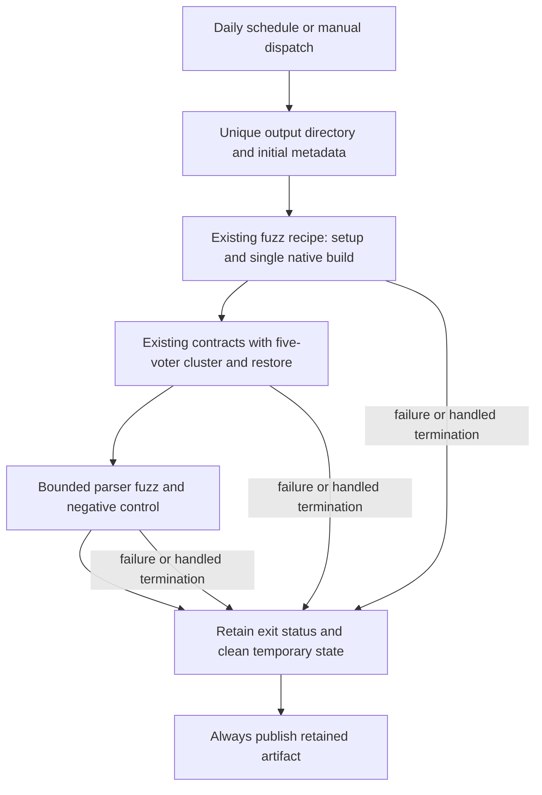
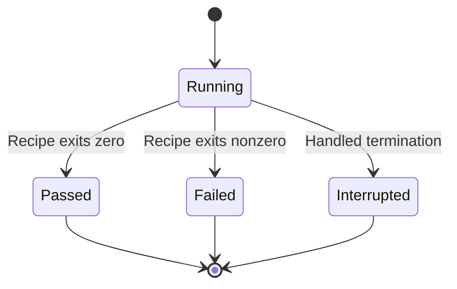

# Registry nightly qualification - Plan

## Goal Capsule

Maintainers receive a nightly Registry qualification result with enough retained evidence to diagnose a failed five-voter, parser-fuzz or isolated-restore gate.
A dedicated Forgejo schedule invokes the existing native qualification recipe (KTD1–KTD3).
`ROADMAP.md` under “Resume here” and “Registry release and growth” supplies the scope and selection rule.
The user authorized continuing roadmap implementation; the lead owns integration, local commits and verification.
Stop for a material prerequisite failure; report it without weakening the gates.
Publishing and observing a real scheduled run remain separate from local delivery.

---

## Product Contract

The existing runners already cover the requested scenarios.
The missing feature is recurring orchestration and retained results: `.forgejo/workflows/ci.yaml` runs on push and pull request, and `scripts/test-registry.sh` deletes its temporary build and fuzz artifacts on exit.
This work satisfies the unchecked nightly-orchestration item without broadening failure scenarios.

### Requirements

**Execution**

- R1. A dedicated Forgejo workflow schedules qualification every night and permits manual dispatch of the same job.
- R2. Each run uses the existing five-voter partition/failover contract, five-voter isolated binary restore contract and bounded sanitizer-backed parser fuzzer with its existing negative control.
- R3. A failed prerequisite or gate makes the job fail, while retained output identifies the failed command and which required gates completed.

**Evidence**

- R4. Each run retains its revision, selected voter count, fuzz limits, exit status and diagnostic logs in a unique artifact directory; a parser failure also retains its reproducer when one exists.
- R5. Available diagnostics are published after success or failure, and temporary processes and storage are cleaned up on normal exit, gate failure and handled termination.

### Scope boundaries

Use existing scenario runners and disposable local services.
Keep the deferred regional deployment, actual backup destination, accepted performance baseline, constrained-host measurements and 24-hour soak outside this change.
This plan adds no product runtime behavior, backup format, parser cases or fault combinations.
Local qualification demonstrates the implementation; it does not establish that the server has fired a nightly schedule.

---

## Planning Contract

### Key technical decisions

- KTD1. Add `.forgejo/workflows/registry-nightly.yaml` with a daily `02:17 UTC` cron and `workflow_dispatch`, using the existing `docker-cli` runner, CI image, pinned checkout procedure and artifact action. A separate workflow keeps recurring runs independent of publication dependencies in `ci.yaml`. Forgejo schedules are registered from the default branch; delivery must describe that activation prerequisite ([Forgejo reference](https://forgejo.org/docs/v17.0/user/actions/reference/)). Governs R1.
- KTD2. Extend `scripts/test-registry.sh` with a validated `REGISTRY_CLUSTER_NODES` setting accepting only `3` or `5`, defaulting to `3`, and pass it to both cluster and restore runners. The nightly job invokes the existing `fuzz` mode with five voters, keeping one native build and the existing fuzz bounds and negative control. A separate orchestrator or second build adds no required behavior. Governs R2.
- KTD3. Add opt-in `REGISTRY_QUALIFICATION_OUTPUT` export to the native recipe. Create a small run-metadata file and capture the console log before work begins, retain build/setup errors and available fuzz reproducers before cleanup, and retain only explicit diagnostic files rather than generated certificates, credentials, databases or whole work trees. Run-directory uniqueness belongs to the caller; reject an existing nonempty output directory. Governs R3–R5.
- KTD4. Serialize phases inside one job with a 45-minute job bound and pinned 14-day artifact retention, following the current fuzz job and inventory upload. Do not depend on cross-run concurrency syntax for correctness: each invocation uses fresh temporary state, distinct output paths, and directly captured logs instead of shared `/tmp/registry-cluster-*` files. Handle termination by reaping owned processes, preserving the exit status and cleaning temporary state. Forced runner loss can prevent final report writes or upload and is not a passing qualification. Governs R3–R5.

### High-level technical design

### Grounding, assumptions and risks

`scripts/test-registry.sh fuzz` already builds the parser target once, runs native and Python contracts, then runs the bounded fuzzer and ASan negative control.
`relay/tests/run_cluster_contract.py` and `relay/tests/run_restore_contract.py` already accept `--nodes 5`; the shell currently selects three voters.
The restore runner stops its source cluster before launching a fresh isolated cluster.
Opt-in diagnostic export from both scenario runners retains their process logs before cleanup and avoids the cluster runner’s shared failure-log filenames.
Use existing runner success messages to identify completed gates; absent success messages do not count as passes.

The chosen cron is an operational default because no nightly time was requested.
The current CI image and installed clang-19 toolchain remain the execution pattern.
Artifact export must preserve the original failure status when reporting or cleanup also fails.
No launch-blocking question remains; actual hosted schedule activation cannot be verified before publication to the default branch.
No new project-specific glossary concept is introduced.

---

## Implementation Units

### U1. Export reproducible native qualification results

**Goal:** Make the existing recipe usable for the five-voter nightly job with retained evidence.

**Requirements:** R2–R5; KTD2–KTD4.

**Dependencies:** None.

**Files:** `scripts/test-registry.sh`; `relay/tests/run_cluster_contract.py`; `relay/tests/run_restore_contract.py`; new `relay/tests/test_qualification_runner.py` for bounded orchestration regressions.

**Approach:** Add the two opt-in settings to the existing recipe, console capture and minimal metadata, then export selected diagnostics before temporary cleanup.
Give the two Python scenario runners an optional diagnostic destination so failure logs are exported into this run’s directory before their temporary trees are removed.
Keep their current failure behavior when no destination is supplied.
Use standard library helpers only where shell reporting or process cleanup becomes unclear; any helper remains local to this runner.
Keep downstream scenario assertions in their existing runners.

**Test scenarios:** Exercise the script through stubbed build/download/scenario commands to prove both runner arguments use five voters, the default remains three, invalid voter counts and nonempty output directories fail before work, a nonzero contract or fuzzer result remains nonzero with logs and without success messages for later gates.
Use a controlled terminating child to verify handled termination reaps owned children and retains available diagnostics.
Verify failed fuzz inputs and scenario process logs are copied when present, and generated secret/storage files are excluded.

**Verification:** Run the bounded Python regressions and shell syntax check; then run the real five-voter fuzz recipe in the CI image once through U2's settings.

### U2. Schedule the existing five-voter qualification recipe

**Goal:** Wire recurring and manual execution to the qualified recipe and retained artifact.

**Requirements:** R1, R3–R5; KTD1, KTD4.

**Dependencies:** U1.

**Files:** New `.forgejo/workflows/registry-nightly.yaml`; `tests/Unit/Shared/Infrastructure/Ci/PublicationWorkflowTest.php`.

**Approach:** Follow `registry-fuzz-quality` toolchain setup in `.forgejo/workflows/ci.yaml` and its current pinned checkout procedure.
Set the five-voter and output settings explicitly, include the Forgejo run identifier and attempt in the artifact path/name, and use the existing pinned always-run artifact action with missing-file failure.
Do not add the scheduled job to publication dependencies.

**Test scenarios:** Extend existing workflow contracts to check nightly cron and manual triggers, matching five-voter fuzz invocation, bounded timeout, unique artifact naming, always-run upload and retention.
Include the new workflow in the existing executable checkout contract.
The U1 controlled-failure regression proves that the uploaded directory remains useful after a gate fails.

**Verification:** Run the affected PHPUnit workflow contract in the CI image, parse the YAML and inspect its resolved trigger structure, and compare configured tools/actions with the existing fuzz and artifact jobs.

### U3. Document activation and record delivery evidence

**Goal:** Give maintainers the local command, artifact interpretation and honest activation status.

**Requirements:** R1–R5.

**Dependencies:** U1, U2.

**Files:** `relay/README.md`; `ROADMAP.md`.

**Approach:** Document the opt-in settings, nightly cron, retained reports and rerun procedure beside existing local checks.
Record exact verification counts and artifact paths in the roadmap, and distinguish shipped local orchestration from a hosted scheduled run observed after a later authorized push and merge.

**Test expectation:** No new tests; prose-preservation audit, relevant link checks and whitespace check apply.

---

## Verification Contract

- `bash -n scripts/test-registry.sh` and `python3 relay/tests/test_qualification_runner.py` verify the added orchestration contract without rebuilding native dependencies for each regression.
- Run `tests/Unit/Shared/Infrastructure/Ci/PublicationWorkflowTest.php` through the repository CI-image runner and parse the new workflow YAML.
- In the CI image, run `bash scripts/test-registry.sh fuzz` with `REGISTRY_CLUSTER_NODES=5`, `REGISTRY_QUALIFICATION_OUTPUT` set to a fresh artifact directory and the existing default fuzz limits. Check the actual five-voter partition/failover and fresh restore outputs, bounded parser run and negative-control result in the retained metadata/logs.
- Inspect the artifact directory after the real run and controlled failure: exit status, revision, voter count, limits and logs must agree with exit status. Confirm temporary child processes and storage were removed.
- Apply prose-fix to documentation and run `git diff --check`. Run simplification and independent code review before recording the final roadmap checkpoint.

The affected native runner and workflow checks are authoritative for this tooling change.
Full backend, frontend, regional, 24-hour soak and accepted-baseline qualification are outside its verification scope.

---

## Definition of Done

The scheduled/manual workflow invokes one existing native recipe with five-voter cluster and restore checks plus parser fuzzing.
Controlled failure and termination checks preserve useful diagnostics and fail the job.
The real CI-image run passes all existing required gates, documentation states the activation prerequisite, and `ROADMAP.md` records the delivered scope and exact checkpoints.
The implementation remains local until the user requests publication.
