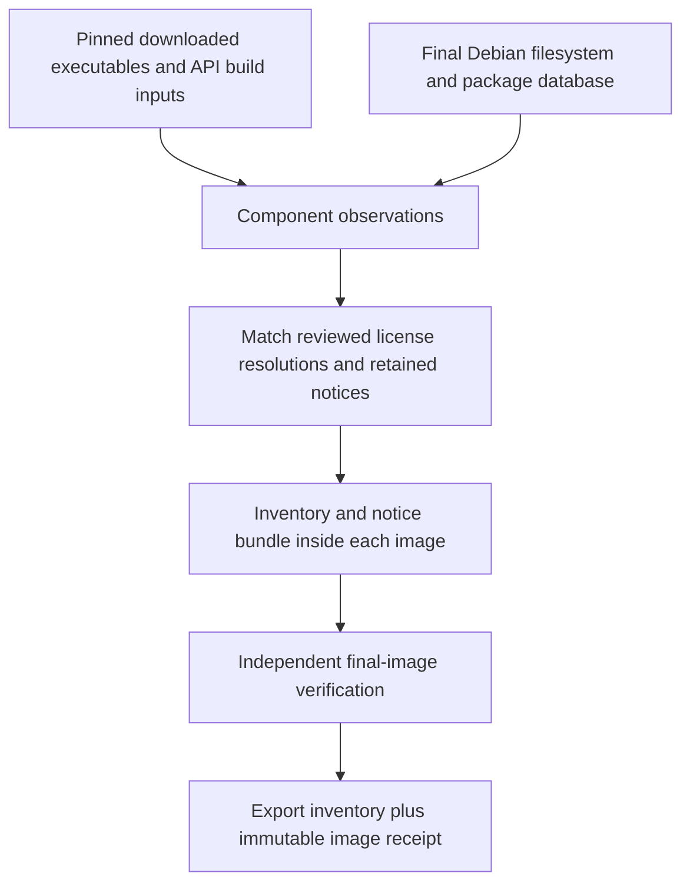

# Registry Packaged Dependency Inventory - Plan

## Goal Capsule

- **Objective:** A release reviewer can identify every third-party component and its license in each packaged Registry image, with evidence tied to the exact image checked.
- **Means:** Generate artifact-derived inventories and ship their resolved notices alongside the runtime artifacts (KTD1–KTD3).
- **Authority:** The selected packaged-inventory item in `ROADMAP.md`, repository instructions, then this plan's Product Contract govern scope.
- **Execution:** Two dependent implementation units; the lead integrates, verifies and makes local commits. Push only when requested.
- **Stop conditions:** Missing artifact provenance, unidentified incorporated components or unresolved license evidence prevent declaring the inventory complete.

---
## Product Contract

### Summary

Complete the packaged transitive dependency/license inventory for the API, rqlite and backup images. Inventory the artifacts actually shipped and retain the notices and evidence needed to review those artifacts.

### Problem Frame

The existing Registry static gate verifies seven direct dependency notices, which remain independently checked after this change. Those notices do not enumerate the Go dependencies in downloaded executables or the OS packages in the final Debian images. The API image also copies notices for components that are absent from its runtime build, including GoogleTest. Reviewers cannot determine the complete packaged contents from the current direct-notice checks.

### Requirements

**Inventory coverage**

- R1. Cover every third-party component shipped in the final API, rqlite and backup images, including installed OS packages, statically incorporated dependencies and the Go runtime/module dependencies of each executable.
- R2. Record component identity, exact version or immutable source identity, artifact association, license expression and the location of retained license/copyright/notice material.
- R3. Derive inventory evidence from the packaged artifacts and final filesystem, retaining the image identity and executable/content digests needed to reproduce the association.

**License evidence and acceptance**

- R4. Resolve transitive license evidence against the corresponding component source identity and retain required notices in the image; an unknown component, license or missing notice fails qualification.
- R5. Verify inventory consistency in the existing static and container qualification gates and record the delivered scope and actual verification checkpoint in `ROADMAP.md`.
- R6. Preserve first-party declarations and existing pinned direct-dependency verification while distinguishing runtime components from build/test-only inputs.

### Scope Boundaries

This work covers the current Linux amd64 packaged images and their release inventory. Existing Registry behavior, SQLite/rqlite storage, API contracts and backup encryption remain outside this change.

Vulnerability scanning, license policy approval workflows, dependency upgrades, OS repository pinning and a general SBOM service are not part of this inventory deliverable. They do not resolve the missing artifact-to-license association and can be evaluated independently.

#### Deferred to Follow-Up Work

The stable-runner performance baseline, nightly orchestration, five-host deployment qualification, 24-hour soak and actual-destination RPO/RTO rehearsal remain open under their existing roadmap items.

### Sources

- `ROADMAP.md`, Registry remaining release implementation: complete the packaged transitive dependency/license inventory.
- `scripts/test-registry-static.sh`: seven pinned direct notices and source/archive checks.
- `relay/docker/Dockerfile`, `relay/docker/rqlite.Dockerfile`, `relay/docker/backup.Dockerfile`: actual image contents and artifact versions.
- `relay/README.md`, third-party notices: current limits concerning direct dependencies and floating OS package versions.

---
## Planning Contract

### Key Technical Decisions

- KTD1. **Use final artifact evidence.** Enumerate installed Debian packages from the final image's package database and preserve their copyright files, including valid package symlink targets. Read Go build information from each shipped executable, including `age-keygen`, and associate its module graph and toolchain with the binary digest. Preserve API compiler dependency and linker evidence against pinned source archives so header-only and statically linked components are covered. This implements R1–R3 without mistaking a source manifest for the installed artifact.
- KTD2. **Keep reviewed license resolutions separate from observations.** Store versioned component/license/source mappings and retained upstream notices under `relay/third_party/`; observations must match those reviewed identities. Account explicitly for embedded native payloads such as SQLite and vendored code not represented as independent Go modules. Acquire each exact Go module version through its versioned module source archive, verify available module checksums, and retain source URL and archive digest with the collected license files. Resolve main-module, replacement-module and Go toolchain source releases by the identities found in the binary. Review nested license/copyright files for embedded code and retain explicit component mappings rather than assigning the parent module license to every payload (R4).
- KTD3. **Generate an image-local machine-readable bundle.** Use one versioned JSON inventory shape for all three images, with per-executable component associations, Debian package records and notice references. Generate it before the final image completes, then independently verify it against the built image and export evidence containing that image's immutable identity. The image cannot embed its own resulting digest, so that association belongs in the exported qualification receipt (R2–R5).
- KTD4. **Reuse existing qualification builds.** Add inventory checks to the existing container runners before their unique image tags are removed. Keep offline fixture checks in the static gate. Avoid a second CI image build or new broad test lane (R5).

### High-Level Technical Design

### Assumptions

- A versioned JSON inventory is sufficient for this bounded release deliverable; no external consumer currently requires SPDX or CycloneDX serialization.
- The existing Python-based Registry tooling is the appropriate home for offline metadata validation and Docker-driven qualification. Build stages may provide Go tooling for binary inspection without installing it in runtime images.
- Debian copyright files remain available in final image layers; the generator must report missing or broken references instead of assuming package names imply retained notices.

### Risks and Implementation Details

Downloaded Go release binaries may expose replacement modules, pseudo-versions or missing build information. Inspect the pinned artifacts during implementation; unavailable evidence is a qualification failure, not permission to infer their contents from a repository's default branch.

The complete component and notice count is an execution-time discovery. Review exact source archives for vendored or embedded native payloads and record those findings with their pinned release mappings. If the pinned artifact cannot be completely inventoried, leave acceptance open and report the precise unresolved component.

OS packages may change between builds because apt repository contents float. Record actual versions for each image rather than claiming reproducible package sets. This plan does not change that packaging policy.

---
## Implementation Units

### U1. Build the artifact inventory and license evidence bundle

**Goal:** Produce complete, validated inventory records and retained notices from the current packaged inputs.

**Requirements:** R1–R4, R6; KTD1–KTD3.

**Dependencies:** None.

**Files:** Create `relay/tools/packaged_inventory.py`, `relay/tests/test_packaged_inventory.py`, `relay/tests/inventory_fixtures/` and reviewed inventory/license material under `relay/third_party/`. Include `relay/CMakeLists.txt` if needed to export compile/link evidence. Modify `scripts/test-registry-static.sh` for the offline checks and its direct-only notice-set assumption.

**Approach:**

1. Inspect the exact pinned executables and source/archive identities already consumed by the Dockerfiles; establish Go/runtime/module and embedded native component coverage.
2. Define the shared inventory shape and reviewed resolution data, preserving exact upstream notices and evidence paths.
3. Implement deterministic generation and independent validation for observed package, executable and component records; separate build/test-only notices from runtime claims.
4. Add fixture-based negative coverage before integrating the image builds.

**Test scenarios:**

- Valid API, rqlite and backup fixture observations produce deterministically ordered inventories with exact identities and resolvable notices.
- A removed transitive module, unknown license, missing notice, changed executable digest or unmatched module replacement fails with the component named.
- A binary without usable Go build information fails rather than falling back to a top-level project license.
- A distinct `age-keygen` observation is required even when it shares modules with `age`.
- Embedded SQLite/native component evidence is required independently of the containing Go module's license.
- Debian package version mismatches and broken copyright symlinks fail; valid package symlinks resolve within the exported filesystem.
- GoogleTest remains recognized as a build/test input and is absent from API runtime inventory claims.

**Verification:** Focused Python inventory tests, the offline static Registry gate and shell/Python syntax checks for changed tooling.

### U2. Package, qualify and document the complete inventories

**Goal:** Ship and independently verify the complete bundle in each actual runtime image.

**Requirements:** R1–R6; KTD3–KTD4.

**Dependencies:** U1's inventory schema, generator and reviewed resolutions.

**Files:** Modify `relay/docker/Dockerfile`, `relay/docker/rqlite.Dockerfile`, `relay/docker/backup.Dockerfile`, `relay/.dockerignore` if needed, `scripts/test-registry-container.sh`, `scripts/test-registry-backup.sh`, `relay/README.md` and `ROADMAP.md`. Extend `relay/tests/test_packaged_inventory.py` for exported image validation. Modify `.forgejo/workflows/ci.yaml` and `tests/Unit/Shared/Infrastructure/Ci/PublicationWorkflowTest.php` only if needed to preserve and publish the same qualification evidence.

**Approach:**

1. Generate the image-local bundles after the final runtime packages and executables are present, keeping inventory tooling out of the resulting runtime where stages permit it. Preserve the existing non-root users, entrypoints and runtime behavior.
2. Verify all three final images through their existing qualification runners, extracting the package database, executables and notices for comparison with the embedded bundle.
3. Export machine-readable inventories and image receipts to a caller-selected evidence directory before cleanup; CI retains those files from the existing container-quality job.
4. Document the bundle location, regeneration and verification procedure, then update only the selected roadmap item and its evidence checkpoint after actual checks pass.

**Execution note:** Prefer the existing container qualification smoke checks over new broad integration suites.

**Test scenarios:**

- Built API, rqlite and backup images each contain a readable inventory whose executable hashes, installed package versions and notice contents match the exported filesystem.
- Tampering with an exported package version, executable or notice causes qualification failure.
- The backup image includes separate coverage for `age`, `age-keygen` and `rclone`; API inventory excludes backup and test-only components.
- Qualification exports receipts for the exact image IDs inspected before unique tags are deleted; retained CI artifacts remain available after runner cleanup.
- Existing API/rqlite container behavior and encrypted backup/offline-restore qualification still pass with the packaged bundles.

**Verification:** Existing Registry container and backup qualification scripts, full static Registry gate, focused workflow contract tests if changed, and documentation/diff checks.

---
## Verification Contract

- Run `python3 -m unittest discover -s relay/tests -p test_packaged_inventory.py` for U1 and the final image-validation fixtures.
- Run `scripts/test-registry-static.sh --pins-notices-only` after offline integration, then `scripts/test-registry-static.sh` once final source/license evidence is ready.
- Run `scripts/test-registry-container.sh` and `scripts/test-registry-backup.sh` serially for U2, retaining inventories and immutable image receipts outside temporary cleanup directories.
- Use the authoritative CI-image runners from `docs-book/part-2-developer-guide/testing.md` for any changed PHP workflow-contract test. Do not run unrelated backend suites.
- Check changed shell/Python syntax, apply `prose-fix` to changed documentation and run `git diff --check`.
- Record exact focused suite counts, static gate results and per-image inventory/notice counts in the roadmap checkpoint. A source-only manifest or unexecuted image verifier does not complete R5.

---
## Definition of Done

U1 is complete when exact artifact observations resolve to retained license evidence, meaningful negative cases pass and no shipped component is silently omitted. U2 is complete when all three actual final images pass inventory validation and their existing behavior qualification, with exported inventories tied to immutable image identities.

The selected roadmap item is checked only after those results exist. Deferred release measurements and external rehearsals retain their current state. All delivered changes remain in local commits unless a push is requested.
