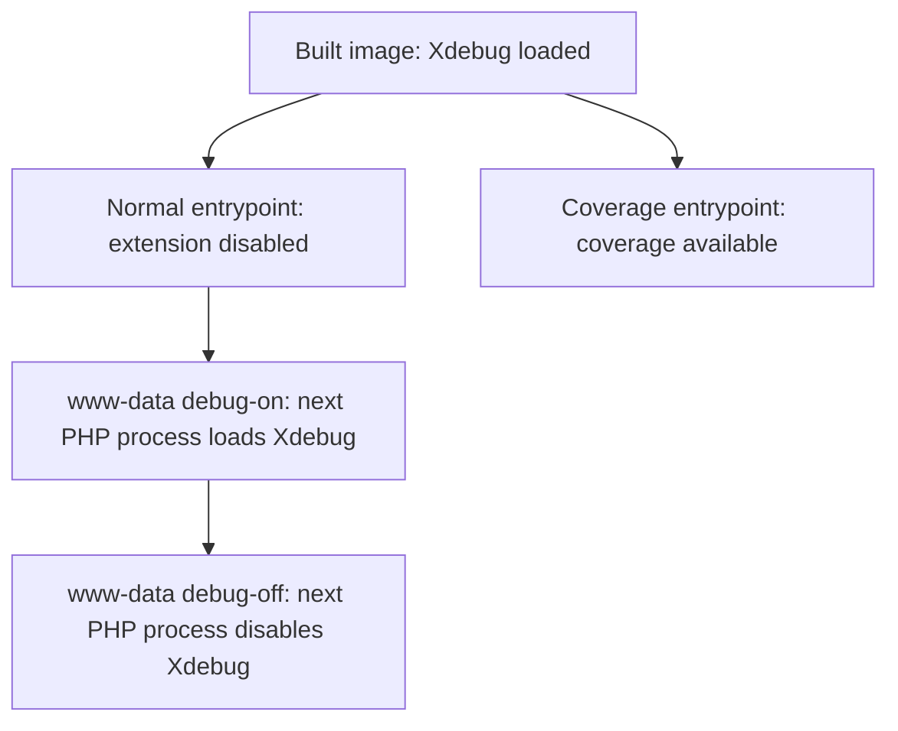

# Fix Dev Xdebug Build - Plan

## Goal Capsule

- Objective: developers can build the development image and use its existing debugging and coverage controls.
- Means: install the requested Xdebug release through an explicit PECL archive URL (KTD1).
- Authority: the request to repair the build failure recorded in `ROADMAP.md`, then the requirements below; implementation units do not change those requirements.
- Execution profile: container build and runtime smoke verification, with disposable containers and no application services or data resets.
- Stop condition: a failed build or runtime contract remains a blocker; fixing this image does not establish that the full source-installation procedure works.
- Delivery: the lead integrates, verifies and records local commits; pushing requires a separate request.

---

## Product Contract

### Summary

Repair the development image's Xdebug installation and verify the controls used by developers and CI.

### Problem Frame

The source-installation checkpoint in `ROADMAP.md` records `unable to unpack xdebug` during the dev image build.
The current dev stage declares `XDEBUG_VERSION=3.5.0` but bundles an unversioned package.
The reproduced failure occurs before compilation: PEAR 1.10.16's REST download path passes an HTTP chunk prefix into its XML parser.
Downloading and bundling the explicit Xdebug 3.5.0 archive succeeds in the same runtime environment.

### Requirements

**Build selection**

- R1. The dev image builds with the default Xdebug version and installs exactly the version requested through `XDEBUG_VERSION`.
- R2. A supported alternate `XDEBUG_VERSION` builds successfully, including when the PECL cache already contains another release.

**Runtime controls**

- R3. The built image loads Xdebug when its entrypoint is bypassed, preserving the installed extension's existing configuration filename.
- R4. Normal entrypoint startup disables Xdebug, while `XDEBUG_MODE=coverage` keeps it available for coverage collection.
- R5. The existing `www-data` debug aliases can enable and disable Xdebug for subsequent PHP processes.

**Acceptance evidence**

- R6. CI runs a focused container smoke check against its image, which inherits the dev stage.
- R7. Documentation distinguishes the repaired image build from the host `posix` prerequisite and the application bootstrap scenarios that remain unverified.

### Scope Boundaries

No global PEAR upgrade, replacement extension installer, blanket cache purge, or new retry path is needed: the explicit archive bypasses the failing metadata lookup and keeps the existing build path.
Reconsider that choice only if the archive build or warm-cache verification fails.
This work does not change extension configuration, application behavior, PostgreSQL, deployment design, or local user data.
The host `posix` prerequisite and full frontend, login, worker and sample-library checks remain outside this repair.

---

## Planning Contract

### Key Technical Decisions

- KTD1. Bundle the explicit versioned archive from `https://pecl.php.net/get/`, using `XDEBUG_VERSION`, and retain `docker-php-ext-configure` and `docker-php-ext-install`. The direct bundle probe succeeds without the broken REST release lookup; retaining installation preserves R3-R5.
- KTD2. Add `scripts/test-dev-xdebug-container.sh` and invoke it after the CI image build in `.forgejo/workflows/ci.yaml`. Following the disposable-container conventions in existing runtime scripts gives R6 a repeatable check without starting the application.
- KTD3. Verify the real default and alternate builds, then force the Xdebug installation layer to execute with an already populated PECL cache. A cached Docker layer alone cannot establish R2.

### High-Level Technical Design

### Existing Patterns and Assumptions

`Dockerfile` owns the version argument, PECL cache, extension installation, aliases and writable INI files.
`docker/dev/entrypoint.sh` owns startup mode selection; it needs no change if the existing contracts pass.
The CI stage derives from dev.
Existing container scripts accept an image selection and use disposable containers; the new script should follow those conventions and run its PHP checks without network access.
No relevant Xdebug or PECL solution entry exists in `docs/solutions/`.
This repair introduces no Baander domain vocabulary requiring a `CONCEPTS.md` entry.

---

## Implementation Units

### U1. Select and verify the requested Xdebug release

**Goal:** repair package acquisition while preserving the existing installation path.

**Requirements:** R1-R5; KTD1 and KTD3.

**Dependencies:** none.

**Files:** `Dockerfile`; verification in `scripts/test-dev-xdebug-container.sh` from U2.

**Approach:** change the dev bundle source to the explicit archive URL; keep the cache mount, configure/install commands and runtime controls.

**Test scenarios:** default release 3.5.0 builds and reports 3.5.0; override release 3.5.3 builds and reports 3.5.3; re-executing the dev installation layer with populated cache still selects the requested release.

**Execution note:** use actual image builds and runtime checks rather than a unit test that matches Dockerfile text.

### U2. Protect the dev image contracts in CI

**Goal:** make extension selection and runtime controls repeatable acceptance checks.

**Requirements:** R3-R6; KTD2.

**Dependencies:** U1 for passing checks; the script may first characterize the old image's version mismatch.

**Files:** `scripts/test-dev-xdebug-container.sh`; `.forgejo/workflows/ci.yaml`.

**Approach:** accept the existing image-selection convention, compare installed Xdebug with image `XDEBUG_VERSION`, and use fresh disposable containers for each startup mode so one check cannot mutate another's INI state.
Wire the smoke after the CI image build.

**Test scenarios:** bypassed entrypoint loads the requested extension; normal startup unloads it; coverage startup enables actual coverage capability; `www-data` can use both aliases and a subsequent PHP process observes each change.
Run with network disabled and clean up all containers even after failure.

### U3. Record the repaired checkpoint

**Goal:** report the verified repair without overstating bootstrap acceptance.

**Requirements:** R7.

**Dependencies:** U1 and U2 verification.

**Files:** `ROADMAP.md`; `README.md` and `docs-book/part-1-operator-guide/getting-started.md` only where their current blocker wording needs correction.

**Approach:** preserve the historical failed bootstrap checkpoint and append the repair evidence, exact image/version checks and remaining unverified scenarios.
Apply the project's prose guidance to changed documentation.

**Test expectation:** no application tests for prose; check changed links, factual claims and whitespace.

---

## Verification Contract

- Build the actual dev target for the default release and alternate 3.5.3; retain bounded build logs outside the repository.
- Force the dev installation layer to run against the populated PECL cache and repeat the version smoke.
- Build the actual CI target and run `scripts/test-dev-xdebug-container.sh` against it; this is the authoritative image context for the added CI check.
- Check the shell script with `bash -n`, inspect workflow placement against the existing image tag, and run `git diff --check`.
- Confirm every runtime scenario in U2 passes; these focused image checks replace unrelated backend or frontend suites for this packaging change.
- Apply code simplification at the phase boundary and review the final change before delivery, addressing justified findings.

## Definition of Done

The requested release builds under both default and override selection, warm-cache execution remains correct, all runtime smoke scenarios pass on the resulting images, and CI invokes the smoke against its built image.
`ROADMAP.md` records the delivered files and verification checkpoints while preserving the remaining bootstrap limitations.
The final changes have passed the applicable reviews and remain local until a push is requested.
