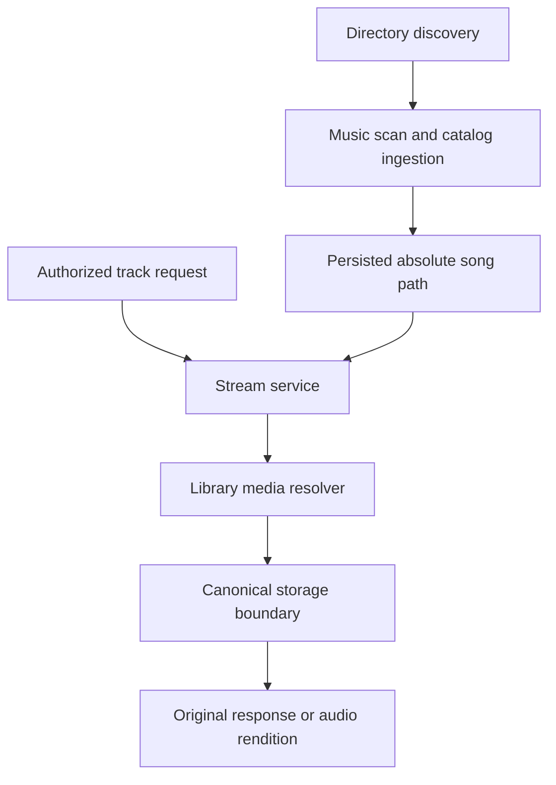

# fix: Play freshly scanned music within its library boundary

## Goal Capsule

**Objective:** An authorized listener can play a freshly scanned music track.

**Means:** Resolve the catalog's absolute song path against its owning library's
canonical root (KTD1–KTD2).

The user's playback repair request owns scope; repository architecture and testing
rules govern implementation. The lead implements with `ce-work` after document
review, owns integration and local commits, and records acceptance in `ROADMAP.md`.
Use the branch named after this plan. Do not merge or push. Stop and report a
blocker if the repair requires changing the persisted path contract, weakening the
filesystem boundary, or resetting existing database, Redis or media data.

---

## Product Contract

### Problem Frame

Source-bootstrap verification at `master` revision `2ab80b39` reached library
scanning and catalog display, but playback returned HTTP 500. The scan pipeline
stores absolute file paths. `StreamService` passes those paths to
`LocalFilesystem::resolve`, whose contract rejects absolute paths. Both the direct
FLAC request and its Opus fallback fail before the media response is produced.

### Requirements

**Playback and containment**

- R1. Freshly scanned, authorized music plays through the normal browser flow.
  Original-file playback and requested Opus transcoding both receive a valid source.
- R2. Preserve the scanner's absolute persisted song paths. Resolve them only
  within the owning library's configured root, using canonical containment checks.
  Reject relative catalog paths, sibling-prefix paths, traversal escapes and
  symlinks that escape that root, including a link replaced between resolutions.
- R3. Preserve `LocalFilesystem`'s relative-path contract and existing traversal,
  null-byte and symlink protections. Do not accept arbitrary absolute paths there,
  strip leading slashes or reinterpret catalog paths relative to `MEDIA_STORAGE_PATH`.
- R4. Missing tracks, missing owning libraries, invalid source paths and missing
  files return the endpoint's safe not-found response. Library authorization stays
  ahead of source resolution, and existing range and transcode behavior remains.

**Proof and recording**

- R5. Add a regression from real directory discovery and catalog ingestion through
  production source resolution and the authorized playback endpoint. Stubbing the
  stream port or inserting only a hand-authored relative song path is insufficient.
- R6. Repeat isolated browser playback for a newly scanned track and record
  successful playback progress and media responses. Verify direct and Opus routes
  independently; a browser that chooses only one format does not prove both.
- R7. Protect existing local data and services. Use run-owned media, databases,
  Redis state, ports and containers; clean up only resources established as owned.
- R8. Update the README, installation guide or operator references only where the
  evidence changes their claims. Record delivered changes, suite counts, static
  gates and any remaining limitation in `ROADMAP.md` after verification. Do not
  report unrelated bootstrap acceptance as complete.

### Scope Boundaries

This repairs the music playback source-path mismatch and its regression gap. It
does not redesign ingestion, catalog storage, transcoding or the general filesystem
API, rewrite schemas, reset existing data, or change frontend format negotiation.
No new domain vocabulary is introduced.

---

## Planning Contract

### Key Technical Decisions

- KTD1. **Keep the producer contract.** `DirectoryScanner` canonicalizes the
  library root; `MusicScanner` publishes each discovered absolute path;
  `FilesDiscoveredHandler` persists that value as `Song::path`. Repair the consumer
  rather than rewriting these paths or adding a migration (R2–R3).
- KTD2. **Keep library ownership behind a narrow application contract.** Add
  `LibraryMediaFileResolverInterface` to the existing Library media-files contract
  layer. Its Library Infrastructure implementation loads the library through its
  own repository, requires an absolute song path, and uses the existing
  `StoragePathBoundary::resolve` with that library's configured root, then requires
  the canonical result to be a regular file. `StreamService`
  obtains the library UUID through `SongRepositoryInterface::getLibraryIdByPublicId`
  and invokes that contract. Returning a resolved string avoids exposing Library
  domain objects to Media. Allow only Media Infrastructure's dependency on this
  existing contract layer; add its service alias and remove the obsolete stream
  service filesystem baseline dependency. No broader application/domain edge or
  new boundary algorithm is justified.
- KTD3. **Map resolution failures safely.** Extend the controller's existing
  `InvalidArgumentException` not-found handling to source resolution. Keep the
  authorization decision before it. Missing files and directory targets fail as
  invalid sources and return 404; do not catch arbitrary runtime/transcode failures.
- KTD4. **Prove the integration that existing tests bypass.** Existing functional
  audio fixtures substitute `StreamPortInterface`; retain their useful codec and
  policy coverage, and add a separate production-wired scanner-to-playback case.
  Place its temporary library outside `MEDIA_STORAGE_PATH`, so an accidental
  storage-root interpretation cannot pass (R5).
- KTD5. **Keep runtime proof disposable.** Reuse the isolated bootstrap method
  from the previous verification effort, accounting explicitly for fixed Compose
  names, ports and external volumes. Only copy the repair into the run-owned
  checkout; preserve existing development services and data (R6–R7).

### High-Level Technical Design

### Evidence and Assumptions

The behavior trace is grounded in
`src/Library/Infrastructure/Scanner/DirectoryScanner.php`,
`src/Library/Application/MusicScanner.php`,
`src/Catalog/Application/CommandHandler/FilesDiscoveredHandler.php`,
`src/Media/Infrastructure/Service/StreamService.php`,
`src/Media/Interface/Controller/StreamController.php`,
`src/Filesystem/Infrastructure/Service/LocalFilesystem.php` and
`src/Shared/Infrastructure/Filesystem/StoragePathBoundary.php`. The architecture
rules permit cross-context application contracts. The current Deptrac graph does
not allow Media to consume the broad Library application layer, whose existing
port also exposes Library domain objects. The narrow media-files contract avoids
that exposure; Library Infrastructure uses its own repository and the existing
Shared Infrastructure boundary helper. Controllers retain their existing ports.
The inspected `docs/solutions/` entries concern other runtime failures and do not
change this repair. No external research is needed for this local contract mismatch.

No product decision blocks implementation. Runtime worker admission and browser
codec selection remain execution-time checks. Keep their outcome separate from
the source-path regression. The repair needs no PostgreSQL schema or query change.

---

## Implementation Units

### U1. Resolve scanned track paths within the owning library

**Goal:** Deliver R1–R4 using KTD1–KTD3. No dependencies.

**Files:** `src/Media/Infrastructure/Service/StreamService.php`,
`src/Media/Interface/Controller/StreamController.php`, a new
`tests/Unit/Media/Infrastructure/Service/StreamServiceTest.php`, and the existing
controller security tests. Add
`src/Library/Application/Port/LibraryMediaFileResolverInterface.php`,
`src/Library/Infrastructure/Filesystem/LibraryMediaFileResolver.php`, and focused
resolver unit tests. Update `config/services.yaml`, `deptrac.yaml` and the obsolete
stream filesystem baseline entry. Adapt
`tests/Integration/TrackStreamFirewallTest.php` to real absolute library paths and
a resolver spy that delegates to the production resolver with a real Library
repository exposed through the fixture kernel. Replace
the relative song fixture in `tests/Fixtures/TwoCommand/deployment.php` with its
existing absolute audio fixture. Trace remaining constructor callers before editing.

**Approach:** Implement the library-root resolution and safe controller error
mapping. Keep the change at the consumer boundary. Verify service autowiring and
trace every constructor call and test override before editing.

**Execution note:** Demonstrate a failing absolute scanned-path regression before
the production fix, then run it against the repair.

**Test scenarios:** An absolute file within a temporary library outside the media
storage root resolves correctly; a symlinked configured library root also works.
Reject a relative song path, outside absolute path, prefix-sibling path, traversal
escape, final symlink escape and parent-directory symlink escape. Resolve once,
replace the link to point outside, and ensure the next resolution rejects it.
Exercise missing song and library, an in-root missing file, a directory target, and
null-byte rejection. Check containment before file existence.
The endpoint returns 404 for resolution failures, while a denied library never
calls the resolver. Existing direct range, transcode-busy and authorization cases
retain their behavior.

**Verify:** Focused service/controller unit tests, existing filesystem boundary and
traversal tests, container wiring, PHPStan and Deptrac for the resulting change.

### U2. Add a scan-to-playback regression and prove real playback

**Goal:** Deliver R5–R7 using KTD4–KTD5. Depends on U1 for the passing proof.

**Files:** A new focused test under `tests/Functional/Media/`, with changes to
`tests/Functional/Media/AudioStreamTestCase.php` or test fixtures only if needed to
reuse source generation without its stream-port override. Runtime artifacts remain
outside tracked files.

**Approach:** Generate temporary FLAC media, discover it through the real directory
scanner and ingest the real discovered-file payload through the catalog handler
and repository. Metadata extraction may use a bounded fixture; source discovery,
persisted song path, stream service and request authorization must be real.
Request the resulting PublicId through the actual playback endpoint.

**Test scenarios:** Assert the persisted path is the scanner-produced absolute
path. An authorized original request returns playable FLAC bytes; a range request
returns 206 and the expected byte slice. An Opus request receives a valid encoded
audio response, using the established real-encoder fixture where suitable. Retain
existing transcode policy, cache and admission coverage rather than building a new
transcode harness. Scan a new track in the disposable browser installation, play
it, and observe time advancing with successful media responses. Exercise direct
and Opus URLs separately and inspect codec/content evidence.

**Verify:** The new regression fails on the pre-repair consumer and passes on the
repair. Run relevant existing functional audio and controller access tests through
the CI image's disposable runner. Record browser origin, source revision, scan
completion, track identity, media status and playback progress without credentials.

### U3. Record verified acceptance and review the repair

**Goal:** Deliver R8. Depends on U1–U2.

**Files:** `ROADMAP.md`, and only evidence-justified corrections in `README.md` and
the affected source-installation operator references.

**Approach:** Record the defect, fix, exact verification checkpoints and remaining
bootstrap limitations. Preserve historical results. Apply `prose-fix` to changed
documentation, run `ce-simplify-code` at phase boundaries and `ce-code-review`
before delivery, and apply justified findings. The lead creates local commits;
workers do not stage or commit.

**Verify:** Prose preservation audits for rewritten existing files, link accuracy,
`git diff --check`, review findings resolved or explicitly bounded, and owned
runtime resources accounted for. No new tests are needed for the prose itself.

---

## Verification Contract

Use tracked `phpunit.xml.dist` and the current CI image. Run focused unit selections
through `scripts/test-unit-container.sh` and functional/integration selections
through `scripts/test-functional-container.sh`; confirm their supported selection
arguments against the current testing guide before execution. Database-backed
tests use disposable PostgreSQL and Redis, never the local development stores.
Serialize shared-state or expensive runners and keep full logs in temporary files.
Run the project's PHPStan and Deptrac gates with the CI image and inspect wiring
after replacing the dependency. Report actual test/assertion counts and any skips;
an environmental skip does not satisfy acceptance. Run `git diff --check` and the
required simplification and code reviews after the final code changes.

Browser proof is separate from PHPUnit: complete a fresh scan and authenticated
playback in the disposable installation, observe advancing playback time and
successful audio transfer, and independently prove direct FLAC plus Opus
transcoding. A successful build, visible catalog item or HTTP 200 HTML page does
not establish playback. If runtime proof is blocked, record the exact blocker and
keep that acceptance item open.

---

## Definition of Done

The repair preserves the persisted absolute-path and relative-only filesystem
contracts, rejects library-boundary escapes, and maps invalid source resolution
to 404 after authorization. The scanner-to-playback regression, relevant existing
tests, static gates and independent review pass. A newly scanned track plays in
the isolated browser environment, with direct and Opus evidence recorded.
`ROADMAP.md` contains the delivered scope and observed checkpoints, including any
remaining limitation. Existing local data remains intact. The work ends with local
commits on the plan branch and no merge or push.
