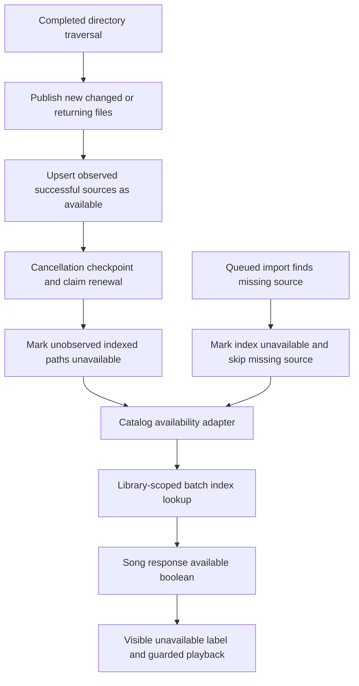
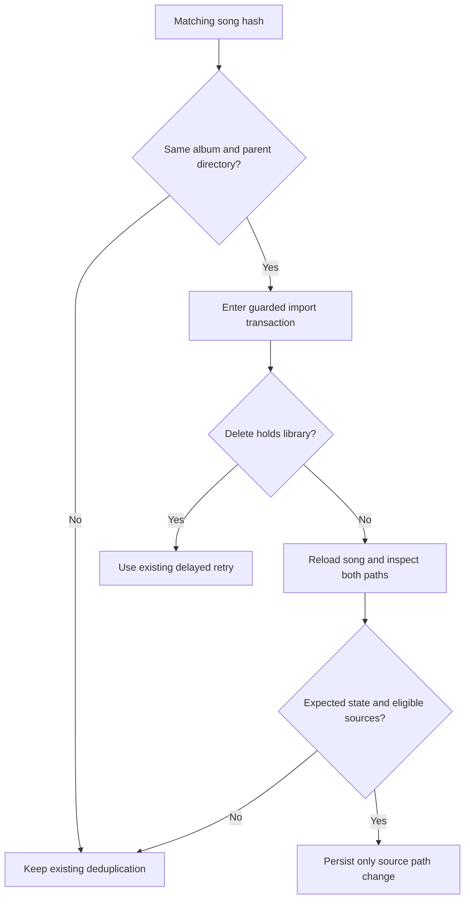

# Preserve unavailable media and repair renamed tracks - Plan

## Goal Capsule

- **Objective:** Listeners keep their library when storage disappears, see which tracks are unavailable, and regain playback when files return or are renamed within an album directory.
- **Means:** Retain file-index observations, project their availability into music responses, and reconcile eligible renamed songs (KTD1–KTD4).
- **Authority:** The user's PHP improvement request and subsequent instructions to preserve missing files, show unavailable tracks, and prevent their playback govern this work.
- **Execution profile:** Prove the regressions, implement the bounded backend and web changes, and verify a real scan-to-browse-to-playback recovery.
- **Stop conditions:** Stop for an ownership-policy change, cross-directory rename reconciliation, a new background-job system, or destructive local-data reset.
- **Completion owner:** The lead integrates, reviews, records verification in `ROADMAP.md`, and makes local commits; pushing requires a request.

---

## Product Contract

### Summary

Keep catalog entries and file-index records when a library root, mounted subtree, or individual file disappears.
Show the last observed availability in the music UI and prevent unavailable tracks from starting playback.
Restore availability when scans find files again, and repair the original track when its source was renamed within the same album directory.

### Problem Frame

A missing library root currently produces an empty discovery result, after which incremental scanners delete every old index row and report completion.
An empty mounted subtree has the same effect on its indexed files.
Catalog records survive, but responses expose no availability, so the web player continues offering playback until streaming rejects the source.
Queued ingestion also deletes missing index rows to ensure returning files can be imported; preserving those rows requires another way to recognize their return.

A renamed audio file is discovered at its new path, but ingestion finds the existing content hash and skips the song.
The original track retains its missing source path, and further scans cannot repair it.

### Requirements

**Renamed tracks**

- R1. An incremental scan or full rescan reconciles an eligible rename so the original song and public IDs play the new source.
- R2. A rename is eligible only when the hash matches, the song belongs to the resolved album, and both paths have the same parent directory.
- R3. Reconciliation requires an available owning root, a missing old source, and a present contained new source; read-only media storage remains supported.
- R4. Reconciliation preserves metadata and relationships, including concurrent edits visible at the write, without new-song artist, genre, lyrics, or album-sync fanout.
- R5. Repeated delivery is idempotent, delete-held imports retain delayed retry, and a failed path write remains retryable.

**Unavailable sources**

- R6. Scans and ingestion preserve catalog entries, identities, counts, relationships, and index rows when any source disappears, including all files under a root or subtree.
- R7. A completed scan marks missing indexed sources unavailable, while a returning unavailable source is republished even with an unchanged hash and becomes available again.
- R8. Public `available` is a required boolean representing the last completed discovery or ingestion observation; an absent index row means false until a scan confirms the source.
- R9. Music lists, album tracks, playlists, search, recommendations, activity, and preview surfaces retain unavailable tracks with an “Unavailable” label and disabled playback actions.
- R10. Explicit selection of an unavailable track does not start playback or substitute another track; bulk playback skips unavailable entries and mixed queues preserve the selected available track's identity.
- R11. Cancellation, publication failure, failed traversal, and lost scan claims do not mark unvisited indexed paths missing; explicit deletion retains its existing behavior.
- R12. Song list, detail, search, album, playlist, recommendation-song and activity-song responses expose availability without changing access checks or reading media files during response assembly.
- R13. Restored music queues retain their tracks, order, selection, metadata and preferences while current catalog availability is hydrated before playback; an unknown or failed availability lookup does not erase the queue or authorize playback.

### Scope Boundaries

Music is the API and UI scope; both music and movie scanners retain source observations because both currently remove unseen index rows.
Cross-directory or cross-album rename reconciliation, global hash deduplication policy, video UI, automatic catalog deletion, live mount detection, polling infrastructure, and new background jobs are outside this repair.
Radio playback keeps its existing behavior and does not depend on the media-file index.
An existing duplicate whose old source still exists keeps its current behavior.
Explicit user deletion remains the path for removing catalog or index records.

### Acceptance Examples

- AE1. Import `Album/old.flac`, rename it to `Album/new.flac`, and scan; the original track plays the renamed file, and repeated ingestion creates no replacement song or metadata fanout.
- AE2. Remove or hide an entire library root, or empty one previously indexed album subtree, then scan; all catalog and index rows remain and affected tracks show unavailable.
- AE3. Restore those files unchanged and scan; existing tracks become available and files whose original queued import found them missing are imported successfully.
- AE4. Rename a recovered source again and force a rescan; the original track plays the second renamed source and old missing index records remain unavailable.
- AE5. Copy identical bytes beside a present original, or discover a match belonging to another album or library; the existing song path stays unchanged.
- AE6. In a mixed album or playlist, bulk play begins with the first available track; selecting an unavailable row, keyboard action, context-menu action, or queue item starts no playback.
- AE7. Cancel a scan or fail a directory publication before traversal finishes; untouched indexed paths retain their previous availability.
- AE8. Restore a saved mixed music queue, including metadata and the selected track; playback waits for current catalog availability, leaves unavailable entries visible, and starts the selected track only if confirmed available.

---

## Planning Contract

### Key Technical Decisions

- KTD1. **Store availability once in the Library index.** Add `library_file_index.available` as a non-null boolean defaulting to true for existing successful discoveries; upsert restores true and missing observations set false without deleting rows.
- KTD2. **Separate all indexed paths from skip-eligible hashes.** Both scanners load all prior paths even on a full rescan; incremental hash skipping uses only available rows, so an unchanged returning file is published again.
- KTD3. **Reconcile only after complete discovery and publication.** Collect observed paths independently of hashing success, check cancellation, and renew the claim before missing-state writes; exceptions exit before reconciliation.
- KTD4. **Update the fresh song inside the guarded import transaction.** A global hash match becomes a candidate only after R2; re-read it with `findFreshByUuid`, recheck expected album/hash/old path and source eligibility, and persist only its source-path change.
- KTD5. **Project availability in batches through application contracts.** Catalog loads distinct albums with the existing `AlbumPortInterface::findByUuids`, groups song paths by owning library, and obtains index booleans through the Library port.
- KTD6. **Guard playback in the shared queue actions.** Propagate the required boolean into track objects, reject unavailable explicit selections, filter bulk queues, and remap an available selected track by public ID after filtering.
- KTD7. **Hydrate restored availability without replacing queue state.** Use existing authenticated catalog reads to confirm restored tracks, applying availability only to matching current entries so delayed responses cannot overwrite a newer queue, selection or metadata.

### Shared Interfaces

These boundaries are fixed before parallel implementation; helper names inside the components remain implementation choices.

- `LibraryFileIndexRepositoryInterface::findAvailableIndexPathMapByLibrary` returns available path-to-hash pairs; it replaces the old unqualified hash-map method.
- `LibraryFileIndexRepositoryInterface::findIndexedPathsByLibrary` returns all known paths for one library.
- `LibraryFileIndexRepositoryInterface::markUnavailableByPaths` performs bounded library-scoped updates, while existing remove methods remain available for explicit deletion.
- `LibraryFileIndexRepositoryInterface::findAvailabilityByPaths` returns a path-to-boolean map for all distinct requested paths, with absent rows false.
- New `LibraryFileAvailabilityInterface::findAvailabilityByPaths` takes the owning library UUID and absolute paths and exposes that same map without filesystem I/O.
- New `SongAvailabilityPortInterface::forSongs` takes songs and returns a song-UUID-to-boolean map; its Catalog adapter uses the existing album batch lookup and Library port.
- `SongResource` receives availability maps as projection input and emits required `available`; resource helpers stay pure.
- Personalized recommendation `song.available` uses the same boolean; enriched activity exposes `songAvailable`, false when no song is present, while preserving its existing song identity fields.
- `LibraryMediaFilesInterface::markMissingUnavailable` replaces `forgetMissing` and returns the missing paths after marking their retained index rows unavailable.

### High-Level Technical Design

The sketches describe ownership and sequencing rather than prescribing helper implementations.

### Assumptions and Limits

Availability is an observation, not proof that storage is currently mounted: it changes after scans or queued imports observe a source.
Existing stream source resolution still checks the actual filesystem and fails unavailable sources even if an older response says available.
No compatibility fallback makes an unindexed catalog song available; the operator scans its library to establish that observation.
If a candidate's expected path, hash, or album changed before its fresh read, reconciliation skips it rather than introducing a new overlapping-import conflict policy.

### Sources and Risks

`src/Library/Application/MusicScanner.php`, `MovieScanner.php`, and `src/Library/Infrastructure/Scanner/DirectoryScanner.php` establish traversal, hash skipping, and current stale-row deletion.
`src/Library/Infrastructure/Filesystem/LibraryMediaFiles.php` and `tests/Integration/Library/LibraryMediaFilesTest.php` establish missing-before-import recovery and explicit deletion safety.
`src/Catalog/Application/CommandHandler/FilesDiscoveredHandler.php` owns hash deduplication, guarded writes, and import fanout.
`src/Catalog/Infrastructure/Doctrine/Repository/SongRepository.php` already persists source paths and supports fresh reads.
`SongResource` is shared by song, album, and playlist projections; web playback maps are spread across catalog, layout, playlist, and player features.
The repository PostgreSQL guidance governs the one-column migration and bounded queries; no extra index or catalog availability column is needed.

---

## Implementation Units

### U3. Retain index availability and expose the Library batch contract

**Requirements:** R6–R8, R11, R12; approach KTD1 and KTD5.

**Ownership:** PostgreSQL worker owns `src/Library/Domain/Repository/LibraryFileIndexRepositoryInterface.php`, `src/Library/Infrastructure/Doctrine/Entity/LibraryFileIndexEntity.php`, `src/Library/Infrastructure/Doctrine/Repository/LibraryFileIndexRepository.php`, the ordered migration under `migrations/`, new Library availability port/adapter, and `tests/Integration/LibraryFileIndexPersistenceTest.php` plus focused adapter tests.
The lead owns service wiring and shared configuration.

**Work:** Add the boolean and frozen methods, make upsert restore availability, and retain removal methods for explicit deletion.
Preserve the existing UUID, unique library/path key, bigint fields, and instant conventions.

**Test scenarios:** Fresh-install mapping and migration agree; unavailable rows retain identity, hash and metadata; unavailable updates are idempotent and library-scoped; upsert restores true; batch reads default missing paths false and isolate libraries; explicit deletion and rollback still work.

**Dependency:** None.

### U4. Preserve missing observations through scans and queued imports

**Requirements:** R6–R8, R11; approach KTD2 and KTD3.

**Ownership:** Lead owns `src/Library/Application/MusicScanner.php`, `MovieScanner.php`, `src/Library/Application/Port/LibraryMediaFilesInterface.php`, `src/Library/Infrastructure/Filesystem/LibraryMediaFiles.php`, the `FilesDiscoveredHandler` missing-file call site, and their unit/integration tests.

**Work:** Replace automatic index removal with unavailable observations, including missing queued imports, through `markMissingUnavailable` and its returned missing-path list.
Load prior paths during forced rescans and retain the no-write-on-incomplete-scan boundary.
Update the misleading missing-file contract name/documentation with its callers rather than preserving deletion semantics.

**Execution note:** Prove an empty root, missing subtree, and missing-before-first-import return before changing production code.

**Test scenarios:** AE2, AE3, AE7 for music and movies; a forced rescan marks absent prior paths; a present file whose hash fails is not mistaken for an unvisited path; cancellation, publication failure, traversal error and claim loss do not reconcile unseen paths.
Retain explicit file deletion, transaction rollback, and returned-file reimport coverage.

**Dependency:** U3.

### U1. Reconcile eligible renamed song sources

**Requirements:** R1–R5; approach KTD4.

**Ownership:** Lead owns `src/Catalog/Domain/Model/Song.php`, the reconciliation logic in `src/Catalog/Application/CommandHandler/FilesDiscoveredHandler.php`, `tests/Unit/Catalog/Domain/Model/SongTest.php`, and focused ingestion tests.

**Work:** Add a validated source-path operation and carry eligible rename candidates into the guarded write without changing new-song fanout.
Keep the fresh-read comparison, source inspection, requeue and failure-propagation semantics from the original bounded repair.

**Test scenarios:** AE1, AE4, AE5; same-path retry, concurrent metadata edit, changed expected old path/hash/album at the fresh read, write failure followed by retry, read-only source directories, empty new-path rejection, and no lyrics/artist/genre/album-sync fanout.

**Dependency:** U4.

### U5. Project availability into every music response

**Requirements:** R8, R12; approach KTD5.

**Ownership:** API worker owns the new Catalog availability port/adapter, `src/Catalog/Interface/Resource/SongResource.php`, song and album controllers, `src/Catalog/Interface/Console/SongUpdateCommand.php`, `src/Playlist/Interface/Controller/PlaylistController.php`, `src/Recommendation/Application/QueryHandler/GetPersonalizedRecommendationsHandler.php`, `src/Activity/Infrastructure/ActivityEnrichmentService.php`, `src/Activity/Interface/Resource/ActivityResource.php`, and their focused tests.
The lead owns service wiring, OpenAPI export, and generated web client artifacts.

**Work:** Use the frozen batch interfaces and pass availability explicitly through song list/search/detail/edit responses, console song-edit output, album tracks, playlist songs, personalized recommendation songs, and enriched activity playback shortcuts.
Recommendation projection batches availability once after its existing public-identity visibility checks; activity enrichment batches its already resolved songs and passes the map into the pure resource.
Keep authorization before projection and preserve existing response contents, path redaction, ordering and pagination.

**Test scenarios:** Mixed available/unavailable/missing-index songs, same path in different libraries, multiple songs sharing albums, batch invocation counts, preserved forbidden/hidden behavior, and availability in every named response shape.
Extend `tests/Unit/Recommendation/Application/QueryHandler/GetPersonalizedRecommendationsHandlerTest.php` and `tests/Unit/Activity/Infrastructure/ActivityEnrichmentPublicIdentityTest.php` for the supplemental projections, including hidden recommendation songs, songless activities, and unchanged public identity fields.

**Dependency:** U3; generated client work follows the finalized response schema.

### U6. Show unavailable music and guard playback consistently

**Requirements:** R9, R10, R13; approach KTD6 and KTD7.

**Ownership:** One web worker owns handwritten `ui/web/src/` changes and related UI tests; generated API client artifacts remain lead-owned.

**Work:** Propagate required availability through catalog song types and every conversion to player tracks.
Label unavailable rows and disable playback controls across catalog lists, albums, column browser, search, spotlight, recommendations, activity, previews and playlists.
Guard shared player queue actions and navigation as well as visible controls; bulk album/artist actions choose the first available track before play, while explicit unavailable selection is rejected.
Restored queue entries follow the same confirmed-availability requirement, with no default-available compatibility fallback or wholesale queue reset.
Hydrate current availability before any restored-track playback, preserve the saved queue and metadata, and keep failures blocked through the existing request/error behavior.
Retain browsing, editing, playlist membership and catalog counts.

**Patterns:** `features/catalog/hooks/use-song-list.ts`, `use-play-album.ts`, `use-play-artist.ts`, `use-context-actions.tsx`, `components/AlbumTrackList.tsx`, `views/ColumnBrowserView.tsx`, `features/layout/components/SpotlightOverlay.tsx`, `features/playlist/pages/PlaylistDetailPage.tsx`, and `features/player/stores/player-queue-slice.ts` under `ui/web/src/`.

**Test scenarios:** AE6 across row, keyboard, double-click, context-menu, search, recommendations, activity and queue actions; mixed queues remap the selected public ID after filtering; all-unavailable bulk play performs no player mutation; labels expose readable text and disabled controls remain accessible.
Cover AE8 through persistence rehydration and explicit queue restoration, a saved true flag whose current catalog observation is false, failed availability reads, late hydration after queue replacement or selection changes, and preserved metadata/preferences; keep radio playback regression coverage.
Update real fixture track types rather than adding default-available fallbacks.

**Dependency:** U5 response schema and generated client.

### U2. Verify recovery end to end and record delivery

**Requirements:** R1–R13.

**Ownership:** Lead owns `tests/Functional/Media/ScannedTrackPlaybackTest.php`, `ROADMAP.md`, `CONCEPTS.md`, and relevant operator/developer documentation.

**Work:** Extend real scanning, ingestion, API and playback coverage for disappearance, restored sources, and renamed sources.
Define media availability in the shared vocabulary and document its observation timing and missing-index semantics.
Record delivered scope and measured verification checkpoints.

**Test scenarios:** AE1–AE8 through isolated fixtures; retain song/index IDs, counts, metadata, playlists and links through absence; verify API false plus UI label/disabled playback, restore unchanged media and verify true plus original/range playback, and perform a second physical rename before forced rescan.
Keep unavailable-source and access-control coverage.

**Dependency:** U1, U4–U6.

---

## Verification Contract

Use the authoritative CI image and runners in `docs-book/part-2-developer-guide/testing.md`.
Run targeted Catalog/Library unit suites with `scripts/test-unit-container.sh` and functional playback with `scripts/test-functional-container.sh`, setting `BAANDER_TEST_IMAGE` to the current checkout's CI image or source-streamed image.
Run PostgreSQL integration, fresh-install mapping/migration, and explicit-deletion regression checks in the same isolated environment.
Run targeted PHPStan and full Deptrac there, plus `git diff --check`.
Serialize suites sharing disposable databases or fixture state; do not use the local application service as the test target.

Regenerate the OpenAPI web client from the changed schema using the repository workflow.
Run affected Vitest suites, Yarn typecheck, lint and build for web changes, followed by a browser check against an explicitly routed disposable `baander.app` instance.
Verify the unavailable label, disabled row/context-menu/bulk playback, restoration after scan, and original/range playback with real fixtures.
Record actual counts and outcomes, including any checks that could not run; no execution result is claimed during planning.

## Definition of Done

All requirements are covered by the responsible units and their verification evidence.
Missing roots and subtrees preserve catalog/index records, restored unchanged sources recover even after a pre-import outage, and renamed tracks retain their original identity and metadata.
Music responses and visible playback surfaces agree on observed availability without changing access boundaries.
Required PHP, PostgreSQL and web gates pass, justified review findings are applied, and the roadmap records delivered scope and checks.
Remove abandoned implementation attempts from the final diff.
