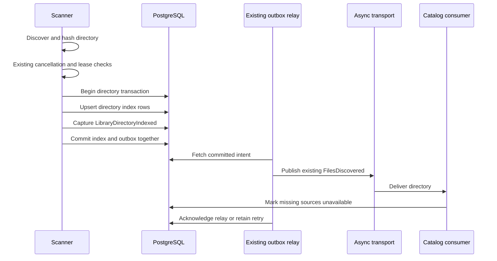

# Publish discovered directories after their index commits - Plan

## Goal Capsule

- **Objective:** Files that disappear between discovery and ingestion are imported when they return unchanged, including when ingestion workers run immediately.
- **Means:** Commit each directory's index updates and durable ingestion intent together, then publish through the existing outbox relay (KTD1).
- **Authority:** The user's continued PHP-focused roadmap work and the source-backed publication defect selected for this repair govern scope.
- **Execution profile:** Establish the interleaving regression, repair the directory boundary, and verify real PostgreSQL visibility and retry behavior.
- **Stop conditions:** Stop for a new job subsystem, schema change, whole-scan transaction, or change to claim expiry/release policy.
- **Completion owner:** The lead integrates, verifies, reviews, records evidence in `ROADMAP.md`, and makes local commits; pushing requires a request.

---

## Product Contract

### Summary

Persist directory ingestion intent with its file-index updates before any consumer can receive it.
Reuse the current outbox relay and `FilesDiscovered` message so directory ingestion can continue while the rest of the scan runs.

### Problem Frame

Music and movie scanners dispatch a directory before writing its index rows.
A fast consumer can find a source missing, mark no row unavailable because it does not exist yet, and return without importing the file.
The scanner then inserts an available index row, so a later incremental scan skips the unchanged returning file forever.
The same ordering can overwrite a missing observation for a previously indexed path.

This is reachable when a console scan runs inline beside an ordinary consumer, even with one ordinary worker, or when multiple consumers are configured.
The live scan claim does not prevent catalog ingestion; the consumer waits only for delete claims.

### Requirements

- R1. A consumer receives a directory only after every index update for that directory has committed.
- R2. A failed directory index write or durable event capture commits neither its index changes nor its ingestion intent, leaving the directory eligible for a later scan.
- R3. A missing source observed by ingestion remains unavailable, and its unchanged return is republished and imported on the next incremental scan.
- R4. A committed ingestion intent survives Redis publication failure and uses the existing outbox retry, lease, and dead-letter behavior.
- R5. Duplicate relay delivery remains supported through the existing at-least-once ingestion behavior; unrelated outbox events keep their existing notification replay path.
- R6. Earlier committed directories remain accepted when a later directory fails or the scan is cancelled; hashing, traversal, and whole-scan lifecycle stay outside directory transactions.
- R7. Existing scan cancellation and claim-renewal behavior remains intact, and successful scan summaries count committed directory intents rather than claiming Redis delivery.

### Scope Boundaries

No schema change, new transport, UI change, global message-bus transaction, or whole-scan transaction is planned.
The existing `FilesDiscovered` message, JSON codec, and Catalog consumer remain the public ingestion contract.
Notification receipts and durable delivery tables remain specific to their existing consumers.
Deferring all ingestion until a scan finishes is not selected because it changes streaming ingestion and does not itself fence writes after a released claim.
Additional fencing against a stale scanner after forced release or takeover is a separate pre-existing concern; this repair retains the current renewal policy.

### Acceptance Examples

- AE1. Discover a new source, remove it before the queued consumer runs, relay the committed directory, then restore the source unchanged; the consumer records unavailable and the next incremental scan republishes it.
- AE2. Run the same sequence for a previously unavailable indexed source; no later scanner upsert overwrites the consumer's missing observation.
- AE3. Fail outbox insertion or one index upsert; a second database connection observes neither partial index changes nor a pending directory intent, and retry can accept the directory.
- AE4. Commit a directory while Redis is unavailable; the scan accepts its durable intent, relay reports failure, and a later relay publishes the unchanged message successfully.
- AE5. Accept one directory and fail a later directory; the earlier intent remains relayable and its index remains committed, while the failing directory rolls back.

---

## Planning Contract

### Key Technical Decisions

- KTD1. **Use the existing transactional outbox per directory.** `TransactionPortInterface` encloses index upserts followed by event capture on the same default database connection; the relay cannot fetch an uncommitted intent.
- KTD2. **Represent the committed fact with a Library domain event.** Add immutable `LibraryDirectoryIndexed` under `Domain/Event`, extending `AbstractDomainEvent` with primitive directory/file payloads and round-trip serialization; do not depend on Application DTOs from Domain.
- KTD3. **Decorate the outbox dispatcher only for the new event.** A Library Infrastructure adapter converts this event into the existing `FilesDiscovered` message and sends it explicitly to `async`; other events delegate to the injected inner `OutboxEventDispatcherInterface`.
- KTD4. **Keep relay delivery at least once.** Do not add the `notifications.v1` receipt to Library publication: Redis acceptance followed by acknowledgement failure can legitimately deliver the directory again.
- KTD5. **Count after commit.** Scanners add directory results and processed counts after their transaction succeeds; the handler derives the accepted count from the returned directories instead of incrementing inside event capture.

### High-Level Technical Design

This sequence defines the visibility boundary; internal helper names remain implementation choices.

### Failure Contract and Assumptions

“Accepted directory” means its index and outbox intent committed; it does not mean Redis has accepted a message or Catalog has imported the files.
The existing summary field `directoriesQueued` keeps its name and describes that durable acceptance in its documentation.
Capture/commit failures fail the scan; Redis publication failures belong to the existing relay and do not roll back accepted directories.
The relay's existing finite retry and dead-letter policy remains the recovery mechanism; no infinite retry loop or new scheduler is introduced.
After fixing the publication failure, an operator can force a library rescan to create fresh directory intents if earlier ones exhausted their relay attempts.

`DoctrineTransaction` flushes the current unit of work and uses the default manager connection.
Verify that index writes and outbox capture resolve to that same connection; no dedicated writer connection is permitted.
An ambient transaction can defer directory visibility until its outer commit, which preserves ordering; this plan adds no ambient transaction around a scan.
Do not mutate loaded index/library persistence entities alongside raw DBAL writes and then flush stale values over them.

### Sources

`src/Library/Application/MusicScanner.php` and `MovieScanner.php` currently publish before unconditional available upserts.
`src/Library/Application/CommandHandler/ScanLibraryHandler.php` publishes directly through Messenger; `src/Library/Interface/Console/ScanLibraryCommand.php` uses inline scan execution.
`src/Catalog/Application/CommandHandler/FilesDiscoveredHandler.php` skips missing files after `LibraryMediaFiles::markMissingUnavailable`.
`src/Shared/Domain/Event/Outbox/OutboxSubscriber.php` captures serializable domain events, and `RelayOutboxHandler.php` reconstructs them before dispatch and acknowledgement.
`config/services.yaml` currently routes replay through the notification-only dispatcher; the decorator preserves that path for every other event.
`tests/Integration/Library/LibraryMediaFilesTest.php` covers disappearance after completed scanning, but not the publication/index interleaving.
The applicable local solution is `docs/solutions/runtime-errors/inline-messenger-run-must-name-the-routed-transport.md`: relay publication must retain the actual `async` route.

---

## Implementation Units

### U1. Capture and relay the directory-indexed fact

**Requirements:** R1, R4, R5; approach KTD2–KTD4.

**Ownership:** Implementation worker owns new `src/Library/Domain/Event/LibraryDirectoryIndexed.php`, its Library Infrastructure outbox dispatcher decorator, and focused tests under `tests/Unit/Library/`.
The lead owns `config/services.yaml` and any justified architecture configuration changes.

**Work:** Define immutable primitive event payloads and strict reconstruction, then map them to the existing message at relay time.
Reuse `DiscoveredFile` only in the Infrastructure conversion and keep the current message codec unchanged.
Delegate nonmatching events to the injected inner interface; do not modify the private notification dispatcher or attach a notification receipt to the Library path.

**Test scenarios:** Payload round trip retains library, directory, every file field and occurrence time; malformed payloads fail visibly; Library events dispatch the existing message with the `async` transport stamp; other events reach the inner dispatcher exactly once; transport failure propagates for outbox retry.

**Dependency:** None.

### U2. Commit directory index updates with event capture

**Requirements:** R1–R3, R6, R7; approach KTD1 and KTD5.

**Ownership:** Implementation worker owns both scanners, `ScanLibraryHandler`, affected `LibraryDiscovery`/scanner PHP documentation, and focused scanner/handler test updates.
Include constructor fixtures in `tests/Unit/Library/Application/LibraryProvisionerTest.php` and relevant claim/cancellation tests.

**Work:** Inject the existing transaction port into both scanners, keep discovery and hashing outside transactions, and run each directory's upserts before its event-capture callback inside one transaction.
Change the production handler callback to dispatch `LibraryDirectoryIndexed` through the event dispatcher instead of sending Messenger directly.
Update result accounting only after commit, preserving the existing cancellation/renewal checkpoints and missing-path reconciliation.
Keep publication conditional on the callback so worker-free provisioning does not also enqueue asynchronous imports.

**Execution note:** First add a behavioral regression in `tests/Integration/Library/LibraryMediaFilesTest.php`: its publication callback removes a discovered source and calls `markMissingUnavailable`; assert the scan leaves that path false, restore it unchanged, and assert incremental scanning republishes it.
The old scanner fails on the availability assertion, establishing the defect without relying on a missing class or constructor error.

**Test scenarios:** AE1–AE3 and AE5; index failure after a partial batch rolls back the directory; capture failure remains retryable; earlier directories survive later failure; cancellation and claim-loss tests preserve their intended boundaries; callbacks without publication still support existing worker-free provisioning.
Update the old mock assertion that publication failure performs no upsert: the required guarantee is no committed index change, now established by real transactional evidence.

**Dependency:** U1.

### U3. Prove PostgreSQL visibility, relay recovery, and record delivery

**Requirements:** R1–R7.

**Ownership:** Lead owns new `tests/Integration/LibraryDirectoryPublicationTest.php`, relevant relay integration coverage, `ROADMAP.md`, `CONCEPTS.md`, and documentation of durable directory acceptance.
The implementation worker reports focused test results; the lead owns authoritative integration and static gates.

**Work:** Use two disposable PostgreSQL connections to verify that the relay cannot see a directory intent before its index commits.
Drive the real outbox relay path and existing missing-file behavior, including unchanged return after a consumer runs immediately after commit.
Record the changed failure contract and verification checkpoints without adding a new operational subsystem.

**Test scenarios:** AE1–AE5 for music, plus movie scanner/relay envelopes and the existing missing-file consumer path without introducing a new video-ingestion fixture; pending intent invisible before commit, both index and intent visible after commit, neither visible after rollback; unavailable sources returning unchanged are queued again.
Cover Redis send failure followed by successful relay, accepted send followed by relay acknowledgement failure and duplicate delivery, and continued notification replay for unrelated events.
The duplicate test verifies eventual import and preserved availability rather than claiming a new global exactly-once guarantee.

**Dependency:** U1 and U2.

---

## Verification Contract

Use the authoritative CI runners in `docs-book/part-2-developer-guide/testing.md`, with the current checkout's image or source stream.
The existing `baander-availability-tests:local` image may supply dependencies; source must match this branch.
Run focused Library scanner/handler/event/relay unit tests, existing Catalog missing-file/reliability tests, and the new two-connection PostgreSQL integration coverage.
Retain existing availability, cancellation, claim, worker-free movie ingestion, outbox payload, lease, retry, and notification replay tests.
Serialize shared-state integration suites and use only disposable PostgreSQL fixtures.

Run targeted PHPStan, full Deptrac, applicable container/service wiring checks, and `git diff --check`.
Update documentation through the house prose workflow and record actual suite counts/static outcomes in the roadmap.
No browser or audible playback test is required for this backend publication boundary.
No test or runtime result is claimed during planning.

## Definition of Done

Committed directory intents become visible only with their index rows, and a missing observation is no longer overwritten by a late scanner upsert.
New and previously unavailable files return unchanged and import through the existing path.
Capture rollback, relay retry/duplicate delivery, prior-directory progress, and existing notification replay have meaningful test evidence.
Required static and integration checks pass, justified review findings are applied, and the roadmap records delivery and acceptance semantics.
Remove abandoned approaches from the final diff.
