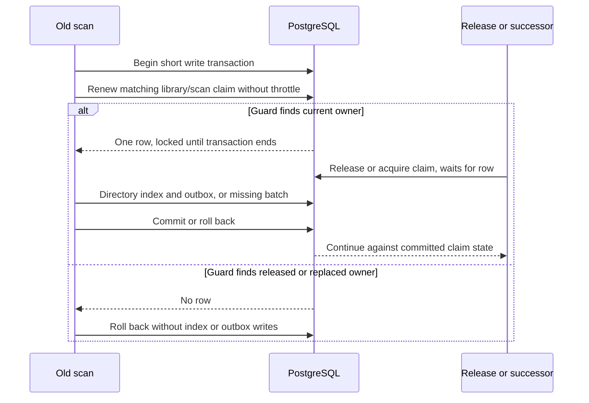

# Stop released scans from overwriting newer library state - Plan

## Goal Capsule

- **Objective:** A released or replaced scan cannot make restored tracks unavailable or overwrite the index and ingestion intent owned by a successor.
- **Means:** Validate and lock the scan claim inside each short write transaction (KTD1).
- **Authority:** The user's continued PHP roadmap work and the confirmed stale-scan write defect selected for this repair govern scope.
- **Execution profile:** Prove the failure within the renewal throttle, implement the write boundary, and verify PostgreSQL ordering across connections.
- **Stop conditions:** Stop for a schema change, whole-scan transaction, or change to claim expiry, release, or claim-free scanning policy.
- **Completion owner:** The lead integrates, verifies, records evidence in `ROADMAP.md`, reviews, and makes local commits; pushing requires a request.

## Product Contract

### Summary

Fence each leased scan's directory and missing-path writes against the current database claim.
Keep the existing heartbeat throttle and claim-free provisioning behavior.

### Problem Frame

`LibraryClaimRenewal` returns cached success for sixty seconds after acquisition or renewal.
An operator can release that claim and start a successor during this interval, yet the old scan still passes every cached check.
Its directory transaction can commit index rows and an outbox event, and its missing-path batches can mark the successor's restored sources unavailable.
The eventual completion check rejects the old claim after those writes have committed.

### Requirements

- R1. A leased scan whose claim was released or replaced before its write guard changes no directory index rows, availability observations, or directory outbox intents.
- R2. Once a write guard accepts the current scan, release and successor claim acquisition wait until that transaction commits or rolls back.
- R3. Both music and movie scans guard directory writes and each bounded missing-path batch, including scans with no discovered files.
- R4. Ordinary heartbeat throttling, lease duration, expired-but-unreplaced renewal, cancellation, and replacement-claim completion/failure semantics remain unchanged.
- R5. Calls that deliberately omit a lease continue working without acquiring or requiring a claim.

### Scope Boundaries

No whole-scan lock, advisory lock, schema change, new retry system, clock-policy change, or CLI/API behavior change is planned.
Hashing and directory traversal stay outside write transactions.
The real null-lease caller is the second forced movie scan in `LibraryProvisioner`, which collects files for later synchronous ingestion; preserve that path.

### Acceptance Examples

- AE1. Freeze the application clock, acquire a scan, force-release it, and claim the library for a successor before sixty seconds pass; the old scan fails before its next directory write and creates no outbox intent.
- AE2. An old empty/partial snapshot resumes after a successor restores and indexes a source; the old missing-path batch leaves that source available and the successor claim intact.
- AE3. While a guarded directory or missing-path transaction is open, a second connection's release/takeover waits, then re-evaluates committed ownership; after successful release or replacement, the old holder's next guard fails.
- AE4. Claim-free direct scans and worker-free movie provisioning still complete with their existing result and publication behavior.

## Planning Contract

### Key Technical Decisions

- KTD1. **Use a claim-row update as the write fence.** Add `LibraryRepositoryInterface::renewScanClaimForWrite(libraryId, claimId, leaseSeconds)`, requiring an active transaction and matching library ID, claim ID, and `scan` kind before renewing; PostgreSQL holds the row lock through the caller's transaction.
- KTD2. **Keep heartbeat and write validation separate.** `LibraryScanLease::guardWrite` performs the new repository operation without throttling and throws the existing claim-lost exception when it updates no row; leave `LibraryClaimRenewal` unchanged.
- KTD3. **Guard before any mutation in the same transaction.** Call the optional lease guard first in existing directory transactions and new transactions around each existing missing-path batch of at most 1000 paths.
- KTD4. **Preserve existing renewal semantics.** Do not add an expiry predicate: an expired claim that has not been replaced may renew, as it does today; release or replacement makes its claim ID unusable.

### High-Level Technical Design

The sequence defines ordering rather than helper implementation details.

### Sources and Limits

`LibraryClaimRenewal::renew` has the sixty-second cached-success branch; both scanners currently renew outside their directory transaction and update missing paths without a surrounding transaction.
`LibraryRepository::releaseClaim` and its claim CTE already update/lock the same library row, so no additional lock namespace is needed.
Use the same manager connection as index/outbox writes and require an active transaction in the concrete repository guard.
The production leased callback only captures `LibraryDirectoryIndexed`; it does not synchronously acquire the catalog import advisory lock.

Existing lost-claim tests advance sixty or nine hundred seconds, forcing a real renewal and missing the recent-release case.
`docs/solutions/architecture-patterns/state-set-when-work-is-queued-on-swoole-task-must-expire.md` describes the intended fencing behavior; update its write-boundary explanation without treating its historical routing details as current configuration.

## Implementation Units

### U1. Fence directory and absence writes against the scan owner

**Requirements:** R1–R5; approach KTD1–KTD4.

**Files:** `src/Library/Domain/Repository/LibraryRepositoryInterface.php`, `src/Library/Infrastructure/Doctrine/Repository/LibraryRepository.php`, `src/Library/Application/Service/LibraryScanLease.php`, both scanners, `tests/Fixtures/Library/InMemoryLibraryRepository.php`, `tests/Unit/Library/Application/ScannerAvailabilityTest.php`, `tests/Unit/Library/Application/CommandHandler/ScanLibraryHandlerTest.php`, and focused lease/guard tests.

**Work:** Implement the narrow unthrottled guard and call it first inside each directory transaction.
Wrap each missing-path batch in a short transaction and guard it before updating availability.
Preserve existing cancellation checkpoints, post-commit accounting, lease policy and null-lease behavior.

**Execution note:** First prove AE1 and AE2 with a frozen clock and actual forced release/replacement, asserting no old-owner writes; a missing method or changed constructor is not red evidence.

**Tests:** Music/movie, normal/full rescan, directory/outbox writes and missing-only scans; cancellation and claim loss roll back only the affected unit; null-lease scans and worker-free provisioning still work.
For AE2, make the successor's observation available before resuming the old cleanup and assert that it stays true.
Current owner succeeds; released, replaced, wrong-library and non-scan owners fail; a call outside a transaction is rejected; expired-but-unreplaced ownership can renew.

### U2. Verify PostgreSQL lock ordering

**Requirements:** R1–R5.

**Files:** `tests/Integration/LibraryScanClaimTest.php`, `tests/Integration/LibraryDirectoryPublicationTest.php`, and their existing Library claim-race fixtures.

**Work:** Use two disposable PostgreSQL connections and explicit synchronization to exercise release, scan takeover, and delete takeover around both guarded write types.
Verify committed directory/index/outbox state and successor availability rather than only checking an exception.
Drive the real scanner directory and missing-batch branches to establish that the guard and writes share their transaction and database connection; repository-method locking alone is insufficient evidence.

**Tests:** AE1–AE4; release/replacement before the guard prevents every write; guard before release blocks the contender through commit and rollback; a later old-owner guard fails and cannot end the replacement claim.
An ordinary takeover still refuses an owner whose guard committed a renewed lease; do not turn waiting into unconditional acquisition.
Prove waiting through the existing PostgreSQL lock-observation/barrier harness, with bounded timeouts rather than sleeps or elapsed-time-only assertions.

**Ownership:** The lead coordinates implementation packets and all shared-state test runs; workers do not start services, expensive suites, stage, or commit.

**Dependency:** U1.

### U3. Record the guarded write contract and verification

**Requirements:** R1–R5.

**Files:** `ROADMAP.md` and relevant claim documentation/solution notes.

**Work:** Describe how release/takeover serializes with an in-flight guarded batch and record measured verification checkpoints.
Keep historical solution routing context distinct from current behavior.

**Test expectation:** No new behavioral tests for documentation; verify the prose against U1/U2 evidence and run the applicable documentation checks.

**Dependency:** U1 and U2.

## Verification Contract

Use the current checkout in the authoritative CI image and documented isolated unit/integration runners.
Run focused scanner, lease, claim, directory-publication and provisioning tests, then the existing cancellation, missing-source recovery, explicit deletion and outbox rollback regressions affected by the change.
Run real PostgreSQL two-connection lock-order tests serially; no production or local user data is reset.
Run targeted PHPStan, full Deptrac, applicable repository/static rules and `git diff --check`.
Apply the house prose workflow to changed documentation and record actual counts and gates in the roadmap.
No browser or audible playback test is needed for this database write boundary; no result is claimed during planning.

## Definition of Done

An old leased scan cannot commit directory/index/outbox or absence updates after release or replacement, including within the renewal throttle.
Two-connection tests establish that accepted writes serialize with release/takeover until transaction completion.
Null-lease callers, expiry/heartbeat policy, cancellation and durable directory publication retain their behavior.
Required checks pass, justified review findings are applied, and the roadmap records delivery evidence.
