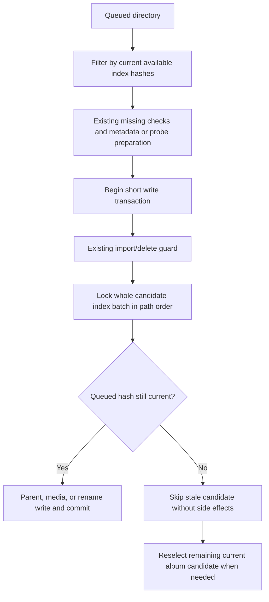

# Ignore superseded directory discoveries during ingestion - Plan

## Goal Capsule

- **Objective:** Delayed ingestion does not duplicate tracks or redirect an existing track onto a source that a newer scan has replaced.
- **Means:** Match queued hashes against current committed index observations before preparation and under a short write guard (KTD1–KTD3).
- **Authority:** The user's continued PHP roadmap work and the confirmed superseded-discovery defect selected for repair govern scope.
- **Execution profile:** Prove B-first/A-replay with real source contents, implement the consumer boundary and necessary index lock ordering, then verify PostgreSQL concurrency.
- **Stop conditions:** Stop for a schema change, new job subsystem, live-filesystem snapshot guarantee, or unrelated catalog/producer cleanup.
- **Completion owner:** The lead integrates, verifies, reviews, records evidence in `ROADMAP.md`, and makes local commits; pushing requires a request.

## Product Contract

### Summary

Discard discovered file snapshots superseded by the latest available index hash.
Recheck that observation in the transaction that creates or changes catalog records, while retaining current files from mixed messages.

### Problem Frame

A queued message carries a file's scan-time hash, size and path, but ingestion checks only that its path exists before reading current metadata.
After A is replaced and scanned as B, B can import first and an old A delivery can create another song using B's metadata and A's hash.
Rename reconciliation can similarly redirect the old song onto replacement bytes because its checks compare the stored song to the queued hash, not the latest index observation.
Durable replay and ordinary worker delays make both sequences reachable.

### Requirements

- R1. A superseded, unindexed, or unavailable discovered file creates or changes no album, movie, song, video, rename source, or associated enrichment work.
- R2. Each catalog write uses the latest committed available hash for its owning library and path, holding that observation stable through the write transaction.
- R3. Mixed messages still process their current files when an earlier metadata candidate becomes superseded; candidate reselection is finite.
- R4. Current duplicate deliveries, A-to-B-to-A hash reversion, and unchanged files restored and rescanned remain supported.
- R5. Missing-file retention, explicit deletion, scan claims, directory intent/result order, and metadata/probe failure retry behavior retain their existing contracts.

### Scope Boundaries

The comparison concerns committed Library observations, not a guarantee that a file cannot change on disk between scans.
Hash equality is the selected identity check; no new generation field, timestamp identity, schema, or filesystem hashing during ingestion is introduced.
Necessary ordering changes cover actual index writers only; no general producer audit, rename cache work, or playlist append work belongs here.

### Acceptance Examples

- AE1. Accept A, replace its source with B and scan again, import B, then replay A; only B's song remains and A causes no metadata/enrichment side effects.
- AE2. A queued rename for hash A points at a path now indexed as B; replay leaves A's original song path and metadata intact.
- AE3. The first album metadata candidate becomes superseded while its metadata is read, but another message file remains current; that file still imports without a stale album or infinite reselection.
- AE4. A current import holds its observation through commit while an index writer waits; if the writer commits first, the old import skips its writes.
- AE5. Latest available hash returns to A, or an unavailable A is restored and rescanned; a queued A snapshot remains eligible and duplicate delivery does not create another current song.

## Planning Contract

### Key Technical Decisions

- KTD1. **Filter before preparation and guard again before writing.** Extend the existing Library media-files contract with batched available hash reads and transaction-only shared-lock reads; compare queued hashes in Catalog before missing checks/metadata and again in every catalog write phase.
- KTD2. **Use existing import/delete ordering.** Inside each short write transaction, take the existing shared import advisory guard before locking the entire candidate index batch with `FOR SHARE`; metadata reads and FFprobe remain outside these locks.
- KTD3. **Guard parent writes and source reconciliation too.** Album/movie creation and artist links use the same observation boundary as song/video writes; if an album metadata anchor becomes stale, retry preparation with the remaining current candidates, discarding at least one candidate each time.
- KTD4. **Acquire index locks in one bytewise path order.** Sort a copy of scanner files for actual upserts; bulk unavailable/removal methods lock globally sorted existing paths before mutation and change only that returned set, avoiding newly visible phantom targets.
- KTD5. **Keep payload and missing semantics stable.** Preserve the original event/result file order, existing bounded batches, retained unavailable rows, and explicit deletion behavior; stale delivery is skipped rather than requeued indefinitely.

### Shared Interfaces and Locking

Add `findAvailableHashesByPaths` and transaction-only `lockAvailableHashesByPathsForImport` to the Library index repository and expose them through `LibraryMediaFilesInterface`.
Both return library-scoped path-to-hash maps; absent and unavailable rows are omitted.
Catalog filters original candidate lists through these maps rather than adopting database lock order for metadata selection.
The shared-lock read requires an active transaction, globally deduplicates and sorts requested paths, and locks matching available rows in bounded chunks using `ORDER BY path COLLATE "C" FOR SHARE`.
Do not upgrade these shared index locks by marking missing sources in the same transaction.

Scanner upserts use a sorted copy and retain their original publication list.
Bulk `markUnavailableByPaths` and `removeByPaths` use short transaction scopes to lock all existing target rows in that same global order, then mutate only returned paths; the lock query includes unavailable rows.
Keep single-path writers and the existing unique library/path lookup; no new public writer-lock helper or index is required.

### High-Level Technical Design

This flow fixes the observation/write boundary; helper decomposition remains an implementation choice.

### Sources and Limits

`FilesDiscoveredHandler::presentFiles` currently checks only presence; `readSong` and movie ingestion combine current metadata/probes with queued hashes, while `reconcileSource` checks only stored song identity and filesystem presence.
Album resolution writes before the existing song transaction, and movie creation/video writes currently lack the shared guarded boundary; include these actual write paths.
`LibraryFileIndexRepository` stores the current hash per library/path, and `SongEntity` has no unique path or hash constraint to prevent the demonstrated duplicate.
The PostgreSQL specialist verified that unsorted scanner upserts or bulk updates could deadlock with new shared index locks; ordered actual writers and returned-target bulk mutation are part of this repair.
No relevant local solution supplies an existing discovery snapshot guard; preserve the documented claim and durable-publication contracts.

## Implementation Units

### U1. Guard current discoveries across preparation and catalog writes

**Requirements:** R1–R5; approach KTD1–KTD5.

**Files:** Library media-files port/implementation, index repository interface/implementation, both scanners, `src/Catalog/Application/CommandHandler/FilesDiscoveredHandler.php`, and focused Library/Catalog tests.

**Work:** Implement batched observation reads, shared write guards, ordered scanner/bulk mutations, and finite album-candidate reselection as one coherent change.
Guard whole song batches before individual writes; guard album/movie parents, videos and renames without holding index locks during metadata or FFprobe work.
Preserve ordinary failure collection, delete-held requeue, and no-new-song enrichment for a rename.

**Execution note:** First prove AE1 using real A/B source contents and metadata read from the current file: B imports first, then old A must not create a second row or trigger metadata/enrichment work.
The red assertion is the extra catalog record or source mutation, not an absent method or constructor mismatch.

**Tests:** Extend `tests/Unit/Catalog/Application/CommandHandler/FilesDiscoveredRenameTest.php`, missing-file/reliability tests, `tests/Integration/Library/LibraryMediaFilesTest.php`, and focused index persistence tests.
Cover AE1–AE5, stale movie parent/video suppression, metadata/probe exceptions and retries, same path across libraries, unavailable/missing index rows, duplicate current intents, and an album whose stale first candidate leaves a valid later file.

### U2. Prove observation stability and writer ordering in PostgreSQL

**Requirements:** R1–R5.

**Files:** A focused integration test under `tests/Integration/Library/`, existing index/publication/claim fixtures, and necessary disposable two-connection helpers.

**Work:** Exercise actual consumer guarded writes and actual scanner/bulk index writers against two PostgreSQL connections.
Verify that shared observation locks serialize hash/availability changes through commit/rollback without reversing the existing delete-guard order.

**Tests:** AE4; reversed input order across scanner, unavailable and removal writers; more than one bounded chunk; an initially absent path inserted between lock and mutation snapshots is not changed by the older bulk operation.
Keep payload/result ordering unchanged and verify that a later current message imports after stale work is skipped.
Use explicit barriers and PostgreSQL lock observation, not sleeps or elapsed-time-only assertions.

**Dependency:** U1.

### U3. Record superseded-delivery behavior and verification

**Requirements:** R1–R5.

**Files:** `ROADMAP.md` and relevant Library ingestion documentation.

**Work:** Record the current-observation contract, finite stale skipping, and measured verification checkpoints.
Record unrelated follow-ups only as roadmap scope; do not implement them here.

**Test expectation:** No new behavioral tests for prose; check it against U1/U2 evidence and run the documentation checks.

**Dependency:** U1 and U2.

## Verification Contract

Use the current checkout in the authoritative CI image and documented isolated unit/integration runners.
Run focused discovery, album/movie, rename, missing-file and enrichment tests, real PostgreSQL observation/lock-order coverage, and affected explicit deletion, claim and durable publication regressions.
The lead serializes shared-state runs; workers do not start services, expensive suites, stage or commit.
Run targeted PHPStan, full Deptrac, applicable repository rules, and `git diff --check`; apply the house prose workflow and record actual suite counts and gates.
Use disposable files and databases without audible playback or local user-data reset; no execution result is claimed during planning.

## Definition of Done

Stale A replay after B imports creates no stale catalog or enrichment state, and a superseded rename cannot redirect the old song.
Current mixed-message files, duplicate accepted intents and unchanged restored sources still import.
Real PostgreSQL tests establish guarded writes, stable ordered index locking and absence-target safety.
Required checks pass, justified review findings are applied, and the roadmap records delivered scope and evidence.
