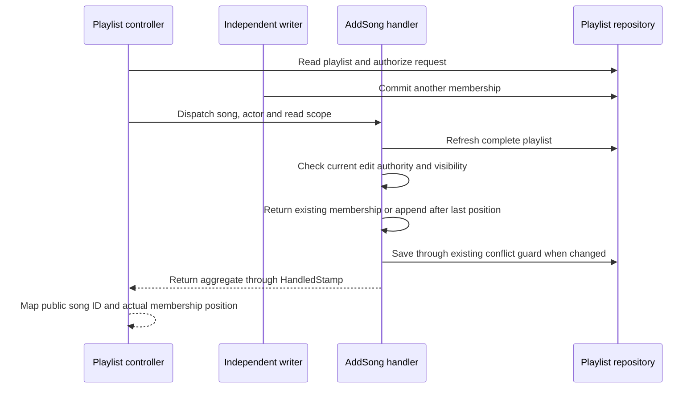

# Concurrent Playlist Appends - Plan

## Goal Capsule

- **Objective:** An authorized playlist append preserves an addition committed before its mutation read and reports the position actually stored.
- **Means:** Carry append intent through the command and resolve it from a refreshed aggregate (KTD1–KTD3).
- **Authority:** The concurrent playlist append follow-up in `ROADMAP.md`, the requirements below, and the backend rules in `.agents/rules/` govern this work.
- **Execution:** Regression first, followed by the bounded PHP change and the existing disposable backend gates. The lead integrates, reviews, records checkpoints in `ROADMAP.md` and makes local commits; pushing requires a request.
- **Stop condition:** A required contract cannot be preserved with the existing aggregate and repository mechanisms, or an authoritative check remains unresolved.

---

## Product Contract

### Summary

Fix the stale append position identified in `ROADMAP.md` while preserving playlist edit authority and optimistic conflict handling.

### Problem Frame

`PlaylistController::addSong` calculates the position from its initial authorization read, then `AddSongHandler` loads songs again and applies that earlier position.
An addition committed between those reads can produce duplicate positions when the handler sees the updated state.
The controller also ignores the returned aggregate, so its response can describe a position that was never stored.
Doctrine can reuse managed parent metadata in `findWithSongs`, making a genuine fresh mutation read necessary to handle this interval reliably.

### Requirements

**Append result**

- R1. An addition committed before the handler's mutation read is retained when the authorized append succeeds, and the new membership receives the append position derived from that read.
- R2. The existing `201` response keeps its flat public `songId` and `position` shape, with the position taken from the handler's returned membership.
- R3. Adding a visible song already present remains successful without saving another membership, and the response gives its existing position.

**Access and concurrent writes**

- R4. Mutation authority is checked against the refreshed playlist: its owner may edit songs, as may a current collaborator while collaboration is enabled; the existing song visibility check still precedes membership disclosure or mutation.
- R5. A conflicting write after the handler's mutation read preserves the existing write-conflict exception and rollback behavior, retaining the winning state.

### Scope Boundaries

Keep explicit-position insertion on the domain aggregate available to its existing callers.
This work changes the append command, its handler and HTTP result mapping, with focused regressions.
No schema, repository SQL, locking or retry mechanism is planned: the refreshed repository read and existing compare-and-swap guard cover the demonstrated intervals.
Reconsider that boundary only if the focused runtime regressions disprove those mechanisms.
General position normalization, repair of pre-existing malformed ordering, and other playlist mutation paths are outside this defect. Appending after sparse stored positions is included because catalog deletion can cascade membership removal without renumbering survivors.

---

## Planning Contract

### Key Technical Decisions

- KTD1. **The command expresses append intent.** Remove the position field from `AddSongCommand` and carry the actor's internal UUID instead. Its only production constructor caller is the HTTP append action, whose request accepts only a song ID. Keep `Playlist::addSong`'s explicit-position API unchanged; no nullable compatibility mode is needed.
- KTD2. **Use the existing refreshed aggregate read.** Load through `PlaylistRepositoryInterface::findByUuid`, whose Doctrine implementation refreshes parent metadata and loads songs and collaborator identities. Check the actor with the existing `ReorderSongsHandler` rule before visibility and duplicate handling. This prevents stale controller authorization from becoming mutation authority after a collaborator removal or collaboration being disabled.
- KTD3. **Resolve position and response from the mutation aggregate.** Add a semantic domain append operation that delegates to the existing insertion method at one greater than the largest stored position, using zero for an empty playlist. Catalog deletion can leave gaps through membership cascade deletion, so count alone can collide with a surviving position. Include the complete loaded song list, including songs outside the actor's visible catalog. Consume the synchronous `HandledStamp` result and locate the requested membership by internal song identity. Follow the existing controller result validation pattern and reject a missing, wrong-type or incomplete result as a programming error.
- KTD4. **Keep the existing write guard.** `PlaylistRepository::save` already checks the parent persistence version and original memberships before synchronization. A later competing write remains a conflict; adding locks or automatic retry would expand the contract without resolving an additional demonstrated gap.

### High-Level Technical Design

### Evidence and Assumptions

The controller and handler trace is in `src/Playlist/Interface/Controller/PlaylistController.php`, `src/Playlist/Application/Command/AddSongCommand.php` and `src/Playlist/Application/CommandHandler/AddSongHandler.php`.
The refresh and write-guard patterns are in `src/Playlist/Infrastructure/Doctrine/Repository/PlaylistRepository.php`; authorization follows `src/Playlist/Application/CommandHandler/ReorderSongsHandler.php` and `src/Playlist/Infrastructure/Security/PlaylistVoter.php`.
No relevant entry in `docs/solutions/` addresses this defect, and no new domain term is needed in `CONCEPTS.md`.
Sparse stored positions are reachable when catalog deletion cascades to playlist membership; append preserves survivors and places the new membership after the highest position without renumbering.
No blocking question remains; exact test helper names are implementation details.

---

## Implementation Units

### U1. Resolve append intent and report the handled membership

**Goal:** Deliver R1–R5 through KTD1–KTD4.

**Dependencies:** None.

**Files:** `src/Playlist/Application/Command/AddSongCommand.php`, `src/Playlist/Application/CommandHandler/AddSongHandler.php`, `src/Playlist/Domain/Model/Playlist.php`, `src/Playlist/Interface/Controller/PlaylistController.php`, `tests/Unit/Playlist/Domain/Model/PlaylistTest.php`, `tests/Unit/Playlist/Application/CommandHandler/AddSongHandlerTest.php`, `tests/Unit/Playlist/Interface/Controller/PlaylistSongIdentityTest.php`, `tests/Integration/PlaylistConcurrencyTest.php`.

**Approach:** Update the command's constructor callers and keep result mapping inside the existing controller pattern. Reuse the reorder handler's actor extraction and current-authority check without changing the shared voter or repository contracts.

**Execution note:** Start with failing controller/real-handler and PostgreSQL regressions. Author and run the runtime scenarios described under U2 against the old implementation before changing production code; U2 owns their final verification rather than their initial authoring.

**Test scenarios:**

1. Controller observes one membership; the handler receives two after an intervening addition. Saving produces positions `0, 1, 2`, and the response reports the requested song at `2`.
2. The handler finds the requested visible song already present at a position different from the controller's earlier count. No save occurs and the response returns that existing position.
3. Owner and current collaborator appends succeed; a removed collaborator, collaboration disabled for a collaborator, and an unrelated actor fail without visibility lookup or save. Include a duplicate request after authority was revoked.
4. An invisible or unknown song remains not found and unwritten; invalid song identity and unauthorized initial requests retain existing controller behavior.
5. Empty and contiguous playlists append at the normal next position; stored positions `0, 2` append at `3` without changing survivors. Existing explicit-position insertion remains available.
6. A missing or invalid handled result, or a result without the requested membership, fails explicitly instead of returning a fabricated position.

**Verification:** The affected domain, handler and controller identity files pass with the regression proven red before implementation.

### U2. Verify the actual PostgreSQL interleavings and delivery checkpoint

**Goal:** Establish runtime evidence for R1, R4 and R5 and record the completed scope.

**Dependencies:** U1.

**Files:** `tests/Integration/PlaylistMutationFirewallTest.php` if a required HTTP assertion is missing, `docs-book/part-2-developer-guide/contexts/playlist.md`, `ROADMAP.md`.

**Approach:** Reuse the independent EntityManagers and disposable schema in the concurrency test. Seed any additional song locally to the new case, preserving the shared fixture assumptions. Avoid process scheduling or sleeps for interleavings that can be ordered synchronously.

**Execution note:** Reuse U1's recorded failing regressions and run their final state; do not repeat unchanged successful gates. Update the playlist context guide to explain the resulting append, authorization, duplicate and conflict behavior.

**Test scenarios:**

1. Keep the first EntityManager populated after the controller-equivalent public-ID read. A second manager commits another song, then the original manager runs the real handler without being cleared. Assert the returned and reloaded aggregate retain exact membership order, expected positions and the winning metadata.
2. Commit collaborator removal or collaboration being disabled between those reads. The refreshed handler rejects that actor and persists no requested membership.
3. Commit an independent addition from the visibility test seam after the handler has loaded its aggregate. The handler's save raises the existing write conflict and the stored state exactly matches the winning snapshot.
4. Existing playlist mutation firewall tests retain owner/collaborator access, hidden-song ordering and flat `201` response behavior.

**Verification:** The focused concurrency and mutation firewall files pass, the static gates pass, and `ROADMAP.md` records actual counts and review evidence.

---

## Verification Contract

Use `scripts/test-backend-container.sh` with explicit test-file selections and a qualified CI image as described in `docs-book/part-2-developer-guide/testing.md`.
Run the three affected unit files, `tests/Integration/PlaylistConcurrencyTest.php` and `tests/Integration/PlaylistMutationFirewallTest.php`; include `tests/Functional/Controller/PlaylistControllerTest.php` when its append assertions or stubs depend on the changed dispatch result.
Run PHPStan with the CI configuration and Deptrac with its existing baseline through the CI image, following `.forgejo/workflows/ci.yaml`.
Serialize shared runtime checks, retain bounded logs and runner artifacts, and record actual test and assertion counts, skipped cases and static results.
A new regression must fail for the intended stale-state reason before its fix and pass afterward; a test skipped for absent PostgreSQL is not runtime evidence.
Run the required simplification and final code review, apply justified findings, run prose preservation checks for changed documentation and `git diff --check`, then record the checkpoint in `ROADMAP.md`.

---

## Definition of Done

R1–R5 have focused passing evidence, including a real PostgreSQL interleaving with the original identity map retained and a later-write conflict that preserves the winner.
The controller's reported position is traceable to the handled aggregate, the domain insertion API remains intact, and no new repository or compatibility mechanism was introduced.
Review corrections are resolved, the roadmap carries the measured checkpoint, and the lead leaves the delivered change in local commits without pushing.
