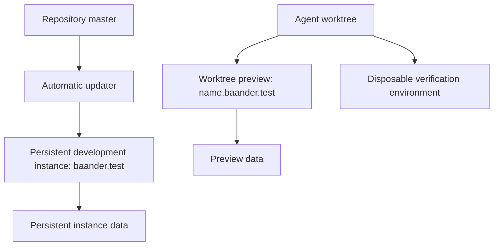
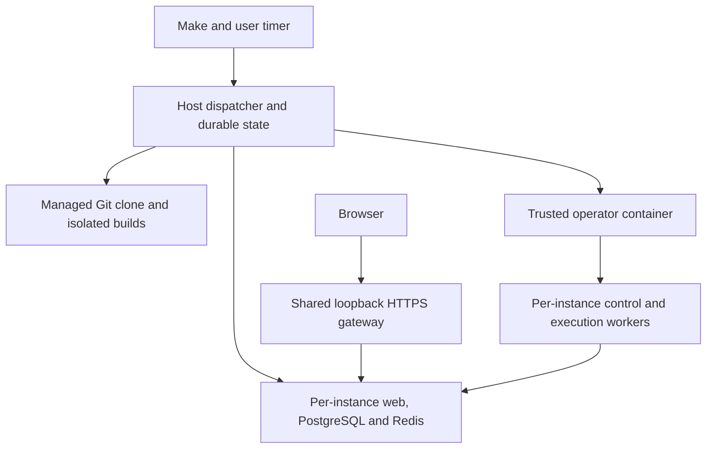
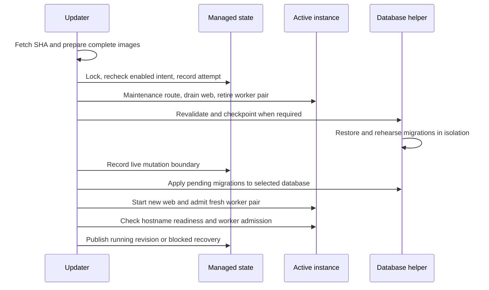
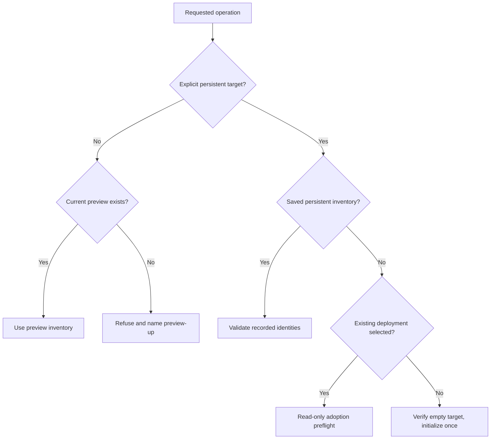

# Local development workflow - Plan

## Goal Capsule

**Objective:** Let a developer use their configured local Baander instance on current master and test feature work without repeatedly assembling the environment or disturbing that instance.

**Means:** A host-managed Make workflow with separate runtime ownership for each instance (KTD1–KTD3).

**Product authority:** The confirmed development-workflow discussion on 2026-10-26, including the explicit choice to update automatically whenever master advances.

**Authority:** Product behavior belongs to the R-IDs below; implementation choices belong to the KTDs. Units implement both. The Product Contract takes precedence on scope.

**Stop conditions:** Do not reset user data, bypass migration or worker admission guards, assume an unconfirmed worker operation succeeded, or claim runtime qualification without evidence. An unsupported host or incompatible existing database stops that activation with a diagnosis.

**Execution profile:** Implement on a branch named for this plan, with local unit commits, phase-boundary simplification and independent code review. The lead integrates and runs authoritative checks; serialize Docker lifecycle drills. Push only when requested.

**Completion owner:** The implementing lead owns verification, documentation and ROADMAP evidence. This artifact authorizes planning; implementation begins only when selected.

---

## Product Contract

### Summary

Provide a persistent development instance at `https://baander.test` that automatically follows master.
Provide separate worktree previews for Codex, Claude Code and human development, with one startup command for each environment.

### Problem Frame

The developer maintains a local deployment with configured libraries while agents work on branches and merge commits into master.
Updating that deployment currently requires knowing which build, dependency, migration and restart steps apply.
A checkout-bound deployment also makes it difficult to distinguish the code being edited from the code being evaluated with real library data.

### Key Decisions

- KD1. **Keep Make as the entry point.** A familiar command surface reduces the number of procedures the developer must remember. Governs R1, R14. (session-settled: user-approved — chosen over a new command interface: the confirmed workflow retains Make.)
- KD2. **Separate the persistent instance from feature previews.** Feature experimentation must not disturb the configured instance. Governs R2, R10, R11. (session-settled: user-directed — chosen over switching baander.test between branches: the developer wants it available independently of feature work.)
- KD3. **Follow master automatically.** Routine updates must not depend on a developer remembering a command. Governs R5, R6. (session-settled: user-directed — chosen over manually requesting each update: the developer wants updates whenever master advances.)
- KD4. **Allow brief update interruptions.** This keeps the local update mechanism bounded. Governs R7, R8. (session-settled: user-approved — chosen over uninterrupted deployment: brief downtime was included in the confirmed scope.)

### Requirements

**Startup and persistent state**

- R1. `make dev-up` must bootstrap or resume the persistent development instance and enable its automatic updater without requiring separate dependency, asset, migration, authentication-setup or service-start commands.
- R2. The persistent development instance must serve `https://baander.test` from a built, identified master revision, independent of edits and branch switches in agent worktrees.
- R3. Initial setup must guide hostname resolution, certificate trust and media-path configuration, retaining those choices for subsequent starts.
- R4. Ordinary restarts and updates must preserve libraries, catalog data, accounts, settings, authentication material and source media, including existing local data adopted into this workflow.

**Automatic updates and failures**

- R5. While enabled, the updater must detect advances of the configured repository's master branch and update the instance without a manual pull, update command or active agent session.
- R6. Updates must run one at a time against identified commits and catch up to the current master head when further commits arrive during an update.
- R7. Each update must coordinate the required builds, dependencies, migrations and service restarts and report success only when the application is ready through its public local hostname.
- R8. An update failure must be visible with its failed revision, failed step and recovery action; incompatible database changes must stop without an automatic reset or an unsafe application downgrade.
- R9. `make dev-down` must stop the persistent instance and its automatic updater while retaining its data until an explicit reset or removal is requested.

**Feature previews and agents**

- R10. `make preview-up` must start or resume a preview for the current worktree, expose its distinct hostname below `baander.test`, and support local code changes without altering the persistent instance.
- R11. Concurrent previews must isolate their databases, queues, authentication material, writable storage and generated artifacts from one another and from the persistent instance.
- R12. Previews must mount shared source media read-only by default, with disposable copies for tests that modify media.
- R13. Agent-triggered development and verification commands must target the current worktree or a disposable test environment by default, with explicit targeting required for the persistent instance.

**Operations and guidance**

- R14. The common workflow must be documented through `make dev-up`, `make dev-status`, `make dev-down`, `make preview-up` and `make preview-down`, with human and agent instructions pointing to the same guide.
- R15. `make dev-status` must show the running revision, detected master revision, service readiness, updater state and any failed update.
- R16. `make preview-down` must stop only the current worktree's preview and retain its configured state until explicitly removed.

### Key Flows

- F1. **First use:** The developer runs `make dev-up`, completes the one-time host and media configuration, opens Baander and configures libraries through its existing interface. Covers R1–R4.
- F2. **Merged work:** Master advances; the updater prepares the selected revision, applies it, checks readiness and reports the running revision. New commits arriving during that work remain pending for the next update. Covers R5–R8, R15.
- F3. **Feature verification:** An agent works in its own worktree and starts a preview when interactive verification is needed. Automated tests use disposable test environments. The developer can compare the preview with the persistent instance. Covers R10–R13.
- F4. **Failure and recovery:** A failed update reports the failed step and recovery action. A database incompatibility requires a separate owner decision about recovery or reset before further database changes. Covers R4, R8, R15.
- F5. **Stop and resume:** The developer stops an instance with its corresponding down command and later resumes it with its up command. Resuming the persistent instance enables catching up with master. Covers R1, R5, R9, R16.

The environments have separate code and state ownership:

### Acceptance Examples

- AE1. **First startup — covers R1–R3:** Given a supported host with prerequisites installed, when the developer runs `make dev-up` and completes guided setup, the application is usable at its hostname without manually running the component setup commands.
- AE2. **Repeat startup — covers R1, R4:** Given configured libraries and an existing account, when the developer repeats startup or rebuilds the runtime, that configuration remains available without duplicate seeding or credential regeneration.
- AE3. **Automatic update — covers R2, R4–R7, R15:** Given a running instance and an advancing master branch, when the updater detects the new head, the instance reaches that revision and reports readiness without developer or agent intervention.
- AE4. **Concurrent merges — covers R6:** Given an update in progress, when master advances again, updates do not overlap and the instance subsequently catches up with the new head.
- AE5. **Preparation failure — covers R4, R8, R15:** Given a running instance, when preparing the next revision fails before the live state changes, the current instance remains available and status reports the unsuccessful attempt.
- AE6. **Database incompatibility — covers R4, R8:** Given an existing database that rejects the target migration history, when an automatic update reaches that check, it does not reset the database or claim success; recovery is explicit and preserves the existing data.
- AE7. **Parallel worktrees — covers R10–R13:** Given two active worktrees, when both start previews and one runs a migration or library scan, neither the other preview nor the persistent instance changes state.
- AE8. **Stopped instance — covers R5, R9:** Given a deliberate `make dev-down`, when master advances, the updater does not restart the instance; a later `make dev-up` resumes automatic updates with retained data.
- AE9. **Preview lifecycle — covers R11, R12, R16:** Given a configured preview, when its down command runs, the other instances and original media remain untouched and a later up command resumes that preview's state.

### Scope Boundaries

- This work covers local development and verification; production deployment automation is outside its scope.
- Uninterrupted updates, automatic database rollback and automatic destructive recovery are excluded under KD4 and R8.
- Copying a populated persistent database into a preview is deferred; independently configured previews satisfy this scope.
- Replacing the existing CI verification system, building a preview dashboard and changing application features are excluded.
- The registry retains its SQLite/rqlite architecture; this workflow does not authorize unrelated persistence changes.

### Dependencies / Assumptions

- The initial target is the existing Linux Docker development environment. Additional host platforms require separate qualification.
- A running container runtime, access to the configured Git remote and sufficient resources for the requested previews are prerequisites.
- Master is the source of code the developer intends to run locally. Updates do not track an agent branch or uncommitted checkout content.
- Brief update interruptions are accepted under KD4; preserving a working version after a state-changing failure depends on a validated recovery procedure, not an image switch alone.

### Planning resolutions

The original deferred questions are resolved by KTD1–KTD8: update detection and supervision, activation and recovery, existing-data adoption, hostname routing, and setup/command integration.
Runtime qualifications remain explicit in the Planning Contract.

### Sources / Research

- `docker-compose.yml:3–160`: source bind mounts, explicit container names, fixed ports and a shared external network currently prevent straightforward concurrent worktree stacks; the nginx hostname defaults to `baander.test`.
- `docker/nginx/Dockerfile:15–17` and `.env.example:10–12`: the generated certificate already includes the local hostname, while application URL defaults still use localhost.
- `Makefile:29–83,133–134,230–244`: build, startup, dependencies, migrations and restarts are separate operations.
- `src/Command/Dev/SetupCommand.php:18–75`: the existing setup command groups migrations, OAuth keys, client setup and development-user creation; its fresh option is destructive.
- `scripts/test-backend-container.py:118,157,256–273,328`: backend verification already provisions uniquely named disposable environments.
- `docs-book/part-1-operator-guide/upgrading.md:113–119`: migration-history incompatibility requires a separate owner-approved reset for the affected target.
- [Docker Compose project isolation](https://docs.docker.com/compose/how-tos/project-name/) and [startup readiness](https://docs.docker.com/compose/how-tos/startup-order/) describe relevant mechanisms; fixed names and ports still require reconciliation.

---

## Planning Contract

**Product Contract preservation:** Requirements R1–R16, decisions KD1–KD4, flows F1–F5 and acceptance examples AE1–AE9 are unchanged. The deferred-question list is replaced by its implementation decisions; no product scope changed.

### Key Technical Decisions

- KTD1. **Use a host Python dispatcher with state outside checkouts.** Make invokes `scripts/dev-environment.py`; a small `scripts/dev_environment/` package owns configuration, state, builds, runtime operations and supervision. Follow the existing Python-backed backend-test launcher pattern. Store private configuration and durable instance records in the developer's XDG configuration/state directories, with owner-only access. Record repository identity, Docker executable/context/daemon identity, instance ID, resource inventory, enabled intent, selected/running revisions, worker snapshot, update phase and recovery evidence. Pin Docker targeting and sanitize inherited Git/Compose/application variables; do not change the user's global context. Covers R1, R9, R13–R16.
- KTD2. **Separate managed source from working source.** The persistent instance uses an independent managed clone fetched from the configured remote's master branch and immutable application/worker image IDs. Preview identity derives from canonical worktree path plus repository identity, not a mutable branch name. Each instance has its own Compose project, PostgreSQL, Redis, writable volumes, identity files, caches and generated assets. Only its HTTP frontend joins the shared gateway network under a unique alias; backend services remain on its private network. Covers R2, R4, R6, R10–R12. [Git worktree](https://git-scm.com/docs/git-worktree) and [Compose networking](https://docs.docker.com/compose/how-tos/networking/) establish why worktree names and project names alone are insufficient isolation.
- KTD3. **Run unattended updates with a systemd user timer.** Install the controller outside worktrees and retain the exact controller version for each active attempt. Poll 60 seconds after the previous oneshot finishes, with explicit one-second timer accuracy; after activation, fetch again and process a newer head without overlapping updates. One instance lock serializes lifecycle mutations. `dev-down` first writes disabled intent and disables the timer, then waits for that lock without killing an active migration. Every queued activation rechecks enabled intent under the lock. Network failures retry with backoff capped at five minutes; a deterministic preparation failure waits for a new head or explicit retry. Activation uncertainty remains blocked under KTD7 while polling can still report newer heads. Covers R5, R6, R8, R9. [systemd timers](https://www.freedesktop.org/software/systemd/man/latest/systemd.timer.html) do not drain an already running service when the timer stops.
- KTD4. **Provide one loopback HTTPS gateway and guided host setup.** Reuse nginx, with one-label preview hostnames below `baander.test`, unique upstream aliases and serialized configuration validation/reload. Select NetworkManager's dnsmasq plugin for the initial supported desktop host, after verifying that NetworkManager owns DNS; an incompatible resolver configuration stops setup with an explicit action. Use an owned wildcard DNS snippet and a developer-owned mkcert CA. Mount only the leaf certificate/key into the gateway. Host setup presents required DNS, trust and port-443 changes once; ordinary commands require no root shell. Bind ingress to loopback, route each origin to its own frontend and use exact proxy trust from the selected gateway attachment. Covers R3, R10. [NetworkManager DNS](https://networkmanager.dev/docs/api/latest/NetworkManager.conf.html), [dnsmasq](https://thekelleys.org.uk/dnsmasq/docs/dnsmasq-man.html) and [mkcert](https://github.com/FiloSottile/mkcert) govern these integrations.
- KTD5. **Keep the existing worker controller as lifecycle owner.** Package the existing trusted operator-container pattern as a Dockerfile target so host PHP is unnecessary. Only that short-lived operator gets the Docker socket; web, workers, frontend tools and the gateway never do. Preserve immutable worker recipes, daemon identity, budgets, fresh boot IDs, one-shot create/start claims and joint retirement. Unknown create uses reconciliation; unknown start uses recovery, never a blind retry. Add an explicit local-development source-mount policy for read-only daemon-visible host directories; production defaults still reject binds, and derived/IPC mounts remain plain local named volumes. Bind identity, target and access mode participate in manifest fingerprinting and create/start/recovery containment checks. Introduce a new manifest version rather than a legacy-parser fallback, retaining the old controller and manifest only to retire an already running deployment. Covers R4, R7, R10–R12.
- KTD6. **Separate fresh initialization, resume and adoption.** First setup selects an existing deployment explicitly or confirms an empty target; it never guesses a volume by the current checkout name. Read database catalogs through an isolated helper before booting Symfony or invoking migrations. Compatible adoption retains the actual PostgreSQL volume, `PGDATA`, database image and writable state, preserves container-visible library paths, and transfers writer ownership only after inventory and preparation succeed. Copy checkout-owned keys/configuration into private managed storage without regenerating identity. Fresh initialization alone creates missing keys, the instance-origin OAuth client and development users; interrupted initialization resumes without resetting them. Populated unversioned, former-chain, ahead-of-target or malformed histories stop without changing the source deployment. Covers R1, R3, R4, R8.
- KTD7. **Make activation a recorded state transition with a database mutation boundary.** Prepare dependencies, assets and images without live writable mounts. Before switching, close ingress, drain web and retire the exact old worker pair through its recorded controller. Block new managed CLI writers, check for unaccounted writers, and revalidate target identity and history. For adoption or pending migrations, take a full custom PostgreSQL dump and a checkpoint of secrets, Redis and writable state after writers stop; verify restore and target migrations on an isolated clone before live migration. Record the mutation phase before entering a target kernel. Failure before live mutation may resume the old release through fresh worker admission; failure or lost confirmation after mutation keeps maintenance routing and blocks further automatic activation. Recovery is explicit: reconcile the interrupted operation, repair forward, or restore a verified checkpoint into a separate target on owner instruction. Never automatically downgrade code against uncertain schema or restore over the live database. Covers R4, R7, R8.
- KTD8. **Prepare complete releases and check both web and workers.** Build frontend assets with the locked Yarn toolchain before producing production and worker images; use isolated build-tool containers, never host PHP/Yarn requirements. Record image IDs and source/content hashes, exclude runtime secrets and use BuildKit secret mounts for necessary build credentials. Success requires the public HTTPS readiness endpoint, no pending migrations and an operational worker admission check using the current worker-service state and dependency criteria. Add a read-only readiness observation to the trusted operator using the process, lease and dependency criteria demonstrated by the worker drill; do not ship its test fixture or enqueue synthetic work on the user instance. Existing controller `status` reports readiness as unchecked, and web `/ready` excludes worker health. Retain last successful and in-flight artifacts needed for diagnosis; prune only owned artifacts that are referenced by neither. Covers R1, R2, R7, R15.
- KTD9. **Make preview refresh explicit for immutable workers.** Preview web and Vite use the current worktree, with dependencies, generated output, caches and keys owned by that preview. `preview-up` snapshots current feature content, including relevant uncommitted files, builds a matching worker image and refreshes it through KTD5. Subsequent web edits may reload live; worker edits become active on the next `preview-up`. Status reports the worker snapshot and whether feature content has changed since it was built. A failed refresh reports the actual remaining versions. Serve API, assets, streaming service worker and HMR through the preview's HTTPS origin. Covers R10, R11, R15, R16.
- KTD10. **Route every agent-facing operation through the same target resolver.** Existing exec, shell, log, migration, restart and frontend browser wrappers default to the current preview and refuse when no preview exists; persistent operations require an explicit instance selector. Keep `make phpunit` and `make paratest` on the disposable coordinator. Browser wrappers must supply an isolated URL and reject an implicit fallback to `baander.test`. Add JSON status for automation, with progress and diagnostics on stderr and secrets redacted. Keep common commands under R14; expose explicit retry/recovery as documented secondary operations, never as an automatic destructive path. Covers R8, R13–R16.
- KTD11. **Preserve database and worker admission contracts.** Read target migration identities from the prepared revision, reject unknown history, and detect edits to previously applied migrations by comparing saved release hashes. Do not synthesize missing history, use ORM schema comparison as complete backup validation, or modify PostgreSQL major version, extensions or `PGDATA` during ordinary application updates. Such requirements report a database-maintenance action. Use existing worker resource formulas without reduced development budgets; preflight aggregate demand before adding a preview and report insufficient resources without stopping other instances. Covers R4, R6–R8, R11.

### High-Level Technical Design

These sketches show ownership and ordering. Concrete helper names and internal data structures may change without changing the KTDs.

**Component ownership — KTD1–KTD5.**

**Update protocol — KTD7–KTD8.**

**Lifecycle and recovery — KTD3, KTD7.**

```mermaid
stateDiagram-v2
    [*] --> Disabled
    Disabled --> Preparing: explicit up
    Ready --> Preparing: master advances
    Preparing --> Ready: preparation fails; old release retained
    Preparing --> Activating: prepared and enabled
    Activating --> Ready: checks succeed
    Activating --> Blocked: mutation or retirement uncertain
    Blocked --> Preparing: explicit verified recovery
    Ready --> Disabled: down
    Preparing --> Disabled: down before activation
    Activating --> Disabled: down waits for safe completion
    Blocked --> Disabled: down retains recovery record
```

Disabled is scheduling intent, not proof that an unresolved activation was repaired. A later up still checks the retained recovery record before mutating anything.

**Target selection and adoption — KTD6, KTD10.**

### Activation and Adoption Details

KTD6–KTD7 extend the existing installation procedure rather than using `app:dev:setup` on every restart.
The adoption inventory includes container/image/daemon IDs, database owner and volume, Redis persistence, worker manifests and credentials, source mounts, derived directories, OAuth keys, APP_SECRET, stream HMAC and VAPID material.
Existing writers remain under their original owner until cutover; never run two PostgreSQL servers against one volume.
If writable directories must move from a checkout into managed volumes, copy them only after quiescence, verify contents and preserve the originals until acceptance.
A changed origin can require login again and cannot make passkeys enrolled for a different relying party portable; retain those rows and report the limitation.

The database helper uses the recorded PostgreSQL major version, explicit read-only catalog transactions and bounded connection/query waits for preflight.
It reuses the initial-schema and unknown-history rules without running Doctrine metadata initialization as a probe.
Retain a validated checkpoint throughout any unresolved activation; checkpoint cleanup cannot remove its only recovery source.
Stop if another database writer or unmanaged worker prevents a quiescent checkpoint.
Full-library source copies are unnecessary under KTD5; original source files are outside checkpoint mutation.

Worker-ready checks follow the operational evidence in `scripts/test-worker-operator-container.sh`, not a new generic heartbeat.
The authoritative acceptance drill additionally demonstrates queued scan ingestion and playback; routine updates do not rescan the user's library to prove readiness.
An updater process interrupted during a state-changing phase resumes as blocked until its recorded evidence is reconciled.
A controller version switch happens only after successful activation and cannot discard the binary/manifests needed to finish an older attempt.

### Assumptions and Runtime Qualifications

- Initial host qualification targets the current Linux/systemd desktop and Docker context, including Rancher Desktop path sharing where used. DNS ownership, user-manager availability and host port 443 must be checked before installation; unsupported setups fail with a concrete prerequisite.
- Updates need the Docker daemon and noninteractive remote credentials. Closing Codex or Claude must not stop them. User lingering is optional for operation after logout and does not itself keep Rancher Desktop alive.
- Current worker minimum admission is 8128 MiB of daemon host RAM for a pair without scheduled console children, or 8448 MiB with them, and at least two disjoint CPU IDs inside each pair. These are existing admission thresholds, not a guarantee of adequate capacity for multiple instances.
- The live database history, extension configuration, volume identities and credentials have not been inspected. Discover them during explicitly targeted adoption; legacy-history refusal is an expected safe outcome, not authorization for a conversion or reset.
- A live web preview can briefly diverge from its worker snapshot under KTD9. Changes to messages or handlers require another preview-up before meaningful integrated verification.

### Alternatives and Limits

- A timer inside the application was rejected because it cannot supervise the services it must stop; the external-health learning supports KTD3.
- A second manually maintained checkout was rejected as the updater's source because branch/configuration edits and generated assets could leak into the persistent runtime; KTD2 uses independent source ownership.
- A copied full media library was rejected as the default because existing host libraries can be read without duplication under the bounded admission extension in KTD5.
- Kubernetes, a hosted preview platform, automatic database rollback and a generic deployment framework add mechanisms that this local workflow does not need. Revisit only for a separately requested deployment outcome.
- No database-version migration, registry redesign, reduced worker resource profile or broad worker-admission rewrite is included.

### Research and Constraints

- `bin/worker-deployment.php`, `src/Shared/Infrastructure/Worker/DeploymentOperatorManifest.php`, `src/Shared/Infrastructure/Worker/DockerWorkerContainment.php` and `src/Shared/Infrastructure/Worker/RegisteredDeploymentRecovery.php` own admission, immutable recipes and retirement. `scripts/test-worker-operator-container.sh` demonstrates the trusted operator-container path.
- `Dockerfile` production/worker stages and `.forgejo/workflows/ci.yaml` establish frontend-before-image build order; `ui/web/vite.config.ts` and `config/packages/pentatrion_vite.yaml` currently fix development origins to localhost.
- `src/Command/Dev/SetupCommand.php`, `src/Command/OAuth/GenerateKeysCommand.php` and `src/Auth/Interface/Console/SetupClientsCommand.php` establish bootstrap/key behavior; preserve key exclusivity and existing identities.
- `docs/solutions/runtime-errors/swoole-sigterm-waits-for-master-timers-and-closes-connections-before-workers-stop.md` constrains web drain; its historical task-pool description is superseded by current worker topology.
- `docs/solutions/architecture-patterns/health-checks-run-in-a-messenger-consumer-cannot-see-outages-that-stop-it.md` supports independent supervision; `src/Shared/Infrastructure/Health/HealthCheckService.php` excludes worker health from web readiness.
- `docs/solutions/architecture-patterns/state-set-when-work-is-queued-on-swoole-task-must-expire.md` supports owner-bound locks and retained claim fencing; current scan work routes through Redis, not historical in-process task workers.
- [PostgreSQL 18 dump](https://www.postgresql.org/docs/18/app-pgdump.html) and [restore](https://www.postgresql.org/docs/18/app-pgrestore.html) govern KTD7 checkpoints. Follow `.agents/skills/postgres-remediation/SKILL.md` for affected persistence and preserve the extension inventory's distinction between packaged and runtime-enabled extensions.
- [Docker bind mounts](https://docs.docker.com/engine/storage/bind-mounts/) resolve paths on the daemon host; [build secrets](https://docs.docker.com/build/building/secrets/) and [environment interpolation](https://docs.docker.com/compose/how-tos/environment-variables/variable-interpolation/) constrain release preparation and explicit targeting.

---

## Implementation Units

### U1. Instance identity, durable state and command targeting

**Goal:** Establish one target resolver and lifecycle state owner for all development operations.
**Requirements:** R9, R13–R16; F3, F5; KTD1–KTD3, KTD10.
**Dependencies:** None.
**Files:** New `scripts/dev-environment.py`, `scripts/dev_environment/model.py`, `scripts/dev_environment/cli.py`, `scripts/tests/test_dev_environment_state.py`; `Makefile`.
**Approach:** Define the instance inventory, private configuration, attempt journal and enabled-intent contract before delegating dependent units. Use atomic writes and owner-bound locks. Keep status readable during long updates. Route existing low-level helpers through the shared resolver and remove obsolete singleton lifecycle paths as their replacements land.
**Test scenarios:**

- Distinct worktrees with the same branch or directory basename receive different stable identities; changing a branch preserves its preview identity.
- Ambient Docker, Compose, Git and database overrides cannot redirect an operation to another instance or daemon.
- A generic exec or migration operation without a current preview refuses instead of using the persistent instance.
- A status request during an update returns the recorded running/target versions and phase without waiting on the mutation lock.
- A queued updater observes disabled intent after acquiring its lock and performs no activation.

**Verification:** State and target tests pass with fake process boundaries, and existing disposable backend-test entrypoints remain independently targeted.

### U2. Complete instance topology and host routing

**Goal:** Start isolated dependencies and route persistent and preview HTTPS origins.
**Requirements:** R1–R4, R10–R12; F1, F3; KTD2, KTD4, KTD8.
**Dependencies:** U1.
**Files:** New `compose.dev-instance.yaml`, `compose.dev-gateway.yaml`, `docker/dev/gateway.conf.template`, `docker/dev/host-setup/`, `scripts/dev_environment/runtime.py`, `scripts/dev_environment/host.py`, `scripts/tests/test_dev_environment_topology.py`; `Dockerfile`, `.dockerignore`, `docker-compose.yml`, `compose.override.yaml`; `tests/Integration/Docker/NginxTemplateTest.php`.
**Approach:** Separate the shared gateway from private instance networks and remove global names/ports from the active development path. Add isolated build-tools and trusted operator targets. Keep the old deployment available only for explicit adoption/retirement, not as a parallel fallback runtime. Generate exact origin, proxy-trust and source/derived mappings from saved instance configuration. Host setup produces inspectable, idempotent DNS/trust instructions and validates daemon-visible paths before claiming success.
**Test scenarios:**

- Covers AE1. A fresh supported host setup reaches the configured HTTPS origin with trusted certificates and required dependencies.
- Two instance models have no overlapping private networks, ports or writable resources; only gateway attachments and read-only media are shared.
- Missing daemon-visible media, occupied port 443 or an unsupported resolver fails before modifying an existing deployment.
- A bad route configuration leaves existing routes usable; deleting one preview route leaves the persistent route intact.
- Neither image contexts nor ordinary containers receive private CA keys, host credentials or the Docker socket.

**Verification:** Compose/configuration checks and gateway integration tests pass; the later U7 drill proves real hostname access and daemon path visibility.

### U3. Development source mounts through worker admission

**Goal:** Admit read-only host media for local instances without weakening production containment.
**Requirements:** R4, R7, R10–R12; F2, F3, F5; KTD5, KTD8, KTD11.
**Dependencies:** U1; integrates with U2 before runtime qualification.
**Files:** `src/Shared/Infrastructure/Worker/DeploymentOperatorManifest.php`, `src/Shared/Infrastructure/Worker/DeploymentContainerRecipe.php`, `src/Shared/Infrastructure/Worker/DockerWorkerContainment.php`, `bin/worker-deployment.php`; `tests/Unit/Shared/Infrastructure/Worker/DeploymentOperatorManifestTest.php`, `tests/Unit/Shared/Infrastructure/Worker/DeploymentPairManifestTest.php`, `tests/Unit/Shared/Infrastructure/Worker/DeploymentContainerRecipeTest.php`, `tests/Unit/Shared/Infrastructure/Worker/DeploymentMediaMountsTest.php`, `tests/Unit/Shared/Infrastructure/Worker/DockerWorkerContainmentTest.php`; `tests/Integration/DockerDeploymentCreateTest.php`, `tests/Integration/RegisteredDeploymentRecoveryTest.php`; new `scripts/test-dev-worker-source-container.sh`.
**Approach:** Trace the manifest, recipe fingerprint, Docker create, inspect and recovery callers before adding the explicit development source policy. Canonicalize and validate source identity and container targets, reject traversal and writable source mounts, and retain named-volume-only derived/IPC storage. Follow the new manifest version through producers and tests in one unit. Preserve resource floors and one-shot claims; retain previous controller artifacts for existing-deployment retirement. Add and test the read-only readiness observation from KTD8 against the actual worker process and lease criteria.
**Test scenarios:**

- A production/default manifest still rejects bind sources and bind-backed volume options.
- A local development manifest admits only declared read-only source directories and rejects missing paths, changed source identity, target overlap and writable mount substitution.
- Create, start and recovery verify the same source identity and fingerprint; an uncertain operation cannot be repeated as a new start.
- Covers AE7. A preview worker reads shared source media while derived data and deployment leases stay instance-specific.
- Insufficient CPU/memory admission refuses the new preview without altering an existing worker pair.

**Verification:** Focused worker unit/integration tests and the disposable source-mount drill pass, followed by existing worker retirement/production containment gates. Give PostgreSQL-specific findings to the project specialist; no schema rewrite is planned.

### U4. Idempotent initialization and preserved-data adoption

**Goal:** Resume or adopt configured instances and prepare safe migration checkpoints.
**Requirements:** R1, R3, R4, R8; F1, F4; KTD6, KTD7, KTD11.
**Dependencies:** U2, U3.
**Files:** New `scripts/dev_environment/database.py`, `scripts/dev_environment/bootstrap.py`, `scripts/tests/test_dev_environment_bootstrap.py`, `scripts/test-dev-database-container.sh`; `src/Command/Dev/SetupCommand.php`, `src/Auth/Interface/Console/SetupClientsCommand.php`; `tests/Unit/Command/Dev/SetupCommandTest.php`, `tests/Integration/UnknownExecutedMigrationGuardTest.php`, `tests/Integration/InitialSchemaMigrationTest.php`, `tests/Integration/OAuthClientPersistenceTest.php`.
**Approach:** Implement the direct catalog preflight and saved-resource inventory before adopting live resources. Invoke database helpers without application kernel boot during inspection. Separate fresh seeding from resume/adoption, parameterize fresh OAuth origin and preserve key generation's existing exclusive-create behavior. Preserve source paths and move writable checkout state only during the verified handoff. Produce and verify complete checkpoints using the actual PostgreSQL image and extensions.
**Test scenarios:**

- Covers AE2. Fresh setup interrupted between keys and client creation resumes without replacing keys, accounts or passwords.
- Compatible populated adoption twice preserves library IDs, catalog rows, user preferences, identities and media paths.
- Covers AE6. Unknown/former history, populated unversioned data and missing recorded volumes refuse without metadata, user-data or credential mutation.
- Partial/mismatched keypairs stop initialization, while a changed origin reports reauthentication limitations without deleting accounts or passkeys.
- A corrupt dump, missing restore extension or failed migration rehearsal prevents live migration and retains the old deployment evidence.
- A pending migration's earlier statements committing before a later failure leave recovery blocked rather than starting old code.

**Verification:** Existing migration/key invariants pass in the CI image; the new disposable database drill validates restore contents and PGroonga behavior. No test may point at the user's adopted database.

### U5. Revision preparation and unattended activation

**Goal:** Advance the persistent instance from remote master without an agent session.
**Requirements:** R2, R4–R9, R15; F2, F4, F5; KTD2, KTD3, KTD5–KTD8, KTD11.
**Dependencies:** U4.
**Files:** New `scripts/dev_environment/build.py`, `scripts/dev_environment/updater.py`, `scripts/dev_environment/workers.py`, `docker/dev/systemd/`, `scripts/tests/test_dev_environment_updates.py`; `Dockerfile`, `.dockerignore`, `Makefile`.
**Approach:** Build the isolated managed-clone release pipeline, frontend artifacts and immutable runtime IDs. Install timer/controller state independently from agent checkouts. Coordinate maintenance routing, writer shutdown, checkpointing, migration, fresh worker admission and readiness through the journal. Record pending head separately from the selected attempt. Implement secondary explicit retry/recovery operations and preserve old controller artifacts until attempts and retirement resolve.
**Test scenarios:**

- Covers AE3. A disposable remote master advance is applied by the timer after the initiating client exits, without touching agent checkout files.
- Covers AE4. A second head arriving during preparation is applied after the first attempt; two timer/manual invocations cannot overlap activation.
- Covers AE5. Build or asset verification failure leaves the old instance serving and records the failed revision.
- Covers AE8. Down during preparation cancels activation; down during migration waits without killing it; a queued tick cannot restart the stopped instance.
- A crash before or after live migration records an unresolved attempt and blocks further activation until evidence is reconciled.
- Unknown worker create/start outcomes use their existing reconciliation/recovery operations and never replay a consumed claim.
- Web readiness with an unavailable worker pair cannot publish a successful revision; a later successful activation replaces the controller version atomically.

**Verification:** Fake-process transition tests pass; U7 proves the real timer, remote fetch, container and migration boundaries on disposable resources.

### U6. Worktree previews and browser verification

**Goal:** Make isolated feature previews usable by humans and agents.
**Requirements:** R10–R16; F3, F5; KTD2, KTD4, KTD9, KTD10.
**Dependencies:** U5.
**Files:** New `scripts/dev_environment/preview.py`, `scripts/tests/test_dev_environment_preview.py`; `ui/web/vite.config.ts`, `config/packages/pentatrion_vite.yaml`, `ui/web/tests/e2e/playwright.config.ts`, `Makefile`; new `ui/web/tests/e2e/dev-workflow.spec.ts`.
**Approach:** Parameterize preview origin and internal Vite routing, isolate generated artifacts and snapshot current feature content for workers. Report worker snapshot freshness on preview startup/status. Keep all low-level commands and browser wrappers on the resolved preview. Require explicit, disposable test URLs; synthetic hostnames, fixtures and email addresses use `baander.app` per project testing rules, with only the real-host qualification using the requested `baander.test` domain.
**Test scenarios:**

- Covers AE7. Two previews with distinct accounts and databases render and perform scans while the persistent instance's revision and state remain unchanged.
- A local web edit reloads on the preview origin; a worker-handler edit is reported as newer than the active worker snapshot until preview-up succeeds.
- Failed worker refresh reports the previous snapshot or blocked state accurately rather than claiming current edits are active.
- HMR, API calls, secure authentication and the streaming service worker work under the same preview HTTPS origin.
- Covers AE9. Preview-down affects only that worktree and a later up retains its state through a fresh worker boot.
- Browser verification with no isolated base URL refuses; it cannot fall back to the configured persistent instance.

**Verification:** Frontend type/build checks and isolated browser cases pass; U7 verifies cross-instance behavior with actual workers.

### U7. End-to-end qualification and canonical guidance

**Goal:** Prove the complete workflow and replace fragmented startup instructions.
**Requirements:** R1–R16; AE1–AE9.
**Dependencies:** U1–U6.
**Files:** New `scripts/test-dev-environment-container.sh`, `scripts/test-dev-environment-host.sh`; `.forgejo/workflows/ci.yaml`, `.forgejo/workflows/frontend.yaml`, `docs-book/part-2-developer-guide/development-environment.md`, `docs-book/part-2-developer-guide/frontend-development.md`, `docs-book/part-2-developer-guide/testing.md`, `docs-book/part-1-operator-guide/upgrading.md`, `docs-book/part-1-operator-guide/commands/app-dev-setup.md`, `README.md`, `AGENTS.md`, `CONCEPTS.md`, `ROADMAP.md`.
**Approach:** Use a disposable local Git remote, dedicated environment state root, temporary data and the existing CI images. Add a host qualification path for actual DNS/trust/timer and Rancher Desktop visibility; never change the developer's real deployment as a test fixture. Document five common commands, preview worker refresh, resource needs, adoption refusal and explicit recovery. Reconcile agent instructions and remove obsolete startup instructions. Record delivered units and check counts in ROADMAP.
**Test scenarios:**

- Covers AE1–AE4. Fresh startup, repeat startup and successive remote merges reach the intended revision while retaining configured library/account state.
- Covers AE5–AE6. Build, schema and post-mutation failures preserve recovery evidence and never reset data or report false readiness.
- Covers AE7–AE9. Parallel previews, down/timer races and resume preserve ownership and original media hashes.
- A sample queued scan reaches catalog ingestion, and original/transcoded playback succeeds through the public origin with the new worker pair.
- Owned cleanup removes test resources while preserving every unrelated container, network, volume and state directory.

**Verification:** Complete the Verification Contract below and retain diagnostic artifacts. This is runtime qualification, not a test of generated configuration alone.

---

## Verification Contract

Use the testing guide's CI image as the authority for PHP, native and worker checks. The scripts below exist; the execution checkpoint distinguishes component checks from incomplete integrated qualification.
Run expensive/shared-state drills serially and use disposable Git remotes, databases, media copies and instance state roots.

| Gate | Applies to | Evidence required |
|---|---|---|
| `python3 -m unittest discover -s scripts/tests -p 'test_dev_environment_*.py'` | U1–U6 | Target ownership, durable state, retry and stop-race behavior; no live services in unit tests |
| `make phpunit` with focused worker/setup/migration selections, then the required full backend gate | U3–U5 | Existing guards, keys, recipes, containment and recovery remain enforced |
| `make phpstan` and the CI Deptrac check | PHP changes | No new architecture or static-analysis violations |
| `bash scripts/test-dev-worker-source-container.sh` and `bash scripts/test-dev-database-container.sh` | U3–U4 | Real read-only mounts, exact worker admission, dump/restore and state-preservation behavior |
| Existing worker operator, production, retirement and recovery container scripts | U3–U5 | No weakened production isolation, claimed starts or retirement ownership |
| Locked Yarn install, type checks, build and `node scripts/verify-build.mjs` from `ui/web` | U2, U6 | Correct frontend bundle and preview origin integration |
| Isolated Playwright workflow cases | U6–U7 | Authentication, assets, playback and cross-preview isolation; no persistent-instance default |
| `bash scripts/test-dev-environment-container.sh` | U7 | Disposable remote updates and all AE1–AE9 behaviors with actual services |
| `bash scripts/test-dev-environment-host.sh` | U7 | Supported host DNS, certificate trust, user timer, loopback binding and daemon-visible paths |
| `git diff --check`, documentation links and prose audit | All | Clean diff and one consistent startup/operations guide |

Readiness probes and a test-suite pass are different evidence: neither substitutes for the other's required scenarios.
No `release:validate` task exists in this workflow; use the repository's CI gates above. No skill behavior is changed, so no skill evaluation is required.
If host qualification cannot run in CI, keep it as an explicit local acceptance gate with recorded versions and receipts; do not claim the entire workflow verified from container tests alone.

---

## Definition of Done

- Every U-ID has its stated verification outcome and every R-ID has evidence from the mapped unit or integrated acceptance drill.
- AE1–AE9 pass on disposable resources, including automatic master updates without a live agent session and preserved configured libraries.
- Production worker containment and migration refusal remain intact; original media and unrelated local resources are unchanged.
- The supported host qualification passes, or delivery is explicitly incomplete with the unavailable gate named.
- The canonical guide and agent instructions agree, and ROADMAP records delivered scope, counts, static gates and remaining limitations.
- Remove abandoned approaches, singleton startup paths superseded by the new workflow, generated secrets and temporary qualification artifacts from the deliverable.
- Complete phase-boundary simplification and independent code review, apply justified findings, and leave shipping to the user's explicit instruction.

## Execution checkpoint — 2026-10-26

Implementation is present on `feat/local-development-workflow`; delivery remains
incomplete. U1–U6 have component verification, with runtime limits recorded in
[ROADMAP.md](../../ROADMAP.md#local-development-workflow). U7 supplies guidance,
component CI drills and a read-only host prerequisite check. Its complete disposable
AE1–AE9 harness and public-origin runtime proof remain open.

The host check stops because mkcert is missing. Default container bind access is
also denied by SELinux. No existing user instance or host trust was changed.
The full backend run remains nonpassing, with baseline failures and isolated rerun
results recorded in the roadmap. No acceptance example is marked complete solely
from generated configuration, mocked activation tests or source review.
