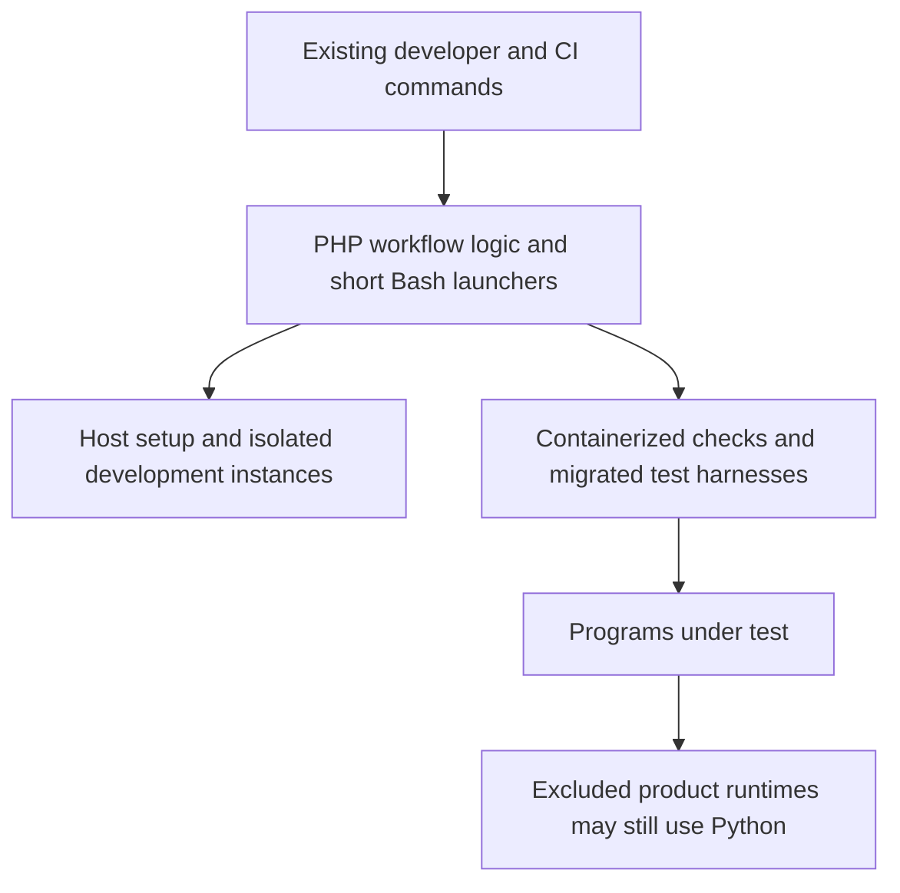
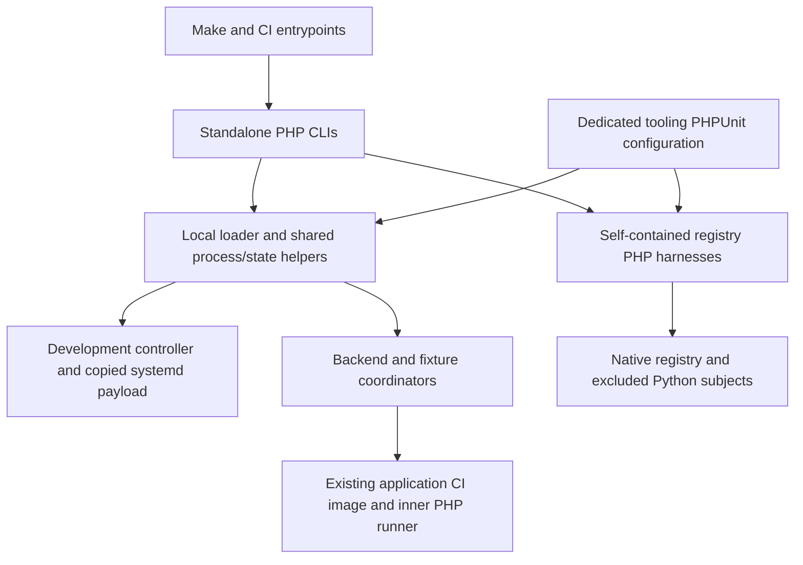
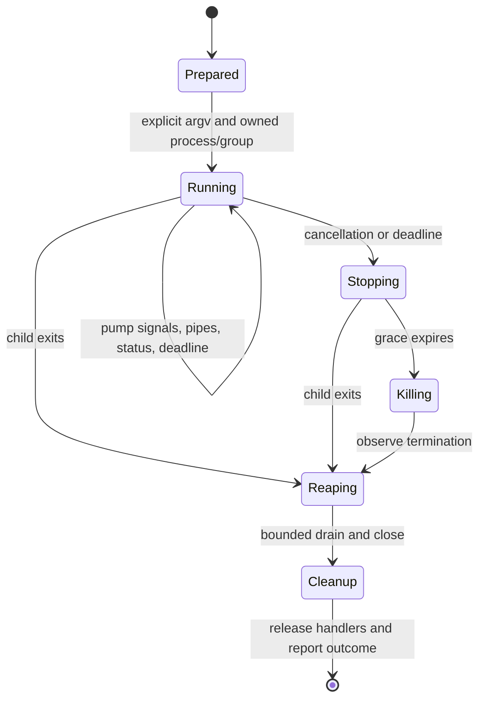
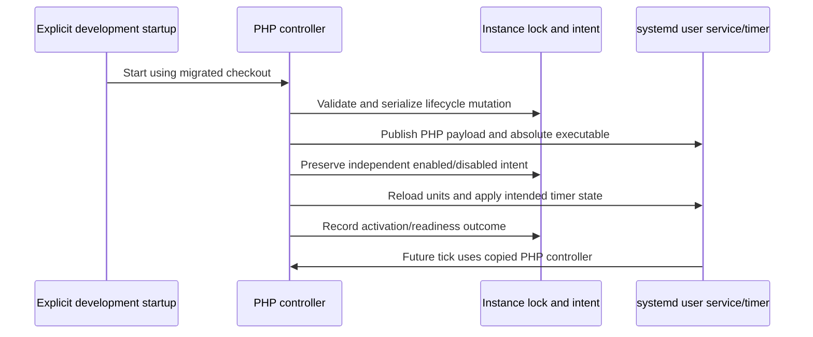

# PHP-first Development Tooling - Plan

## Goal Capsule

- **Objective:** Contributors can maintain and run Baander's testing and development workflows without repository-owned Python tooling.
- **Means:** Standalone PHP tooling with short Bash launchers (KTD1, KTD2).
- **Product authority:** The confirmed scope in this Product Contract governs the migration; shipped backup and operator implementations remain outside it.
- **Open blockers:** None. U1 verifies the native process and filesystem mechanisms before dependent migrations proceed.
- **Execution profile:** Characterize existing behavior, migrate by owned workflow, and retire each replaced Python path with its callers.
- **Delivery:** Implementation lands as local commits on a branch named after this plan; the lead owns integration, checks, and commits, and pushes only when asked.

---

## Product Contract

### Summary

Consolidate repository-owned testing and development tooling in PHP, with Bash as the secondary language.
Remove Python from the workflow implementations and their tests while preserving the existing development and verification behavior.

### Problem Frame

Contributors currently maintain related workflows across Python, PHP, and Bash.
Make delegates local development and containerized static-check orchestration to Python, while the application console and backend test runner already use PHP.
Python also appears inside shell scripts, test fixtures, CI commands, registry test harnesses, and DSP development commands.
Replacing only the top-level launchers would leave the same maintenance split underneath them.

### Key Decisions

- **Complete removal within the selected scope.** Governs R1. (session-settled: user-directed — chosen over justified Python exceptions: eliminate Python from these workflows.)
- **Workflow scope rather than product migration.** Governs R3. (session-settled: user-directed — chosen over repository-wide product and operator rewrites: keep this change limited to testing and development.)
- **PHP host baseline and independent bootstrap.** Governs R4, R5. (session-settled: user-approved — chosen over retaining the existing Python host controller: align development tooling with PHP.)
- **Preserve the command workflow.** Governs R6, R7, R8, R9. (session-settled: user-approved — chosen over a command or environment redesign: consolidate languages without changing the development workflow.)

### Requirements

**Language and scope**

- R1. Remove repository-owned Python implementations, embedded snippets, fixtures, and test harnesses from testing and development workflows, including the tests of those tools.
- R2. Implement workflow logic in PHP and retain Bash for short launchers and straightforward shell operations; existing JavaScript/TypeScript ecosystem tooling is outside this language migration.
- R3. Preserve shipped backup and operator implementations and third-party toolchain internals, even when an in-scope test exercises them.

**Host and bootstrap**

- R4. Require PHP 8.5+ with Swoole on the host and report an unmet baseline before a workflow starts changing host or instance state.
- R5. Keep initial host setup usable before application dependencies and services are ready; the availability of the application's `bin/console` must not be a bootstrap prerequisite.

**Behavior preservation**

- R6. Preserve the documented Make command surface, instance targeting, argument handling, exit outcomes, and diagnostic information used by developers and CI.
- R7. Preserve persistent development instance and worktree preview isolation, retained local data, automatic update behavior, and preview worker snapshot behavior defined in the [development environment guide](../../docs-book/part-2-developer-guide/development-environment.md).
- R8. Preserve containerized authoritative checks, disposable test isolation, and test-result, coverage, and diagnostic artifacts defined in the [testing guide](../../docs-book/part-2-developer-guide/testing.md).
- R9. Preserve workflow process behavior, including cancellation, signal handling, locking, timeouts, child failure propagation, and cleanup of owned resources.

**Coverage and completion**

- R10. Cover local development orchestration, backend checks, worker drills, registry test and qualification harnesses, DSP development commands, documentation helpers, and shared workflow helpers used by those paths.
- R11. Update the associated CI commands, Make/CMake invocations, environment setup, and active documentation to use the migrated tooling.
- R12. Remove Python dependency declarations used solely by migrated tooling, retaining dependencies needed by the excluded components in R3.
- R13. Preserve meaningful behavioral coverage when migrating tooling tests and verify the in-scope workflow code without a Python interpreter available to that code; excluded programs under test may retain their runtime dependencies.

### Scope Boundaries

R1 and R10 include code wherever it is stored, not only files under `scripts/`.
The repository-owned prose audit under `.agents/`, Python embedded in Bash, and development HTTP servers in DSP Makefiles are included.
Shared inventory and build helpers used by the selected workflows are included as tooling; their packaged outputs remain subject to R6 and R8 where consumed by those workflows.

R3 excludes rewriting the registry backup service and enrollment issuer, changing their protocols, or replacing upstream compiler and build-tool implementations.
A test harness is included even when its subject is an excluded Python program.
The migration therefore does not promise that every container image or every process launched during a test is Python-free.

R2 does not authorize replacing frontend test runners, browser automation, or other existing JavaScript/TypeScript tooling with PHP.
The host baseline does not move containerized application checks onto the host or require Swoole concurrency in every helper.
Database architecture, application features, and the command organization of `bin/console` are outside scope.

The diagram illustrates R2–R8: changing the orchestration language preserves the distinction between host tooling, containerized checks, and programs under test.

### Acceptance Examples

- AE1. **Covers R4, R5.** On a fresh checkout with PHP 8.5+ and Swoole but no application vendor directory, initial host setup can perform its own work without booting the application console; an unmet PHP baseline is reported before state changes.
- AE2. **Covers R6, R7.** Starting, refreshing, stopping, and resuming a worktree preview through Make retains its state and worker snapshot semantics without changing the persistent instance or another preview.
- AE3. **Covers R6, R8, R9.** A failing or interrupted containerized check returns the corresponding failure outcome, retains its diagnostic evidence, and cleans up only its owned disposable resources.
- AE4. **Covers R1, R10, R13.** A worker drill that formerly parsed JSON through inline Python performs the same assertions through migrated tooling, including its failure cases, without invoking Python for the harness.
- AE5. **Covers R3, R10, R13.** A migrated registry test harness can exercise the unchanged Python backup service or enrollment issuer; the subject's Python runtime does not excuse Python in the harness itself.
- AE6. **Covers R1, R2, R10–R12.** DSP development commands and the repository prose audit run through their PHP/Bash replacements, and their active instructions no longer direct contributors to the removed Python helpers.

### Success Criteria

The migration's completion evidence accounts for every repository-owned Python call site in the selected workflows, including embedded invocations and shared helpers.
Each remaining Python reference has an identified excluded owner or is historical documentation; unexplained active workflow references prevent completion.
Behavioral verification covers bootstrap, local environment lifecycle, workflow failures, and each affected test family, with suite counts and static-gate outcomes recorded in `ROADMAP.md`.

### Dependencies and Assumptions

The supported host remains the Linux environment described in the development guide, with its existing Docker and system integration requirements plus R4.
The exact PHP/Swoole packaging for CI and helper containers is an implementation decision.
Python package installations in the PostgreSQL, FFmpeg, application, and runner images have not been fully classified by consumer; package presence alone does not establish eligibility for removal under R12.

### Planning Questions

Bootstrap and dependency loading are resolved by KTD1 and KTD5; shared helper ownership by KTD6; runtime placement by KTD4; migration sequencing and behavioral verification by KTD7–KTD9 and U1–U8.
Execution-time checks are listed under Planning Contract / Open Questions.

### Sources and Research

Source inspection establishes the following starting points; it does not establish runtime parity for the proposed migration.

| Source | Planning relevance |
| --- | --- |
| `Makefile:2`, `Makefile:5`, `Makefile:61` | Python development/static-check wrappers and command argument handling. |
| `bin/console:7`, `scripts/backend-test-runner.php:1` | Application bootstrap dependencies and an existing PHP orchestration example. |
| `scripts/dev_environment/`, `scripts/tests/`, `tests/Fixtures/` | Development lifecycle, tooling tests, and Python fixtures. |
| `.forgejo/workflows/ci.yaml:217`, `relay/CMakeLists.txt:50` | CI invocations and Python required by registry test enrollment. |
| `packages/dsp/dynamics_meter/Makefile:25` and sibling DSP Makefiles | Python development HTTP-server commands. |
| `.agents/skills/prose-fix/SKILL.md:69` | Repository-owned Python documentation audit. |
| `relay/docker/backup.Dockerfile:33`, `relay/README.md:361` | Shipped backup entrypoint and documented enrollment operator command excluded by R3. |
| `relay/docker/Dockerfile:24`, `relay/docker/rqlite.Dockerfile:32` | Shared inventory helpers with packaging consumers. |
| `docker/postgres/Dockerfile:36`, `docker/ffmpeg/Dockerfile:1` | Python installations requiring consumer classification. |
| [Local development workflow plan](2026-10-26-1949-feat-local-development-workflow-plan.md) | Established command and environment contracts; this migration replaces its Python implementation choice. |

---

## Planning Contract

**Product Contract preservation:** Requirements R1–R13 and acceptance examples AE1–AE6 are unchanged; decision ownership links were made explicit and planning questions were resolved without changing scope.

### Key Technical Decisions

- KTD1. **Keep workflow code outside the application kernel.** Create a small `Baander\Tooling` library under `packages/baander-tooling/src/`, published locally as the `baander/tooling` Composer package, with standalone `.php` entrypoints replacing the current `.py` commands. The root and `scripts/composer.json` manifests require the library through local path repositories. Composer generates both loaders; the scripts installation has no external package, Symfony, Dotenv, database, or application-container dependency; `bin/console` retains its application role. This implements R2, R4, R5 without introducing a second application console framework. (session-settled: user-approved — the later user direction requires Composer loading, modern PHP 8.5 syntax with pipes for nested transformations, reproducible formatting, and library placement under `packages/`; setup remains usable before application dependencies exist.)

- KTD2. **Own process execution explicitly.** A shared runner accepts argv arrays, cwd, an explicit environment, stream disposition, and an optional deadline; callers receive exit, signal, timeout, or cancellation outcomes mapped to their existing CLI contracts under R6 and R9. Use native `proc_open` with nonblocking pipes and a locally owned Swoole reactor/timer to service signals, output, stdin, and monotonic deadlines; do not enable global coroutine hooks. Close/reap only after observing completion, bound inherited-pipe draining, and remove every owned timer/handler. Captured logs stream to files; interactive commands inherit terminal descriptors and retain their existing unbounded mode. [PHP process documentation](https://www.php.net/manual/en/function.proc-open.php) and [Swoole signal documentation](https://raw.githubusercontent.com/swoole/docs/master/public/en/process/process.md) support this combination, whose integration is verified in U1.

- KTD3. **Preserve OS ownership and durable state.** Retain state paths, JSON shapes, modes, instance identities, lockfiles, Docker target pinning, and updater intent under R7 and R9. Use same-directory temporary files, checked file synchronization, atomic rename, and checked parent-directory synchronization; U1 proves the Linux directory-sync mechanism rather than assuming file-only fsync is equivalent. Retain symlink/containment checks. For commands that currently own process groups, use a narrow Bash/Linux `setsid` launcher with a verified owned group identity; the PHP runner signals that group through Swoole and reaps its direct child. Docker resources still require explicit Docker cleanup because killing a client does not stop its containers. No new host dependency on `pcntl` or `posix` is introduced. The [filesystem reference](https://www.php.net/manual/en/function.fsync.php) and [shutdown learning](../solutions/runtime-errors/swoole-sigterm-waits-for-master-timers-and-closes-connections-before-workers-stop.md) inform the durability and external-observation gates.

- KTD4. **Provision PHP where each command executes.** The host uses R4; command-specific parser/archive extensions are checked only by tools that need them. Add pinned, checksum-verified PHP 8.5 and compatible Swoole builds to the existing Debian trixie CI runner rather than switching its distro or copying binaries across incompatible runtime libraries. Use the repository's PHP 8.5.2 and Swoole 6.2.0 versions as the initial aligned pins, verifying release artifacts during implementation. CI tooling includes DOM/XML, archive support, and a real YAML parser built for that PHP. The registry static-check command uses ext-yaml and declares that prerequisite; base host setup does not need it. Test-only nginx and backup images receive suitable PHP runtimes; shipped images do not gain PHP merely to run tests or produce inventory. The execution-location table below owns the placement details.

- KTD5. **Reuse PHPUnit for tooling tests.** Add `phpunit-tooling.xml.dist` with a test bootstrap that loads the root Composer dependencies, including PHPUnit and the local tooling package, without `tests/bootstrap.php`, Dotenv, or the kernel. Separate harness-only tests from excluded-subject tests so the former can run without Python and the latter require explicit subject executables; neither group is silently skipped. Use the existing CI image's PHPUnit dependency; a separate tooling PHPStan configuration covers the new library, entrypoints, and tests without the application's container loaders. Registry CLI contract drivers remain standalone PHP under `relay/tests/`, with their shared support local to that build context; their unit tests join the tooling suite, but disposable qualification images do not need PHPUnit. This satisfies R8 and R13 without inventing a test framework or requiring application dependencies for host setup.

- KTD6. **Port helpers according to their existing contracts.** Preserve the distinct application and registry inventory formats, canonical JSON, hashes, artifact locations, and archive defenses; do not merge their implementations merely because both are named packaged inventory. PHP implementations under `relay/` remain self-contained when Docker builds use the `relay/` context. Replace shlex-dependent command splitting with a narrowly tested POSIX-word tokenizer that performs no expansion or evaluation; retain literal argv mode and the existing explicitly requested shell mode. Shell entrypoints retain simple command forwarding, linear build recipes and traps; move their substantive state, retry, timing, parsing, coordination and assertion logic into PHP, including logic currently written entirely in Bash, under R1, R2, R6, and R10.

- KTD7. **Treat excluded Python programs as test subjects.** Replace direct Python imports with PHP-driven calls to the unchanged enrollment and backup CLIs, using PHP fake external commands and independent HMAC/status/artifact oracles. Cover CLI-reachable invalid input and timing boundaries rather than reproducing private functions in PHP; retain the enrollment known vector as an oracle self-check. No Python import bridge, inline program, or generated Python fixture is allowed. For backup cadence, add a separate real-time contract bounded at 900 seconds: observe the immediate attempt, suspend the subject during controlled capture, resume near 360 seconds, observe deadline failure and missed-tick reporting, and verify the next attempt near the original 600-second tick without a catch-up burst. Keep the current encrypted/recovery contract's 300-second bound; both checks are mandatory. Increase `registry-container-quality` from 30 to 45 minutes to accommodate the extra bound. This preserves meaningful coverage under R3 and R13 without adding a clock-injection feature to shipped code.

- KTD8. **Migrate each caller with its implementation.** Land units in dependency order, keeping intermediate command families usable; delete a replaced Python path when its callers and tests move, with no compatibility wrapper. Development controller publication includes the copied systemd payload and absolute PHP executable as one coordinated replacement under the existing lifecycle lock, preserving enabled/disabled intent. The migration is exercised against disposable state and fake or isolated systemd services; deployment to the user's persistent instance is not part of agent verification. This implements R1, R7, R11 while protecting existing local data.

- KTD9. **Prove removal at the code boundary.** Maintain a small reviewed inventory of active Python call sites during the migration, including generated code and shell heredocs, with each entry assigned to an owning unit or an R3 exclusion. At completion, run harness-only paths in an environment without Python, and run excluded subjects in separate qualified environments with explicit subject executable paths. Account separately for upstream Emscripten/Meson and other toolchain internals. Keep the caller audit and a focused regression check for forbidden workflow invocations; do not ban Python globally or rename scripts while retaining their interpreter. R12 package removals follow this consumer inventory.

### Execution Locations

| Location | PHP placement and integration |
| --- | --- |
| Developer host | Standalone entrypoints and local loader; core PHP/Swoole process support, existing Linux tools, and per-command extension diagnostics. No host vendor requirement for initial setup. |
| Forgejo `docker-cli` runner | Build PHP/Swoole against its existing trixie libraries, preserving Docker, C++, Java, Node, and Emscripten tools; add XML/archive/YAML support for workflow parsers. Pin and verify new build sources. |
| Application CI/dev/worker images | Reuse their PHP runtime and copy the needed helpers; keep Swoole-disabled application test children independent of the coordinator's baseline. Tooling PHPUnit runs in the CI image. |
| PostgreSQL capacity sampler | Run the PHP observer from the existing PHP controller/fixture environment against the disposable PostgreSQL endpoint; preserve cadence, measurements, identity, and readiness artifacts without adding PHP to the database image. |
| nginx test image | Replace its Python socket/echo fixture with a PHP stream-based fixture and provide PHP 8.5 CLI in `docker/nginx/Dockerfile.test`; keep it inside the same test network/namespace. Production nginx is unaffected. |
| Registry CTest and static checks | Resolve PHP for harnesses under `BUILD_TESTING`; keep Python discovery only for the explicitly excluded enrollment subject. YAML diagnostics use ext-yaml in the qualified tooling environment. |
| Registry build and inventory stages | Run PHP evidence capture and inventory generation in build-only stages with runtimes built for their base image; copy only generated inventory into final API/rqlite/backup images. |
| Backup qualification image | Derive a test-only image with PHP and the original Python backup subject and external tools; retain read-only/network-none/tmpfs restrictions and the unprivileged user. |

The runtime packages in this table are implementation dependencies for the named commands, not additional prerequisites for the host-setup path in R5.

### High-Level Technical Design

The runtime graph keeps application startup outside the host tooling dependency chain (KTD1, KTD4, KTD5).

The process lifecycle owns cancellation, escalation, output, and cleanup explicitly (KTD2, KTD3).

Copied-controller cutover follows the existing mutation and intent boundaries (KTD8); tests observe both the installed command and persisted intent.

### Sequencing and Ownership

U1 establishes the shared loader, process boundary, test configuration, and CI runtime.
U2 and U3 complete the host controller; U4 then reuses its snapshot and Docker adapters.
U5–U7 own separate helper and harness families after U1, and U8 completes the remaining developer tools and full inventory reconciliation.
The lead serializes edits to Dockerfiles, CI workflows, Make/CMake, shared configurations, guides, and this plan's roadmap checkpoint; workers own only their assigned code and tests and do not stage or commit.
Run simplification at the foundation, migrated-workflow, and final-integration boundaries; independent code review follows authoritative checks.

### Risks and Decisions

- **A signal handler without an active reactor will not preserve cancellation.** KTD2 requires an explicit pump, including silent-child and inherited-terminal cases; no application server or global coroutine machinery is introduced.
- **Existing local state and copied timers outlive the worktree.** KTD3 and KTD8 preserve their formats and ownership; no reset, automatic data conversion, or parallel legacy controller is planned.
- **Product code excluded from the migration still needs Python.** KTD7 and KTD9 make that dependency observable without relaxing harness removal; only the supported CLI behavior is asserted, not private-function parity.
- **Real-time cadence verification adds execution time.** KTD7 accepts that bounded cost instead of changing production scheduling or adding a clock-interposition dependency.
- **Parser and inventory ports can weaken validation.** KTD4 and KTD6 retain real XML/YAML/archive parsers, independent oracles, and malformed-input tests; no regex YAML parser or alternate inventory format is planned.
- **Installed Python does not identify its consumer.** Under KTD9, retain PostgreSQL PL/Python and FFmpeg/upstream build dependencies unless the affected-consumer audit proves they serve only migrated tooling; no database feature removal is inferred.

### Open Questions

**Deferred to Implementation**

- U1 must prove directory synchronization, process-group identity, signal delivery, and pipe behavior on the supported Linux PHP/Swoole baseline; a failure stops dependent units for a design correction, not a silent guarantee reduction.
- Resolve release checksums and compatible build recipes for the runner and test-only PHP runtimes from their official sources, then record the pins; this plan does not invent unverified hashes.
- Measure cadence-test scheduling tolerance on the CI runner while retaining the observable distinction between the original 600-second tick and resume-plus-300 scheduling under KTD7.
- Complete the package consumer audit under KTD9 before removing image-level Python declarations; unresolved consumers remain classified exclusions with evidence, never presumed unused.

---

## Implementation Units

### U1. Establish the standalone tooling foundation and execution runtime

**Goal:** Provide the shared PHP bootstrap, process runner, and independent test environment needed by the migration.
**Requirements:** R2, R4, R5, R9, R13; AE1, AE3; KTD1–KTD5.
**Dependencies:** None.
**Files:** Create `scripts/bootstrap.php`, `scripts/composer.json`, `scripts/composer.lock`, `packages/baander-tooling/composer.json`, `packages/baander-tooling/src/Runtime/`, `packages/baander-tooling/src/Process/`, `packages/baander-tooling/src/Filesystem/`, `packages/baander-tooling/src/CommandLine/`, `packages/baander-tooling/resources/process-group.sh`, `scripts/tests/php/bootstrap.php`, `scripts/tests/php/RuntimeTest.php`, `ProcessRunnerTest.php`, `AtomicFileTest.php`, `CommandWordsTest.php`, `phpunit-tooling.xml.dist`, and `phpstan-tooling.neon`. Update `docker/runner/Dockerfile` and the tooling test hooks in `.forgejo/workflows/ci.yaml`; keep PHP build recipes under `docker/runner/`.
**Approach:** Implement KTD1–KTD5 with small interfaces for real and fake process/filesystem operations; keep the runner usable by multiple coordinators without a general task framework. Add a real parser for command words and runtime preflight checks before any write. Document which entrypoints require Swoole and which leaf helpers use core PHP only. CI provisions its PHP runtime before switching any migrated command to it.
**Execution note:** Establish failure-oriented characterization fixtures before porting their consumers; do not start dependent units until real process and durability checks pass.
**Test scenarios:** Missing/old PHP or absent Swoole produces a clear failure before state changes; a checkout with only scripts Composer dependencies can run host preflight before application dependencies are installed. Literal spaces, empty arguments, quotes, dollar signs, semicolons and newlines round-trip without evaluation, while malformed quoting fails. Concurrent stdout/stderr and partial stdin do not deadlock; a silent child, a child with descendants, inherited pipe writers, nonzero exit, SIGINT, SIGTERM and deadline expiry preserve the expected outcome and bounded cleanup. Atomic write failures, corrupt JSON, symlinks and lock contention preserve existing content and release ownership.
**Verification:** Dedicated tooling PHPUnit and PHPStan pass in the CI image; process tests use real disposable children and verify no survivors. Prove the core/bootstrap path with no application vendor and no optional `pcntl`/`posix` extensions.

### U2. Port development identity, host setup, and supervision

**Goal:** Replace host configuration and installed-controller ownership while preserving existing state.
**Requirements:** R1, R4–R7, R9–R11, R13; AE1, AE2; KTD1–KTD3, KTD6, KTD8.
**Dependencies:** U1.
**Files:** Create PHP counterparts under `packages/baander-tooling/src/Development/` for `model.py`, `process.py`, `host.py`, and `supervisor.py`. Port `scripts/tests/test_dev_environment_state.py`, `test_dev_environment_host.py`, and supervision cases from `test_dev_environment_activation.py` to `scripts/tests/php/DevelopmentStateTest.php`, `DevelopmentHostTest.php`, and `DevelopmentSupervisorTest.php`.
**Approach:** Preserve XDG roots and instance records, separate updater intent, Docker daemon identity and environment filtering. Replace the copied-controller publication and systemd executable/payload together under KTD8. Keep unused public Python callers until U3 switches the complete controller; remove internal Python modules with that cutover rather than exposing a half-ported CLI.
**Test scenarios:** Reopen saved state with identical instance IDs, keys and data paths; a missing preview never selects persistent state. Reject mismatched/corrupt records and symlink escapes. Verify explicit SELinux paths exclude the private CA, privileged-port refusal precedes mutation, and generated credentials remain private. Under temporary XDG roots and fake systemctl, replace the copied Python controller with PHP, preserve disabled intent, and prove stopping the timer does not terminate an active mutation.
**Verification:** Focused tooling suite verifies record equality and supervisor races; no real persistent instance or user timer is modified.

### U3. Port development lifecycle and switch its public entrypoints

**Goal:** Run complete setup, activation, updates, recovery, and preview acceptance through PHP.
**Requirements:** R1, R4–R7, R9–R11, R13; AE1, AE2; KTD1–KTD3, KTD6, KTD8.
**Dependencies:** U2.
**Files:** Create `scripts/dev-environment.php`, PHP `Development/` counterparts of `cli.py`, `build.py`, `bootstrap.py`, `database.py`, `runtime.py`, `workers.py`, and `updater.py`, plus `scripts/dev_environment_acceptance.php` and `scripts/dev_environment_media_probe.php`. Replace the remaining `scripts/tests/test_dev_environment_*.py` with `scripts/tests/php/Development*Test.php`, including `DevelopmentCliTest.php`, `DevelopmentUpdatesTest.php`, `DevelopmentBootstrapTest.php`, and `DevelopmentWorkersTest.php`; port `test_two_command_browser_cleanup.py`. Update Make, `scripts/test-dev-*.sh`, controller build-copy manifests and the development guide; remove `scripts/dev-environment.py` and `scripts/dev_environment/` after all callers switch.
**Approach:** Keep existing release-preparation, migration-checkpoint, writer-stop, activation, readiness and blocked-recovery semantics; port orchestration without changing SQL or database architecture. Preserve Docker archive transport for remote daemons, immutable worker snapshots, source-media containment, and safe argv forwarding. Keep browser `.mjs` probes unchanged and migrate their orchestration.
**Test scenarios:** Failed fetch/build leaves the prior runtime serving; disabled intent during preparation prevents activation; a later merge catches up; interrupted or uncertain migrations retain evidence and refuse unsafe replay. Fresh and repeated startup retain identity; two previews remain isolated; worker refresh reports the actual snapshot. Browser failure and cancellation clean up owned children/resources and retain diagnostics.
**Verification:** Tooling lifecycle tests plus disposable `test-dev-*` drills and isolated acceptance pass; refresh the worktree preview through `make preview-up`, and pass its explicit URL as `E2E_BASE_URL` for relevant browser checks. Persistent lifecycle coverage uses disposable qualification state, never the user's persistent checkout.

### U4. Port backend coordination and result validation

**Goal:** Replace outer backend test and static-check Python while retaining the inner PHP runner and artifacts.
**Requirements:** R1, R6, R8–R11, R13; AE3; KTD2, KTD5, KTD6, KTD9.
**Dependencies:** U1, U3 for shared development snapshot and Docker adapters.
**Files:** Replace `scripts/test-backend-container.py`, `check-backend-container.py`, `test-backend-stack-isolation.py`, `compare-backend-runs.py`, and `validate-backend-coverage.py` with same-stem `.php` entrypoints and `packages/baander-tooling/src/Backend/` helpers. Port `scripts/tests/test_backend_*.py` to `scripts/tests/php/BackendCoordinatorTest.php`, `BackendComparisonTest.php`, and `BackendCoverageTest.php`; update `scripts/test-backend-container.sh`, Make and CI invocations.
**Approach:** Retain the ordinary/native/service lane contract, process-count range, seeds and timeouts. Keep `scripts/backend-test-runner.php` as the inner discover/run/finalize authority. Preserve all report paths and staging publication, stack-isolation result schema, archive-based static checks, unprivileged check execution, and Swoole-disabled child qualification.
**Test scenarios:** Reject invalid worker counts and incompatible report arguments; propagate discovery, lane and finalization failures; verify service stacks do not share database/Redis/socket state. Compare only equivalent completed test identities/seeds/coverage denominators; reject metric discrepancies beyond the current tolerance. Timeout/cancellation retains logs, performs final inventory and identifies cleanup failures without hiding the original failure.
**Verification:** Tooling coordinator/report tests, disposable stack-isolation drill, static-check wrapper qualification and representative ordinary/native/service lanes pass with unchanged artifact consumers.

### U5. Port application and registry inventory tooling

**Goal:** Remove Python from shared build evidence and packaged-inventory workflows without changing their evidence contracts.
**Requirements:** R1–R3, R6, R8–R13; KTD4–KTD6, KTD9.
**Dependencies:** U1.
**Files:** Replace `scripts/packaged_inventory.py`, `relay/tools/packaged_inventory.py`, and `relay/tools/verify_packaged_image.py` with `.php` counterparts. Port `scripts/tests/test_packaged_inventory.py`, `test_retain_build_evidence.py`, and `relay/tests/test_packaged_inventory.py` to `scripts/tests/php/ApplicationInventoryTest.php`, `RetainBuildEvidenceTest.php`, and `RegistryInventoryTest.php`. Update `scripts/collect-packaged-inventory.sh`, registry inventory callers, `relay/docker/{Dockerfile,rqlite.Dockerfile,backup.Dockerfile}`, and affected build-evidence consumers.
**Approach:** Follow KTD6 with separate schemas and deterministic serialization. Preserve source/link/map evidence, licenses, revision/image binding, receipt paths and failure evidence. Safe archive extraction validates entry types, normalized destinations, link targets, and existing destination symlinks before materializing entries; do not delegate unchecked extraction to a shell command. PHP exists only in build/test stages that need it.
**Test scenarios:** Golden fixtures retain expected hashes and JSON shapes; wrong revisions, unresolved components, missing licenses, modified executables and malformed archives fail. Absolute/traversal paths, escaping links and symlink-parent replacement cannot write outside the owned root. Verification of an immutable image retains its receipt and removes its stopped inspection container on failure.
**Verification:** Both inventory suites and retained-build-evidence tests pass, including the separate CI-image evidence check. Generate and verify inventory for application production/worker and registry API/rqlite/backup test builds; final runtime contents change only where the audited tooling dependency removal requires it.

### U6. Port network fixtures, worker assertions, and shell-embedded Python

**Goal:** Keep runtime drills behaviorally equivalent with PHP fixtures and assertions.
**Requirements:** R1–R3, R6, R8–R13; AE3, AE4; KTD2, KTD4–KTD6, KTD9.
**Dependencies:** U1, U4.
**Files:** Replace Python under `tests/Fixtures/Http/` and `tests/Fixtures/Worker/` with same-stem PHP helpers; add `scripts/tests/php/HttpFixtureTest.php`, `WorkerFixtureTest.php`, and `WorkerCleanupTest.php`. Update affected `scripts/test-worker-*.sh`, `scripts/test-websocket-proxy-logs.sh`, `scripts/test-docker-context.sh`, other runtime drill call sites, `tests/Fixtures/Worker/lifecycle-checkpoint.sh`, and `docker/nginx/Dockerfile.test`.
**Approach:** Extract JSON transformations and assertions into named PHP helpers instead of large shell-embedded PHP programs. Preserve DNS wire behavior, echo/WebSocket behavior, capacities, readiness and timing records. Move the PostgreSQL sampler to its PHP controller environment per the execution-location table, retaining its disposable DB target and measurement semantics. Generated test stubs become PHP or short Bash executables.
**Test scenarios:** DNS rejection and orphan cleanup, proxy handshake/log behavior, malformed worker status, capacity exhaustion, stale/changed boots, disappeared resources, and interrupted cleanup produce the same verdicts and receipts. A sampler starts and reports ready against the intended disposable DB only; its interval and recorded metrics remain equivalent. Negative controls still fail rather than merely producing parseable JSON.
**Verification:** Fixture tests and the affected worker, proxy, Docker-context and shutdown drills pass; each disposable drill records restored resource ownership and retained failure evidence.

### U7. Port registry qualification and excluded-product test harnesses

**Goal:** Run registry qualification through PHP while leaving shipped Python programs intact.
**Requirements:** R1–R3, R6, R8–R13; AE3, AE5; KTD4–KTD7, KTD9.
**Dependencies:** U1, U5.
**Files:** Replace `relay/tests/*.py` with standalone `.php` contract drivers and `relay/tests/Support/`; add tooling tests `scripts/tests/php/RegistryQualificationTest.php`, `RegistryCleanupTest.php`, `EnrollmentIssuerTest.php`, and `BackupContractTest.php`. Create `relay/tests/run_backup_fault_contract.php` and `run_backup_cadence_contract.php` for the standalone disposable gates; update `relay/CMakeLists.txt`, `scripts/test-registry*.sh`, `.forgejo/workflows/ci.yaml`, `.forgejo/workflows/registry-nightly.yaml`, and test-only backup image construction. `relay/backup/registry_backup.py` and `relay/tools/issue_enrollment.py` remain unchanged.
**Approach:** Port HTTP/storage/transport/cluster/load/restore/rqlite contracts, observer and enrollment support, TSAN verification, orchestration stubs, and real YAML diagnostics parsing. Convert imported-product tests according to KTD7, including the separate cadence gate and job budget. Resolve PHP only for testing in CMake and retain an explicit subject Python path for enrollment tests; no general Python harness discovery remains.
**Test scenarios:** Invalid enrollment keys/TTL and HMAC mismatch fail without exposing secrets. Backup authentication/content/header/encryption/upload/deadline errors retain prior success, reap fake children, and leave no plaintext spool. Health cases use bounded wall-time margins; cadence verifies missed ticks without a burst. Qualification cancellation removes owned storage/cluster processes, retains diagnostics, and preserves the failing gate's status. YAML parser controls reject real blocking diagnostics and accept the documented third-party exclusions.
**Verification:** Tooling registry tests, CTest, static checks with negative controls, release/sanitizer/thread/fuzz paths, container and encrypted-backup/restore qualification pass; cadence completes within its separate bound. The native C++ tests and excluded product bytes remain unchanged.

### U8. Finish developer helpers, dependency retirement, and integrated acceptance

**Goal:** Close the remaining Python call sites and prove the whole agreed scope is migrated.
**Requirements:** R1–R13; AE1–AE6; KTD4–KTD9.
**Dependencies:** U3–U7.
**Files:** Replace `.agents/skills/prose-fix/scripts/audit_rewrite.py` with `.php` and update its `SKILL.md`; update the six affected `packages/dsp/*/Makefile` development servers. Add `scripts/tests/php/DeveloperHelpersTest.php` and `PythonBoundaryTest.php`; update remaining CI/Make/CMake/image consumers, `docs-book/part-2-developer-guide/{development-environment,testing}.md`, `relay/README.md`, active packaged-inventory guides, and `ROADMAP.md`.
**Approach:** Use PHP's development HTTP server for the DSP roots/ports and preserve the prose audit's report-only exit behavior and counts. Finish the KTD9 call-site inventory, remove only proven tooling-only Python packages, and remove obsolete test discovery/instructions. Keep historical plans/checkpoints accurate. Add the dedicated tooling/static gates to the normal CI path and qualify every execution location from the matrix.
**Test scenarios:** DSP servers serve the expected assets from the original directory and report occupied-port failures. Prose audit fixtures preserve backtick/number/normative/structure deltas and its zero exit convention. Boundary checks catch inline, generated, and renamed Python harnesses while allowing only identified product/toolchain consumers. Missing runtime/parser dependencies fail with a command-specific diagnostic before the affected operation.
**Verification:** All gates below pass on the integrated tree, including no-Python harness checks and separate excluded-subject checks; source audit accounts for every remaining active Python reference. Update the roadmap with actual suite counts, static outcomes and any remaining acceptance limits.

---

## Verification Contract

Implementation records fresh counts and outcomes; the historical Python suite counts are reference evidence, not acceptance for the PHP port.
Application and tooling suites remain separate so tooling tests cannot silently fall into database-backed application lanes.

| Gate | Required evidence |
| --- | --- |
| Tooling unit/contract suite | Existing CI image runs PHPUnit with `phpunit-tooling.xml.dist`; all migrated behavior tests and negative controls pass, with counts and skipped cases reported explicitly. |
| Tooling static analysis | Dedicated `phpstan-tooling.neon` passes on new runtime, fixtures, entrypoints and tests without loading the app kernel. PHP syntax and Bash syntax checks cover touched executables. |
| Bootstrap and OS boundaries | No-vendor startup and unmet-baseline cases pass before side effects; real process-group/signal/pipe/timeout and durable-state tests pass without `pcntl`/`posix`. |
| Development lifecycle | Disposable `test-dev-*` and acceptance harnesses cover fresh/repeated startup, copied timer cutover, update failure, stop/resume, recovery, preview isolation and retained data; actual worktree browser checks use `make preview-url` explicitly. |
| Backend integration | `make ci` retains Composer validation, PHPStan, Deptrac and all backend lanes; stack-isolation, report-equivalence and Swoole-disabled-child controls pass. |
| Runtime fixtures | Affected worker, HTTP/DNS/proxy, source/production and shutdown drills retain their assertions, negative controls, artifacts and cleanup inventory. |
| Registry qualification | CTest, static diagnostics, release/sanitize/thread/fuzz, container and backup/restore gates retain their contracts; the 900-second cadence gate is additional to the unchanged 300-second fast backup gate. |
| Inventory | Application and registry inventory generation/verification, adversarial extraction tests and retained-build-evidence checks pass against their respective schemas and immutable test images. |
| Python boundary | Harness-only jobs run without Python; mixed subject/toolchain jobs use explicit classified dependencies, and source/caller checks find no workflow-owned Python. |
| Documentation and review | Changed links resolve, prose audits and whitespace checks pass; simplification and independent code review findings are resolved or reported before completion. |

Run expensive Docker suites serially and retain logs under their existing artifact locations.
Mock HTTP/DNS or use disposable local services with `baander.app` fixtures; isolated local application browser checks retain the documented `.test` exception.
Capture before/after resources and data fingerprints for lifecycle checks, and never reset user data to obtain a passing result.

---

## Definition of Done

- All eight units satisfy their traced requirements and verification outcomes; no in-scope Python entrypoint, module, fixture, generated program, or test harness remains.
- Every execution location has its PHP runtime and declared parser dependencies, with no accidental PHP addition to excluded shipped components.
- The verification contract passes on the integrated tree, with separate evidence for tooling, application, registry, and excluded Python subjects.
- The shipped backup and enrollment implementations remain byte-identical, existing local state stays usable, and agent verification leaves the persistent instance untouched.
- Active instructions use the new tooling, remaining Python dependencies have evidence-backed ownership, and `ROADMAP.md` records scope and measured acceptance.
- Local commits, simplification and independent code review are complete; pushing remains subject to the user's instruction.
